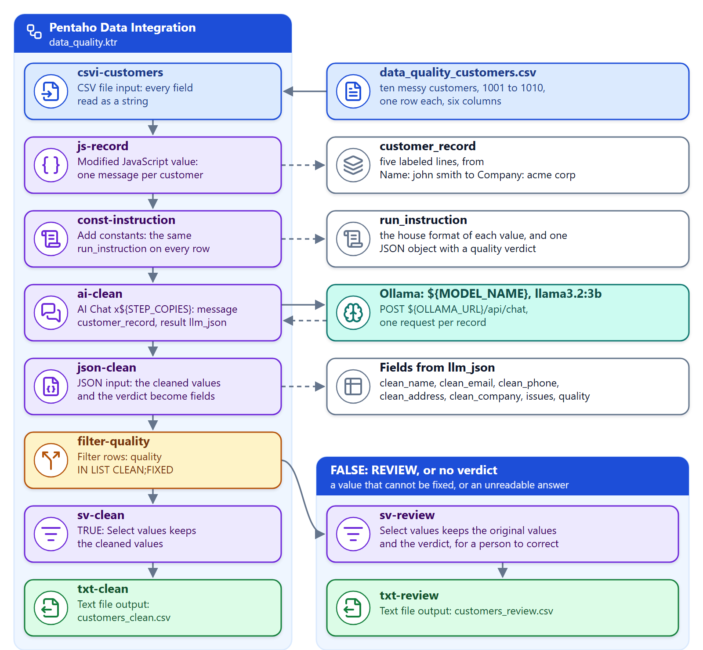
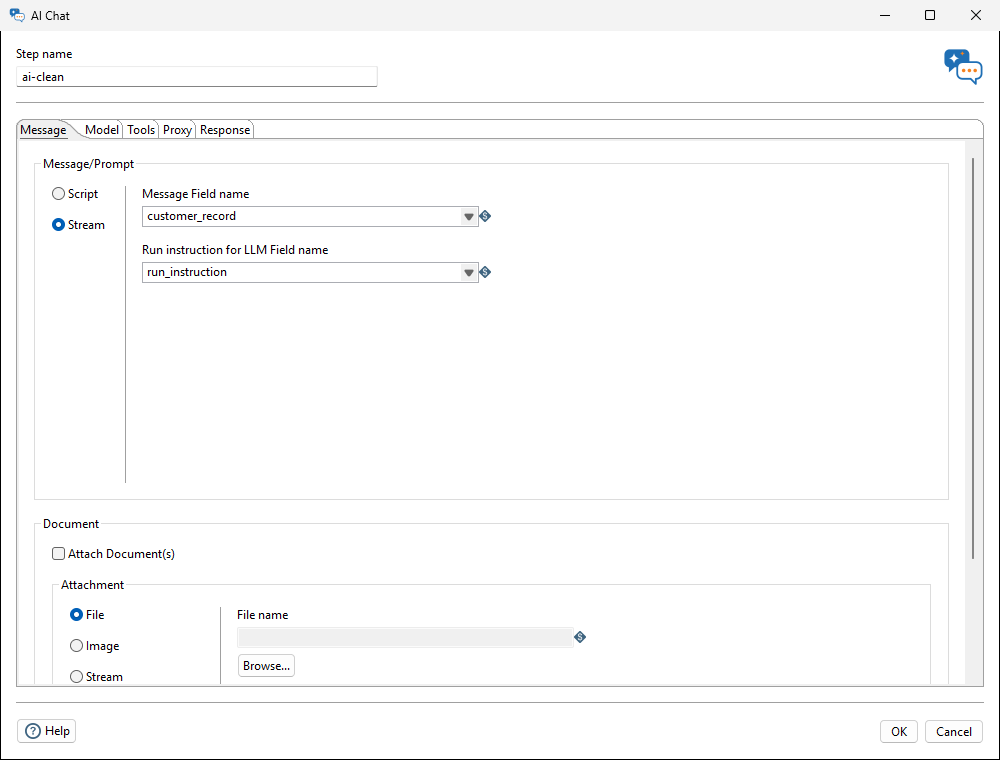
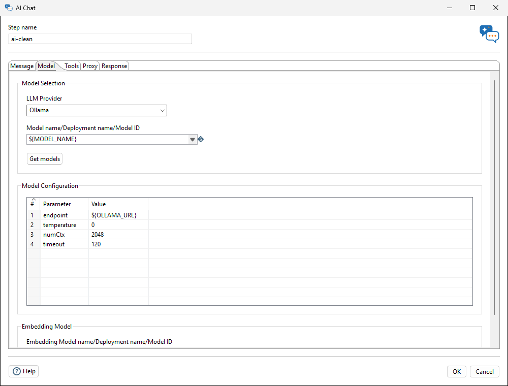
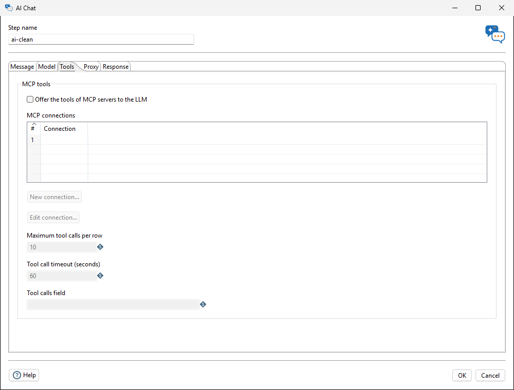
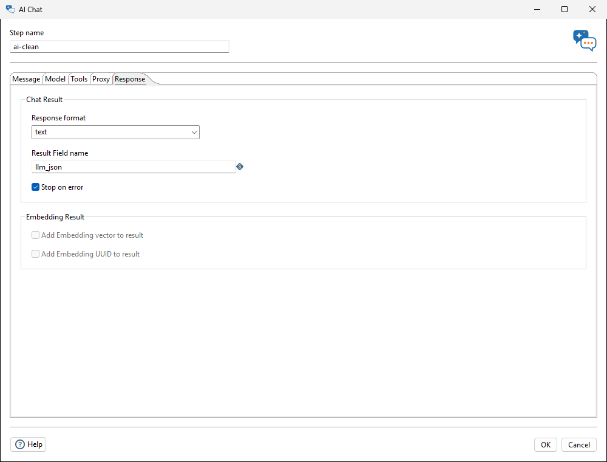
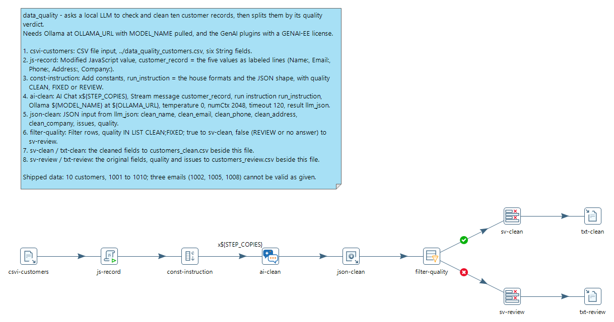

# Data Quality

> **Warning:**
>
> #### Workshop - Data Quality
>
> Build a Pentaho Data Integration transformation that sends ten messy customer records, one at a time, to a local Large Language Model (LLM) served by Ollama with the **AI Chat** step. The model cleans each record and gives it a quality verdict, and the transformation splits the records into a clean file and a file for review.
>
> **What you'll do**
>
> * Find the quality problems in the raw customer file
> * Turn each record into one message with **Modified JavaScript value**
> * Give the model the house formats and a JSON answer shape as its run instruction
> * Clean every record with **AI Chat**, in parallel copies, and parse the answer with **JSON input**
> * Split the records by the model's verdict with **Filter rows**, and write two CSV files
>
> **Prerequisites:**
>
> * [Sentiment Analysis](../06-llm-sentiment-analysis/guide.md): the AI Chat, run instruction and JSON input pattern this workshop reuses
> * Ollama running on `http://localhost:11434` with `llama3.2:3b` pulled, and the GenAI plugins installed, as set up in [Before You Start](../00-before-you-start/guide.md)
>
> **Estimated time:** 35 minutes

<figure>

<figcaption class="pcm-video-caption">Walkthrough: coming soon</figcaption>

</figure>

<div align="center">
<figure>

<figcaption>What you build: the steps of data_quality.ktr and the two files its Filter rows fills</figcaption>
</figure>
</div>

:::: tabs

### 1. Data Quality

> **Note:**
>
> #### Data Quality Problems
>
> The same customer can arrive as `john smith`, `JOHN SMITH` or `John Smith`, with a phone number written four different ways. An LLM can apply a target format to each field from a short instruction, where a rule-based cleanup needs a rule for every variation. It can also say when a value cannot be fixed at all.

**How the approaches compare:**

| Approach | Strengths | Weaknesses |
| --- | --- | --- |
| Regex and rules | Fast, deterministic | Brittle: every new variation needs a new rule |
| Data quality tools | Broad features | Licensing cost and setup effort |
| Manual cleaning | Accurate | Doesn't scale |
| LLM | Flexible: handles variations it was never shown, and explains what it changed | Slower per record, and its output must be checked |

**The data:** `data_quality_customers.csv` holds ten customers, `1001` to `1010`, with six columns. The first five:

```text
customer_id,name,email,phone,address,company_name
1001,john smith,JSMITH@GMAIL.COM,555.123.4567,"123 main st apt 5, new york, ny","acme corp"
1002,SARAH JOHNSON,sarah.j@company,+1-555-987-6543,"456 oak avenue, los angeles, ca 90001",TechStart Inc
1003,Bob O'Brien,bob.obrien@email.com,(555) 111-2222,"789 Pine Rd, Chicago IL","DataSys LLC"
1004,maria garcia,m.garcia@test.co.uk,5551234567,"321 Elm Street, Houston, Texas 77001",global solutions ltd
1005,JAMES WILSON,james@,555-999-8888,"PO Box 456, Seattle WA 98101","Cloud Services, Inc."
```

**The problems in four of them:**

| Customer | Name | Email | Phone | Address | Company |
| --- | --- | --- | --- | --- | --- |
| 1001 | Lowercase | Uppercase | Dots | Lowercase, abbreviations | Lowercase |
| 1002 | All caps | No top-level domain (`@company`) | Already in the target format | Lowercase | Good |
| 1005 | All caps | No domain (`james@`) | No country code | No comma before the state | Good |
| 1009 | Lowercase | Good | Parentheses, no space | No comma before the state | All caps |

**What the model is asked for:** the house format of each field, a list of the problems it found, and one verdict per record.

| Verdict | Meaning | Where the record goes |
| --- | --- | --- |
| `CLEAN` | Nothing needed a change | `customers_clean.csv` |
| `FIXED` | Every problem was fixed | `customers_clean.csv` |
| `REVIEW` | A value cannot be fixed, such as the email `james@` | `customers_review.csv` |

Three emails in the file cannot be valid as given: `sarah.j@company` (1002), `james@` (1005) and `lisa_anderson@email` (1008). A model must not invent the missing domain, so those records need a person.

### 2. Check Ollama

> **Note:**
>
> #### One Record by Hand
>
> Send one record to the model yourself, with the kind of instruction this workshop gives it. It is the same request the **AI Chat** step sends for every row.

1. Check that Ollama answers and has the model. In PowerShell, run:

```powershell
(Invoke-RestMethod http://localhost:11434/api/tags).models | Select-Object name
```

> **Success:** Checkpoint: the list of models includes `llama3.2:3b`.

2. Send customer 1005 to the model. In PowerShell, run:

```powershell
$body = @{
  model    = "llama3.2:3b"
  stream   = $false
  options  = @{ temperature = 0 }
  messages = @(
    @{ role = "system"; content = 'You check and clean one customer record. An email with no domain cannot be fixed. Answer with one JSON object and nothing else: {"name": "...", "email": "...", "quality": "CLEAN" | "FIXED" | "REVIEW"}' }
    @{ role = "user";   content = "Name: JAMES WILSON`nEmail: james@`nPhone: 555-999-8888" }
  )
} | ConvertTo-Json -Depth 4
(Invoke-RestMethod -Uri http://localhost:11434/api/chat -Method Post -ContentType "application/json" -Body $body).message.content
```

> **Success:** Checkpoint: one line of JSON with `name`, `email` and `quality`. With `llama3.2:3b` at temperature `0` it came back as `{"name": "JAMES WILSON", "email": "james@domain.com", "quality": "FIXED"}`: the model left the name in capitals, invented a domain and called the record fixed, against the instruction. Your answer may differ. A small model follows a short rule like this unreliably, which is why the transformation you build gives it a fuller instruction, with the house format of every field and examples of what cannot be fixed.

### 3. Read the Customers

> **Note:**
>
> #### Read the Customers
>
> Create the transformation and its parameters, and read `data_quality_customers.csv` with every field as a string: the values are text to be cleaned, not numbers.

1. Start Pentaho Data Integration with the **Start Pentaho Data Integration** button below, or from PowerShell:

```powershell
Set-Location C:\Pentaho\design-tools\data-integration
.\Spoon.bat
```

<button data-launch="spoon" data-path="">Start Pentaho Data Integration</button>

2. Select **File > New > Transformation** (`Ctrl+N`).
3. Select **File > Save as** and save it as `data_quality.ktr` in `C:\Workshop-AI-Specialty\04-llm-integration\07-llm-data-quality`, next to `data_quality_customers.csv`. (On your own machine, download `data_quality_customers.csv` from **Lab Files** below into the folder you save in.)
4. Double-click an empty part of the canvas. **Transformation properties** opens.
5. Open the **Parameters** tab and fill the grid:

| Parameter | Default Value | Description |
| --- | --- | --- |
| `MODEL_NAME` | `llama3.2:3b` | Ollama chat model |
| `OLLAMA_URL` | `http://localhost:11434` | Ollama server |
| `STEP_COPIES` | `4` | Parallel copies of ai-clean |

6. Select **OK**.
7. On the **Design** tab, open the **Input** folder and drag **CSV file input** onto the canvas.
8. Double-click **CSV file input**.
9. Set **Step name** to `csvi-customers`.
10. Set **Filename** to `${Internal.Entry.Current.Directory}/data_quality_customers.csv`.
11. Keep **Delimiter** `,`, **Enclosure** `"` and **Header row present?** selected. Clear **Lazy conversion?**.
12. Fill the **Fields** grid. Every field is a String with no length, trimmed on both sides:

| Name | Type | Length | Trim type |
| --- | --- | --- | --- |
| `customer_id` | String | | both |
| `name` | String | | both |
| `email` | String | | both |
| `phone` | String | | both |
| `address` | String | | both |
| `company_name` | String | | both |

13. Select **OK**.
14. Save the transformation (`Ctrl+S`).
15. Select **csvi-customers** on the canvas, press `F10` (**Action > Preview**), and select **Quick Launch**.

> **Success:** Checkpoint: **Examine preview data** shows 10 rows, `customer_id` `1001` to `1010`. The first is `john smith`, `JSMITH@GMAIL.COM`, `555.123.4567`; the address `123 main st apt 5, new york, ny` arrives as one field, because the file encloses it in quotes.

16. Select **Close**.

### 4. Build the Message

> **Note:**
>
> #### Modified JavaScript Value
>
> **AI Chat** in Stream mode sends one field as the message. This record has five values to clean, so a **Modified JavaScript value** step joins them into one field, `customer_record`, one labeled line per value.

1. On the **Design** tab, open the **Scripting** folder and drag **Modified JavaScript value** onto the canvas.
2. Create a hop from **csvi-customers** to **Modified JavaScript value**: hold `Shift` and drag from one step to the other.
3. Double-click **Modified JavaScript value**.
4. Set **Step name** to `js-record`.
5. Replace the text in the **Script 1** tab with:

```javascript
// One customer as labeled lines: the message AI Chat sends
var customer_record = "Name: " + name + "\n" +
  "Email: " + email + "\n" +
  "Phone: " + phone + "\n" +
  "Address: " + address + "\n" +
  "Company: " + company_name;
```

6. Fill the **Fields** grid with one row: **Fieldname** `customer_record`, **Type** String, **Replace value 'Fieldname' or 'Rename to'** `N`.
7. Select **OK**.
8. Select **js-record** on the canvas, press `F10` (**Action > Preview**), and select **Quick Launch**.

> **Success:** Checkpoint: 10 rows with a new `customer_record` field. For `1001` it holds five lines, from `Name: john smith` to `Company: acme corp`.

9. Select **Close**.

> **Under the hood:**
>
> #### The step builds the message because AI Chat never reads field values into a prompt
>
> In **AI Chat**, `${...}` in a prompt is a Pentaho Data Integration variable, resolved once when the transformation starts; a field's value is never put into a Script prompt. So any message that combines several fields is built upstream, here by a script, and **AI Chat** reads it from the stream. The labels (`Name:`, `Email:`) tell the model which value is which.
>
> **Why it matters:** the row's own values reach the model only through a stream field. A prompt typed into the step is the same for every row.

### 5. The Instruction

> **Note:**
>
> #### Add Constants
>
> The instruction gives the house format of each field, says which emails cannot be fixed, and spells out the JSON answer, verdict included. It is the same for every record, so **Add constants** adds it as `run_instruction`.

1. On the **Design** tab, open the **Transform** folder and drag **Add constants** onto the canvas.
2. Create a hop from **js-record** to **Add constants**.
3. Double-click **Add constants**.
4. Set **Step name** to `const-instruction`.
5. In the **Fields** grid, add one row: **Name** `run_instruction`, **Type** `String`, and in **Value** this text:

```text
You check and clean one customer record from a US customer file.
Put each value in the house format: name in Title Case; email in lowercase; phone as +1-555-123-4567; address as Street, City, ST ZIP with a two-letter state code (keep a ZIP only if the record has one); company name in its proper business form, such as Acme Corp or Cloud Services, Inc.
An email with no domain or no top-level domain, such as james@ or sarah.j@company, cannot be fixed: keep it as given.
Answer with one JSON object and nothing else, in exactly this shape:
{"name": "...", "email": "...", "phone": "...", "address": "...", "company_name": "...", "issues": ["one short phrase per problem you found"], "quality": "CLEAN" | "FIXED" | "REVIEW"}
quality is CLEAN when nothing needed a change, FIXED when you fixed every problem, and REVIEW when a value cannot be fixed.
```

6. Select **OK**.

> **Under the hood:**
>
> #### The verdict is part of the answer, so the pipeline can act on it
>
> The model returns the cleaned values and a `quality` field with one of three words. A step downstream compares that field with a list, so the instruction names the exact words and when each one applies. `issues` asks the model to say what it changed, which a reviewer can check against the original.
>
> **Why it matters:** a model that only returns cleaned values hides the records it could not clean. A verdict turns its judgment into something the pipeline can route.

### 6. Ask the Model

> **Note:**
>
> #### AI Chat
>
> **AI Chat** sends each record to the model with `run_instruction`, and adds the model's answer to the row as `llm_json`.

1. On the **Design** tab, open the **AI** folder and drag **AI Chat** onto the canvas.
2. Create a hop from **const-instruction** to **AI Chat**.
3. Double-click **AI Chat**.
4. Set **Step name** to `ai-clean`.
5. On the **Message** tab, under **Message/Prompt**, select **Stream**. Set **Message Field name** to `customer_record` and **Run instruction for LLM Field name** to `run_instruction`. Keep **Attach Document(s)** cleared.
6. On the **Model** tab, set **LLM Provider** to `Ollama` and **Model name/Deployment name/Model ID** to `${MODEL_NAME}`.
7. Fill the **Model Configuration** grid. Delete any row that is not in this table:

| Parameter | Value |
| --- | --- |
| `endpoint` | `${OLLAMA_URL}` |
| `temperature` | `0` |
| `numCtx` | `2048` |
| `timeout` | `120` |

8. On the **Response** tab, keep **Response format** `text`, set **Result Field name** to `llm_json`, and keep **Stop on error** selected.
<div align="center">
<figure>

<figcaption>ai-clean: the Message tab</figcaption>
</figure>
</div>

<div align="center">
<figure>

<figcaption>ai-clean: the Model tab</figcaption>
</figure>
</div>

<div align="center">
<figure>

<figcaption>ai-clean: the Tools tab</figcaption>
</figure>
</div>

<div align="center">
<figure>

<figcaption>ai-clean: the Response tab</figcaption>
</figure>
</div>

9. Select **OK**.
10. Right-click **ai-clean** and select **Change Number of Copies to Start...**.
11. In **Nr of copies of step...**, enter `${STEP_COPIES}` and select **OK**.

> **Under the hood:**
>
> #### One step replaced two scripts and a REST call
>
> Without the plugin, this call takes three steps: a script that builds the request body as JSON text, a **REST client** that posts it, and a third step that unwraps Ollama's reply. Every one of them is a place to get the request wrong, such as a body field that no step created, which sends an empty request. **AI Chat** builds the request from its settings: the run instruction becomes the system message, `customer_record` the user message, and the model, endpoint and options come from the **Model** tab. It puts only the model's reply in `llm_json`. A temperature of `0` makes the same record get the same answer on every run.
>
> **Why it matters:** there is no request text to get wrong, and the model and server are parameters, so the same transformation runs against another model by changing `MODEL_NAME`.

### 7. Parse the Answer

> **Note:**
>
> #### JSON Input
>
> **JSON input** reads `llm_json` and splits it into the cleaned fields, the list of issues and the verdict. The cleaned fields get a `clean_` prefix, so the originals stay beside them.

1. On the **Design** tab, open the **Input** folder and drag **JSON input** onto the canvas.
2. Create a hop from **ai-clean** to **JSON input**.
3. Double-click **JSON input**.
4. Set **Step name** to `json-clean`.
5. On the **File** tab, select **Source is from a previous step** and set **Select field** to `llm_json`.
6. On the **Content** tab, make sure **Ignore missing path** and **Default path leaf to null** are selected.
7. On the **Fields** tab, fill the grid:

| Name | Path | Type |
| --- | --- | --- |
| `clean_name` | `$.name` | String |
| `clean_email` | `$.email` | String |
| `clean_phone` | `$.phone` | String |
| `clean_address` | `$.address` | String |
| `clean_company` | `$.company_name` | String |
| `issues` | `$.issues` | String |
| `quality` | `$.quality` | String |

8. Select **OK**.

> **Under the hood:**
>
> #### A missing key gives a null field, but a broken answer stops the run
>
> With **Ignore missing path** and **Default path leaf to null** selected, a key the model leaves out becomes a null field instead of failing the row, and so does an answer that is plain text with no JSON in it, such as `Sure! Here is the record.`. `issues` is an array in the answer; read as a String it keeps its JSON text, such as `["name in lowercase","phone with dots"]`.
>
> **Why it matters:** an answer that *starts* as JSON but is broken, with a missing brace or a stray bracket, is different: **JSON input** cannot parse it and stops the whole transformation. The section after the split catches those rows.

### 8. Split by Verdict

> **Note:**
>
> #### Filter Rows and Two Outputs
>
> **Filter rows** sends the records the model passed as `CLEAN` or `FIXED` to the clean file, and every other record to the review file: `REVIEW`, and any row with no readable verdict.

1. On the **Design** tab, open the **Flow** folder and drag **Filter rows** onto the canvas.
2. Create a hop from **json-clean** to **Filter rows**.
3. On the **Design** tab, open the **Transform** folder and drag **Select values** onto the canvas twice. Open the **Output** folder and drag **Text file output** onto the canvas twice.
4. Double-click the first **Select values**, set **Step name** to `sv-clean`, and on the **Select & Alter** tab list these fields in this order: `customer_id`, `clean_name`, `clean_email`, `clean_phone`, `clean_address`, `clean_company`, `quality`, `issues`. Select **OK**.
5. Double-click the second **Select values**, set **Step name** to `sv-review`, and list: `customer_id`, `name`, `email`, `phone`, `address`, `company_name`, `quality`, `issues`. Select **OK**.
6. Create a hop from **Filter rows** to **sv-clean**. When Spoon asks, select **Result is TRUE**.
7. Create a hop from **Filter rows** to **sv-review**. When Spoon asks, select **Result is FALSE**.
8. Double-click **Filter rows** and set **Step name** to `filter-quality`.
9. Under **The condition**, select `<field>` and select `quality` in the list. Select the function `=` and change it to `IN LIST`.
10. Select `<value>`. In **Enter value**, set **Type** to `String` and **Value** to `CLEAN;FIXED`, and select **OK**.
11. Check that **Send 'true' data to step** is `sv-clean` and **Send 'false' data to step** is `sv-review`. Select **OK**.
12. Create a hop from **sv-clean** to the first **Text file output**, and from **sv-review** to the second.
13. Double-click the first **Text file output** and set **Step name** to `txt-clean`.
14. On the **File** tab, set **Filename** to `${Internal.Entry.Current.Directory}/customers_clean` and **Extension** to `csv`. Select **Create Parent folder**.
15. On the **Content** tab, keep **Separator** `,`, **Enclosure** `"` and **Header** selected, and set **Encoding** to `UTF-8`.
16. On the **Fields** tab, select **Get Fields**, then **Minimal width**. The grid lists the eight fields in the order **sv-clean** gives them, with no fixed lengths, so no value is padded with spaces. Select **OK**.
17. Set up the second **Text file output** the same way, **Get Fields** and **Minimal width** included, with **Step name** `txt-review` and **Filename** `${Internal.Entry.Current.Directory}/customers_review`. Select **OK**.
18. Save the transformation (`Ctrl+S`).

> **Under the hood:**
>
> #### A null verdict fails the IN LIST test, so it goes to review
>
> `IN LIST` is true when `quality` equals one of the values between the semicolons. A null `quality`, from an answer with no verdict in it, equals neither, so the row takes the false path to `sv-review`. The two **Select values** steps give each file its own columns: the clean file the cleaned values, the review file the originals that a person will correct.
>
> **Why it matters:** the safe default is review. A record leaves the pipeline as clean only when the model said, in words the filter checks, that it is.

### 9. Catch the Answers the Parser Cannot Read

> **Note:**
>
> #### Error Handling on JSON Input
>
> A small model sometimes closes a JSON answer with the wrong bracket. An error hop sends such a row to a file of its own, with the parser's message, and the other records carry on.

1. On the **Design** tab, open the **Output** folder and drag **Text file output** onto the canvas, below **json-clean**.
2. Double-click it and set **Step name** to `txt-bad-answers`. On the **File** tab, set **Filename** to `${Internal.Entry.Current.Directory}/bad_answers` and **Extension** to `csv`. Select **OK**.
3. Create a hop from **json-clean** to **txt-bad-answers**, and select **Error handling of step** in the menu that opens. The hop is drawn red, with a red error icon.
4. Right-click **json-clean** and select **Error Handling...**. In **Step error handling settings**, enter these settings, then select **OK**:

| Setting | Value |
| --- | --- |
| **Target step** | `txt-bad-answers` |
| **Enable the error handling?** | Selected |
| **Nr of errors fieldname** | `err_count` |
| **Error descriptions fieldname** | `err_desc` |

5. Double-click **txt-bad-answers**. On the **Fields** tab, select **Get Fields**, then **Minimal width**, and delete every row except `customer_id`, `llm_json` and `err_desc`. Select **OK**, and save the transformation (`Ctrl+S`).

> **Under the hood:**
>
> #### A row the step cannot process leaves by the error hop instead of stopping the run
>
> Without error handling, the first unparsable answer fails **json-clean** and stops the transformation, so the records behind it are never written. With it, **JSON input** adds the parser's message to the row as `err_desc` and sends that row down the red hop. The step's **Errors** count in **Step Metrics** shows how many rows went that way.
>
> **Why it matters:** this is how a production pipeline treats a model: most answers are good, some are not, and the bad ones are kept with their reason so a person, or a rerun with a stronger model, can deal with them.

### 10. Run

> **Note:**
>
> #### Run the Transformation
>
> Ten records are ten model calls. On a CPU-only machine each takes about 15 to 30 seconds; the four parallel copies overlap them as far as Ollama allows.

1. Press `F9` (**Action > Run**), and select **Run** in the **Run Options** dialog.
2. In **Execution Results**, open the **Step Metrics** tab.

> **Success:** Checkpoint: **csvi-customers** shows 10 under **Written**, and the four copies of **ai-clean** read 10 rows between them (for example 3, 3, 2 and 2). **json-clean** writes 10 with 0 under **Errors**: every answer parsed, so none went down the error hop. **filter-quality** reads 10 and splits them: **txt-clean** writes 2 and **txt-review** writes 8. On a machine with a GPU the ten model calls take under 10 seconds.

3. Select **json-clean** on the canvas and open the **Preview data** tab.

> **Success:** Checkpoint: 10 rows. Each has the model's cleaned values, such as `john smith` as `John Smith` for customer 1001, an `issues` list, and a `quality` of `CLEAN`, `FIXED` or `REVIEW`. The values and the wording of the issues are the model's and will differ from run to run.

4. Open `customers_review.csv` in `C:\Workshop-AI-Specialty\04-llm-integration\07-llm-data-quality`.

> **Success:** Checkpoint: its first line is `customer_id,name,email,phone,address,company_name,quality,issues`. The records with an email that cannot be valid, `1002`, `1005` and `1008`, are among its 8 rows. `llama3.2:3b` is cautious: in the measured run it sent 1003, 1004, 1007, 1009 and 1010 to review too, and `customers_clean.csv` held only 1001 and 1006, both `FIXED`. Your split may differ. `bad_answers.csv` is there too, but empty, without even a header line, when every answer parsed.

5. Compare the two files with `data_quality_customers.csv`. Where the model put a record in the clean file that you would review, tighten the instruction: name the case and the verdict it gets.

::::

## Troubleshooting <!-- no-step -->

<details>
<summary>Error initializing step: License validation failed</summary>

The Pentaho license on this machine has no GenAI rights. Every GenAI plugin step checks for a license with the GenAI Plugin Suite (GENAI-EE) subscription when the transformation starts. Install a license that includes it, as described in [Before You Start](../00-before-you-start/guide.md).

</details>

<details>
<summary>ai-clean fails with Connection refused or model not found</summary>

Ollama is not running, or does not have the model in `MODEL_NAME`. Start the Ollama app, run `ollama list`, and pull the model or change the parameter.

</details>

<details>
<summary>Every record lands in customers_review.csv</summary>

The verdicts are null: the answers were not the JSON the instruction asked for. Preview **ai-clean** and read `llm_json`. A larger model (`qwen2.5:7b`), or an instruction that repeats "nothing else", usually fixes it.

</details>

## Lab Files

Click a file to download. For `.ktr` and `.kjb` files, **Open in Pentaho Data Integration** launches Pentaho Data Integration with the file loaded. If Pentaho Data Integration is already running, the path is copied to your clipboard — switch to Pentaho Data Integration and press `Ctrl+O`, `Ctrl+V`, `Enter`.

The ten raw customer records:

[data_quality_customers.csv](./files/data_quality_customers.csv)

### Solution <!-- no-step -->

The finished transformation for this lab. Open it alongside your own to compare, or run it to see the expected result. It reads `data_quality_customers.csv` from the lab folder and writes `customers_clean.csv` and `customers_review.csv` beside itself, and `bad_answers.csv` for any answer the parser could not read.

Also on disk at `C:\Workshop-AI-Specialty\04-llm-integration\07-llm-data-quality\solution`.

[data_quality.ktr](./files/solution/data_quality.ktr) <button data-launch="spoon" data-path="files/solution/data_quality.ktr">Open in Pentaho Data Integration</button> <button data-graph="files/solution/data_quality.ktr">View graph</button>

data_quality in Spoon, with its note:

<div align="center">
<figure>

<figcaption>data_quality.ktr in Spoon</figcaption>
</figure>
</div>
