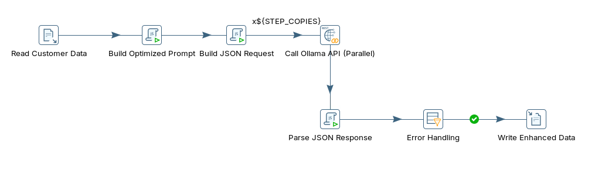
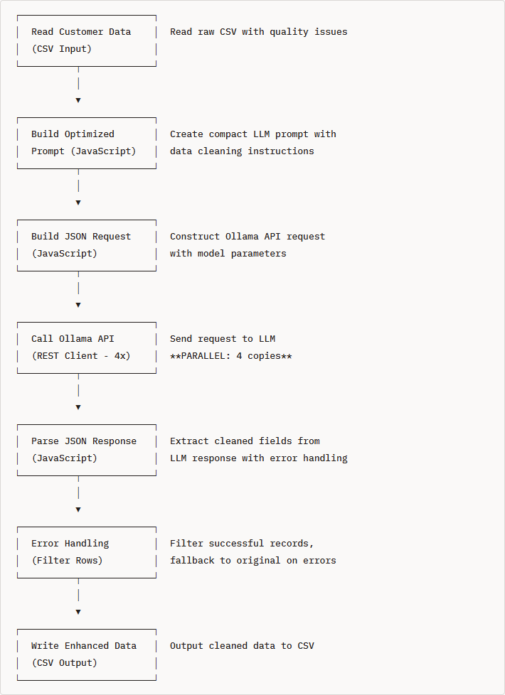
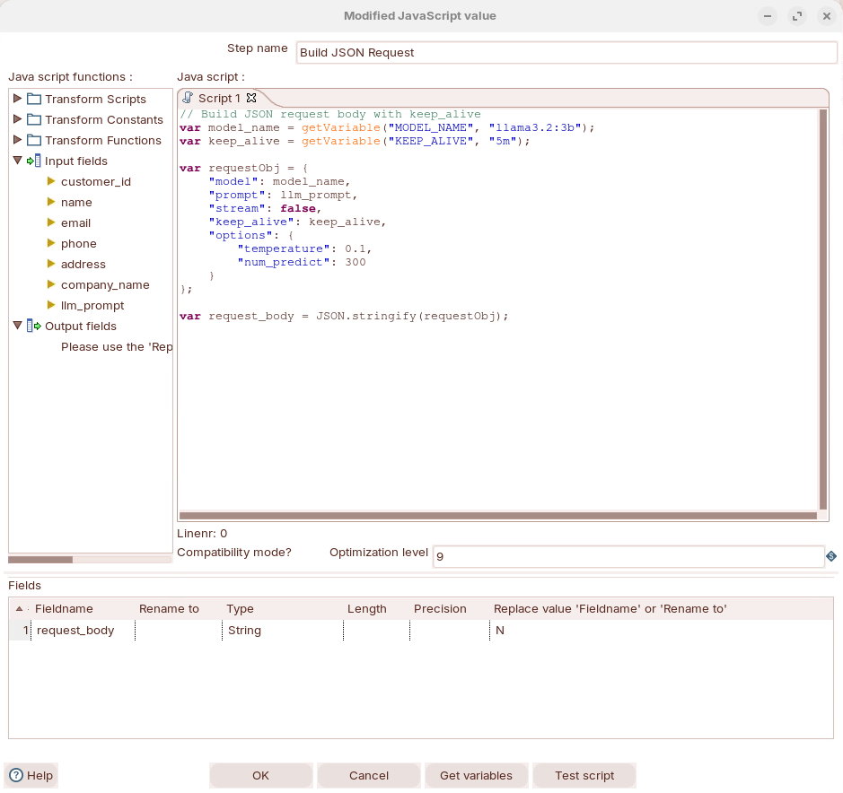
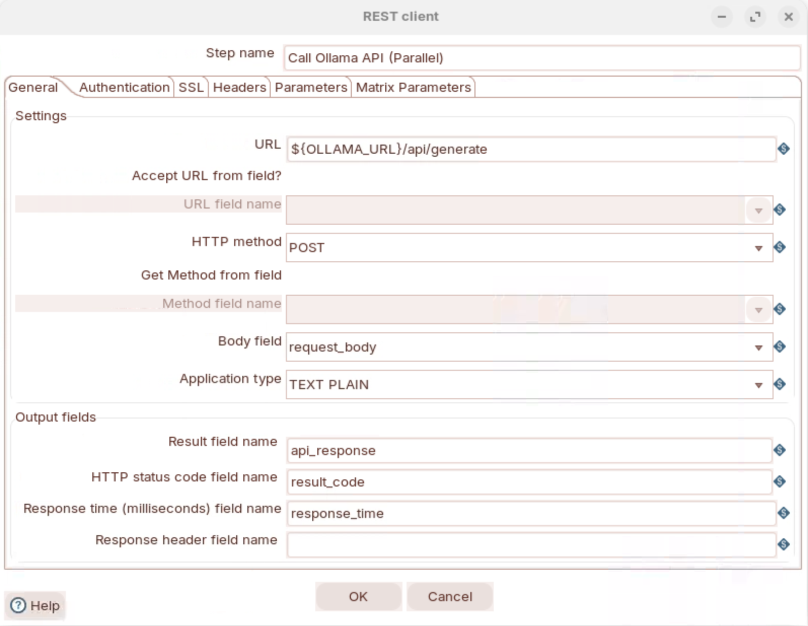

# Data Quality

> **Warning:**
>
> #### Workshop - Data Quality
>
> Build a Pentaho Data Integration transformation that sends ten messy customer records, one at a time, to a local Large Language Model (LLM) served by Ollama, and writes back cleaned names, emails, phone numbers, addresses and company names.
>
> **What you'll do**
>
> * Find the quality problems in the raw customer file
> * Build a compact cleaning prompt and an Ollama request in two **Modified JavaScript value** steps
> * Call Ollama from parallel copies of **REST client**
> * Parse the answer with a fallback to the original values, and filter out the rows that failed
> * Write the cleaned records to a CSV file
>
> **Prerequisites:**
>
> * [Sentiment Analysis](../06-llm-sentiment-analysis/guide.md): the REST client and parallel-copies pattern this workshop reuses
> * Ollama running on `http://localhost:11434` with `llama3.2:3b` pulled
>
> **Estimated time:** 35 minutes

<div align="center">
<figure>

<figcaption>What you build: seven steps, with a filter before the output</figcaption>
</figure>
</div>

:::: tabs

### 1. Data Quality

> **Note:**
>
> #### Data Quality Problems
>
> The same customer can arrive as `john smith`, `JOHN SMITH` or `John Smith`, with a phone number written four different ways. An LLM can apply a target format to each field from a short instruction, where a rule-based cleanup needs a rule for every variation.

**How the approaches compare:**

| Approach | Strengths | Weaknesses |
| --- | --- | --- |
| Regex and rules | Fast, deterministic | Brittle: every new variation needs a new rule |
| Data quality tools | Broad features | Licensing cost and setup effort |
| Manual cleaning | Accurate | Doesn't scale |
| LLM | Flexible: handles variations it was never shown | Needs LLM infrastructure; slower per record, and its output must be checked |

**The data:** `data_quality_customers.csv` holds ten customers, `1001` to `1010`. The first five:

```text
customer_id,name,email,phone,address,company_name
1001,john smith,JSMITH@GMAIL.COM,555.123.4567,"123 main st apt 5, new york, ny",acme corp
1002,SARAH JOHNSON,sarah.j@company,+1-555-987-6543,"456 oak avenue, los angeles, ca 90001",TechStart Inc
1003,Bob O'Brien,bob.obrien@email.com,(555) 111-2222,"789 Pine Rd, Chicago IL",DataSys LLC
1004,maria garcia,m.garcia@test.co.uk,5551234567,"321 Elm Street, Houston, Texas 77001",global solutions ltd
1005,JAMES WILSON,james@,555-999-8888,"PO Box 456, Seattle WA 98101","Cloud Services, Inc."
```

**The problems in four of them:**

| Customer | Name | Email | Phone | Address | Company |
| --- | --- | --- | --- | --- | --- |
| 1001 | Lowercase | Uppercase | Dots | Lowercase, abbreviations | Lowercase |
| 1002 | All caps | No top-level domain (`@company`) | Already in the target format | Lowercase | Good |
| 1005 | All caps | No domain (`james@`) | No country code | No comma before the state | Good |
| 1009 | Lowercase | Good | Parentheses, no space | No comma before the state | All caps |

**What the prompt asks for:** the transformation's prompt shows the model one example value per field.

| Field | Format in the prompt | 1001 cleaned to that format |
| --- | --- | --- |
| `name` | `Title Case` | `John Smith` |
| `email` | `valid@format` | `jsmith@gmail.com` |
| `phone` | `+1-555-123-4567` | `+1-555-123-4567` |
| `address` | `St,City,ST ZIP` | `123 Main St Apt 5, New York, NY` |
| `company_name` | `Proper Name` | `Acme Corp` |

The prompt does not say what to do with an email that cannot be fixed, such as `james@`: check what the model returns for 1002, 1005 and 1008.

<div align="center">
<figure>

<figcaption>The pipeline, one box per step</figcaption>
</figure>
</div>

### 2. Ollama API

> **Note:**
>
> #### Ollama API Endpoint
>
> The transformation sends one `POST` to `http://localhost:11434/api/generate` per customer. Unlike the Sentiment Analysis request, this one has no `"format": "json"`, so the model can wrap its JSON in other text; the parsing step later allows for that.

1. Send customer 1002 to the model with the transformation's prompt and options. In PowerShell, run:

::: tabs

### Windows (PowerShell)

```powershell
$prompt = @'
Clean this data. Return JSON: {"name":"Title Case","email":"valid@format","phone":"+1-555-123-4567","address":"St,City,ST ZIP","company_name":"Proper Name"}
Name:SARAH JOHNSON
Email:sarah.j@company
Phone:+1-555-987-6543
Addr:456 oak avenue, los angeles, ca 90001
Co:TechStart Inc
'@
$body = @{
  model      = "llama3.2:3b"
  prompt     = $prompt
  stream     = $false
  keep_alive = "5m"
  options    = @{ temperature = 0.1; num_predict = 300 }
} | ConvertTo-Json
(Invoke-RestMethod -Uri http://localhost:11434/api/generate -Method Post -ContentType "application/json" -Body $body).response
```

### macOS / Linux

```bash
curl http://localhost:11434/api/generate -d '{
  "model": "llama3.2:3b",
  "prompt": "Clean this data. Return JSON: {\"name\":\"Title Case\",\"email\":\"valid@format\",\"phone\":\"+1-555-123-4567\",\"address\":\"St,City,ST ZIP\",\"company_name\":\"Proper Name\"}\nName:SARAH JOHNSON\nEmail:sarah.j@company\nPhone:+1-555-987-6543\nAddr:456 oak avenue, los angeles, ca 90001\nCo:TechStart Inc",
  "stream": false,
  "keep_alive": "5m",
  "options": {"temperature": 0.1, "num_predict": 300}
}'
```

:::

> **Success:** Checkpoint: the model's answer contains a JSON object with the keys `name`, `email`, `phone`, `address` and `company_name`, possibly with text around it. The values are the model's: `SARAH JOHNSON` should come back in Title Case, and the phone is already in the target format.

What the request asks of Ollama:

| Key | Value | Why |
| --- | --- | --- |
| `model` | `llama3.2:3b` | A small model that runs on a CPU |
| `prompt` | The compact prompt | One example value per field, short labels (`Addr`, `Co`): fewer tokens to process per record |
| `stream` | `false` | One complete answer per row |
| `keep_alive` | `5m` | Keeps the model loaded for 5 minutes after the last request |
| `options.temperature` | `0.1` | Low randomness, so the same record gets nearly the same answer every run |
| `options.num_predict` | `300` | At most 300 tokens per answer: room for the JSON, and a stop for a runaway answer |

In the answer, `prompt_eval_count` is the number of tokens in your prompt and `eval_count` the number the model generated; the time per record grows with both.

### 3. Read the Customers

> **Note:**
>
> #### Read the Customers
>
> Create the transformation and its parameters, and read `data_quality_customers.csv` with every field as a string: the values are text to be cleaned, not numbers.

1. Start Spoon with the **Start Pentaho Data Integration** button below, or from a terminal:

::: tabs

### Windows (PowerShell)

```powershell
Set-Location C:\Pentaho\design-tools\data-integration
.\spoon.bat
```

### macOS / Linux

```bash
cd ~/Pentaho/design-tools/data-integration
./spoon.sh
```

:::

<button data-launch="spoon" data-path="">Start Pentaho Data Integration</button>

2. Select **File > New > Transformation** (`Ctrl+N`).
3. Select **File > Save as** and save it as `data_quality_enhancement_optimized.ktr` in `C:\Workshop-AI-Specialty\04-llm-integration\07-llm-data-quality`, next to `data_quality_customers.csv`. (On your own machine, download the file from **Lab Files** below into the folder you save in.)
4. Double-click an empty part of the canvas. **Transformation properties** opens.
5. Open the **Parameters** tab and fill the grid:

| Parameter | Default Value | Description |
| --- | --- | --- |
| `INPUT_FILE` | `${Internal.Transformation.Filename.Directory}/data_quality_customers.csv` | Input CSV file with raw customer data |
| `MODEL_NAME` | `llama3.2:3b` | Ollama model to use (3b recommended for quality) |
| `OLLAMA_URL` | `http://localhost:11434` | Ollama API endpoint |
| `STEP_COPIES` | `4` | Number of parallel API call copies (4-8 recommended) |

6. Select **OK**.
7. On the **Design** tab, open the **Input** folder and drag **CSV file input** onto the canvas.
8. Double-click **CSV file input**.
9. Set **Step name** to `Read Customer Data`.
10. Set **Filename** to `${INPUT_FILE}`.
11. Keep **Delimiter** `,` and **Enclosure** `"`, and keep **Header row present?** selected. Clear **Lazy conversion?**.
12. Set **Format** to `mixed` and **File encoding** to `UTF-8`.
13. Fill the **Fields** grid. Every field is a String, with no length:

| Name | Type |
| --- | --- |
| `customer_id` | String |
| `name` | String |
| `email` | String |
| `phone` | String |
| `address` | String |
| `company_name` | String |

14. Select **OK**.
15. Save the transformation (`Ctrl+S`).
16. Select **Read Customer Data** on the canvas, press `F10` (**Action > Preview**), and select **Quick Launch**.

> **Success:** Checkpoint: **Examine preview data** shows 10 rows, `customer_id` `1001` to `1010`. The first is `john smith`, `JSMITH@GMAIL.COM`, `555.123.4567`; the address `123 main st apt 5, new york, ny` arrives as one field, because the file encloses it in quotes.

17. Select **Close**.

### 4. Build the Prompt

> **Note:**
>
> #### Build Optimized Prompt
>
> A **Modified JavaScript value** step turns the five raw fields into one prompt, `llm_prompt`.

1. On the **Design** tab, open the **Scripting** folder and drag **Modified JavaScript value** onto the canvas.
2. Create a hop from **Read Customer Data** to **Modified JavaScript value**: hold `Shift` and drag from one step to the other.
3. Double-click **Modified JavaScript value**.
4. Set **Step name** to `Build Optimized Prompt`.
5. Replace the text in the **Script 1** tab with:

```javascript
// Optimized short prompt - 50% shorter
var llm_prompt = "Clean this data. Return JSON: {\"name\":\"Title Case\",\"email\":\"valid@format\",\"phone\":\"+1-555-123-4567\",\"address\":\"St,City,ST ZIP\",\"company_name\":\"Proper Name\"}\nName:" + name + "\nEmail:" + email + "\nPhone:" + phone + "\nAddr:" + address + "\nCo:" + company_name;
```

6. Fill the **Fields** grid with one row: **Fieldname** `llm_prompt`, **Type** String, **Replace value 'Fieldname' or 'Rename to'** `N`. (**Get variables** adds it for you.)
7. Select **OK**.
8. Select **Build Optimized Prompt** on the canvas, press `F10` (**Action > Preview**), and select **Quick Launch**.

> **Success:** Checkpoint: 10 rows with a new `llm_prompt` field. The first starts `Clean this data. Return JSON:` and ends `Co:acme corp`.

9. Select **Close**.

The prompt is short on purpose. The transformation's basic version (in **Lab Files**) spells each instruction out ("Full Name in Title Case", "valid@email.com or INVALID if cannot be fixed"); this one keeps the example values and abbreviates the labels, so each request has fewer tokens for the model to read.

### 5. Build the Request

> **Note:**
>
> #### Build JSON Request
>
> A second **Modified JavaScript value** step wraps `llm_prompt` in the request body Ollama expects. Keeping the prompt and the request apart means you can change the wording without touching the model settings, and the other way round.

1. Drag another **Modified JavaScript value** from the **Scripting** folder onto the canvas.
2. Create a hop from **Build Optimized Prompt** to the new step.
3. Double-click the new step.
4. Set **Step name** to `Build JSON Request`.
5. Replace the text in the **Script 1** tab with:

```javascript
// Build JSON request body with keep_alive
var model_name = getVariable("MODEL_NAME", "llama3.2:3b");
var keep_alive = getVariable("KEEP_ALIVE", "5m");

var requestObj = {
    "model": model_name,
    "prompt": llm_prompt,
    "stream": false,
    "keep_alive": keep_alive,
    "options": {
        "temperature": 0.1,
        "num_predict": 300
    }
};

var request_body = JSON.stringify(requestObj);
```

6. Fill the **Fields** grid with one row: **Fieldname** `request_body`, **Type** String, **Replace value 'Fieldname' or 'Rename to'** `N`. (**Get variables** also adds `model_name`, `keep_alive` and `requestObj`; delete them if you use it.)

<div align="center">
<figure>

<figcaption>Build JSON Request: request_body is the only output field</figcaption>
</figure>
</div>

7. Select **OK**.

> **Under the hood:**
>
> #### KEEP_ALIVE fell back to 5m, because the transformation does not define it
>
> `getVariable("KEEP_ALIVE", "5m")` returns the variable when something sets it (a parameter, `kettle.properties`, or the command line) and the second argument when nothing does. This transformation has no `KEEP_ALIVE` parameter, so unless `kettle.properties` sets one, every request asks Ollama to keep the model loaded for 5 minutes after it answers. `MODEL_NAME` is a parameter, so its default, `llama3.2:3b`, applies unless you change it when you run.
>
> **Why it matters:** a default in the script keeps the step working when a variable is missing, but it also hides that it is missing; to change the value, add the parameter, don't edit the script.

### 6. Call Ollama

> **Note:**
>
> #### REST Client
>
> The same call as in Sentiment Analysis, with this transformation's field names: the body is `request_body` and the answer goes to `api_response`.

1. On the **Design** tab, open the **Lookup** folder and drag **REST client** onto the canvas.
2. Create a hop from **Build JSON Request** to **REST client**.
3. Double-click **REST client**.
4. Set **Step name** to `Call Ollama API (Parallel)`.
5. On the **General** tab, set **URL** to `${OLLAMA_URL}/api/generate`, **HTTP method** to `POST` and **Body field** to `request_body`. Keep **Application type** `TEXT PLAIN`.
6. Under **Output fields**, set **Result field name** to `api_response`, **HTTP status code field name** to `result_code` and **Response time (milliseconds) field name** to `response_time`. Leave the **Headers** tab empty.

<div align="center">
<figure>

<figcaption>Call Ollama API (Parallel): the body is request_body</figcaption>
</figure>
</div>

7. Select **OK**.
8. Right-click **Call Ollama API (Parallel)** and select **Change Number of Copies to Start...**.
9. In **Nr of copies of step...**, enter `${STEP_COPIES}` and select **OK**.

### 7. Parse the Response

> **Note:**
>
> #### Parse JSON Response
>
> A third script takes the cleaned values out of the answer. Each output field starts as the original value and is replaced only when the answer parses, and a flag, `parsing_error`, records whether it did.

1. Drag a **Modified JavaScript value** from the **Scripting** folder onto the canvas.
2. Create a hop from **Call Ollama API (Parallel)** to the new step.
3. Double-click the new step.
4. Set **Step name** to `Parse JSON Response`.
5. Replace the text in the **Script 1** tab with:

```javascript
// Parse the Ollama response with robust error handling
var enhanced_name = name;
var enhanced_email = email;
var enhanced_phone = phone;
var enhanced_address = address;
var enhanced_company = company_name;
var parsing_error = "N";
var error_message = "";

try {
    var response = JSON.parse(api_response);
    var fullResponse = response.response;

    // Extract JSON from response (handles various formats)
    var jsonStart = fullResponse.indexOf("{");
    var jsonEnd = fullResponse.lastIndexOf("}") + 1;

    if (jsonStart >= 0 && jsonEnd > jsonStart) {
        var jsonStr = fullResponse.substring(jsonStart, jsonEnd);
        var data = JSON.parse(jsonStr);

        enhanced_name = data.name || name;
        enhanced_email = data.email || email;
        enhanced_phone = data.phone || phone;
        enhanced_address = data.address || address;
        enhanced_company = data.company_name || company_name;
    } else {
        parsing_error = "Y";
        error_message = "No JSON found in response";
    }
} catch(e) {
    parsing_error = "Y";
    error_message = e.message || "Parse error";
}
```

6. Fill the **Fields** grid. (**Get variables** adds every variable in the script; keep only these.)

| Fieldname | Type | Replace value 'Fieldname' or 'Rename to' |
| --- | --- | --- |
| `enhanced_name` | String | N |
| `enhanced_email` | String | N |
| `enhanced_phone` | String | N |
| `enhanced_address` | String | N |
| `enhanced_company` | String | N |
| `parsing_error` | String | N |
| `error_message` | String | N |

7. Select **OK**.

> **Under the hood:**
>
> #### A bad answer kept the original values instead of failing the row
>
> The script parses twice: `JSON.parse(api_response)` reads Ollama's envelope, and the model's text is in its `response` field. Without `"format": "json"` the model may write "Here is the cleaned record:" before the JSON, so the script cuts from the first `{` to the last `}` and parses only that. Any failure lands in `catch`, which sets `parsing_error` to `Y` and the reason in `error_message`, while the `enhanced_*` fields still hold the originals they started with. `data.name || name` also keeps the original when the model leaves a key out or empty.
>
> **Why it matters:** one malformed answer out of thousands does not stop the load, and the flag says exactly which rows to look at.

### 8. Filter and Write

> **Note:**
>
> #### Error Handling and Output
>
> A **Filter rows** step passes only the rows that parsed to a **Text file output** step. The rows with `parsing_error` `Y` have no target, so they are dropped.

1. On the **Design** tab, open the **Flow** folder and drag **Filter rows** onto the canvas.
2. Create a hop from **Parse JSON Response** to **Filter rows**.
3. Double-click **Filter rows**.
4. Set **Step name** to `Error Handling`.
5. Under **The condition**, select `<field>` and select `parsing_error` in the list. Keep the function `=`.
6. Select `<value>`. In **Enter value**, set **Type** to `String` and **Value** to `N`, and select **OK**.
7. Select **OK**.
8. On the **Design** tab, open the **Output** folder and drag **Text file output** onto the canvas.
9. Create a hop from **Error Handling** to **Text file output**. When Spoon asks, select **Result is TRUE**.
10. Double-click **Text file output**.
11. Set **Step name** to `Write Enhanced Data`.
12. On the **File** tab, set **Filename** to `${Internal.Transformation.Filename.Directory}/customer_data_enhanced_optimized` and **Extension** to `csv`.
13. Select **Create Parent folder**, **Include date in filename?** and **Include time in filename?**. Keep **Add filenames to result** selected.
14. On the **Content** tab, keep **Separator** `,` and **Enclosure** `"`, keep **Header** selected, and set **Format** to `DOS` and **Encoding** to `UTF-8`.
15. On the **Fields** tab, fill the grid. Every field is a String:

| Name | Type |
| --- | --- |
| `customer_id` | String |
| `enhanced_name` | String |
| `enhanced_email` | String |
| `enhanced_phone` | String |
| `enhanced_address` | String |
| `enhanced_company` | String |

16. Select **OK**.
17. Double-click **Error Handling** and check that **Send 'true' data to step** is `Write Enhanced Data` and **Send 'false' data to step** is empty. Select **OK**.
18. Save the transformation (`Ctrl+S`).

### 9. Run

> **Note:**
>
> #### Run the Transformation
>
> Ten records are ten LLM calls. On a CPU-only machine each takes about 15 to 30 seconds; the four parallel copies overlap them as far as Ollama allows.

1. Press `F9` (**Action > Run**), and select **Run** in the **Run Options** dialog.
2. In **Execution Results**, open the **Step Metrics** tab.

> **Success:** Checkpoint: **Read Customer Data** shows 10 under **Written**, and the four copies of **Call Ollama API (Parallel)** read 10 rows between them. **Write Enhanced Data** shows one row for each record whose answer parsed: 10 when every answer parsed, fewer when some did not.

3. Select **Parse JSON Response** on the canvas and open the **Preview data** tab.

> **Success:** Checkpoint: 10 rows. Where `parsing_error` is `N`, the `enhanced_*` fields hold the model's cleaned values, such as `john smith` as `John Smith`; where it is `Y`, `error_message` says why and the `enhanced_*` fields repeat the originals. Which rows parse, and the exact values, depend on the model's answers.

4. Find the results file. In PowerShell, run:

::: tabs

### Windows (PowerShell)

```powershell
Get-ChildItem C:\Workshop-AI-Specialty\04-llm-integration\07-llm-data-quality\customer_data_enhanced_optimized_*.csv
```

### macOS / Linux

```bash
ls customer_data_enhanced_optimized_*.csv
```

Run it in the folder you saved the transformation in.

:::

> **Success:** Checkpoint: a file named `customer_data_enhanced_optimized_<yyyyMMdd>_<HHmmss>.csv`. Its first line is `customer_id,enhanced_name,enhanced_email,enhanced_phone,enhanced_address,enhanced_company`.

5. Compare the cleaned file with `data_quality_customers.csv`. Check the three emails that cannot be valid as given (`sarah.j@company`, `james@`, `lisa_anderson@email`): the prompt gives the model no rule for them.

::::

## Troubleshooting <!-- no-step -->

<details>
<summary>Every row has parsing_error Y</summary>

Preview **Call Ollama API (Parallel)** and read `result_code` and `api_response`. A code other than `200` means Ollama refused the request: check that it is running and that `MODEL_NAME` names a model `ollama list` shows.

</details>

<details>
<summary>Answers are cut off mid-JSON</summary>

The answer reached `num_predict` (300 tokens) before the closing `}`. Raise `num_predict` in **Build JSON Request**.

</details>

<details>
<summary>The run is slow</summary>

Set `STEP_COPIES` in the **Run Options** dialog to the number of CPU cores minus 1, and keep the model loaded between runs by adding a `KEEP_ALIVE` parameter (for example `30m`) to the transformation.

</details>

## Lab Files

Click a file to download. For `.ktr` and `.kjb` files, **Open in Pentaho Data Integration** launches Pentaho Data Integration with the file loaded. If Pentaho Data Integration is already running, the path is copied to your clipboard — switch to Pentaho Data Integration and press `Ctrl+O`, `Ctrl+V`, `Enter`.

The ten raw customer records:

[data_quality_customers.csv](./files/data_quality_customers.csv)

### Solution <!-- no-step -->

The finished transformation for this lab. Open it alongside your own to compare, or run it to see the expected result.

Also on disk at `C:\Workshop-AI-Specialty\04-llm-integration\07-llm-data-quality\solution`.

[data_quality_enhancement_optimized.ktr](./files/data_quality_enhancement_optimized.ktr) <button data-launch="spoon" data-path="files/data_quality_enhancement_optimized.ktr">Open in Pentaho Data Integration</button> <button data-graph="files/data_quality_enhancement_optimized.ktr">View graph</button>

The basic version, to compare its longer prompt with the optimized one:

[data_quality_enhancement.ktr](./files/data_quality_enhancement.ktr) <button data-launch="spoon" data-path="files/data_quality_enhancement.ktr">Open in Pentaho Data Integration</button> <button data-graph="files/data_quality_enhancement.ktr">View graph</button>
