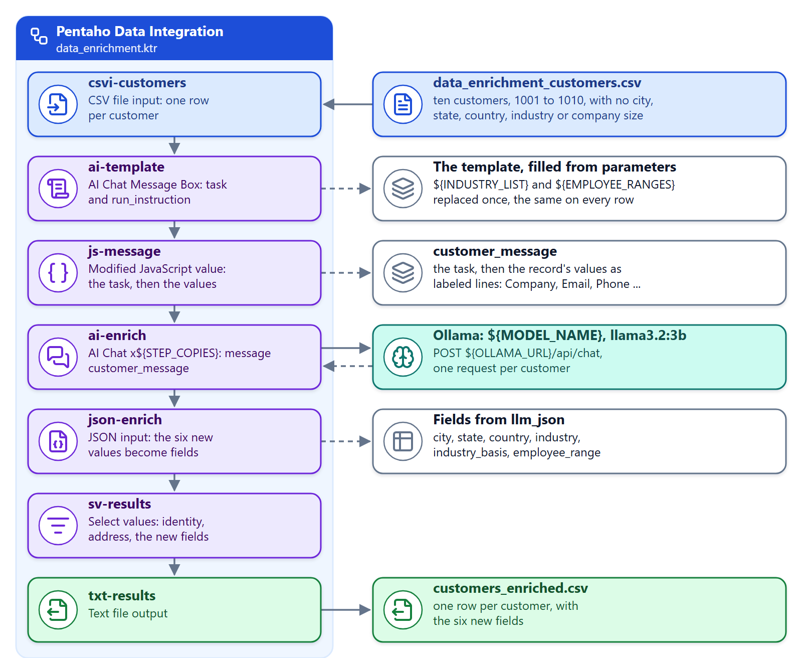
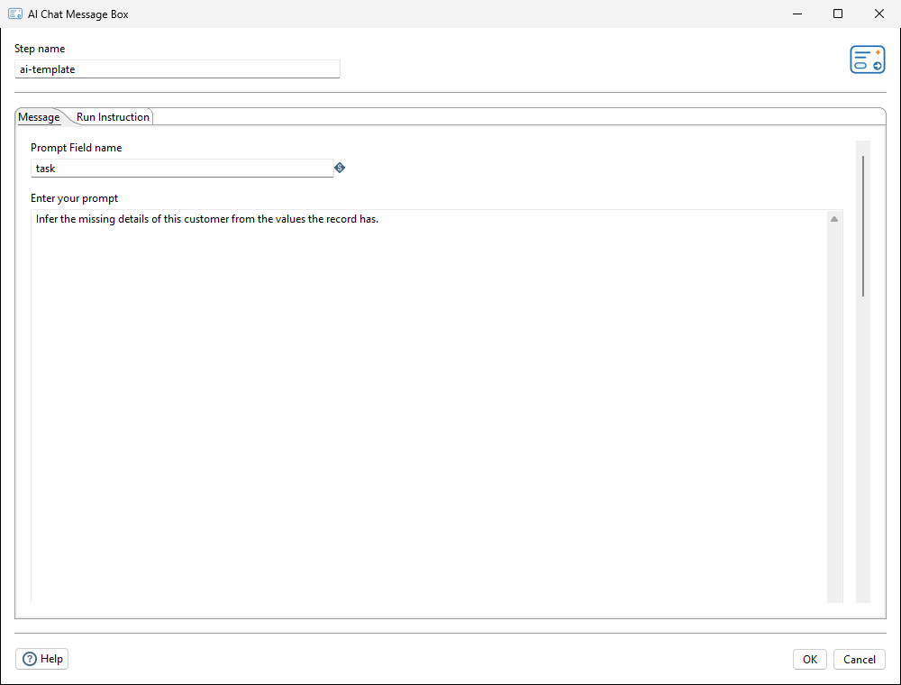
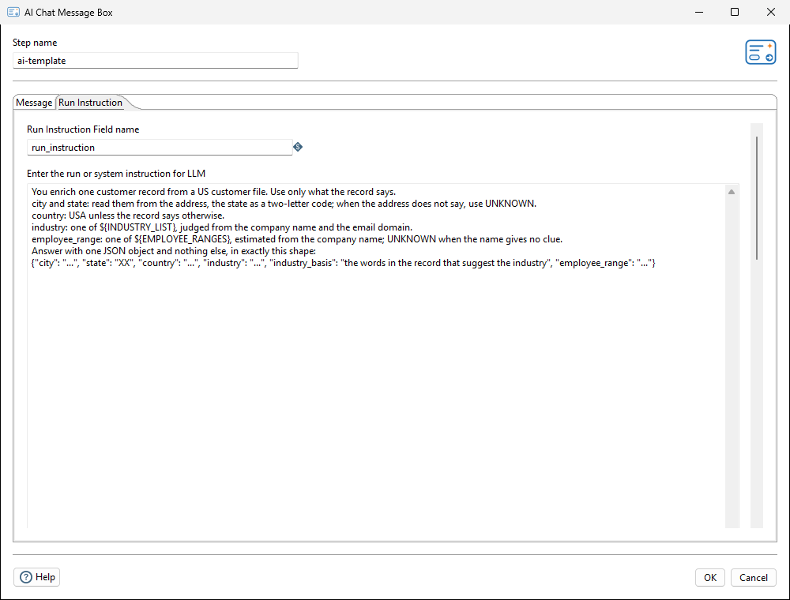
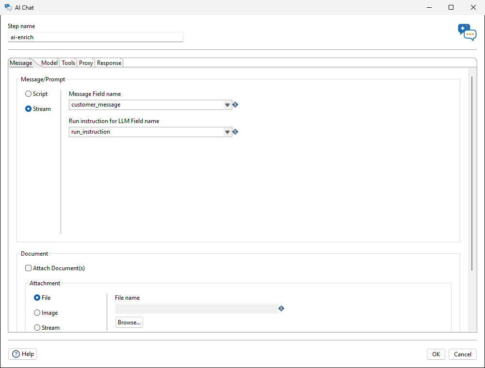
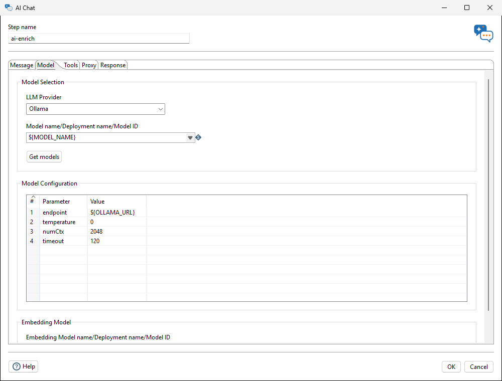
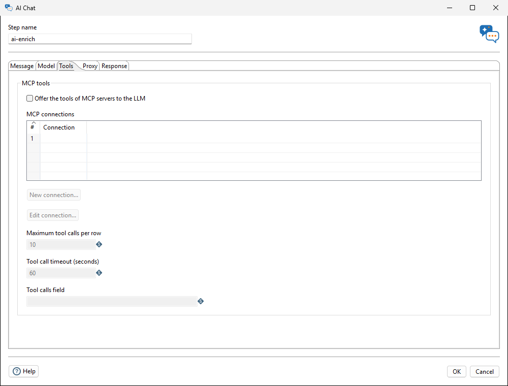
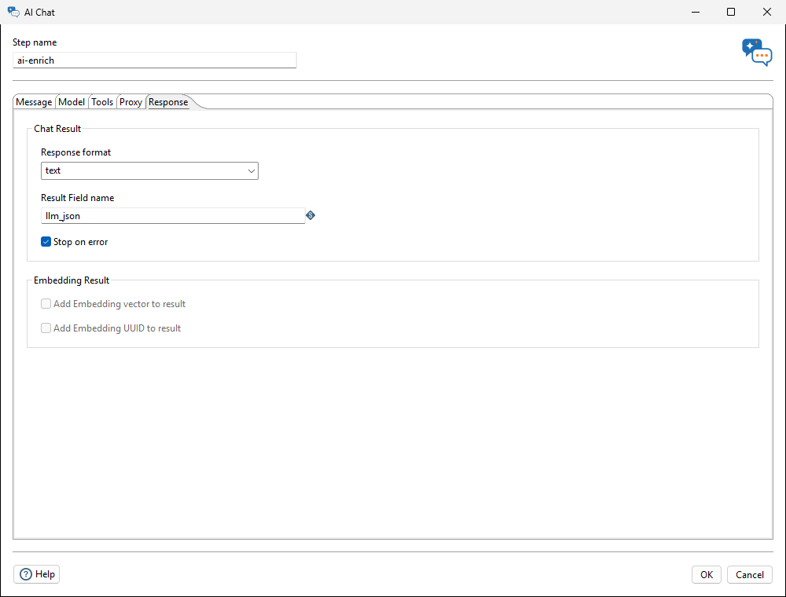
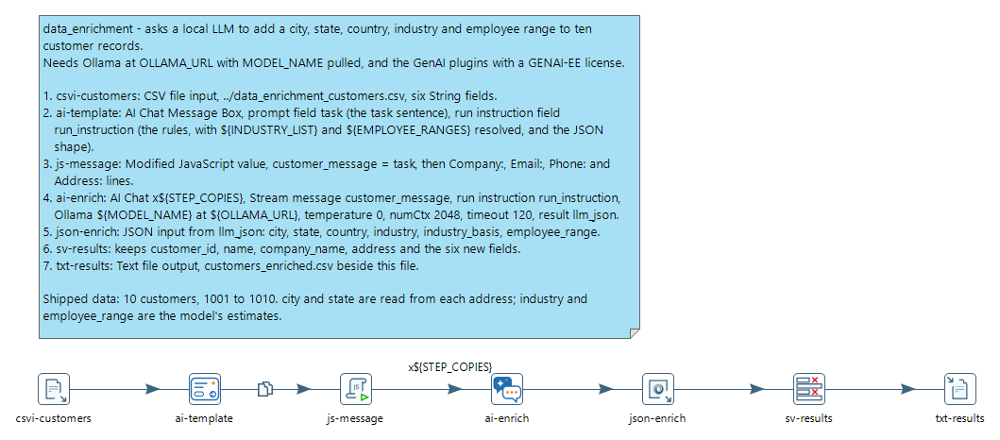

# Data Enrichment

> **Warning:**
>
> #### Workshop - Data Enrichment
>
> Rule-based ETL can clean data, but it cannot infer what a record does not say. Build a Pentaho Data Integration transformation in which a local Large Language Model (LLM) served by Ollama adds a city, state, country, industry and employee range to each of ten customer records, with the **AI Chat** step and a prompt template built by **AI Chat Message Box**.
>
> **What you'll do**
>
> * Decide which fields to infer, and how far each one can be trusted
> * Build the task and the run instruction from a template with **AI Chat Message Box**, filled from parameters
> * Join the task and each record's values into one message with **Modified JavaScript value**
> * Ask the model for the new fields with **AI Chat**, and parse them with **JSON input**
> * Write the enriched records, and check which values were read and which were guessed
>
> **Prerequisites:**
>
> * [Data Quality](../07-llm-data-quality/guide.md): the message, AI Chat and JSON input pattern this workshop reuses
> * Ollama running on `http://localhost:11434` with `llama3.2:3b` pulled, and the GenAI plugins installed, as set up in [Before You Start](../00-before-you-start/guide.md)
>
> **Estimated time:** 30 minutes

<figure>

<figcaption class="pcm-video-caption">Walkthrough: coming soon</figcaption>

</figure>

<div align="center">
<figure>

<figcaption>What you build: the steps of data_enrichment.ktr and what each one builds, calls and writes</figcaption>
</figure>
</div>

:::: tabs

### 1. Data Enrichment

> **Note:**
>
> #### Enrichment Compared with Data Quality
>
> Data quality fixes the fields a record already has. Enrichment adds fields it doesn't have, from the context in the ones it does: a company name suggests an industry, an address holds a city and a state.

| Aspect | Data Quality | Data Enrichment |
| --- | --- | --- |
| Goal | Fix incorrect or inconsistent values | Add missing information |
| Process | Standardize and validate | Infer and classify |
| Output | The same fields, cleaned | New fields |
| Example | `john smith` becomes `John Smith` | `acme corp` gets an industry and an employee range |
| Risk | Low: the value was there | Medium: an inferred value can be a guess |

**The data:** `data_enrichment_customers.csv` holds the same ten customers as the Data Quality lab, `1001` to `1010`. None of them has a separate city, state, country, industry or company size. The first three:

```text
customer_id,name,email,phone,address,company_name
1001,john smith,JSMITH@GMAIL.COM,555.123.4567,"123 main st apt 5, new york, ny","acme corp"
1002,SARAH JOHNSON,sarah.j@company,+1-555-987-6543,"456 oak avenue, los angeles, ca 90001",TechStart Inc
1003,Bob O'Brien,bob.obrien@email.com,(555) 111-2222,"789 Pine Rd, Chicago IL","DataSys LLC"
```

**The enrichment goals:**

| New field | How it is inferred | Trust |
| --- | --- | --- |
| `city` | Read from the address | High: the address says it |
| `state` | Read from the address, as a two-letter code (`Houston, Texas 77001` gives `TX`) | High |
| `country` | `USA` unless the record says otherwise | High for this file |
| `industry` | Classified from the company name and the email domain, from a fixed list | Medium: an estimate |
| `industry_basis` | The words in the record that suggest the industry | A check on `industry` |
| `employee_range` | Estimated from the company name, from fixed bands | Low: a guess from a name |

**Why an LLM:** a rule such as "company name contains Tech, so industry is Technology" breaks on the first company it was not written for. A lookup table only knows the companies already in it, and a paid company-data API charges per call. An LLM infers from whatever the record holds, runs locally with Ollama, and fills several fields in one call. The price is certainty: `city` and `state` are read from the address, but `industry` and `employee_range` are the model's estimate from a name, and should be labeled as inferred wherever they are used. That is why the model also returns `industry_basis`.

### 2. Check Ollama

> **Note:**
>
> #### One Record by Hand
>
> Send one record to the model yourself, with a short form of this workshop's instruction.

1. Check that Ollama answers and has the model. In PowerShell, run:

```powershell
(Invoke-RestMethod http://localhost:11434/api/tags).models | Select-Object name
```

> **Success:** Checkpoint: the list of models includes `llama3.2:3b`.

2. Send customer 1004 to the model. In PowerShell, run:

```powershell
$body = @{
  model    = "llama3.2:3b"
  stream   = $false
  options  = @{ temperature = 0 }
  messages = @(
    @{ role = "system"; content = 'You enrich one customer record. Read city and state (two letters) from the address. industry: one of Technology, Finance, Services, Consulting. Answer with one JSON object and nothing else: {"city": "...", "state": "XX", "industry": "..."}' }
    @{ role = "user";   content = "Company: global solutions ltd`nAddress: 321 Elm Street, Houston, Texas 77001" }
  )
} | ConvertTo-Json -Depth 4
(Invoke-RestMethod -Uri http://localhost:11434/api/chat -Method Post -ContentType "application/json" -Body $body).message.content
```

> **Success:** Checkpoint: one line of JSON with `city`, `state` and `industry`, such as `{"city": "Houston", "state": "TX", "industry": "Technology"}`. The address fixes `Houston` and `TX`; the industry is the model's estimate from the name `global solutions ltd`, and can differ from run to run and from the transformation's answer.

### 3. Read the Customers

> **Note:**
>
> #### Read the Customers
>
> Create the transformation, give it the parameters its steps read, including the two lists the model chooses from, and read the customers.

1. Start Pentaho Data Integration with the **Start Pentaho Data Integration** button below, or from PowerShell:

```powershell
Set-Location C:\Pentaho\design-tools\data-integration
.\Spoon.bat
```

<button data-launch="spoon" data-path="">Start Pentaho Data Integration</button>

2. Select **File > New > Transformation** (`Ctrl+N`).
3. Select **File > Save as** and save it as `data_enrichment.ktr` in `C:\Workshop-AI-Specialty\04-llm-integration\08-llm-data-enrichment`, next to `data_enrichment_customers.csv`. (On your own machine, download `data_enrichment_customers.csv` from **Lab Files** below into the folder you save in.)
4. Double-click an empty part of the canvas. **Transformation properties** opens.
5. Open the **Parameters** tab and fill the grid:

| Parameter | Default Value | Description |
| --- | --- | --- |
| `MODEL_NAME` | `llama3.2:3b` | Ollama chat model |
| `OLLAMA_URL` | `http://localhost:11434` | Ollama server |
| `STEP_COPIES` | `4` | Parallel copies of ai-enrich |
| `INDUSTRY_LIST` | `Technology, Finance, Healthcare, Retail, Manufacturing, Services, Real Estate, Consulting` | The industries the model may choose from |
| `EMPLOYEE_RANGES` | `1-10, 11-50, 51-200, 201-500, 501-1000, 1000+` | The company-size bands |

6. Select **OK**.
7. On the **Design** tab, open the **Input** folder and drag **CSV file input** onto the canvas.
8. Double-click **CSV file input** and set **Step name** to `csvi-customers`.
9. Set **Filename** to `${Internal.Entry.Current.Directory}/data_enrichment_customers.csv`.
10. Keep **Delimiter** `,`, **Enclosure** `"` and **Header row present?** selected. Clear **Lazy conversion?**.
11. Fill the **Fields** grid. Every field is a String with no length, trimmed on both sides:

| Name | Type | Length | Trim type |
| --- | --- | --- | --- |
| `customer_id` | String | | both |
| `name` | String | | both |
| `email` | String | | both |
| `phone` | String | | both |
| `address` | String | | both |
| `company_name` | String | | both |

12. Select **OK**, and save the transformation (`Ctrl+S`).
13. Select **csvi-customers** on the canvas, press `F10` (**Action > Preview**), and select **Quick Launch**.

> **Success:** Checkpoint: **Examine preview data** shows 10 rows, `customer_id` `1001` to `1010`; the first company is `acme corp`.

14. Select **Close**.

### 4. The Prompt Template

> **Note:**
>
> #### AI Chat Message Box
>
> **AI Chat Message Box** adds two text fields to every row, a prompt and a run instruction, typed once in its dialog. Any `${VARIABLE}` in them is replaced by the variable's value, so the two lists the model chooses from come from the parameters you just created.

1. On the **Design** tab, open the **AI** folder and drag **AI Chat Message Box** onto the canvas.
2. Create a hop from **csvi-customers** to **AI Chat Message Box**: hold `Shift` and drag from one step to the other.
3. Double-click **AI Chat Message Box** and set **Step name** to `ai-template`.
4. On the **Message** tab, set **Prompt Field name** to `task` and enter this in **Enter your prompt**:

```text
Infer the missing details of this customer from the values the record has.
```

5. On the **Run Instruction** tab, set **Run Instruction Field name** to `run_instruction` and enter this in **Enter the run or system instruction for LLM**:

```text
You enrich one customer record from a US customer file. Use only what the record says.
city and state: read them from the address, the state as a two-letter code; when the address does not say, use UNKNOWN.
country: USA unless the record says otherwise.
industry: one of ${INDUSTRY_LIST}, judged from the company name and the email domain.
employee_range: one of ${EMPLOYEE_RANGES}, estimated from the company name; UNKNOWN when the name gives no clue.
Answer with one JSON object and nothing else, in exactly this shape:
{"city": "...", "state": "XX", "country": "...", "industry": "...", "industry_basis": "the words in the record that suggest the industry", "employee_range": "..."}
```

<div align="center">
<figure>

<figcaption>ai-template: the Message tab</figcaption>
</figure>
</div>

<div align="center">
<figure>

<figcaption>ai-template: the Run Instruction tab</figcaption>
</figure>
</div>

6. Select **OK**.

> **Under the hood:**
>
> #### The template's variables are filled once, from the parameters
>
> When the transformation starts, **AI Chat Message Box** replaces `${INDUSTRY_LIST}` and `${EMPLOYEE_RANGES}` with the parameters' values and adds the same `task` and `run_instruction` to every row. It replaces variables only, never field values: the customer's own values join the message in the next step.
>
> **Why it matters:** the list of industries is a business decision, not part of the prompt's wording. As a parameter it can change per run, in the **Run Options** dialog, without anyone editing the instruction.

### 5. Build the Message

> **Note:**
>
> #### Modified JavaScript Value
>
> The message is the task followed by the customer's values, one labeled line each. A **Modified JavaScript value** step joins them into `customer_message`.

1. On the **Design** tab, open the **Scripting** folder and drag **Modified JavaScript value** onto the canvas.
2. Create a hop from **ai-template** to **Modified JavaScript value**.
3. Double-click **Modified JavaScript value** and set **Step name** to `js-message`.
4. Replace the text in the **Script 1** tab with:

```javascript
// The task from ai-template, then the customer's values as labeled lines
var customer_message = task + "\n\n" +
  "Company: " + company_name + "\n" +
  "Email: " + email + "\n" +
  "Phone: " + phone + "\n" +
  "Address: " + address;
```

5. Fill the **Fields** grid with one row: **Fieldname** `customer_message`, **Type** String, **Replace value 'Fieldname' or 'Rename to'** `N`.
6. Select **OK**, and save the transformation (`Ctrl+S`).

The record's name is left out of the message on purpose: a person's name says nothing about a company's industry or size, and a value the model does not need is one it cannot misuse.

### 6. Ask the Model

> **Note:**
>
> #### AI Chat and JSON Input
>
> **AI Chat** sends each `customer_message` with the `run_instruction` from the template. **JSON input** splits the answer into the six new fields.

1. On the **Design** tab, open the **AI** folder and drag **AI Chat** onto the canvas.
2. Create a hop from **js-message** to **AI Chat**.
3. Double-click **AI Chat** and set **Step name** to `ai-enrich`.
4. On the **Message** tab, under **Message/Prompt**, select **Stream**. Set **Message Field name** to `customer_message` and **Run instruction for LLM Field name** to `run_instruction`. Keep **Attach Document(s)** cleared.
5. On the **Model** tab, set **LLM Provider** to `Ollama` and **Model name/Deployment name/Model ID** to `${MODEL_NAME}`.
6. Fill the **Model Configuration** grid. Delete any row that is not in this table:

| Parameter | Value |
| --- | --- |
| `endpoint` | `${OLLAMA_URL}` |
| `temperature` | `0` |
| `numCtx` | `2048` |
| `timeout` | `120` |

7. On the **Response** tab, keep **Response format** `text`, set **Result Field name** to `llm_json`, and keep **Stop on error** selected.
<div align="center">
<figure>

<figcaption>ai-enrich: the Message tab</figcaption>
</figure>
</div>

<div align="center">
<figure>

<figcaption>ai-enrich: the Model tab</figcaption>
</figure>
</div>

<div align="center">
<figure>

<figcaption>ai-enrich: the Tools tab</figcaption>
</figure>
</div>

<div align="center">
<figure>

<figcaption>ai-enrich: the Response tab</figcaption>
</figure>
</div>

8. Select **OK**.
9. Right-click **ai-enrich** and select **Change Number of Copies to Start...**. Enter `${STEP_COPIES}` and select **OK**.
10. On the **Design** tab, open the **Input** folder and drag **JSON input** onto the canvas. Create a hop from **ai-enrich** to it.
11. Double-click **JSON input** and set **Step name** to `json-enrich`.
12. On the **File** tab, select **Source is from a previous step** and set **Select field** to `llm_json`.
13. On the **Content** tab, make sure **Ignore missing path** and **Default path leaf to null** are selected.
14. On the **Fields** tab, fill the grid:

| Name | Path | Type |
| --- | --- | --- |
| `city` | `$.city` | String |
| `state` | `$.state` | String |
| `country` | `$.country` | String |
| `industry` | `$.industry` | String |
| `industry_basis` | `$.industry_basis` | String |
| `employee_range` | `$.employee_range` | String |

15. Select **OK**.

> **Under the hood:**
>
> #### The same request every time, because the temperature is 0
>
> **AI Chat** sends `run_instruction` as the system message and `customer_message` as the user message to `${OLLAMA_URL}`. With `temperature` `0` the model picks its most likely answer, so a second run gives the same enrichment for the same record. The values read from the address will be right far more often than the estimated ones, but repeating them is not the same as being right: `industry_basis` shows what each estimate rests on.
>
> **Why it matters:** an enrichment that changes between runs cannot be audited. A fixed temperature and a stated basis make each inferred value something a reviewer can check.

### 7. Catch the Answers the Parser Cannot Read

> **Note:**
>
> #### Error Handling on JSON Input
>
> A small model sometimes closes a JSON answer with the wrong bracket. An error hop sends such a row to a file of its own, with the parser's message, and the other records carry on.

1. On the **Design** tab, open the **Output** folder and drag **Text file output** onto the canvas, below **json-enrich**.
2. Double-click it and set **Step name** to `txt-bad-answers`. On the **File** tab, set **Filename** to `${Internal.Entry.Current.Directory}/bad_answers` and **Extension** to `csv`. Select **OK**.
3. Create a hop from **json-enrich** to **txt-bad-answers**, and select **Error handling of step** in the menu that opens. The hop is drawn red, with a red error icon.
4. Right-click **json-enrich** and select **Error Handling...**. In **Step error handling settings**, enter these settings, then select **OK**:

| Setting | Value |
| --- | --- |
| **Target step** | `txt-bad-answers` |
| **Enable the error handling?** | Selected |
| **Nr of errors fieldname** | `err_count` |
| **Error descriptions fieldname** | `err_desc` |

5. Double-click **txt-bad-answers**. On the **Fields** tab, select **Get Fields**, then **Minimal width**, and delete every row except `customer_id`, `llm_json` and `err_desc`. Select **OK**, and save the transformation (`Ctrl+S`).

> **Under the hood:**
>
> #### A row the step cannot process leaves by the error hop instead of stopping the run
>
> Without error handling, the first unparsable answer fails **json-enrich** and stops the transformation, so the records behind it are never written. With it, **JSON input** adds the parser's message to the row as `err_desc` and sends that row down the red hop. The step's **Errors** count in **Step Metrics** shows how many rows went that way.
>
> **Why it matters:** this is how a production pipeline treats a model: most answers are good, some are not, and the bad ones are kept with their reason so a person, or a rerun with a stronger model, can deal with them.

### 8. Write and Run

> **Note:**
>
> #### Select Values and Text File Output
>
> Keep the customer's identity, the address the location was read from, and the six new fields, and write them to `customers_enriched.csv`.

1. On the **Design** tab, open the **Transform** folder and drag **Select values** onto the canvas. Create a hop from **json-enrich** to it.
2. Double-click **Select values**, set **Step name** to `sv-results`, and on the **Select & Alter** tab list these fields in this order: `customer_id`, `name`, `company_name`, `address`, `city`, `state`, `country`, `industry`, `industry_basis`, `employee_range`. Select **OK**.
3. On the **Design** tab, open the **Output** folder and drag **Text file output** onto the canvas. Create a hop from **sv-results** to it.
4. Double-click **Text file output** and set **Step name** to `txt-results`.
5. On the **File** tab, set **Filename** to `${Internal.Entry.Current.Directory}/customers_enriched` and **Extension** to `csv`. Select **Create Parent folder**.
6. On the **Content** tab, keep **Separator** `,`, **Enclosure** `"` and **Header** selected, and set **Encoding** to `UTF-8`. On the **Fields** tab, select **Get Fields**, then **Minimal width**: the ten fields in the order **sv-results** gives them, with no fixed lengths.
7. Select **OK**, and save the transformation (`Ctrl+S`).
8. Press `F9` (**Action > Run**), and select **Run** in the **Run Options** dialog.
9. In **Execution Results**, open the **Step Metrics** tab.

> **Success:** Checkpoint: **csvi-customers** shows 10 under **Written**, and the four copies of **ai-enrich** read 10 rows between them (for example 3, 3, 2 and 2). **json-enrich** writes 10 with 0 under **Errors**: every answer parsed, so none went down the error hop, and **txt-results** shows 10 under **Written**. On a machine with a GPU the ten model calls take about 5 seconds.

10. Select **txt-results** on the canvas and open the **Preview data** tab.

> **Success:** Checkpoint: 10 rows, one per customer, with the six new fields. `city` and `state` match each address (customer 1004, `Houston, Texas 77001`, as `Houston` and `TX`) and `country` is `USA`. `industry` is one of the eight in `INDUSTRY_LIST`, for example `Services` for 1004 and `Real Estate` for 1008, with the words it was judged from in `industry_basis`; `employee_range` is one of the bands, such as `1-10` or `51-200`. The estimates are the model's and will differ from run to run. Read `industry_basis` critically: in the measured run the model copied the instruction's placeholder, `the words in the record that suggest the industry`, into it for customer 1001 instead of real words.

11. Open `customers_enriched.csv` in `C:\Workshop-AI-Specialty\04-llm-integration\08-llm-data-enrichment`.

> **Success:** Checkpoint: its first line is `customer_id,name,company_name,address,city,state,country,industry,industry_basis,employee_range`, followed by one row per answer that parsed: 10 when every answer did. `bad_answers.csv` is there too, but empty, without even a header line, when every answer parsed.

12. Try another list: press `F9`, and in the **Run Options** dialog change `INDUSTRY_LIST` to `Technology, Services, Other`. Run again and compare: the template sent the new list to every row without a change to any step.

::::

## Troubleshooting <!-- no-step -->

<details>
<summary>Error initializing step: License validation failed</summary>

The Pentaho license on this machine has no GenAI rights. Every GenAI plugin step, **AI Chat Message Box** included, checks for a license with the GenAI Plugin Suite (GENAI-EE) subscription when the transformation starts. Install a license that includes it, as described in [Before You Start](../00-before-you-start/guide.md).

</details>

<details>
<summary>The instruction still says ${INDUSTRY_LIST}</summary>

The parameter is missing or misspelled. Double-click an empty part of the canvas and open the **Parameters** tab: the name must match the template exactly, case included.

</details>

<details>
<summary>The new fields are null on a row</summary>

The model's answer was not the JSON the instruction asked for. Preview **ai-enrich** and read `llm_json` for that row. A larger model (`qwen2.5:7b`) usually fixes it.

</details>

## Lab Files

Click a file to download. For `.ktr` and `.kjb` files, **Open in Pentaho Data Integration** launches Pentaho Data Integration with the file loaded. If Pentaho Data Integration is already running, the path is copied to your clipboard — switch to Pentaho Data Integration and press `Ctrl+O`, `Ctrl+V`, `Enter`.

The ten customer records to enrich:

[data_enrichment_customers.csv](./files/data_enrichment_customers.csv)

### Solution <!-- no-step -->

The finished transformation for this lab. Open it alongside your own to compare, or run it to see the expected result. It reads `data_enrichment_customers.csv` from the lab folder and writes `customers_enriched.csv` beside itself, and `bad_answers.csv` for any answer the parser could not read.

Also on disk at `C:\Workshop-AI-Specialty\04-llm-integration\08-llm-data-enrichment\solution`.

[data_enrichment.ktr](./files/solution/data_enrichment.ktr) <button data-launch="spoon" data-path="files/solution/data_enrichment.ktr">Open in Pentaho Data Integration</button> <button data-graph="files/solution/data_enrichment.ktr">View graph</button>

data_enrichment in Spoon, with its note:

<div align="center">
<figure>

<figcaption>data_enrichment.ktr in Spoon</figcaption>
</figure>
</div>
