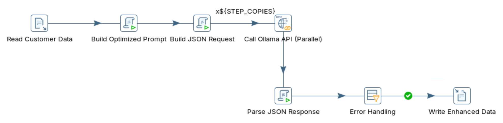
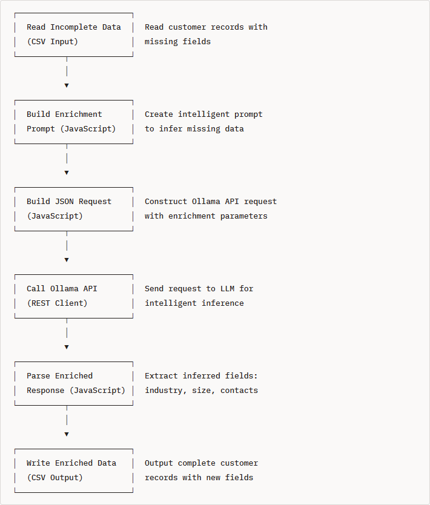

# Data Enrichment

> **Warning:**
>
> #### Workshop - Data Enrichment
>
> Rule-based ETL can clean data, but it cannot infer what a record does not say. In this workshop you turn the Data Quality transformation into an enrichment pipeline: a local Large Language Model (LLM) served by Ollama adds a city, state, country, industry and employee range to each customer record in Pentaho Data Integration.
>
> **What you'll do**
>
> * Decide which fields to infer, and how each one is inferred
> * Test an enrichment prompt against the Ollama API
> * Turn the Data Quality transformation into an enrichment transformation
> * Add new fields such as industry and employee range to the output
> * Check which values the model inferred, and how far to trust them
>
> **Prerequisites:**
>
> * [Data Quality](../07-llm-data-quality/guide.md): this workshop starts from its transformation
> * Ollama running on `http://localhost:11434` with `llama3.2:3b` pulled
>
> **Estimated time:** 30 minutes

<div align="center">
<figure>

<figcaption>What you build: the Data Quality pipeline, with a new prompt, request and parser</figcaption>
</figure>
</div>

:::: tabs

### 1. Data Enrichment

> **Note:**
>
> #### Enrichment Compared with Data Quality
>
> Data quality fixes the fields a record already has. Enrichment adds fields it doesn't have, from the context in the ones it does: a company name suggests an industry, an address holds a city and a state.

| Aspect | Data Quality | Data Enrichment |
| --- | --- | --- |
| Goal | Fix incorrect or inconsistent values | Add missing information |
| Process | Standardize and validate | Infer and classify |
| Output | The same fields, cleaned | New fields |
| Example | `john smith` becomes `John Smith` | `acme corp` gets an industry and an employee range |
| Risk | Low: the value was there | Medium: an inferred value can be a guess |

**The data:** `data_enrichment_customers.csv` holds the same ten customers as the Data Quality lab, `1001` to `1010`. None of them has a separate city, state, country, industry or company size. The first three:

```text
customer_id,name,email,phone,address,company_name
1001,john smith,JSMITH@GMAIL.COM,555.123.4567,"123 main st apt 5, new york, ny",acme corp
1002,SARAH JOHNSON,sarah.j@company,+1-555-987-6543,"456 oak avenue, los angeles, ca 90001",TechStart Inc
1003,Bob O'Brien,bob.obrien@email.com,(555) 111-2222,"789 Pine Rd, Chicago IL",DataSys LLC
```

**The enrichment goals:**

| New field | How it is inferred | Example |
| --- | --- | --- |
| `city` | Taken from the address | `los angeles, ca 90001` gives `Los Angeles` |
| `state` | Taken from the address, as a two-letter code | `Houston, Texas 77001` gives `TX` |
| `country` | `USA` unless the record says otherwise | `USA` |
| `industry` | Classified from the company name and email domain | `TechStart Inc` suggests `Technology` |
| `employee_range` | Estimated from the company name: `1-10`, `11-50`, `51-200`, `201-500`, `501-1000` or `1000+` | `TechStart Inc` suggests a small company |

**Why an LLM:** a rule such as "company name contains Tech, so industry is Technology" breaks on the first company it was not written for. A lookup table only knows the companies already in it, and a paid company-data API charges per call and limits how often you can call it. An LLM infers from whatever the record holds, runs locally with Ollama, and fills several fields in one call. The price is certainty: `city` and `state` are read from the address, but `industry` and `employee_range` are the model's estimate from a name, and should be labeled as inferred wherever they are used.

### 2. Ollama API

> **Note:**
>
> #### The Enrichment Request
>
> The request asks for JSON with `"format": "json"`, and allows a little more freedom than the cleaning request: `temperature` `0.3` instead of `0.1`, and up to 400 tokens.

1. Send customer 1002 to the model with the enrichment prompt. In PowerShell, run:

::: tabs

### Windows (PowerShell)

```powershell
$prompt = @'
Infer missing details for this customer. Return ONLY valid JSON with these fields:
{"city":"...","state":"...","country":"...","industry":"...","employee_range":"..."}
Rules:
- city and state: take them from the address; state as a 2-letter code; if unknown use "UNKNOWN"
- country: "USA" unless the record says otherwise
- industry: Technology, Finance, Healthcare, Retail, Manufacturing, Services, Real Estate or Consulting
- employee_range: 1-10, 11-50, 51-200, 201-500, 501-1000 or 1000+
Company: TechStart Inc
Email: sarah.j@company
Phone: +1-555-987-6543
Address: 456 oak avenue, los angeles, ca 90001
'@
$body = @{
  model   = "llama3.2:3b"
  prompt  = $prompt
  stream  = $false
  format  = "json"
  options = @{ temperature = 0.3; num_predict = 400 }
} | ConvertTo-Json
(Invoke-RestMethod -Uri http://localhost:11434/api/generate -Method Post -ContentType "application/json" -Body $body).response
```

### macOS / Linux

```bash
curl http://localhost:11434/api/generate -d '{
  "model": "llama3.2:3b",
  "prompt": "Infer missing details for this customer. Return ONLY valid JSON with these fields:\n{\"city\":\"...\",\"state\":\"...\",\"country\":\"...\",\"industry\":\"...\",\"employee_range\":\"...\"}\nRules:\n- city and state: take them from the address; state as a 2-letter code; if unknown use \"UNKNOWN\"\n- country: \"USA\" unless the record says otherwise\n- industry: Technology, Finance, Healthcare, Retail, Manufacturing, Services, Real Estate or Consulting\n- employee_range: 1-10, 11-50, 51-200, 201-500, 501-1000 or 1000+\nCompany: TechStart Inc\nEmail: sarah.j@company\nPhone: +1-555-987-6543\nAddress: 456 oak avenue, los angeles, ca 90001",
  "stream": false,
  "format": "json",
  "options": {"temperature": 0.3, "num_predict": 400}
}'
```

:::

> **Success:** Checkpoint: a JSON object with the keys `city`, `state`, `country`, `industry` and `employee_range`. The address fixes `Los Angeles` and `CA`; `industry` and `employee_range` are the model's estimates and can change between runs.

2. Run the same command again and compare the two answers. The values read from the address should repeat; the estimated ones may not, which is what `temperature` `0.3` allows.

### 3. Build the Transformation

> **Note:**
>
> #### From Data Quality to Data Enrichment
>
> The pipeline keeps every step of the Data Quality transformation. You point it at this lab's file, replace the three scripts, and write the new fields.

1. Start Spoon with the **Start Pentaho Data Integration** button below, or from a terminal:

::: tabs

### Windows (PowerShell)

```powershell
Set-Location C:\Pentaho\design-tools\data-integration
.\spoon.bat
```

### macOS / Linux

```bash
cd ~/Pentaho/design-tools/data-integration
./spoon.sh
```

:::

<button data-launch="spoon" data-path="">Start Pentaho Data Integration</button>

2. Select **File > Open** (`Ctrl+O`) and open your `data_quality_enhancement_optimized.ktr` from `C:\Workshop-AI-Specialty\04-llm-integration\07-llm-data-quality`. (If you did not build it, open the solution from the **Lab Files** of [Data Quality](../07-llm-data-quality/guide.md).)
3. Select **File > Save as** and save it as `data_enrichment_optimized.ktr` in `C:\Workshop-AI-Specialty\04-llm-integration\08-llm-data-enrichment`, next to `data_enrichment_customers.csv`. (On your own machine, download the file from **Lab Files** below into the folder you save in.)
4. Double-click an empty part of the canvas, open the **Parameters** tab, and set the **Default Value** of `INPUT_FILE` to `${Internal.Transformation.Filename.Directory}/data_enrichment_customers.csv`. Select **OK**.
5. Double-click **Build Optimized Prompt** and replace the text in the **Script 1** tab with:

```javascript
// Enrichment prompt: infer the fields the record does not have
var llm_prompt = "Infer missing details for this customer. Return ONLY valid JSON with these fields:\n" +
  "{\"city\":\"...\",\"state\":\"...\",\"country\":\"...\",\"industry\":\"...\",\"employee_range\":\"...\"}\n" +
  "Rules:\n" +
  "- city and state: take them from the address; state as a 2-letter code; if unknown use \"UNKNOWN\"\n" +
  "- country: \"USA\" unless the record says otherwise\n" +
  "- industry: Technology, Finance, Healthcare, Retail, Manufacturing, Services, Real Estate or Consulting\n" +
  "- employee_range: 1-10, 11-50, 51-200, 201-500, 501-1000 or 1000+\n" +
  "Company: " + company_name + "\n" +
  "Email: " + email + "\n" +
  "Phone: " + phone + "\n" +
  "Address: " + address;
```

6. Keep the **Fields** grid as it is (`llm_prompt`, String) and select **OK**.
7. Double-click **Build JSON Request** and replace the text in the **Script 1** tab with:

```javascript
// Enrichment request: JSON output, a little more freedom, longer answers
var model_name = getVariable("MODEL_NAME", "llama3.2:3b");
var keep_alive = getVariable("KEEP_ALIVE", "5m");

var requestObj = {
    "model": model_name,
    "prompt": llm_prompt,
    "stream": false,
    "format": "json",
    "keep_alive": keep_alive,
    "options": {
        "temperature": 0.3,
        "num_predict": 400
    }
};

var request_body = JSON.stringify(requestObj);
```

8. Keep the **Fields** grid as it is (`request_body`, String) and select **OK**.
9. Double-click **Parse JSON Response** and replace the text in the **Script 1** tab with:

```javascript
// Parse the enrichment answer; UNKNOWN when the model leaves a field out
var city = "UNKNOWN";
var state = "UNKNOWN";
var country = "UNKNOWN";
var industry = "UNKNOWN";
var employee_range = "UNKNOWN";
var parsing_error = "N";
var error_message = "";

try {
    var response = JSON.parse(api_response);
    var fullResponse = response.response;

    var jsonStart = fullResponse.indexOf("{");
    var jsonEnd = fullResponse.lastIndexOf("}") + 1;

    if (jsonStart >= 0 && jsonEnd > jsonStart) {
        var data = JSON.parse(fullResponse.substring(jsonStart, jsonEnd));

        city = data.city || city;
        state = data.state || state;
        country = data.country || country;
        industry = data.industry || industry;
        employee_range = data.employee_range || employee_range;
    } else {
        parsing_error = "Y";
        error_message = "No JSON found in response";
    }
} catch(e) {
    parsing_error = "Y";
    error_message = e.message || "Parse error";
}
```

10. Replace the rows of the **Fields** grid with:

| Fieldname | Type | Replace value 'Fieldname' or 'Rename to' |
| --- | --- | --- |
| `city` | String | N |
| `state` | String | N |
| `country` | String | N |
| `industry` | String | N |
| `employee_range` | String | N |
| `parsing_error` | String | N |
| `error_message` | String | N |

11. Select **OK**.

> **Under the hood:**
>
> #### The enriched fields start as UNKNOWN, so a missing answer is visible
>
> In the Data Quality parser each field started as the original value, because a failed cleanup should leave the data as it was. An enrichment field has no original value, so this parser starts each one as `UNKNOWN` and replaces it only with a non-empty value from the model. `parsing_error` is set the same way as before, so **Error Handling** keeps working unchanged.
>
> **Why it matters:** downstream, `UNKNOWN` can be counted and reported; an empty string looks like data that was never requested.

12. Double-click **Write Enhanced Data**. On the **File** tab, set **Filename** to `${Internal.Transformation.Filename.Directory}/customer_data_enriched`.
13. On the **Fields** tab, replace the grid with these fields. Every field is a String:

| Name | Type |
| --- | --- |
| `customer_id` | String |
| `name` | String |
| `company_name` | String |
| `address` | String |
| `city` | String |
| `state` | String |
| `country` | String |
| `industry` | String |
| `employee_range` | String |

14. Select **OK**.
15. Save the transformation (`Ctrl+S`).

### 4. Run

> **Note:**
>
> #### Run the Transformation
>
> Ten records, ten LLM calls, spread over the parallel copies of **Call Ollama API (Parallel)**.

1. Press `F9` (**Action > Run**), and select **Run** in the **Run Options** dialog.
2. In **Execution Results**, open the **Step Metrics** tab.

> **Success:** Checkpoint: **Read Customer Data** shows 10 under **Written**, and **Write Enhanced Data** one row for each record whose answer parsed: 10 when every answer parsed.

3. Select **Write Enhanced Data** on the canvas and open the **Preview data** tab.

> **Success:** Checkpoint: one row per customer with `city`, `state`, `country`, `industry` and `employee_range` filled in. `city` and `state` should match each address (customer 1004, `Houston, Texas 77001`, as `Houston` and `TX`); `industry` and `employee_range` are the model's estimates.

4. Find the results file. In PowerShell, run:

::: tabs

### Windows (PowerShell)

```powershell
Get-ChildItem C:\Workshop-AI-Specialty\04-llm-integration\08-llm-data-enrichment\customer_data_enriched_*.csv
```

### macOS / Linux

```bash
ls customer_data_enriched_*.csv
```

Run it in the folder you saved the transformation in.

:::

> **Success:** Checkpoint: a file named `customer_data_enriched_<yyyyMMdd>_<HHmmss>.csv`. Its first line is `customer_id,name,company_name,address,city,state,country,industry,employee_range`.

5. Run the transformation a second time and compare the two files. Fields read from the address should match; where `industry` or `employee_range` changed between runs, the model was guessing.

::::

## Lab Files

Click a file to download. For `.ktr` and `.kjb` files, **Open in Pentaho Data Integration** launches Pentaho Data Integration with the file loaded. If Pentaho Data Integration is already running, the path is copied to your clipboard — switch to Pentaho Data Integration and press `Ctrl+O`, `Ctrl+V`, `Enter`.

The ten customer records to enrich:

[data_enrichment_customers.csv](./files/data_enrichment_customers.csv)

### Solution <!-- no-step -->

The transformations that ship with this lab. Open them alongside your own to compare.

Also on disk at `C:\Workshop-AI-Specialty\04-llm-integration\08-llm-data-enrichment\solution`.

[data_enrichment_optimized.ktr](./files/data_enrichment_optimized.ktr) <button data-launch="spoon" data-path="files/data_enrichment_optimized.ktr">Open in Pentaho Data Integration</button> <button data-graph="files/data_enrichment_optimized.ktr">View graph</button>

[data_enrichment.ktr](./files/data_enrichment.ktr) <button data-launch="spoon" data-path="files/data_enrichment.ktr">Open in Pentaho Data Integration</button> <button data-graph="files/data_enrichment.ktr">View graph</button>

The pipeline, one box per step, with the names an enrichment version could give them:

<div align="center">
<figure>

<figcaption>The enrichment pipeline as designed</figcaption>
</figure>
</div>
