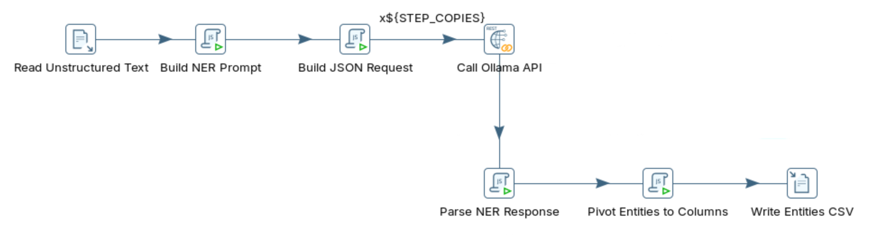
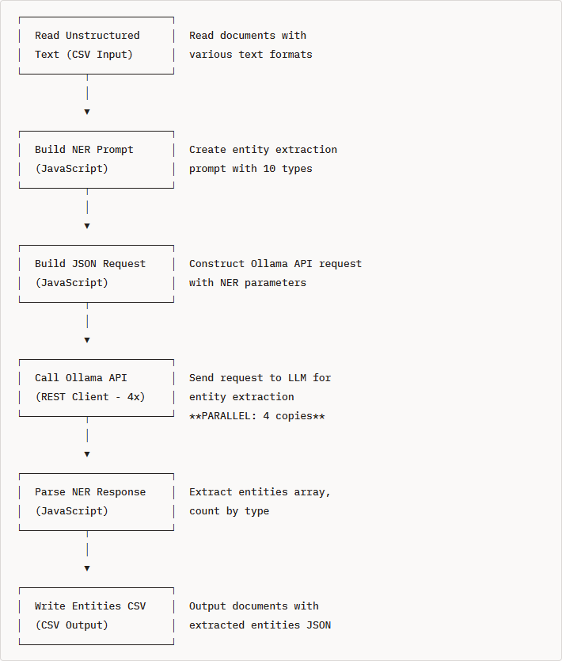

# Named Entity Recognition

> **Warning:**
>
> #### Workshop - Named Entity Recognition
>
> Named Entity Recognition (NER) finds the people, organizations, places, dates and other named things in free text and labels each one. Build a Pentaho Data Integration transformation that sends ten business documents to a local Large Language Model (LLM) served by Ollama and turns the entities it returns into columns.
>
> **What you'll do**
>
> * Prompt the model for a JSON array of entities in ten types
> * Call Ollama from parallel copies of **REST client**, with room for long answers
> * Count the entities by type in a **Modified JavaScript value** step
> * Pivot the first 15 entities into columns, and write everything to a CSV file
>
> **Prerequisites:**
>
> * [Data Quality](../07-llm-data-quality/guide.md): the prompt, request and parse pattern this workshop reuses
> * Ollama running on `http://localhost:11434` with `llama3.2:3b` pulled
>
> **Estimated time:** 30 minutes

<div align="center">
<figure>

<figcaption>What you build: seven steps, ending in a pivot to columns</figcaption>
</figure>
</div>

:::: tabs

### 1. Named Entity Recognition

> **Note:**
>
> #### What NER Does
>
> NER identifies named entities in unstructured text and classifies them into predefined types. The output is structured: one record per entity, with its exact text, its type, and the words around it.

**Example input** (the first document of this lab):

```text
Hi, this is Sarah Johnson from Acme Corporation. I'm writing to inquire about the order I placed on
December 15th, 2024. My customer ID is CUST-98765. Please contact me at sarah.johnson@acmecorp.com
or call 555-123-4567. Our office is located at 123 Main Street, San Francisco, CA 94102.
```

**Example output:**

```json
[
  {"entity": "Sarah Johnson", "type": "PERSON", "context": "this is Sarah Johnson from"},
  {"entity": "Acme Corporation", "type": "ORGANIZATION", "context": "Sarah Johnson from Acme Corporation"},
  {"entity": "December 15th, 2024", "type": "DATE", "context": "order I placed on December 15th"},
  {"entity": "sarah.johnson@acmecorp.com", "type": "CONTACT", "context": "contact me at sarah.johnson@acmecorp.com"}
]
```

**The entity types in this workshop:**

| Entity type | Description | Examples |
| --- | --- | --- |
| **PERSON** | Names of people | Sarah Johnson, Dr. Michael Chen |
| **ORGANIZATION** | Companies, institutions | Acme Corp, Stanford University |
| **LOCATION** | Cities, addresses, buildings | San Francisco, 123 Main St, Room 405 |
| **DATE** | Dates and times | December 15th 2024, 10:30 AM PST |
| **PRODUCT** | Product names and models | UltraBook Pro X1 |
| **MONEY** | Currency amounts | $125,000, £250,000 GBP |
| **CONTACT** | Emails, phone numbers | user@company.com, 555-123-4567, ext. 4521 |
| **ID** | Identifiers, tracking codes | CUST-98765, INV-2024-0089 |
| **TECHNOLOGY** | Software, platforms | AWS, Python, TensorFlow |
| **POSITION** | Job titles, roles | CEO, Project Manager |

**Why an LLM:** rule-based and trained NER models need labeled training data, work best in the domain they were trained on, and come with a fixed list of types. An LLM extracts entities without training data (zero-shot), takes its list of types from the prompt, so adding a type is a change of wording, and uses context to tell, for example, a person from a company with the same name. NER is used to pull names, IDs and dates from support tickets, parties and amounts from contracts, users and error codes from logs, and companies and figures from reports.

**The data:** `ner_documents.csv` holds ten documents of ten kinds, from a customer email to an HR memo, with three columns: `document_id`, `source` and `text`. `ner_documents_2.csv` has the same ten and ten more (a financial report, an invoice, a medical record and others), for a longer run once this one works.

<div align="center">
<figure>

<figcaption>The pipeline as first designed: the solution adds Pivot Entities to Columns before the output</figcaption>
</figure>
</div>

### 2. Ollama API

> **Note:**
>
> #### The NER Request
>
> An entity list is longer than a sentiment label, so this request allows up to 1,000 tokens (`num_predict`) per answer. It asks for JSON with `"format": "json"`, at `temperature` `0.1`.

1. Send the first document to the model with the transformation's prompt. In PowerShell, run:

::: tabs

### Windows (PowerShell)

```powershell
$prompt = @'
Extract ALL named entities from this text. Return a JSON array of ALL entities found.
Format: [{"entity":"exact text","type":"TYPE","context":"surrounding words"},...]
Types: PERSON, ORGANIZATION, LOCATION, DATE, PRODUCT, MONEY, CONTACT, ID, TECHNOLOGY, POSITION
Important: Return array with multiple objects, not a single object. Extract every entity.
TEXT:
Hi, this is Sarah Johnson from Acme Corporation. I'm writing to inquire about the order I placed on December 15th, 2024. My customer ID is CUST-98765. Please contact me at sarah.johnson@acmecorp.com or call 555-123-4567. Our office is located at 123 Main Street, San Francisco, CA 94102.
'@
$body = @{
  model      = "llama3.2:3b"
  prompt     = $prompt
  stream     = $false
  keep_alive = "15m"
  format     = "json"
  options    = @{ temperature = 0.1; num_predict = 1000 }
} | ConvertTo-Json
(Invoke-RestMethod -Uri http://localhost:11434/api/generate -Method Post -ContentType "application/json" -Body $body).response
```

### macOS / Linux

```bash
curl http://localhost:11434/api/generate -d '{
  "model": "llama3.2:3b",
  "prompt": "Extract ALL named entities from this text. Return a JSON array of ALL entities found.\nFormat: [{\"entity\":\"exact text\",\"type\":\"TYPE\",\"context\":\"surrounding words\"},...]\nTypes: PERSON, ORGANIZATION, LOCATION, DATE, PRODUCT, MONEY, CONTACT, ID, TECHNOLOGY, POSITION\nImportant: Return array with multiple objects, not a single object. Extract every entity.\nTEXT:\nHi, this is Sarah Johnson from Acme Corporation. I am writing to inquire about the order I placed on December 15th, 2024. My customer ID is CUST-98765. Please contact me at sarah.johnson@acmecorp.com or call 555-123-4567. Our office is located at 123 Main Street, San Francisco, CA 94102.",
  "stream": false,
  "keep_alive": "15m",
  "format": "json",
  "options": {"temperature": 0.1, "num_predict": 1000}
}'
```

:::

> **Success:** Checkpoint: JSON that lists entities with `entity`, `type` and `context`. Which entities, and whether the list comes back as a bare array or wrapped in an object such as `{"entities": [...]}`, depend on the model; `Sarah Johnson`, `Acme Corporation` and `CUST-98765` are the ones to look for.

2. Count the entities in the answer and compare them with the text: the document holds a person, a company, a date, an ID, an email, a phone number and an address.

### 3. Build the Prompt and Request

> **Note:**
>
> #### Read, Prompt, Request
>
> Read the documents, build the NER prompt from `text`, and wrap it in the request body.

1. Start Spoon with the **Start Pentaho Data Integration** button below, or from a terminal:

::: tabs

### Windows (PowerShell)

```powershell
Set-Location C:\Pentaho\design-tools\data-integration
.\spoon.bat
```

### macOS / Linux

```bash
cd ~/Pentaho/design-tools/data-integration
./spoon.sh
```

:::

<button data-launch="spoon" data-path="">Start Pentaho Data Integration</button>

2. Select **File > New > Transformation** (`Ctrl+N`).
3. Select **File > Save as** and save it as `named_entity_recognition_optimized.ktr` in `C:\Workshop-AI-Specialty\04-llm-integration\09-llm-ner`, next to `ner_documents.csv`. (On your own machine, download the file from **Lab Files** below into the folder you save in.)
4. Double-click an empty part of the canvas, open the **Parameters** tab, and fill the grid:

| Parameter | Default Value | Description |
| --- | --- | --- |
| `KEEP_ALIVE` | `15m` | Keep model loaded in memory (5m/15m/30m/60m) |
| `MODEL_NAME` | `llama3.2:3b` | LLM model to use for NER |
| `OLLAMA_URL` | `http://localhost:11434/api/generate` | Ollama API endpoint |
| `STEP_COPIES` | `4` | Number of parallel API call copies (set to CPU cores - 1) |

In this transformation `OLLAMA_URL` holds the whole endpoint, path included, and the REST client uses it as it is.

5. Select **OK**.
6. On the **Design** tab, open the **Input** folder and drag **CSV file input** onto the canvas.
7. Double-click **CSV file input**.
8. Set **Step name** to `Read Unstructured Text`.
9. Set **Filename** to `${Internal.Transformation.Filename.Directory}/ner_documents.csv`.
10. Keep **Delimiter** `,`, **Enclosure** `"`, and **Lazy conversion?** and **Header row present?** selected. Set **Format** to `mixed` and **File encoding** to `UTF-8`.
11. Fill the **Fields** grid:

| Name | Type | Length |
| --- | --- | --- |
| `document_id` | String | 50 |
| `source` | String | 100 |
| `text` | String | 10000 |

12. Select **OK**.
13. On the **Design** tab, open the **Scripting** folder and drag **Modified JavaScript value** onto the canvas.
14. Create a hop from **Read Unstructured Text** to **Modified JavaScript value**: hold `Shift` and drag from one step to the other.
15. Double-click **Modified JavaScript value**.
16. Set **Step name** to `Build NER Prompt`.
17. Replace the text in the **Script 1** tab with:

```javascript
// Optimized NER prompt - more explicit array format
var llm_prompt = "Extract ALL named entities from this text. Return a JSON array of ALL entities found.\n" +
  "Format: [{\"entity\":\"exact text\",\"type\":\"TYPE\",\"context\":\"surrounding words\"},...]\n" +
  "Types: PERSON, ORGANIZATION, LOCATION, DATE, PRODUCT, MONEY, CONTACT, ID, TECHNOLOGY, POSITION\n" +
  "Important: Return array with multiple objects, not a single object. Extract every entity.\n" +
  "TEXT:\n" + text;
```

18. Fill the **Fields** grid with one row: **Fieldname** `llm_prompt`, **Type** String, **Replace value 'Fieldname' or 'Rename to'** `N`.
19. Select **OK**.
20. Drag another **Modified JavaScript value** onto the canvas and create a hop from **Build NER Prompt** to it.
21. Double-click the new step and set **Step name** to `Build JSON Request`.
22. Replace the text in the **Script 1** tab with:

```javascript
// Build Ollama API request with keep-alive parameter
var model_name = getVariable("MODEL_NAME", "llama3.2:3b");
var keep_alive = getVariable("KEEP_ALIVE", "15m");

var requestObj = {
    "model": model_name,
    "prompt": llm_prompt,
    "stream": false,
    "keep_alive": keep_alive,
    "format": "json",
    "options": {
        "temperature": 0.1,
        "num_predict": 1000
    }
};

var request_body = JSON.stringify(requestObj);
```

23. Fill the **Fields** grid with one row: **Fieldname** `request_body`, **Type** String, **Replace value 'Fieldname' or 'Rename to'** `N`.
24. Select **OK**.
25. Save the transformation (`Ctrl+S`).
26. Select **Build JSON Request** on the canvas, press `F10` (**Action > Preview**), and select **Quick Launch**.

> **Success:** Checkpoint: 10 rows, `document_id` `1` to `10`, with `llm_prompt` and `request_body`. The first `request_body` starts `{"model":"llama3.2:3b","prompt":"Extract ALL named entities from this text.`.

27. Select **Close**.

### 4. Call Ollama and Parse

> **Note:**
>
> #### Call, Parse, Count
>
> **REST client** sends the requests in parallel. A script then takes the entity array out of the answer and counts the people, organizations, locations and dates.

1. On the **Design** tab, open the **Lookup** folder and drag **REST client** onto the canvas.
2. Create a hop from **Build JSON Request** to **REST client**.
3. Double-click **REST client** and set **Step name** to `Call Ollama API`.
4. On the **General** tab, set **URL** to `${OLLAMA_URL}`, **HTTP method** to `POST` and **Body field** to `request_body`. Keep **Application type** `TEXT PLAIN`.
5. Under **Output fields**, set **Result field name** to `api_response`, **HTTP status code field name** to `result_code` and **Response time (milliseconds) field name** to `response_time`.
6. Select **OK**.
7. Right-click **Call Ollama API** and select **Change Number of Copies to Start...**. Enter `${STEP_COPIES}` and select **OK**.
8. Drag a **Modified JavaScript value** from the **Scripting** folder onto the canvas and create a hop from **Call Ollama API** to it.
9. Double-click the new step and set **Step name** to `Parse NER Response`.
10. Replace the text in the **Script 1** tab with:

```javascript
// Parse Ollama response and extract entities as JSON string
var entities_json = "[]";
var entity_count = 0;
var person_count = 0;
var org_count = 0;
var location_count = 0;
var date_count = 0;

try {
    var response = JSON.parse(api_response);
    var fullResponse = response.response;
    
    // Extract JSON array from response
    var jsonStart = fullResponse.indexOf("[");
    var jsonEnd = fullResponse.lastIndexOf("]") + 1;
    
    if (jsonStart >= 0 && jsonEnd > jsonStart) {
        var jsonStr = fullResponse.substring(jsonStart, jsonEnd);
        entities_json = jsonStr;
        
        // Count entities by type
        var entities = JSON.parse(jsonStr);
        entity_count = entities.length;
        
        for (var i = 0; i < entities.length; i++) {
            var entityType = entities[i].type || "";
            if (entityType == "PERSON") person_count++;
            else if (entityType == "ORGANIZATION") org_count++;
            else if (entityType == "LOCATION") location_count++;
            else if (entityType == "DATE") date_count++;
        }
    }
} catch(e) {
    entities_json = "[]";
    entity_count = 0;
}
```

11. Fill the **Fields** grid. (**Get variables** adds every variable in the script; keep only these.)

| Fieldname | Type | Replace value 'Fieldname' or 'Rename to' |
| --- | --- | --- |
| `entities_json` | String | N |
| `entity_count` | Integer | N |
| `person_count` | Integer | N |
| `org_count` | Integer | N |
| `location_count` | Integer | N |
| `date_count` | Integer | N |

12. Select **OK**.

> **Under the hood:**
>
> #### The parser cut out the array, whatever the model wrapped around it
>
> `"format": "json"` makes the model answer with valid JSON, but valid JSON can be an object as well as an array, and a small model often returns `{"entities": [...]}` when asked for a list. The script ignores the wrapper: it takes everything from the first `[` to the last `]`, stores that text in `entities_json`, and parses it to count the types. If no array is found, or it does not parse, the row keeps `[]` and counts of 0 instead of failing.
>
> **Why it matters:** an `entity_count` of 0 on a document that clearly names people is the signal that the model answered in an unexpected shape; read `api_response` for that row to see what came back.

13. Save the transformation (`Ctrl+S`).

### 5. Pivot and Write

> **Note:**
>
> #### One Column Per Entity
>
> A CSV file is easier to filter when each entity has its own column. A script copies the first 15 entities into `entity_1` to `entity_15`, each with its type in `entity_type_1` to `entity_type_15`; `entities_json` keeps the full list.

1. Drag a **Modified JavaScript value** from the **Scripting** folder onto the canvas and create a hop from **Parse NER Response** to it.
2. Double-click the new step and set **Step name** to `Pivot Entities to Columns`.
3. Replace the text in the **Script 1** tab with:

```javascript
// Parse entities_json and populate entity columns
var entities_json_str = entities_json || "[]";

// Initialize all entity columns
var entity_1 = "", entity_type_1 = "";
var entity_2 = "", entity_type_2 = "";
var entity_3 = "", entity_type_3 = "";
var entity_4 = "", entity_type_4 = "";
var entity_5 = "", entity_type_5 = "";
var entity_6 = "", entity_type_6 = "";
var entity_7 = "", entity_type_7 = "";
var entity_8 = "", entity_type_8 = "";
var entity_9 = "", entity_type_9 = "";
var entity_10 = "", entity_type_10 = "";
var entity_11 = "", entity_type_11 = "";
var entity_12 = "", entity_type_12 = "";
var entity_13 = "", entity_type_13 = "";
var entity_14 = "", entity_type_14 = "";
var entity_15 = "", entity_type_15 = "";

try {
    var entities = JSON.parse(entities_json_str);

    // Handle both formats: {"entities": [...]} and [...]
    if (typeof entities === 'object' && entities.entities) {
        entities = entities.entities;
    }

    // Populate entity columns
    if (entities.length > 0) {
        entity_1 = entities[0].entity || "";
        entity_type_1 = entities[0].type || "";
    }
    if (entities.length > 1) {
        entity_2 = entities[1].entity || "";
        entity_type_2 = entities[1].type || "";
    }
    if (entities.length > 2) {
        entity_3 = entities[2].entity || "";
        entity_type_3 = entities[2].type || "";
    }
    if (entities.length > 3) {
        entity_4 = entities[3].entity || "";
        entity_type_4 = entities[3].type || "";
    }
    if (entities.length > 4) {
        entity_5 = entities[4].entity || "";
        entity_type_5 = entities[4].type || "";
    }
    if (entities.length > 5) {
        entity_6 = entities[5].entity || "";
        entity_type_6 = entities[5].type || "";
    }
    if (entities.length > 6) {
        entity_7 = entities[6].entity || "";
        entity_type_7 = entities[6].type || "";
    }
    if (entities.length > 7) {
        entity_8 = entities[7].entity || "";
        entity_type_8 = entities[7].type || "";
    }
    if (entities.length > 8) {
        entity_9 = entities[8].entity || "";
        entity_type_9 = entities[8].type || "";
    }
    if (entities.length > 9) {
        entity_10 = entities[9].entity || "";
        entity_type_10 = entities[9].type || "";
    }
    if (entities.length > 10) {
        entity_11 = entities[10].entity || "";
        entity_type_11 = entities[10].type || "";
    }
    if (entities.length > 11) {
        entity_12 = entities[11].entity || "";
        entity_type_12 = entities[11].type || "";
    }
    if (entities.length > 12) {
        entity_13 = entities[12].entity || "";
        entity_type_13 = entities[12].type || "";
    }
    if (entities.length > 13) {
        entity_14 = entities[13].entity || "";
        entity_type_14 = entities[13].type || "";
    }
    if (entities.length > 14) {
        entity_15 = entities[14].entity || "";
        entity_type_15 = entities[14].type || "";
    }
} catch(e) {
    // Keep empty values on error
}
```

4. Fill the **Fields** grid with 30 rows, each **Type** String and **Replace value 'Fieldname' or 'Rename to'** `N`, in this order: `entity_1`, `entity_type_1`, `entity_2`, `entity_type_2`, and so on to `entity_15`, `entity_type_15`. (**Get variables** adds them in that order; delete any other variable it adds, such as `entities_json_str`.)
5. Select **OK**.
6. On the **Design** tab, open the **Output** folder and drag **Text file output** onto the canvas.
7. Create a hop from **Pivot Entities to Columns** to **Text file output**.
8. Double-click **Text file output** and set **Step name** to `Write Entities CSV`.
9. On the **File** tab, set **Filename** to `${Internal.Transformation.Filename.Directory}/entities_extracted` and **Extension** to `csv`. Select **Create Parent folder**, **Include date in filename?** and **Include time in filename?**, and keep **Add filenames to result** selected.
10. On the **Content** tab, keep **Separator** `,` and **Enclosure** `"`, keep **Header** selected, and set **Format** to `DOS` and **Encoding** to `UTF-8`.
11. On the **Fields** tab, select **Get Fields**, then delete the `request_body` row. The grid keeps these fields, in this order:

| Name | Type |
| --- | --- |
| `document_id`, `source`, `text`, `llm_prompt`, `api_response` | String |
| `result_code`, `response_time` | String (as the solution has them; Integer from **Get Fields** writes the same text) |
| `entities_json` | String |
| `entity_count`, `person_count`, `org_count`, `location_count`, `date_count` | Integer |
| `entity_1`, `entity_type_1` to `entity_15`, `entity_type_15` | String |

12. Select **OK**.
13. Save the transformation (`Ctrl+S`).

### 6. Run

> **Note:**
>
> #### Run the Transformation
>
> Ten documents, ten LLM calls of up to 1,000 tokens each: the longest run in this module so far.

1. Press `F9` (**Action > Run**), and select **Run** in the **Run Options** dialog.
2. In **Execution Results**, open the **Step Metrics** tab.

> **Success:** Checkpoint: **Read Unstructured Text** shows 10 under **Written**, the four copies of **Call Ollama API** read 10 rows between them, and **Write Entities CSV** shows 10 under **Written**.

3. Select **Write Entities CSV** on the canvas and open the **Preview data** tab.

> **Success:** Checkpoint: 10 rows, one per document. `entity_count` is above 0 for the documents whose answer parsed, `entity_1` to `entity_15` hold the first entities with their types, and `entities_json` the full list. The entities and counts are the model's and vary between runs.

4. Find the results file. In PowerShell, run:

::: tabs

### Windows (PowerShell)

```powershell
Get-ChildItem C:\Workshop-AI-Specialty\04-llm-integration\09-llm-ner\entities_extracted_*.csv
```

### macOS / Linux

```bash
ls entities_extracted_*.csv
```

Run it in the folder you saved the transformation in.

:::

> **Success:** Checkpoint: a file named `entities_extracted_<yyyyMMdd>_<HHmmss>.csv`, with a header line that starts `document_id,source,text,llm_prompt,api_response`.

5. For a longer run, double-click **Read Unstructured Text**, set **Filename** to `${Internal.Transformation.Filename.Directory}/ner_documents_2.csv`, select **OK**, and run again: 20 documents.

::::

## Lab Files

Click a file to download. For `.ktr` and `.kjb` files, **Open in Pentaho Data Integration** launches Pentaho Data Integration with the file loaded. If Pentaho Data Integration is already running, the path is copied to your clipboard — switch to Pentaho Data Integration and press `Ctrl+O`, `Ctrl+V`, `Enter`.

The ten documents the transformation reads, and a 20-document set for a longer run:

[ner_documents.csv](./files/ner_documents.csv)

[ner_documents_2.csv](./files/ner_documents_2.csv)

### Solution <!-- no-step -->

The finished transformation for this lab. Open it alongside your own to compare.

Also on disk at `C:\Workshop-AI-Specialty\04-llm-integration\09-llm-ner\solution`.

[named_entity_recognition_optimized.ktr](./files/named_entity_recognition_optimized.ktr) <button data-launch="spoon" data-path="files/named_entity_recognition_optimized.ktr">Open in Pentaho Data Integration</button> <button data-graph="files/named_entity_recognition_optimized.ktr">View graph</button>

The basic version, with one copy of the API call, a longer prompt that describes each type, and no pivot:

[named_entity_recognition.ktr](./files/named_entity_recognition.ktr) <button data-launch="spoon" data-path="files/named_entity_recognition.ktr">Open in Pentaho Data Integration</button> <button data-graph="files/named_entity_recognition.ktr">View graph</button>
