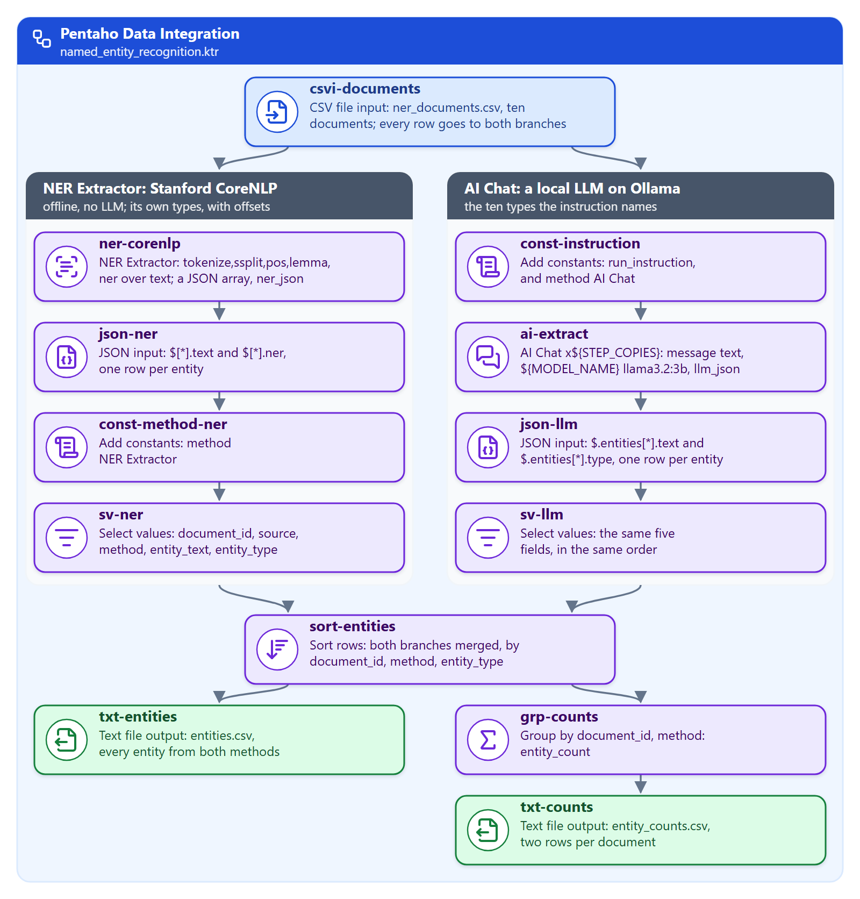
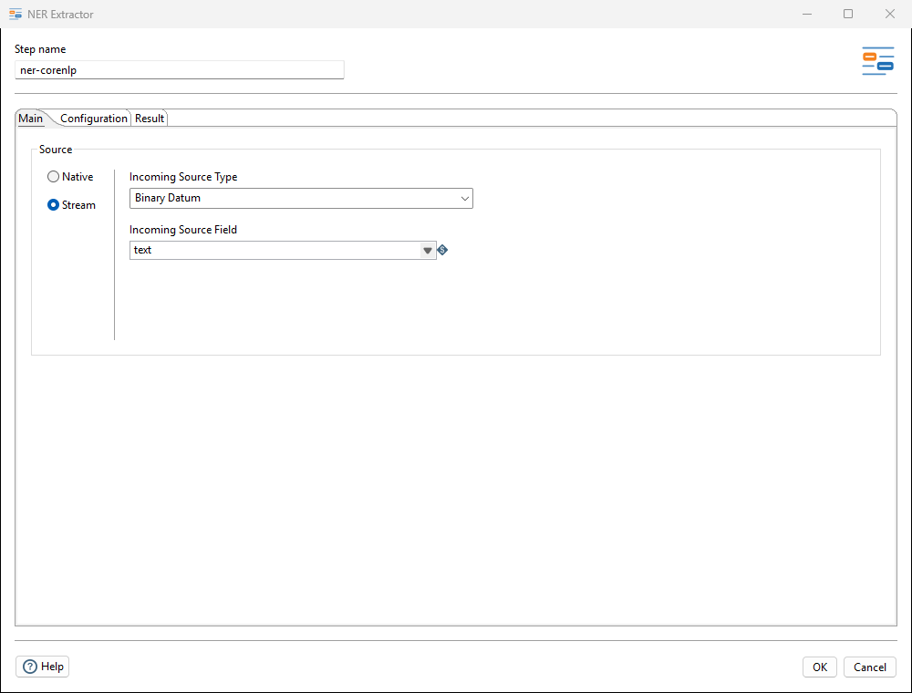
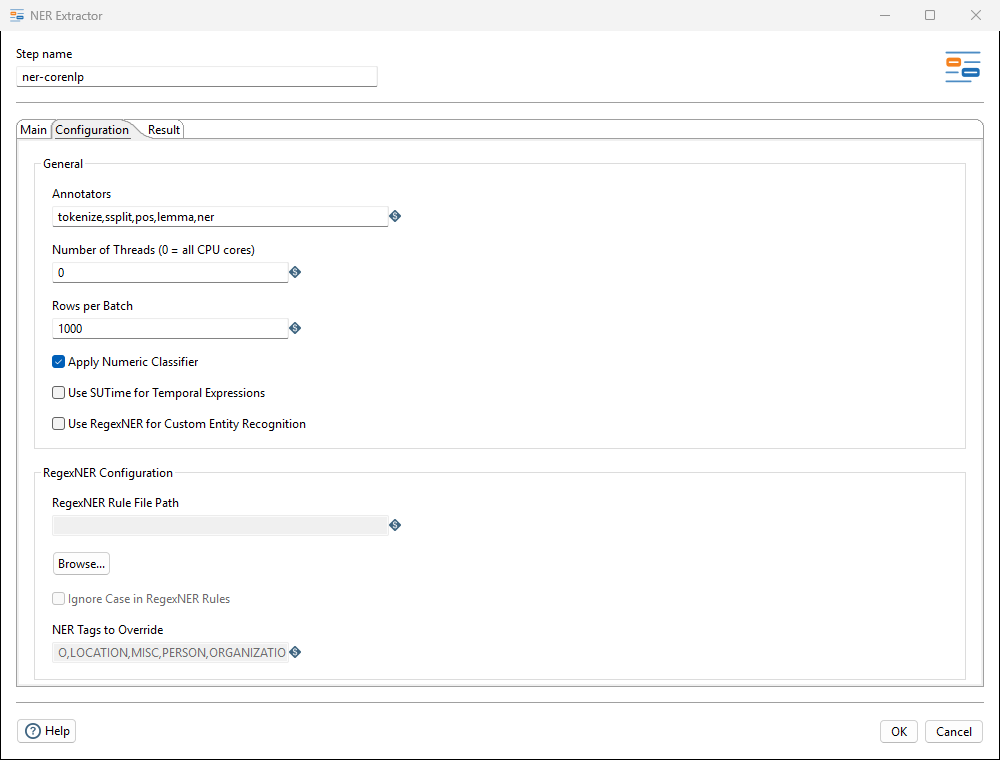
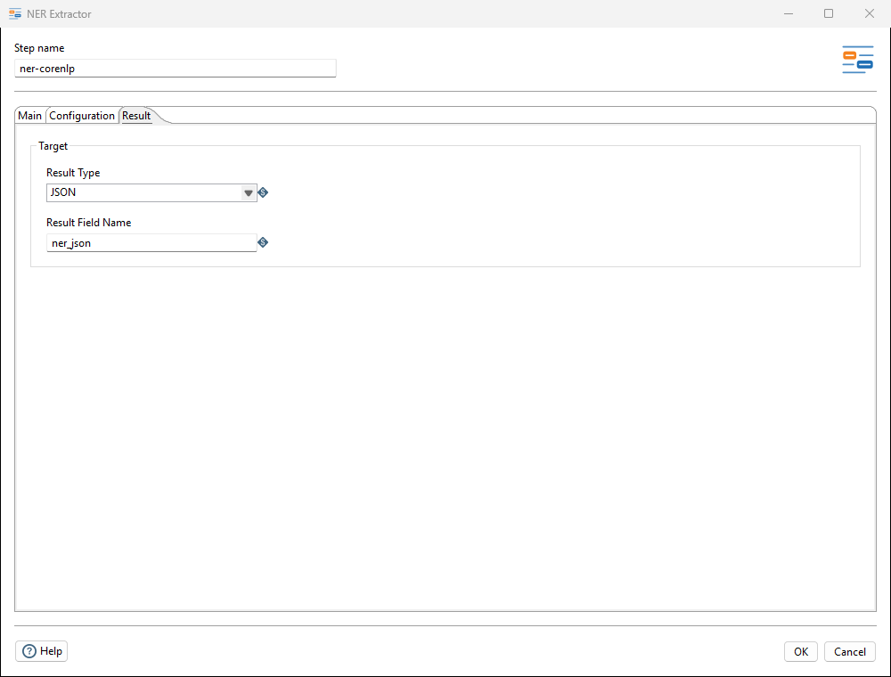
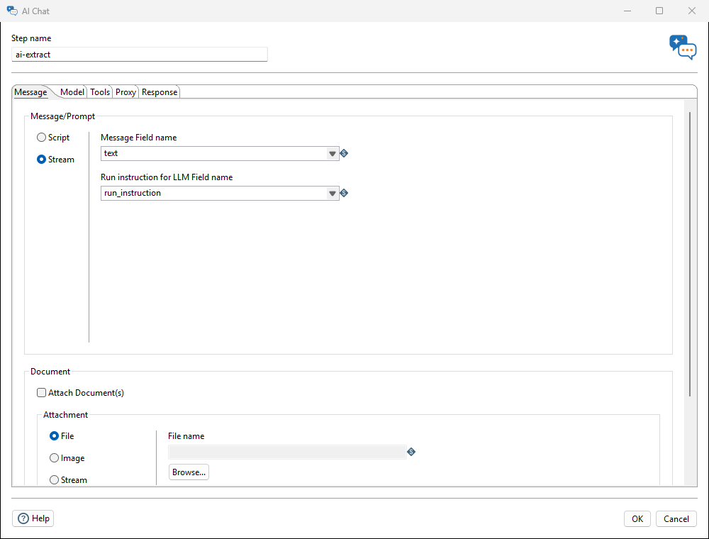
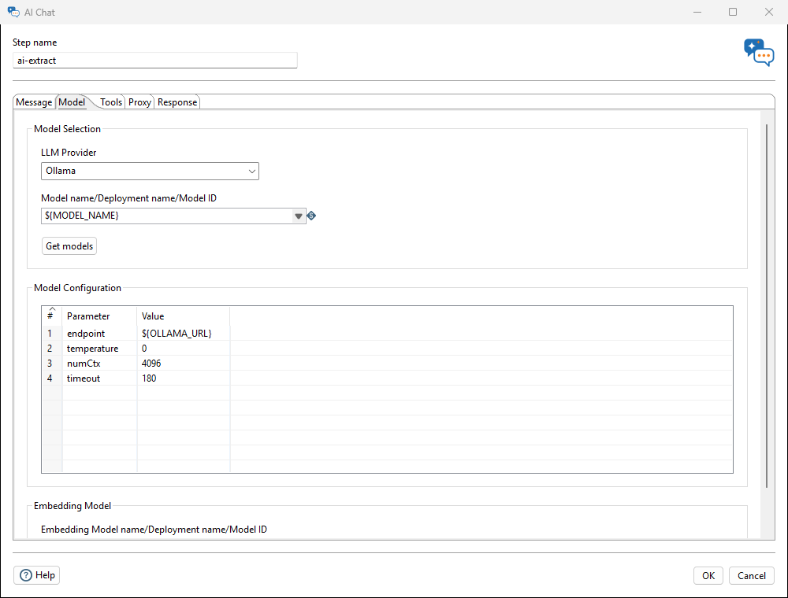
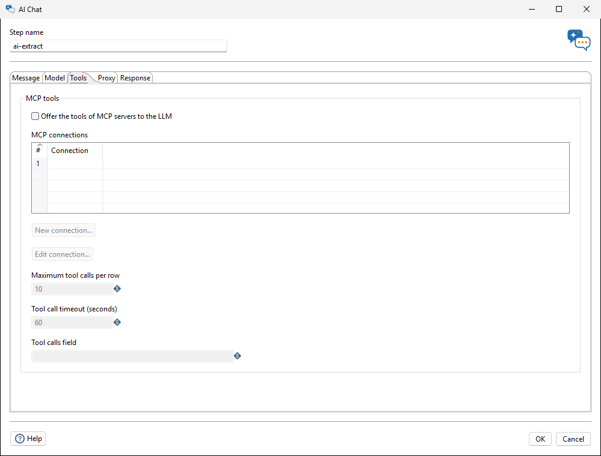
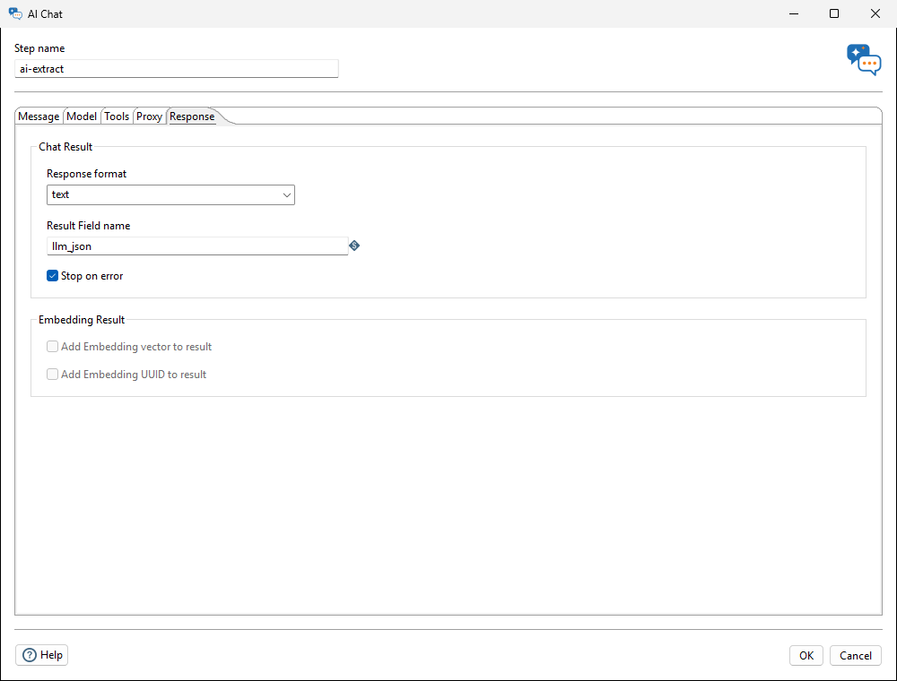
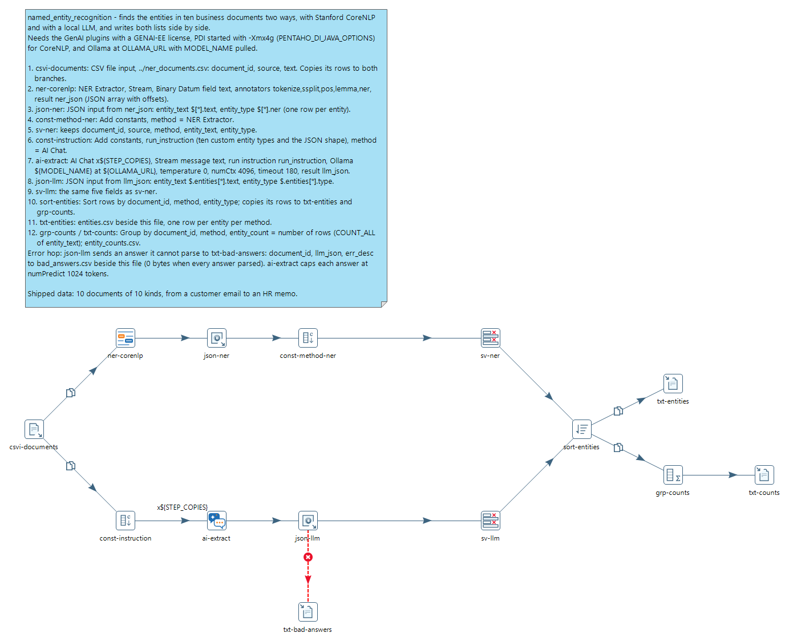

# Named Entity Recognition

> **Warning:**
>
> #### Workshop - Named Entity Recognition
>
> Named Entity Recognition (NER) finds the people, organizations, places, dates and other named things in free text and labels each one. Build a Pentaho Data Integration transformation that does it two ways on the same ten business documents: with the **NER Extractor** step, which runs Stanford CoreNLP and no Large Language Model (LLM), and with the **AI Chat** step and a local LLM served by Ollama. Then compare what each one finds.
>
> **What you'll do**
>
> * Give Pentaho Data Integration the memory the CoreNLP models need
> * Extract entities with **NER Extractor**, offline, with their positions in the text
> * Extract entities of your own types with **AI Chat**, as JSON
> * Turn both answers into one row per entity with **JSON input**, and merge them
> * Count the entities per document and method, and compare the two lists
>
> **Prerequisites:**
>
> * [Data Quality](../07-llm-data-quality/guide.md): the AI Chat, run instruction and JSON input pattern this workshop reuses
> * Ollama running on `http://localhost:11434` with `llama3.2:3b` pulled, and the GenAI plugins installed, as set up in [Before You Start](../00-before-you-start/guide.md)
> * At least 6 GB of free memory: the CoreNLP models need about 4 GB of Java heap
>
> **Estimated time:** 40 minutes

<figure>

<figcaption class="pcm-video-caption">Walkthrough: coming soon</figcaption>

</figure>

<div align="center">
<figure>

<figcaption>What you build: one input, two ways to find the entities, one merged result</figcaption>
</figure>
</div>

:::: tabs

### 1. NER Two Ways

> **Note:**
>
> #### What NER Does
>
> NER identifies named entities in unstructured text and classifies them into types. The output is structured: one record per entity, with its exact text and its type, ready to load, count or join.

**Example input** (the first document of this lab):

```text
Hi, this is Sarah Johnson from Acme Corporation. I'm writing to inquire about the order I placed on
December 15th, 2024. My customer ID is CUST-98765. Please contact me at sarah.johnson@acmecorp.com
or call 555-123-4567. Our office is located at 123 Main Street, San Francisco, CA 94102.
```

**The two methods:**

| | NER Extractor | AI Chat |
| --- | --- | --- |
| What runs | Stanford CoreNLP 4.6.0, a trained statistical model with rules, inside Pentaho Data Integration | An LLM on the Ollama server |
| Entity types | CoreNLP's own: PERSON, ORGANIZATION, CITY, STATE_OR_PROVINCE, COUNTRY, DATE, MONEY, EMAIL, TITLE and others | The ones you name in the instruction |
| Output | A JSON array, every entity with `text`, `ner`, `beginOffset`, `endOffset`, `sentenceIndex` and `confidence` | The JSON shape you ask for |
| Positions in the text | Yes, character offsets | No |
| Network and cost | None: offline, no model server | One model call per document |
| Same input, same output | Always | At `temperature` `0`, nearly always |
| Language | English models only | Whatever the model reads |
| Memory and start-up | About 4 GB of Java heap; the models load on the first row, 10 to 40 seconds | Ollama's memory, outside Pentaho Data Integration |

**The custom types for AI Chat:**

| Entity type | Description | Examples |
| --- | --- | --- |
| **PERSON** | Names of people | Sarah Johnson, Michael Chen |
| **ORGANIZATION** | Companies, institutions | Acme Corporation, Microsoft Corporation |
| **LOCATION** | Cities, addresses, countries | San Francisco, 123 Main Street |
| **DATE** | Dates and times | December 15th, 2024 |
| **MONEY** | Currency amounts | $125,000, £250,000 GBP |
| **PRODUCT** | Product names | Enterprise Suite |
| **POSITION** | Job titles | CEO, procurement director |
| **CONTACT** | Emails, phone numbers, extensions | sarah.johnson@acmecorp.com, 555-123-4567 |
| **ID** | Customer, employee, invoice, ticket or order numbers | CUST-98765, INV-2024-0089 |
| **TECHNOLOGY** | Software, platforms, systems | PaymentProcessor module |

`ID` and `TECHNOLOGY` are business types that no general-purpose NER model was trained on. That is the LLM's strength: a new type is a line in the instruction. The NER Extractor's strength is that it is fast, free, repeatable and tells you exactly where each entity is.

**The data:** `ner_documents.csv` holds ten documents of ten kinds, from a customer email to an HR memo, with three columns: `document_id`, `source` and `text`. `ner_documents_2.csv` has the same ten and ten more (a financial report, an invoice, a medical record and others), for a longer run once this one works.

### 2. Memory for CoreNLP

> **Note:**
>
> #### More Java Heap
>
> Spoon starts with a 2 GB Java heap. The CoreNLP models for **NER Extractor** need about 4 GB, so start Spoon with a larger heap through the `PENTAHO_DI_JAVA_OPTIONS` environment variable, which `Spoon.bat` reads in place of its own memory settings.

1. Start Spoon with a 4 GB heap. In PowerShell, run:

```powershell
$env:PENTAHO_DI_JAVA_OPTIONS = "-Xms1024m -Xmx4g"
Set-Location C:\Pentaho\design-tools\data-integration
.\Spoon.bat
```

2. To keep the setting for the **Start Pentaho Data Integration** button and every later start, store it for your user, then close and start Spoon again:

```powershell
[Environment]::SetEnvironmentVariable("PENTAHO_DI_JAVA_OPTIONS", "-Xms1024m -Xmx4g", "User")
```

<button data-launch="spoon" data-path="">Start Pentaho Data Integration</button>

> **Under the hood:**
>
> #### The variable replaces Spoon's memory settings, not adds to them
>
> `Spoon.bat` passes `PENTAHO_DI_JAVA_OPTIONS` to Java when it is set, and its default `-Xms1024m -Xmx2048m` when it is not. `-Xmx4g` lets the Java heap grow to 4 GB, enough for CoreNLP's tagger and NER models; with 2 GB the step can stop with `OutOfMemoryError` on the first row. Pan and Kitchen read the same variable, so a scheduled run gets the same heap.
>
> **Why it matters:** CoreNLP's memory is inside the Pentaho Data Integration process, unlike an LLM's, which lives in Ollama. Size the heap for it wherever the transformation runs.

### 3. Read the Documents

> **Note:**
>
> #### Read the Documents
>
> Create the transformation and its parameters, and read `ner_documents.csv`. Its rows go to both methods.

1. Select **File > New > Transformation** (`Ctrl+N`).
2. Select **File > Save as** and save it as `named_entity_recognition.ktr` in `C:\Workshop-AI-Specialty\04-llm-integration\09-llm-ner`, next to `ner_documents.csv`. (On your own machine, download `ner_documents.csv` from **Lab Files** below into the folder you save in.)
3. Double-click an empty part of the canvas, open the **Parameters** tab, and fill the grid:

| Parameter | Default Value | Description |
| --- | --- | --- |
| `MODEL_NAME` | `llama3.2:3b` | Ollama chat model |
| `OLLAMA_URL` | `http://localhost:11434` | Ollama server |
| `STEP_COPIES` | `4` | Parallel copies of ai-extract |

4. Select **OK**.
5. On the **Design** tab, open the **Input** folder and drag **CSV file input** onto the canvas.
6. Double-click **CSV file input** and set **Step name** to `csvi-documents`.
7. Set **Filename** to `${Internal.Entry.Current.Directory}/ner_documents.csv`.
8. Keep **Delimiter** `,`, **Enclosure** `"` and **Header row present?** selected. Clear **Lazy conversion?**.
9. Fill the **Fields** grid:

| Name | Type | Format | Length | Precision | Trim type |
| --- | --- | --- | --- | --- | --- |
| `document_id` | Integer | `#` | 15 | 0 | both |
| `source` | String | | | | both |
| `text` | String | | | | both |

10. Select **OK**, and save the transformation (`Ctrl+S`).
11. Select **csvi-documents** on the canvas, press `F10` (**Action > Preview**), and select **Quick Launch**.

> **Success:** Checkpoint: **Examine preview data** shows 10 rows, `document_id` `1` to `10`. The first is `customer_email`, starting `Hi, this is Sarah Johnson from Acme Corporation.`

12. Select **Close**.

### 4. NER Extractor

> **Note:**
>
> #### Stanford CoreNLP, No LLM
>
> **NER Extractor** runs CoreNLP over the `text` field of each row and adds a JSON array of the entities it found. **JSON input** turns the array into one row per entity, and **Add constants** labels those rows with the method.

1. On the **Design** tab, open the **AI** folder and drag **NER Extractor** onto the canvas.
2. Create a hop from **csvi-documents** to **NER Extractor**: hold `Shift` and drag from one step to the other.
3. Double-click **NER Extractor** and set **Step name** to `ner-corenlp`.
4. On the **Main** tab, select **Stream**. Keep **Incoming Source Type** `Binary Datum` and set **Incoming Source Field** to `text`.
5. On the **Configuration** tab, set **Annotators** to `tokenize,ssplit,pos,lemma,ner`. Keep **Apply Numeric Classifier** selected, and **Use SUTime for Temporal Expressions**, **Use RegexNER for Custom Entity Recognition** and **Ignore Case in RegexNER Rules** cleared.
6. On the **Result** tab, keep **Result Type** `JSON` and set **Result Field Name** to `ner_json`.
<div align="center">
<figure>

<figcaption>ner-corenlp: the Main tab</figcaption>
</figure>
</div>

<div align="center">
<figure>

<figcaption>ner-corenlp: the Configuration tab</figcaption>
</figure>
</div>

<div align="center">
<figure>

<figcaption>ner-corenlp: the Result tab</figcaption>
</figure>
</div>

7. Select **OK**.

> **Under the hood:**
>
> #### CoreNLP tagged every word, then grouped the tags into entities
>
> The annotators run in order: `tokenize` splits the text into words, `ssplit` into sentences, `pos` tags each word's part of speech, `lemma` its base form, and `ner` the entity type, using trained models and CoreNLP's built-in rules for emails, titles and numbers. Consecutive words with the same tag become one entity, with its character offsets in the original text and the model's confidence. The `ner` annotator also applies CoreNLP's built-in fine-grained rules, so a place comes back as `CITY`, `STATE_OR_PROVINCE` or `COUNTRY` rather than the coarse `LOCATION`. RegexNER, which this workshop leaves off, is for your own rule file on top of that.
>
> **Why it matters:** the offsets let you highlight, mask or cut out each entity in the source text, which an LLM's answer cannot do reliably. The same text always gives the same entities.

8. On the **Design** tab, open the **Input** folder and drag **JSON input** onto the canvas. Create a hop from **ner-corenlp** to it.
9. Double-click **JSON input** and set **Step name** to `json-ner`.
10. On the **File** tab, select **Source is from a previous step** and set **Select field** to `ner_json`.
11. On the **Content** tab, make sure **Ignore missing path** and **Default path leaf to null** are selected.
12. On the **Fields** tab, fill the grid:

| Name | Path | Type |
| --- | --- | --- |
| `entity_text` | `$[*].text` | String |
| `entity_type` | `$[*].ner` | String |

13. Select **OK**.
14. On the **Design** tab, open the **Transform** folder and drag **Add constants** onto the canvas. Create a hop from **json-ner** to it.
15. Double-click **Add constants**, set **Step name** to `const-method-ner`, and add one row: **Name** `method`, **Type** `String`, **Value** `NER Extractor`. Select **OK**.
16. Drag **Select values** from the **Transform** folder onto the canvas and create a hop from **const-method-ner** to it.
17. Double-click **Select values**, set **Step name** to `sv-ner`, and on the **Select & Alter** tab list these fields in this order: `document_id`, `source`, `method`, `entity_text`, `entity_type`. Select **OK**.
18. Save the transformation (`Ctrl+S`).

> **Under the hood:**
>
> #### A path with [*] gave one row per array element
>
> `$[*].text` selects the `text` of every element of the array, so **JSON input** writes one row per entity, each with the fields of the row it came from (`document_id`, `source`). A document with three entities becomes three rows. This was checked by running the step on a CoreNLP-shaped array of three entities: three rows came out.
>
> **Why it matters:** one row per entity is the shape a database table, a count or a join needs. The document's own fields travel with every entity.

### 5. AI Chat Extraction

> **Note:**
>
> #### Custom Types From an LLM
>
> The second branch asks the model for the ten custom types as a JSON object with an `entities` array, and turns it into rows the same way.

1. On the **Design** tab, open the **Transform** folder and drag **Add constants** onto the canvas.
2. Create a hop from **csvi-documents** to **Add constants**. When Spoon asks, select **Copy**.
3. Double-click **Add constants** and set **Step name** to `const-instruction`. In the **Fields** grid, add the first of two rows: **Name** `run_instruction`, **Type** `String`, with this text in **Value**:

```text
You extract named entities from one business document.
Use these entity types only: PERSON, ORGANIZATION, LOCATION, DATE, MONEY, PRODUCT, POSITION (a job title), CONTACT (an email address, phone number or extension), ID (a customer, employee, invoice, ticket or order number), TECHNOLOGY (software, a platform or a system).
List every entity once, with its text exactly as it appears in the document.
Answer with one JSON object and nothing else, in exactly this shape:
{"entities": [{"text": "exact text from the document", "type": "one of the types above"}]}
```

4. Add the second row: **Name** `method`, **Type** `String`, **Value** `AI Chat`. Select **OK**.
5. On the **Design** tab, open the **AI** folder and drag **AI Chat** onto the canvas. Create a hop from **const-instruction** to it.
6. Double-click **AI Chat** and set **Step name** to `ai-extract`.
7. On the **Message** tab, under **Message/Prompt**, select **Stream**. Set **Message Field name** to `text` and **Run instruction for LLM Field name** to `run_instruction`. Keep **Attach Document(s)** cleared.
8. On the **Model** tab, set **LLM Provider** to `Ollama` and **Model name/Deployment name/Model ID** to `${MODEL_NAME}`.
9. Fill the **Model Configuration** grid. Delete any row that is not in this table:

| Parameter | Value |
| --- | --- |
| `endpoint` | `${OLLAMA_URL}` |
| `temperature` | `0` |
| `numCtx` | `4096` |
| `timeout` | `180` |

10. On the **Response** tab, keep **Response format** `text`, set **Result Field name** to `llm_json`, and keep **Stop on error** selected.
<div align="center">
<figure>

<figcaption>ai-extract: the Message tab</figcaption>
</figure>
</div>

<div align="center">
<figure>

<figcaption>ai-extract: the Model tab</figcaption>
</figure>
</div>

<div align="center">
<figure>

<figcaption>ai-extract: the Tools tab</figcaption>
</figure>
</div>

<div align="center">
<figure>

<figcaption>ai-extract: the Response tab</figcaption>
</figure>
</div>

11. Select **OK**.
12. Right-click **ai-extract** and select **Change Number of Copies to Start...**. Enter `${STEP_COPIES}` and select **OK**.
13. Drag **JSON input** from the **Input** folder onto the canvas and create a hop from **ai-extract** to it.
14. Double-click it and set **Step name** to `json-llm`. On the **File** tab, select **Source is from a previous step** and set **Select field** to `llm_json`. On the **Content** tab, make sure **Ignore missing path** and **Default path leaf to null** are selected.
15. On the **Fields** tab, fill the grid:

| Name | Path | Type |
| --- | --- | --- |
| `entity_text` | `$.entities[*].text` | String |
| `entity_type` | `$.entities[*].type` | String |

16. Select **OK**.
17. Drag **Select values** onto the canvas and create a hop from **json-llm** to it. Double-click it, set **Step name** to `sv-llm`, and list the same fields as **sv-ner**, in the same order: `document_id`, `source`, `method`, `entity_text`, `entity_type`. Select **OK**.
18. Save the transformation (`Ctrl+S`).

> **Under the hood:**
>
> #### The answer is wrapped in an object, because an object is easier to ask for
>
> The instruction asks for `{"entities": [...]}` rather than a bare array. A small model asked for "a JSON object" keeps to one shape more often than one asked for "an array", and a named key leaves room to add fields later, such as a document summary. `numCtx` `4096` holds the instruction, the longest document and a long list of entities; `timeout` `180` allows for that list on a slow machine.
>
> **Why it matters:** the instruction is the only schema the model has. A shape that is easy to follow, with a fixed list of types, is what makes its answer parseable row after row.

### 6. Side by Side

> **Note:**
>
> #### Merge, Sort and Count
>
> Both branches now give rows with the same five fields. **Sort rows** merges them in document order, one file lists every entity, and **Group by** counts the entities per document and method.

1. On the **Design** tab, open the **Transform** folder and drag **Sort rows** onto the canvas.
2. Create a hop from **sv-ner** to **Sort rows**, and another from **sv-llm** to **Sort rows**.
3. Double-click **Sort rows** and set **Step name** to `sort-entities`. Fill the **Fields** grid with `document_id`, `method` and `entity_type`, each **Ascending** `Y`. Select **OK**.
4. On the **Design** tab, open the **Output** folder and drag **Text file output** onto the canvas. Create a hop from **sort-entities** to it.
5. Double-click **Text file output** and set **Step name** to `txt-entities`. On the **File** tab, set **Filename** to `${Internal.Entry.Current.Directory}/entities` and **Extension** to `csv`, and select **Create Parent folder**. On the **Content** tab, keep **Separator** `,`, **Enclosure** `"` and **Header** selected, and set **Encoding** to `UTF-8`. On the **Fields** tab, select **Get Fields**, then **Minimal width**, and select **OK**.
6. On the **Design** tab, open the **Statistics** folder and drag **Group by** onto the canvas. Create a hop from **sort-entities** to it. When Spoon asks, select **Copy**.
7. Double-click **Group by** and set **Step name** to `grp-counts`.
8. In **The fields that make up the group**, add `document_id` and `method`.
9. In **Aggregates**, add one row: **Name** `entity_count`, **Subject** `entity_text`, **Type** `Number of rows (without field argument)`. Select **OK**.
10. Drag a **Text file output** onto the canvas and create a hop from **grp-counts** to it. Set it up as **txt-entities**, **Get Fields** and **Minimal width** included, with **Step name** `txt-counts` and **Filename** `${Internal.Entry.Current.Directory}/entity_counts`. Select **OK**.
11. Save the transformation (`Ctrl+S`).

> **Under the hood:**
>
> #### Two inputs merged because their rows had the same layout
>
> A step with two incoming hops reads rows from both, and Pentaho Data Integration requires that every input has the same fields in the same order and types, which the two **Select values** steps guarantee. **Sort rows** waits for every row from both branches, then sorts them, so **Group by**, which needs its input sorted by the group fields, can count each document and method in one pass. The merge, sort and count were checked by running them on hand-written answers: 3 CoreNLP entities and 4 LLM entities for one document gave 7 entity rows and two count rows, `3` and `4`.
>
> **Why it matters:** the comparison is plain data, so it can be loaded, filtered or charted like any other. A spot check of one document's two lists shows more than a summary of either.

### 7. Run and Compare

> **Note:**
>
> #### Run the Transformation
>
> The first row waits while CoreNLP loads its models; after that it tags a document in well under a second. The LLM branch makes one model call per document.

1. Press `F9` (**Action > Run**), and select **Run** in the **Run Options** dialog.
2. In **Execution Results**, open the **Step Metrics** tab.

<!-- UNPROVEN: the checkpoints below describe the expected shape; replace with measured figures once the GENAI-EE license lets the solution run. -->

> **Success:** Checkpoint: every step finishes without errors. **csvi-documents** shows 10 under **Written**, **ner-corenlp** and the copies of **ai-extract** each read 10, and **json-ner** and **json-llm** write one row per entity, many more than 10 each. **grp-counts** writes 20 rows: two per document.

3. Select **ner-corenlp** on the canvas and open the **Preview data** tab.

> **Success:** Checkpoint: each `ner_json` is a JSON array; in the first document, `Sarah Johnson` is tagged `PERSON` and `Acme Corporation` `ORGANIZATION`, each with its `beginOffset` and `endOffset`.

4. Open `entity_counts.csv` and `entities.csv` in `C:\Workshop-AI-Specialty\04-llm-integration\09-llm-ner`, and compare the two methods document by document.

> **Success:** Checkpoint: `entity_counts.csv` starts `document_id,method,entity_count`. In `entities.csv`, look for what only one method found: the `ID` and `TECHNOLOGY` entities, such as `CUST-98765`, only from AI Chat; the fine-grained types, such as `CITY` and `STATE_OR_PROVINCE`, only from NER Extractor.

5. Run again and compare: the NER Extractor rows are identical every time; the AI Chat rows usually are, at `temperature` `0`, but a model can still word an entity differently.

::::

## Troubleshooting <!-- no-step -->

<details>
<summary>Error initializing step: License validation failed</summary>

The Pentaho license on this machine has no GenAI rights. Every GenAI plugin step, **NER Extractor** included, checks for a license with the GenAI Plugin Suite (GENAI-EE) subscription when the transformation starts. Install a license that includes it, as described in [Before You Start](../00-before-you-start/guide.md).

</details>

<details>
<summary>ner-corenlp stops with OutOfMemoryError or Java heap space</summary>

Spoon is running with its default 2 GB heap. Close it and start it again with `PENTAHO_DI_JAVA_OPTIONS` set to `-Xms1024m -Xmx4g`, as in the **Memory for CoreNLP** tab.

</details>

<details>
<summary>The first row takes a long time</summary>

CoreNLP loads its models when the first row arrives, which takes 10 to 40 seconds. The rows after it are fast.

</details>

<details>
<summary>The AI Chat branch has no rows for a document</summary>

The model's answer was not the JSON the instruction asked for, so `$.entities[*]` found nothing. Preview **ai-extract** and read `llm_json` for that document. A larger model (`qwen2.5:7b`) usually fixes it.

</details>

## Lab Files

Click a file to download. For `.ktr` and `.kjb` files, **Open in Pentaho Data Integration** launches Pentaho Data Integration with the file loaded. If Pentaho Data Integration is already running, the path is copied to your clipboard — switch to Pentaho Data Integration and press `Ctrl+O`, `Ctrl+V`, `Enter`.

The ten business documents the transformation reads:

[ner_documents.csv](./files/ner_documents.csv)

The same ten and ten more, for a longer run: change the **Filename** of **csvi-documents** to `ner_documents_2.csv`:

[ner_documents_2.csv](./files/ner_documents_2.csv)

### Solution <!-- no-step -->

The finished transformation for this lab. Open it alongside your own to compare, or run it to see the expected result. It reads `ner_documents.csv` from the lab folder and writes `entities.csv` and `entity_counts.csv` beside itself.

Also on disk at `C:\Workshop-AI-Specialty\04-llm-integration\09-llm-ner\solution`.

[named_entity_recognition.ktr](./files/solution/named_entity_recognition.ktr) <button data-launch="spoon" data-path="files/solution/named_entity_recognition.ktr">Open in Pentaho Data Integration</button> <button data-graph="files/solution/named_entity_recognition.ktr">View graph</button>

named_entity_recognition in Spoon, with its note:

<div align="center">
<figure>

<figcaption>named_entity_recognition.ktr in Spoon</figcaption>
</figure>
</div>
