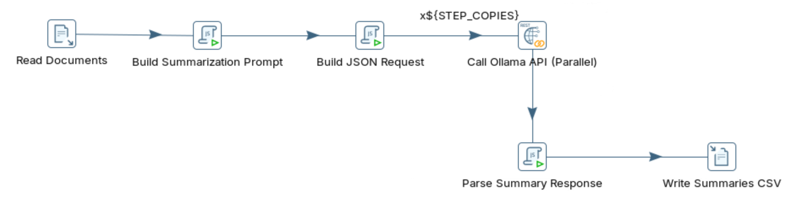
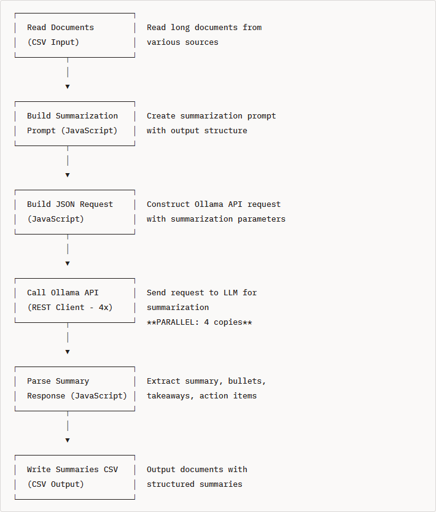

# Text Summarization

> **Warning:**
>
> #### Workshop - Text Summarization
>
> Long documents are hard to act on quickly. Build a Pentaho Data Integration transformation that sends ten business documents to a local Large Language Model (LLM) served by Ollama, and stores a summary, key points, takeaways and action items next to each one.
>
> **What you'll do**
>
> * Ask the model for a structured summary in one JSON object
> * Read long documents, from 269 to 1,657 words, into the transformation
> * Call Ollama from parallel copies of **REST client**
> * Turn the model's arrays into fields you can store
> * Write the summaries to a CSV file
>
> **Prerequisites:**
>
> * [Data Quality](../07-llm-data-quality/guide.md): the prompt, request and parse pattern this workshop reuses
> * Ollama running on `http://localhost:11434` with `llama3.2:3b` pulled
>
> **Estimated time:** 30 minutes

<div align="center">
<figure>

<figcaption>What you build: six steps, one LLM call per document</figcaption>
</figure>
</div>

:::: tabs

### 1. Text Summarization

> **Note:**
>
> #### What Is Text Summarization?
>
> Text summarization condenses a long document into a shorter one that keeps the most important information. This workshop asks for four parts at once: a two-to-three-sentence summary, the key facts, the takeaways, and the action items the document mentions.

**Example input:** the first document of this lab, meeting notes of 269 words. It starts:

```text
Meeting held on February 15, 2025, in Conference Room A. Attendees: Sarah Johnson (CEO), Michael Chen (CTO),
Jennifer Williams (VP Product), Robert Smith (VP Sales), and Linda Martinez (VP Marketing). The meeting focused
on our Q1 2025 product strategy and roadmap priorities. Sarah opened the meeting by reviewing Q4 2024
performance, noting that revenue exceeded targets by 23% at $45.6 million...
```

**An example answer**, with every fact taken from that document:

```json
{
  "summary": "Q1 2025 product strategy meeting covered Q4 performance review (revenue up 23% to $45.6M), technical roadmap with three major initiatives (AI platform, cloud integrations, mobile redesign), customer feedback analysis prioritizing reporting dashboards and collaboration tools, and sales pipeline projecting $38-42M for Q1.",
  "bullet_points": [
    "Q4 2024 revenue exceeded targets by 23% at $45.6 million",
    "Three major technical initiatives: AI analytics platform (March 15), cloud integrations (April), mobile redesign (May)",
    "Top customer requests: advanced reporting, real-time collaboration, API documentation",
    "Q1 sales pipeline: $38-42M projected with 15 major deals totaling $12M",
    "$2.5M marketing budget approved for Q1 campaigns"
  ],
  "key_takeaways": [
    "Strong Q4 performance driven by enterprise North American sales",
    "60% of engineering resources allocated to top customer feature requests",
    "Focus on thought leadership marketing strategy with conferences and webinars"
  ],
  "action_items": [
    "Michael: Finalize API documentation by March 1st",
    "Jennifer: Create customer advisory board by February 28th",
    "Robert: Implement new sales playbook by March 15th",
    "Linda: Launch website redesign by March 30th"
  ]
}
```

**Kinds of summary:**

| Kind | What it is | Typical use |
| --- | --- | --- |
| Extractive | Key sentences selected from the original | A quick overview, news |
| Abstractive | New text that captures the meaning | Executive summaries, reports |
| Bullet points | The key points as a list | Action tracking, presentations |
| Key takeaways | The main insights and conclusions | Decision support |

**Why an LLM:** extractive methods such as keyword extraction or TF-IDF can only pick sentences from the original; they cannot rephrase, combine related points, or tell which point matters most. An LLM writes an abstractive summary in its own words, adapts to the kind of document, and can return several formats in one answer, including the action items buried in a paragraph. Use it for status reports and meeting notes, long complaint and email threads, contracts, research papers and technical documentation. Because the summary is generated text, check it against the source before you rely on a figure in it.

**The data:** `text_summarization_documents.csv` holds ten documents of ten kinds, with the columns `document_id`, `document_type`, `title` and `full_text`: meeting notes (269 words), an incident report, a research paper, a customer complaint, a project proposal, a press release, an email thread, an annual report, technical documentation, and a legal contract (1,657 words). `text_summarization_documents_2.csv` holds the first five, for a shorter run.

<div align="center">
<figure>

<figcaption>The pipeline, one box per step</figcaption>
</figure>
</div>

### 2. Ollama API

> **Note:**
>
> #### The Summarization Request
>
> A summary with four parts is a long answer, so the request allows up to 800 tokens (`num_predict`), asks for JSON with `"format": "json"`, and uses a `temperature` of `0.2`: low, with a little room for wording.

1. Send the first document's opening to the model with the transformation's prompt. In PowerShell, run:

::: tabs

### Windows (PowerShell)

```powershell
$prompt = @'
Summarize document. Return JSON: {"summary":"","bullet_points":[],"key_takeaways":[],"action_items":[]}
Summary: 2-3 sentences. Bullet points: 3-5 key facts. Takeaways: 2-4 insights. Actions: tasks mentioned or [].
Return ONLY JSON.
TYPE: meeting_notes
TITLE: Q1 2025 Product Strategy Meeting
TEXT:
Meeting held on February 15, 2025, in Conference Room A. Sarah opened the meeting by reviewing Q4 2024 performance, noting that revenue exceeded targets by 23% at $45.6 million. Action items assigned: Michael to finalize API documentation by March 1st, Jennifer to create customer advisory board by February 28th.
'@
$body = @{
  model      = "llama3.2:3b"
  prompt     = $prompt
  stream     = $false
  keep_alive = "15m"
  format     = "json"
  options    = @{ temperature = 0.2; num_predict = 800 }
} | ConvertTo-Json
(Invoke-RestMethod -Uri http://localhost:11434/api/generate -Method Post -ContentType "application/json" -Body $body).response
```

### macOS / Linux

```bash
curl http://localhost:11434/api/generate -d '{
  "model": "llama3.2:3b",
  "prompt": "Summarize document. Return JSON: {\"summary\":\"\",\"bullet_points\":[],\"key_takeaways\":[],\"action_items\":[]}\nSummary: 2-3 sentences. Bullet points: 3-5 key facts. Takeaways: 2-4 insights. Actions: tasks mentioned or [].\nReturn ONLY JSON.\nTYPE: meeting_notes\nTITLE: Q1 2025 Product Strategy Meeting\nTEXT:\nMeeting held on February 15, 2025, in Conference Room A. Sarah opened the meeting by reviewing Q4 2024 performance, noting that revenue exceeded targets by 23% at $45.6 million. Action items assigned: Michael to finalize API documentation by March 1st, Jennifer to create customer advisory board by February 28th.",
  "stream": false,
  "keep_alive": "15m",
  "format": "json",
  "options": {"temperature": 0.2, "num_predict": 800}
}'
```

:::

> **Success:** Checkpoint: a JSON object with the keys `summary`, `bullet_points`, `key_takeaways` and `action_items`, the last three as arrays. The wording is the model's; the two action items in the text (Michael's API documentation, Jennifer's advisory board) should appear in `action_items`.

2. Compare the answer with the text: every figure in it should come from the three sentences you sent.

### 3. Build the Transformation

> **Note:**
>
> #### Read, Prompt, Request
>
> Read the documents, build the compact summarization prompt, and wrap it in the request body.

1. Start Spoon with the **Start Pentaho Data Integration** button below, or from a terminal:

::: tabs

### Windows (PowerShell)

```powershell
Set-Location C:\Pentaho\design-tools\data-integration
.\spoon.bat
```

### macOS / Linux

```bash
cd ~/Pentaho/design-tools/data-integration
./spoon.sh
```

:::

<button data-launch="spoon" data-path="">Start Pentaho Data Integration</button>

2. Select **File > New > Transformation** (`Ctrl+N`).
3. Select **File > Save as** and save it as `text_summarization_optimized.ktr` in `C:\Workshop-AI-Specialty\04-llm-integration\10-llm-text-summarization`, next to `text_summarization_documents.csv`. (On your own machine, download the file from **Lab Files** below into the folder you save in.)
4. Double-click an empty part of the canvas, open the **Parameters** tab, and fill the grid:

| Parameter | Default Value | Description |
| --- | --- | --- |
| `KEEP_ALIVE` | `15m` | Keep model loaded in memory (5m/15m/30m/60m) |
| `MODEL_NAME` | `llama3.2:3b` | LLM model to use for summarization |
| `OLLAMA_URL` | `http://localhost:11434` | Ollama API base URL |
| `STEP_COPIES` | `4` | Number of parallel API call copies (set to CPU cores - 1) |

5. Select **OK**.
6. On the **Design** tab, open the **Input** folder and drag **CSV file input** onto the canvas.
7. Double-click **CSV file input**.
8. Set **Step name** to `Read Documents`.
9. Set **Filename** to `${Internal.Transformation.Filename.Directory}/text_summarization_documents.csv`.
10. Keep **Delimiter** `,`, **Enclosure** `"`, and **Lazy conversion?** and **Header row present?** selected. Set **File encoding** to `UTF-8`.
11. Fill the **Fields** grid:

| Name | Type | Length |
| --- | --- | --- |
| `document_id` | String | 50 |
| `document_type` | String | 100 |
| `title` | String | 500 |
| `full_text` | String | 50000 |

12. Select **OK**.
13. On the **Design** tab, open the **Scripting** folder and drag **Modified JavaScript value** onto the canvas.
14. Create a hop from **Read Documents** to **Modified JavaScript value**: hold `Shift` and drag from one step to the other.
15. Double-click **Modified JavaScript value** and set **Step name** to `Build Summarization Prompt`.
16. Replace the text in the **Script 1** tab with:

```javascript
// Optimized compact summarization prompt - 50% shorter than basic
var llm_prompt = "Summarize document. Return JSON: {\"summary\":\"\",\"bullet_points\":[],\"key_takeaways\":[],\"action_items\":[]}\n" +
  "Summary: 2-3 sentences. Bullet points: 3-5 key facts. Takeaways: 2-4 insights. Actions: tasks mentioned or [].\n" +
  "Return ONLY JSON.\n" +
  "TYPE: " + document_type + "\n" +
  "TITLE: " + title + "\n" +
  "TEXT:\n" + full_text;
```

17. Fill the **Fields** grid with one row: **Fieldname** `llm_prompt`, **Type** String, **Replace value 'Fieldname' or 'Rename to'** `N`.
18. Select **OK**.
19. Drag another **Modified JavaScript value** onto the canvas and create a hop from **Build Summarization Prompt** to it.
20. Double-click the new step and set **Step name** to `Build JSON Request`.
21. Replace the text in the **Script 1** tab with:

```javascript
// Build JSON request body with keep_alive for Ollama API
var model_name = getVariable("MODEL_NAME", "llama3.2:3b");
var keep_alive = getVariable("KEEP_ALIVE", "15m");

var requestObj = {
    "model": model_name,
    "prompt": llm_prompt,
    "stream": false,
    "keep_alive": keep_alive,
    "format": "json",
    "options": {
        "temperature": 0.2,
        "num_predict": 800
    }
};

var request_body = JSON.stringify(requestObj);
```

22. Fill the **Fields** grid with one row: **Fieldname** `request_body`, **Type** String, **Replace value 'Fieldname' or 'Rename to'** `N`.
23. Select **OK**.
24. Save the transformation (`Ctrl+S`).
25. Select **Build JSON Request** on the canvas, press `F10` (**Action > Preview**), and select **Quick Launch**.

> **Success:** Checkpoint: 10 rows, `document_id` `1` to `10`; the first is the `meeting_notes` document `Q1 2025 Product Strategy Meeting`. Its `llm_prompt` starts `Summarize document. Return JSON:` and its `request_body` starts `{"model":"llama3.2:3b","prompt":"Summarize document.`.

26. Select **Close**.

### 4. Call Ollama and Parse

> **Note:**
>
> #### Call, Parse, Write
>
> **REST client** sends the documents in parallel; a script takes the four parts out of the answer, and **Text file output** writes them next to each document's title.

1. On the **Design** tab, open the **Lookup** folder and drag **REST client** onto the canvas.
2. Create a hop from **Build JSON Request** to **REST client**.
3. Double-click **REST client** and set **Step name** to `Call Ollama API (Parallel)`.
4. On the **General** tab, set **URL** to `${OLLAMA_URL}/api/generate`, **HTTP method** to `POST` and **Body field** to `request_body`. Keep **Application type** `TEXT PLAIN`.
5. Under **Output fields**, set **Result field name** to `api_response`, **HTTP status code field name** to `result_code` and **Response time (milliseconds) field name** to `response_time`.
6. Select **OK**.
7. Right-click **Call Ollama API (Parallel)** and select **Change Number of Copies to Start...**. Enter `${STEP_COPIES}` and select **OK**.
8. Drag a **Modified JavaScript value** from the **Scripting** folder onto the canvas and create a hop from **Call Ollama API (Parallel)** to it.
9. Double-click the new step and set **Step name** to `Parse Summary Response`.
10. Replace the text in the **Script 1** tab with:

```javascript
// Parse Ollama response and extract summary components
var summary = "";
var bullet_points = "[]";
var key_takeaways = "[]";
var action_items = "[]";

try {
    var response = JSON.parse(api_response);
    var fullResponse = response.response;

    // Extract JSON object from response
    var jsonStart = fullResponse.indexOf("{");
    var jsonEnd = fullResponse.lastIndexOf("}") + 1;

    if (jsonStart >= 0 && jsonEnd > jsonStart) {
        var jsonStr = fullResponse.substring(jsonStart, jsonEnd);
        var summaryObj = JSON.parse(jsonStr);

        // Extract summary fields
        summary = summaryObj.summary || "";

        // Convert arrays to JSON strings
        if (summaryObj.bullet_points && Array.isArray(summaryObj.bullet_points)) {
            bullet_points = JSON.stringify(summaryObj.bullet_points);
        }

        if (summaryObj.key_takeaways && Array.isArray(summaryObj.key_takeaways)) {
            key_takeaways = JSON.stringify(summaryObj.key_takeaways);
        }

        if (summaryObj.action_items && Array.isArray(summaryObj.action_items)) {
            action_items = JSON.stringify(summaryObj.action_items);
        }
    }
} catch(e) {
    summary = "Error parsing response: " + e.message;
    bullet_points = "[]";
    key_takeaways = "[]";
    action_items = "[]";
}
```

11. Fill the **Fields** grid with four rows, each **Type** String and **Replace value 'Fieldname' or 'Rename to'** `N`: `summary`, `bullet_points`, `key_takeaways`, `action_items`.
12. Select **OK**.

> **Under the hood:**
>
> #### Each array became one text field holding JSON
>
> A Pentaho Data Integration field holds one value per row, and the model returns three lists of varying length. The script keeps each list whole: `JSON.stringify` turns `bullet_points`, `key_takeaways` and `action_items` back into JSON text, such as `["first point","second point"]`, and checks with `Array.isArray` that the model really returned a list before it does. A list that is missing, or not a list, stays `[]`; an answer that does not parse puts the error message in `summary`.
>
> **Why it matters:** the CSV keeps one row per document, and a later step or a database can still read each list as JSON when it needs the items one by one.

13. On the **Design** tab, open the **Output** folder and drag **Text file output** onto the canvas.
14. Create a hop from **Parse Summary Response** to **Text file output**.
15. Double-click **Text file output** and set **Step name** to `Write Summaries CSV`.
16. On the **File** tab, set **Filename** to `${Internal.Transformation.Filename.Directory}/summaries_` and **Extension** to `csv`. Select **Create Parent folder**, **Include date in filename?** and **Include time in filename?**, and keep **Add filenames to result** selected.
17. On the **Content** tab, keep **Separator** `,` and **Enclosure** `"`, keep **Header** selected, and set **Format** to `DOS` and **Encoding** to `UTF-8`.
18. On the **Fields** tab, fill the grid with seven rows, all String: `document_id`, `document_type`, `title`, `summary`, `bullet_points`, `key_takeaways`, `action_items`. (**Get Fields** adds every field in the stream; if you use it, delete the others.)
19. Select **OK**.
20. Save the transformation (`Ctrl+S`).

### 5. Run

> **Note:**
>
> #### Run the Transformation
>
> Ten long documents and answers of up to 800 tokens each: on a CPU-only machine, allow several minutes.

1. Press `F9` (**Action > Run**), and select **Run** in the **Run Options** dialog.
2. In **Execution Results**, open the **Step Metrics** tab.

> **Success:** Checkpoint: **Read Documents** shows 10 under **Written**, the four copies of **Call Ollama API (Parallel)** read 10 rows between them, and **Write Summaries CSV** shows 10 under **Written**.

3. Select **Write Summaries CSV** on the canvas and open the **Preview data** tab.

> **Success:** Checkpoint: 10 rows, one per document, each with a `summary` of a few sentences and the three lists as JSON text. The wording is the model's and changes between runs. A `summary` that starts `Error parsing response:` marks a document whose answer did not parse.

4. Find the results file. In PowerShell, run:

::: tabs

### Windows (PowerShell)

```powershell
Get-ChildItem C:\Workshop-AI-Specialty\04-llm-integration\10-llm-text-summarization\summaries_*.csv
```

### macOS / Linux

```bash
ls summaries_*.csv
```

Run it in the folder you saved the transformation in.

:::

> **Success:** Checkpoint: a file named `summaries__<yyyyMMdd>_<HHmmss>.csv`: the file name ends in `_`, and Pentaho Data Integration adds another `_` before the date. Its first line is `document_id,document_type,title,summary,bullet_points,key_takeaways,action_items`.

5. Check one summary against its document: open the legal contract (`document_id` `10`, the longest) in `text_summarization_documents.csv` and compare its figures and dates with the `summary` and `bullet_points` the model wrote.

::::

## Lab Files

Click a file to download. For `.ktr` and `.kjb` files, **Open in Pentaho Data Integration** launches Pentaho Data Integration with the file loaded. If Pentaho Data Integration is already running, the path is copied to your clipboard — switch to Pentaho Data Integration and press `Ctrl+O`, `Ctrl+V`, `Enter`.

The ten documents the transformation reads, and a five-document set for a shorter run:

[text_summarization_documents.csv](./files/text_summarization_documents.csv)

[text_summarization_documents_2.csv](./files/text_summarization_documents_2.csv)

### Solution <!-- no-step -->

The finished transformation for this lab. Open it alongside your own to compare, or run it to see the expected result.

Also on disk at `C:\Workshop-AI-Specialty\04-llm-integration\10-llm-text-summarization\solution`.

[text_summarization_optimized.ktr](./files/text_summarization_optimized.ktr) <button data-launch="spoon" data-path="files/text_summarization_optimized.ktr">Open in Pentaho Data Integration</button> <button data-graph="files/text_summarization_optimized.ktr">View graph</button>

The basic version, with one copy of the API call and a longer prompt that spells out each instruction:

[text_summarization.ktr](./files/text_summarization.ktr) <button data-launch="spoon" data-path="files/text_summarization.ktr">Open in Pentaho Data Integration</button> <button data-graph="files/text_summarization.ktr">View graph</button>
