# Text Summarization

> **Warning:**
>
> #### Workshop - Text Summarization
>
> Long documents are hard to act on quickly. Build two Pentaho Data Integration transformations with the **AI Chat** step and a local Large Language Model (LLM) served by Ollama. The first stores a summary, key points, takeaways and action items next to each of ten business documents. The second summarizes a report too long for one model call: it reads a Word document, splits it into chunks, summarizes each chunk, and then summarizes the summaries.
>
> **What you'll do**
>
> * Ask the model for a structured summary of each document in one JSON object
> * Learn why a long document must be split: the model's context window
> * Read a Word document with **Read Unstructured Document** and split it with **AI Segmentation**
> * Summarize every chunk with **AI Chat**, and join the summaries in order with **Sort rows** and **Group by**
> * Summarize the joined summaries with a second **AI Chat** (map-reduce)
>
> **Prerequisites:**
>
> * [Data Quality](../07-llm-data-quality/guide.md): the AI Chat, run instruction and JSON input pattern this workshop reuses
> * Ollama running on `http://localhost:11434` with `llama3.2:3b` pulled, and the GenAI plugins installed, as set up in [Before You Start](../00-before-you-start/guide.md)
>
> **Estimated time:** 45 minutes

<figure>

<figcaption class="pcm-video-caption">Walkthrough: coming soon</figcaption>

</figure>

<div align="center">
<figure>

<figcaption>The second transformation, long_document_summary.ktr: the map half down the left, the reduce half up the right</figcaption>
</figure>
</div>

:::: tabs

### 1. Text Summarization

> **Note:**
>
> #### What Is Text Summarization?
>
> Text summarization condenses a long document into a shorter one that keeps the most important information. The first transformation asks for four parts at once: a two-to-three-sentence summary, the key facts, the takeaways, and the action items the document mentions.

**Example input:** the first document of this lab, meeting notes of 269 words. It starts:

```text
Meeting held on February 15, 2025, in Conference Room A. Attendees: Sarah Johnson (CEO), Michael Chen (CTO),
Jennifer Williams (VP Product), Robert Smith (VP Sales), and Linda Martinez (VP Marketing). The meeting focused
on our Q1 2025 product strategy and roadmap priorities. Sarah opened the meeting by reviewing Q4 2024
performance, noting that revenue exceeded targets by 23% at $45.6 million...
```

**An example answer**, with every fact taken from that document:

```json
{
  "summary": "Q1 2025 product strategy meeting covered Q4 performance (revenue up 23% to $45.6M), three technical initiatives, customer feedback priorities, and a Q1 sales projection of $38-42M.",
  "bullet_points": [
    "Q4 2024 revenue exceeded targets by 23% at $45.6 million",
    "Three initiatives: AI analytics platform (March 15), cloud integrations (April), mobile redesign (May)",
    "Q1 sales pipeline: $38-42M projected with 15 major deals totaling $12M"
  ],
  "key_takeaways": [
    "60% of engineering resources go to the top customer feature requests"
  ],
  "action_items": [
    "Michael: Finalize API documentation by March 1st",
    "Jennifer: Create customer advisory board by February 28th"
  ]
}
```

**Kinds of summary:**

| Kind | What it is | Typical use |
| --- | --- | --- |
| Extractive | Key sentences selected from the original | A quick overview, news |
| Abstractive | New text that captures the meaning | Executive summaries, reports |
| Bullet points | The key points as a list | Action tracking, presentations |
| Key takeaways | The main insights and conclusions | Decision support |

**Why an LLM:** extractive methods such as keyword extraction or TF-IDF can only pick sentences from the original; they cannot rephrase, combine related points, or tell which point matters most. An LLM writes an abstractive summary in its own words, adapts to the kind of document, and can return several formats in one answer, including the action items buried in a paragraph. Because the summary is generated text, check it against the source before you rely on a figure in it.

**The data:**

| File | What it holds |
| --- | --- |
| `text_summarization_documents.csv` | Ten documents of ten kinds, columns `document_id`, `document_type`, `title` and `full_text`: meeting notes (269 words, 1,866 characters) up to a legal contract (1,657 words, 11,188 characters) |
| `text_summarization_documents_2.csv` | The first five, for a shorter run |
| `annual_report_2024.docx` | A fictitious company's annual report: 3,735 words and 22,166 characters of text in 34 headed sections, for the second transformation |

### 2. Read the Documents

> **Note:**
>
> #### Part 1: One Summary per Document
>
> Create the first transformation and read the ten documents. Each one fits in a single model call.

1. Start Pentaho Data Integration with the **Start Pentaho Data Integration** button below, or from PowerShell:

```powershell
Set-Location C:\Pentaho\design-tools\data-integration
.\Spoon.bat
```

<button data-launch="spoon" data-path="">Start Pentaho Data Integration</button>

2. Select **File > New > Transformation** (`Ctrl+N`).
3. Select **File > Save as** and save it as `text_summarization.ktr` in `C:\Workshop-AI-Specialty\04-llm-integration\10-llm-text-summarization`, next to `text_summarization_documents.csv`. (On your own machine, download the files from **Lab Files** below into the folder you save in.)
4. Double-click an empty part of the canvas, open the **Parameters** tab, and fill the grid:

| Parameter | Default Value | Description |
| --- | --- | --- |
| `MODEL_NAME` | `llama3.2:3b` | Ollama chat model |
| `OLLAMA_URL` | `http://localhost:11434` | Ollama server |
| `STEP_COPIES` | `2` | Parallel copies of ai-summary |

5. Select **OK**.
6. On the **Design** tab, open the **Input** folder and drag **CSV file input** onto the canvas.
7. Double-click **CSV file input** and set **Step name** to `csvi-documents`.
8. Set **Filename** to `${Internal.Entry.Current.Directory}/text_summarization_documents.csv`.
9. Keep **Delimiter** `,`, **Enclosure** `"` and **Header row present?** selected. Clear **Lazy conversion?**.
10. Fill the **Fields** grid:

| Name | Type | Format | Length | Precision | Trim type |
| --- | --- | --- | --- | --- | --- |
| `document_id` | Integer | `#` | 15 | 0 | both |
| `document_type` | String | | | | both |
| `title` | String | | | | both |
| `full_text` | String | | | | both |

11. Select **OK**, and save the transformation (`Ctrl+S`).
12. Select **csvi-documents** on the canvas, press `F10` (**Action > Preview**), and select **Quick Launch**.

> **Success:** Checkpoint: **Examine preview data** shows 10 rows, `document_id` `1` to `10`. The first is `meeting_notes`, `Q1 2025 Product Strategy Meeting`; the last is `legal_contract`.

13. Select **Close**.

### 3. Summarize

> **Note:**
>
> #### Add Constants, AI Chat and JSON Input
>
> The instruction spells out the four parts and their JSON shape. **AI Chat** sends each document's `full_text` with it, and **JSON input** splits the answer into four fields.

1. On the **Design** tab, open the **Transform** folder and drag **Add constants** onto the canvas. Create a hop from **csvi-documents** to it: hold `Shift` and drag from one step to the other.
2. Double-click **Add constants** and set **Step name** to `const-instruction`. Add one row: **Name** `run_instruction`, **Type** `String`, with this text in **Value**:

```text
You summarize one business document for a busy manager. Use only facts that are in the document.
Answer with one JSON object and nothing else, in exactly this shape:
{"summary": "two or three sentences", "bullet_points": ["up to five key facts, with their figures"], "key_takeaways": ["up to three conclusions"], "action_items": ["each action the document asks for, with its owner and date when the document gives them"]}
Use an empty list when the document has no action items.
```

3. Select **OK**.
4. On the **Design** tab, open the **AI** folder and drag **AI Chat** onto the canvas. Create a hop from **const-instruction** to it.
5. Double-click **AI Chat** and set **Step name** to `ai-summary`.
6. On the **Message** tab, under **Message/Prompt**, select **Stream**. Set **Message Field name** to `full_text` and **Run instruction for LLM Field name** to `run_instruction`. Keep **Attach Document(s)** cleared.
7. On the **Model** tab, set **LLM Provider** to `Ollama` and **Model name/Deployment name/Model ID** to `${MODEL_NAME}`.
8. Fill the **Model Configuration** grid. Delete any row that is not in this table:

| Parameter | Value |
| --- | --- |
| `endpoint` | `${OLLAMA_URL}` |
| `temperature` | `0` |
| `numCtx` | `8192` |
| `timeout` | `300` |

9. On the **Response** tab, keep **Response format** `text`, set **Result Field name** to `llm_json`, and keep **Stop on error** selected.
<div align="center">
<figure>
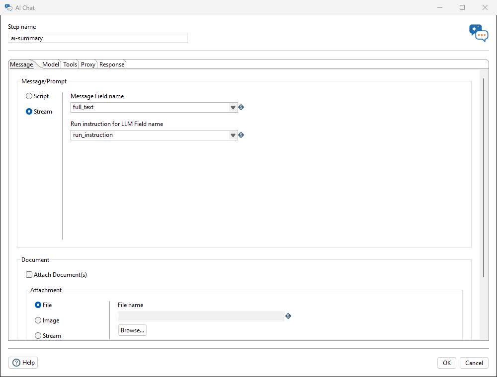
<figcaption>ai-summary: the Message tab</figcaption>
</figure>
</div>

<div align="center">
<figure>
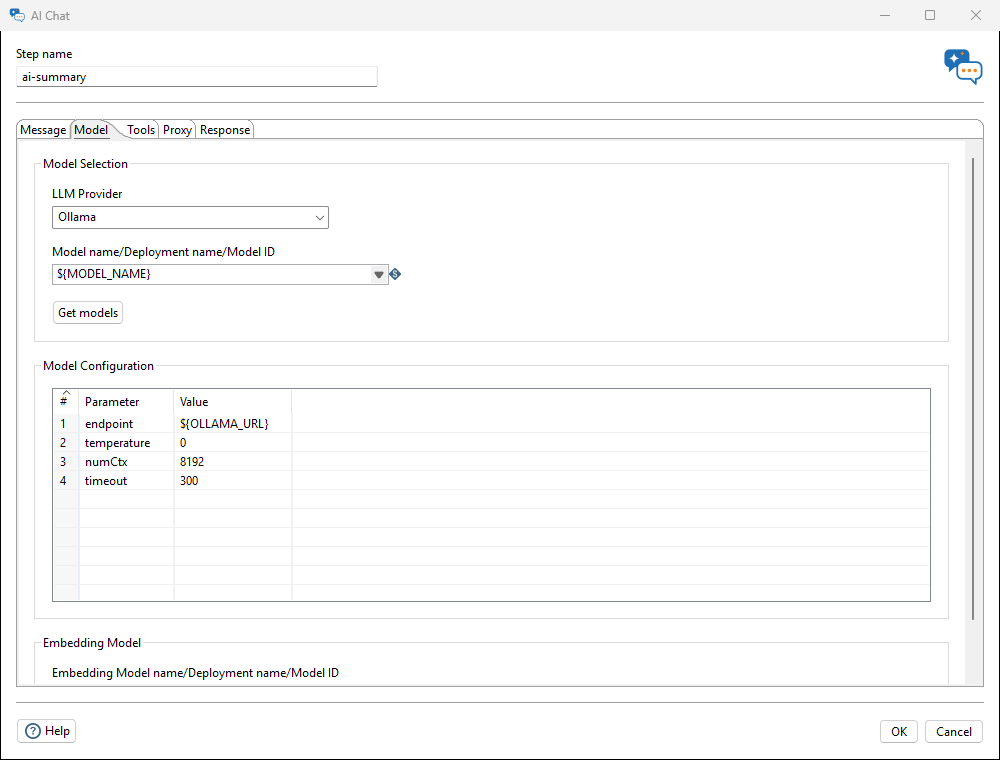
<figcaption>ai-summary: the Model tab</figcaption>
</figure>
</div>

<div align="center">
<figure>
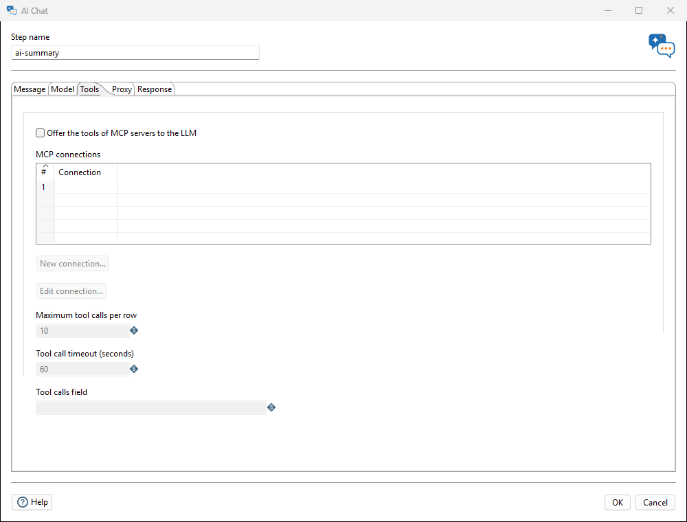
<figcaption>ai-summary: the Tools tab</figcaption>
</figure>
</div>

<div align="center">
<figure>
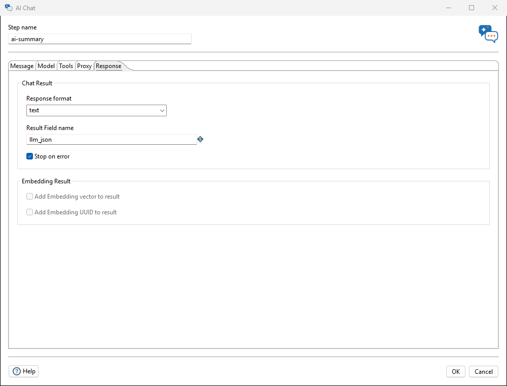
<figcaption>ai-summary: the Response tab</figcaption>
</figure>
</div>

10. Select **OK**.
11. Right-click **ai-summary** and select **Change Number of Copies to Start...**. Enter `${STEP_COPIES}` and select **OK**.

> **Under the hood:**
>
> #### numCtx sets how much text one call can hold
>
> A model reads its whole input, instruction and message, plus the answer it writes, inside one *context window*, measured in tokens; a token is about four characters of English. `numCtx` sets that window for the call. The longest document here, 11,188 characters, is about 2,800 tokens; with the instruction and a 400-token answer it fits in `8192`. Ollama does not fail when the input is longer than the window: it cuts the input to fit, and the model summarizes what is left without saying so.
>
> **Why it matters:** a summary of a document the model only partly read looks as confident as a full one. Size `numCtx` for the longest document, or split the document, as the second transformation does.

12. On the **Design** tab, open the **Input** folder and drag **JSON input** onto the canvas. Create a hop from **ai-summary** to it.
13. Double-click **JSON input** and set **Step name** to `json-summary`. On the **File** tab, select **Source is from a previous step** and set **Select field** to `llm_json`. On the **Content** tab, make sure **Ignore missing path** and **Default path leaf to null** are selected.
14. On the **Fields** tab, fill the grid:

| Name | Path | Type |
| --- | --- | --- |
| `summary` | `$.summary` | String |
| `bullet_points` | `$.bullet_points` | String |
| `key_takeaways` | `$.key_takeaways` | String |
| `action_items` | `$.action_items` | String |

15. Select **OK**, and save the transformation (`Ctrl+S`).

### 4. Catch the Answers the Parser Cannot Read

> **Note:**
>
> #### Error Handling on JSON Input
>
> A small model sometimes closes a JSON answer with the wrong bracket. An error hop sends such a row to a file of its own, with the parser's message, and the other documents carry on.

1. On the **Design** tab, open the **Output** folder and drag **Text file output** onto the canvas, below **json-summary**.
2. Double-click it and set **Step name** to `txt-bad-answers`. On the **File** tab, set **Filename** to `${Internal.Entry.Current.Directory}/bad_answers` and **Extension** to `csv`. Select **OK**.
3. Create a hop from **json-summary** to **txt-bad-answers**, and select **Error handling of step** in the menu that opens. The hop is drawn red, with a red error icon.
4. Right-click **json-summary** and select **Error Handling...**. In **Step error handling settings**, enter these settings, then select **OK**:

| Setting | Value |
| --- | --- |
| **Target step** | `txt-bad-answers` |
| **Enable the error handling?** | Selected |
| **Nr of errors fieldname** | `err_count` |
| **Error descriptions fieldname** | `err_desc` |

5. Double-click **txt-bad-answers**. On the **Fields** tab, select **Get Fields**, then **Minimal width**, and delete every row except `document_id`, `llm_json` and `err_desc`. Select **OK**, and save the transformation (`Ctrl+S`).

> **Under the hood:**
>
> #### A row the step cannot process leaves by the error hop instead of stopping the run
>
> Without error handling, the first unparsable answer fails **json-summary** and stops the transformation, so the documents behind it are never written. With it, **JSON input** adds the parser's message to the row as `err_desc` and sends that row down the red hop. The step's **Errors** count in **Step Metrics** shows how many rows went that way.
>
> **Why it matters:** this is how a production pipeline treats a model: most answers are good, some are not, and the bad ones are kept with their reason so a person, or a rerun with a stronger model, can deal with them.

### 5. Write and Run

> **Note:**
>
> #### Select Values and Text File Output
>
> Keep each document's identity and its four summary fields, and write them to `summaries.csv`. The three lists stay JSON arrays as text, one cell each.

1. On the **Design** tab, open the **Transform** folder and drag **Select values** onto the canvas. Create a hop from **json-summary** to it.
2. Double-click **Select values**, set **Step name** to `sv-results`, and on the **Select & Alter** tab list these fields in this order: `document_id`, `document_type`, `title`, `summary`, `bullet_points`, `key_takeaways`, `action_items`. Select **OK**.
3. On the **Design** tab, open the **Output** folder and drag **Text file output** onto the canvas. Create a hop from **sv-results** to it.
4. Double-click **Text file output** and set **Step name** to `txt-results`. On the **File** tab, set **Filename** to `${Internal.Entry.Current.Directory}/summaries` and **Extension** to `csv`, and select **Create Parent folder**.
5. On the **Content** tab, keep **Separator** `,`, **Enclosure** `"` and **Header** selected, and set **Encoding** to `UTF-8`.
6. On the **Fields** tab, select **Get Fields**, then **Minimal width**. Select **OK**, and save the transformation (`Ctrl+S`).
7. Press `F9` (**Action > Run**), and select **Run** in the **Run Options** dialog.
8. In **Execution Results**, open the **Step Metrics** tab.

> **Success:** Checkpoint: **csvi-documents** shows 10 under **Written**, and the two copies of **ai-summary** read 10 rows between them, 5 each. **json-summary** reads 10, and **txt-results** and **txt-bad-answers** together write 10. In the measured run **json-summary** showed 1 under **Errors**: the answer for document 6, the press release, stopped after its `key_takeaways` list without closing the JSON object, so it went down the error hop to `bad_answers.csv`, and the other 9 were written. Your run may catch a different document, or none. On a machine with a GPU the ten calls take about 35 seconds; a long document takes a minute or more on a CPU-only machine.

9. Open `summaries.csv` in `C:\Workshop-AI-Specialty\04-llm-integration\10-llm-text-summarization`.

> **Success:** Checkpoint: its first line is `document_id,document_type,title,summary,bullet_points,key_takeaways,action_items`, followed by one row per answer that parsed: 9 in the measured run. For the meeting notes, `action_items` lists the owners and dates the notes give, for example `Michael Chen: Finalize API documentation by March 1st`; for a document that asks nothing of anyone, such as the legal contract, it can be `[]`. The wording is the model's and will differ. `bad_answers.csv` is there too: its first line is `document_id,llm_json,err_desc`, followed by one row per answer that did not parse, with the model's whole answer in `llm_json` and the parser's message, such as `Unexpected End Of File`, in `err_desc`. When every answer parsed, the file is empty, without even a header line.

### 6. A Document Too Long

> **Note:**
>
> #### Part 2: Map-Reduce
>
> `annual_report_2024.docx` has 22,166 characters of text, about 5,500 tokens. That fits no `numCtx` small enough to run quickly on a CPU, and a real report is often ten times longer. The answer is to summarize it in pieces.

**The plan, step by step:**

| Stage | Step | What happens |
| --- | --- | --- |
| Read | **Read Unstructured Document** | The Word file becomes one text field |
| Split | **AI Segmentation** | The text becomes chunks of at most 800 tokens, one row each, numbered from 0 |
| Map | **AI Chat** | Each chunk gets its own three-to-five-sentence summary |
| Order | **Sort rows** | The parallel copies return chunks out of order; sorting by the chunk number puts them back |
| Join | **Group by** | The chunk summaries become one field, in order, separated by ` \| ` |
| Reduce | **AI Chat** | The joined summaries, a few hundred tokens, get one executive summary |

**Why chunks overlap:** a chunk can end in the middle of a sentence or a table. An overlap of 80 tokens repeats the end of each chunk at the start of the next, so no fact is cut in half without either chunk seeing all of it.

**Why it is called map-reduce:** the map stage does the same job on every piece independently, so its calls run in parallel; the reduce stage combines their results. Each call stays small, and the document can be any length: only the number of map calls grows.

### 7. Read the Report

> **Note:**
>
> #### Generate Rows and Read Unstructured Document
>
> **Read Unstructured Document** needs an incoming row to start, even when it reads a fixed file, so **Generate Rows** gives it one, with the document's name.

1. Select **File > New > Transformation** (`Ctrl+N`). Select **File > Save as** and save it as `long_document_summary.ktr` in `C:\Workshop-AI-Specialty\04-llm-integration\10-llm-text-summarization`, next to `annual_report_2024.docx`.
2. Double-click an empty part of the canvas, open the **Parameters** tab, and fill the grid:

| Parameter | Default Value | Description |
| --- | --- | --- |
| `MODEL_NAME` | `llama3.2:3b` | Ollama chat model |
| `OLLAMA_URL` | `http://localhost:11434` | Ollama server |
| `STEP_COPIES` | `2` | Parallel copies of ai-map |

3. Select **OK**.
4. On the **Design** tab, open the **Input** folder and drag **Generate Rows** onto the canvas.
5. Double-click **Generate Rows** and set **Step name** to `gr-document`. Set **Limit** to `1`, and fill the **Fields** grid with one row: **Name** `doc_name`, **Type** `String`, **Value** `annual_report_2024.docx`. Select **OK**.
6. On the **Design** tab, open the **Input** folder and drag **Read Unstructured Document** onto the canvas. Create a hop from **gr-document** to it.
7. Double-click **Read Unstructured Document** and set **Step name** to `doc-read`.
8. Under **Source**, select **File** and set **File name** to `${Internal.Entry.Current.Directory}/annual_report_2024.docx`. Keep **File encoding** `UTF-8` and **File password** empty.
9. Under **Target**, set **Result Field name** to `doc_text`.
<div align="center">
<figure>
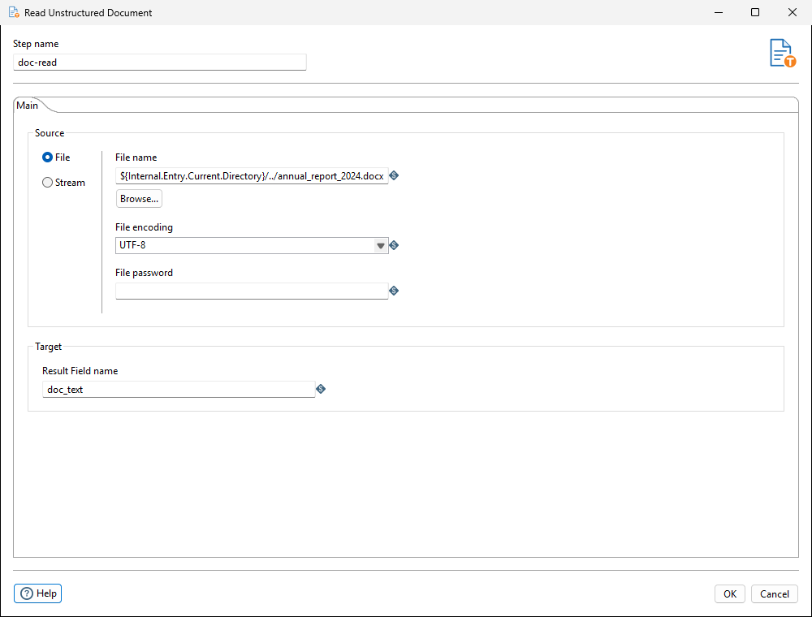
<figcaption>doc-read: its settings</figcaption>
</figure>
</div>

10. Select **OK**, and save the transformation (`Ctrl+S`).

### 8. Split into Chunks

> **Note:**
>
> #### AI Segmentation
>
> **AI Segmentation** splits `doc_text` into chunks and writes one row per chunk, with the chunk's number in `index`.

1. On the **Design** tab, open the **AI** folder and drag **AI Segmentation** onto the canvas. Create a hop from **doc-read** to it.
2. Double-click **AI Segmentation** and set **Step name** to `seg-chunks`.
3. On the **Main** tab, set **Field name** to `doc_text`, **Split strategy** to `Split by Recursion (Paragraph > Line > Sentence > Word)` and **Output field Name** to `chunk`. Keep **Add segment index to result** and **Stop on error** selected.
4. On the **Config** tab, under **Options**, select **Using Tokens**. Set **LLM provider** to `Ollama`, **Model name** to `${MODEL_NAME}`, **Max Segment size** to `800` and **Max Overlap size** to `80`. The **Using Chars** sizes are not used while **Using Tokens** is selected; leave them at their defaults (the solution stores `2000` and `0` there).
<div align="center">
<figure>
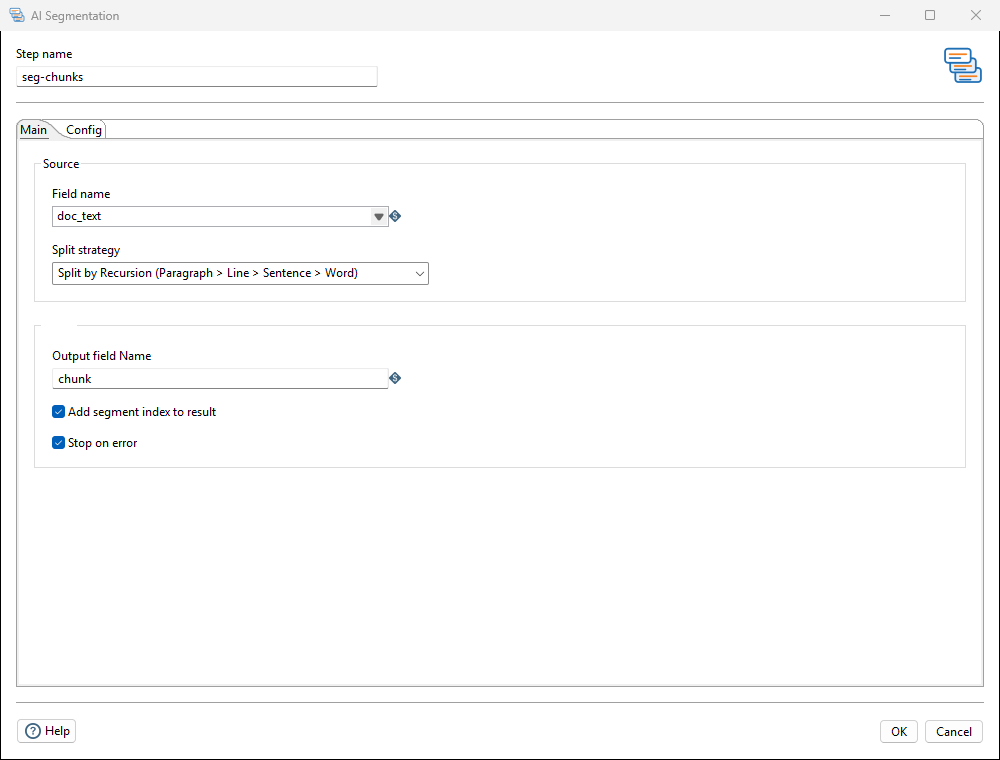
<figcaption>seg-chunks: the Main tab</figcaption>
</figure>
</div>

<div align="center">
<figure>
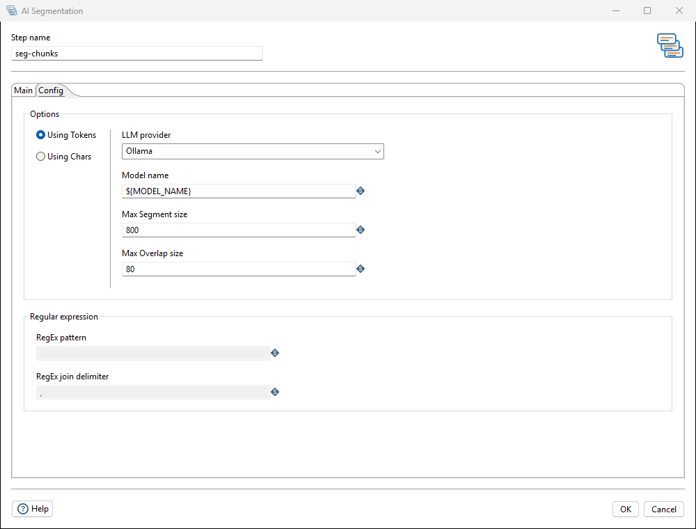
<figcaption>seg-chunks: the Config tab</figcaption>
</figure>
</div>

5. Select **OK**.
6. On the **Design** tab, open the **Transform** folder and drag **Select values** onto the canvas. Create a hop from **seg-chunks** to it.
7. Double-click **Select values**, set **Step name** to `sv-chunks`, and on the **Select & Alter** tab list `doc_name`, `index` and `chunk`. Select **OK**, and save the transformation (`Ctrl+S`).

> **Under the hood:**
>
> #### Recursion kept paragraphs whole wherever they fit
>
> Split by Recursion tries the largest unit first: it keeps whole paragraphs together up to 800 tokens, splits a paragraph that is too long into lines, then sentences, then words. For Ollama the step makes no call to the server: it estimates about four characters per token, which is why the chunk size has a margin below the map call's `numCtx` of `4096`. Every chunk row also carries the row's other fields, including the whole `doc_text`, which **sv-chunks** drops.
>
> **Why it matters:** a chunk that ends at a paragraph break is a chunk the model can summarize on its own. Dropping `doc_text` keeps each row small as it moves through the rest of the transformation.

### 9. Map: Summarize Each Chunk

> **Note:**
>
> #### Add Constants and AI Chat
>
> Every chunk gets the same instruction: summarize this part in plain text and keep the figures. The answers are not JSON, because the next step only joins them.

1. On the **Design** tab, open the **Transform** folder and drag **Add constants** onto the canvas. Create a hop from **sv-chunks** to it.
2. Double-click **Add constants** and set **Step name** to `const-map`. Add one row: **Name** `run_instruction`, **Type** `String`, with this text in **Value**:

```text
You summarize one part of a long company annual report. The part can start or end in the middle of a section.
Write three to five sentences in plain text, with no heading and no list. Keep every figure, name and date that matters, exactly as the text gives it. Do not add anything the text does not say.
```

3. Select **OK**.
4. On the **Design** tab, open the **AI** folder and drag **AI Chat** onto the canvas. Create a hop from **const-map** to it.
5. Double-click **AI Chat** and set **Step name** to `ai-map`.
6. On the **Message** tab, under **Message/Prompt**, select **Stream**. Set **Message Field name** to `chunk` and **Run instruction for LLM Field name** to `run_instruction`.
7. On the **Model** tab, set **LLM Provider** to `Ollama` and **Model name/Deployment name/Model ID** to `${MODEL_NAME}`, and fill the **Model Configuration** grid, deleting any other row:

| Parameter | Value |
| --- | --- |
| `endpoint` | `${OLLAMA_URL}` |
| `temperature` | `0` |
| `numCtx` | `4096` |
| `timeout` | `180` |

8. On the **Response** tab, keep **Response format** `text`, set **Result Field name** to `chunk_summary`, and keep **Stop on error** selected.
<div align="center">
<figure>
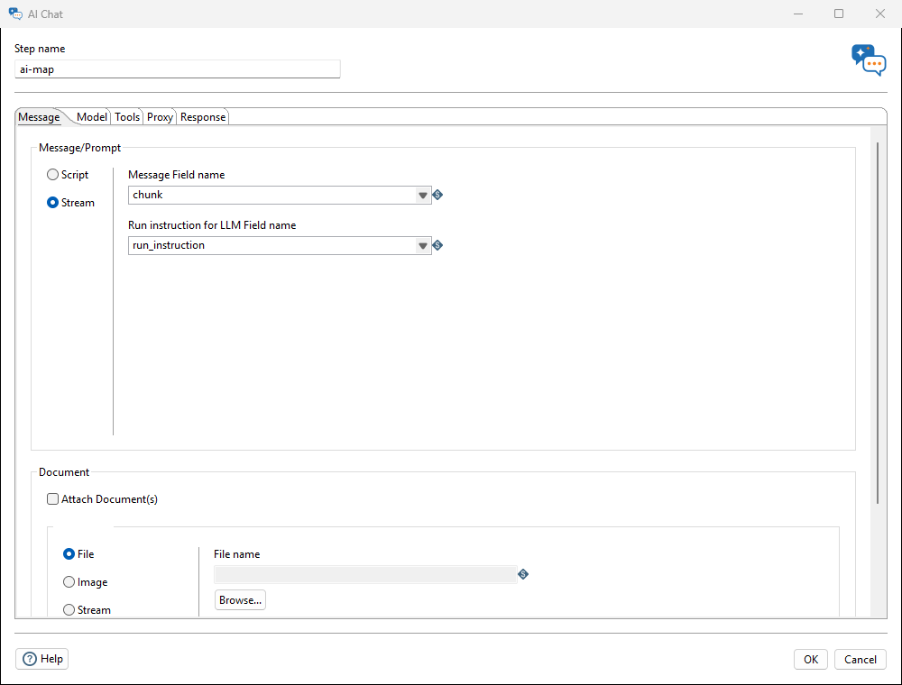
<figcaption>ai-map: the Message tab</figcaption>
</figure>
</div>

<div align="center">
<figure>
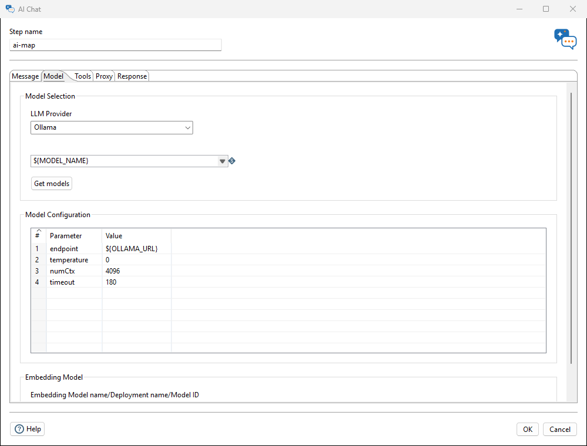
<figcaption>ai-map: the Model tab</figcaption>
</figure>
</div>

<div align="center">
<figure>
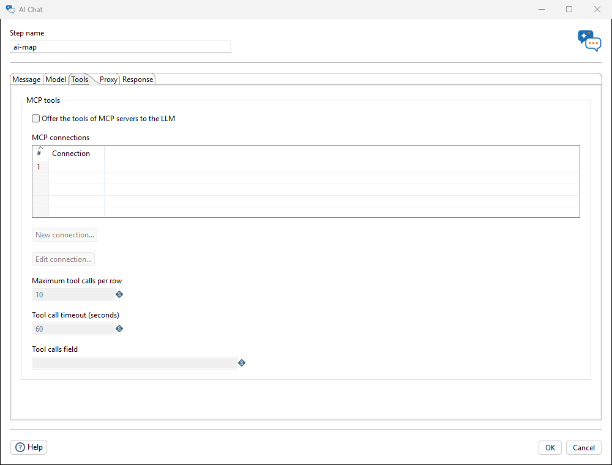
<figcaption>ai-map: the Tools tab</figcaption>
</figure>
</div>

<div align="center">
<figure>

<figcaption>ai-map: the Response tab</figcaption>
</figure>
</div>

9. Select **OK**.
10. Right-click **ai-map** and select **Change Number of Copies to Start...**. Enter `${STEP_COPIES}` and select **OK**.
11. Save the transformation (`Ctrl+S`).

### 10. Reduce: Summarize the Summaries

> **Note:**
>
> #### Sort Rows, Group By and a Second AI Chat
>
> Put the chunk summaries back in document order, join them into one field, and ask the model for one summary of the whole report.

1. On the **Design** tab, open the **Transform** folder and drag **Sort rows** onto the canvas. Create a hop from **ai-map** to it.
2. Double-click **Sort rows**, set **Step name** to `sort-chunks`, and fill the **Fields** grid with one row: `index`, **Ascending** `Y`. Select **OK**.
3. On the **Design** tab, open the **Statistics** folder and drag **Group by** onto the canvas. Create a hop from **sort-chunks** to it.
4. Double-click **Group by** and set **Step name** to `grp-concat`. In **The fields that make up the group**, add `doc_name`.
5. Fill the **Aggregates** grid:

| Name | Subject | Type | Value |
| --- | --- | --- | --- |
| `part_summaries` | `chunk_summary` | Concatenate strings separated by | ` \| ` |
| `chunk_count` | `index` | Number of rows (without field argument) | |

The separator is a space, a vertical bar and a space.

6. Select **OK**.

> **Under the hood:**
>
> #### Sort rows waited for every chunk, so the join is in document order
>
> The two copies of **ai-map** finish chunks at different speeds, so chunk 3 can reach the next step before chunk 2. **Sort rows** holds every row until the last chunk arrives, then passes them on by `index`. **Group by** then makes one row for the document, with every `chunk_summary` joined in that order and the number of chunks. This sort-and-join was checked by running it on three hand-written summaries sent in the order 2, 0, 1: the result was `Part one. | Part two. | Part three.` with a `chunk_count` of `3`.
>
> **Why it matters:** the reduce call reads the parts in the order the report tells them, so a figure in the outlook is not mistaken for last year's.

7. On the **Design** tab, open the **Transform** folder and drag **Add constants** onto the canvas. Create a hop from **grp-concat** to it.
8. Double-click it and set **Step name** to `const-reduce`. Add one row: **Name** `reduce_instruction`, **Type** `String`, with this text in **Value**:

```text
The text holds the summaries of the consecutive parts of one company annual report, in order, separated by | characters.
Write one executive summary of the whole report: a paragraph of 120 to 180 words, then a blank line, then up to five lines that each start with "- " and give one key figure or decision.
Use only facts from the summaries, and keep each figure exactly as they give it.
```

9. Select **OK**.
10. Drag **AI Chat** from the **AI** folder onto the canvas and create a hop from **const-reduce** to it.
11. Double-click it and set **Step name** to `ai-reduce`. On the **Message** tab, select **Stream**, and set **Message Field name** to `part_summaries` and **Run instruction for LLM Field name** to `reduce_instruction`.

<div align="center">
<figure>
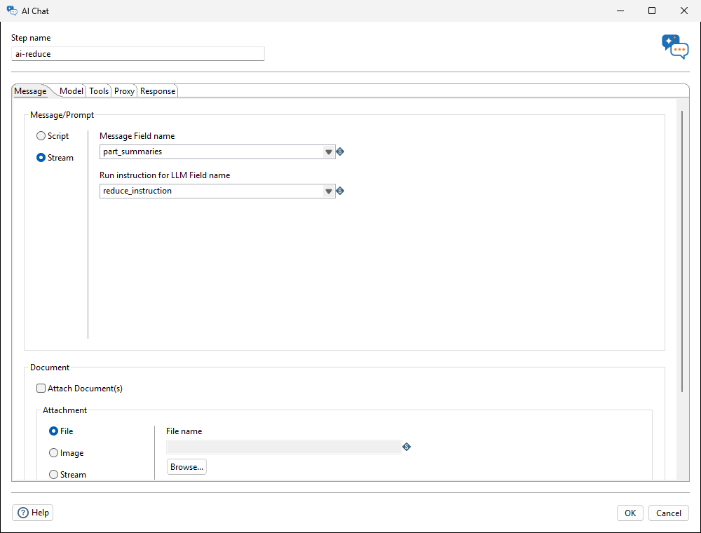
<figcaption>ai-reduce: the Message tab</figcaption>
</figure>
</div>

<div align="center">
<figure>
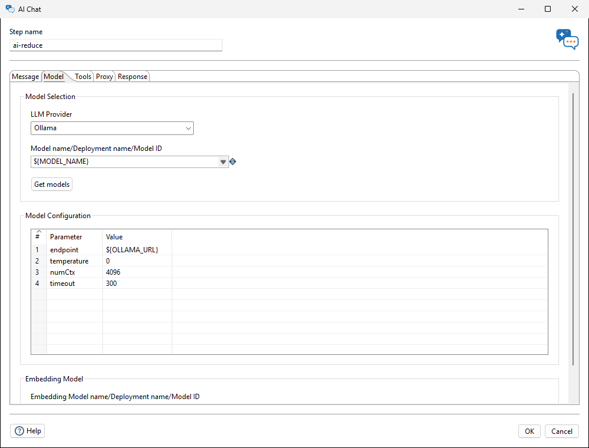
<figcaption>ai-reduce: the Model tab</figcaption>
</figure>
</div>

<div align="center">
<figure>

<figcaption>ai-reduce: the Tools tab</figcaption>
</figure>
</div>

<div align="center">
<figure>
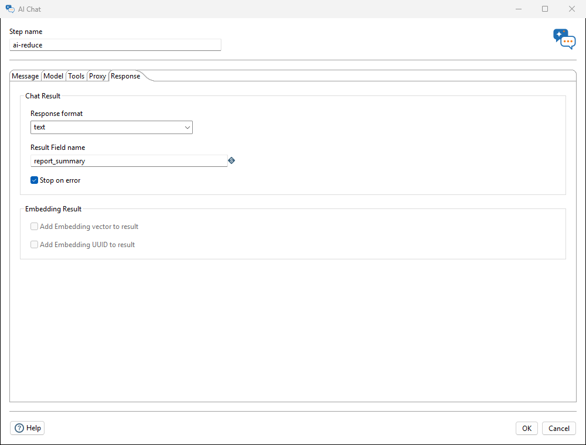
<figcaption>ai-reduce: the Response tab</figcaption>
</figure>
</div>

12. On the **Model** tab, set **LLM Provider** to `Ollama` and **Model name/Deployment name/Model ID** to `${MODEL_NAME}`, and fill the **Model Configuration** grid: `endpoint` `${OLLAMA_URL}`, `temperature` `0`, `numCtx` `4096`, `timeout` `300`.
13. On the **Response** tab, keep **Response format** `text` and set **Result Field name** to `report_summary`. Select **OK**. Keep it at one copy: there is only one row.
14. Drag **Select values** onto the canvas and create a hop from **ai-reduce** to it. Double-click it, set **Step name** to `sv-summary`, and list `doc_name`, `chunk_count`, `report_summary` and `part_summaries`. Select **OK**.
15. Drag **Text file output** onto the canvas and create a hop from **sv-summary** to it. Double-click it and set **Step name** to `txt-summary`. On the **File** tab, set **Filename** to `${Internal.Entry.Current.Directory}/long_document_summary` and **Extension** to `csv`, and select **Create Parent folder**. On the **Content** tab set **Encoding** to `UTF-8`, and on the **Fields** tab select **Get Fields**, then **Minimal width**. Select **OK**.
16. Save the transformation (`Ctrl+S`).

### 11. Run the Long Document

> **Note:**
>
> #### Run the Transformation
>
> One map call per chunk, then one reduce call. Allow several minutes on a CPU-only machine.

1. Press `F9` (**Action > Run**), and select **Run** in the **Run Options** dialog.
2. In **Execution Results**, open the **Step Metrics** tab.

> **Success:** Checkpoint: every step finishes without errors. **gr-document** and **doc-read** write 1 row; **seg-chunks** reads 1 and writes 9, one row per chunk; the two copies of **ai-map** read the 9 between them (5 and 4); **grp-concat** reads 9 and writes 1, and **ai-reduce** and **txt-summary** write 1. On a machine with a GPU the run takes about 25 seconds.

3. Select **seg-chunks** on the canvas and open the **Preview data** tab.

> **Success:** Checkpoint: one row per chunk, `index` from `0` up. The first chunk starts with the report's title, `Harbor Lane Logistics: Annual Report 2024`.

4. Open `long_document_summary.csv` in `C:\Workshop-AI-Specialty\04-llm-integration\10-llm-text-summarization`.

> **Success:** Checkpoint: its first line is `doc_name,chunk_count,report_summary,part_summaries`, followed by one row: `annual_report_2024.docx` with a `chunk_count` of `9`. `report_summary` is one paragraph and up to five `- ` lines, with the report's own figures, such as revenue of `$899.0 million`, up 8.9% from `$825.5 million`; `part_summaries` holds the chunk summaries the reduce call read. The wording will differ from run to run.

5. Check two figures of `report_summary` against the report itself. A figure the report does not contain came from the model, not the document.

::::

## Troubleshooting <!-- no-step -->

<details>
<summary>Error initializing step: License validation failed</summary>

The Pentaho license on this machine has no GenAI rights. Every GenAI plugin step, **Read Unstructured Document** and **AI Segmentation** included, checks for a license with the GenAI Plugin Suite (GENAI-EE) subscription when the transformation starts. Install a license that includes it, as described in [Before You Start](../00-before-you-start/guide.md).

</details>

<details>
<summary>A summary misses part of a long document</summary>

The document was longer than `numCtx` allowed, and Ollama cut the input to fit without an error. Raise `numCtx`, or summarize the document in chunks as the second transformation does.

</details>

<details>
<summary>ai-summary or ai-map times out</summary>

A long input on a CPU-only machine can take longer than `timeout`. Raise it in the **Model Configuration** grid, or set `STEP_COPIES` to `1` so the calls do not compete for the CPU.

</details>

<details>
<summary>doc-read fails before any row is read</summary>

The file name is wrong, or the extension is not one the step reads (TXT, PDF, DOC, DOCX, PPT, PPTX). Compare **File name** with the file on disk, and make sure `annual_report_2024.docx` is next to the transformation.

</details>

## Lab Files

Click a file to download. For `.ktr` and `.kjb` files, **Open in Pentaho Data Integration** launches Pentaho Data Integration with the file loaded. If Pentaho Data Integration is already running, the path is copied to your clipboard — switch to Pentaho Data Integration and press `Ctrl+O`, `Ctrl+V`, `Enter`.

The ten business documents of the first transformation:

[text_summarization_documents.csv](./files/text_summarization_documents.csv)

The first five of them, for a shorter run: change the **Filename** of **csvi-documents** to `text_summarization_documents_2.csv`:

[text_summarization_documents_2.csv](./files/text_summarization_documents_2.csv)

The long report of the second transformation, a fictitious company's annual report:

[annual_report_2024.docx](./files/annual_report_2024.docx)

### Solution <!-- no-step -->

The finished transformations for this lab. Open them alongside your own to compare, or run them to see the expected result. They read their data from the lab folder and write `summaries.csv` and `long_document_summary.csv` beside themselves; the first also writes `bad_answers.csv` for any answer the parser could not read.

Also on disk at `C:\Workshop-AI-Specialty\04-llm-integration\10-llm-text-summarization\solution`.

[text_summarization.ktr](./files/solution/text_summarization.ktr) <button data-launch="spoon" data-path="files/solution/text_summarization.ktr">Open in Pentaho Data Integration</button> <button data-graph="files/solution/text_summarization.ktr">View graph</button>

text_summarization in Spoon, with its note:

<div align="center">
<figure>
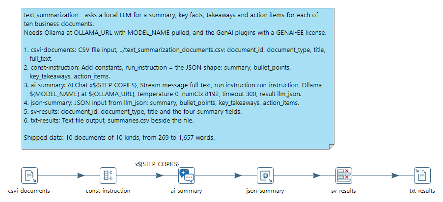
<figcaption>text_summarization.ktr in Spoon</figcaption>
</figure>
</div>

[long_document_summary.ktr](./files/solution/long_document_summary.ktr) <button data-launch="spoon" data-path="files/solution/long_document_summary.ktr">Open in Pentaho Data Integration</button> <button data-graph="files/solution/long_document_summary.ktr">View graph</button>

long_document_summary in Spoon, with its note:

<div align="center">
<figure>
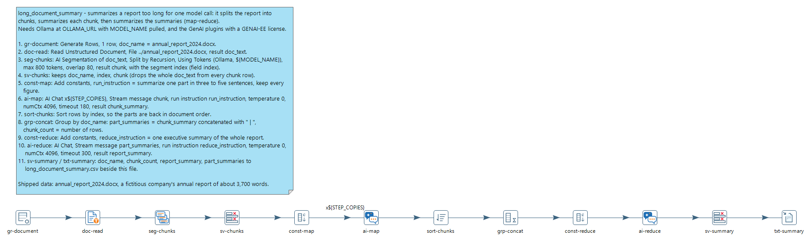
<figcaption>long_document_summary.ktr in Spoon</figcaption>
</figure>
</div>
