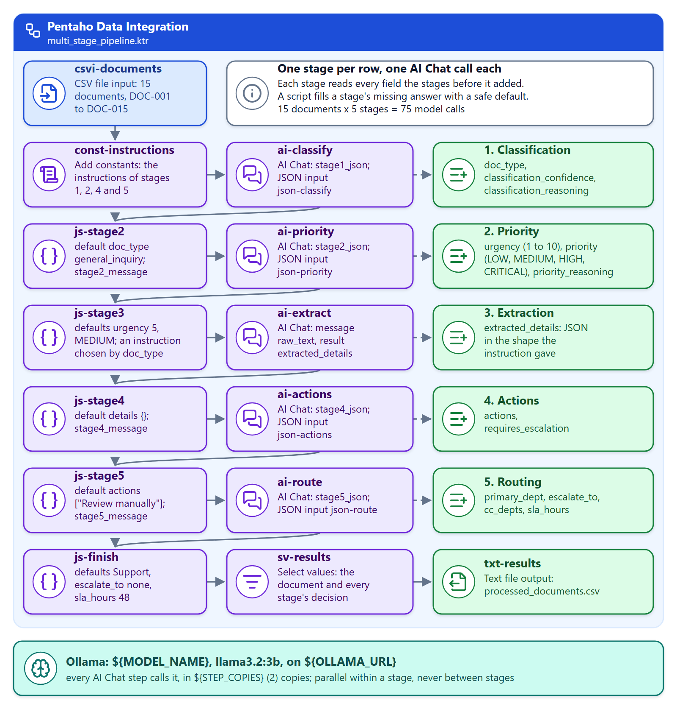
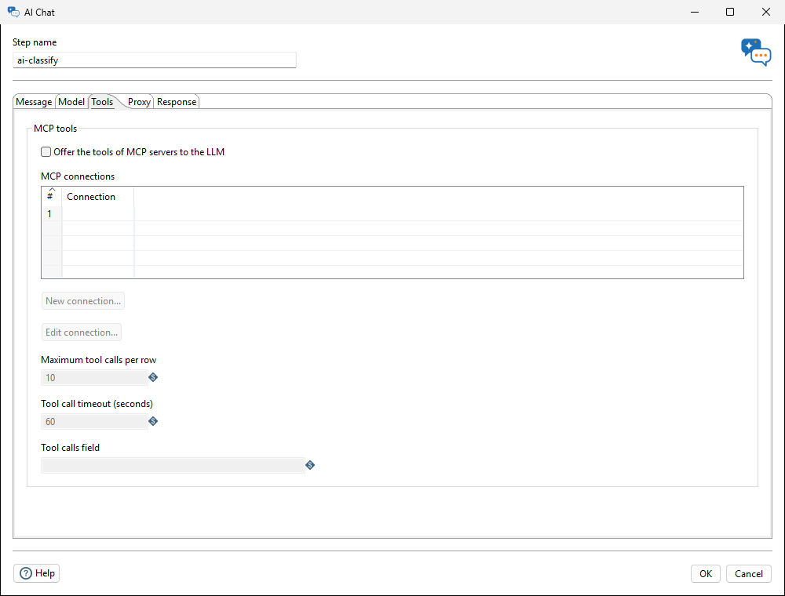
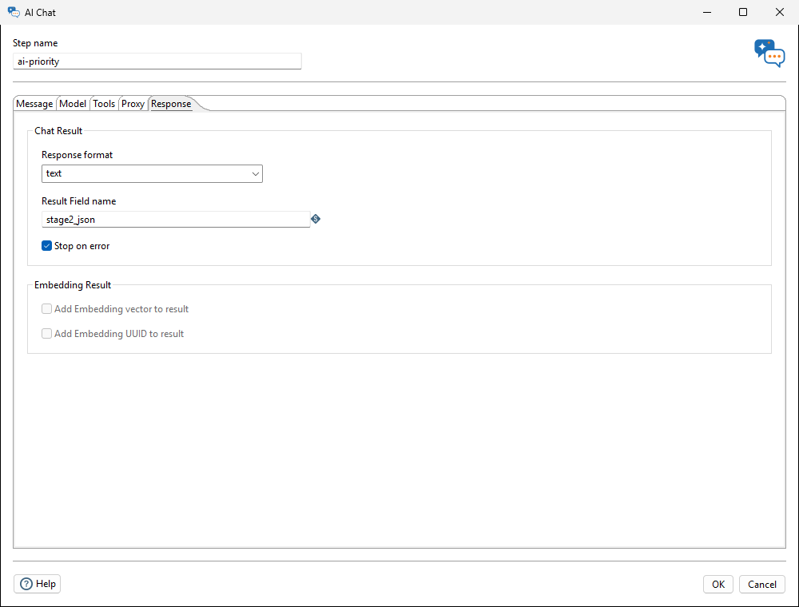
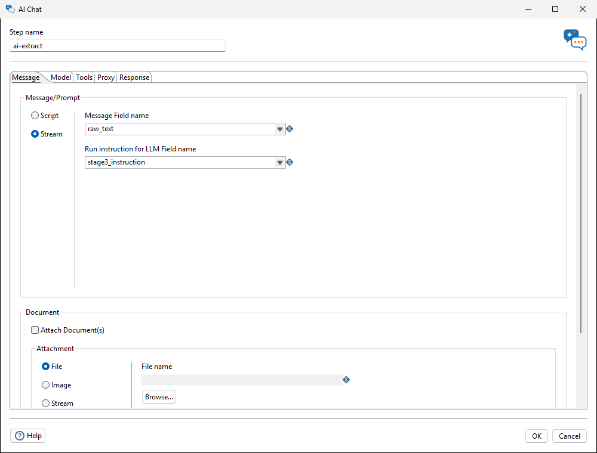
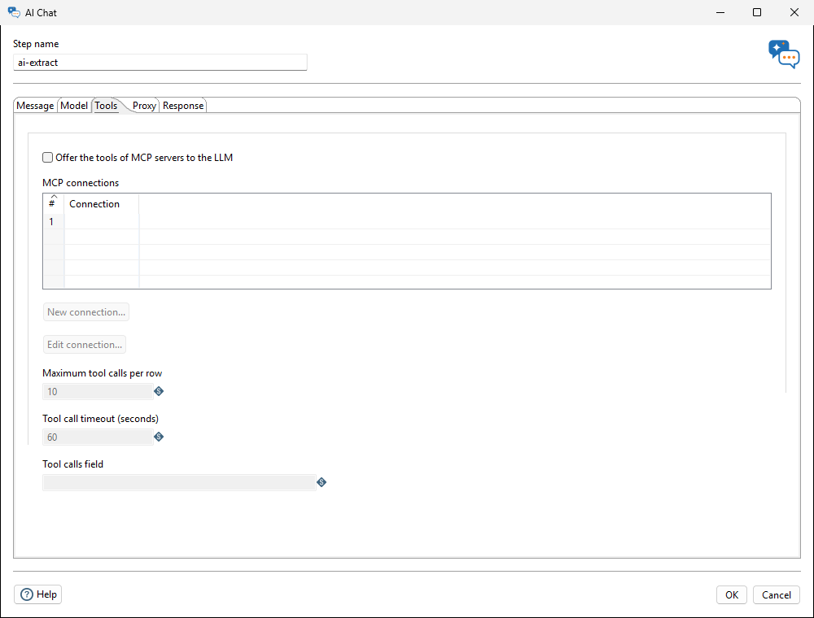
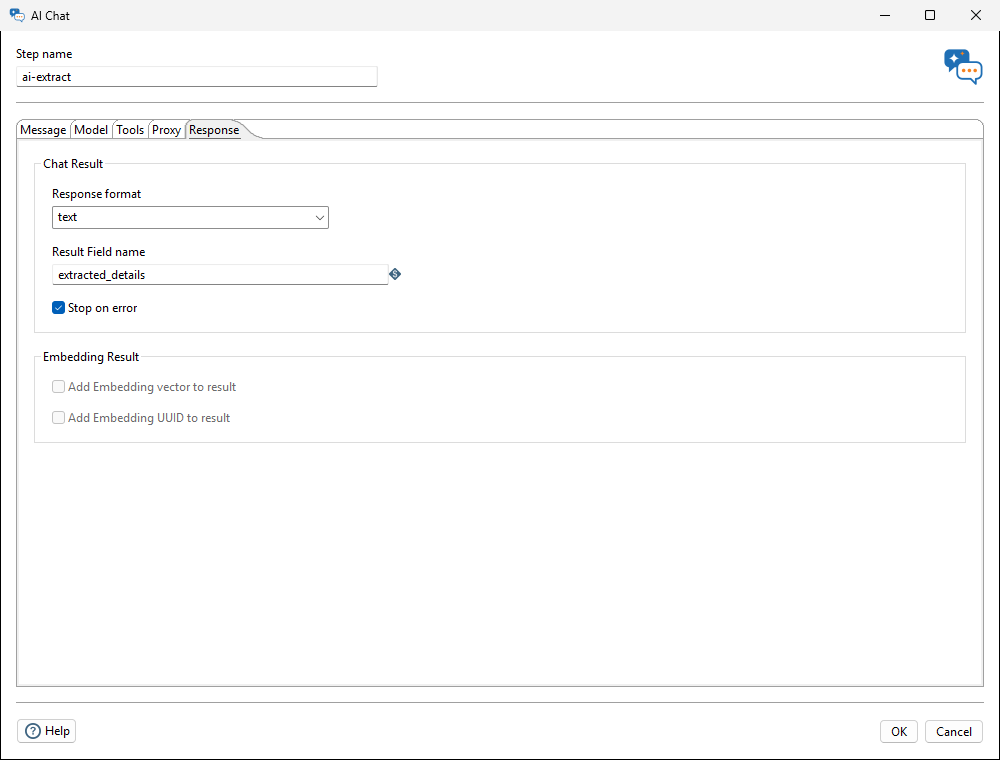
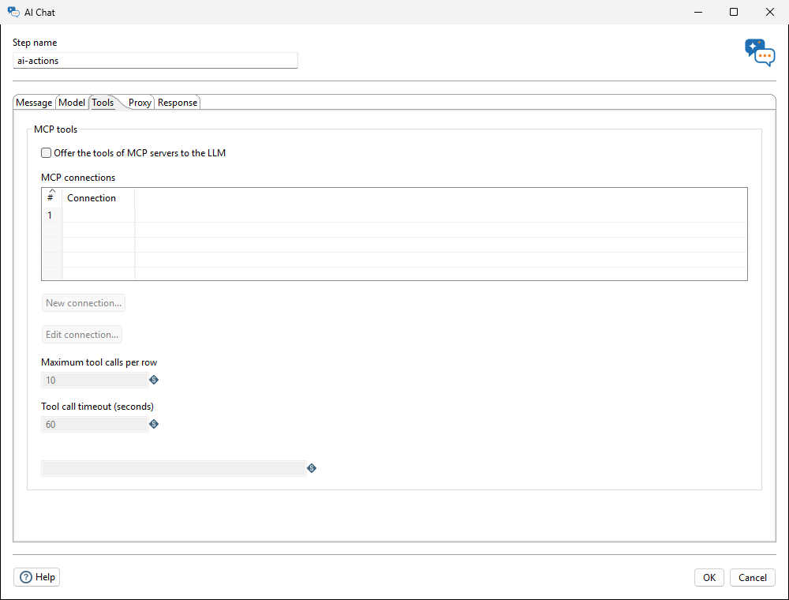
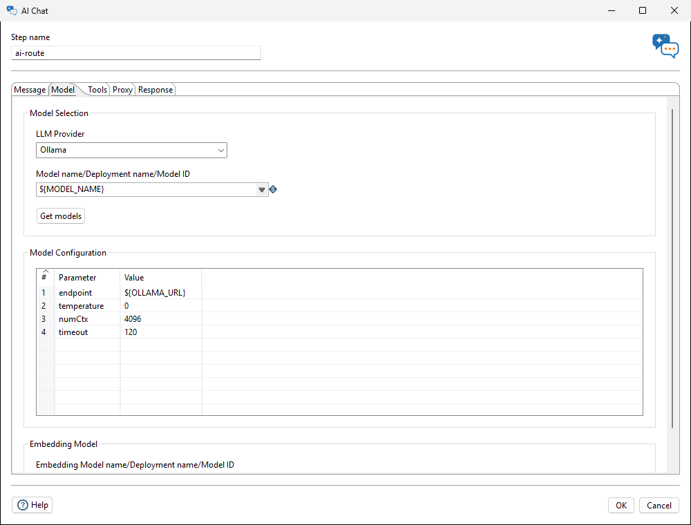
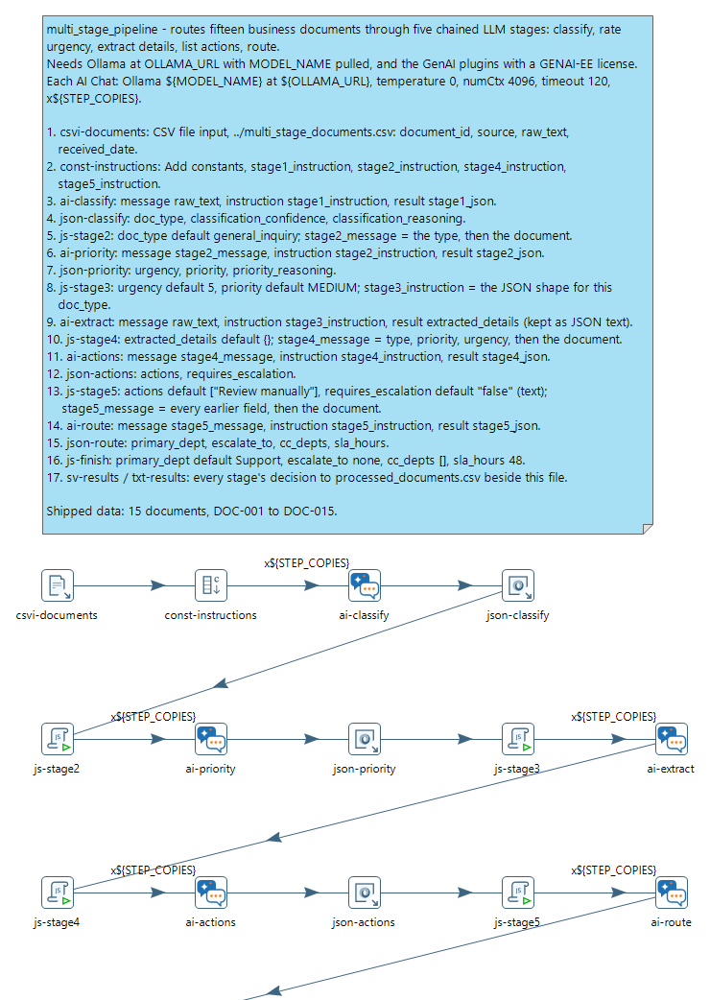

# Multi-staged

> **Warning:**
>
> #### Workshop - Multi-staged
>
> Build a Pentaho Data Integration transformation that chains five **AI Chat** steps, each calling a local Large Language Model (LLM) served by Ollama, into a document router. Each stage does one job, adds its answer to the row, and passes everything it learned to the next.
>
> **What you'll do**
>
> * Chain five AI Chat calls in one transformation, each stage reading the fields earlier stages added
> * Classify each document, then score its urgency with the classification in the message
> * Choose a type-specific run instruction per row, built by a script
> * Give every stage a safe default for a missing answer, and an error hop for a broken one, so one bad answer doesn't stop the pipeline
> * Write each document with every stage's decision, for auditing
>
> **Prerequisites:**
>
> * [Data Quality](../07-llm-data-quality/guide.md): the message, AI Chat and JSON input pattern each stage repeats
> * Ollama running on `http://localhost:11434` with `llama3.2:3b` pulled, and the GenAI plugins installed, as set up in [Before You Start](../00-before-you-start/guide.md)
>
> **Estimated time:** 50 minutes

<figure>

<figcaption class="pcm-video-caption">Walkthrough: coming soon</figcaption>

</figure>

<div align="center">
<figure>

<figcaption>What you build: five stages, each a script, one AI Chat call and the fields it adds</figcaption>
</figure>
</div>

:::: tabs

### 1. Multi-Stage Pipelines

> **Note:**
>
> #### What Is a Multi-Stage Pipeline?
>
> A multi-stage pipeline chains several LLM calls in order. Each stage performs one focused task and adds its result to the row, so the next stage works with everything gathered so far, like stations on an assembly line.

**The five stages of this workshop:**

| Stage | Job | Message | Adds |
| --- | --- | --- | --- |
| 1. Classification | What kind of document is this? | The document | `doc_type`, `classification_confidence`, `classification_reasoning` |
| 2. Priority | How urgent is it? | `doc_type`, the document | `urgency` (1 to 10), `priority` (`LOW`, `MEDIUM`, `HIGH`, `CRITICAL`), `priority_reasoning` |
| 3. Extraction | The details that matter for this type | The document, with an instruction chosen by `doc_type` | `extracted_details` (JSON, different per type) |
| 4. Actions | What should be done? | `doc_type`, `priority`, `urgency`, the document | `actions`, `requires_escalation` |
| 5. Routing | Who owns it? | Every field above, the document | `primary_dept`, `escalate_to`, `cc_depts`, `sla_hours` |

**One prompt or five:**

| Aspect | One prompt | Five stages |
| --- | --- | --- |
| Task per call | Six tasks at once | One task per call |
| Conditional logic | Not possible: every document gets the same questions | Stage 3 asks different questions per document type |
| An answer with no JSON in it | Loses everything | Loses one stage; the others keep their results |
| Debugging | Hard to tell which part went wrong | Each stage's answer is a field you can read |
| Auditability | One decision | A recorded decision, with reasoning, per stage |
| Calls per document | 1 | 5, each with a shorter instruction and a shorter answer |

**The principles:**

1. **One responsibility per stage.** A focused instruction is easier for a small model to follow well than one with six tasks.
2. **Context passes forward.** Stage 2 knows the document is a `security_incident`; Stage 5 knows its type, priority, details and actions.
3. **Conditional branching.** A security incident needs a vulnerability type and a disclosure deadline; a legal threat needs the deadline and the party making the claim.
4. **Error isolation.** Each script that starts a stage first replaces a missing answer of the stage before with a safe default (`general_inquiry`, urgency `5`, `Support`), so a stage that fails passes a usable value on. An answer that is broken JSON, which the parser cannot read at all, leaves by that stage's error hop to a file of its own instead of stopping the run.

**When to use it:** when documents differ in kind and need different handling, when a decision depends on an earlier one, or when each decision must be auditable. A uniform task that treats every document the same way is simpler as one call. Parallelize within a stage (several copies of a step), never between stages, because each stage needs the one before it.

**The data:** `multi_stage_documents.csv` holds 15 documents, `DOC-001` to `DOC-015`, with the columns `document_id`, `source`, `raw_text` and `received_date`. They range from an urgent outage email and a trademark notice to a feature request and a thank-you message; line breaks in `raw_text` are written as the two characters `\n`, which the model reads as line breaks. `multi_stage_documents_2.csv` holds the first four, for a shorter run.

### 2. Read and Instruct

> **Note:**
>
> #### Read the Documents and Add the Instructions
>
> Create the transformation, read the documents, and add the run instructions of Stages 1, 2, 4 and 5 in one **Add constants** step. Stage 3's instruction depends on the row, so a script builds it later.

1. Start Pentaho Data Integration with the **Start Pentaho Data Integration** button below, or from PowerShell:

```powershell
Set-Location C:\Pentaho\design-tools\data-integration
.\Spoon.bat
```

<button data-launch="spoon" data-path="">Start Pentaho Data Integration</button>

2. Select **File > New > Transformation** (`Ctrl+N`).
3. Select **File > Save as** and save it as `multi_stage_pipeline.ktr` in `C:\Workshop-AI-Specialty\04-llm-integration\11-llm-multi-staged`, next to `multi_stage_documents.csv`. (On your own machine, download the file from **Lab Files** below into the folder you save in.)
4. Double-click an empty part of the canvas, open the **Parameters** tab, and fill the grid:

| Parameter | Default Value | Description |
| --- | --- | --- |
| `MODEL_NAME` | `llama3.2:3b` | Ollama chat model for every stage |
| `OLLAMA_URL` | `http://localhost:11434` | Ollama server |
| `STEP_COPIES` | `2` | Parallel copies of each AI Chat step |

5. Select **OK**.
6. On the **Design** tab, open the **Input** folder and drag **CSV file input** onto the canvas.
7. Double-click **CSV file input** and set **Step name** to `csvi-documents`.
8. Set **Filename** to `${Internal.Entry.Current.Directory}/multi_stage_documents.csv`.
9. Keep **Delimiter** `,`, **Enclosure** `"` and **Header row present?** selected. Clear **Lazy conversion?**.
10. Fill the **Fields** grid. Every field is a String with no length, trimmed on both sides: `document_id`, `source`, `raw_text`, `received_date`.
11. Select **OK**, and save the transformation (`Ctrl+S`).
12. Select **csvi-documents** on the canvas, press `F10` (**Action > Preview**), and select **Quick Launch**.

> **Success:** Checkpoint: **Examine preview data** shows 15 rows, `DOC-001` to `DOC-015`. The first is an `email` received `2025-02-28`, starting `Subject: URGENT: Production System Down`.

13. Select **Close**.
14. On the **Design** tab, open the **Transform** folder and drag **Add constants** onto the canvas. Create a hop from **csvi-documents** to it: hold `Shift` and drag from one step to the other.
15. Double-click **Add constants** and set **Step name** to `const-instructions`. Fill the **Fields** grid with four rows, each **Type** `String`, with these texts in **Value**:

`stage1_instruction`:

```text
You classify one incoming business document.
Types: security_incident (vulnerability reports, breaches), legal_threat (cease and desist, trademark or copyright claims), critical_ticket (high-value customer issues, billing errors), business_opportunity (partnership offers, sales leads), bug_report (defects, crashes), feature_request (enhancement ideas), general_inquiry (questions, basic support), positive_feedback (praise, thank-you messages).
Choose the most specific type that fits.
Answer with one JSON object and nothing else, in exactly this shape:
{"doc_type": "one of the types above", "confidence": a number from 0.0 to 1.0, "reasoning": "one sentence"}
```

`stage2_instruction`:

```text
You rate how urgent one business document is. The message gives its type, then the document.
Typical urgency by type: security_incident 8-10, legal_threat 7-9, critical_ticket 6-9, business_opportunity 5-7, bug_report 4-8, feature_request 2-5, general_inquiry 1-4, positive_feedback 1-2. Weigh business impact, deadlines, legal exposure and the customer's value.
priority follows from urgency: 9-10 CRITICAL, 7-8 HIGH, 4-6 MEDIUM, 1-3 LOW.
Answer with one JSON object and nothing else, in exactly this shape:
{"urgency": an integer from 1 to 10, "priority": "LOW" | "MEDIUM" | "HIGH" | "CRITICAL", "reasoning": "one sentence"}
```

`stage4_instruction`:

```text
You list the actions one business document needs. The message gives its type, priority and urgency, then the document.
Each action says who does what, with a timeframe when the priority is HIGH or CRITICAL.
Examples: a security_incident needs the security team alerted and a patch scheduled; a legal_threat goes to legal counsel with a reply prepared before the deadline; a critical_ticket gets a senior engineer and a call to the customer within 2 hours; a business_opportunity gets a discovery call and an account executive.
Answer with one JSON object and nothing else, in exactly this shape:
{"actions": ["up to four actions"], "requires_escalation": true or false}
```

`stage5_instruction`:

```text
You route one business document to the department that owns it. The message gives what earlier analysis found, then the document.
Routing rules: security_incident to Security (SLA 2-4 hours), escalate to CTO when CRITICAL; legal_threat to Legal (4-8 hours), escalate to CEO when the liability is high; critical_ticket to Support (4-24 hours by urgency), cc Sales when the account is worth more than $100,000; business_opportunity to Sales (24-48 hours); bug_report to Engineering (24-72 hours); feature_request to Product (168 hours); general_inquiry to Support (48 hours); positive_feedback to Marketing (168 hours).
Urgency 9 or more always escalates to an executive.
Answer with one JSON object and nothing else, in exactly this shape:
{"primary_dept": "Security" | "Legal" | "Support" | "Engineering" | "Product" | "Sales" | "Marketing", "escalate_to": "CEO" | "CTO" | "CFO" | "VP" | "none", "cc_depts": ["other departments to inform"], "sla_hours": an integer}
```

16. Select **OK**, and save the transformation (`Ctrl+S`).

### 3. Stage 1: Classify

> **Note:**
>
> #### The First AI Chat
>
> Every **AI Chat** step in this transformation has the same model settings; only its message, instruction and result fields differ. Set up the first one here, then copy it for the others.

1. On the **Design** tab, open the **AI** folder and drag **AI Chat** onto the canvas. Create a hop from **const-instructions** to it.
2. Double-click **AI Chat** and set **Step name** to `ai-classify`.
3. On the **Message** tab, under **Message/Prompt**, select **Stream**. Set **Message Field name** to `raw_text` and **Run instruction for LLM Field name** to `stage1_instruction`. Keep **Attach Document(s)** cleared.
4. On the **Model** tab, set **LLM Provider** to `Ollama` and **Model name/Deployment name/Model ID** to `${MODEL_NAME}`.
5. Fill the **Model Configuration** grid. Delete any row that is not in this table:

| Parameter | Value |
| --- | --- |
| `endpoint` | `${OLLAMA_URL}` |
| `temperature` | `0` |
| `numCtx` | `4096` |
| `timeout` | `120` |

6. On the **Response** tab, keep **Response format** `text`, set **Result Field name** to `stage1_json`, and keep **Stop on error** selected.
<div align="center">
<figure>

<figcaption>ai-classify: the Message tab</figcaption>
</figure>
</div>

<div align="center">
<figure>

<figcaption>ai-classify: the Model tab</figcaption>
</figure>
</div>

<div align="center">
<figure>

<figcaption>ai-classify: the Tools tab</figcaption>
</figure>
</div>

<div align="center">
<figure>

<figcaption>ai-classify: the Response tab</figcaption>
</figure>
</div>

7. Select **OK**.
8. Right-click **ai-classify** and select **Change Number of Copies to Start...**. Enter `${STEP_COPIES}` and select **OK**.
9. On the **Design** tab, open the **Input** folder and drag **JSON input** onto the canvas. Create a hop from **ai-classify** to it.
10. Double-click **JSON input** and set **Step name** to `json-classify`. On the **File** tab, select **Source is from a previous step** and set **Select field** to `stage1_json`. On the **Content** tab, make sure **Ignore missing path** and **Default path leaf to null** are selected.
11. On the **Fields** tab, fill the grid:

| Name | Path | Type |
| --- | --- | --- |
| `doc_type` | `$.doc_type` | String |
| `classification_confidence` | `$.confidence` | Number |
| `classification_reasoning` | `$.reasoning` | String |

12. Select **OK**, and save the transformation (`Ctrl+S`).

> **Under the hood:**
>
> #### Five AI Chat steps, five requests per document, no request text written by hand
>
> Each **AI Chat** step sends its own chat request to Ollama for every row: its instruction field as the system message, its message field as the user message. Without the plugin, each stage would need three steps for the same thing: a script that writes the request body as JSON text, a **REST client** that posts it, and a script that digs the answer out of Ollama's reply. With **AI Chat**, a stage is the script that builds its message, the call, and a **JSON input**.
>
> **Why it matters:** no stage writes request text or unwraps Ollama's reply, so no stage can get either wrong, and the model, server and options are set the same way in every stage, from the same parameters.

### 4. Stage 2: Priority

> **Note:**
>
> #### A Message That Carries Stage 1's Answer
>
> A script starts Stage 2: it gives `doc_type` its safe default when Stage 1's answer could not be read, and builds the message from the type and the document.

1. On the **Design** tab, open the **Scripting** folder and drag **Modified JavaScript value** onto the canvas. Create a hop from **json-classify** to it.
2. Double-click it and set **Step name** to `js-stage2`.
3. Replace the text in the **Script 1** tab with:

```javascript
// Stage 1 left no doc_type? Use the safe default, then build Stage 2's message
if (doc_type == null || doc_type == "") doc_type = "general_inquiry";
var stage2_message = "Document type: " + doc_type + "\n\nDocument:\n" + raw_text;
```

4. Fill the **Fields** grid:

| Fieldname | Type | Replace value 'Fieldname' or 'Rename to' |
| --- | --- | --- |
| `doc_type` | String | Y |
| `stage2_message` | String | N |

5. Select **OK**.
6. Select **ai-classify** on the canvas and copy it (`Ctrl+C`), then paste it onto the canvas (`Ctrl+V`). Create a hop from **js-stage2** to the copy.
7. Double-click the copy and set **Step name** to `ai-priority`. On the **Message** tab, set **Message Field name** to `stage2_message` and **Run instruction for LLM Field name** to `stage2_instruction`. On the **Response** tab, set **Result Field name** to `stage2_json`. Select **OK**. Check that it shows `x${STEP_COPIES}`; if not, change its number of copies as for **ai-classify**.

<div align="center">
<figure>

<figcaption>ai-priority: the Message tab</figcaption>
</figure>
</div>

<div align="center">
<figure>

<figcaption>ai-priority: the Model tab</figcaption>
</figure>
</div>

<div align="center">
<figure>

<figcaption>ai-priority: the Tools tab</figcaption>
</figure>
</div>

<div align="center">
<figure>

<figcaption>ai-priority: the Response tab</figcaption>
</figure>
</div>

8. Drag **JSON input** onto the canvas and create a hop from **ai-priority** to it. Double-click it and set **Step name** to `json-priority`. On the **File** tab, select **Source is from a previous step** and set **Select field** to `stage2_json`. On the **Content** tab, make sure **Ignore missing path** and **Default path leaf to null** are selected. On the **Fields** tab, fill the grid:

| Name | Path | Type |
| --- | --- | --- |
| `urgency` | `$.urgency` | Integer |
| `priority` | `$.priority` | String |
| `priority_reasoning` | `$.reasoning` | String |

9. Select **OK**, and save the transformation (`Ctrl+S`).

> **Under the hood:**
>
> #### Replace value wrote the default back into the field Stage 1 created
>
> With **Replace value** `Y`, the script's `doc_type` variable replaces the field's value instead of adding a second field of the same name. A row whose Stage 1 answer was readable keeps its type; a row whose answer held no type, where **JSON input** left `doc_type` null, now carries `general_inquiry`. These default scripts were run on a row with every stage's answer missing: it came out as `general_inquiry`, urgency `5`, `MEDIUM`, details `{}`, actions `["Review manually"]`, `Support` with a 48-hour SLA.
>
> **Why it matters:** an answer with no usable value costs one decision, not the document. The next stages and the output always have a value to work with, and a reviewer can spot the defaults.

### 5. Stage 3: Extraction

> **Note:**
>
> #### An Instruction Built per Row
>
> One script, five instructions: the `doc_type` from Stage 1 decides which details to ask for. The script writes the instruction into a field, and **AI Chat** reads it like any other. The answer is kept whole, as JSON text, because its keys differ by type.

1. Drag a **Modified JavaScript value** onto the canvas and create a hop from **json-priority** to it.
2. Double-click it and set **Step name** to `js-stage3`.
3. Replace the text in the **Script 1** tab with:

```javascript
// Stage 2 left no answer? Use the safe defaults
if (urgency == null) urgency = 5;
if (priority == null || priority == "") priority = "MEDIUM";

// Stage 3's instruction depends on the document type from Stage 1
var shape;
if (doc_type == "security_incident") {
  shape = '{"vuln_type": "SQL injection, XSS or another kind", "severity": "Low | Medium | High | Critical", "affected_systems": "which systems", "disclosure_days": a number of days or null}';
} else if (doc_type == "legal_threat") {
  shape = '{"legal_issue": "trademark, copyright or another kind", "deadline_days": a number of days or null, "potential_liability": "a brief estimate", "parties": "who is making the claim"}';
} else if (doc_type == "critical_ticket") {
  shape = '{"customer_name": "company or person", "issue_summary": "one sentence", "business_impact": "revenue at risk and why", "account_value": "the amount, if the document gives one"}';
} else if (doc_type == "business_opportunity") {
  shape = '{"partner_name": "company name", "opportunity_type": "partnership, sale or another kind", "deal_value": "the amount, if the document gives one", "contact_person": "name and title"}';
} else {
  shape = '{"summary": "one sentence", "key_points": ["up to three points"], "mentions_deadline": true or false}';
}
var stage3_instruction = "You extract the details that matter from one " + doc_type + " document.\n" +
  "Answer with one JSON object and nothing else, in exactly this shape:\n" + shape;
```

4. Fill the **Fields** grid:

| Fieldname | Type | Replace value 'Fieldname' or 'Rename to' |
| --- | --- | --- |
| `urgency` | Integer | Y |
| `priority` | String | Y |
| `stage3_instruction` | String | N |

5. Select **OK**.
6. Paste another copy of **ai-classify** (`Ctrl+V`) and create a hop from **js-stage3** to it. Double-click it and set **Step name** to `ai-extract`. On the **Message** tab, keep **Message Field name** `raw_text` and set **Run instruction for LLM Field name** to `stage3_instruction`. On the **Response** tab, set **Result Field name** to `extracted_details`. Select **OK**. Check that it shows `x${STEP_COPIES}`.

<div align="center">
<figure>

<figcaption>ai-extract: the Message tab</figcaption>
</figure>
</div>

<div align="center">
<figure>

<figcaption>ai-extract: the Model tab</figcaption>
</figure>
</div>

<div align="center">
<figure>

<figcaption>ai-extract: the Tools tab</figcaption>
</figure>
</div>

<div align="center">
<figure>

<figcaption>ai-extract: the Response tab</figcaption>
</figure>
</div>

7. Save the transformation (`Ctrl+S`).

> **Under the hood:**
>
> #### The branch is in the instruction, not on the canvas
>
> The canvas has one path, but each row takes its own branch inside the script: an `if` on `doc_type` picks the JSON shape for `security_incident`, `legal_threat`, `critical_ticket` or `business_opportunity`, and every other type gets a generic summary shape. **AI Chat** reads a different instruction for each row, because the instruction is a stream field. A **Switch / case** step could split the rows onto five paths instead, at the cost of five sets of AI Chat steps.
>
> **Why it matters:** a new document type is a new `else if` with its own shape, not new steps, and `extracted_details` keeps the different shapes in one field.

### 6. Stage 4: Actions

> **Note:**
>
> #### A Message With the Type, Priority and Urgency
>
> The Stage 4 message opens with what Stages 1 and 2 decided, so the model can match its actions to the priority.

1. Drag a **Modified JavaScript value** onto the canvas and create a hop from **ai-extract** to it.
2. Double-click it and set **Step name** to `js-stage4`.
3. Replace the text in the **Script 1** tab with:

```javascript
// Stage 3 left no answer? Keep an empty object, then build Stage 4's message
if (extracted_details == null || extracted_details == "") extracted_details = "{}";
var stage4_message = "Document type: " + doc_type + "\n" +
  "Priority: " + priority + " (urgency " + urgency + "/10)\n\n" +
  "Document:\n" + raw_text;
```

4. Fill the **Fields** grid:

| Fieldname | Type | Replace value 'Fieldname' or 'Rename to' |
| --- | --- | --- |
| `extracted_details` | String | Y |
| `stage4_message` | String | N |

5. Select **OK**.
6. Paste another copy of **ai-classify** (`Ctrl+V`) and create a hop from **js-stage4** to it. Double-click it and set **Step name** to `ai-actions`. On the **Message** tab, set **Message Field name** to `stage4_message` and **Run instruction for LLM Field name** to `stage4_instruction`. On the **Response** tab, set **Result Field name** to `stage4_json`. Select **OK**. Check that it shows `x${STEP_COPIES}`.

<div align="center">
<figure>

<figcaption>ai-actions: the Message tab</figcaption>
</figure>
</div>

<div align="center">
<figure>

<figcaption>ai-actions: the Model tab</figcaption>
</figure>
</div>

<div align="center">
<figure>

<figcaption>ai-actions: the Tools tab</figcaption>
</figure>
</div>

<div align="center">
<figure>

<figcaption>ai-actions: the Response tab</figcaption>
</figure>
</div>

7. Drag **JSON input** onto the canvas and create a hop from **ai-actions** to it. Double-click it and set **Step name** to `json-actions`. On the **File** tab, select **Source is from a previous step** and set **Select field** to `stage4_json`. On the **Content** tab, make sure **Ignore missing path** and **Default path leaf to null** are selected. On the **Fields** tab, fill the grid:

| Name | Path | Type |
| --- | --- | --- |
| `actions` | `$.actions` | String |
| `requires_escalation` | `$.requires_escalation` | String |

8. Select **OK**, and save the transformation (`Ctrl+S`).

`requires_escalation` is read as text, `true` or `false`, rather than as a Boolean: the next script may write a default into it, and a script's own true and false values cannot be stored back into a Boolean field.

### 7. Stage 5: Routing and Output

> **Note:**
>
> #### Every Earlier Decision in One Message
>
> The last stage reads everything the row has gathered and picks the department and the service level (SLA). A final script fills its defaults, and the row is written out with every stage's decision.

1. Drag a **Modified JavaScript value** onto the canvas and create a hop from **json-actions** to it.
2. Double-click it and set **Step name** to `js-stage5`.
3. Replace the text in the **Script 1** tab with:

```javascript
// Stage 4 left no answer? Ask for a manual review
if (actions == null || actions == "") actions = '["Review manually"]';
if (requires_escalation == null || requires_escalation == "") requires_escalation = "false";
var stage5_message = "Earlier analysis:\n" +
  "- Document type: " + doc_type + "\n" +
  "- Priority: " + priority + " (urgency " + urgency + "/10)\n" +
  "- Details: " + extracted_details + "\n" +
  "- Actions: " + actions + "\n" +
  "- Requires escalation: " + requires_escalation + "\n\n" +
  "Document:\n" + raw_text;
```

4. Fill the **Fields** grid:

| Fieldname | Type | Replace value 'Fieldname' or 'Rename to' |
| --- | --- | --- |
| `actions` | String | Y |
| `requires_escalation` | String | Y |
| `stage5_message` | String | N |

5. Select **OK**.
6. Paste another copy of **ai-classify** (`Ctrl+V`) and create a hop from **js-stage5** to it. Double-click it and set **Step name** to `ai-route`. On the **Message** tab, set **Message Field name** to `stage5_message` and **Run instruction for LLM Field name** to `stage5_instruction`. On the **Response** tab, set **Result Field name** to `stage5_json`. Select **OK**. Check that it shows `x${STEP_COPIES}`.

<div align="center">
<figure>

<figcaption>ai-route: the Message tab</figcaption>
</figure>
</div>

<div align="center">
<figure>

<figcaption>ai-route: the Model tab</figcaption>
</figure>
</div>

<div align="center">
<figure>

<figcaption>ai-route: the Tools tab</figcaption>
</figure>
</div>

<div align="center">
<figure>

<figcaption>ai-route: the Response tab</figcaption>
</figure>
</div>

7. Drag **JSON input** onto the canvas and create a hop from **ai-route** to it. Double-click it and set **Step name** to `json-route`. On the **File** tab, select **Source is from a previous step** and set **Select field** to `stage5_json`. On the **Content** tab, make sure **Ignore missing path** and **Default path leaf to null** are selected. On the **Fields** tab, fill the grid:

| Name | Path | Type |
| --- | --- | --- |
| `primary_dept` | `$.primary_dept` | String |
| `escalate_to` | `$.escalate_to` | String |
| `cc_depts` | `$.cc_depts` | String |
| `sla_hours` | `$.sla_hours` | Integer |

8. Select **OK**.
9. Drag a **Modified JavaScript value** onto the canvas and create a hop from **json-route** to it. Double-click it, set **Step name** to `js-finish`, and replace the text in the **Script 1** tab with:

```javascript
// Stage 5 left no answer? Route to Support with a 48-hour SLA
if (primary_dept == null || primary_dept == "") primary_dept = "Support";
if (escalate_to == null || escalate_to == "") escalate_to = "none";
if (cc_depts == null || cc_depts == "") cc_depts = "[]";
if (sla_hours == null) sla_hours = 48;
```

10. Fill its **Fields** grid with four rows, each **Replace value 'Fieldname' or 'Rename to'** `Y`: `primary_dept` String, `escalate_to` String, `cc_depts` String, `sla_hours` Integer. Select **OK**.
11. On the **Design** tab, open the **Transform** folder and drag **Select values** onto the canvas. Create a hop from **js-finish** to it.
12. Double-click **Select values**, set **Step name** to `sv-results`, and on the **Select & Alter** tab list these fields in this order: `document_id`, `source`, `received_date`, `doc_type`, `classification_confidence`, `urgency`, `priority`, `extracted_details`, `actions`, `requires_escalation`, `primary_dept`, `escalate_to`, `cc_depts`, `sla_hours`. Select **OK**.
13. On the **Design** tab, open the **Output** folder and drag **Text file output** onto the canvas. Create a hop from **sv-results** to it.
14. Double-click **Text file output** and set **Step name** to `txt-results`. On the **File** tab, set **Filename** to `${Internal.Entry.Current.Directory}/processed_documents` and **Extension** to `csv`, and select **Create Parent folder**.
15. On the **Content** tab, keep **Separator** `,`, **Enclosure** `"` and **Header** selected, and set **Encoding** to `UTF-8`. On the **Fields** tab, select **Get Fields**, then **Minimal width**.
16. Select **OK**, and save the transformation (`Ctrl+S`).

### 8. Catch the Answers the Parser Cannot Read

> **Note:**
>
> #### Error Handling on JSON Input
>
> A small model sometimes closes a JSON answer with the wrong bracket. An error hop sends such a row to a file of its own, with the parser's message, and the other documents carry on.

1. On the **Design** tab, open the **Output** folder and drag **Text file output** onto the canvas, below **json-classify**.
2. Double-click it and set **Step name** to `txt-bad-classify`. On the **File** tab, set **Filename** to `${Internal.Entry.Current.Directory}/bad_classify` and **Extension** to `csv`. Select **OK**.
3. Create a hop from **json-classify** to **txt-bad-classify**, and select **Error handling of step** in the menu that opens. The hop is drawn red, with a red error icon.
4. Right-click **json-classify** and select **Error Handling...**. In **Step error handling settings**, enter these settings, then select **OK**:

| Setting | Value |
| --- | --- |
| **Target step** | `txt-bad-classify` |
| **Enable the error handling?** | Selected |
| **Nr of errors fieldname** | `err_count` |
| **Error descriptions fieldname** | `err_desc` |

5. Double-click **txt-bad-classify**. On the **Fields** tab, select **Get Fields**, then **Minimal width**, and delete every row except `document_id`, `stage1_json` and `err_desc`. Select **OK**.
6. Give the three other **JSON input** steps their own error hop the same way, steps 1 to 5 with the settings above, each to its own **Text file output**:

| JSON input | Text file output | Filename | Fields kept |
| --- | --- | --- | --- |
| **json-priority** | `txt-bad-priority` | `${Internal.Entry.Current.Directory}/bad_priority` | `document_id`, `stage2_json`, `err_desc` |
| **json-actions** | `txt-bad-actions` | `${Internal.Entry.Current.Directory}/bad_actions` | `document_id`, `stage4_json`, `err_desc` |
| **json-route** | `txt-bad-route` | `${Internal.Entry.Current.Directory}/bad_route` | `document_id`, `stage5_json`, `err_desc` |

Stage 3 has no **JSON input**: **ai-extract** keeps its answer whole as text, so it needs no error hop. Save the transformation (`Ctrl+S`).

> **Under the hood:**
>
> #### A row the step cannot process leaves by the error hop instead of stopping the run
>
> Without error handling, the first unparsable answer fails **json-classify** and stops the transformation, so the documents behind it are never written. With it, **JSON input** adds the parser's message to the row as `err_desc` and sends that row down the red hop. The step's **Errors** count in **Step Metrics** shows how many rows went that way.
>
> **Why it matters:** this is how a production pipeline treats a model: most answers are good, some are not, and the bad ones are kept with their reason so a person, or a rerun with a stronger model, can deal with them. A row that leaves by a stage's error hop does not reach the later stages or `processed_documents.csv`; its `document_id` in that stage's file says which document to look at.

### 9. Run

> **Note:**
>
> #### Run the Transformation
>
> Fifteen documents, five calls each: 75 model calls. On a CPU-only machine allow 15 minutes or more; try `multi_stage_documents_2.csv` first for a four-document run.

1. Press `F9` (**Action > Run**), and select **Run** in the **Run Options** dialog.
2. In **Execution Results**, open the **Step Metrics** tab.

> **Success:** Checkpoint: **csvi-documents** shows 15 under **Written**, and the two copies of each AI Chat step read 15 rows between them (8 and 7). In the measured run every JSON input step, **json-classify**, **json-priority**, **json-actions** and **json-route**, wrote 15 with 0 under **Errors**, so no row went down an error hop and **txt-results** shows 15 under **Written**. On a machine with a GPU the 75 calls take about 35 seconds.

3. Open `processed_documents.csv` in `C:\Workshop-AI-Specialty\04-llm-integration\11-llm-multi-staged`.

> **Success:** Checkpoint: its first line is `document_id,source,received_date,doc_type,classification_confidence,urgency,priority,extracted_details,actions,requires_escalation,primary_dept,escalate_to,cc_depts,sla_hours`, followed by one row per document that no stage sent to an error hop: 15 in the measured run. The praise, the dashboard chat `DOC-004`, the thank-you email `DOC-012` and the post `DOC-015`, came back as `positive_feedback` with urgency `1`, priority `LOW` and an SLA of `168` hours, and `extracted_details` differs in its keys from one type to another: `vuln_type` and `severity` for a security incident, `legal_issue` and `deadline_days` for the trademark notice `DOC-005`. Watch how one stage's mistake carries forward: `llama3.2:3b` classified the outage email `DOC-001` as a `security_incident`, so the extract stage looked for a vulnerability (`vuln_type` `Connection timeout`) and the route stage sent it to Security with `escalate_to` `CTO`, where Engineering was the right team. The labels are the model's and can differ from run to run. `bad_classify.csv`, `bad_priority.csv`, `bad_actions.csv` and `bad_route.csv` are there too, but empty, without even a header line, when every answer of their stage parsed.

4. Look for defaults: a `general_inquiry` with urgency `5` and actions `["Review manually"]` is a row where an early stage's answer held none of the fields asked for. Preview that stage's AI Chat step to see why.

::::

## Troubleshooting <!-- no-step -->

<details>
<summary>Error initializing step: License validation failed</summary>

The Pentaho license on this machine has no GenAI rights. Every GenAI plugin step checks for a license with the GenAI Plugin Suite (GENAI-EE) subscription when the transformation starts. Install a license that includes it, as described in [Before You Start](../00-before-you-start/guide.md).

</details>

<details>
<summary>A pasted AI Chat step still reads raw_text or stage1_instruction</summary>

The copy keeps every setting of **ai-classify**. Double-click it and change **Message Field name**, **Run instruction for LLM Field name** and **Result Field name** for its stage.

</details>

<details>
<summary>Many rows carry the defaults</summary>

The answers were not the JSON the instructions asked for. Preview the first AI Chat step whose JSON input has null fields and read its result field. A larger model (`qwen2.5:7b`) usually fixes it.

</details>

## Lab Files

Click a file to download. For `.ktr` and `.kjb` files, **Open in Pentaho Data Integration** launches Pentaho Data Integration with the file loaded. If Pentaho Data Integration is already running, the path is copied to your clipboard — switch to Pentaho Data Integration and press `Ctrl+O`, `Ctrl+V`, `Enter`.

The 15 documents the transformation routes:

[multi_stage_documents.csv](./files/multi_stage_documents.csv)

The first four of them, for a shorter run: change the **Filename** of **csvi-documents** to `multi_stage_documents_2.csv`:

[multi_stage_documents_2.csv](./files/multi_stage_documents_2.csv)

### Solution <!-- no-step -->

The finished transformation for this lab. Open it alongside your own to compare, or run it to see the expected result. It reads `multi_stage_documents.csv` from the lab folder and writes `processed_documents.csv` beside itself, and `bad_classify.csv`, `bad_priority.csv`, `bad_actions.csv` and `bad_route.csv` for any answer the parser could not read.

Also on disk at `C:\Workshop-AI-Specialty\04-llm-integration\11-llm-multi-staged\solution`.

[multi_stage_pipeline.ktr](./files/solution/multi_stage_pipeline.ktr) <button data-launch="spoon" data-path="files/solution/multi_stage_pipeline.ktr">Open in Pentaho Data Integration</button> <button data-graph="files/solution/multi_stage_pipeline.ktr">View graph</button>

multi_stage_pipeline in Spoon, with its note:

<div align="center">
<figure>

<figcaption>multi_stage_pipeline.ktr in Spoon</figcaption>
</figure>
</div>
