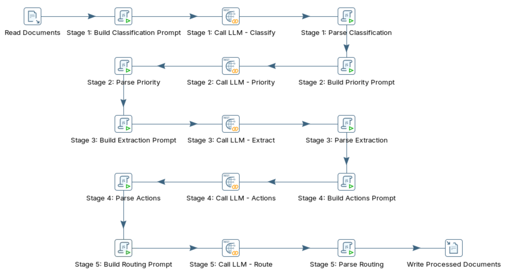
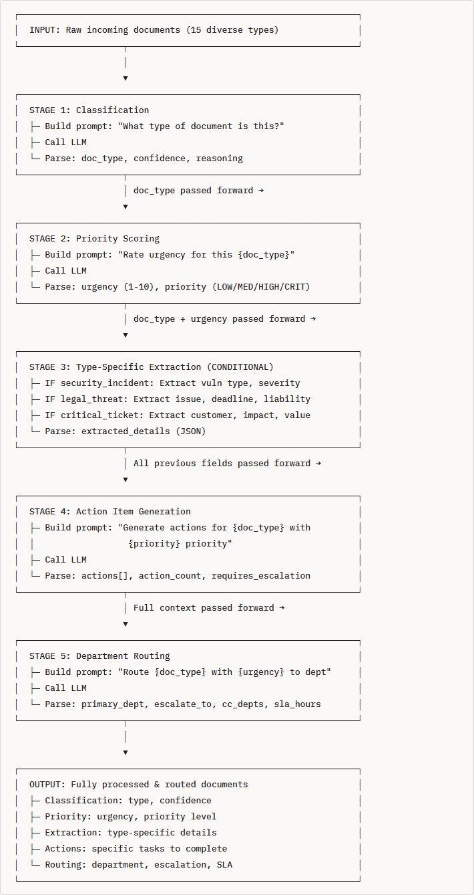

# Multi-staged

> **Warning:**
>
> #### Workshop - Multi-staged
>
> Build a Pentaho Data Integration transformation that chains five calls to a local Large Language Model (LLM) served by Ollama into a document router: each stage does one job and passes everything it learned to the next.
>
> **What you'll do**
>
> * Chain five LLM calls in one transformation, each stage reading the fields earlier stages added
> * Classify each document, then score its urgency with the classification in the prompt
> * Choose a type-specific extraction prompt with conditional logic
> * Give every stage a safe default, so one failed answer doesn't stop the pipeline
> * Write each document with every stage's decision, for auditing
>
> **Prerequisites:**
>
> * [Data Quality](../07-llm-data-quality/guide.md): the build, call and parse pattern each stage repeats
> * Ollama running on `http://localhost:11434` with `llama3.2:3b` pulled
>
> **Estimated time:** 45 minutes

<div align="center">
<figure>

<figcaption>What you build: five stages of build, call and parse</figcaption>
</figure>
</div>

:::: tabs

### 1. Multi-Stage Pipelines

> **Note:**
>
> #### What Is a Multi-Stage Pipeline?
>
> A multi-stage pipeline chains several LLM calls in order. Each stage performs one focused task and adds its result to the row, so the next stage works with everything gathered so far, like stations on an assembly line.

**The five stages of this workshop:**

| Stage | Job | Reads | Adds |
| --- | --- | --- | --- |
| 1. Classification | What kind of document is this? | The document | `doc_type`, `classification_confidence`, `classification_reasoning` |
| 2. Priority | How urgent is it? | The document, `doc_type` | `urgency` (1 to 10), `priority` (`LOW`, `MEDIUM`, `HIGH`, `CRITICAL`), `priority_reasoning` |
| 3. Extraction | The details that matter for this type | The document, `doc_type` | `extracted_details` (JSON, different per type) |
| 4. Actions | What should be done? | The document, `doc_type`, `priority`, `urgency` | `actions_json`, `action_count`, `requires_escalation` |
| 5. Routing | Who owns it? | The document and every field above | `primary_dept`, `escalate_to`, `cc_depts`, `sla_hours` |

**One prompt or five:** a single prompt could ask for the category, the urgency, the details, the actions and the department at once:

```text
Prompt: "Analyze this support ticket and provide:
- Category (bug/feature/billing/complaint)
- Urgency score 1-10
- Customer name, account value, issue summary
- Action items to resolve
- Department to route to
- Escalation path
All in JSON format."
```

| Aspect | One prompt | Five stages |
| --- | --- | --- |
| Task per call | Six tasks at once | One task per call |
| Conditional logic | Not possible: every document gets the same questions | Stage 3 asks different questions per document type |
| A failed answer | Loses everything | Loses one stage; the others keep their results |
| Debugging | Hard to tell which part went wrong | Each stage's output is a field you can read |
| Auditability | One decision | A recorded decision, with reasoning, per stage |
| Calls per document | 1 | 5, each with a shorter prompt and a shorter answer |

**The principles:**

1. **One responsibility per stage.** A focused prompt is easier for a small model to answer well than a prompt with six tasks.
2. **Context passes forward.** Stage 2 knows the document is a `security_incident`; Stage 5 knows its type, priority, action count and whether to escalate.
3. **Conditional branching.** A security incident needs a vulnerability type and a disclosure deadline; a legal threat needs the deadline and the threatening party.
4. **Error isolation.** Every parse script starts from a safe default (`general_inquiry`, urgency `5`, `Support`), so a stage that fails passes a usable value on.

**When to use it:** when documents differ in kind and need different handling, when a decision depends on an earlier one, or when each decision must be auditable. A uniform task that treats every document the same way is simpler as one call. Three to five stages suit most cases; parallelize within a stage (several copies of a call), never between stages, because each stage needs the one before it.

**Patterns and applications:**

| Pattern | Example |
| --- | --- |
| Classify, then process conditionally | Legal documents get legal extraction, technical ones technical extraction |
| Score, then route by priority | Urgency 9 or more goes to executives, under 5 to the first-line team |
| Extract, validate, enrich | Incomplete records go back for information, complete ones are enriched |
| Analyze, recommend, act | Low-risk actions run automatically, high-risk ones go to a person |

The same chain fits support automation, contract review, content moderation, resume screening and invoice processing.

**The data:** `multi_stage_documents.csv` holds 15 documents, `DOC-001` to `DOC-015`, with the columns `document_id`, `source`, `raw_text` and `received_date`. They range from an urgent outage email and a trademark notice to a feature request and a thank-you message; line breaks in `raw_text` are written as the two characters `\n`. `multi_stage_documents_2.csv` holds the first four, for a shorter run.

<div align="center">
<figure>

<figcaption>The five stages and what each passes forward</figcaption>
</figure>
</div>

### 2. Ollama API

> **Note:**
>
> #### One Stage by Hand
>
> Every stage sends one `POST` to `/api/generate` with `"format": "json"`. Try Stage 1 on `DOC-007`, a security vulnerability report.

1. Send `DOC-007` to the model with a short form of the Stage 1 prompt. In PowerShell, run:

::: tabs

### Windows (PowerShell)

```powershell
$prompt = @'
Classify the following document and return ONLY a valid JSON object:
{"doc_type": "one of: security_incident, legal_threat, critical_ticket, business_opportunity, bug_report, feature_request, general_inquiry, positive_feedback", "confidence": 0.0 to 1.0, "reasoning": "brief explanation"}
DOCUMENT SOURCE: email
DOCUMENT TEXT:
Subject: Security Vulnerability Report. Found SQL injection vulnerability in your login form. Severity: Critical. Affects all users. Can extract password hashes. Timeline for public disclosure: 90 days
'@
$body = @{
  model   = "llama3.2:3b"
  prompt  = $prompt
  stream  = $false
  format  = "json"
  options = @{ temperature = 0.1; num_predict = 200 }
} | ConvertTo-Json
(Invoke-RestMethod -Uri http://localhost:11434/api/generate -Method Post -ContentType "application/json" -Body $body).response
```

### macOS / Linux

```bash
curl http://localhost:11434/api/generate -d '{
  "model": "llama3.2:3b",
  "prompt": "Classify the following document and return ONLY a valid JSON object:\n{\"doc_type\": \"one of: security_incident, legal_threat, critical_ticket, business_opportunity, bug_report, feature_request, general_inquiry, positive_feedback\", \"confidence\": 0.0 to 1.0, \"reasoning\": \"brief explanation\"}\nDOCUMENT SOURCE: email\nDOCUMENT TEXT:\nSubject: Security Vulnerability Report. Found SQL injection vulnerability in your login form. Severity: Critical. Affects all users. Can extract password hashes. Timeline for public disclosure: 90 days",
  "stream": false,
  "format": "json",
  "options": {"temperature": 0.1, "num_predict": 200}
}'
```

:::

> **Success:** Checkpoint: a JSON object with `doc_type`, `confidence` and `reasoning`. For this report the expected type is `security_incident`; the confidence and the wording are the model's.

2. Read how the rest of the chain would treat this document. These answers are an illustration of the shape each stage returns, not a recorded run:

| After stage | The row has gained |
| --- | --- |
| 1 | `doc_type` `security_incident`, a confidence, a reason |
| 2 | `urgency` near 10, `priority` `CRITICAL`: the Stage 2 prompt says security incidents are usually 8 to 10 |
| 3 | `extracted_details` such as `{"vuln_type": "SQL injection", "severity": "Critical", "affected_systems": "login form", "disclosure_days": 90}` |
| 4 | Actions such as "Alert security team immediately" and "Patch vulnerability within 48h", and `requires_escalation` `true` |
| 5 | `primary_dept` `Security`, `escalate_to` `CTO`: the routing rules say to escalate a critical security incident to the CTO |

### 3. Read and Classify

> **Note:**
>
> #### Stage 1: Classification
>
> Read the documents, then build the first stage: a prompt and request in one script, the call, and a parser that falls back to `general_inquiry`.

1. Start Spoon with the **Start Pentaho Data Integration** button below, or from a terminal:

::: tabs

### Windows (PowerShell)

```powershell
Set-Location C:\Pentaho\design-tools\data-integration
.\spoon.bat
```

### macOS / Linux

```bash
cd ~/Pentaho/design-tools/data-integration
./spoon.sh
```

:::

<button data-launch="spoon" data-path="">Start Pentaho Data Integration</button>

2. Select **File > New > Transformation** (`Ctrl+N`).
3. Select **File > Save as** and save it as `multi_stage_pipeline.ktr` in `C:\Workshop-AI-Specialty\04-llm-integration\11-llm-multi-staged`, next to `multi_stage_documents.csv`. (On your own machine, download the file from **Lab Files** below into the folder you save in.)
4. Double-click an empty part of the canvas, open the **Parameters** tab, and fill the grid:

| Parameter | Default Value | Description |
| --- | --- | --- |
| `MODEL_NAME` | `llama3.2:3b` | LLM model to use for all stages |
| `OLLAMA_URL` | `http://localhost:11434` | Ollama API base URL |

5. Select **OK**.
6. On the **Design** tab, open the **Input** folder and drag **CSV file input** onto the canvas.
7. Double-click **CSV file input** and set **Step name** to `Read Documents`.
8. Set **Filename** to `${Internal.Transformation.Filename.Directory}/multi_stage_documents.csv`.
9. Keep **Delimiter** `,`, **Enclosure** `"`, and **Lazy conversion?** and **Header row present?** selected. Set **File encoding** to `UTF-8`.
10. Fill the **Fields** grid:

| Name | Type | Length |
| --- | --- | --- |
| `document_id` | String | 50 |
| `source` | String | 100 |
| `raw_text` | String | 50000 |
| `received_date` | String | 20 |

11. Select **OK**.
12. On the **Design** tab, open the **Scripting** folder and drag **Modified JavaScript value** onto the canvas.
13. Create a hop from **Read Documents** to **Modified JavaScript value**: hold `Shift` and drag from one step to the other.
14. Double-click **Modified JavaScript value** and set **Step name** to `Stage 1: Build Classification Prompt`.
15. Replace the text in the **Script 1** tab with:

```javascript
// STAGE 1: Document Classification
// Goal: Identify the type of document to enable conditional processing

var stage1_prompt = "Classify the following document and return ONLY a valid JSON object:\n\n" +
  "{" + '\"doc_type\": \"one of: security_incident, legal_threat, critical_ticket, business_opportunity, bug_report, feature_request, general_inquiry, positive_feedback\"' + ", " +
  '\"confidence\": 0.0 to 1.0' + ", " +
  '\"reasoning\": \"brief explanation\"' + "}\n\n" +
  "Classification Guidelines:\n" +
  "- security_incident: Vulnerability reports, breach notifications, security concerns\n" +
  "- legal_threat: Cease & desist, trademark/copyright claims, legal demands\n" +
  "- critical_ticket: High-value customer issues, billing errors, urgent problems\n" +
  "- business_opportunity: Partnership offers, sales leads, significant deals\n" +
  "- bug_report: Software defects, crashes, technical issues\n" +
  "- feature_request: Enhancement requests, new feature ideas\n" +
  "- general_inquiry: Questions, basic support, information requests\n" +
  "- positive_feedback: Praise, testimonials, thank you messages\n\n" +
  "Rules:\n" +
  "- Return ONLY valid JSON, no additional text\n" +
  "- Choose the MOST SPECIFIC type that fits\n" +
  "- Confidence > 0.8 means very sure, < 0.5 means uncertain\n\n" +
  "DOCUMENT SOURCE: " + source + "\n" +
  "DOCUMENT TEXT:\n" + raw_text;

var model_name = getVariable("MODEL_NAME", "llama3.2:3b");

var stage1_request = JSON.stringify({
  "model": model_name,
  "prompt": stage1_prompt,
  "stream": false,
  "format": "json",
  "options": {
    "temperature": 0.1,
    "num_predict": 200
  }
});
```

16. Fill the **Fields** grid with one row: **Fieldname** `stage1_request`, **Type** String, **Replace value 'Fieldname' or 'Rename to'** `N`.
17. Select **OK**.
18. Save the transformation (`Ctrl+S`).
19. Select **Stage 1: Build Classification Prompt** on the canvas, press `F10` (**Action > Preview**), and select **Quick Launch**.

> **Success:** Checkpoint: 15 rows, `DOC-001` to `DOC-015`, each with a `stage1_request` that starts `{"model":"llama3.2:3b","prompt":"Classify the following document and return ONLY a valid JSON object:`.

20. Select **Close**.
21. On the **Design** tab, open the **Lookup** folder and drag **REST client** onto the canvas. Create a hop from **Stage 1: Build Classification Prompt** to it.
22. Double-click **REST client** and set **Step name** to `Stage 1: Call LLM - Classify`.
23. On the **General** tab, set **URL** to `${OLLAMA_URL}/api/generate`, **HTTP method** to `POST` and **Body field** to `stage1_request`. Keep **Application type** `TEXT PLAIN`.
24. Under **Output fields**, set **Result field name** to `stage1_response`, **HTTP status code field name** to `stage1_code` and **Response time (milliseconds) field name** to `stage1_time`. Select **OK**.
25. Drag a **Modified JavaScript value** onto the canvas and create a hop from **Stage 1: Call LLM - Classify** to it.
26. Double-click it and set **Step name** to `Stage 1: Parse Classification`.
27. Replace the text in the **Script 1** tab with:

```javascript
// Parse Stage 1 response
var doc_type = "general_inquiry"; // default fallback
var classification_confidence = 0.0;
var classification_reasoning = "";

try {
  var response = JSON.parse(stage1_response);
  var llmOutput = response.response;

  // Extract JSON from response
  var jsonStart = llmOutput.indexOf("{");
  var jsonEnd = llmOutput.lastIndexOf("}") + 1;

  if (jsonStart >= 0 && jsonEnd > jsonStart) {
    var jsonStr = llmOutput.substring(jsonStart, jsonEnd);
    var classResult = JSON.parse(jsonStr);

    doc_type = classResult.doc_type || "general_inquiry";
    classification_confidence = classResult.confidence || 0.0;
    classification_reasoning = classResult.reasoning || "";
  }
} catch(e) {
  doc_type = "general_inquiry";
  classification_confidence = 0.0;
  classification_reasoning = "Error parsing: " + e.message;
}
```

28. Fill the **Fields** grid:

| Fieldname | Type | Replace value 'Fieldname' or 'Rename to' |
| --- | --- | --- |
| `doc_type` | String | N |
| `classification_confidence` | Number | N |
| `classification_reasoning` | String | N |

29. Select **OK**, and save the transformation (`Ctrl+S`).

> **Under the hood:**
>
> #### The row carried every field forward, so the next stage needs no join
>
> A Pentaho Data Integration step adds its output fields to the row it received and passes the whole row on. After **Stage 1: Parse Classification**, each row holds the four columns of the file, the request and response of Stage 1, and `doc_type`. Stage 2's script can read `doc_type` and `raw_text` as plain variables, because both are fields of the row it is given.
>
> **Why it matters:** context accumulation costs nothing to build; each new stage is three more steps on the same row, with every earlier decision already in reach.

### 4. Stage 2: Priority

> **Note:**
>
> #### Stage 2: Urgency and Priority
>
> The Stage 2 prompt starts with the Stage 1 result, and gives the urgency range typical for each document type.

1. Drag a **Modified JavaScript value** onto the canvas and create a hop from **Stage 1: Parse Classification** to it.
2. Double-click it and set **Step name** to `Stage 2: Build Priority Prompt`.
3. Replace the text in the **Script 1** tab with:

```javascript
// STAGE 2: Priority Scoring
// Uses doc_type from Stage 1 to contextualize urgency assessment

var stage2_prompt = "This document has been classified as: " + doc_type + "\n\n" +
  "Rate the urgency and assign priority. Return ONLY valid JSON:\n\n" +
  "{" + '\"urgency\": 1-10 integer' + ", " +
  '\"priority\": \"LOW, MEDIUM, HIGH, or CRITICAL\"' + ", " +
  '\"reasoning\": \"brief explanation\"' + "}\n\n" +
  "Urgency Guidelines by Type:\n" +
  "- security_incident: Usually 8-10 (immediate threat)\n" +
  "- legal_threat: Usually 7-9 (legal deadlines matter)\n" +
  "- critical_ticket: 6-9 (depends on customer value & impact)\n" +
  "- business_opportunity: 5-7 (time-sensitive but not emergency)\n" +
  "- bug_report: 4-8 (depends on severity & user impact)\n" +
  "- feature_request: 2-5 (enhancement, not urgent)\n" +
  "- general_inquiry: 1-4 (routine support)\n" +
  "- positive_feedback: 1-2 (no urgency, just nice to have)\n\n" +
  "Priority Mapping:\n" +
  "- CRITICAL: Urgency 9-10 (immediate action required)\n" +
  "- HIGH: Urgency 7-8 (action needed within hours)\n" +
  "- MEDIUM: Urgency 4-6 (action within days)\n" +
  "- LOW: Urgency 1-3 (can wait)\n\n" +
  "Consider in your assessment:\n" +
  "- Potential business impact\n" +
  "- Time sensitivity and deadlines\n" +
  "- Legal or compliance implications\n" +
  "- Customer value (look for enterprise/account details)\n\n" +
  "DOCUMENT TEXT:\n" + raw_text;

var model_name = getVariable("MODEL_NAME", "llama3.2:3b");

var stage2_request = JSON.stringify({
  "model": model_name,
  "prompt": stage2_prompt,
  "stream": false,
  "format": "json",
  "options": {
    "temperature": 0.2,
    "num_predict": 200
  }
});
```

4. Fill the **Fields** grid with one row: **Fieldname** `stage2_request`, **Type** String, **Replace value 'Fieldname' or 'Rename to'** `N`. Select **OK**.
5. Drag a **REST client** from the **Lookup** folder onto the canvas and create a hop from **Stage 2: Build Priority Prompt** to it.
6. Double-click it and set **Step name** to `Stage 2: Call LLM - Priority`.
7. On the **General** tab, set **URL** to `${OLLAMA_URL}/api/generate`, **HTTP method** to `POST` and **Body field** to `stage2_request`. Keep **Application type** `TEXT PLAIN`.
8. Under **Output fields**, set **Result field name** to `stage2_response`, **HTTP status code field name** to `stage2_code` and **Response time (milliseconds) field name** to `stage2_time`. Select **OK**.
9. Drag a **Modified JavaScript value** onto the canvas and create a hop from **Stage 2: Call LLM - Priority** to it.
10. Double-click it and set **Step name** to `Stage 2: Parse Priority`.
11. Replace the text in the **Script 1** tab with:

```javascript
// Parse Stage 2 response
var urgency = 5; // default medium urgency
var priority = "MEDIUM";
var priority_reasoning = "";

try {
  var response = JSON.parse(stage2_response);
  var llmOutput = response.response;

  var jsonStart = llmOutput.indexOf("{");
  var jsonEnd = llmOutput.lastIndexOf("}") + 1;

  if (jsonStart >= 0 && jsonEnd > jsonStart) {
    var jsonStr = llmOutput.substring(jsonStart, jsonEnd);
    var priorityResult = JSON.parse(jsonStr);

    urgency = priorityResult.urgency || 5;
    priority = priorityResult.priority || "MEDIUM";
    priority_reasoning = priorityResult.reasoning || "";
  }
} catch(e) {
  urgency = 5;
  priority = "MEDIUM";
  priority_reasoning = "Error parsing: " + e.message;
}
```

12. Fill the **Fields** grid:

| Fieldname | Type | Replace value 'Fieldname' or 'Rename to' |
| --- | --- | --- |
| `urgency` | Integer | N |
| `priority` | String | N |
| `priority_reasoning` | String | N |

13. Select **OK**, and save the transformation (`Ctrl+S`).

### 5. Stage 3: Extraction

> **Note:**
>
> #### Stage 3: Type-Specific Extraction
>
> One script, five prompts: the `doc_type` from Stage 1 decides which details to ask for. The answer is stored whole, as JSON text, because its keys differ by type.

1. Drag a **Modified JavaScript value** onto the canvas and create a hop from **Stage 2: Parse Priority** to it.
2. Double-click it and set **Step name** to `Stage 3: Build Extraction Prompt`.
3. Replace the text in the **Script 1** tab with:

```javascript
// STAGE 3: Type-Specific Information Extraction
// CONDITIONAL: Different extraction logic based on doc_type from Stage 1

var extraction_prompt = "";

// Conditional extraction based on document type
if (doc_type == "security_incident") {
  extraction_prompt = "Extract security incident details. Return ONLY valid JSON:\n\n" +
    "{" + '\"vuln_type\": \"SQL injection, XSS, etc.\"' + ", " +
    '\"severity\": \"Low, Medium, High, Critical\"' + ", " +
    '\"affected_systems\": \"which systems\"' + ", " +
    '\"disclosure_days\": integer or null' + "}\n\n" +
    "DOCUMENT:\n" + raw_text;

} else if (doc_type == "legal_threat") {
  extraction_prompt = "Extract legal threat details. Return ONLY valid JSON:\n\n" +
    "{" + '\"legal_issue\": \"trademark, copyright, etc.\"' + ", " +
    '\"deadline_days\": integer or null' + ", " +
    '\"potential_liability\": \"brief estimate\"' + ", " +
    '\"parties\": \"who is threatening us\"' + "}\n\n" +
    "DOCUMENT:\n" + raw_text;

} else if (doc_type == "critical_ticket") {
  extraction_prompt = "Extract customer support details. Return ONLY valid JSON:\n\n" +
    "{" + '\"customer_name\": \"company or person\"' + ", " +
    '\"issue_summary\": \"brief description\"' + ", " +
    '\"business_impact\": \"revenue risk, etc.\"' + ", " +
    '\"account_value\": \"$ amount if mentioned\"' + "}\n\n" +
    "DOCUMENT:\n" + raw_text;

} else if (doc_type == "business_opportunity") {
  extraction_prompt = "Extract business opportunity details. Return ONLY valid JSON:\n\n" +
    "{" + '\"partner_name\": \"company name\"' + ", " +
    '\"opportunity_type\": \"partnership, sales, etc.\"' + ", " +
    '\"deal_value\": \"$ amount if mentioned\"' + ", " +
    '\"contact_person\": \"name and title\"' + "}\n\n" +
    "DOCUMENT:\n" + raw_text;

} else {
  // Generic extraction for other types
  extraction_prompt = "Extract key details. Return ONLY valid JSON:\n\n" +
    "{" + '\"summary\": \"one sentence summary\"' + ", " +
    '\"key_points\": [\"point 1\", \"point 2\"]' + ", " +
    '\"mentions_deadline\": true or false' + "}\n\n" +
    "DOCUMENT:\n" + raw_text;
}

var model_name = getVariable("MODEL_NAME", "llama3.2:3b");

var stage3_request = JSON.stringify({
  "model": model_name,
  "prompt": extraction_prompt,
  "stream": false,
  "format": "json",
  "options": {
    "temperature": 0.2,
    "num_predict": 300
  }
});
```

4. Fill the **Fields** grid with one row: **Fieldname** `stage3_request`, **Type** String, **Replace value 'Fieldname' or 'Rename to'** `N`. Select **OK**.

> **Under the hood:**
>
> #### The branch is in the prompt, not on the canvas
>
> The canvas has one path, but each row takes its own branch inside the script: an `if` on `doc_type` picks the prompt for `security_incident`, `legal_threat`, `critical_ticket` or `business_opportunity`, and every other type gets a generic summary prompt. A **Switch / case** step could split the rows onto five paths instead, at the cost of five sets of call and parse steps.
>
> **Why it matters:** a new document type is a new `else if` with its own prompt, not new steps, and `extracted_details` keeps the different shapes in one field.

5. Drag a **REST client** from the **Lookup** folder onto the canvas and create a hop from **Stage 3: Build Extraction Prompt** to it.
6. Double-click it and set **Step name** to `Stage 3: Call LLM - Extract`.
7. On the **General** tab, set **URL** to `${OLLAMA_URL}/api/generate`, **HTTP method** to `POST` and **Body field** to `stage3_request`. Keep **Application type** `TEXT PLAIN`.
8. Under **Output fields**, set **Result field name** to `stage3_response`, **HTTP status code field name** to `stage3_code` and **Response time (milliseconds) field name** to `stage3_time`. Select **OK**.
9. Drag a **Modified JavaScript value** onto the canvas and create a hop from **Stage 3: Call LLM - Extract** to it.
10. Double-click it and set **Step name** to `Stage 3: Parse Extraction`.
11. Replace the text in the **Script 1** tab with:

```javascript
// Parse Stage 3 response - store as JSON string for flexibility
var extracted_details = "{}";

try {
  var response = JSON.parse(stage3_response);
  var llmOutput = response.response;

  var jsonStart = llmOutput.indexOf("{");
  var jsonEnd = llmOutput.lastIndexOf("}") + 1;

  if (jsonStart >= 0 && jsonEnd > jsonStart) {
    extracted_details = llmOutput.substring(jsonStart, jsonEnd);
  }
} catch(e) {
  extracted_details = '{"error": "' + e.message + '"}';
}
```

12. Fill the **Fields** grid with one row: **Fieldname** `extracted_details`, **Type** String, **Replace value 'Fieldname' or 'Rename to'** `N`.
13. Select **OK**, and save the transformation (`Ctrl+S`).

### 6. Stage 4: Actions

> **Note:**
>
> #### Stage 4: Action Items
>
> The Stage 4 prompt opens with the type, priority and urgency from Stages 1 and 2, and adds example actions for the four main types.

1. Drag a **Modified JavaScript value** onto the canvas and create a hop from **Stage 3: Parse Extraction** to it.
2. Double-click it and set **Step name** to `Stage 4: Build Actions Prompt`.
3. Replace the text in the **Script 1** tab with:

```javascript
// STAGE 4: Action Item Generation
// Uses: doc_type, urgency, priority from previous stages

var stage4_prompt = "This is a " + doc_type + " document with " + priority + " priority (urgency " + urgency + "/10).\n\n" +
  "Generate specific action items. Return ONLY valid JSON:\n\n" +
  "{" + '\"actions\": [\"action 1\", \"action 2\", \"action 3\"]' + ", " +
  '\"action_count\": integer' + ", " +
  '\"requires_escalation\": true or false' + "}\n\n" +
  "Action Guidelines:\n" +
  "- Be specific and actionable\n" +
  "- Include who should do what\n" +
  "- Mention timeframes if urgent\n" +
  "- CRITICAL/HIGH priority: immediate actions\n" +
  "- MEDIUM/LOW priority: can be more general\n\n" +
  "Examples for " + doc_type + ":\n";

// Type-specific action examples
if (doc_type == "security_incident") {
  stage4_prompt += "- Alert security team immediately\n- Patch vulnerability within 48h\n- Notify affected users\n- Prepare disclosure statement\n\n";
} else if (doc_type == "legal_threat") {
  stage4_prompt += "- Forward to legal counsel\n- Gather evidence/documentation\n- Prepare response within deadline\n- Brief executive team\n\n";
} else if (doc_type == "critical_ticket") {
  stage4_prompt += "- Assign to senior engineer\n- Contact customer within 2h\n- Investigate root cause\n- Offer service credits if needed\n\n";
} else if (doc_type == "business_opportunity") {
  stage4_prompt += "- Schedule discovery call\n- Prepare pitch deck\n- Assign account executive\n- Send follow-up email\n\n";
}

stage4_prompt += "DOCUMENT:\n" + raw_text;

var model_name = getVariable("MODEL_NAME", "llama3.2:3b");

var stage4_request = JSON.stringify({
  "model": model_name,
  "prompt": stage4_prompt,
  "stream": false,
  "format": "json",
  "options": {
    "temperature": 0.3,
    "num_predict": 400
  }
});
```

4. Fill the **Fields** grid with one row: **Fieldname** `stage4_request`, **Type** String, **Replace value 'Fieldname' or 'Rename to'** `N`. Select **OK**.
5. Drag a **REST client** from the **Lookup** folder onto the canvas and create a hop from **Stage 4: Build Actions Prompt** to it.
6. Double-click it and set **Step name** to `Stage 4: Call LLM - Actions`.
7. On the **General** tab, set **URL** to `${OLLAMA_URL}/api/generate`, **HTTP method** to `POST` and **Body field** to `stage4_request`. Keep **Application type** `TEXT PLAIN`.
8. Under **Output fields**, set **Result field name** to `stage4_response`, **HTTP status code field name** to `stage4_code` and **Response time (milliseconds) field name** to `stage4_time`. Select **OK**.
9. Drag a **Modified JavaScript value** onto the canvas and create a hop from **Stage 4: Call LLM - Actions** to it.
10. Double-click it and set **Step name** to `Stage 4: Parse Actions`.
11. Replace the text in the **Script 1** tab with:

```javascript
// Parse Stage 4 response
var actions_json = "[]";
var action_count = 0;
var requires_escalation = false;

try {
  var response = JSON.parse(stage4_response);
  var llmOutput = response.response;

  var jsonStart = llmOutput.indexOf("{");
  var jsonEnd = llmOutput.lastIndexOf("}") + 1;

  if (jsonStart >= 0 && jsonEnd > jsonStart) {
    var jsonStr = llmOutput.substring(jsonStart, jsonEnd);
    var actionsResult = JSON.parse(jsonStr);

    if (actionsResult.actions && Array.isArray(actionsResult.actions)) {
      actions_json = JSON.stringify(actionsResult.actions);
      action_count = actionsResult.actions.length;
    }
    requires_escalation = actionsResult.requires_escalation || false;
  }
} catch(e) {
  actions_json = '["Review manually"]';
  action_count = 1;
  requires_escalation = false;
}
```

12. Fill the **Fields** grid:

| Fieldname | Type | Replace value 'Fieldname' or 'Rename to' |
| --- | --- | --- |
| `actions_json` | String | N |
| `action_count` | Integer | N |
| `requires_escalation` | Boolean | N |

13. Select **OK**, and save the transformation (`Ctrl+S`).

### 7. Stage 5: Routing

> **Note:**
>
> #### Stage 5: Routing and Output
>
> The last stage reads every earlier decision and the routing rules, picks the department and the service level (SLA), and adds the total time of the five calls. Then the row is written out.

1. Drag a **Modified JavaScript value** onto the canvas and create a hop from **Stage 4: Parse Actions** to it.
2. Double-click it and set **Step name** to `Stage 5: Build Routing Prompt`.
3. Replace the text in the **Script 1** tab with:

```javascript
// STAGE 5: Department Routing
// Uses: ALL previous stage outputs for intelligent routing decision

var stage5_prompt = "Route this document to the appropriate department.\n\n" +
  "CONTEXT FROM PREVIOUS ANALYSIS:\n" +
  "- Document Type: " + doc_type + "\n" +
  "- Priority: " + priority + " (urgency " + urgency + "/10)\n" +
  "- Actions Required: " + action_count + " action items\n" +
  "- Requires Escalation: " + requires_escalation + "\n\n" +
  "Return ONLY valid JSON:\n\n" +
  "{" + '\"primary_dept\": \"Security, Legal, Support, Engineering, Product, Sales, Marketing\"' + ", " +
  '\"escalate_to\": \"CEO, CTO, CFO, VP or null\"' + ", " +
  '\"cc_depts\": [\"dept1\", \"dept2\"] or []' + ", " +
  '\"sla_hours\": integer (response time SLA)' + "}\n\n" +
  "Routing Rules:\n" +
  "- security_incident → Security (2-4h SLA), escalate to CTO if CRITICAL\n" +
  "- legal_threat → Legal (4-8h SLA), escalate to CEO if high liability\n" +
  "- critical_ticket → Support → Account Manager (4-24h SLA based on urgency)\n" +
  "- business_opportunity → Sales/Partnerships (24-48h SLA)\n" +
  "- bug_report → Engineering (24-72h SLA)\n" +
  "- feature_request → Product (1-2 week SLA)\n" +
  "- general_inquiry → Support (1-2 day SLA)\n" +
  "- positive_feedback → Marketing (no SLA, log for testimonials)\n\n" +
  "Escalation Triggers:\n" +
  "- Urgency >= 9: Always escalate to executive\n" +
  "- Legal/Security CRITICAL: Escalate to C-level\n" +
  "- High account value (>$100k): CC account manager\n\n" +
  "DOCUMENT:\n" + raw_text;

var model_name = getVariable("MODEL_NAME", "llama3.2:3b");

var stage5_request = JSON.stringify({
  "model": model_name,
  "prompt": stage5_prompt,
  "stream": false,
  "format": "json",
  "options": {
    "temperature": 0.1,
    "num_predict": 200
  }
});
```

4. Fill the **Fields** grid with one row: **Fieldname** `stage5_request`, **Type** String, **Replace value 'Fieldname' or 'Rename to'** `N`. Select **OK**.
5. Drag a **REST client** from the **Lookup** folder onto the canvas and create a hop from **Stage 5: Build Routing Prompt** to it.
6. Double-click it and set **Step name** to `Stage 5: Call LLM - Route`.
7. On the **General** tab, set **URL** to `${OLLAMA_URL}/api/generate`, **HTTP method** to `POST` and **Body field** to `stage5_request`. Keep **Application type** `TEXT PLAIN`.
8. Under **Output fields**, set **Result field name** to `stage5_response`, **HTTP status code field name** to `stage5_code` and **Response time (milliseconds) field name** to `stage5_time`. Select **OK**.
9. Drag a **Modified JavaScript value** onto the canvas and create a hop from **Stage 5: Call LLM - Route** to it.
10. Double-click it and set **Step name** to `Stage 5: Parse Routing`.
11. Replace the text in the **Script 1** tab with:

```javascript
// Parse Stage 5 response
var primary_dept = "Support"; // default
var escalate_to = "";
var cc_depts = "[]";
var sla_hours = 48;

try {
  var response = JSON.parse(stage5_response);
  var llmOutput = response.response;

  var jsonStart = llmOutput.indexOf("{");
  var jsonEnd = llmOutput.lastIndexOf("}") + 1;

  if (jsonStart >= 0 && jsonEnd > jsonStart) {
    var jsonStr = llmOutput.substring(jsonStart, jsonEnd);
    var routingResult = JSON.parse(jsonStr);

    primary_dept = routingResult.primary_dept || "Support";
    escalate_to = routingResult.escalate_to || "";
    if (routingResult.cc_depts && Array.isArray(routingResult.cc_depts)) {
      cc_depts = JSON.stringify(routingResult.cc_depts);
    }
    sla_hours = routingResult.sla_hours || 48;
  }
} catch(e) {
  primary_dept = "Support";
  escalate_to = "";
  cc_depts = "[]";
  sla_hours = 48;
}

// Calculate total processing time
var total_processing_time = (stage1_time || 0) + (stage2_time || 0) + (stage3_time || 0) + (stage4_time || 0) + (stage5_time || 0);
var stages_completed = 5;
```

12. Fill the **Fields** grid:

| Fieldname | Type | Replace value 'Fieldname' or 'Rename to' |
| --- | --- | --- |
| `primary_dept` | String | N |
| `escalate_to` | String | N |
| `cc_depts` | String | N |
| `sla_hours` | Integer | N |
| `total_processing_time` | Integer | N |
| `stages_completed` | Integer | N |

13. Select **OK**.
14. On the **Design** tab, open the **Output** folder and drag **Text file output** onto the canvas. Create a hop from **Stage 5: Parse Routing** to it.
15. Double-click **Text file output** and set **Step name** to `Write Processed Documents`.
16. On the **File** tab, set **Filename** to `${Internal.Transformation.Filename.Directory}/../output/processed_documents_` and **Extension** to `csv`. Select **Create Parent folder**, **Include date in filename?** and **Include time in filename?**, and keep **Add filenames to result** selected.
17. On the **Content** tab, keep **Separator** `,` and **Enclosure** `"`, keep **Header** selected, and set **Format** to `DOS` and **Encoding** to `UTF-8`.
18. On the **Fields** tab, fill the grid:

| Name | Type |
| --- | --- |
| `document_id` | String |
| `source` | String |
| `doc_type` | String |
| `classification_confidence` | Number |
| `urgency` | Integer |
| `priority` | String |
| `extracted_details` | String |
| `action_count` | Integer |
| `actions_json` | String |
| `requires_escalation` | Boolean |
| `primary_dept` | String |
| `escalate_to` | String |
| `cc_depts` | String |
| `sla_hours` | Integer |
| `stages_completed` | Integer |
| `total_processing_time` | Integer |

19. Select **OK**.
20. Save the transformation (`Ctrl+S`).

### 8. Run

> **Note:**
>
> #### Run the Transformation
>
> Fifteen documents and five calls each make 75 LLM calls. On a CPU-only machine at 15 to 30 seconds a call, that can take half an hour or more; for a first run, set **Filename** of **Read Documents** to `${Internal.Transformation.Filename.Directory}/multi_stage_documents_2.csv` (4 documents, 20 calls) and set it back afterwards.

1. Press `F9` (**Action > Run**), and select **Run** in the **Run Options** dialog.
2. In **Execution Results**, open the **Step Metrics** tab.

> **Success:** Checkpoint: every step finishes without errors. **Read Documents** and **Write Processed Documents** both show 15 under **Written** (4 with the short file), and each of the five **Call LLM** steps read the same number of rows.

3. Select **Write Processed Documents** on the canvas and open the **Preview data** tab.

> **Success:** Checkpoint: one row per document. `stages_completed` is `5` in every row, because the Stage 5 script sets it; `total_processing_time` is the sum of the five response times in milliseconds. `doc_type`, `priority`, the actions and the routing are the model's decisions and vary between runs: expect `DOC-007` as a `security_incident` routed to `Security`, and `DOC-005`, the trademark notice, as a `legal_threat`.

4. Find the results file. It is written one folder up from the transformation, in `output`. In PowerShell, run:

::: tabs

### Windows (PowerShell)

```powershell
Get-ChildItem C:\Workshop-AI-Specialty\04-llm-integration\output\processed_documents_*.csv
```

### macOS / Linux

```bash
ls ../output/processed_documents_*.csv
```

Run it in the folder you saved the transformation in.

:::

> **Success:** Checkpoint: a file named `processed_documents__<yyyyMMdd>_<HHmmss>.csv`. Its first line is `document_id,source,doc_type,classification_confidence,urgency,priority,extracted_details,action_count,actions_json,requires_escalation,primary_dept,escalate_to,cc_depts,sla_hours,stages_completed,total_processing_time`.

5. Audit one decision: for a row with `requires_escalation` `true`, read its `doc_type`, `urgency` and `escalate_to`, and check them against the Stage 5 routing rules ("Urgency >= 9: Always escalate to executive").

> **Under the hood:**
>
> #### The stages ran at the same time, on different documents
>
> Every Pentaho Data Integration step runs in its own thread, and rows move between steps through buffers. While Stage 1 classifies the third document, Stage 2 can score the second and Stage 3 extract from the first. The order of calls for one document is fixed, but the calls of different documents overlap, so Ollama receives requests from several stages and answers them as its parallel settings allow.
>
> **Why it matters:** a chain of five stages does not take five times as long per document as one stage once the pipeline is full; the slowest stage sets the pace.

::::

## Lab Files

Click a file to download. For `.ktr` and `.kjb` files, **Open in Pentaho Data Integration** launches Pentaho Data Integration with the file loaded. If Pentaho Data Integration is already running, the path is copied to your clipboard — switch to Pentaho Data Integration and press `Ctrl+O`, `Ctrl+V`, `Enter`.

The 15 documents the transformation reads, and a four-document set for a shorter run:

[multi_stage_documents.csv](./files/multi_stage_documents.csv)

[multi_stage_documents_2.csv](./files/multi_stage_documents_2.csv)

### Solution <!-- no-step -->

The finished transformation for this lab. Open it alongside your own to compare, or run it to see the expected result. Run from the solution folder, it writes to `C:\Workshop-AI-Specialty\04-llm-integration\11-llm-multi-staged\output`.

Also on disk at `C:\Workshop-AI-Specialty\04-llm-integration\11-llm-multi-staged\solution`.

[multi_stage_pipeline.ktr](./files/multi_stage_pipeline.ktr) <button data-launch="spoon" data-path="files/multi_stage_pipeline.ktr">Open in Pentaho Data Integration</button> <button data-graph="files/multi_stage_pipeline.ktr">View graph</button>
