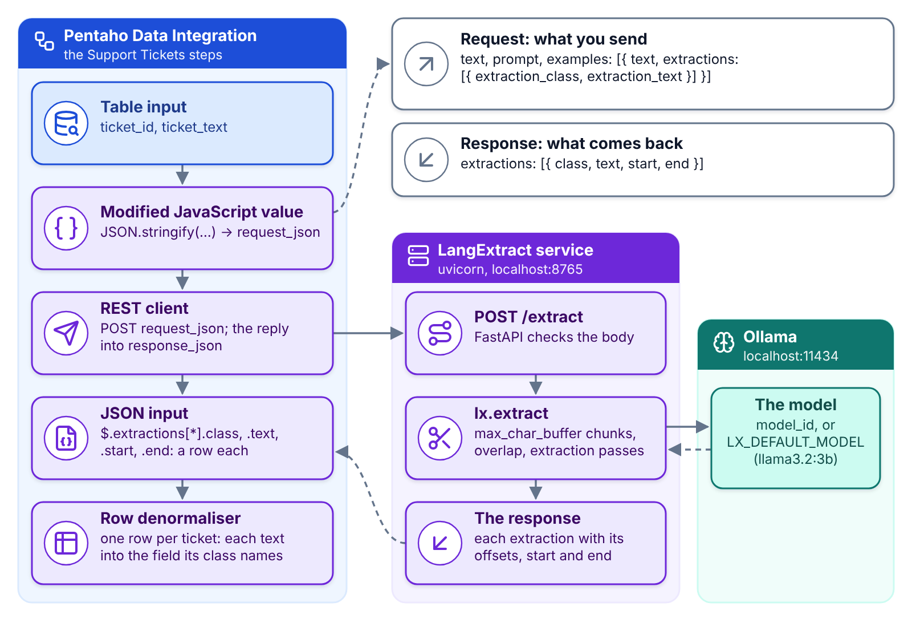

# Overview

> **Note:**
>
> #### LangExtract
>
> LangExtract turns free-form text into structured rows for Pentaho Data Integration. Use it when regular expressions are too brittle and training a model is too heavy. Each extraction comes back with its source offsets, so you can trace every value to the text it came from.

<div align="center">
<figure>

<figcaption>Pentaho Data Integration calls the LangExtract service, which calls the local Ollama</figcaption>
</figure>
</div>

Read the diagram down the left column, then across. **Modified JavaScript value** builds one request per row, **REST client** posts it to the service's `/extract`, and the service runs `lx.extract`, which reads the text in chunks sized by `max_char_buffer`, with `overlap` between them, in as many passes as `extraction_passes` asks, and calls the model on Ollama. The response comes back to **JSON input** as one row per extraction, with its `start` and `end` offsets in the text, and **Row denormaliser** turns those rows back into one row per ticket, as in the Support Tickets workshop. The two boxes at the top are the contract below: the names you send in the examples are not the names you read back.

**This page assumes:**

* the LangExtract service is running on `http://localhost:8765` (see **Start the LangExtract Service** below)
* Ollama is running locally with the course model
* the endpoint is `POST /extract`

**Choose an integration pattern:** use one pattern per transformation.

| Pattern | When to use it | Flow |
| --- | --- | --- |
| REST service (recommended) | Reusable, production-ready pipelines | Pentaho Data Integration input, **REST client**, **JSON input**, transform, output |
| Shell step | Quick local experiments, when you do not need a shared service | Pentaho Data Integration runs a script that calls LangExtract |

The bundled service uses your local Ollama as its backend, so data stays on the machine. This module uses the REST service pattern throughout.

**API contract**

The request (`model_id`, `max_char_buffer`, `overlap` and `extraction_passes` are optional):

```json
{
  "text": "source text",
  "prompt": "what to extract",
  "examples": [
    {
      "text": "example text",
      "extractions": [
        {
          "extraction_class": "field_name",
          "extraction_text": "example value"
        }
      ]
    }
  ],
  "model_id": "llama3.2:3b",
  "max_char_buffer": 1200,
  "overlap": 100,
  "extraction_passes": 2
}
```

The response:

```json
{
  "extractions": [
    {
      "class": "field_name",
      "text": "value found",
      "start": 0,
      "end": 10
    }
  ]
}
```

> **Warning:** Post to `/extract`, and read the response fields as `class`, `text`, `start` and `end`, not as the request's `extraction_class` and `extraction_text`.

***

## Start the LangExtract Service <!-- no-step -->

The service ships with this page:

[app.py](./files/langextract-service/app.py)

[requirements.txt](./files/langextract-service/requirements.txt)

It wraps Google's `langextract` library behind the contract above and uses your local Ollama as the backend, so lab data never leaves the machine. On a Windows machine set up by the course installer, it is already in `C:\Workshop-AI-Specialty\05-langextract\12-langextract\langextract-service`.

1. Create the service's Python environment, once. In PowerShell, run:

::: tabs

### Windows (PowerShell)

```powershell
Set-Location C:\Workshop-AI-Specialty\05-langextract\12-langextract\langextract-service
python -m venv .venv
.\.venv\Scripts\pip install -r requirements.txt
```

### macOS / Linux

In the folder you downloaded `app.py` and `requirements.txt` to, run:

```bash
python3 -m venv .venv
.venv/bin/pip install -r requirements.txt
```

:::

2. Start the service, and keep this terminal open while you work through the module. In PowerShell, run:

::: tabs

### Windows (PowerShell)

```powershell
Set-Location C:\Workshop-AI-Specialty\05-langextract\12-langextract\langextract-service
.\.venv\Scripts\python -m uvicorn app:app --host 0.0.0.0 --port 8765
```

### macOS / Linux

```bash
.venv/bin/python -m uvicorn app:app --host 0.0.0.0 --port 8765
```

:::

3. Check that it answers. The first start can take a few seconds while the libraries load; if the connection is refused, wait and try again. In a second terminal, run:

::: tabs

### Windows (PowerShell)

```powershell
Invoke-RestMethod http://localhost:8765/health
```

### macOS / Linux

```bash
curl http://localhost:8765/health
```

:::

> **Success:** Checkpoint: the service answers with `status` `ok`, `model` `llama3.2:3b` and `model_url` `http://localhost:11434`.

The service reads two environment variables when it starts: `LX_DEFAULT_MODEL` (the model when a request names none, `llama3.2:3b` by default) and `LX_MODEL_URL` (the Ollama address, `http://localhost:11434` by default). Ollama must be running with that model pulled; the environment panel on the Before You Start page checks both.

***

## Workshops <!-- no-step -->

* **Support Tickets** — extract structured fields from free-form support tickets.
* **Clinical Notes** — extract entities from unstructured clinical notes.
* **Contract Documents** — pull key terms from contract text.

***

## Troubleshooting <!-- no-step -->

<details>
<summary>Connection refused on 8765</summary>

The service is not running: start it as in **Start the LangExtract Service**, and check `http://localhost:8765/docs` in a browser.

</details>

<details>
<summary>Empty extractions</summary>

Tighten the prompt and improve the few-shot examples.

</details>

<details>
<summary>Wrong JSON paths</summary>

Parse `class`, `text`, `start` and `end`.

</details>

<details>
<summary>Long documents miss values</summary>

Increase `extraction_passes` or add `overlap`.

</details>

<details>
<summary>Too many duplicates</summary>

Deduplicate before the final load.

</details>
