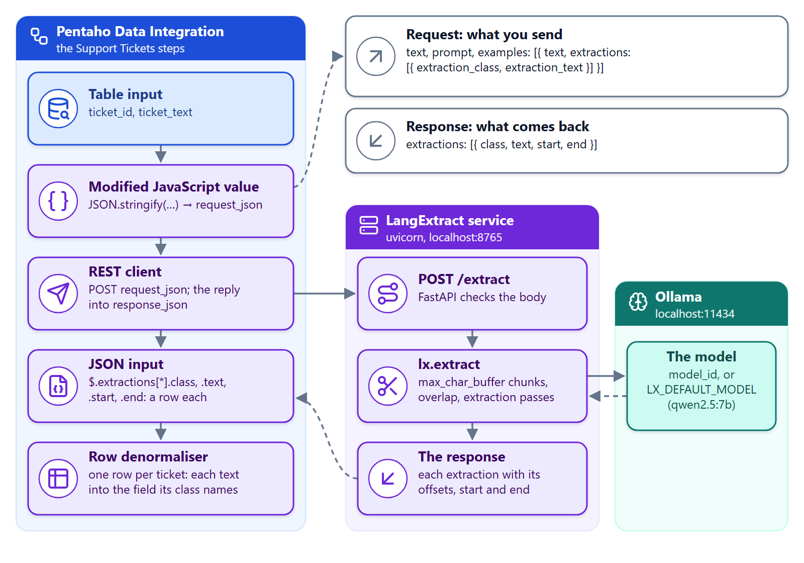

# Overview

<div class="pcm-intro">LangExtract turns free-form text into structured rows for Pentaho Data Integration. Use it when regular expressions are too brittle and training a model is too heavy. Each extraction comes back with its source offsets, so you can trace every value to the text it came from. This module runs Google's open-source <code>langextract</code> library as a small local service that calls your own Ollama, so the text never leaves the machine.</div>

**What You'll Learn**

* How a transformation calls the LangExtract service with **REST client**, and the request and response it exchanges
* How to set up and start the service in its own Python environment on Windows
* Which model the service needs, and why the course's small chat model is not enough here

***

## How It Works <!-- no-step -->

<div align="center">
<figure>

<figcaption>Pentaho Data Integration calls the LangExtract service, which calls the local Ollama</figcaption>
</figure>
</div>

Read the diagram down the left column, then across. **Modified JavaScript value** builds one request per row, **REST client** posts it to the service's `/extract`, and the service runs `lx.extract`, which reads the text in chunks of up to `max_char_buffer` characters, in as many passes as `extraction_passes` asks, and calls the model on Ollama. The response comes back to **JSON input** as one row per extraction, with its `start` and `end` offsets in the text. The two boxes at the top are the contract below: the names you send in the examples are not the names you read back.

**Choose an integration pattern:** use one pattern per transformation.

| Pattern | When to use it | Flow |
| --- | --- | --- |
| REST service (this module) | Reusable pipelines that many transformations call | Pentaho Data Integration input, **REST client**, **JSON input**, transform, output |
| Script step | A one-off experiment on one machine | Pentaho Data Integration runs a Python script that calls `langextract` itself |

**API contract**

The request (`model_id`, `max_char_buffer`, `overlap` and `extraction_passes` are optional):

```json
{
  "text": "source text",
  "prompt": "what to extract",
  "examples": [
    {
      "text": "example text",
      "extractions": [
        {
          "extraction_class": "field_name",
          "extraction_text": "example value"
        }
      ]
    }
  ],
  "model_id": "qwen2.5:7b",
  "max_char_buffer": 1200,
  "overlap": 100,
  "extraction_passes": 2
}
```

The response:

```json
{
  "extractions": [
    {
      "class": "field_name",
      "text": "value found",
      "start": 0,
      "end": 10
    }
  ]
}
```

> **Warning:** Post to `/extract`, and read the response fields as `class`, `text`, `start` and `end`, not as the request's `extraction_class` and `extraction_text`.

Between the two, the service does the work of LangExtract:

> **Under the hood:**
>
> #### The service turns the request into one lx.extract call and grounds every answer in the text
>
> `app.py` is a FastAPI application. It turns each item of `examples` into LangExtract example data and calls `lx.extract` with the prompt, the examples, the model that `model_id` names (or `LX_DEFAULT_MODEL`) and your Ollama's address. LangExtract splits the text into chunks of up to `max_char_buffer` characters, asks the model about each chunk `extraction_passes` times, and then looks for each answer in the text to find its `start` and `end`. `overlap` has no parameter of that name in LangExtract 1.x: the service passes it as `context_window_chars`, the characters of the previous chunk sent along with each chunk. A failure comes back as HTTP 502, with a `detail` that starts `langextract failed:`.
>
> **Why it matters:** an answer LangExtract cannot find in the text comes back with `start` and `end` empty. That is how a pipeline tells a value the text holds from one the model made up, as the Contract Documents workshop does with **Filter rows**.

***

## Start the LangExtract Service <!-- no-step -->

The service ships with this page:

[app.py](./files/langextract-service/app.py)

[requirements.txt](./files/langextract-service/requirements.txt)

On a machine set up by the course installer, both are in `C:\Workshop-AI-Specialty\06-langextract\12-langextract\langextract-service`. On your own machine, download them into a folder of that name. The service needs the course's Python (3.12, from [Before You Start](../00-before-you-start/guide.md)) and Ollama with `qwen2.5:7b`.

1. Pull the model the service uses. In PowerShell, run:

```powershell
ollama pull qwen2.5:7b
ollama list
```

> **Success:** Checkpoint: `ollama list` includes `qwen2.5:7b`, 4.7 GB.

2. Create the service's own Python environment, once, and install its libraries into it. In PowerShell, run:

```powershell
Set-Location C:\Workshop-AI-Specialty\06-langextract\12-langextract\langextract-service
python -m venv .venv
.\.venv\Scripts\python -m pip install -r requirements.txt
```

> **Success:** Checkpoint: pip ends with a `Successfully installed` line that includes `langextract`, `fastapi` and `uvicorn`. The course was checked with `langextract` 1.7.2, `fastapi` 0.165.0 and `uvicorn` 0.54.0.

3. Start the service, and keep this PowerShell window open while you work through the module:

```powershell
Set-Location C:\Workshop-AI-Specialty\06-langextract\12-langextract\langextract-service
.\.venv\Scripts\python -m uvicorn app:app --host 127.0.0.1 --port 8765
```

> **Success:** Checkpoint: uvicorn logs `Application startup complete.` and then `Uvicorn running on http://127.0.0.1:8765 (Press CTRL+C to quit)`, a few seconds after you start it.

`--host 127.0.0.1` keeps the service on this machine: nothing on the network can reach it, and Windows does not ask to open the firewall.

4. Open a second PowerShell window and ask the service for its health:

```powershell
Invoke-RestMethod http://localhost:8765/health
```

> **Success:** Checkpoint: three keys. `status` is `ok`, `model` is `qwen2.5:7b` and `model_url` is `http://localhost:11434`.

The service reads two environment variables when it starts: `LX_DEFAULT_MODEL` (the model when a request names none, `qwen2.5:7b` by default) and `LX_MODEL_URL` (the Ollama address, `http://localhost:11434` by default). To stop the service, press `Ctrl+C` in its window.

***

## Which Model <!-- no-step -->

The rest of the course chats with `llama3.2:3b`. This module uses `qwen2.5:7b`, because LangExtract asks the model for a strict JSON shape, a list of extractions per chunk, and a 3-billion-parameter model does not keep to it. Measured on the course PC with the six Support Tickets:

| Model | Extractions found | Time per ticket |
| --- | --- | --- |
| `llama3.2:3b` | 0: every chunk was dropped with `Content must contain an 'extractions' key` | 3 s |
| `qwen2.5:7b` | 32, five or six per ticket, each one a value the ticket states | 6 to 7 s |

The times are on a machine with an NVIDIA GPU, once the model is loaded (the first request also waits for Ollama to load it); on a CPU alone, `qwen2.5:7b` takes several times longer. The workshops' transformations name the model in a parameter, `LX_MODEL`, so you can try another one without editing a step.

***

## Workshops <!-- no-step -->

* [Support Tickets](../13-langextract-support-tickets/guide.md) - extract structured fields from free-form support tickets and route the critical ones.
* [Clinical Notes](../14-langextract-clinical-notes/guide.md) - extract medications, symptoms, diagnoses and allergies from clinical note files into a staging table.
* [Contract Documents](../15-langextract-contract-documents/guide.md) - pull key terms from contract files into clause rows and one wide row per contract.

The three workshops keep their tables in the course's PostgreSQL, the `genai` database of the pgvector lab kit (container `pcm-pgvector`, port `5433`), which [Before You Start](../00-before-you-start/guide.md) sets up.

***

## Troubleshooting <!-- no-step -->

<details>
<summary>Connection refused on 8765</summary>

The service is not running: start it as in **Start the LangExtract Service**, and check `http://localhost:8765/docs` in a browser.

</details>

<details>
<summary>Empty extractions</summary>

Look at the service's window. `Chunk omitted from results (parse error)` means the model did not answer in LangExtract's format: use `qwen2.5:7b` or a larger model. Otherwise tighten the prompt and make the worked example closer to the real text.

</details>

<details>
<summary>The reply is a detail that starts langextract failed</summary>

The rest of the message names the cause. The most common one is a model Ollama does not have: run `ollama list`, and pull it.

</details>

<details>
<summary>Long documents miss values</summary>

Increase `extraction_passes`, or `overlap` so each chunk sees the end of the one before it.

</details>

<details>
<summary>Too many duplicates</summary>

A second pass can find the same value again. Deduplicate before the final load, on the class and the text.

</details>
