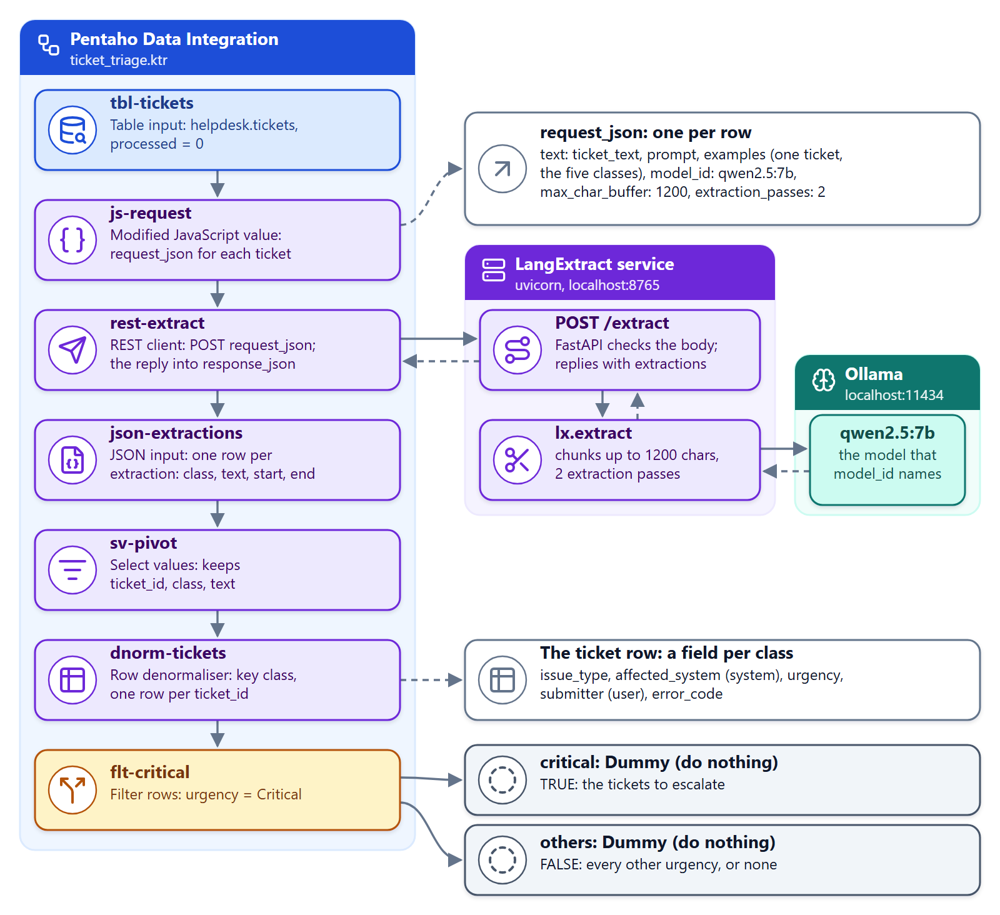
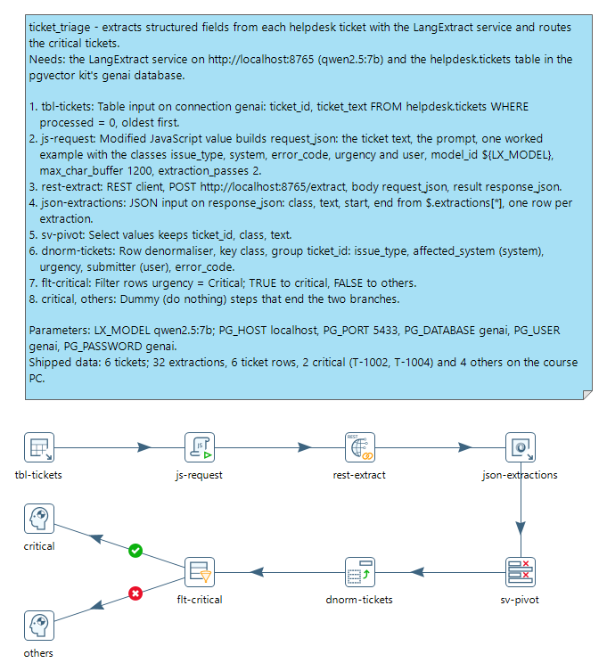

# Support Tickets

> **Warning:**
>
> #### Workshop - Support Tickets
>
> Build a transformation that reads free-form helpdesk tickets from PostgreSQL, has the LangExtract service pull structured fields out of each one, and routes the critical tickets apart from the rest. It replaces reading and routing every ticket by hand.
>
> **What you'll do**
>
> * Test the LangExtract service's `/extract` route with one ticket
> * Create the tickets table in the course's PostgreSQL and read it with **Table input**
> * Build each extraction request in **Modified JavaScript value** and send it with **REST client**
> * Parse the replies with **JSON input** and pivot them to one row per ticket with **Row denormaliser**
> * Route the `Critical` tickets with **Filter rows**
>
> **Prerequisites:**
>
> * The LangExtract [Overview](../12-langextract/guide.md): the service running on `http://localhost:8765`, and Ollama with `qwen2.5:7b`
> * The pgvector lab kit's PostgreSQL running (container `pcm-pgvector`, port `5433`), as set up in [Before You Start](../00-before-you-start/guide.md)
>
> **Estimated time:** 45 minutes

<figure>

<figcaption class="pcm-video-caption">Walkthrough: coming soon</figcaption>

</figure>

<div align="center">
<figure>

<figcaption>What you build: the steps of ticket_triage.ktr, the service they call, and where each ticket goes</figcaption>
</figure>
</div>

> **Note:**
>
> #### Business Case
>
> GlobalServ Technologies supports 12,000 end users. Its service desk receives 1,400 free-form tickets per day, analysts spend about five minutes reading and routing each one, and roughly 23% of tickets are misrouted on the first pass.

The transformation turns each ticket into one row with `ticket_id`, `issue_type`, `affected_system`, `urgency`, `submitter` and `error_code`, and splits the rows on `urgency`. In production the two branches would load tables, one for the critical tickets and one for the rest. This workshop ends each branch in a **Dummy (do nothing)** step instead, so you can inspect the results without creating more tables.

:::: tabs

### 1. Test the Service

> **Note:**
>
> #### Test the Service
>
> The transformation calls the LangExtract service on port `8765`, which the [Overview](../12-langextract/guide.md) page sets up. Check that it answers, then send it one ticket by hand: **REST client** sends this same kind of request for every row.

1. Make sure the service is running in its own PowerShell window, as **Start the LangExtract Service** on the Overview page shows. In a second PowerShell window, run:

```powershell
Invoke-RestMethod http://localhost:8765/health
```

> **Success:** Checkpoint: `status` is `ok`, `model` is `qwen2.5:7b` and `model_url` is `http://localhost:11434`.

2. Send one ticket and one worked example to the extraction route. In PowerShell, run:

```powershell
$body = @'
{
  "text": "Jane Smith cannot log into the VPN. Error code VPN-403. This is urgent.",
  "prompt": "Extract issue_type, system, urgency, user, and error_code.",
  "examples": [
    {
      "text": "Raj Patel cannot access SAP. Error code ERP-991. Critical issue.",
      "extractions": [
        {"extraction_class": "user", "extraction_text": "Raj Patel"},
        {"extraction_class": "system", "extraction_text": "SAP"},
        {"extraction_class": "error_code", "extraction_text": "ERP-991"},
        {"extraction_class": "urgency", "extraction_text": "Critical"}
      ]
    }
  ],
  "model_id": "qwen2.5:7b",
  "max_char_buffer": 1200,
  "extraction_passes": 2
}
'@
(Invoke-RestMethod -Method Post -Uri http://localhost:8765/extract -ContentType 'application/json' -Body $body).extractions | Format-Table
```

The first request can take longer while Ollama loads the model.

> **Success:** Checkpoint: a table with the columns `class`, `text`, `start` and `end`. On the course PC it has four rows: `user` `Jane Smith` from 0 to 10, `system` `VPN`, `error_code` `VPN-403` and `urgency` `Urgent`. The classes and values are the model's, so they can differ.

### 2. Tickets Table

> **Note:**
>
> #### Tickets Table
>
> The transformation reads `helpdesk.tickets` in the course's PostgreSQL: one row per ticket, with `processed` `0` until the ticket has been handled. Create the schema and the table in the lab kit's `genai` database, and load six sample tickets.

1. Open `psql` inside the lab kit's container. In PowerShell, run:

```powershell
podman exec -it pcm-pgvector psql -U genai -d genai
```

> **Success:** Checkpoint: the prompt reads `genai=#`.

2. Paste this SQL at the `genai=#` prompt and press `Enter`:

```sql
CREATE SCHEMA IF NOT EXISTS helpdesk;

CREATE TABLE helpdesk.tickets (
  ticket_id   VARCHAR(20) PRIMARY KEY,
  ticket_text TEXT        NOT NULL,
  processed   SMALLINT    NOT NULL DEFAULT 0,
  created_at  TIMESTAMP   NOT NULL
);

INSERT INTO helpdesk.tickets (ticket_id, ticket_text, created_at) VALUES
('T-1001', 'Hi, I can''t log into the VPN since this morning. Error code: VPN-403. My laptop is a Dell XPS running Windows 11. This is blocking me from working. - Jane Smith, Finance', '2025-01-06 08:05:00'),
('T-1002', 'The ERP system (SAP S/4HANA) is throwing DUMP errors for our whole team. Short dump: DYNPRO_SEND_IN_BACKGROUND. Production is affected. Critical! - Raj Patel, Supply Chain', '2025-01-06 08:20:00'),
('T-1003', 'Outlook keeps crashing when I open attachments. ERR_OUTLOOK_0x800CCC0F. Not urgent, just annoying. Running Office 365 on Windows 10. - Tom Green, Marketing', '2025-01-06 08:45:00'),
('T-1004', 'Payroll run is failing in Workday with error PAY-5001 and 3,000 employees will not be paid on Friday. Critical, please escalate now. - Maria Lopez, HR', '2025-01-06 09:10:00'),
('T-1005', 'Could someone reset my Jira password? I get AUTH-401 when I sign in. Low priority, I can use the web board meanwhile. - Ken Ito, Engineering', '2025-01-06 09:30:00'),
('T-1006', 'The shared printer on floor 3 shows PRN-022 paper jam again. Medium priority, people are walking to floor 2. - Olu Adeyemi, Facilities', '2025-01-06 09:55:00');
```

> **Success:** Checkpoint: `psql` answers `CREATE SCHEMA`, `CREATE TABLE` and `INSERT 0 6`.

3. Run:

```sql
SELECT ticket_id, processed, created_at
FROM helpdesk.tickets
ORDER BY created_at;
```

> **Success:** Checkpoint: 6 rows, `T-1001` to `T-1006`, each with `processed` `0`; the first was created at `2025-01-06 08:05:00`.

4. Enter `\q` to leave `psql`.

### 3. Read the Tickets

> **Note:**
>
> #### Read the Tickets
>
> Create the transformation, give it the parameters its steps read, connect it to the lab kit's PostgreSQL, and read the unprocessed tickets, oldest first, with **Table input**.

1. Start Spoon with the **Start Pentaho Data Integration** button below, or from PowerShell:

```powershell
Set-Location C:\Pentaho\design-tools\data-integration
.\Spoon.bat
```

<button data-launch="spoon" data-path="">Start Pentaho Data Integration</button>

2. Select **File > New > Transformation** (`Ctrl+N`).
3. Select **File > Save as** and save it as `ticket_triage.ktr` in `C:\Workshop-AI-Specialty\06-langextract\13-langextract-support-tickets`.
4. Double-click an empty part of the canvas. **Transformation properties** opens.
5. Open the **Parameters** tab and fill the grid:

| Parameter | Default Value | Description |
| --- | --- | --- |
| `LX_MODEL` | `qwen2.5:7b` | Ollama model the LangExtract service runs |
| `PG_HOST` | `localhost` | pgvector host (lab kit: localhost) |
| `PG_PORT` | `5433` | pgvector port (lab kit: 5433; 5432 is the Pentaho repository) |
| `PG_DATABASE` | `genai` | Database |
| `PG_USER` | `genai` | User |
| `PG_PASSWORD` | `genai` | Password |

6. Select **OK**.
7. Select **File > New > Database Connection**. The **Database Connection** dialog opens on **General**.
8. Enter these settings. Select **PostgreSQL** in the **Connection type** list and **Native (JDBC)** in the **Access** list. With the parameters' defaults, the connection goes to the lab kit: host `localhost`, port `5433`, database `genai`, user `genai`, password `genai`:

| Setting | Value |
| --- | --- |
| **Connection name** | `genai` |
| **Connection type** | **PostgreSQL** |
| **Access** | **Native (JDBC)** |
| **Host Name** | `${PG_HOST}` |
| **Database Name** | `${PG_DATABASE}` |
| **Port Number** | `${PG_PORT}` |
| **Username** | `${PG_USER}` |
| **Password** | `${PG_PASSWORD}` |

9. Select **Test**.

> **Success:** Checkpoint: Spoon shows **Connection tested successfully**, with the message `Connection to genai was successful.`

10. Select **OK** to close the message, then select **OK** to close **Database Connection**.

> **Under the hood:**
>
> #### The connection reads its settings from the parameters when the transformation starts
>
> Spoon stores `${PG_HOST}` and the other references in the transformation as they are, and Pentaho Data Integration replaces each one with the parameter's value when the transformation runs, or when you test the connection or preview a step. Port `5433` is the lab kit's container: the Pentaho Server's own repository PostgreSQL already has `5432`.
>
> **Why it matters:** to run the same transformation against another database, change the parameters in the **Run Options** dialog, not the connection.

11. On the **Design** tab, open the **Input** folder and drag **Table input** onto the canvas.
12. Double-click **Table input**. Set **Step name** to `tbl-tickets`.
13. In **Connection**, select `genai`.
14. Enter this query in **SQL**:

```sql
SELECT ticket_id, ticket_text
FROM helpdesk.tickets
WHERE processed = 0
ORDER BY created_at ASC
```

15. Select **Replace variables in script?**.
16. Select **Preview**, enter `100` rows, and select **OK**. The rows show in **Examine preview data**.

> **Success:** Checkpoint: 6 rows, `T-1001` to `T-1006` in that order, each with its `ticket_text`.

17. Select **Close**, then select **OK** to close **Table input**.

### 4. Build the Request

> **Note:**
>
> #### Build the Request
>
> **Modified JavaScript value** builds the body the service expects, one JSON string per ticket: the ticket's text, the extraction prompt, one worked example, the model and the tuning options.

1. On the **Design** tab, open the **Scripting** folder and drag **Modified JavaScript value** onto the canvas.
2. Create a hop from **tbl-tickets** to **Modified JavaScript value**: hold `Shift` and drag from one step to the other.
3. Double-click **Modified JavaScript value**. Set **Step name** to `js-request`.
4. Replace `//Script here` on the **Script 1** tab with this script:

```javascript
var prompt = 'Extract issue_type, system, urgency, user, and error_code. ' +
    'For urgency use only one of: Critical, High, Medium, Low. ' +
    'If a field cannot be found in the text, omit it from the output entirely. ' +
    'Do not use placeholder values such as "none", "N/A", or "none mentioned".';

var few_shot = [{
  text: 'Cannot access Confluence. Error ERR-502. Critical, the release is blocked! - Alice Wong, DevOps',
  extractions: [
    { extraction_class: 'issue_type', extraction_text: 'Cannot access' },
    { extraction_class: 'system', extraction_text: 'Confluence' },
    { extraction_class: 'error_code', extraction_text: 'ERR-502' },
    { extraction_class: 'urgency', extraction_text: 'Critical' },
    { extraction_class: 'user', extraction_text: 'Alice Wong' }
  ]
}];

var request_json = JSON.stringify({
  text: ticket_text + '',
  prompt: prompt,
  examples: few_shot,
  model_id: getVariable('LX_MODEL', 'qwen2.5:7b'),
  max_char_buffer: 1200,
  extraction_passes: 2
});
```

5. Fill the **Fields** grid with one row:

| Fieldname | Rename to | Type | Replace value 'Fieldname' or 'Rename to' |
| --- | --- | --- | --- |
| `request_json` | `request_json` | String | N |

6. Select **OK**.
7. Select **js-request** on the canvas, press `F10` (**Action > Preview**), and select **Quick Launch**.

> **Success:** Checkpoint: 6 rows. Each keeps `ticket_id` and `ticket_text` and adds `request_json`, a JSON string that starts `{"text":"` with the ticket's text and contains `"model_id":"qwen2.5:7b"`.

8. Select **Close**.

> **Under the hood:**
>
> #### The worked example teaches the model the classes and the exact words to copy
>
> LangExtract shows the model the example's text and its extractions before the ticket, so the model learns the five class names and that each value is copied word for word from the text: `Critical`, not a label it invents. `ticket_text + ''` turns the field into a JavaScript string, so `JSON.stringify` escapes its quotes and line breaks, and `getVariable('LX_MODEL', 'qwen2.5:7b')` reads the parameter, with the model as a fallback.
>
> **Why it matters:** the example is the contract with the model. Ask in the prompt for `Critical, High, Medium, Low` and extract `Critical` in the example, and the urgency comes back in that form, which is what **Filter rows** compares against in part 6.

### 5. Call the Service

> **Note:**
>
> #### Call the Service
>
> **REST client** posts each request to the service and keeps the reply in a new field. **JSON input** then turns each reply into one row per extraction.

1. On the **Design** tab, open the **Lookup** folder and drag **REST client** onto the canvas.
2. Create a hop from **js-request** to **REST client**.
3. Double-click **REST client**. Set **Step name** to `rest-extract`.
4. On the **General** tab, enter these settings. Select `JSON` in the **Application type** list and `POST` in the **HTTP method** list:

| Setting | Value |
| --- | --- |
| **Application type** | `JSON` |
| **HTTP method** | `POST` |
| **URL** | `http://localhost:8765/extract` |
| **Body field** | `request_json` |
| **Result field name** | `response_json` |

5. Select **OK**.

> **Under the hood:**
>
> #### Each row becomes one POST, and the reply comes back whatever its status
>
> **REST client** sends the value of `request_json` as the body of a `POST` to the URL, once for every incoming row, waits for the reply, and writes its body to `response_json`. It does not fail on an error status: a failed extraction arrives as a reply of its own, `{"detail":"langextract failed: ..."}`. Each extraction in a good reply has its class, its text and its character offsets in the ticket, `start` and `end`.
>
> **Why it matters:** the reply has the same four generic fields whatever you extract, so one **JSON input** configuration parses every extraction task in this module.

6. On the **Design** tab, open the **Input** folder and drag **JSON input** onto the canvas.
7. Create a hop from **rest-extract** to **JSON input**.
8. Double-click **JSON input**. Set **Step name** to `json-extractions`.
9. On the **File** tab, select **Source is from a previous step**, and set **Select field** to `response_json`.
10. On the **Content** tab, make sure **Ignore missing path** and **Default path leaf to null** are selected.
11. On the **Fields** tab, fill the **Fields** grid:

| Name | Path | Type |
| --- | --- | --- |
| `class` | `$.extractions[*].class` | String |
| `text` | `$.extractions[*].text` | String |
| `start` | `$.extractions[*].start` | String |
| `end` | `$.extractions[*].end` | String |

12. Select **OK**.

### 6. Pivot and Route

> **Note:**
>
> #### Pivot and Route
>
> Keep the three fields the pivot needs, turn each ticket's extractions into one row with a column per class, and split the critical tickets from the rest.

1. On the **Design** tab, open the **Transform** folder and drag **Select values** onto the canvas.
2. Create a hop from **json-extractions** to **Select values**.
3. Double-click **Select values**. Set **Step name** to `sv-pivot`.
4. On the **Select & Alter** tab, fill the **Fields** grid with three rows:

| Fieldname |
| --- |
| `ticket_id` |
| `class` |
| `text` |

5. Select **OK**.
6. On the **Design** tab, open the **Transform** folder and drag **Row denormaliser** onto the canvas.
7. Create a hop from **sv-pivot** to **Row denormaliser**.
8. Double-click **Row denormaliser**. Set **Step name** to `dnorm-tickets`.
9. Set **The key field** to `class`.
10. Fill **The fields that make up the grouping** grid with one row: **Group field** `ticket_id`.
11. Fill the **Target fields** grid. Leave the other columns empty:

| Target fieldname | Value fieldname | Key value | Type |
| --- | --- | --- | --- |
| `issue_type` | `text` | `issue_type` | String |
| `affected_system` | `text` | `system` | String |
| `urgency` | `text` | `urgency` | String |
| `submitter` | `text` | `user` | String |
| `error_code` | `text` | `error_code` | String |

12. Select **OK**. If Spoon shows a **Notice** that the incoming data should be sorted on the grouping fields, select **Close**.

> **Under the hood:**
>
> #### Row denormaliser pivots runs of consecutive rows, so this stream needs no sort
>
> **Row denormaliser** builds one output row from each run of consecutive rows with the same `ticket_id`, and puts each row's `text` in the target field whose **Key value** matches its `class`. It does not sort: rows of one ticket that arrive apart become separate output rows. Here they arrive together, because **tbl-tickets** returns the tickets in `created_at` order, every step runs one copy, and **json-extractions** emits all the extractions of one reply before it reads the next row. With no aggregation set, a second extraction of the same class, such as the second pass finding the urgency again, overwrites the first.
>
> **Why it matters:** a **Sort rows** step would read the whole stream before it passes on a single row. Skipping it is safe only while the order holds: run more than one copy of **rest-extract** and the tickets interleave, so a sort on `ticket_id` belongs in front of the pivot.

13. On the **Design** tab, open the **Flow** folder and drag **Filter rows** onto the canvas.
14. Create a hop from **dnorm-tickets** to **Filter rows**.
15. From the **Flow** folder, drag a **Dummy (do nothing)** onto the canvas. Double-click it, set **Step name** to `critical`, and select **OK**.
16. From the **Flow** folder, drag another **Dummy (do nothing)** onto the canvas. Double-click it, set **Step name** to `others`, and select **OK**.
17. Create a hop from **Filter rows** to **critical** and select **Result is TRUE**. Create a hop from **Filter rows** to **others** and select **Result is FALSE**.
18. Double-click **Filter rows**. Set **Step name** to `flt-critical`. **Send 'true' data to step** reads `critical`, and **Send 'false' data to step** reads `others`.
19. In **The condition**, select `<field>` on the left and select `urgency`. Keep the function, `=`.
20. Select `<value>`. In the **Enter value** dialog, set **Type** to `String` and **Value** to `Critical`, then select **OK**.
21. Select **OK**, and save the transformation (`Ctrl+S`).

### 7. Run

> **Note:**
>
> #### Run and Check
>
> Run the transformation with the service running, then follow the tickets through **Step Metrics** and the preview data of each step. The run waits on the model for every ticket: about 35 seconds for the six on a machine with a GPU, several minutes on a CPU alone.

1. Press `F9` (**Action > Run**), and select **Run** in the **Run Options** dialog.
2. In **Execution Results**, open the **Step Metrics** tab.

> **Success:** Checkpoint: no step shows an error. **tbl-tickets**, **js-request** and **rest-extract** each write 6 rows. **json-extractions** writes one row per extraction, 32 in each of three runs on the course PC; the model decides the exact number. **dnorm-tickets** writes 6 rows, one per ticket, **critical** reads 2 and **others** reads 4.

3. Select **json-extractions** on the canvas and open the **Preview data** tab.

> **Success:** Checkpoint: one row per extraction. Each row carries the ticket's `ticket_id`, `ticket_text`, `request_json` and `response_json`, and the `class`, `text`, `start` and `end` of one extraction. Some tickets, such as `T-1001`, have two `urgency` rows, one from each extraction pass.

4. Select **dnorm-tickets** on the canvas and open the **Preview data** tab.

> **Success:** Checkpoint: 6 rows, one per ticket. On the course PC: `T-1001` `can't log into the VPN`, `VPN`, `High`, `Jane Smith`, `VPN-403`; `T-1002` with `affected_system` `SAP S/4HANA`, `urgency` `Critical` and `error_code` `DYNPRO_SEND_IN_BACKGROUND`; `T-1003` `Low`; `T-1004` `Workday`, `Critical`, `Maria Lopez`, `PAY-5001`; `T-1005` `Jira`, `Low`; `T-1006` `printer`, `Medium`. A column is `<null>` when the model found nothing of that class in the ticket.

5. Select **critical** on the canvas and open the **Preview data** tab.

> **Success:** Checkpoint: 2 rows, `T-1002` and `T-1004`, both with `urgency` `Critical`.

6. Select **others** on the canvas and open the **Preview data** tab.

> **Success:** Checkpoint: 4 rows, `T-1001`, `T-1003`, `T-1005` and `T-1006`, with `urgency` `High`, `Low`, `Low` and `Medium`. Nothing in the transformation sets `processed`, so the next run reads the same tickets again.

::::

## Troubleshooting <!-- no-step -->

<details>
<summary>Connection refused on port 8765</summary>

The LangExtract service is not running. Start it as **Start the LangExtract Service** on the [Overview](../12-langextract/guide.md) page shows, and keep its window open while the transformation runs.

</details>

<details>
<summary>Connection to genai fails</summary>

The lab kit's container is not running, or the port is wrong. In PowerShell, run `podman ps --filter name=pcm-pgvector`: the container should be `Up` with `127.0.0.1:5433->5432/tcp`. If it is stopped, run `podman start pcm-pgvector`. `PG_PORT` must be `5433`.

</details>

<details>
<summary>critical and others are empty, or every extracted column is null</summary>

Select **rest-extract** on the canvas and open the **Preview data** tab. If `response_json` starts `{"detail":"langextract failed:`, the service could not run the extraction, and the rest of the message names the cause, such as a model that Ollama doesn't have. If it is `{"extractions":[]}`, look at the service's window for `Chunk omitted from results (parse error)`: the model did not answer in LangExtract's format, which is why this module uses `qwen2.5:7b` rather than `llama3.2:3b`.

</details>

<details>
<summary>critical stays empty although the tickets look urgent</summary>

The condition compares `urgency` with `Critical` exactly, capital letter included. Look at the `urgency` values in the **dnorm-tickets** preview: a model that answers `CRITICAL` or `Critical!` needs the prompt and the example to agree, or a condition that allows for it.

</details>

## Lab Files

Click a file to download. For `.ktr` and `.kjb` files, **Open in Pentaho Data Integration** launches Pentaho Data Integration with the file loaded. If Pentaho Data Integration is already running, the path is copied to your clipboard — switch to Pentaho Data Integration and press `Ctrl+O`, `Ctrl+V`, `Enter`.

The LangExtract service, `app.py` and `requirements.txt`, ships with the [Overview](../12-langextract/guide.md) page. The tickets come from the `helpdesk.tickets` table you create in part 2.

### Solution <!-- no-step -->

The finished transformation for this lab. Open it alongside your own to compare, or run it to see the expected result. It needs the `helpdesk.tickets` table from part 2, the lab kit's PostgreSQL and the running service; its own `genai` connection reads the `PG_*` parameters.

Also on disk at `C:\Workshop-AI-Specialty\06-langextract\13-langextract-support-tickets\solution`.

[ticket_triage.ktr](./files/solution/ticket_triage.ktr) <button data-launch="spoon" data-path="files/solution/ticket_triage.ktr">Open in Pentaho Data Integration</button> <button data-graph="files/solution/ticket_triage.ktr">View graph</button>

ticket_triage in Spoon, with its note:

<div align="center">
<figure>

<figcaption>ticket_triage.ktr in Spoon</figcaption>
</figure>
</div>
