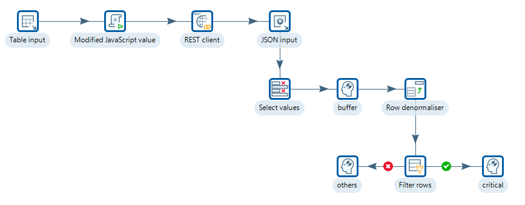
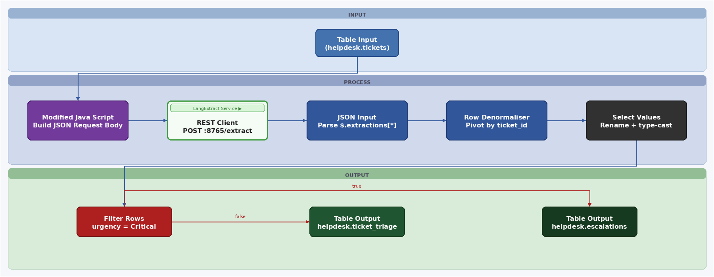
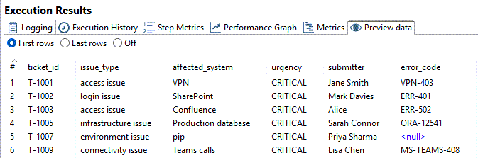

# Support Tickets

> **Warning:**
>
> #### Workshop - Support Tickets
>
> Build a transformation that reads free-form helpdesk tickets, has the LangExtract service pull structured fields out of each one, and routes the critical tickets apart from the rest. It replaces reading and routing every ticket by hand.
>
> **What you'll do**
>
> * Start the LangExtract service and test its `/health` and `/extract` routes
> * Read the unprocessed tickets from PostgreSQL with **Table input**
> * Build each extraction request in **Modified JavaScript value** and send it with **REST client**
> * Parse the replies with **JSON input** and pivot them to one row per ticket with **Row denormaliser**
> * Route the `CRITICAL` tickets with **Filter rows**
>
> **Prerequisites:**
>
> * The LangExtract [Overview](../12-langextract/guide.md): the request and response contract this lab uses
> * Ollama running on `http://localhost:11434`
> * Python 3.10 or later, for the service
> * A PostgreSQL database you can create a schema and a table in, with DBeaver (or `psql`) connected to it. The course installs no database for this lab.
>
> **Estimated time:** 40 minutes

<div align="center">
<figure>

<figcaption>What you build: ten steps, ending in two branches out of Filter rows</figcaption>
</figure>
</div>

> **Note:**
>
> #### Business Case
>
> GlobalServ Technologies supports 12,000 end users. Its service desk receives 1,400 free-form tickets per day, analysts spend about five minutes reading and routing each one, and roughly 23% of tickets are misrouted on the first pass.

The transformation turns each ticket into one row with `ticket_id`, `issue_type`, `affected_system`, `urgency`, `submitter` and `error_code`, and splits the rows on `urgency`. In production the two branches load tables, `helpdesk.ticket_triage` for most tickets and `helpdesk.escalations` for the critical ones. This lab ends each branch in a **Dummy (do nothing)** step instead, so you can inspect the results without creating those tables.

<div align="center">
<figure>

<figcaption>The production design: Table output steps where this lab has Dummy steps</figcaption>
</figure>
</div>

:::: tabs

### 1. Start the Service

> **Note:**
>
> #### Start the Service
>
> The transformation calls the LangExtract REST service on port `8765`, which ships with the [Overview](../12-langextract/guide.md) page. Set it up once in its own Python environment, then keep it running in its terminal while you work. If you started it on the Overview page and `/health` answers (step 3), go to step 4.

1. Create the service's Python environment and install its libraries. In PowerShell, run:

::: tabs

### Windows (PowerShell)

```powershell
Set-Location C:\Workshop-AI-Specialty\05-langextract\12-langextract\langextract-service
python -m venv .venv
.\.venv\Scripts\pip install -r requirements.txt
```

### macOS / Linux

In a terminal, in the `langextract-service` folder you downloaded the lab files to, run:

```bash
python3 -m venv .venv
.venv/bin/pip install -r requirements.txt
```

:::

> **Success:** Checkpoint: pip ends with a `Successfully installed` line that includes `langextract`, `fastapi` and `uvicorn`.

2. Start the service in the same terminal, and leave the terminal open:

::: tabs

### Windows (PowerShell)

```powershell
.\.venv\Scripts\python -m uvicorn app:app --host 0.0.0.0 --port 8765
```

### macOS / Linux

```bash
.venv/bin/python -m uvicorn app:app --host 0.0.0.0 --port 8765
```

:::

> **Success:** Checkpoint: uvicorn logs `Uvicorn running on http://0.0.0.0:8765` and then `Application startup complete.`

3. Open a second terminal and ask the service for its health. If the request is refused, wait a few seconds and run it again:

::: tabs

### Windows (PowerShell)

```powershell
Invoke-RestMethod http://localhost:8765/health
```

### macOS / Linux

```bash
curl http://localhost:8765/health
```

:::

> **Success:** Checkpoint: three keys. `status` is `ok`, `model` is `llama3.2:3b` and `model_url` is `http://localhost:11434`: the service's defaults, which the environment variables `LX_DEFAULT_MODEL` and `LX_MODEL_URL` change.

4. Pull the model the transformation asks for. Its request names `llama3.1:8b`, which takes the place of the service's default model. In the second terminal, run:

```powershell
ollama pull llama3.1:8b
ollama list
```

> **Success:** Checkpoint: `ollama pull` ends with `success`, and `ollama list` includes `llama3.1:8b`.

5. Test the extraction route with one ticket and one worked example:

::: tabs

### Windows (PowerShell)

```powershell
$body = @'
{
  "text": "Jane Smith cannot log into the VPN. Error code VPN-403. This is urgent.",
  "prompt": "Extract issue_type, system, urgency, user, and error_code.",
  "examples": [
    {
      "text": "Raj Patel cannot access SAP. Error code ERP-991. Critical issue.",
      "extractions": [
        {"extraction_class": "user", "extraction_text": "Raj Patel"},
        {"extraction_class": "system", "extraction_text": "SAP"},
        {"extraction_class": "error_code", "extraction_text": "ERP-991"},
        {"extraction_class": "urgency", "extraction_text": "Critical"}
      ]
    }
  ],
  "model_id": "llama3.1:8b",
  "max_char_buffer": 1200,
  "extraction_passes": 2
}
'@
Invoke-RestMethod -Method Post -Uri http://localhost:8765/extract -ContentType 'application/json' -Body $body | ConvertTo-Json -Depth 5
```

### macOS / Linux

```bash
curl -X POST http://localhost:8765/extract \
  -H "Content-Type: application/json" \
  -d '{
    "text": "Jane Smith cannot log into the VPN. Error code VPN-403. This is urgent.",
    "prompt": "Extract issue_type, system, urgency, user, and error_code.",
    "examples": [
      {
        "text": "Raj Patel cannot access SAP. Error code ERP-991. Critical issue.",
        "extractions": [
          {"extraction_class": "user", "extraction_text": "Raj Patel"},
          {"extraction_class": "system", "extraction_text": "SAP"},
          {"extraction_class": "error_code", "extraction_text": "ERP-991"},
          {"extraction_class": "urgency", "extraction_text": "Critical"}
        ]
      }
    ],
    "model_id": "llama3.1:8b",
    "max_char_buffer": 1200,
    "extraction_passes": 2
  }'
```

:::

> **Success:** Checkpoint: the reply is a JSON object with one key, `extractions`: a list in which every item has `class`, `text`, `start` and `end`. Which classes and values come back depends on the model.

### 2. Tickets Table

> **Note:**
>
> #### Tickets Table
>
> The transformation reads `helpdesk.tickets` in PostgreSQL: one row per ticket, with `processed` `0` until the ticket has been handled. The course ships no such database, so create the table and load three sample tickets.

1. In DBeaver (or `psql`), connected to your PostgreSQL database, run:

```sql
CREATE SCHEMA IF NOT EXISTS helpdesk;

CREATE TABLE helpdesk.tickets (
  ticket_id   VARCHAR(20) PRIMARY KEY,
  ticket_text TEXT        NOT NULL,
  processed   SMALLINT    NOT NULL DEFAULT 0,
  created_at  TIMESTAMP   NOT NULL
);

INSERT INTO helpdesk.tickets (ticket_id, ticket_text, created_at) VALUES
('T-1001', 'Hi, I can''t log into the VPN since this morning. Error code: VPN-403. My laptop is a Dell XPS running Windows 11. This is blocking me from working. — Jane Smith, Finance', '2025-01-06 08:05:00'),
('T-1002', 'The ERP system (SAP S/4HANA) is throwing DUMP errors for our whole team. Short dump: DYNPRO_SEND_IN_BACKGROUND. Production is affected. Critical! — Raj Patel, Supply Chain', '2025-01-06 08:20:00'),
('T-1003', 'Outlook keeps crashing when I open attachments. ERR_OUTLOOK_0x800CCC0F. Not urgent, just annoying. Running Office 365 on Windows 10. — Tom Green, Marketing', '2025-01-06 08:45:00');
```

2. Run:

```sql
SELECT ticket_id, processed, created_at
FROM helpdesk.tickets
ORDER BY created_at;
```

> **Success:** Checkpoint: 3 rows, `T-1001`, `T-1002` and `T-1003`, each with `processed` `0`.

### 3. Read the Tickets

> **Note:**
>
> #### Read the Tickets
>
> **Table input** runs a query over a connection named `PG:Helpdesk` and returns the unprocessed tickets, oldest first.

1. Start Spoon with the **Start Pentaho Data Integration** button below, or from a terminal:

::: tabs

### Windows (PowerShell)

```powershell
Set-Location C:\Pentaho\design-tools\data-integration
.\spoon.bat
```

### macOS / Linux

```bash
cd ~/Pentaho/design-tools/data-integration
./spoon.sh
```

:::

<button data-launch="spoon" data-path="">Start Pentaho Data Integration</button>

2. Select **File > New > Transformation** (`Ctrl+N`).
3. Select **File > Save as** and save it as `ticket_triage.ktr` in `C:\Workshop-AI-Specialty\05-langextract\13-langextract-support-tickets`.
4. Select **File > New > Database Connection**. The **Database Connection** dialog opens on **General**.
5. Enter these settings. Select **PostgreSQL** in the **Connection type** list and **Native (JDBC)** in the **Access** list. The host, database, user and password are those of your own PostgreSQL database:

| Setting | Value |
| --- | --- |
| **Connection name** | `PG:Helpdesk` |
| **Connection type** | **PostgreSQL** |
| **Access** | **Native (JDBC)** |
| **Host Name** | your PostgreSQL host, such as `localhost` |
| **Database Name** | the database that holds `helpdesk.tickets` |
| **Port Number** | `5432` |
| **Username** | your PostgreSQL user |
| **Password** | that user's password |

6. Select **Test**.

> **Success:** Checkpoint: Spoon shows **Connection tested successfully**, with the message `Connection to PG:Helpdesk was successful.`

7. Select **OK** to close the message, then select **OK** to close **Database Connection**.
8. In the **View** tab, expand **Database connections**, right-click `PG:Helpdesk`, and select **Move to System**. The solution file holds no connection of its own: it finds `PG:Helpdesk` by name among the shared connections.
9. On the **Design** tab, open the **Input** folder and drag **Table input** onto the canvas.
10. Double-click **Table input**. Keep its **Step name**, `Table input`.
11. In **Connection**, select `PG:Helpdesk`.
12. Enter this query in **SQL**:

```sql
SELECT ticket_id, ticket_text
FROM helpdesk.tickets
WHERE processed = 0
ORDER BY created_at ASC
```

13. Select **Preview**, enter `100` rows, and select **OK**. The rows show in **Examine preview data**.

> **Success:** Checkpoint: 3 rows, `T-1001`, `T-1002` and `T-1003` in that order, each with its `ticket_text`.

14. Select **Close**, then select **OK** to close **Table input**.

### 4. Build the Request

> **Note:**
>
> #### Build the Request
>
> **Modified JavaScript value** builds the body the service expects, one JSON string per ticket: the ticket's text, the extraction prompt, one worked example, the model and the tuning options.

1. On the **Design** tab, open the **Scripting** folder and drag **Modified JavaScript value** onto the canvas.
2. Create a hop from **Table input** to **Modified JavaScript value**: hold `Shift` and drag from one step to the other.
3. Double-click **Modified JavaScript value**. Keep its **Step name**, `Modified JavaScript value`.
4. Replace `//Script here` on the **Script 1** tab with this script:

```javascript
var prompt = 'Extract issue_type, system, urgency, user, and error_code. ' +
        'For urgency use only one of: CRITICAL, HIGH, MEDIUM, LOW. ' +
        'If a field cannot be found in the text, omit it from the output entirely. ' +
        'Do not use placeholder values such as "none", "N/A", or "none mentioned".';
var few_shot = [{
  text: 'Cannot access Confluence. Error ERR-502. Urgent! — Alice, DevOps',
  extractions: [
    { extraction_class: 'issue_type', extraction_text: 'access issue' },
    { extraction_class: 'system', extraction_text: 'Confluence' },
    { extraction_class: 'urgency', extraction_text: 'Urgent' },
    { extraction_class: 'user', extraction_text: 'Alice' },
    { extraction_class: 'error_code', extraction_text: 'ERR-502' }
  ]
}];

var request_json = JSON.stringify({
  text: ticket_text + '',
  prompt: prompt,
  examples: few_shot,
  model_id: 'llama3.1:8b',
  max_char_buffer: 1200,
  extraction_passes: 2
});
```

5. Fill the **Fields** grid with one row:

| Fieldname | Rename to | Type | Replace value 'Fieldname' or 'Rename to' |
| --- | --- | --- | --- |
| `request_json` | `request_json` | String | N |

6. Select **OK**.
7. Select **Modified JavaScript value** on the canvas, press `F10` (**Action > Preview**), and select **Quick Launch**.

> **Success:** Checkpoint: 3 rows. Each keeps `ticket_id` and `ticket_text` and adds `request_json`, a JSON string that starts `{"text":"` with the ticket's text and contains `"model_id":"llama3.1:8b"`.

8. Select **Close**.

### 5. Call the Service

> **Note:**
>
> #### Call the Service
>
> **REST client** posts each request to the service and keeps the reply in a new field. **JSON input** then turns each reply into one row per extraction.

1. On the **Design** tab, open the **Lookup** folder and drag **REST client** onto the canvas.
2. Create a hop from **Modified JavaScript value** to **REST client**.
3. Double-click **REST client**. Keep its **Step name**, `REST client`.
4. On the **General** tab, enter these settings. Select `JSON` in the **Application type** list and `POST` in the **HTTP method** list:

| Setting | Value |
| --- | --- |
| **Application type** | `JSON` |
| **HTTP method** | `POST` |
| **URL** | `http://localhost:8765/extract` |
| **Body field** | `request_json` |
| **Result field name** | `response_json` |

5. Select **OK**.

> **Under the hood:**
>
> #### Each row becomes one POST, and the service hands it to LangExtract
>
> **REST client** sends the value of `request_json` as the body of a `POST` to the URL, once for every incoming row, and writes the reply's body to `response_json` whatever its HTTP status. The service turns `examples` into LangExtract example data and calls `lx.extract` with the prompt, the examples and the model that `model_id` names on your Ollama. It passes `max_char_buffer`, `overlap` and `extraction_passes` on only when the installed LangExtract version accepts them. Each extraction comes back with its class, its text and its character offsets in the ticket, `start` and `end`; when LangExtract gives no offsets, the service uses the first place the text occurs in the ticket. A failure comes back as HTTP 502, with a `detail` that starts `langextract failed:`.
>
> **Why it matters:** the reply has the same four generic fields whatever you extract, so one **JSON input** configuration parses every extraction task, and the offsets let you trace each value back to the words in the ticket that produced it.

6. On the **Design** tab, open the **Input** folder and drag **JSON input** onto the canvas.
7. Create a hop from **REST client** to **JSON input**.
8. Double-click **JSON input**. Keep its **Step name**, `JSON input`.
9. On the **File** tab, select **Source is from a previous step**, and set **Select field** to `response_json`.
10. On the **Fields** tab, fill the **Fields** grid:

| Name | Path | Type |
| --- | --- | --- |
| `class` | `$.extractions[*].class` | String |
| `text` | `$.extractions[*].text` | String |
| `start` | `$.extractions[*].start` | String |
| `end` | `$.extractions[*].end` | String |

11. Select **OK**.

### 6. Pivot and Route

> **Note:**
>
> #### Pivot and Route
>
> Keep the three fields the pivot needs, turn each ticket's extractions into one row with a column per class, and split the critical tickets from the rest.

1. On the **Design** tab, open the **Transform** folder and drag **Select values** onto the canvas.
2. Create a hop from **JSON input** to **Select values**.
3. Double-click **Select values**. Keep its **Step name**, `Select values`.
4. On the **Select & Alter** tab, fill the **Fields** grid with three rows:

| Fieldname |
| --- |
| `ticket_id` |
| `class` |
| `text` |

5. Select **OK**.
6. On the **Design** tab, open the **Flow** folder and drag **Dummy (do nothing)** onto the canvas.
7. Create a hop from **Select values** to **Dummy (do nothing)**.
8. Double-click **Dummy (do nothing)**. Set **Step name** to `buffer`, and select **OK**.
9. On the **Design** tab, open the **Transform** folder and drag **Row denormaliser** onto the canvas.
10. Create a hop from **buffer** to **Row denormaliser**.
11. Double-click **Row denormaliser**. Keep its **Step name**, `Row denormaliser`.
12. Set **The key field** to `class`.
13. Fill **The fields that make up the grouping** grid with one row: **Group field** `ticket_id`.
14. Fill the **Target fields** grid. Leave the other columns empty:

| Target fieldname | Value fieldname | Key value | Type |
| --- | --- | --- | --- |
| `issue_type` | `text` | `issue_type` | String |
| `affected_system` | `text` | `system` | String |
| `urgency` | `text` | `urgency` | String |
| `submitter` | `text` | `user` | String |
| `error_code` | `text` | `error_code` | String |

15. Select **OK**. If Spoon shows a **Notice** that the incoming data should be sorted on the grouping fields, select **Close**.

> **Under the hood:**
>
> #### Row denormaliser pivots runs of consecutive rows, so this stream needs no sort
>
> **Row denormaliser** builds one output row from each run of consecutive rows with the same `ticket_id`, and puts each row's `text` in the target field whose **Key value** matches its `class`. It does not sort: rows of one ticket that arrive apart become separate output rows. Here they arrive together, because **Table input** returns the tickets in `created_at` order, every step runs one copy, and **JSON input** emits all the extractions of one reply before it reads the next row. **buffer** passes them through unchanged. With no aggregation set, a second extraction of the same class overwrites the first.
>
> **Why it matters:** a **Sort rows** step would read the whole stream before it passes on a single row. Skipping it is safe only while the order holds: run more than one copy of **REST client** and the tickets interleave, so a sort on `ticket_id` belongs in front of the pivot.

16. On the **Design** tab, open the **Flow** folder and drag **Filter rows** onto the canvas.
17. Create a hop from **Row denormaliser** to **Filter rows**.
18. From the **Flow** folder, drag a **Dummy (do nothing)** onto the canvas, to the right of **Filter rows**. Double-click it, set **Step name** to `critical`, and select **OK**.
19. From the **Flow** folder, drag another **Dummy (do nothing)** onto the canvas, to the left of **Filter rows**. Double-click it, set **Step name** to `others`, and select **OK**.
20. Create a hop from **Filter rows** to **critical** and select **Result is TRUE**. Create a hop from **Filter rows** to **others** and select **Result is FALSE**.
21. Double-click **Filter rows**. Keep its **Step name**, `Filter rows`. **Send 'true' data to step** reads `critical`, and **Send 'false' data to step** reads `others`.
22. In **The condition**, select `<field>` on the left and select `urgency`. Keep the function, `=`.
23. Select `<value>`. In the **Enter value** dialog, set **Type** to `String` and **Value** to `CRITICAL`, then select **OK**.
24. Select **OK**.

### 7. Run

> **Note:**
>
> #### Run and Check
>
> Run the transformation with the service running, then follow the tickets through **Step Metrics** and the preview data of each step. The run waits on the model for every ticket, so it takes a while.

1. Save the transformation (`Ctrl+S`).
2. Press `F9` (**Action > Run**), and select **Run** in the **Run Options** dialog.
3. In **Execution Results**, open the **Step Metrics** tab.

> **Success:** Checkpoint: **Table input**, **Modified JavaScript value** and **REST client** each write 3 rows. **JSON input** writes one row per extraction; how many depends on the model. **Row denormaliser** writes one row per ticket the service found anything in, and the **Read** of **critical** and **others** adds up to what **Row denormaliser** wrote. No step shows an error.

4. Select **JSON input** on the canvas and open the **Preview data** tab.

> **Success:** Checkpoint: one row per extraction. Each row carries the ticket's `ticket_id`, `ticket_text`, `request_json` and `response_json`, and the `class`, `text`, `start` and `end` of one extraction. Which classes each ticket gets, and their values, depend on the model.

5. Select **Row denormaliser** on the canvas and open the **Preview data** tab.

> **Success:** Checkpoint: one row per ticket, with `ticket_id`, `issue_type`, `affected_system`, `urgency`, `submitter` and `error_code`. A column is `<null>` when the model found nothing of that class in the ticket.

6. Select **critical** on the canvas and open the **Preview data** tab.

<div align="center">
<figure>

<figcaption>Every row on the critical branch has urgency CRITICAL (an older run, with different tickets)</figcaption>
</figure>
</div>

> **Success:** Checkpoint: only tickets whose `urgency` is exactly `CRITICAL`. Which tickets the model rates critical varies from run to run.

7. Select **others** on the canvas and open the **Preview data** tab.

> **Success:** Checkpoint: the remaining tickets, with any other `urgency` value or `<null>`. Nothing in the transformation sets `processed`, so the next run reads the same tickets again.

::::

## Troubleshooting <!-- no-step -->

<details>
<summary>Connection refused on port 8765</summary>

The LangExtract service is not running. Start it as part 1, step 2 shows, and keep its terminal open while the transformation runs.

</details>

<details>
<summary>critical and others are empty, or every extracted column is null</summary>

Select **REST client** on the canvas and open the **Preview data** tab. If `response_json` starts `{"detail":"langextract failed:`, the service could not run the extraction, and the rest of the message names the cause, such as a model that Ollama doesn't have. Check that Ollama is running and that `ollama list` includes `llama3.1:8b`.

</details>

<details>
<summary>critical stays empty although the tickets look urgent</summary>

The condition compares `urgency` with `CRITICAL` exactly, capital letters included. The prompt asks for `CRITICAL`, `HIGH`, `MEDIUM` or `LOW`, but the worked example extracts `Urgent`, so the model may answer in other words. Look at the `urgency` values in the **Row denormaliser** preview.

</details>

## Lab Files

Click a file to download. For `.ktr` and `.kjb` files, **Open in Pentaho Data Integration** launches Pentaho Data Integration with the file loaded. If Pentaho Data Integration is already running, the path is copied to your clipboard — switch to Pentaho Data Integration and press `Ctrl+O`, `Ctrl+V`, `Enter`.

The LangExtract service, `app.py` and `requirements.txt`, ships with the [Overview](../12-langextract/guide.md) page. The tickets come from the `helpdesk.tickets` table you create in part 2.

### Solution <!-- no-step -->

The finished transformation for this lab. Open it alongside your own to compare, or run it to see the expected result. It needs the shared `PG:Helpdesk` connection from part 3 and the running service.

Also on disk at `C:\Workshop-AI-Specialty\05-langextract\13-langextract-support-tickets\solution`.

[ticket_triage.ktr](./files/ticket_triage.ktr) <button data-launch="spoon" data-path="files/ticket_triage.ktr">Open in Pentaho Data Integration</button> <button data-graph="files/ticket_triage.ktr">View graph</button>
