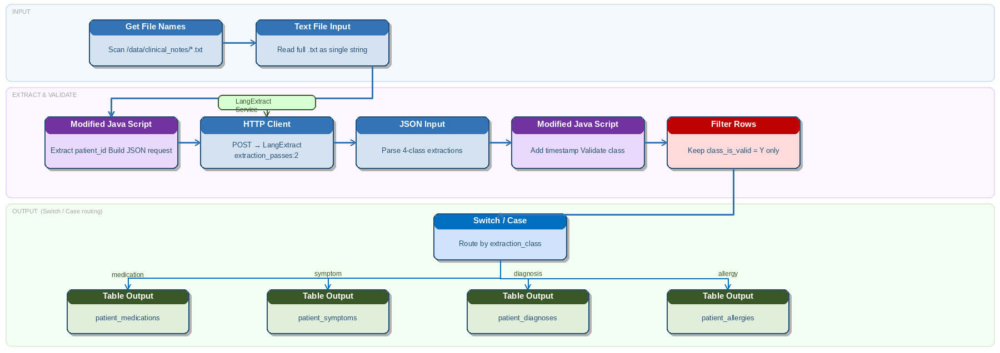

# Clinical Notes

> **Warning:**
>
> #### Workshop - Clinical Notes
>
> Use LangExtract to turn narrative clinical notes into structured medical facts, for coding, reconciliation and downstream review. You build a transformation that reads note files, calls the LangExtract service, and writes one staging row per fact.
>
> **What you'll do**
>
> * Read clinical note files with **Get file names** and **Text file input**
> * Build a LangExtract request with **Modified JavaScript value**
> * Call LangExtract through **REST client** and parse the extractions with **JSON input**
> * Keep the expected classes with **Filter rows** and load them with **Table output**
>
> **Prerequisites:**
>
> * [Support Tickets](../13-langextract-support-tickets/guide.md): the same request, call and parse, built step by step, and the LangExtract service started in its part 1
> * Ollama with `llama3.1:8b`, the model the request names
> * A PostgreSQL database for the staging table, with a Pentaho Data Integration connection to it (such as `PG:Helpdesk` from Support Tickets) and DBeaver (or `psql`)
>
> **Estimated time:** 35 minutes

<div align="center">
<figure>

<figcaption>The extraction flow; this page loads all four classes into one staging table, where the diagram splits them</figcaption>
</figure>
</div>

> **Note:**
>
> #### Business Case
>
> Northbridge NHS Foundation Trust runs eight hospitals and 34 outpatient clinics. Clinical staff produce about 3,200 encounter notes per day, and key facts such as medications, diagnoses, symptoms and allergies are buried in the narrative text.

This workshop ships no files and no solution. You build the transformation from the design and the settings on this page, and read your own copy of the sample note. The transformation is `clinical_notes.ktr`:

| # | Step | Does |
| --- | --- | --- |
| 1 | **Get file names** | Lists every note file in the notes folder (the design uses `/data/clinical_notes/`) |
| 2 | **Text file input** | Reads each file into `note_text` |
| 3 | **Modified JavaScript value** | Builds `patient_id` and `request_json` |
| 4 | **REST client** | Calls LangExtract |
| 5 | **JSON input** | Parses one row per extraction |
| 6 | **Filter rows** | Drops unknown classes |
| 7 | **Table output** | Writes to `staging.patient_extractions` |

The original design adds a second **Modified JavaScript value** between **JSON input** and **Filter rows**, for `patient_id` and validation flags. This page leaves it out: `patient_id` comes from the first script, and **Filter rows** checks the class itself.

:::: tabs

### 1. Prepare

> **Note:**
>
> #### Prepare
>
> The transformation needs the LangExtract service and the model its request names, a note file to read, and the staging table it loads.

1. Start the LangExtract service and pull `llama3.1:8b`, as [Support Tickets](../13-langextract-support-tickets/guide.md) shows in part 1, steps 1 to 4. Then ask the service for its health:

::: tabs

### Windows (PowerShell)

```powershell
Invoke-RestMethod http://localhost:8765/health
```

### macOS / Linux

```bash
curl http://localhost:8765/health
```

:::

> **Success:** Checkpoint: `status` is `ok`, and `model_url` is `http://localhost:11434`.

2. Create a folder for the notes, and save this sample note in it as `NB-004821.txt`. The transformation reads every `.txt` file in the folder and takes the patient ID from the file name:

```text
Patient: Mary Johnson   DOB: 12/03/1965   MRN: NB-004821
Visit Date: 15/11/2024   Attending: Dr. Samuel Lee, Internal Medicine

Chief Complaint:
Patient presents with persistent fatigue, shortness of breath on exertion, and
occasional chest tightness over the past three weeks.

Medical History:
Known Type 2 Diabetes Mellitus diagnosed 2014, Hypertension since 2018,
Hyperlipidaemia. Non-smoker. Occasional alcohol.

Allergies:
Penicillin — rash and urticaria. Sulfa drugs — anaphylaxis.

Current Medications:
Metformin 1000mg twice daily with meals.
Lisinopril 10mg once daily in the morning.
Atorvastatin 40mg at bedtime.
Aspirin 81mg once daily.
```

3. Create the staging table. In DBeaver (or `psql`), connected to your PostgreSQL database, run:

```sql
CREATE SCHEMA IF NOT EXISTS staging;

CREATE TABLE staging.patient_extractions (
  id SERIAL PRIMARY KEY,
  patient_id VARCHAR(20),
  class VARCHAR(30),
  text TEXT,
  start INT,
  "end" INT,
  extracted_at TIMESTAMP DEFAULT NOW()
);
```

`end` is a reserved word in PostgreSQL, so the column name is in double quotes.

> **Success:** Checkpoint: the `staging` schema holds an empty `patient_extractions` table with the seven columns from `id` to `extracted_at`.

### 2. Read the Notes

> **Note:**
>
> #### Read the Notes
>
> **Get file names** lists the note files, and **Text file input** reads each one into a field, `note_text`, for the request.

1. Start Spoon with the **Start Pentaho Data Integration** button below, or from a terminal:

::: tabs

### Windows (PowerShell)

```powershell
Set-Location C:\Pentaho\design-tools\data-integration
.\spoon.bat
```

### macOS / Linux

```bash
cd ~/Pentaho/design-tools/data-integration
./spoon.sh
```

:::

<button data-launch="spoon" data-path="">Start Pentaho Data Integration</button>

2. Select **File > New > Transformation** (`Ctrl+N`).
3. Select **File > Save as** and save it as `clinical_notes.ktr` in a folder of your own, such as the one that holds your notes folder.
4. On the **Design** tab, open the **Input** folder and drag **Get file names** onto the canvas.
5. Double-click **Get file names**. On the **File** tab, enter the path of your notes folder in **File or directory**, set **Regular Expression** to `.*\.txt`, and select **Add**.
6. Select **OK**.
7. On the **Design** tab, open the **Input** folder and drag **Text file input** onto the canvas.
8. Create a hop from **Get file names** to **Text file input**: hold `Shift` and drag from one step to the other.
9. Double-click **Text file input**. Set it to read the files that **Get file names** lists, into one String field named `note_text`, and to pass the incoming `short_filename` field on: the next step builds `patient_id` from it.

> **Warning:** **Text file input** reads a file line by line, so a note of several lines arrives as several rows, and the service would get one line per request. To send each whole note in one request, read the files with **Load file content in memory** (in the **Input** folder), which reads each file into one row. This page defines no settings for either step; a run decides which one the design needs.

10. Select **OK**.

### 3. Build and Send the Request

> **Note:**
>
> #### Build and Send the Request
>
> **Modified JavaScript value** builds one request per note, **REST client** sends it to the service, and **JSON input** turns each reply into one row per extracted fact.

1. On the **Design** tab, open the **Scripting** folder and drag **Modified JavaScript value** onto the canvas.
2. Create a hop from **Text file input** to **Modified JavaScript value**.
3. Double-click **Modified JavaScript value**. Replace `//Script here` on the **Script 1** tab with this script:

```javascript
var patient_id = (short_filename + '').replace('.txt', '');

var few_shot = [{
  text: 'Patient takes Ramipril 5mg daily. Dizziness. CKD Stage 3. Allergic to NSAIDs.',
  extractions: [
    { extraction_class: 'medication', extraction_text: 'Ramipril 5mg daily' },
    { extraction_class: 'symptom', extraction_text: 'dizziness' },
    { extraction_class: 'diagnosis', extraction_text: 'CKD Stage 3' },
    { extraction_class: 'allergy', extraction_text: 'NSAIDs' }
  ]
}];

var request_json = JSON.stringify({
  text: note_text + '',
  prompt: 'Extract medications with dosage, symptoms, diagnoses, and allergies with reactions where present.',
  examples: few_shot,
  model_id: 'llama3.1:8b',
  max_char_buffer: 1200,
  extraction_passes: 2
});
```

4. Fill the **Fields** grid:

| Fieldname | Type |
| --- | --- |
| `patient_id` | String |
| `request_json` | String |

5. Select **OK**.
6. On the **Design** tab, open the **Lookup** folder and drag **REST client** onto the canvas.
7. Create a hop from **Modified JavaScript value** to **REST client**.
8. Double-click **REST client**. On the **General** tab, enter these settings:

| Setting | Value |
| --- | --- |
| **Application type** | `JSON` |
| **HTTP method** | `POST` |
| **URL** | `http://localhost:8765/extract` |
| **Body field** | `request_json` |
| **Result field name** | `response_json` |

The design also gives a connection timeout of `30000` ms and a socket timeout of `120000` ms. **REST client** in Pentaho Data Integration 11 has no timeout settings: **Connection timeout** and **Socket timeout** belong to the **HTTP post** step.

9. Select **OK**.
10. On the **Design** tab, open the **Input** folder and drag **JSON input** onto the canvas.
11. Create a hop from **REST client** to **JSON input**.
12. Double-click **JSON input**. On the **File** tab, select **Source is from a previous step**, and set **Select field** to `response_json`.
13. On the **Fields** tab, fill the **Fields** grid. `start` and `end` are Integer because the staging table's columns are:

| Name | Path | Type |
| --- | --- | --- |
| `class` | `$.extractions[*].class` | String |
| `text` | `$.extractions[*].text` | String |
| `start` | `$.extractions[*].start` | Integer |
| `end` | `$.extractions[*].end` | Integer |

14. Select **OK**.

> **Under the hood:**
>
> #### JSON input turns one reply into one row per extraction
>
> With **Source is from a previous step**, **JSON input** reads `response_json` from each incoming row and evaluates every path on it separately: `$.extractions[*].class` returns the class of every extraction, `$.extractions[*].text` every text, and so on. It pairs the lists by position into one row per extraction, and copies the incoming row's fields, `patient_id` among them, onto each. The lists must be the same length, or the step fails with a message that the data structure is not the same. The service returns all four keys for every extraction, with `start` and `end` as `null` when it has no offsets, so the lists line up.
>
> **Why it matters:** one request per note becomes one row per fact, and each fact still knows its patient, without a lookup or a join.

### 4. Validate and Load

> **Note:**
>
> #### Validate and Load
>
> Keep only the four expected classes, then write each fact to `staging.patient_extractions`.

1. On the **Design** tab, open the **Flow** folder and drag **Filter rows** onto the canvas.
2. Create a hop from **JSON input** to **Filter rows**.
3. Double-click **Filter rows**. In **The condition**, select `<field>` on the left and select `class`.
4. Select the function in the middle of the condition (it shows `=`), then select `IN LIST`.
5. Select `<value>`. In the **Enter value** dialog, set **Type** to `String` and **Value** to `medication;symptom;diagnosis;allergy`, then select **OK**.
6. Select **OK**.
7. On the **Design** tab, open the **Output** folder and drag **Table output** onto the canvas.
8. Create a hop from **Filter rows** to **Table output** and select **Result is TRUE**. Rows of any other class have no step to go to, so **Filter rows** discards them.
9. Double-click **Table output**. Set **Connection** to your PostgreSQL connection, **Target schema** to `staging` and **Target table** to `patient_extractions`.
10. Select **Specify database fields**. On the **Database fields** tab, fill the grid. `id` and `extracted_at` are left to the table's defaults:

| Table field | Stream field |
| --- | --- |
| `patient_id` | `patient_id` |
| `class` | `class` |
| `text` | `text` |
| `start` | `start` |
| `end` | `end` |

11. Select **OK**.

### 5. Run and Validate

> **Note:**
>
> #### Run and Validate
>
> Run the transformation with the service running, then read the facts back from the staging table. The run waits on the model for every request.

1. Save the transformation (`Ctrl+S`).
2. Press `F9` (**Action > Run**), and select **Run** in the **Run Options** dialog.
3. In **Execution Results**, open the **Step Metrics** tab.

> **Success:** Checkpoint: **Get file names** writes 1 row, one per note file. **JSON input** writes one row per extraction, and **Table output** one row for each that passed **Filter rows**; how many depends on the model.

4. In DBeaver, run:

```sql
SELECT patient_id, class, text
FROM staging.patient_extractions
ORDER BY patient_id, class;
```

> **Success:** Checkpoint: rows for `NB-004821` only, each with a `class` of `allergy`, `diagnosis`, `medication` or `symptom` and a `text` taken from the note, such as a medication with its dose. Which facts the model finds varies from run to run.

5. Clinical notes often repeat a fact. Look for duplicates; deduplicate on `patient_id`, `class`, `text`, `start` and `end`. In DBeaver, run:

```sql
SELECT patient_id, class, text, start, "end", COUNT(*)
FROM staging.patient_extractions
GROUP BY patient_id, class, text, start, "end"
HAVING COUNT(*) > 1;
```

> **Success:** Checkpoint: one row for each fact stored more than once, with its count; no rows means no duplicates.

::::

## Lab Files

Click a file to download. For `.ktr` and `.kjb` files, **Open in Pentaho Data Integration** launches Pentaho Data Integration with the file loaded. If Pentaho Data Integration is already running, the path is copied to your clipboard — switch to Pentaho Data Integration and press `Ctrl+O`, `Ctrl+V`, `Enter`.

_No bundled files for this lab._
