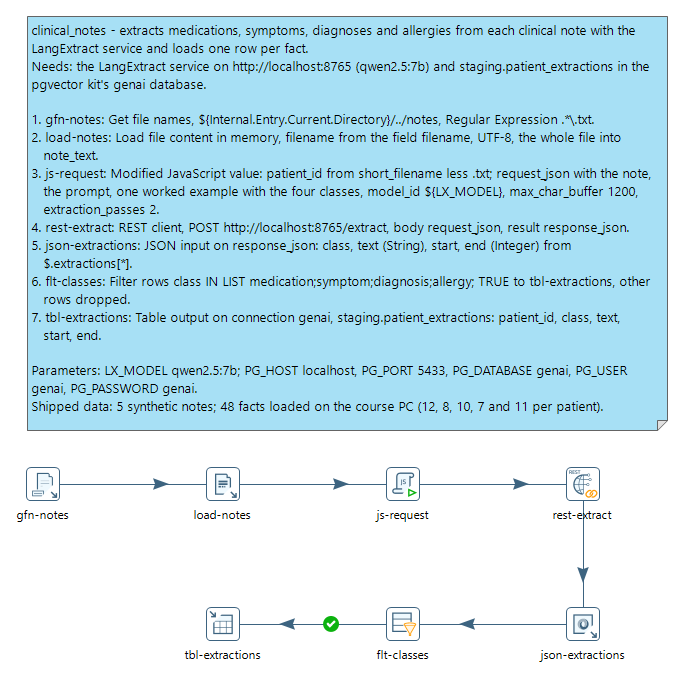

# Clinical Notes

> **Warning:**
>
> #### Workshop - Clinical Notes
>
> Use LangExtract to turn narrative clinical notes into structured medical facts, for coding, reconciliation and downstream review. You build a transformation that reads five note files, calls the LangExtract service, and writes one staging row per fact, with the place in the note it came from.
>
> **What you'll do**
>
> * Create the staging table in the course's PostgreSQL
> * List the note files with **Get file names** and read each whole note with **Load file content in memory**
> * Build a LangExtract request with **Modified JavaScript value** and send it with **REST client**
> * Parse the extractions with **JSON input**, keep the expected classes with **Filter rows**, and load them with **Table output**
>
> **Prerequisites:**
>
> * [Support Tickets](../13-langextract-support-tickets/guide.md): the same request, call and parse, built step by step
> * The LangExtract service running on `http://localhost:8765` with Ollama and `qwen2.5:7b`, as the [Overview](../12-langextract/guide.md) page sets up
> * The pgvector lab kit's PostgreSQL running (container `pcm-pgvector`, port `5433`), as set up in [Before You Start](../00-before-you-start/guide.md)
>
> **Estimated time:** 40 minutes

<figure>

<figcaption class="pcm-video-caption">Walkthrough: coming soon</figcaption>

</figure>

<div align="center">
<figure>

<figcaption>What you build: the steps of clinical_notes.ktr, the service they call, and where each fact goes</figcaption>
</figure>
</div>

> **Note:**
>
> #### Business Case
>
> Northbridge Health runs eight hospitals and 34 outpatient clinics. Clinical staff produce about 3,200 encounter notes per day, and key facts such as medications, diagnoses, symptoms and allergies are buried in the narrative text.

The workshop folder holds five synthetic notes in `notes`, one file per patient, named after the patient's record number: `NB-004821.txt` to `NB-005884.txt`. The patients are fictional. Each note has a chief complaint, a medical history, allergies, current medications, and an assessment or a plan.

:::: tabs

### 1. Prepare

> **Note:**
>
> #### Prepare
>
> Check that the service answers, and create the staging table the transformation loads.

1. Make sure the LangExtract service is running in its own PowerShell window, as **Start the LangExtract Service** on the [Overview](../12-langextract/guide.md) page shows. In a second PowerShell window, run:

```powershell
Invoke-RestMethod http://localhost:8765/health
```

> **Success:** Checkpoint: `status` is `ok`, `model` is `qwen2.5:7b` and `model_url` is `http://localhost:11434`.

2. Open `psql` inside the lab kit's container. In PowerShell, run:

```powershell
podman exec -it pcm-pgvector psql -U genai -d genai
```

3. Paste this SQL at the `genai=#` prompt and press `Enter`:

```sql
CREATE SCHEMA IF NOT EXISTS staging;

CREATE TABLE staging.patient_extractions (
  id SERIAL PRIMARY KEY,
  patient_id VARCHAR(20),
  class VARCHAR(30),
  text TEXT,
  start INT,
  "end" INT,
  extracted_at TIMESTAMP DEFAULT NOW()
);
```

`end` is a reserved word in PostgreSQL, so the column name is in double quotes.

> **Success:** Checkpoint: `psql` answers `CREATE SCHEMA` and `CREATE TABLE`. `\d staging.patient_extractions` lists the seven columns from `id` to `extracted_at`.

4. Enter `\q` to leave `psql`.

### 2. Read the Notes

> **Note:**
>
> #### Read the Notes
>
> Create the transformation with its parameters and connection, list the note files with **Get file names**, and read each whole file into one field, `note_text`, with **Load file content in memory**.

1. Start Spoon with the **Start Pentaho Data Integration** button below, or from PowerShell:

```powershell
Set-Location C:\Pentaho\design-tools\data-integration
.\Spoon.bat
```

<button data-launch="spoon" data-path="">Start Pentaho Data Integration</button>

2. Select **File > New > Transformation** (`Ctrl+N`).
3. Select **File > Save as** and save it as `clinical_notes.ktr` in `C:\Workshop-AI-Specialty\06-langextract\14-langextract-clinical-notes`, next to the `notes` folder. (On your own machine, download the five notes from **Lab Files** below into a `notes` folder beside the transformation.)
4. Double-click an empty part of the canvas. **Transformation properties** opens.
5. Open the **Parameters** tab and fill the grid:

| Parameter | Default Value | Description |
| --- | --- | --- |
| `LX_MODEL` | `qwen2.5:7b` | Ollama model the LangExtract service runs |
| `PG_HOST` | `localhost` | pgvector host (lab kit: localhost) |
| `PG_PORT` | `5433` | pgvector port (lab kit: 5433; 5432 is the Pentaho repository) |
| `PG_DATABASE` | `genai` | Database |
| `PG_USER` | `genai` | User |
| `PG_PASSWORD` | `genai` | Password |

6. Select **OK**.
7. Select **File > New > Database Connection**. Enter these settings, selecting **PostgreSQL** in the **Connection type** list and **Native (JDBC)** in the **Access** list. With the parameters' defaults, the connection goes to the lab kit: host `localhost`, port `5433`, database `genai`, user `genai`, password `genai`:

| Setting | Value |
| --- | --- |
| **Connection name** | `genai` |
| **Connection type** | **PostgreSQL** |
| **Access** | **Native (JDBC)** |
| **Host Name** | `${PG_HOST}` |
| **Database Name** | `${PG_DATABASE}` |
| **Port Number** | `${PG_PORT}` |
| **Username** | `${PG_USER}` |
| **Password** | `${PG_PASSWORD}` |

8. Select **Test**, then **OK** on the message, and **OK** to close **Database Connection**.

> **Success:** Checkpoint: the message reads `Connection to genai was successful.`

9. On the **Design** tab, open the **Input** folder and drag **Get file names** onto the canvas.
10. Double-click **Get file names**. Set **Step name** to `gfn-notes`.
11. On the **File** tab, enter `${Internal.Entry.Current.Directory}/notes` in **File or directory**, set **Regular Expression** to `.*\.txt`, and select **Add**.
12. Select **Show filename(s)...**.

> **Success:** Checkpoint: five files, `NB-004821.txt`, `NB-005107.txt`, `NB-005392.txt`, `NB-005660.txt` and `NB-005884.txt`, in the `notes` folder.

13. Select **Close**, then **OK**.
14. On the **Design** tab, open the **Input** folder and drag **Load file content in memory** onto the canvas.
15. Create a hop from **gfn-notes** to **Load file content in memory**: hold `Shift` and drag from one step to the other.
16. Double-click **Load file content in memory**. Set **Step name** to `load-notes`.
17. On the **File** tab, select **Filename is defined in a field?** and set **Get filename from field** to `filename`.
18. On the **Content** tab, set **Encoding** to `UTF-8`.
19. On the **Fields** tab, fill the grid with one row: **Name** `note_text`, **Element** `File content`, **Type** `String`.
20. Select **OK**.
21. Select **load-notes** on the canvas, press `F10` (**Action > Preview**), and select **Quick Launch**.

> **Success:** Checkpoint: 5 rows, one per note. Each has the fields of **gfn-notes**, among them `filename` and `short_filename` (`NB-004821.txt` first), and `note_text`, the whole note, which starts `SYNTHETIC TRAINING RECORD`.

22. Select **Close**.

> **Under the hood:**
>
> #### One file becomes one row, so one note becomes one request
>
> **Text file input** reads a file line by line, so a note of twenty lines would arrive as twenty rows, and the service would get one line per request, without the context around it. **Load file content in memory** reads the file named in each incoming row in one go, into a single field, and adds it to that row, so `short_filename` and the other fields of **gfn-notes** travel with the note.
>
> **Why it matters:** LangExtract does its own chunking, with `max_char_buffer` and extraction passes. Give it the whole document and let it decide where to cut.

### 3. Build and Send the Request

> **Note:**
>
> #### Build and Send the Request
>
> **Modified JavaScript value** builds one request per note, **REST client** sends it to the service, and **JSON input** turns each reply into one row per extracted fact.

1. On the **Design** tab, open the **Scripting** folder and drag **Modified JavaScript value** onto the canvas.
2. Create a hop from **load-notes** to **Modified JavaScript value**.
3. Double-click **Modified JavaScript value**. Set **Step name** to `js-request`, and replace `//Script here` on the **Script 1** tab with this script:

```javascript
var patient_id = (short_filename + '').replace('.txt', '');

var few_shot = [{
  text: 'Patient takes Ramipril 5mg daily. Complains of dizziness. Known CKD stage 3. Allergic to NSAIDs.',
  extractions: [
    { extraction_class: 'medication', extraction_text: 'Ramipril 5mg daily' },
    { extraction_class: 'symptom', extraction_text: 'dizziness' },
    { extraction_class: 'diagnosis', extraction_text: 'CKD stage 3' },
    { extraction_class: 'allergy', extraction_text: 'NSAIDs' }
  ]
}];

var request_json = JSON.stringify({
  text: note_text + '',
  prompt: 'Extract medications with their dose, symptoms, diagnoses, and allergies. ' +
          'Use the exact words of the note. Use only the classes medication, symptom, diagnosis and allergy.',
  examples: few_shot,
  model_id: getVariable('LX_MODEL', 'qwen2.5:7b'),
  max_char_buffer: 1200,
  extraction_passes: 2
});
```

4. Fill the **Fields** grid:

| Fieldname | Rename to | Type | Replace value 'Fieldname' or 'Rename to' |
| --- | --- | --- | --- |
| `patient_id` | `patient_id` | String | N |
| `request_json` | `request_json` | String | N |

5. Select **OK**.
6. On the **Design** tab, open the **Lookup** folder and drag **REST client** onto the canvas.
7. Create a hop from **js-request** to **REST client**.
8. Double-click **REST client**. Set **Step name** to `rest-extract`. On the **General** tab, enter these settings:

| Setting | Value |
| --- | --- |
| **Application type** | `JSON` |
| **HTTP method** | `POST` |
| **URL** | `http://localhost:8765/extract` |
| **Body field** | `request_json` |
| **Result field name** | `response_json` |

9. Select **OK**.
10. On the **Design** tab, open the **Input** folder and drag **JSON input** onto the canvas.
11. Create a hop from **rest-extract** to **JSON input**.
12. Double-click **JSON input**. Set **Step name** to `json-extractions`. On the **File** tab, select **Source is from a previous step**, and set **Select field** to `response_json`.
13. On the **Content** tab, make sure **Ignore missing path** and **Default path leaf to null** are selected.
14. On the **Fields** tab, fill the **Fields** grid. `start` and `end` are Integer, to match the staging table's `INT` columns:

| Name | Path | Type |
| --- | --- | --- |
| `class` | `$.extractions[*].class` | String |
| `text` | `$.extractions[*].text` | String |
| `start` | `$.extractions[*].start` | Integer |
| `end` | `$.extractions[*].end` | Integer |

15. Select **OK**.

> **Under the hood:**
>
> #### JSON input turns one reply into one row per extraction
>
> With **Source is from a previous step**, **JSON input** reads `response_json` from each incoming row and evaluates every path on it separately: `$.extractions[*].class` returns the class of every extraction, `$.extractions[*].text` every text, and so on. It pairs the lists by position into one row per extraction, and copies the incoming row's fields, `patient_id` among them, onto each. The service returns all four keys for every extraction, with `start` and `end` as `null` when LangExtract could not find the text in the note, so the lists always line up.
>
> **Why it matters:** one request per note becomes one row per fact, and each fact still knows its patient, without a lookup or a join.

### 4. Validate and Load

> **Note:**
>
> #### Validate and Load
>
> Keep only the four expected classes, then write each fact to `staging.patient_extractions`.

1. On the **Design** tab, open the **Flow** folder and drag **Filter rows** onto the canvas.
2. Create a hop from **json-extractions** to **Filter rows**.
3. On the **Design** tab, open the **Output** folder and drag **Table output** onto the canvas.
4. Create a hop from **Filter rows** to **Table output** and select **Result is TRUE**.
5. Double-click **Filter rows**. Set **Step name** to `flt-classes`. **Send 'true' data to step** reads `Table output`; leave **Send 'false' data to step** empty.
6. In **The condition**, select `<field>` on the left and select `class`.
7. Select the function in the middle of the condition (it shows `=`), then select `IN LIST`.
8. Select `<value>`. In the **Enter value** dialog, set **Type** to `String` and **Value** to `medication;symptom;diagnosis;allergy`, then select **OK**.
9. Select **OK**.
10. Double-click **Table output**. Set **Step name** to `tbl-extractions`, **Connection** to `genai`, **Target schema** to `staging` and **Target table** to `patient_extractions`.
11. Select **Specify database fields**. On the **Database fields** tab, fill the grid. `id` and `extracted_at` are left to the table's defaults:

| Table field | Stream field |
| --- | --- |
| `patient_id` | `patient_id` |
| `class` | `class` |
| `text` | `text` |
| `start` | `start` |
| `end` | `end` |

12. Select **OK**, and save the transformation (`Ctrl+S`).

> **Under the hood:**
>
> #### A row with no hop to take is dropped, by design
>
> **flt-classes** sends a row whose condition is true to **tbl-extractions**. A false row has no step to go to, so **Filter rows** discards it and counts nothing as an error. `IN LIST` compares the whole value with each item of the semicolon-separated list. When **Table output** writes `end`, Pentaho Data Integration quotes the column name, because `END` is in its list of PostgreSQL reserved words.
>
> **Why it matters:** the prompt asks for four classes, but a model can still invent a fifth, such as `procedure`. The filter is the contract on the table's side: nothing that is not one of the four reaches it.

### 5. Run and Validate

> **Note:**
>
> #### Run and Validate
>
> Run the transformation with the service running, then read the facts back from the staging table. The run waits on the model for every note: about 50 seconds for the five on a machine with a GPU.

1. Press `F9` (**Action > Run**), and select **Run** in the **Run Options** dialog.
2. In **Execution Results**, open the **Step Metrics** tab.

> **Success:** Checkpoint: no step shows an error. **gfn-notes**, **load-notes**, **js-request** and **rest-extract** each write 5 rows. **json-extractions** writes one row per extraction: 48 in each of two runs on the course PC, which the model decides. **flt-classes** passed all of them, so **tbl-extractions** writes the same number.

3. Open `psql` (`podman exec -it pcm-pgvector psql -U genai -d genai`) and run:

```sql
SELECT patient_id, COUNT(*) AS facts
FROM staging.patient_extractions
GROUP BY patient_id
ORDER BY patient_id;
```

> **Success:** Checkpoint: 5 rows. On the course PC: `NB-004821` 12, `NB-005107` 8, `NB-005392` 10, `NB-005660` 7 and `NB-005884` 11.

4. Look at one patient's facts:

```sql
SELECT class, text, start, "end"
FROM staging.patient_extractions
WHERE patient_id = 'NB-004821'
ORDER BY start;
```

> **Success:** Checkpoint: 12 rows on the course PC, in the order they appear in the note: three symptoms from `persistent fatigue` (start `234`), three diagnoses from `Type 2 Diabetes Mellitus diagnosed 2014`, the allergies `Penicillin - rash and urticaria` and `Sulfa drugs - anaphylaxis`, and four medications from `Metformin 1000mg twice daily with meals` to `Aspirin 81mg once daily`. Every row has a `start` and an `end`.

5. Read the facts the model got wrong. Run:

```sql
SELECT patient_id, class, text
FROM staging.patient_extractions
WHERE text ILIKE 'No known%' OR text ILIKE '%culture%';
```

> **Success:** Checkpoint: on the course PC, 2 rows: `NB-005660` `allergy` `No known drug allergies`, and `NB-005884` `medication` `Urine culture sent`. Both are words the note contains, in the wrong class: grounding proves where a value came from, not that its class is right.

6. Clinical notes often repeat a fact, and two extraction passes can find it twice. Look for duplicates:

```sql
SELECT patient_id, class, text, start, "end", COUNT(*)
FROM staging.patient_extractions
GROUP BY patient_id, class, text, start, "end"
HAVING COUNT(*) > 1;
```

> **Success:** Checkpoint: one row for each fact stored more than once, with its count. On the course PC it returned no rows: LangExtract keeps the first of two overlapping extractions.

7. Enter `\q` to leave `psql`. Each run adds its rows again: to start over, run `TRUNCATE staging.patient_extractions;` in `psql` first.

::::

## Troubleshooting <!-- no-step -->

<details>
<summary>gfn-notes finds no files</summary>

The transformation is not saved next to the `notes` folder, or it is not saved at all: `${Internal.Entry.Current.Directory}` is the folder of the saved file. Save it in `C:\Workshop-AI-Specialty\06-langextract\14-langextract-clinical-notes`.

</details>

<details>
<summary>tbl-extractions fails on column end</summary>

The table was created without the double quotes around `end`, or the stream field is named differently. Drop the table and create it again with the SQL of part 1.

</details>

<details>
<summary>json-extractions writes no rows</summary>

Select **rest-extract** on the canvas and open the **Preview data** tab. A `response_json` that starts `{"detail":"langextract failed:` names the cause; `{"extractions":[]}` means the model answered in a form LangExtract could not read. See the [Overview](../12-langextract/guide.md) page's troubleshooting.

</details>

## Lab Files

Click a file to download. For `.ktr` and `.kjb` files, **Open in Pentaho Data Integration** launches Pentaho Data Integration with the file loaded. If Pentaho Data Integration is already running, the path is copied to your clipboard — switch to Pentaho Data Integration and press `Ctrl+O`, `Ctrl+V`, `Enter`.

The five synthetic clinical notes the transformation reads, all fictional patients. Save them in a `notes` folder:

[NB-004821.txt](./files/notes/NB-004821.txt)

[NB-005107.txt](./files/notes/NB-005107.txt)

[NB-005392.txt](./files/notes/NB-005392.txt)

[NB-005660.txt](./files/notes/NB-005660.txt)

[NB-005884.txt](./files/notes/NB-005884.txt)

### Solution <!-- no-step -->

The finished transformation for this lab. Open it alongside your own to compare, or run it to see the expected result. It reads the notes from the `notes` folder beside the `solution` folder and loads `staging.patient_extractions`, which part 1 creates, through its own `genai` connection; the LangExtract service must be running.

Also on disk at `C:\Workshop-AI-Specialty\06-langextract\14-langextract-clinical-notes\solution`.

[clinical_notes.ktr](./files/solution/clinical_notes.ktr) <button data-launch="spoon" data-path="files/solution/clinical_notes.ktr">Open in Pentaho Data Integration</button> <button data-graph="files/solution/clinical_notes.ktr">View graph</button>

clinical_notes in Spoon, with its note:

<div align="center">
<figure>

<figcaption>clinical_notes.ktr in Spoon</figcaption>
</figure>
</div>
