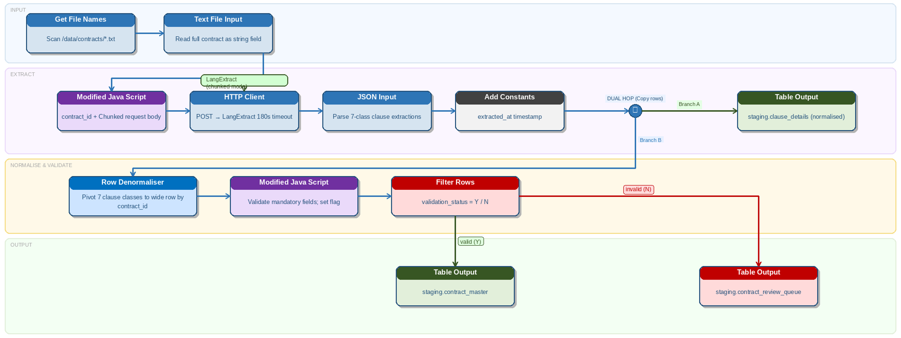

# Contract Documents

> **Warning:**
>
> #### Workshop - Contract Documents
>
> Use LangExtract to pull critical legal and commercial terms from long contracts, for due diligence, review queues and clause indexing. You build a transformation that reads contract files, calls LangExtract to extract key clauses, and writes both normalized clause rows and one wide master row per contract to staging.
>
> **What you'll do**
>
> * Read contract `*.txt` files and load each into a `contract_text` field
> * Build a `request_json` payload with few-shot examples and multiple extraction passes
> * Call LangExtract with **REST client** and parse the reply with **JSON input**
> * Write normalized clause rows to `staging.clause_details`
> * Pivot the extracted classes into a wide row and route valid contracts to `staging.contract_master`
>
> **Prerequisites:**
>
> * [Support Tickets](../13-langextract-support-tickets/guide.md): the same request, call, parse and pivot, built step by step, and the LangExtract service started in its part 1
> * Ollama with `llama3.1:8b`, the model the request names
> * A PostgreSQL database for the staging tables, with a Pentaho Data Integration connection to it (such as `PG:Helpdesk` from Support Tickets) and DBeaver (or `psql`)
>
> **Estimated time:** 35 minutes

<div align="center">
<figure>

<figcaption>One stream, two branches: a row per clause, and a wide row per contract that is validated before it loads</figcaption>
</figure>
</div>

> **Note:**
>
> #### Business Case
>
> Meridian Capital Partners reviews about 220 contracts per quarter. Documents range from 8 to 140 pages, and key terms such as liability caps and governing law appear in inconsistent locations.

This workshop ships no files and no solution. You build the transformation from the design and the settings on this page, and read your own copy of the sample contract. The transformation is `langextract_contracts.ktr`:

| # | Step | Does |
| --- | --- | --- |
| 1 | **Get file names** | Lists every `*.txt` contract (the design uses `/data/contracts/`) |
| 2 | **Text file input** | Loads each file into `contract_text` |
| 3 | **Modified JavaScript value** | Builds `contract_id` and `request_json` |
| 4 | **REST client** | Calls LangExtract |
| 5 | **JSON input** | Parses one row per clause |
| 6 | **Get system info** | Stamps `extracted_at` |
| 7 | **Table output** | Writes normalized clause rows to `staging.clause_details` |
| 8 | **Row denormaliser** | Pivots the target classes into one wide row per contract |
| 9 | **Modified JavaScript value** | Validates the required fields |
| 10 | **Filter rows** | Routes valid rows to `staging.contract_master` and the rest to `staging.contract_review_queue` |

The two branches are:

* **Branch A: clause details.** One row per extraction in `staging.clause_details`: `contract_id`, `class`, `text`, `start`, `end` and `extracted_at`.
* **Branch B: contract master.** One wide row per contract in `staging.contract_master`: `contract_id`, `party_a`, `party_b`, `effective_date`, `termination`, `payment_terms`, `liability_cap`, `governing_law`, `validation_status` and `extracted_at`.

:::: tabs

### 1. Prepare

> **Note:**
>
> #### Prepare
>
> The transformation needs the LangExtract service and the model its request names, a contract file to read, and the three staging tables it loads.

1. Start the LangExtract service and pull `llama3.1:8b`, as [Support Tickets](../13-langextract-support-tickets/guide.md) shows in part 1, steps 1 to 4. Then ask the service for its health:

::: tabs

### Windows (PowerShell)

```powershell
Invoke-RestMethod http://localhost:8765/health
```

### macOS / Linux

```bash
curl http://localhost:8765/health
```

:::

> **Success:** Checkpoint: `status` is `ok`, and `model_url` is `http://localhost:11434`.

2. Create a folder for the contracts, and save this sample contract text in it as `contract-001.txt`. The transformation reads every `.txt` file in the folder and takes the contract ID from the file name:

```text
SERVICE AGREEMENT

This Service Agreement ("Agreement") is entered into as of 1st January 2025
("Effective Date") by and between:

Acme Corporation Ltd ... ("Service Provider")
and
GlobalTech Holdings PLC ... ("Client").

The Service Provider shall provide software development and consultancy services.
This Agreement shall commence on the Effective Date and continue for 24 months.
```

3. Create the staging tables. In DBeaver (or `psql`), connected to your PostgreSQL database, run:

```sql
CREATE SCHEMA IF NOT EXISTS staging;

CREATE TABLE staging.clause_details (
  id SERIAL PRIMARY KEY,
  contract_id VARCHAR(50),
  class VARCHAR(50),
  text TEXT,
  start INT,
  "end" INT,
  extracted_at TIMESTAMP DEFAULT NOW()
);

CREATE TABLE staging.contract_master (
  contract_id VARCHAR(50) PRIMARY KEY,
  party_a TEXT,
  party_b TEXT,
  effective_date VARCHAR(100),
  termination TEXT,
  payment_terms TEXT,
  liability_cap TEXT,
  governing_law TEXT,
  validation_status CHAR(1) DEFAULT 'Y',
  extracted_at TIMESTAMP DEFAULT NOW()
);

CREATE TABLE staging.contract_review_queue (LIKE staging.contract_master INCLUDING DEFAULTS);
```

`end` is a reserved word in PostgreSQL, so the column name is in double quotes. The review queue has the master table's columns, without its primary key.

> **Success:** Checkpoint: the `staging` schema holds three empty tables: `clause_details`, `contract_master` and `contract_review_queue`.

### 2. Read the Contracts

> **Note:**
>
> #### Read the Contracts
>
> **Get file names** lists the contract files, and **Text file input** loads each one into a field, `contract_text`, for the request.

1. Start Spoon with the **Start Pentaho Data Integration** button below, or from a terminal:

::: tabs

### Windows (PowerShell)

```powershell
Set-Location C:\Pentaho\design-tools\data-integration
.\spoon.bat
```

### macOS / Linux

```bash
cd ~/Pentaho/design-tools/data-integration
./spoon.sh
```

:::

<button data-launch="spoon" data-path="">Start Pentaho Data Integration</button>

2. Select **File > New > Transformation** (`Ctrl+N`).
3. Select **File > Save as** and save it as `langextract_contracts.ktr` in a folder of your own, such as the one that holds your contracts folder.
4. On the **Design** tab, open the **Input** folder and drag **Get file names** onto the canvas.
5. Double-click **Get file names**. On the **File** tab, enter the path of your contracts folder in **File or directory**, set **Regular Expression** to `.*\.txt`, and select **Add**.
6. Select **OK**.
7. On the **Design** tab, open the **Input** folder and drag **Text file input** onto the canvas.
8. Create a hop from **Get file names** to **Text file input**: hold `Shift` and drag from one step to the other.
9. Double-click **Text file input**. Set it to read the files that **Get file names** lists, into one String field named `contract_text`, and to pass the incoming `short_filename` field on: the next step builds `contract_id` from it.

> **Warning:** **Text file input** reads a file line by line, so a contract arrives as many rows, and the service would get one line per request. To send each whole contract in one request, read the files with **Load file content in memory** (in the **Input** folder), which reads each file into one row. This page defines no settings for either step; a run decides which one the design needs.

10. Select **OK**.

### 3. Build and Send the Request

> **Note:**
>
> #### Build and Send the Request
>
> **Modified JavaScript value** builds one request per contract, with a worked example and two extraction passes; **REST client** sends it, and **JSON input** turns each reply into one row per clause.

1. On the **Design** tab, open the **Scripting** folder and drag **Modified JavaScript value** onto the canvas.
2. Create a hop from **Text file input** to **Modified JavaScript value**.
3. Double-click **Modified JavaScript value**. Replace `//Script here` on the **Script 1** tab with this script:

```javascript
var contract_id = (short_filename + '').replace('.txt', '');

var few_shot = [{
  text: 'Agreement between Acme Ltd and BetaCorp PLC as of 1 March 2024. Terminate with 60 days notice. Payment within 30 days. Liability capped at £250,000. Governed by laws of England.',
  extractions: [
    { extraction_class: 'party_a', extraction_text: 'Acme Ltd' },
    { extraction_class: 'party_b', extraction_text: 'BetaCorp PLC' },
    { extraction_class: 'effective_date', extraction_text: '1 March 2024' },
    { extraction_class: 'termination', extraction_text: '60 days notice' },
    { extraction_class: 'payment_terms', extraction_text: 'Payment within 30 days' },
    { extraction_class: 'liability_cap', extraction_text: '£250,000' },
    { extraction_class: 'governing_law', extraction_text: 'laws of England' }
  ]
}];

var request_json = JSON.stringify({
  text: contract_text + '',
  prompt: 'Extract party_a, party_b, effective_date, termination, payment_terms, liability_cap, and governing_law.',
  examples: few_shot,
  model_id: 'llama3.1:8b',
  max_char_buffer: 1500,
  overlap: 200,
  extraction_passes: 2
});
```

> **Tip:** Long contracts need chunk overlap. If clauses are split at chunk boundaries, increase `overlap` before you move to a larger model.

4. Fill the **Fields** grid:

| Fieldname | Type |
| --- | --- |
| `contract_id` | String |
| `request_json` | String |

5. Select **OK**.

> **Under the hood:**
>
> #### The service drops any tuning option its LangExtract version does not accept
>
> Before it calls `lx.extract`, the service reads that function's signature and keeps only the options it accepts among `max_char_buffer`, `overlap` and `extraction_passes`. An option the installed version does not know is left out without an error, and so is one the request leaves out or sets to `null`. The request also names its own model, `llama3.1:8b`, which takes the place of the service's default.
>
> **Why it matters:** if raising `overlap` changes nothing, check which LangExtract version the service runs before you rework the prompt. In the service's folder, `.\.venv\Scripts\pip show langextract` (`.venv/bin/pip show langextract` on macOS / Linux) prints it.

6. On the **Design** tab, open the **Lookup** folder and drag **REST client** onto the canvas.
7. Create a hop from **Modified JavaScript value** to **REST client**.
8. Double-click **REST client**. On the **General** tab, enter these settings:

| Setting | Value |
| --- | --- |
| **Application type** | `JSON` |
| **HTTP method** | `POST` |
| **URL** | `http://localhost:8765/extract` |
| **Body field** | `request_json` |
| **Result field name** | `response_json` |

The design also gives a connection timeout of `30000` ms and a socket timeout of `180000` ms. **REST client** in Pentaho Data Integration 11 has no timeout settings: **Connection timeout** and **Socket timeout** belong to the **HTTP post** step.

9. Select **OK**.
10. On the **Design** tab, open the **Input** folder and drag **JSON input** onto the canvas.
11. Create a hop from **REST client** to **JSON input**.
12. Double-click **JSON input**. On the **File** tab, select **Source is from a previous step**, and set **Select field** to `response_json`.
13. On the **Fields** tab, fill the **Fields** grid. `start` and `end` are Integer because the staging table's columns are:

| Name | Path | Type |
| --- | --- | --- |
| `class` | `$.extractions[*].class` | String |
| `text` | `$.extractions[*].text` | String |
| `start` | `$.extractions[*].start` | Integer |
| `end` | `$.extractions[*].end` | Integer |

14. Select **OK**.

### 4. Clause Rows

> **Note:**
>
> #### Clause Rows
>
> Branch A: stamp each clause row with the time of the run and write it to `staging.clause_details`, one row per extraction.

1. On the **Design** tab, open the **Input** folder and drag **Get system info** onto the canvas.
2. Create a hop from **JSON input** to **Get system info**.
3. Double-click **Get system info**. Fill the **Fields** grid with one row: **Name** `extracted_at`, **Type** `system date (variable)`.
4. Select **OK**. The design names **Add constants** for this step, but **Add constants** adds values you type, the same on every row, so it cannot stamp the time of the run.
5. On the **Design** tab, open the **Output** folder and drag **Table output** onto the canvas.
6. Create a hop from **Get system info** to **Table output**.
7. Double-click **Table output**. Set **Step name** to `clause_details`, **Connection** to your PostgreSQL connection, **Target schema** to `staging` and **Target table** to `clause_details`.
8. Select **Specify database fields**. On the **Database fields** tab, fill the grid:

| Table field | Stream field |
| --- | --- |
| `contract_id` | `contract_id` |
| `class` | `class` |
| `text` | `text` |
| `start` | `start` |
| `end` | `end` |
| `extracted_at` | `extracted_at` |

9. Select **OK**.

### 5. Contract Master

> **Note:**
>
> #### Contract Master
>
> Branch B: pivot each contract's clauses into one wide row, mark whether the required terms are present, and route the row to the master table or the review queue.

1. On the **Design** tab, open the **Transform** folder and drag **Row denormaliser** onto the canvas.
2. Create a hop from **Get system info** to **Row denormaliser**. When Spoon asks, select **Copy**: both branches get every row.
3. Double-click **Row denormaliser**. Set **The key field** to `class`.
4. Fill **The fields that make up the grouping** grid with one row: **Group field** `contract_id`.
5. Fill the **Target fields** grid. Leave the other columns empty:

| Target fieldname | Value fieldname | Key value | Type |
| --- | --- | --- | --- |
| `party_a` | `text` | `party_a` | String |
| `party_b` | `text` | `party_b` | String |
| `effective_date` | `text` | `effective_date` | String |
| `termination` | `text` | `termination` | String |
| `payment_terms` | `text` | `payment_terms` | String |
| `liability_cap` | `text` | `liability_cap` | String |
| `governing_law` | `text` | `governing_law` | String |

6. Select **OK**. If Spoon shows a **Notice** that the incoming data should be sorted on the grouping fields, select **Close**: the rows of one contract arrive together, as they leave **JSON input**.
7. On the **Design** tab, open the **Scripting** folder and drag **Modified JavaScript value** onto the canvas.
8. Create a hop from **Row denormaliser** to the new **Modified JavaScript value**.
9. Double-click it. Replace `//Script here` on the **Script 1** tab with this script, which sets `validation_status` to `Y` only when `party_a`, `party_b`, `effective_date` and `governing_law` all have a value:

```javascript
var validation_status = (party_a != null && party_b != null &&
    effective_date != null && governing_law != null) ? 'Y' : 'N';
```

10. Fill the **Fields** grid with one row: **Fieldname** `validation_status`, **Type** `String`.
11. Select **OK**.
12. On the **Design** tab, open the **Flow** folder and drag **Filter rows** onto the canvas.
13. Create a hop from the second **Modified JavaScript value** to **Filter rows**.
14. From the **Output** folder, drag two **Table output** steps onto the canvas. Name one `contract_master` and the other `contract_review_queue`: double-click each, set **Step name**, and select **OK**.
15. Create a hop from **Filter rows** to **contract_master** and select **Result is TRUE**. Create a hop from **Filter rows** to **contract_review_queue** and select **Result is FALSE**.
16. Double-click **Filter rows**. In **The condition**, select `<field>` on the left and select `validation_status`. Keep the function, `=`.
17. Select `<value>`. In the **Enter value** dialog, set **Type** to `String` and **Value** to `Y`, then select **OK**. Select **OK** to close **Filter rows**.
18. Double-click **contract_master**. Set **Connection** to your PostgreSQL connection, **Target schema** to `staging` and **Target table** to `contract_master`.
19. Select **Specify database fields**. On the **Database fields** tab, fill the grid. `extracted_at` is left to the table's default:

| Table field | Stream field |
| --- | --- |
| `contract_id` | `contract_id` |
| `party_a` | `party_a` |
| `party_b` | `party_b` |
| `effective_date` | `effective_date` |
| `termination` | `termination` |
| `payment_terms` | `payment_terms` |
| `liability_cap` | `liability_cap` |
| `governing_law` | `governing_law` |
| `validation_status` | `validation_status` |

20. Select **OK**.
21. Double-click **contract_review_queue** and set it up the same way, with **Target table** `contract_review_queue` and the same field grid. Select **OK**.

### 6. Run and Validate

> **Note:**
>
> #### Run and Validate
>
> Run the transformation with the service running, then read both branches back from staging. `contract_id` is the primary key of `staging.contract_master`, so to run again with the same file, empty that table first.

1. Save the transformation (`Ctrl+S`).
2. Press `F9` (**Action > Run**), and select **Run** in the **Run Options** dialog.
3. In **Execution Results**, open the **Step Metrics** tab.

> **Success:** Checkpoint: **Get file names** writes 1 row, one per contract file. **JSON input** writes one row per extraction, and **clause_details** writes the same number. **Row denormaliser** writes 1 row, and **Filter rows** sends it to **contract_master** or to **contract_review_queue**. How many clauses the model finds varies from run to run.

4. In DBeaver, run:

```sql
SELECT contract_id, class, text
FROM staging.clause_details
ORDER BY contract_id, class;
```

> **Success:** Checkpoint: rows for `contract-001` only, each with one of the seven classes and a `text` taken from the contract, such as a party's name. Which clauses the model finds varies from run to run.

5. Look at the wide row. In DBeaver, run:

```sql
SELECT contract_id, party_a, party_b, effective_date, liability_cap, governing_law
FROM staging.contract_master
ORDER BY contract_id;
```

> **Success:** Checkpoint: one row for `contract-001` only if the model returned both parties, the effective date and the governing law, with the extracted terms in their columns. The sample text names no governing law, so unless the model supplies one, this query returns no rows.

6. In DBeaver, run:

```sql
SELECT contract_id, party_a, party_b, effective_date, governing_law, validation_status
FROM staging.contract_review_queue
ORDER BY contract_id;
```

> **Success:** Checkpoint: `contract-001` appears here, with `validation_status` `N`, exactly when it is not in `staging.contract_master`. The empty columns show which required terms the model did not find.

::::

## Lab Files

Click a file to download. For `.ktr` and `.kjb` files, **Open in Pentaho Data Integration** launches Pentaho Data Integration with the file loaded. If Pentaho Data Integration is already running, the path is copied to your clipboard — switch to Pentaho Data Integration and press `Ctrl+O`, `Ctrl+V`, `Enter`.

_No bundled files for this lab._
