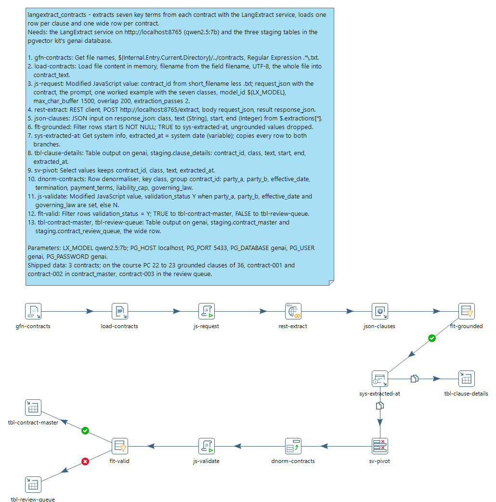

# Contract Documents

> **Warning:**
>
> #### Workshop - Contract Documents
>
> Use LangExtract to pull critical legal and commercial terms from contracts, for due diligence, review queues and clause indexing. You build a transformation that reads three contract files, calls LangExtract to extract seven key terms, keeps only the terms it can find in the text, and writes both clause rows and one wide row per contract to staging.
>
> **What you'll do**
>
> * Read each contract file whole with **Get file names** and **Load file content in memory**
> * Build a `request_json` payload with a worked example, chunk overlap and two extraction passes
> * Call LangExtract with **REST client**, parse the reply with **JSON input**, and drop ungrounded values with **Filter rows**
> * Write one row per clause to `staging.clause_details`
> * Pivot the clauses into one wide row per contract and route valid contracts to `staging.contract_master`, the rest to `staging.contract_review_queue`
>
> **Prerequisites:**
>
> * [Support Tickets](../13-langextract-support-tickets/guide.md) and [Clinical Notes](../14-langextract-clinical-notes/guide.md): the same request, call, parse and pivot, built step by step
> * The LangExtract service running on `http://localhost:8765` with Ollama and `qwen2.5:7b`, as the [Overview](../12-langextract/guide.md) page sets up
> * The pgvector lab kit's PostgreSQL running (container `pcm-pgvector`, port `5433`), as set up in [Before You Start](../00-before-you-start/guide.md)
>
> **Estimated time:** 50 minutes

<figure>

<figcaption class="pcm-video-caption">Walkthrough: coming soon</figcaption>

</figure>

<div align="center">
<figure>

<figcaption>One stream, two branches: a row per clause, and a wide row per contract that is validated before it loads</figcaption>
</figure>
</div>

> **Note:**
>
> #### Business Case
>
> Meridian Capital Partners reviews about 220 contracts per quarter. Documents range from 8 to 140 pages, and key terms such as liability caps and governing law appear in inconsistent places.

The workshop folder holds three sample contracts in `contracts`, between fictional parties:

| File | Contract | What it has |
| --- | --- | --- |
| `contract-001.txt` | Service Agreement, Acme Software Ltd and Brightwater Holdings PLC | All seven terms, in nine numbered clauses |
| `contract-002.txt` | Master Subscription Agreement, Halcyon Cloud Services Inc. and Copperleaf Retail Group LLC | All seven terms; the liability cap is a formula, not an amount |
| `contract-003.txt` | Equipment Maintenance Agreement (draft), Redfern Industrial Services Pty Ltd and Marlow Valley Water Authority | No commencement date and no governing law: both are "to be confirmed" |

The transformation writes two branches:

* **Branch A: clause details.** One row per grounded extraction in `staging.clause_details`: `contract_id`, `class`, `text`, `start`, `end` and `extracted_at`.
* **Branch B: contract master.** One wide row per contract: `contract_id`, `party_a`, `party_b`, `effective_date`, `termination`, `payment_terms`, `liability_cap`, `governing_law`, `validation_status` and `extracted_at`, in `staging.contract_master` when the four required terms are there, and in `staging.contract_review_queue` when they are not.

:::: tabs

### 1. Prepare

> **Note:**
>
> #### Prepare
>
> Check that the service answers, and create the three staging tables the transformation loads.

1. Make sure the LangExtract service is running in its own PowerShell window, as **Start the LangExtract Service** on the [Overview](../12-langextract/guide.md) page shows. In a second PowerShell window, run:

```powershell
Invoke-RestMethod http://localhost:8765/health
```

> **Success:** Checkpoint: `status` is `ok`, `model` is `qwen2.5:7b` and `model_url` is `http://localhost:11434`.

2. Open `psql` inside the lab kit's container. In PowerShell, run:

```powershell
podman exec -it pcm-pgvector psql -U genai -d genai
```

3. Paste this SQL at the `genai=#` prompt and press `Enter`:

```sql
CREATE SCHEMA IF NOT EXISTS staging;

CREATE TABLE staging.clause_details (
  id SERIAL PRIMARY KEY,
  contract_id VARCHAR(50),
  class VARCHAR(50),
  text TEXT,
  start INT,
  "end" INT,
  extracted_at TIMESTAMP DEFAULT NOW()
);

CREATE TABLE staging.contract_master (
  contract_id VARCHAR(50) PRIMARY KEY,
  party_a TEXT,
  party_b TEXT,
  effective_date VARCHAR(100),
  termination TEXT,
  payment_terms TEXT,
  liability_cap TEXT,
  governing_law TEXT,
  validation_status CHAR(1) DEFAULT 'Y',
  extracted_at TIMESTAMP DEFAULT NOW()
);

CREATE TABLE staging.contract_review_queue (LIKE staging.contract_master INCLUDING DEFAULTS);
```

`end` is a reserved word in PostgreSQL, so the column name is in double quotes. The review queue has the master table's columns, without its primary key. If you did the Clinical Notes workshop, `psql` says the `staging` schema already exists and skips it.

> **Success:** Checkpoint: `psql` answers `CREATE TABLE` three times. `\dt staging.*` lists `clause_details`, `contract_master` and `contract_review_queue`.

4. Enter `\q` to leave `psql`.

### 2. Read the Contracts

> **Note:**
>
> #### Read the Contracts
>
> Create the transformation with its parameters and connection, list the contract files with **Get file names**, and read each whole file into `contract_text` with **Load file content in memory**.

1. Start Spoon with the **Start Pentaho Data Integration** button below, or from PowerShell:

```powershell
Set-Location C:\Pentaho\design-tools\data-integration
.\Spoon.bat
```

<button data-launch="spoon" data-path="">Start Pentaho Data Integration</button>

2. Select **File > New > Transformation** (`Ctrl+N`).
3. Select **File > Save as** and save it as `langextract_contracts.ktr` in `C:\Workshop-AI-Specialty\06-langextract\15-langextract-contract-documents`, next to the `contracts` folder. (On your own machine, download the three contracts from **Lab Files** below into a `contracts` folder beside the transformation.)
4. Double-click an empty part of the canvas. **Transformation properties** opens.
5. Open the **Parameters** tab and fill the grid:

| Parameter | Default Value | Description |
| --- | --- | --- |
| `LX_MODEL` | `qwen2.5:7b` | Ollama model the LangExtract service runs |
| `PG_HOST` | `localhost` | pgvector host (lab kit: localhost) |
| `PG_PORT` | `5433` | pgvector port (lab kit: 5433; 5432 is the Pentaho repository) |
| `PG_DATABASE` | `genai` | Database |
| `PG_USER` | `genai` | User |
| `PG_PASSWORD` | `genai` | Password |

6. Select **OK**.
7. Select **File > New > Database Connection**. Enter these settings, selecting **PostgreSQL** in the **Connection type** list and **Native (JDBC)** in the **Access** list. With the parameters' defaults, the connection goes to the lab kit: host `localhost`, port `5433`, database `genai`, user `genai`, password `genai`:

| Setting | Value |
| --- | --- |
| **Connection name** | `genai` |
| **Connection type** | **PostgreSQL** |
| **Access** | **Native (JDBC)** |
| **Host Name** | `${PG_HOST}` |
| **Database Name** | `${PG_DATABASE}` |
| **Port Number** | `${PG_PORT}` |
| **Username** | `${PG_USER}` |
| **Password** | `${PG_PASSWORD}` |

8. Select **Test**, then **OK** on the message, and **OK** to close **Database Connection**.

> **Success:** Checkpoint: the message reads `Connection to genai was successful.`

9. On the **Design** tab, open the **Input** folder and drag **Get file names** onto the canvas.
10. Double-click **Get file names**. Set **Step name** to `gfn-contracts`.
11. On the **File** tab, enter `${Internal.Entry.Current.Directory}/contracts` in **File or directory**, set **Regular Expression** to `.*\.txt`, and select **Add**. Select **OK**.
12. On the **Design** tab, open the **Input** folder and drag **Load file content in memory** onto the canvas.
13. Create a hop from **gfn-contracts** to **Load file content in memory**: hold `Shift` and drag from one step to the other.
14. Double-click **Load file content in memory**. Set **Step name** to `load-contracts`.
15. On the **File** tab, select **Filename is defined in a field?** and set **Get filename from field** to `filename`.
16. On the **Content** tab, set **Encoding** to `UTF-8`.
17. On the **Fields** tab, fill the grid with one row: **Name** `contract_text`, **Element** `File content`, **Type** `String`.
18. Select **OK**.
19. Select **load-contracts** on the canvas, press `F10` (**Action > Preview**), and select **Quick Launch**.

> **Success:** Checkpoint: 3 rows, `contract-001.txt` to `contract-003.txt` in `short_filename`, each with the whole contract in `contract_text`.

20. Select **Close**.

### 3. Build and Send the Request

> **Note:**
>
> #### Build and Send the Request
>
> **Modified JavaScript value** builds one request per contract, with a worked example, chunk overlap and two extraction passes; **REST client** sends it, and **JSON input** turns each reply into one row per clause.

1. On the **Design** tab, open the **Scripting** folder and drag **Modified JavaScript value** onto the canvas.
2. Create a hop from **load-contracts** to **Modified JavaScript value**.
3. Double-click **Modified JavaScript value**. Set **Step name** to `js-request`, and replace `//Script here` on the **Script 1** tab with this script:

```javascript
var contract_id = (short_filename + '').replace('.txt', '');

var few_shot = [{
  text: 'This agreement is made on 1 March 2024 between Acme Ltd ("Supplier") and BetaCorp PLC ("Buyer"). ' +
        'Either party may terminate with 60 days notice. Payment is due within 30 days of invoice. ' +
        'Liability is capped at GBP 250,000. This agreement is governed by the laws of England.',
  extractions: [
    { extraction_class: 'effective_date', extraction_text: '1 March 2024' },
    { extraction_class: 'party_a', extraction_text: 'Acme Ltd' },
    { extraction_class: 'party_b', extraction_text: 'BetaCorp PLC' },
    { extraction_class: 'termination', extraction_text: 'terminate with 60 days notice' },
    { extraction_class: 'payment_terms', extraction_text: 'Payment is due within 30 days of invoice' },
    { extraction_class: 'liability_cap', extraction_text: 'GBP 250,000' },
    { extraction_class: 'governing_law', extraction_text: 'the laws of England' }
  ]
}];

var request_json = JSON.stringify({
  text: contract_text + '',
  prompt: 'Extract party_a (the first party named), party_b (the second party named), effective_date, ' +
          'termination, payment_terms, liability_cap, and governing_law. Use the exact words of the contract. ' +
          'If a term is not in the contract, leave it out: do not use placeholder values such as "none", ' +
          '"not specified" or "N/A".',
  examples: few_shot,
  model_id: getVariable('LX_MODEL', 'qwen2.5:7b'),
  max_char_buffer: 1500,
  overlap: 200,
  extraction_passes: 2
});
```

4. Fill the **Fields** grid:

| Fieldname | Rename to | Type | Replace value 'Fieldname' or 'Rename to' |
| --- | --- | --- | --- |
| `contract_id` | `contract_id` | String | N |
| `request_json` | `request_json` | String | N |

5. Select **OK**.

> **Under the hood:**
>
> #### A contract longer than max_char_buffer is read in chunks, with the end of the one before
>
> The contracts are 1,220 to 2,446 characters long, so with `max_char_buffer` `1500` LangExtract cuts `contract-001` and `contract-002` into two chunks each, between sentences, and asks the model about each chunk on its own. The service passes `overlap` to LangExtract as `context_window_chars`, so each chunk goes to the model with the last 200 characters of the one before. `extraction_passes` `2` reads every chunk twice and keeps the first of two extractions that cover the same text.
>
> **Why it matters:** a clause that starts at the end of one chunk is still read in context in the next. A term the model cannot see in its chunk, such as the governing law while it reads clause 1, is where models invent placeholder values; the prompt forbids them, and part 4 drops any that get through.

6. On the **Design** tab, open the **Lookup** folder and drag **REST client** onto the canvas.
7. Create a hop from **js-request** to **REST client**.
8. Double-click **REST client**. Set **Step name** to `rest-extract`. On the **General** tab, enter these settings:

| Setting | Value |
| --- | --- |
| **Application type** | `JSON` |
| **HTTP method** | `POST` |
| **URL** | `http://localhost:8765/extract` |
| **Body field** | `request_json` |
| **Result field name** | `response_json` |

9. Select **OK**.
10. On the **Design** tab, open the **Input** folder and drag **JSON input** onto the canvas.
11. Create a hop from **rest-extract** to **JSON input**.
12. Double-click **JSON input**. Set **Step name** to `json-clauses`. On the **File** tab, select **Source is from a previous step**, and set **Select field** to `response_json`.
13. On the **Content** tab, make sure **Ignore missing path** and **Default path leaf to null** are selected.
14. On the **Fields** tab, fill the **Fields** grid. `start` and `end` are Integer, to match the staging table's `INT` columns:

| Name | Path | Type |
| --- | --- | --- |
| `class` | `$.extractions[*].class` | String |
| `text` | `$.extractions[*].text` | String |
| `start` | `$.extractions[*].start` | Integer |
| `end` | `$.extractions[*].end` | Integer |

15. Select **OK**.

### 4. Clause Rows

> **Note:**
>
> #### Clause Rows
>
> Branch A: keep only the extractions LangExtract found in the contract, stamp each row with the time of the run, and write it to `staging.clause_details`.

1. On the **Design** tab, open the **Flow** folder and drag **Filter rows** onto the canvas.
2. Create a hop from **json-clauses** to **Filter rows**.
3. On the **Design** tab, open the **Input** folder and drag **Get system info** onto the canvas.
4. Create a hop from **Filter rows** to **Get system info** and select **Result is TRUE**.
5. Double-click **Filter rows**. Set **Step name** to `flt-grounded`. **Send 'true' data to step** reads `Get system info`; leave **Send 'false' data to step** empty.
6. In **The condition**, select `<field>` on the left and select `start`. Select the function (it shows `=`), then select `IS NOT NULL`. Select **OK**.

> **Under the hood:**
>
> #### start is empty exactly when the value is not in the contract
>
> After the model answers, LangExtract looks for each extracted text in the chunk it came from and records where it found it, `start` and `end`. A value the model wrote itself, such as `not explicitly stated in the provided text`, is in no contract, so its `start` and `end` come back `null`. **flt-grounded** keeps the rows that have a `start`; the others have no hop to take and are dropped.
>
> **Why it matters:** without this filter, a placeholder from one chunk can overwrite a real value from another when **Row denormaliser** pivots the rows, and a contract would pass validation with `not explicitly stated` as its governing law. The match is fuzzy, though: a made-up value can still match a few characters of the text, so a stricter pipeline also compares `end - start` with the length of `text`.

7. Double-click **Get system info**. Set **Step name** to `sys-extracted-at`, and fill the **Fields** grid with one row: **Name** `extracted_at`, **Type** `system date (variable)`. Select **OK**.
8. On the **Design** tab, open the **Output** folder and drag **Table output** onto the canvas.
9. Create a hop from **sys-extracted-at** to **Table output**.
10. Double-click **Table output**. Set **Step name** to `tbl-clause-details`, **Connection** to `genai`, **Target schema** to `staging` and **Target table** to `clause_details`.
11. Select **Specify database fields**. On the **Database fields** tab, fill the grid:

| Table field | Stream field |
| --- | --- |
| `contract_id` | `contract_id` |
| `class` | `class` |
| `text` | `text` |
| `start` | `start` |
| `end` | `end` |
| `extracted_at` | `extracted_at` |

12. Select **OK**.

### 5. Contract Master

> **Note:**
>
> #### Contract Master
>
> Branch B: pivot each contract's clauses into one wide row, mark whether the required terms are present, and route the row to the master table or the review queue.

1. On the **Design** tab, open the **Transform** folder and drag **Select values** onto the canvas.
2. Create a hop from **sys-extracted-at** to **Select values**. When Spoon asks, select **Copy**: both branches get every row.
3. Double-click **Select values**. Set **Step name** to `sv-pivot`, and on the **Select & Alter** tab fill the **Fields** grid with four rows: `contract_id`, `class`, `text` and `extracted_at`. Select **OK**.
4. On the **Design** tab, open the **Transform** folder and drag **Row denormaliser** onto the canvas.
5. Create a hop from **sv-pivot** to **Row denormaliser**.
6. Double-click **Row denormaliser**. Set **Step name** to `dnorm-contracts` and **The key field** to `class`.
7. Fill **The fields that make up the grouping** grid with one row: **Group field** `contract_id`.
8. Fill the **Target fields** grid. Leave the other columns empty:

| Target fieldname | Value fieldname | Key value | Type |
| --- | --- | --- | --- |
| `party_a` | `text` | `party_a` | String |
| `party_b` | `text` | `party_b` | String |
| `effective_date` | `text` | `effective_date` | String |
| `termination` | `text` | `termination` | String |
| `payment_terms` | `text` | `payment_terms` | String |
| `liability_cap` | `text` | `liability_cap` | String |
| `governing_law` | `text` | `governing_law` | String |

9. Select **OK**. If Spoon shows a **Notice** that the incoming data should be sorted on the grouping fields, select **Close**: the rows of one contract arrive together, as they leave **json-clauses**.
10. On the **Design** tab, open the **Scripting** folder and drag **Modified JavaScript value** onto the canvas.
11. Create a hop from **dnorm-contracts** to the new **Modified JavaScript value**.
12. Double-click it. Set **Step name** to `js-validate`, and replace `//Script here` on the **Script 1** tab with this script, which sets `validation_status` to `Y` only when `party_a`, `party_b`, `effective_date` and `governing_law` all have a value:

```javascript
var validation_status = (party_a != null && party_b != null &&
    effective_date != null && governing_law != null) ? 'Y' : 'N';
```

13. Fill the **Fields** grid with one row: **Fieldname** `validation_status`, **Rename to** `validation_status`, **Type** `String`, **Replace value 'Fieldname' or 'Rename to'** `N`. Select **OK**.
14. On the **Design** tab, open the **Flow** folder and drag **Filter rows** onto the canvas.
15. Create a hop from **js-validate** to **Filter rows**.
16. From the **Output** folder, drag two **Table output** steps onto the canvas. Name one `tbl-contract-master` and the other `tbl-review-queue`: double-click each, set **Step name**, and select **OK**.
17. Create a hop from **Filter rows** to **tbl-contract-master** and select **Result is TRUE**. Create a hop from **Filter rows** to **tbl-review-queue** and select **Result is FALSE**.
18. Double-click **Filter rows**. Set **Step name** to `flt-valid`. In **The condition**, select `<field>` on the left and select `validation_status`. Keep the function, `=`.
19. Select `<value>`. In the **Enter value** dialog, set **Type** to `String` and **Value** to `Y`, then select **OK**. Select **OK** to close **Filter rows**.
20. Double-click **tbl-contract-master**. Set **Connection** to `genai`, **Target schema** to `staging` and **Target table** to `contract_master`.
21. Select **Specify database fields**. On the **Database fields** tab, fill the grid:

| Table field | Stream field |
| --- | --- |
| `contract_id` | `contract_id` |
| `party_a` | `party_a` |
| `party_b` | `party_b` |
| `effective_date` | `effective_date` |
| `termination` | `termination` |
| `payment_terms` | `payment_terms` |
| `liability_cap` | `liability_cap` |
| `governing_law` | `governing_law` |
| `validation_status` | `validation_status` |
| `extracted_at` | `extracted_at` |

22. Select **OK**.
23. Double-click **tbl-review-queue** and set it up the same way, with **Target table** `contract_review_queue` and the same field grid. Select **OK**, and save the transformation (`Ctrl+S`).

### 6. Run and Validate

> **Note:**
>
> #### Run and Validate
>
> Run the transformation with the service running, then read both branches back from staging. About 40 seconds for the three contracts on a machine with a GPU. `contract_id` is the primary key of `staging.contract_master`, so to run again, empty the tables first (step 6).

1. Press `F9` (**Action > Run**), and select **Run** in the **Run Options** dialog.
2. In **Execution Results**, open the **Step Metrics** tab.

> **Success:** Checkpoint: no step shows an error. **gfn-contracts** to **rest-extract** each write 3 rows. In two runs on the course PC **json-clauses** wrote 36 rows and **flt-grounded** kept 22 and 23 of them: the others were values the model made up, with no `start`. **sys-extracted-at** writes twice what **flt-grounded** kept, a copy of each row to each branch, and **tbl-clause-details** the same number as **flt-grounded**. **dnorm-contracts** writes 3 rows, one per contract; **tbl-contract-master** writes 2 and **tbl-review-queue** 1. The extraction counts are the model's, so they vary from run to run.

3. Open `psql` (`podman exec -it pcm-pgvector psql -U genai -d genai`) and run:

```sql
SELECT contract_id, class, LEFT(text, 60) AS text, start
FROM staging.clause_details
ORDER BY contract_id, start;
```

> **Success:** Checkpoint: one row per grounded clause, every one with a `start`. On the course PC: 7 or 8 rows for `contract-001`, 9 for `contract-002` (both parties appear twice, in the opening and in the signature line) and 6 for `contract-003`, which has no `effective_date`.

4. Look at the wide rows of the valid contracts:

```sql
SELECT contract_id, party_a, party_b, effective_date, LEFT(governing_law, 50) AS governing_law
FROM staging.contract_master
ORDER BY contract_id;
```

> **Success:** Checkpoint: 2 rows. `contract-001`: `Acme Software Ltd`, `Brightwater Holdings PLC`, `1 January 2025`, governed by the laws of England and Wales. `contract-002`: `Halcyon Cloud Services Inc.`, `Copperleaf Retail Group LLC`, `15 March 2025`, the laws of the State of New York. The `liability_cap` of `contract-001` is the weak spot: in one run on the course PC it was empty, in the other it was `A: [Not specified]`, a made-up value that LangExtract matched to a single character of the contract, so it passed **flt-grounded**.

5. Look at the review queue:

```sql
SELECT contract_id, party_a, effective_date, governing_law, validation_status
FROM staging.contract_review_queue;
```

> **Success:** Checkpoint: 1 row, `contract-003`, with `validation_status` `N` and no `effective_date`. Its `governing_law` is `to be confirmed by the Authority's legal team before signature`: grounded words from the draft, but no governing law. The check found the missing date; a person in the review queue reads the rest.

6. To run the transformation again, empty the three tables first:

```sql
TRUNCATE staging.clause_details, staging.contract_master, staging.contract_review_queue;
```

7. Enter `\q` to leave `psql`.

::::

## Troubleshooting <!-- no-step -->

<details>
<summary>tbl-contract-master fails with a duplicate key</summary>

The table still holds the rows of an earlier run, and `contract_id` is its primary key. Empty the tables as step 6 of part 6 shows, and run again.

</details>

<details>
<summary>Every contract goes to the review queue</summary>

Preview **dnorm-contracts**. If the term columns are all `<null>`, look at **json-clauses**: when every row has an empty `start`, the model answered with words that are not in the contracts, and **flt-grounded** dropped them all. Check that `LX_MODEL` is `qwen2.5:7b` or a larger model.

</details>

<details>
<summary>Raising overlap changes nothing</summary>

Check which LangExtract version the service runs. In the service's folder, `.\.venv\Scripts\python -m pip show langextract` prints it. The service passes `overlap` on as `context_window_chars` only when that version's `extract()` has the parameter; the course was checked with 1.7.2.

</details>

## Lab Files

Click a file to download. For `.ktr` and `.kjb` files, **Open in Pentaho Data Integration** launches Pentaho Data Integration with the file loaded. If Pentaho Data Integration is already running, the path is copied to your clipboard — switch to Pentaho Data Integration and press `Ctrl+O`, `Ctrl+V`, `Enter`.

The three sample contracts the transformation reads, between fictional parties. Save them in a `contracts` folder:

[contract-001.txt](./files/contracts/contract-001.txt)

[contract-002.txt](./files/contracts/contract-002.txt)

[contract-003.txt](./files/contracts/contract-003.txt)

### Solution <!-- no-step -->

The finished transformation for this lab. Open it alongside your own to compare, or run it to see the expected result. It reads the contracts from the `contracts` folder beside the `solution` folder and loads the three staging tables, which part 1 creates, through its own `genai` connection; the LangExtract service must be running.

Also on disk at `C:\Workshop-AI-Specialty\06-langextract\15-langextract-contract-documents\solution`.

[langextract_contracts.ktr](./files/solution/langextract_contracts.ktr) <button data-launch="spoon" data-path="files/solution/langextract_contracts.ktr">Open in Pentaho Data Integration</button> <button data-graph="files/solution/langextract_contracts.ktr">View graph</button>

langextract_contracts in Spoon, with its note:

<div align="center">
<figure>

<figcaption>langextract_contracts.ktr in Spoon</figcaption>
</figure>
</div>
