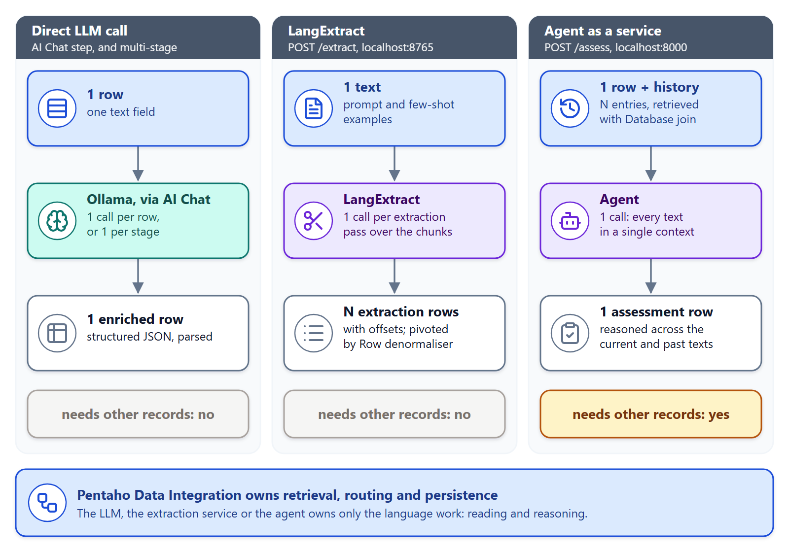
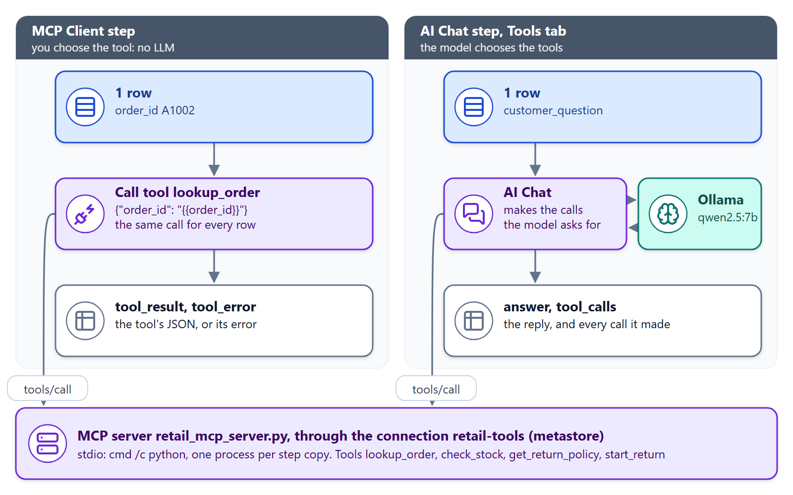

# Overview

This module goes beyond one prompt per row. The earlier workshops sent each row to a Large Language Model (LLM) with the **AI Chat** step: one prompt in, one answer out, a pure function of one row. Here you meet two ways to give a model more than the current row. An *agent as a service*: Pentaho Data Integration retrieves an asset's maintenance history and calls a deployed Python agent that reasons across all of it. And the *Model Context Protocol* (MCP): a standard way for Pentaho Data Integration, or a model, to call the tools of a server.

**What You'll Learn**

* What separates an agent from a direct LLM call or an extraction service
* Why the history is retrieved by Pentaho Data Integration, and the reasoning left to the agent
* What MCP is: servers that offer tools and resources, clients that list and call them
* The two ways Pentaho Data Integration uses MCP: the **MCP Client** step, and the **AI Chat** step's **Tools** tab
* The transports the plugin supports, and where its MCP connections are stored

:::: tabs

### 1. Agent as a Service

The test for whether something needs an agent: can Pentaho Data Integration produce the same result by adding more steps to the canvas? No standard step reads several free-text entries as a whole and judges what they mean together; that judgement is what the agent owns.

**The three approaches in this course:**

| | Direct LLM call / multi-stage | LangExtract | Agent as a service |
| --- | --- | --- | --- |
| What it does | Sends one prompt per row with **AI Chat**, returns structured JSON for that row | Extracts named values with character offsets from one text; returns one row per value | Reads the current entry and its retrieved history, reasons across all of them, returns one assessment |
| Input to the service | One text field from the row | One text field, a prompt and few-shot examples | The current log text and N history entries, retrieved by Pentaho Data Integration before the call |
| Output shape | One row in, one enriched row out | One row in, N extraction rows out, pivoted by **Row denormaliser** | One row in, one assessment row out |
| LLM calls per row | 1 (or a fixed number of stages) | 1 per extraction pass over the chunked text | 1: all the texts in a single context |
| Needs other records? | No: each row on its own | No: each document on its own | Yes: the history Pentaho Data Integration retrieves with **Database join** is essential |
| Decision grounded in | The current text | The current text, traced back by character offsets | The current text and the verified history in the database |
| Can Pentaho Data Integration steps replicate it? | Yes: **AI Chat**, chained for multi-stage | Partly: rules cover known formats; LangExtract handles variable ones | Not with standard steps: the cross-text reasoning is the agent's |
| Use when | Classifying, enriching or summarizing individual records | Extracting typed fields from free text where rules are too brittle | The assessment depends on what earlier records say, not only the current one |

<figure>

<figcaption>What goes in, what does the work and what comes out, for each approach</figcaption>
</figure>

Read the diagram down each column: what Pentaho Data Integration sends, the service that does the language work, and what comes back. Only the agent's column starts from more than the current row: Pentaho Data Integration retrieves the history first, with **Database join**, and sends it along, which is why only that column needs other records. The bar underneath holds for all three: retrieval, routing and persistence stay in Pentaho Data Integration.

> **Note:**
>
> #### The Scenario
>
> A maintenance team logs fault observations as free-text entries against industrial assets: one paragraph per entry, written by an engineer in the field, with no fixed schema or controlled vocabulary. Pentaho Data Integration reads these entries from a database table and must produce a priority assessment for each one. A complete assessment answers three questions:
>
> * What fault does this entry describe? (classification)
> * What has happened to this asset before? (history retrieval)
> * Is the current entry a new fault, an acceleration of a known pattern, or normal variation, given that history? (pattern reasoning)

The **Deploy & Run the Agent** workshop builds this: Pentaho Data Integration reads the entries and each asset's history from two SQLite databases, posts one request per entry to the agent with **REST client**, and routes each assessment by priority into a table. The agent makes one LLM call per entry and needs no tools of its own, because Pentaho Data Integration has already retrieved everything it needs.

### 2. Model Context Protocol

The Model Context Protocol (MCP) is an open protocol, built on JSON-RPC 2.0, between *MCP clients* and *MCP servers*. A server offers:

* **Tools**: functions a client can call, such as "look up an order" or "check stock". Each tool has a name, a description and a JSON schema for its arguments, and returns a result, usually text or JSON.
* **Resources**: content a client can read by URI, such as `retail://policies/shipping` or `file:///data/report.txt`.

A client connects, lists what the server offers, and calls a tool or reads a resource. Many products ship an MCP server today (issue trackers, file systems, databases), and a few lines of Python with the official SDK make your own, as the **MCP Tools** workshop's server shows. Prompts, sampling and elicitation, the protocol's other features, are not used by the plugin.

**Two ways Pentaho Data Integration uses MCP:**

| | **MCP Client** step | **AI Chat** step, **Tools** tab |
| --- | --- | --- |
| Who chooses the tool | You, in the step: the same tool for every row, or a tool name from a field | The model, for each row, from the tools' descriptions |
| Arguments | A JSON template with `{{field}}` placeholders, or a JSON object from a field | Built by the model from the message |
| LLM involved | No | Yes: a model with tool-calling support, such as `qwen2.5:7b` on Ollama |
| Operations | **List tools** (one row per tool), **Call tool**, **Read resource** | Offers the tools; the step makes the calls the model asks for, then the model answers |
| Output | `tool_result` and `tool_error`, or `tool_name`, `tool_description` and `tool_schema` | The model's answer, and optionally a **Tool calls field** with every call made |
| Use it when | You know which tool to call: lookups, enrichment, automation | The input is free text and the right tool depends on what it asks |

<figure>

<figcaption>The same server, called by the step you configure or by the model</figcaption>
</figure>

**Transports.** The plugin reaches a server in one of two ways:

| Transport | How it works | Use it for |
| --- | --- | --- |
| **Streamable HTTP** | Pentaho Data Integration posts to a server that is already running, at a URL that usually ends in `/mcp`, with optional HTTP headers such as `Authorization` | Shared and production servers, hosted MCP services, servers in containers |
| **Local process (stdio)** | The step starts the server as a child process and talks to it through its standard input and output: one process per step copy, stopped when the transformation ends | Servers that exist only as a local program, development, servers you would start with `npx`, `uvx` or `python` |

The legacy **HTTP + SSE** transport, an endpoint that usually ends in `/sse`, is **not supported**: use the server's Streamable HTTP endpoint, or run it locally over stdio. On Windows, start a stdio server through `cmd`, with `/c` as the first argument: launchers such as `npx.cmd` cannot be started as a process on their own.

**Connections live in the metastore, not in the `.ktr`.** You create an MCP connection once, from either step's **New...** button: its transport, URL or command and arguments, headers, environment variables, and **Allowed tools**. Pentaho Data Integration stores it in the metastore under your user profile, and a transformation refers to it only by name. So:

* A transformation runs only where its connection exists. On another machine, a Carte server or the Pentaho Server, create the connection there or copy the metastore, and install the runtime a stdio server needs, such as Python or Node.js.
* Header values and environment variables are stored encrypted and never logged; put secrets in `kettle.properties` and refer to them as `${VARIABLE}`.
* **Allowed tools** restricts every step that uses the connection: other tools are neither listed nor called, and **AI Chat** never offers them to the model. It is the place to keep a model away from tools that change data.

**Agents and tools.** The maintenance agent in this module gets everything in one request, because Pentaho Data Integration retrieves the history first. MCP tools suit the opposite case: when what to fetch depends on the text, a model can decide for itself, and the tool calls it makes are recorded. When you already know what to fetch, a deterministic **MCP Client** call, or a **Database join**, gives the same answer every run.

::::

***

## Workshops <!-- no-step -->

* [MCP Tools](../22-mcp-tools/guide.md): connect to the course's MCP server, list and call its tools with **MCP Client**, then let a model choose the tools with **AI Chat**.
* [Deploy & Run the Agent](../17-agent-deploy/guide.md): start the agent service, wire it into a Pentaho Data Integration transformation, run it, and review performance.
* [Project: Pentaho MCP Server](../29-project-pentaho-mcp/guide.md): build your own MCP server in front of Carte, in four milestones, and drive it from Pentaho Data Integration and from a desktop AI assistant. A longer, open-ended project, not assessed.
