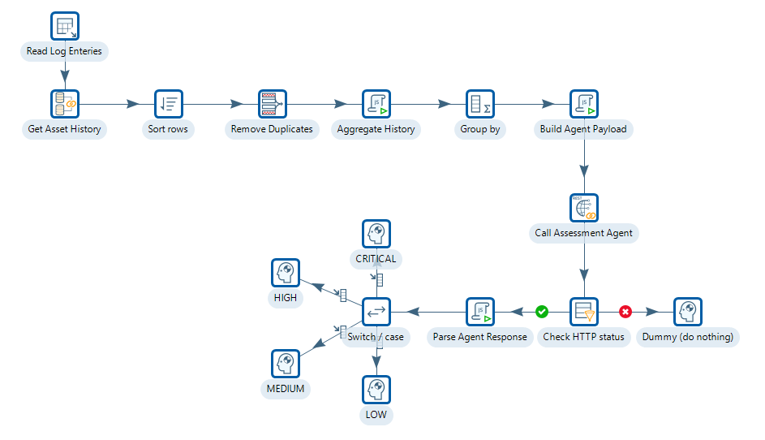
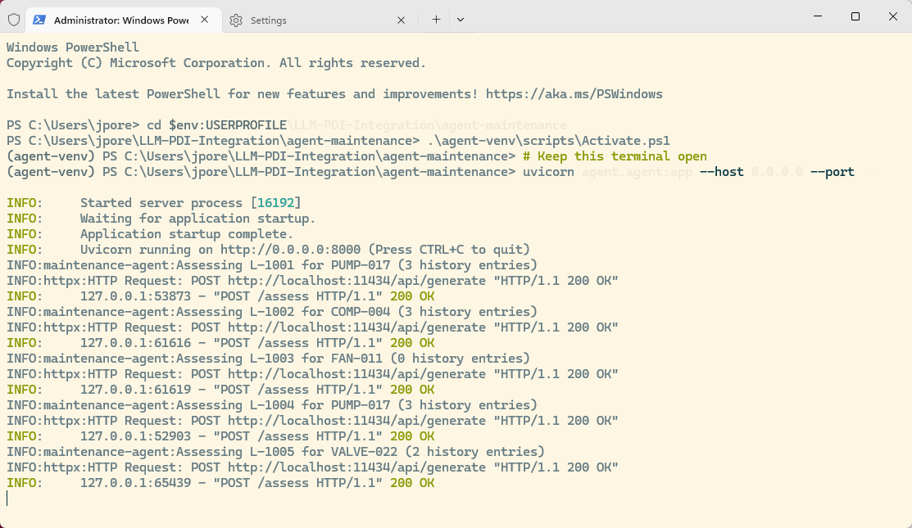

# Deploy & Run the Agent

> **Warning:**
>
> #### Workshop - Deploy & Run the Agent
>
> Start the maintenance assessment agent, a small Python service, and build a Pentaho Data Integration transformation that sends it each maintenance log entry together with the asset's history. Pentaho Data Integration reads, joins and routes the rows; the agent does the one task no rule can do: reason across several free-text entries at once.
>
> **What you'll do**
>
> * Set up the agent and start it on `localhost:8000`
> * Test the agent with one request, outside Pentaho Data Integration
> * Read the log entries and each asset's history from two SQLite databases
> * Build one request per log entry and send it to the agent with **REST client**
> * Route each assessment by priority into the `assessed_log` table
> * Compare your run with the performance figures
>
> **Prerequisites:**
>
> * The Agent-as-a-Service [Overview](../16-agent-as-a-service/guide.md)
> * Python 3.11 or later, and Ollama with `llama3.2:3b`, as set up in [Before You Start](../00-before-you-start/guide.md)
> * **REST client** and **Modified JavaScript value**, as used in [Sentiment Analysis](../06-llm-sentiment-analysis/guide.md)
>
> **Estimated time:** 90 minutes

:::: tabs

### 1. Start the Agent

> **Note:**
>
> #### Start the Agent
>
> The agent is a FastAPI service, `agent.py`, with one endpoint: `POST /assess`. Set it up once in its own Python environment, then start it and leave its terminal open while you work through this workshop.

On Windows, the lab's files are in `C:\Workshop-AI-Specialty\06-agent-as-a-service\17-agent-deploy\agent-maintenance`. On macOS / Linux, download the files from **Lab Files** below into a folder named `agent-maintenance`, keeping its `agent`, `data` and `scripts` subfolders.

1. In PowerShell, run the following (on macOS / Linux, run the `bash` commands in a terminal in the `agent-maintenance` folder you downloaded the lab files to):

::: tabs

### Windows (PowerShell)

```powershell
Set-Location C:\Workshop-AI-Specialty\06-agent-as-a-service\17-agent-deploy\agent-maintenance
Test-Path data\maintenance_log.db, data\asset_history.db
```

### macOS / Linux

```bash
ls data/maintenance_log.db data/asset_history.db
```

:::

> **Success:** Checkpoint: PowerShell prints `True` twice; on macOS / Linux, `ls` lists both files.

2. Create the agent's Python environment and install its four packages, `fastapi`, `uvicorn`, `httpx` and `pydantic`:

::: tabs

### Windows (PowerShell)

```powershell
python -m venv .venv
.\.venv\Scripts\python -m pip install -r requirements.txt
```

### macOS / Linux

```bash
python3 -m venv .venv
.venv/bin/python -m pip install -r requirements.txt
```

:::

> **Success:** Checkpoint: pip ends with a line that starts `Successfully installed` and names `fastapi`, `uvicorn`, `httpx` and `pydantic`, among the packages they depend on.

3. Check that Ollama answers and that the course model is pulled:

::: tabs

### Windows (PowerShell)

```powershell
Invoke-RestMethod http://localhost:11434
ollama list
```

### macOS / Linux

```bash
curl http://localhost:11434
ollama list
```

:::

> **Success:** Checkpoint: Ollama answers `Ollama is running`, and `ollama list` includes `llama3.2:3b`.

4. Start the agent. `agent.py` asks Ollama for `llama3.1:8b` unless the `AGENT_MODEL_NAME` environment variable names another model, so the first line points it at the course model. (To use the agent's own default instead, run `ollama pull llama3.1:8b` and leave out the first line.)

::: tabs

### Windows (PowerShell)

```powershell
$env:AGENT_MODEL_NAME = "llama3.2:3b"
.\.venv\Scripts\python -m uvicorn agent.agent:app --host 0.0.0.0 --port 8000
```

### macOS / Linux

```bash
export AGENT_MODEL_NAME=llama3.2:3b
.venv/bin/python -m uvicorn agent.agent:app --host 0.0.0.0 --port 8000
```

:::

> **Success:** Checkpoint: the terminal shows `Application startup complete.`, then `Uvicorn running on http://0.0.0.0:8000 (Press CTRL+C to quit)`.

5. Leave this terminal open: the agent answers Pentaho Data Integration's requests from it. Open a second PowerShell window (on macOS / Linux, a second terminal in the `agent-maintenance` folder) and run:

::: tabs

### Windows (PowerShell)

```powershell
Set-Location C:\Workshop-AI-Specialty\06-agent-as-a-service\17-agent-deploy\agent-maintenance
Invoke-RestMethod http://localhost:8000/health
```

### macOS / Linux

```bash
curl http://localhost:8000/health
```

:::

> **Success:** Checkpoint: the agent answers with `status` `ok` and `model` `llama3.2:3b`. `curl` shows it as `{"status":"ok","model":"llama3.2:3b"}`.

6. Open `http://localhost:8000/docs` in a web browser.

> **Success:** Checkpoint: the page is headed **Maintenance Assessment Agent**, version `1.0.0`, and lists two endpoints: `GET /health` and `POST /assess`.

### 2. The Boundary Argument

> **Note:**
>
> #### The Boundary Argument
>
> Pentaho Data Integration handles structured data with a wide range of steps, and some of them imitate parts of what an agent does: **Regex evaluation**, **Fuzzy match**, **Rules executor**. They find text that looks similar, not text that means the same thing. This part shows where that line falls for this workshop's data.

| Task | Pentaho Data Integration steps | Capability | Verdict |
| --- | --- | --- | --- |
| Extract a structured asset ID (for example `ASSET-0042`) | **Regex evaluation** | Extracts fixed-format patterns reliably | Pentaho Data Integration handles this |
| Look up an asset's history rows by `asset_id` | **Database lookup**, **Database join** | Exact key match; **Database join** returns every matching row | Pentaho Data Integration handles this |
| Classify the fault type from known keywords (`bearing`, `temperature`) | **Rules executor**; **Regex evaluation** with **Modified JavaScript value** | IF/THEN rules on keyword presence | Pentaho Data Integration handles known, listed faults |
| Fuzzy-match the current description against a library of known faults | **Fuzzy match** | Levenshtein or Jaro-Winkler distance between two strings | Pentaho Data Integration handles surface similarity, not meaning |
| Assign the final priority once the fault type is known | **Filter rows**, **Switch / case**, **Modified JavaScript value** | Deterministic routing on field values | Pentaho Data Integration handles this completely |

**Why Regex evaluation falls short.** "bearing noise getting worse" and "intermittent vibration on startup since maintenance" both point to bearing degradation. They share no keyword, no common word sequence and no pattern a regular expression can match. What they share is meaning, and a regular expression sees only the surface form of the text.

**Why Rules executor falls short.** A rule can fire on the keyword `bearing` in the current entry. It cannot conclude that this entry, read with two earlier entries about vibration and a bearing replacement 18 months ago, is a recurrence of the same root cause rather than a new fault. That conclusion means reading and combining four separate texts, and a rule tests the field values of the current row.

You could concatenate the history into one field and write a rule against that, but the rule still tests for keywords, not meaning. "No unusual noise but slight vibration" contains `vibration`, so a keyword rule treats it like "severe vibration on every startup". The negation and the qualifiers ("slight", "no unusual") change the meaning completely, and a rule cannot read them.

**Why Fuzzy match falls short.** **Fuzzy match** scores how alike two strings are, character by character. "Bearing noise" and "audible roughness in drive shaft" score low but mean the same thing; "bearing temperature normal" and "bearing temperature elevated" score high but mean the opposite. On maintenance text it produces false positives and false negatives at a rate that is not acceptable for safety-relevant prioritization.

**Why Modified JavaScript value falls short.** **Modified JavaScript value** can run any algorithm you can write in JavaScript: concatenate the history entries, count keywords, apply weighted scores. That is a rules system with extra steps, and it fails where rules fail: new descriptions, combined symptoms, qualified negations and patterns across entries. It manipulates strings; it does not understand language.

Take these four history entries for asset `PUMP-017`:

```text
2025-09-12: slight rumble on startup, clears after 2 minutes, logged for monitoring
2025-11-03: intermittent vibration under load, no temperature anomaly, bearing checked ok
2026-01-18: bearing replaced (scheduled maintenance)
2026-03-29: rougher than usual on startup, louder than before the January maintenance
```

> **Note:** Read together, the four entries say: RECURRENCE. Bearing symptoms have returned 10 weeks after the bearing was replaced, which is abnormally fast and points either to an incorrect installation or to a cause the January maintenance did not address. Priority: HIGH.
>
> None of the rule-based steps above produces this assessment. **Database join** returns the four history entries as rows, and **Modified JavaScript value** can concatenate them, but no rule-based step reads them together and concludes that the current entry matches the pattern from before January, and that its return within 10 weeks of a replacement is abnormal.
>
> That is the task the agent owns: read several unstructured history entries alongside a new one, and judge whether together they describe a known degradation pattern, a recurrence or a new fault. Pentaho Data Integration retrieves the history as structured rows; the agent reads the text and reasons about what it means. Everything else in the pipeline is Pentaho Data Integration.

### 3. Test the Agent

> **Note:**
>
> #### Test the Agent
>
> Pentaho Data Integration already knows each entry's `asset_id`, so it retrieves the history before it calls the agent, and the agent gets everything it needs in one request: one LLM call per log entry. Send it one request by hand first, so you know what Pentaho Data Integration gets back.

The pipeline you build in parts 4 to 6:

```text
PDI transformation                                    Agent (FastAPI, port 8000)

Table input                  read maintenance_log
Database join                fetch each asset's history rows
Sort rows, Unique rows,
Modified JavaScript value,
Group by                     one row per log entry, history as a JSON array
Modified JavaScript value    build the request body
REST client                  POST /assess  ------------>  read log_text and history
                                                          one LLM call to Ollama
Filter rows                  HTTP 200?     <------------  the assessment as JSON
Modified JavaScript value    parse the answer
Switch / case                route on priority
Table output (4 steps)       insert into assessed_log
```

|  | Pentaho Data Integration transformation | Maintenance assessment agent |
| --- | --- | --- |
| Owns | All data flow: retrieval, routing and persistence | Language understanding and reasoning across texts |
| Reads | Structured rows from the `maintenance_log` and `asset_history` tables | Unstructured text: the current log entry and its history entries |
| Produces | Structured rows with `priority`, `fault_type`, `pattern` and `assessment` fields | One structured JSON assessment per request |
| Uses | **Table input**, **Database join**, **Modified JavaScript value**, **REST client**, **Switch / case**, **Table output** | One LLM call with the history in the prompt; no tools |
| Can rules replace it? | Yes: all the Pentaho Data Integration logic is deterministic | No: reasoning about language does not reduce to rules |

1. In the second terminal, send the agent a test request for `PUMP-017` with three history entries. On a CPU, the answer can take 15 to 30 seconds or more.

::: tabs

### Windows (PowerShell)

```powershell
$body = @'
{
  "log_id": "TEST-001",
  "asset_id": "PUMP-017",
  "log_text": "Rougher than usual on startup, louder than before January maintenance",
  "history": [
    {"logged_at": "2025-09-12", "log_text": "slight rumble on startup"},
    {"logged_at": "2025-11-03", "log_text": "intermittent vibration under load"},
    {"logged_at": "2026-01-18", "log_text": "bearing replaced, WO-4412"}
  ]
}
'@
Invoke-RestMethod -Uri http://localhost:8000/assess -Method Post -ContentType "application/json" -Body $body
```

### macOS / Linux

```bash
curl -s -X POST http://localhost:8000/assess \
  -H "Content-Type: application/json" \
  -d '{
    "log_id": "TEST-001",
    "asset_id": "PUMP-017",
    "log_text": "Rougher than usual on startup, louder than before January maintenance",
    "history": [
      {"logged_at": "2025-09-12", "log_text": "slight rumble on startup"},
      {"logged_at": "2025-11-03", "log_text": "intermittent vibration under load"},
      {"logged_at": "2026-01-18", "log_text": "bearing replaced, WO-4412"}
    ]
  }'
```

:::

> **Success:** Checkpoint: the agent answers with seven keys: `log_id` `TEST-001`, `asset_id` `PUMP-017`, then `priority`, `fault_type`, `pattern`, `assessment` and `confidence`. In the agent's terminal, `Assessing TEST-001 for PUMP-017 (3 history entries)` is followed by `"POST /assess HTTP/1.1" 200 OK`.

2. Compare the answer with the history you sent. The values are the model's, so they vary from run to run; this is what each key holds:

| Key | What it holds |
| --- | --- |
| `priority` | `CRITICAL`, `HIGH`, `MEDIUM` or `LOW`. The prompt asks for `HIGH` when the current symptom is the same type as an earlier one, especially after a repair: here, roughness on startup after the bearing replacement |
| `fault_type` | A short `snake_case` label the model chooses, such as `bearing_degradation` |
| `pattern` | `RECURRENCE`, `ESCALATION`, `NEW_FAULT` or `NORMAL_VARIATION`. The prompt's rules point to `RECURRENCE` for this history |
| `assessment` | One or two sentences of the model's reasoning, which should connect the January bearing replacement with the returning symptoms |
| `confidence` | A whole number from 0 to 100 |

> **Under the hood:**
>
> #### The agent validated the request, then asked Ollama once
>
> FastAPI checked the body against the request model in `agent.py` before any LLM call: a missing key, or a body not sent as `application/json`, gets HTTP 422. `build_prompt` then wrote one prompt (the priority and pattern rules, the history oldest first, the current entry last), and `call_llm` sent it to Ollama's `/api/generate` with `"format": "json"`, a temperature of `0.1` and at most 300 tokens of answer. An answer that is not valid JSON gets a retry with a stricter instruction, up to 3 attempts before the agent answers 500; an unreachable Ollama, or a model Ollama does not have, gets 502. Last, the agent forces `priority` and `pattern` into their allowed values (anything else becomes `MEDIUM` and `NEW_FAULT`) and keeps `confidence` between 0 and 100.
>
> **Why it matters:** whatever the model writes, Pentaho Data Integration gets the same seven keys and one of four priorities back, so a **Switch / case** with four cases routes every row.

### 4. Read Logs and History

> **Note:**
>
> #### Read Logs and History
>
> Start the transformation: read the unprocessed log entries, fetch each asset's history, and collapse that history into one JSON array per entry. Both databases are SQLite files in the agent's `data` folder.

The `maintenance_log` table in `maintenance_log.db` holds five entries, all with `processed` `0`:

| `log_id` | `asset_id` | `logged_at` | `engineer` | `log_text` |
| --- | --- | --- | --- | --- |
| `L-1001` | `PUMP-017` | `2026-04-07 08:14:00` | J.Walsh | Rougher than usual on startup, louder than before the January maintenance. Vibration settling after ~3 minutes. |
| `L-1002` | `COMP-004` | `2026-04-07 09:02:00` | S.Okafor | High temperature alarm triggered at 09:00. Reading: 94C. Limit is 85C. No prior warnings this shift. |
| `L-1003` | `FAN-011` | `2026-04-07 10:31:00` | T.Marsh | Fan running normally. Slight hum noted but within normal range. No action. |
| `L-1004` | `PUMP-017` | `2026-04-07 11:45:00` | J.Walsh | Vibration increased since this morning. Getting worse through the shift. |
| `L-1005` | `VALVE-022` | `2026-04-07 13:10:00` | R.Nkosi | Valve sticking on close. Takes 3-4 attempts. Never seen this before. |

The `asset_history` table in `asset_history.db` holds these eight entries, each one stored twice (16 rows). `FAN-011` has no history:

| `asset_id` | `logged_at` | `log_text` |
| --- | --- | --- |
| `PUMP-017` | `2025-09-12` | slight rumble on startup, clears after 2 minutes |
| `PUMP-017` | `2025-11-03` | intermittent vibration under load, bearing checked ok |
| `PUMP-017` | `2026-01-18` | bearing replaced, work order WO-4412 |
| `COMP-004` | `2025-10-05` | temperature running slightly high 82C, within tolerance |
| `COMP-004` | `2025-12-14` | cooling fan filter cleaned, temperature normal |
| `COMP-004` | `2026-02-28` | temperature normal, no issues |
| `VALVE-022` | `2025-08-20` | valve serviced, seals replaced |
| `VALVE-022` | `2026-01-09` | operating normally, no issues |

The finished transformation, `maintenance_assessment.ktr`, has these steps. You build the first six in this part:

| Step name | Step type | What Pentaho Data Integration does here |
| --- | --- | --- |
| `Read Log Entries` | **Table input** | Selects the unprocessed rows from `maintenance_log` |
| `Get Asset History` | **Database join** | Fetches the asset's rows from `asset_history`: one output row per history entry |
| `Sort rows` | **Sort rows** | Orders the rows by log entry, then by date |
| `Remove Duplicates` | **Unique rows** | Drops the second copy of each history entry |
| `Aggregate History` | **Modified JavaScript value** | Gathers each entry's history rows into a JSON array |
| `Group by` | **Group by** | Keeps one row per log entry, with the complete array |
| `Build Agent Payload` | **Modified JavaScript value** | Builds the request body for `POST /assess` |
| `Call Assessment Agent` | **REST client** | Posts the body to `${AGENT_URL}/assess` |
| `Check HTTP Status` | **Filter rows** | Sends HTTP 200 answers on, and the rest to the error file |
| `Parse Agent Response` | **Modified JavaScript value** | Reads `priority`, `fault_type`, `pattern`, `assessment` and `confidence` from the answer |
| `Route by Priority` | **Switch / case** | Sends each row on by its `priority` |
| `Write CRITICAL`, `Write HIGH`, `Write MEDIUM`, `Write LOW` | **Table output** | Insert the assessed rows into `assessed_log` |
| `Write HTTP Errors` | **Text file output** | Keeps the failed calls for investigation |

<div align="center">
<figure>

<figcaption>An earlier build of the transformation: Dummy steps stand where you add the four Table output steps and Write HTTP Errors, and three steps carry older names (Read Log Enteries, Check HTTP status, Switch / case for Read Log Entries, Check HTTP Status, Route by Priority)</figcaption>
</figure>
</div>

1. Start Spoon with the **Start Pentaho Data Integration** button below, or from a terminal:

::: tabs

### Windows (PowerShell)

```powershell
Set-Location C:\Pentaho\design-tools\data-integration
.\spoon.bat
```

### macOS / Linux

```bash
cd ~/Pentaho/design-tools/data-integration
./spoon.sh
```

:::

<button data-launch="spoon" data-path="">Start Pentaho Data Integration</button>

2. Select **File > New > Transformation** (`Ctrl+N`).
3. Select **File > Save as** and save it as `maintenance_assessment.ktr` in `C:\Workshop-AI-Specialty\06-agent-as-a-service\17-agent-deploy\agent-maintenance`, the folder that holds `data`. On macOS / Linux, save it in the `agent-maintenance` folder you downloaded the lab files to.
4. Double-click an empty part of the canvas. **Transformation properties** opens.
5. On the **Parameters** tab, fill the grid:

| Parameter | Default Value | Description |
| --- | --- | --- |
| `AGENT_URL` | `http://localhost:8000` | Base URL of the assessment agent |
| `STEP_COPIES` | `2` | Copies of **Call Assessment Agent** that run in parallel |

6. Select **OK**.
7. Select **File > New > Database Connection**. The **Database Connection** dialog opens on **General**.
8. On **General**, enter these settings. Select **SQLite** in the **Connection type** list and **Native (JDBC)** in the **Access** list:

| Setting | Value |
| --- | --- |
| **Connection name** | `maintenance_log_db` |
| **Connection type** | **SQLite** |
| **Access** | **Native (JDBC)** |
| **Database Name** | `C:\Workshop-AI-Specialty\06-agent-as-a-service\17-agent-deploy\agent-maintenance\data\maintenance_log.db` |

Leave the other settings as they are: SQLite opens the file named in **Database Name** and ignores the host and port. On macOS / Linux, enter the full path to `data/maintenance_log.db` in the folder you downloaded the lab files to.

9. Select **Test**.

> **Success:** Checkpoint: Spoon shows **Connection tested successfully**, with the message `Connection to maintenance_log_db was successful.`

10. Select **OK** to close the message.

> **Warning:** **Test** also succeeds when the file name is wrong: SQLite creates an empty database file for a name it cannot find. A wrong path shows up later, as `no such table` when the transformation runs.

11. Select **OK** to save the connection and close the **Database Connection** dialog.
12. Repeat steps 7 to 11 for the history database: set **Connection name** to `asset_history_db` and **Database Name** to `C:\Workshop-AI-Specialty\06-agent-as-a-service\17-agent-deploy\agent-maintenance\data\asset_history.db`.

> **Success:** Checkpoint: in the **View** tab, **Database connections** under your transformation lists `asset_history_db` and `maintenance_log_db`.

13. On the **Design** tab, open the **Input** folder and drag **Table input** onto the canvas.
14. Double-click **Table input**. Set **Step name** to `Read Log Entries` and **Connection** to `maintenance_log_db`.
15. Enter this query in **SQL**. Leave **Enable lazy conversion** and **Replace variables in script?** cleared.

```sql
SELECT
    log_id,
    asset_id,
    logged_at,
    engineer,
    log_text
FROM maintenance_log
WHERE processed = 0
ORDER BY logged_at ASC
```

16. Select **Preview**, enter `100` rows, and select **OK**.

> **Success:** Checkpoint: **Examine preview data** shows 5 rows, `L-1001` to `L-1005`, for `PUMP-017`, `COMP-004`, `FAN-011`, `PUMP-017` and `VALVE-022`.

17. Select **Close**, then select **OK** to close **Read Log Entries**.

`WHERE processed = 0` reads only entries that have not been assessed. This transformation does not set `processed`; a production version would set it to `1` after a successful run, for example from a job that runs after the transformation.

18. On the **Design** tab, open the **Lookup** folder and drag **Database join** onto the canvas.
19. Create a hop from **Read Log Entries** to **Database join**: hold `Shift` and drag from one step to the other. If Spoon shows a menu of hop types, select **Main output of step** (here and for every hop in this workshop that has no other instruction).
20. Double-click **Database join**. Set **Step name** to `Get Asset History` and **Connection** to `asset_history_db`.
21. Enter this query in **SQL**:

```sql
SELECT
    logged_at  AS hist_logged_at,
    log_text   AS hist_log_text
FROM asset_history
WHERE asset_id = ?
ORDER BY logged_at ASC
```

22. Set **Number of rows to return** to `10`, and select **Outer join?**. The field takes a number, not a variable.
23. Fill **The parameters to use** with one row, for the `?` in the query:

| Parameter fieldname | Parameter Type |
| --- | --- |
| `asset_id` | `String` |

24. Select **OK**.

**Outer join?** keeps an entry whose asset has no history, `FAN-011`, as one row with nulls in `hist_logged_at` and `hist_log_text`. Without it, that entry would leave the stream without a trace.

25. On the **Design** tab, open the **Transform** folder and drag **Sort rows** onto the canvas. Create a hop from **Get Asset History** to **Sort rows**.
26. Double-click **Sort rows**, keep its name, and fill the **Fields** grid:

| Fieldname | Ascending | Case sensitive compare? |
| --- | --- | --- |
| `log_id` | `Y` | `N` |
| `hist_logged_at` | `Y` | `N` |

27. Select **OK**.
28. From the **Transform** folder, drag **Unique rows** onto the canvas. Create a hop from **Sort rows** to **Unique rows**.
29. Double-click **Unique rows** and set **Step name** to `Remove Duplicates`. Leave the **Fields to compare on** grid empty, so the step compares complete rows.
30. Select **OK**. If Spoon shows a **Notice** about sorted input, select **Close**.
31. Select **Remove Duplicates** on the canvas, press `F10` (**Action > Preview**), and select **Quick Launch**.

> **Success:** Checkpoint: **Examine preview data** shows 12 rows: 3 history rows each for `L-1001`, `L-1002` and `L-1004`, 2 for `L-1005`, and 1 for `L-1003` (`FAN-011`) with `<null>` in `hist_logged_at` and `hist_log_text`. Every row carries its entry's `log_id`, `asset_id`, `logged_at`, `engineer` and `log_text`.

32. Select **Close**.

> **Under the hood:**
>
> #### Database join ran its query once per log entry, and every history row came back twice
>
> **Database join** bound each entry's `asset_id` to the `?` and ran the query, once per log entry, adding each result row to a copy of the entry. `asset_history.db` stores each of its 8 history entries twice, so the join wrote 23 rows: 6 for each of the two `PUMP-017` entries and for `COMP-004`, 4 for `VALVE-022`, and 1 for `FAN-011`, the outer-join row with nulls. **Sort rows** put each pair of copies side by side, and **Unique rows**, comparing complete rows, kept the first of each pair: 12 rows.
>
> **Why it matters:** a lookup can multiply rows without raising any error. Counting the rows at each step, as you do in **Step Metrics** after the run, is how you catch it.

33. On the **Design** tab, open the **Scripting** folder and drag **Modified JavaScript value** onto the canvas. Create a hop from **Remove Duplicates** to it.
34. Double-click **Modified JavaScript value** and set **Step name** to `Aggregate History`. Replace the text on the **Script 1** tab with this script:

```javascript
// ==========================================================================
// AGGREGATE HISTORY ROWS INTO A JSON ARRAY
// ==========================================================================
// The Database join produced N rows per log entry (one per history record).
// On each row, history_json holds the history read so far for that log_id,
// so the LAST row of each log_id carries the complete JSON array.
// The Group by step after this one keeps that last value.
//
// Sort rows has sorted the rows by log_id, so all rows for the same
// log_id arrive one after another.
//
// Variables declared with var keep their values from one row to the next
// within one copy of this step.
// ==========================================================================

// Initialize the accumulators on the first row
if (typeof history_buffer === "undefined") {
    var history_buffer = [];
    var current_log_id = null;
}

// A new log_id starts a new buffer
if (current_log_id !== null && current_log_id !== log_id + "") {
    history_buffer = [];
}

current_log_id = log_id + "";

// Add this history row (skip the NULL row from the outer join)
if (hist_logged_at !== null && hist_log_text !== null) {
    history_buffer.push({
        "logged_at": hist_logged_at + "",
        "log_text":  hist_log_text  + ""
    });
}

// The output field: the history so far, as a JSON array string
var history_json = JSON.stringify(history_buffer);
```

35. Fill the **Fields** grid with one row:

| Fieldname | Type |
| --- | --- |
| `history_json` | `String` |

36. Select **OK**.
37. On the **Design** tab, open the **Statistics** folder and drag **Group by** onto the canvas. Create a hop from **Aggregate History** to **Group by**.
38. Double-click **Group by** and keep its name. Fill **The fields that make up the group** grid:

| Group field |
| --- |
| `log_id` |
| `asset_id` |
| `logged_at` |
| `engineer` |
| `log_text` |

39. Fill the **Aggregates** grid with one row:

| Name | Subject | Type |
| --- | --- | --- |
| `history_json` | `history_json` | **Last non-null value** |

40. Select **OK**. If Spoon shows a **Notice** about sorted input, select **Close**.

`log_id` identifies the entry; the other four group fields carry its columns through. **Last non-null value** keeps the `history_json` of each entry's last row, the one whose array holds every history entry.

41. Select **Group by** on the canvas, press `F10` (**Action > Preview**), and select **Quick Launch**.

> **Success:** Checkpoint: 5 rows, one per log entry. `history_json` holds 3 entries for `L-1001`, `L-1002` and `L-1004`, 2 for `L-1005`, and `[]` for `L-1003`. For `L-1001` it reads `[{"logged_at":"2025-09-12","log_text":"slight rumble on startup, clears after 2 minutes"},{"logged_at":"2025-11-03","log_text":"intermittent vibration under load, bearing checked ok"},{"logged_at":"2026-01-18","log_text":"bearing replaced, work order WO-4412"}]`.

42. Select **Close**, and save the transformation (`Ctrl+S`).

> **Tip:** **Aggregate History** works here because it runs as one copy and sees each entry's rows in order. For large volumes, or to run more copies, build the array in a sub-transformation with **Transformation executor** instead: for each log entry, a child transformation queries the history and returns one row with the complete array. It keeps no state between rows, so it is safe to run in parallel.

### 5. Call the Agent

> **Note:**
>
> #### Call the Agent
>
> Build the request body for each log entry, post it to the agent, and read the answer back into fields. A row whose call fails goes to a file instead.

1. On the **Design** tab, open the **Scripting** folder and drag **Modified JavaScript value** onto the canvas. Create a hop from **Group by** to it.
2. Double-click the new **Modified JavaScript value** and set **Step name** to `Build Agent Payload`. Replace the text on the **Script 1** tab with this script:

```javascript
// ==========================================================================
// BUILD THE AGENT REQUEST PAYLOAD
// ==========================================================================
// This step takes the history_json array string produced by
// Aggregate History and Group by, and builds the complete JSON body
// for a POST request to the agent's /assess endpoint.
//
// Input fields expected from the stream:
//   log_id       - unique identifier for this log entry
//   asset_id     - asset identifier from maintenance_log
//   log_text     - the raw engineer observation text
//   history_json - JSON array string from Aggregate History + Group by
//
// Output field:
//   agent_payload - serialized JSON string, the REST client body
// ==========================================================================

// 1. Clean log_text.
//    Engineers enter free text - quotes and newlines are common.
var safe_text = (log_text + "")
    .replace(/\\/g, "\\\\")   // escape backslashes first
    .replace(/"/g,  '\\"')      // escape double quotes
    .replace(/\n/g, " ")         // replace newlines with space
    .replace(/\r/g, "");         // remove carriage returns

// 2. Parse the history JSON array.
//    history_json arrives as a string: '[{"logged_at":"...","log_text":"..."}]'
//    It is "[]" for assets with no history (FAN-011).
//    It may be null if Group by produced no value - handle defensively.
var history_arr = [];
try {
    var raw = history_json + "";
    if (raw && raw !== "null" && raw.length > 2) {
        history_arr = JSON.parse(raw);
    }
} catch(e) {
    history_arr = [];  // default to empty - the agent handles it
}

// 3. Build the complete request object and serialize it.
var agent_payload = JSON.stringify({
    "log_id":   log_id   + "",
    "asset_id": asset_id + "",
    "log_text": safe_text,
    "history":  history_arr
});
```

3. Fill the **Fields** grid with one row:

| Fieldname | Type |
| --- | --- |
| `agent_payload` | `String` |

4. Select **OK**.
5. Select **Build Agent Payload** on the canvas, press `F10` (**Action > Preview**), and select **Quick Launch**.

> **Success:** Checkpoint: 5 rows, each with `agent_payload` as one line of JSON. For `L-1001` it starts `{"log_id":"L-1001","asset_id":"PUMP-017","log_text":"Rougher than usual on startup` and holds the three history entries; for `L-1003` it ends `"history":[]}`.

6. Select **Close**.

These are the payloads for `L-1001` and `L-1003` (`FAN-011`, no history), laid out on several lines for reading:

```json
{
  "log_id": "L-1001",
  "asset_id": "PUMP-017",
  "log_text": "Rougher than usual on startup, louder than before the January maintenance. Vibration settling after ~3 minutes.",
  "history": [
    {"logged_at": "2025-09-12", "log_text": "slight rumble on startup, clears after 2 minutes"},
    {"logged_at": "2025-11-03", "log_text": "intermittent vibration under load, bearing checked ok"},
    {"logged_at": "2026-01-18", "log_text": "bearing replaced, work order WO-4412"}
  ]
}

{
  "log_id": "L-1003",
  "asset_id": "FAN-011",
  "log_text": "Fan running normally. Slight hum noted but within normal range. No action.",
  "history": []
}
```

7. On the **Design** tab, open the **Lookup** folder and drag **REST client** onto the canvas. Create a hop from **Build Agent Payload** to **REST client**.
8. Double-click **REST client** and set **Step name** to `Call Assessment Agent`.
9. On the **General** tab, enter these settings:

| Setting | Value |
| --- | --- |
| **URL** | `${AGENT_URL}/assess` |
| **HTTP method** | `POST` |
| **Body field** | `agent_payload` |
| **Application type** | `JSON` |
| **Result field name** | `agent_response` |
| **HTTP status code field name** | `response_code` |
| **Response time (milliseconds) field name** | `response_time_ms` |

Leave the **Headers** tab empty. **Application type** `JSON` sends the body as `application/json`, the only content type the agent reads as JSON; with `TEXT PLAIN`, the agent answers 422.

10. Select **OK**.
11. Right-click **Call Assessment Agent** and select **Change Number of Copies to Start...**. In the **Nr of copies of step...** dialog, enter `${STEP_COPIES}` and select **OK**.

The **REST client** dialog has no timeout setting. The agent allows each Ollama call 120 seconds (`AGENT_TIMEOUT`), and answers 502 when Ollama fails or does not answer in time.

12. On the **Design** tab, open the **Flow** folder and drag **Filter rows** onto the canvas. Create a hop from **Call Assessment Agent** to **Filter rows**.
13. On the **Design** tab, open the **Scripting** folder and drag **Modified JavaScript value** onto the canvas, to the right of **Filter rows**. Double-click it, set **Step name** to `Parse Agent Response`, and select **OK**.
14. On the **Design** tab, open the **Output** folder and drag **Text file output** onto the canvas, below **Filter rows**. Double-click it, set **Step name** to `Write HTTP Errors`, and select **OK**.
15. Create a hop from **Filter rows** to **Parse Agent Response** and select **Result is TRUE**. Create a hop from **Filter rows** to **Write HTTP Errors** and select **Result is FALSE**.
16. Double-click **Filter rows** and set **Step name** to `Check HTTP Status`. **Send 'true' data to step** reads `Parse Agent Response`, and **Send 'false' data to step** reads `Write HTTP Errors`.
17. In **The condition**, select `<field>` on the left and select `response_code`. Keep the function `=`. Select `<value>`. In the **Enter value** dialog, set **Type** to `Integer` and **Value** to `200`, then select **OK**. The condition reads `response_code = 200`.
18. Select **OK**.
19. Double-click **Parse Agent Response**. Replace the text on the **Script 1** tab with this script:

```javascript
// ==========================================================================
// PARSE THE AGENT RESPONSE
// ==========================================================================
// The agent returns a clean JSON object - no Ollama wrapper envelope.
// The agent_response field contains the raw HTTP response body as a string.
//
// Expected response schema:
// {
//   "log_id":     "L-1001",
//   "asset_id":   "PUMP-017",
//   "priority":   "HIGH",
//   "fault_type": "bearing_degradation",
//   "pattern":    "RECURRENCE",
//   "assessment": "Bearing degradation ...",
//   "confidence": 85
// }
//
// Error handling: if parsing fails, priority defaults to MEDIUM so the
// row is routed to the standard queue rather than being lost.
// parse_error = "Y" flags it for manual review.
// ==========================================================================

var priority        = "MEDIUM";
var fault_type      = "unknown";
var pattern         = "NEW_FAULT";
var assessment      = "";
var confidence      = 50;
var parse_error     = "N";
var parse_error_msg = "";

try {
    var d = JSON.parse(agent_response + "");

    priority   = d.priority   ? (d.priority   + "").toUpperCase() : "MEDIUM";
    fault_type = d.fault_type ? (d.fault_type + "")               : "unknown";
    pattern    = d.pattern    ? (d.pattern    + "").toUpperCase() : "NEW_FAULT";
    assessment = d.assessment ? (d.assessment + "")               : "";
    confidence = d.confidence ? parseInt(d.confidence, 10)        : 50;

    // Clamp confidence to the valid range
    if (confidence < 0)   confidence = 0;
    if (confidence > 100) confidence = 100;

} catch(e) {
    parse_error     = "Y";
    parse_error_msg = e.message ? e.message + "" : "JSON parse error";
    // All output fields keep their safe defaults above.
    // The row continues downstream with priority = MEDIUM.
}
```

20. Fill the **Fields** grid:

| Fieldname | Type | Holds |
| --- | --- | --- |
| `priority` | `String` | `CRITICAL`, `HIGH`, `MEDIUM` or `LOW` |
| `fault_type` | `String` | A short `snake_case` label from the agent |
| `pattern` | `String` | `RECURRENCE`, `ESCALATION`, `NEW_FAULT` or `NORMAL_VARIATION` |
| `assessment` | `String` | One or two sentences of explanation |
| `confidence` | `Integer` | 0 to 100 |
| `parse_error` | `String` | `Y` or `N` |
| `parse_error_msg` | `String` | The exception message when `parse_error` is `Y` |

21. Select **OK**.
22. Double-click **Write HTTP Errors**. On the **File** tab, set **Filename** to `${Internal.Entry.Current.Directory}/http_errors` and keep **Extension** `txt`.
23. On the **Fields** tab, select **Get Fields**, then **Minimal width**. The file keeps every field of a failed call, including `response_code`, `agent_payload` (what was sent) and `agent_response` (the agent's error detail).
24. Select **OK**, and save the transformation (`Ctrl+S`).

A call that fails at the HTTP level reaches **Write HTTP Errors** with its code: `422` for a request body the agent rejects, `502` when Ollama is not running or does not have the model, and `500` when the model's answer is still not valid JSON after 3 attempts.

### 6. Route and Write

> **Note:**
>
> #### Route and Write
>
> Send each assessed row to one of four **Table output** steps by its priority. All four insert into the `assessed_log` table in `maintenance_log.db`; separate steps keep each priority's path visible on the canvas, ready for its own handling.

1. On the **Design** tab, open the **Flow** folder and drag **Switch / case** onto the canvas. Create a hop from **Parse Agent Response** to **Switch / case**.
2. Double-click **Switch / case**, set **Step name** to `Route by Priority`, and select **OK**.
3. On the **Design** tab, open the **Output** folder and drag **Table output** onto the canvas. Double-click it and set **Step name** to `Write CRITICAL`.
4. Set **Connection** to `maintenance_log_db` and **Target table** to `assessed_log`, and select **Specify database fields**.
5. Open the **Database fields** tab and fill the grid. `assessed_at` is not in it: the table fills that column with the time of the insert.

| Table field | Stream field |
| --- | --- |
| `log_id` | `log_id` |
| `asset_id` | `asset_id` |
| `logged_at` | `logged_at` |
| `log_text` | `log_text` |
| `priority` | `priority` |
| `fault_type` | `fault_type` |
| `pattern` | `pattern` |
| `assessment` | `assessment` |
| `confidence` | `confidence` |
| `parse_error` | `parse_error` |
| `response_time_ms` | `response_time_ms` |

6. Select **OK**.
7. Repeat steps 3 to 6 three times, with **Step name** `Write HIGH`, `Write MEDIUM` and `Write LOW`.
8. Create a hop from **Route by Priority** to each of the four **Table output** steps. In the menu Spoon shows for each hop, select **Create a new target case for this step**.
9. Double-click **Route by Priority**. Set **Field name to switch** to `priority`, keep **Case value data type** `String`, and set **Default target step** to `Write MEDIUM`.
10. Fill the **Case values** grid:

| Value | Target step |
| --- | --- |
| `CRITICAL` | `Write CRITICAL` |
| `HIGH` | `Write HIGH` |
| `MEDIUM` | `Write MEDIUM` |
| `LOW` | `Write LOW` |

11. Select **OK**, and save the transformation (`Ctrl+S`).

**Default target step** catches any value outside the four, the same safe default **Parse Agent Response** uses, so no row is dropped.

### 7. Run

> **Note:**
>
> #### Run the Transformation
>
> Run the transformation while the agent is running, then check the row counts at each step, the agent's log and the rows in `assessed_log`.

1. Check that the agent's terminal from **1. Start the Agent** still shows `Uvicorn running on http://0.0.0.0:8000`. If you closed it, open PowerShell and repeat steps 1 and 4 of that part.
2. Press `F9` (**Action > Run**), and select **Run** in the **Run Options** dialog.
3. Watch the agent's terminal while the transformation runs.

<div align="center">
<figure>

<figcaption>The agent's log during the run: one Assessing line and one 200 OK per entry (from an older folder and environment name)</figcaption>
</figure>
</div>

> **Success:** Checkpoint: the agent logs one `Assessing` line per log entry, each followed by its call to `http://localhost:11434/api/generate` and by `"POST /assess HTTP/1.1" 200 OK`. With two copies of **Call Assessment Agent**, the order can differ from this list:
>
> * `Assessing L-1001 for PUMP-017 (3 history entries)`
> * `Assessing L-1002 for COMP-004 (3 history entries)`
> * `Assessing L-1003 for FAN-011 (0 history entries)`
> * `Assessing L-1004 for PUMP-017 (3 history entries)`
> * `Assessing L-1005 for VALVE-022 (2 history entries)`

4. When the run ends, in **Execution Results**, open the **Step Metrics** tab.

> **Success:** Checkpoint: in **Written**, **Read Log Entries** shows 5, **Get Asset History** 23, **Sort rows** 23, **Remove Duplicates** 12, **Aggregate History** 12, **Group by** 5 and **Build Agent Payload** 5. **Call Assessment Agent** has one line per copy (**Copynr** `0` and `1`), 5 rows between them. The four **Write** steps share the 5 rows by the priorities the model chose, and **Write HTTP Errors** shows 0 when every call returned 200.

5. Select **Write HIGH** on the canvas (or any **Write** step that received rows) and open the **Preview data** tab.

> **Success:** Checkpoint: the rows the step inserted, with every field of the stream: the log entry, `history_json`, `agent_payload`, `agent_response`, `response_code` `200` and `response_time_ms`, then the parsed `priority`, `fault_type`, `pattern`, `assessment`, `confidence`, and `parse_error` `N`. Which entries arrive here is the model's call.

6. List what the transformation wrote to `assessed_log`. In the second terminal, in the `agent-maintenance` folder, run:

::: tabs

### Windows (PowerShell)

```powershell
.\.venv\Scripts\python -c "import sqlite3; con = sqlite3.connect('data/maintenance_log.db'); [print(r) for r in con.execute('SELECT log_id, asset_id, priority, pattern, confidence FROM assessed_log ORDER BY log_id')]"
```

### macOS / Linux

```bash
.venv/bin/python -c "import sqlite3; con = sqlite3.connect('data/maintenance_log.db'); [print(r) for r in con.execute('SELECT log_id, asset_id, priority, pattern, confidence FROM assessed_log ORDER BY log_id')]"
```

:::

> **Success:** Checkpoint: 5 rows, `L-1001` to `L-1005`, each with the `priority`, `pattern` and `confidence` the agent returned.

Compare your rows with the answers the prompt's rules in `agent.py` point to. The model can disagree with a rule; for any row that differs, read its `assessment` to see why.

| `log_id` | What the entry says | The rule that applies | `priority` | `pattern` |
| --- | --- | --- | --- | --- |
| `L-1001` | Rougher on startup, after the January bearing replacement | The same symptom type as the history, after a repair | `HIGH` | `RECURRENCE` |
| `L-1002` | Alarm triggered; 94C against a limit of 85C | A reading over its stated limit, and an alarm; high temperature is in the history | `CRITICAL` | `RECURRENCE` |
| `L-1003` | Running normally, within normal range, no action | The engineer states it is normal | `LOW` | `NORMAL_VARIATION` |
| `L-1004` | Vibration getting worse through the shift | Worse during the current shift | `CRITICAL` | `ESCALATION` |
| `L-1005` | Valve sticking, never seen before | No history entry of the same symptom type | `MEDIUM` | `NEW_FAULT` |

7. Before you run the transformation again, empty `assessed_log`: `log_id` is its primary key, and this transformation reads the same five entries every time, so a second run would stop on duplicate keys. In the second terminal, run:

::: tabs

### Windows (PowerShell)

```powershell
.\.venv\Scripts\python -c "import sqlite3; con = sqlite3.connect('data/maintenance_log.db'); con.execute('DELETE FROM assessed_log'); con.commit()"
```

### macOS / Linux

```bash
.venv/bin/python -c "import sqlite3; con = sqlite3.connect('data/maintenance_log.db'); con.execute('DELETE FROM assessed_log'); con.commit()"
```

:::

**Key points**

* **The boundary is precise.** Pentaho Data Integration steps handle extraction, lookup, rules and routing. No rule-based step reads several unstructured entries together and judges whether they describe a known pattern; that is the one task the agent owns.
* **Pentaho Data Integration does more of the work than the agent.** **Table input** reads the entries, **Database join** retrieves the history, two **Modified JavaScript value** steps build the request and parse the answer, and **Switch / case** routes the result. The agent does one thing: reason across text.
* **One LLM call, grounded in retrieved data, is the clean pattern.** Pentaho Data Integration retrieves the history as rows and passes it in one request, so the agent needs no tools of its own.
* **Confidence surfaces the model's uncertainty for human review.** Entries with little history or ambiguous text can go to a review queue, whatever their priority.
* **The test for any agent pattern is: can Pentaho Data Integration replicate it?** If steps can do it, use steps: they are faster, simpler and deterministic. If not, that is where an agent earns its place.

### 8. Performance

> **Note:**
>
> #### Performance
>
> Each call carries the agent's instructions, the asset's history and the current entry, so its prompt is longer than in the earlier workshops, and the time per call grows with the history.

With the course model, `llama3.2:3b`, on a CPU, expect 15 to 30 seconds or more per call (see [Before You Start](../00-before-you-start/guide.md)). These times for the 5 entries were measured with `llama3.1:8b`, the agent's default model, on an NVIDIA RTX 3080 12 GB GPU:

| Configuration (`llama3.1:8b`, RTX 3080 12 GB) | Step copies | 5 entries | Notes |
| --- | --- | --- | --- |
| No history | 1 | about 15 to 25 s | About 3 to 5 s per call, short prompt |
| 5 history entries | 1 | about 25 to 40 s | About 5 to 8 s per call, longer prompt |
| 10 history entries | 1 | about 30 to 50 s | About 6 to 10 s per call |
| 10 history entries | 2 | about 18 to 30 s | Recommended starting point |
| 10 history entries | 4 | about 14 to 24 s | Try this on a 12 GB GPU |

1. Empty `assessed_log`, as in step 7 of **7. Run**.
2. Press `F9` (**Action > Run**). In the **Run Options** dialog, open the **Parameters** tab, set the **Value** of `STEP_COPIES` to `1`, and select **Run**.
3. When the run ends, in **Execution Results**, open the **Step Metrics** tab.

> **Success:** Checkpoint: **Call Assessment Agent** has one line, with 5 in **Written**, and its **Time** column shows how long the five calls took one after another.

4. Compare that **Time** with the run you made with two copies.

> **Under the hood:**
>
> #### Each copy of REST client waits for its answer before it sends the next row
>
> A **REST client** copy sends one request and waits for the answer before it reads its next row, so with one copy the five calls run one after another. With `STEP_COPIES` at `2`, Pentaho Data Integration starts two copies and deals the rows out between them, so two requests are in flight at once. The agent's `assess` endpoint is asynchronous and accepts both; whether Ollama then answers them side by side or one after the other is Ollama's setting, not Pentaho Data Integration's.
>
> **Why it matters:** more copies only help while the model server has capacity to spare. Measure on the hardware you deploy to before you raise the number of copies.

::::

## Troubleshooting <!-- no-step -->

<details>
<summary>The agent answers 502 Bad Gateway</summary>

Ollama is not running, or does not have the model the agent asks for. Check that `ollama list` shows `llama3.2:3b`, and that you set `AGENT_MODEL_NAME` in the agent's terminal before you started it: `http://localhost:8000/health` shows the model the agent uses. Ollama errors also show in the agent's terminal.

</details>

<details>
<summary>Every row goes to Write HTTP Errors with response_code 422</summary>

The agent rejected the request body. Check that **Application type** in **Call Assessment Agent** is `JSON`: with `TEXT PLAIN`, the agent does not read the body as JSON. Then preview **Build Agent Payload** and check that `agent_payload` holds `log_id`, `asset_id`, `log_text` and `history`.

</details>

<details>
<summary>Uvicorn says Could not import module "agent.agent"</summary>

Run the start command from the `agent-maintenance` folder, the one that holds the `agent` folder, not from inside `agent`.

</details>

<details>
<summary>A step fails with no such table</summary>

The connection's **Database Name** points to the wrong file, and SQLite created an empty database there. Correct the path in the connection (in the **View** tab, expand **Database connections**, right-click the connection and select **Edit...**), and delete the empty file it created.

</details>

<details>
<summary>A second run fails with UNIQUE constraint failed: assessed_log.log_id</summary>

The first run's rows are still in `assessed_log`. Empty the table, as in step 7 of **7. Run**, then run the transformation again.

</details>

## Lab Files

Click a file to download. For `.ktr` and `.kjb` files, **Open in Pentaho Data Integration** launches Pentaho Data Integration with the file loaded. If Pentaho Data Integration is already running, the path is copied to your clipboard — switch to Pentaho Data Integration and press `Ctrl+O`, `Ctrl+V`, `Enter`.

The agent and its data form one folder, `agent-maintenance`. Keep its layout when you download the files: `agent.py` in `agent`, `requirements.txt` at the top, and the two databases in `data`:

[agent.py](./files/agent-maintenance/agent/agent.py)

[requirements.txt](./files/agent-maintenance/requirements.txt)

[maintenance_log.db](./files/agent-maintenance/data/maintenance_log.db)

[asset_history.db](./files/agent-maintenance/data/asset_history.db)

The two scripts in `scripts` build the databases from scratch, in a `data` folder under the folder you run them from. Running `create_assets_history_db.py` against an existing `asset_history.db` appends another copy of every history entry:

[create_maintenance_db.py](./files/agent-maintenance/scripts/create_maintenance_db.py)

[create_assets_history_db.py](./files/agent-maintenance/scripts/create_assets_history_db.py)

Also on disk at `C:\Workshop-AI-Specialty\06-agent-as-a-service\17-agent-deploy\agent-maintenance`.
