# Key Concepts Workshop

> **Warning:**
>
> #### Workshop - Key Concepts Workshop
>
> Run one short Python script for each idea an LLM pipeline is built on (prompts, tokenization, embeddings, search and transformers) against your local Ollama, and read what each one prints and draws. These ideas sit behind every AI step you build in Pentaho Data Integration later in the course.
>
> **What you'll do**
>
> * Set up a Python environment for the scripts and pull the `nomic-embed-text` embedding model
> * Turn a prompt into an embedding and compare prompts by cosine similarity
> * Split text into tokens with `tiktoken` and compare three encodings
> * Cluster questions by topic and rank sentences with a semantic search
> * Compare keyword search with vector search on the same documents
> * Follow a prompt through the stages of a transformer
>
> **Prerequisites:**
>
> * [Overview of a Prompt](../01-overview/guide.md)
> * Python 3.12, installed in [Before You Start](../00-before-you-start/guide.md)
> * Ollama running on `http://localhost:11434`
>
> **Estimated time:** 45 minutes

:::: tabs

### 1. Set Up the Scripts

> **Note:**
>
> #### Set Up the Scripts
>
> The five scripts ship with this lab, in `C:\Workshop-AI-Specialty\02-pdi-ai-pipelines\18-key-concepts-workshop`. Give them their own Python environment there, once, and make sure Ollama has the embedding model they call.

1. In PowerShell, run these commands to create the environment in the lab folder and install the libraries listed in `requirements.txt`. On macOS / Linux, open a terminal in the folder you downloaded the lab files to and run the **macOS / Linux** commands.

::: tabs

### Windows (PowerShell)

```powershell
Set-Location C:\Workshop-AI-Specialty\02-pdi-ai-pipelines\18-key-concepts-workshop
python -m venv .venv
.\.venv\Scripts\pip install -r requirements.txt
```

### macOS / Linux

```bash
python3 -m venv .venv
.venv/bin/pip install -r requirements.txt
```

:::

> **Success:** Checkpoint: pip prints a `Successfully installed` line that names `matplotlib`, `numpy`, `ollama`, `openai`, `scikit-learn`, `seaborn` and `tiktoken`, with the libraries they depend on, such as `pandas`.

2. In PowerShell, run:

```powershell
ollama pull nomic-embed-text
ollama list
```

> **Success:** Checkpoint: `ollama pull` ends with `success`, and `ollama list` includes `nomic-embed-text:latest`.

The scripts call `nomic-embed-text`, not the course's chat model `llama3.2:3b`: an embedding model returns numbers rather than text, and on current Ollama releases a chat model such as `llama3.2` cannot produce embeddings. The course installer pulls `nomic-embed-text` when it sets up Ollama, so on a lab machine the pull only confirms that the model is there.

Run every script from the lab folder: each one writes its output folder, such as `embedding_visualizations`, into the folder you run it from. Every script except `tokenization.py` starts by asking whether to use a different Ollama server; press `Enter` to keep `http://localhost:11434`.

### 2. Prompt

> **Note:**
>
> #### Prompt
>
> When you send a prompt, the model first turns the text into numbers: a vector called an embedding. The transformer turns that vector into a probability for every token that could come next, and the model builds its response from those probabilities, one token at a time. `prompt.py` shows the first step: it turns a question into an embedding and compares it with three other questions.

1. Read `prompt.py`:

```python
import numpy as np  # For numerical operations and array handling
import matplotlib.pyplot as plt  # For creating visualizations
from sklearn.decomposition import PCA  # For dimensionality reduction (though not used in current code)
import textwrap  # For wrapping text in visualizations
import os  # For file and directory operations
import ollama  # Official Ollama Python client for interacting with Ollama API
from datetime import datetime  # For timestamping output files

def ensure_output_directory():
    """
    Create output directory for visualizations if it doesn't exist.
    
    This function checks if the 'embedding_visualizations' directory exists,
    and creates it if it doesn't. This ensures we have a place to save
    our visualization outputs without raising errors.
    
    Returns:
        str: Path to the output directory
    """
    output_dir = "embedding_visualizations"
    if not os.path.exists(output_dir):
        os.makedirs(output_dir)
        print(f"Created output directory: {output_dir}")
    return output_dir

def save_plot(plt, filename):
    """
    Save the current matplotlib plot to the visualizations directory with timestamp.
    
    This function:
    1. Gets the output directory path
    2. Generates a unique filename with timestamp
    3. Saves the current matplotlib figure
    4. Closes the plot to free up memory
    
    Args:
        plt: The matplotlib pyplot object
        filename (str): Base name for the output file (will be appended with timestamp)
    """
    output_dir = ensure_output_directory()
    # Add timestamp to filename to prevent overwriting previous visualizations
    # Format: YYYYMMDD_HHMMSS (e.g., 20250301_143042)
    timestamp = datetime.now().strftime("%Y%m%d_%H%M%S")
    full_path = os.path.join(output_dir, f"{filename}_{timestamp}.png")
    plt.savefig(full_path)  # Save the figure to the specified path
    print(f"Saved visualization to: {full_path}")
    plt.close()  # Close the plot to free up memory and prevent display overlap

def create_embedding(text, client):
    """
    Create an embedding for the given text using Ollama's nomic-embed-text model.
    
    This function uses the Ollama Python client to generate an embedding vector
    for the provided text. Embeddings are numerical representations of text that
    capture semantic meaning in a high-dimensional vector space.
    
    Args:
        text (str): The text to generate an embedding for
        client: Ollama client instance
    
    Returns:
        numpy.ndarray: The embedding vector as a numpy array
        
    Notes:
        - The model "nomic-embed-text" must be available in your Ollama installation
        - The returned embedding dimensions depend on the specific model
    """
    # Generate the embedding using the nomic-embed-text model
    response = client.embeddings(
        model="nomic-embed-text",  # Specify which model to use for embedding
        prompt=text  # The text input to embed
    )
    
    # The response contains the embedding data
    # Convert this to a numpy array for easier mathematical operations
    return np.array(response["embedding"])

def visualize_embedding_stats(embedding):
    """
    Create a visualization of basic statistics about the embedding vector.
    
    This function generates a comprehensive figure with three subplots
    that help analyze different aspects of the embedding vector:
    
    1. Distribution histogram - Shows the spread of values across the vector
    2. Dimension values plot - Shows patterns in the first 50 dimensions
    3. Statistical summary - Shows key numerical properties of the vector
    
    Args:
        embedding (numpy.ndarray): The embedding vector to visualize
    """
    plt.figure(figsize=(12, 4))  # Create a figure with specified width and height
    
    # Plot 1: Histogram of vector values
    plt.subplot(131)  # 1 row, 3 columns, 1st position
    plt.hist(embedding, bins=50)  # Create histogram with 50 bins for detail
    plt.title('Distribution of Vector Values')
    plt.xlabel('Value')
    plt.ylabel('Frequency')
    
    # Plot 2: First 50 dimensions of the vector
    plt.subplot(132)  # 1 row, 3 columns, 2nd position
    plt.plot(embedding[:50])  # Plot only first 50 dimensions for clarity
    plt.title('First 50 Dimensions')
    plt.xlabel('Dimension')
    plt.ylabel('Value')
    
    # Plot 3: Basic statistical summary
    # Calculate key statistics about the embedding vector
    stats = f"""
    Mean: {np.mean(embedding):.4f}
    Std: {np.std(embedding):.4f}
    Min: {np.min(embedding):.4f}
    Max: {np.max(embedding):.4f}
    Dimensions: {len(embedding)}
    """
    plt.subplot(133)  # 1 row, 3 columns, 3rd position
    plt.text(0.1, 0.5, stats, fontsize=10)  # Add text at specified position
    plt.axis('off')  # Hide axes for cleaner look
    plt.title('Vector Statistics')
    
    plt.tight_layout()  # Adjust spacing between subplots for better appearance
    save_plot(plt, "embedding_stats")  # Save the visualization

def compare_similar_texts(client):
    """
    Compare embeddings of semantically similar and different texts.
    
    This function demonstrates how embedding similarity correlates with
    semantic similarity between texts. It:
    
    1. Creates embeddings for a set of test phrases using Ollama
    2. Calculates cosine similarity between all possible pairs
    3. Visualizes the similarity matrix as a heatmap
    
    The test phrases include similar questions about France's capital,
    and a different question about Germany's capital to show contrast.
    This helps visualize how the embedding model captures semantic similarity.
    
    Args:
        client: Ollama client instance
    """
    # Define a set of test phrases to compare
    # First three are semantically related, fourth is different
    texts = [
        "What is the capital of France?",
        "Tell me France's capital city",
        "Paris is located in which country?",
        "What is the capital of Germany?"  # Different meaning
    ]
    
    # Create embeddings for all texts using the Ollama client
    print("Generating embeddings for comparison texts...")
    # List comprehension to get embeddings for each text in the list
    embeddings = [create_embedding(text, client) for text in texts]
    
    # Define cosine similarity calculation function
    def cosine_similarity(a, b):
        """
        Calculate the cosine similarity between two vectors.
        
        Cosine similarity is defined as the cosine of the angle between two vectors.
        It's a measure of similarity between -1 (opposite) and 1 (identical).
        For embeddings, higher values indicate more similar meanings.
        
        The formula is: cos(θ) = (a·b)/(||a||·||b||)
        
        Args:
            a (numpy.ndarray): First vector
            b (numpy.ndarray): Second vector
            
        Returns:
            float: Cosine similarity score between -1 and 1
        """
        # Numerator: dot product of the vectors
        dot_product = np.dot(a, b)
        # Denominator: product of the L2 norms (vector magnitudes)
        norm_product = np.linalg.norm(a) * np.linalg.norm(b)
        # Return the cosine of the angle between vectors
        return dot_product / norm_product
    
    # Calculate similarity matrix between all pairs of embeddings
    similarities = []
    print("Calculating similarity matrix...")
    for i in range(len(embeddings)):
        row = []
        for j in range(len(embeddings)):
            # Calculate similarity between embedding i and embedding j
            sim = cosine_similarity(embeddings[i], embeddings[j])
            row.append(f"{sim:.3f}")  # Format to 3 decimal places as string
        similarities.append(row)
    
    # Visualize the similarity matrix as a heatmap
    plt.figure(figsize=(10, 8))  # Create figure with adequate size for the heatmap
    
    # Convert string similarities back to float for visualization
    # The imshow function needs numerical values to create the heatmap
    plt.imshow([[float(x) for x in row] for row in similarities], cmap='YlOrRd')
    
    plt.colorbar()  # Add a color scale reference bar
    
    # Add text annotations showing exact similarity values in each cell
    for i in range(len(texts)):
        for j in range(len(texts)):
            plt.text(j, i, similarities[i][j], ha='center', va='center')
    
    # Add wrapped text labels for each axis
    # textwrap.fill breaks long text into multiple lines with specified width
    plt.xticks(range(len(texts)), [textwrap.fill(t, 15) for t in texts], rotation=45)
    plt.yticks(range(len(texts)), [textwrap.fill(t, 15) for t in texts])
    
    plt.title('Cosine Similarity Between Different Prompts')
    plt.tight_layout()  # Adjust layout to make room for rotated x-axis labels
    save_plot(plt, "similarity_matrix")  # Save the visualization

def get_ollama_client():
    """
    Create and configure an Ollama client.
    
    This function:
    1. Creates a default Ollama client
    2. Offers option to connect to a non-default Ollama server
    
    Returns:
        Ollama client instance
    """
    # Default Ollama server location
    default_host = "http://localhost:11434"
    
    print("\nOllama Connection Configuration")
    print("==============================")
    print(f"Default Ollama server address: {default_host}")
    
    # Ask if user wants to use a non-default Ollama server
    change_host = input("Connect to a different Ollama server? (y/N): ").lower()
    
    # Create client with specified host or default
    if change_host == 'y' or change_host == 'yes':
        custom_host = input("Enter Ollama server URL: ")
        if custom_host:
            client = ollama.Client(host=custom_host)
            print(f"Using Ollama server at {custom_host}")
        else:
            print(f"No URL provided, using default {default_host}")
            client = ollama.Client(host=default_host)
    else:
        client = ollama.Client(host=default_host)
        print(f"Using default Ollama server at {default_host}")
    
    return client

def main():
    """
    Main function to run the embedding visualization workflow.
    
    This function orchestrates the entire process:
    1. Creates and configures an Ollama client
    2. Creates an embedding for a test prompt
    3. Displays basic information about the embedding
    4. Visualizes the embedding statistics
    5. Compares embeddings of similar texts
    
    The workflow demonstrates:
    - How to use the Ollama Python client
    - How to work with embedding vectors
    - How to create informative visualizations
    - How semantic similarity is captured in the embedding space
    """
    print("Embedding Visualization with Ollama and nomic-embed-text")
    print("======================================================")
    print("This script will generate embeddings using Ollama and create")
    print("visualizations to help understand the embedding properties.")
    
    # Create and configure the Ollama client
    client = get_ollama_client()
    
    try:
        # Test prompt for embedding
        text_prompt = "What is the capital of France?"
        print(f"\nCreating embedding for: '{text_prompt}'")
        
        # Create and analyze the embedding
        print("Requesting embedding from Ollama API...")
        embedding = create_embedding(text_prompt, client)
        
        # Display basic information about the embedding
        print(f"\nEmbedding shape: {embedding.shape}")
        print(f"Number of dimensions: {len(embedding)}")
        print("\nFirst 10 dimensions of the embedding vector:")
        print(embedding[:10])
        
        # Create visualizations
        print("\nVisualizing embedding statistics...")
        visualize_embedding_stats(embedding)
        
        # Compare similar texts
        print("\nComparing similar texts...")
        compare_similar_texts(client)
        
        print("\nAll visualizations completed successfully!")
        print("Check the 'embedding_visualizations' directory for output files.")
        
    except Exception as e:
        print(f"\nError: {str(e)}")
        print("\nTroubleshooting steps:")
        print("=====================")
        print("1. Ensure Ollama is installed and running")
        print("   - Ollama can be installed from https://ollama.com")
        print("   - Check if the Ollama service is running on your system")
        print("\n2. Make sure the nomic-embed-text model is pulled")
        print("   - Run 'ollama pull nomic-embed-text' in your terminal")
        print("   - This may take some time depending on your internet connection")
        print("\n3. Verify the API host is correct")
        print("   - Check for typos in the URL")
        print("   - Ensure the protocol (http://) is included")
        print("   - Confirm the port number is correct (usually 11434)")
        print("\n4. Check that the Ollama Python package is installed")
        print("   - Run 'pip install ollama' in your environment")
        print("   - Ensure you're using the Python environment as your other packages")
        print(f"\nDetailed error: {type(e).__name__}: {str(e)}")

if __name__ == "__main__":
    """
    Entry point of the script.
    
    This conditional ensures the main() function is only executed when 
    the script is run directly (not when imported as a module).
    """
    main()
```

When you run it, the script:

* asks whether to connect to a different Ollama server;
* creates an embedding of `What is the capital of France?` with the `create_embedding(text, client)` function and Ollama's `nomic-embed-text` model;
* prints the shape of the vector and its first 10 numbers;
* draws a histogram, a line plot of the first 50 dimensions and a statistical summary (mean, standard deviation, minimum and maximum) of the vector in one figure, and saves it as a timestamped PNG file in `embedding_visualizations`;
* embeds four questions, calculates the cosine similarity of every pair, and saves the 4 × 4 similarity matrix, with each value written in its cell, as a second PNG file.

2. Run the script. In PowerShell, run:

::: tabs

### Windows (PowerShell)

```powershell
Set-Location C:\Workshop-AI-Specialty\02-pdi-ai-pipelines\18-key-concepts-workshop
.\.venv\Scripts\python prompt.py
```

### macOS / Linux

```bash
.venv/bin/python prompt.py
```

:::

3. When the script asks `Connect to a different Ollama server? (y/N):`, press `Enter`.

One run printed this:

```text
Embedding Visualization with Ollama and nomic-embed-text
======================================================
This script will generate embeddings using Ollama and create
visualizations to help understand the embedding properties.

Ollama Connection Configuration
==============================
Default Ollama server address: http://localhost:11434
Connect to a different Ollama server? (y/N): Using default Ollama server at http://localhost:11434

Creating embedding for: 'What is the capital of France?'
Requesting embedding from Ollama API...

Embedding shape: (768,)
Number of dimensions: 768

First 10 dimensions of the embedding vector:
[-0.03822199  0.5150606  -3.48149633 -0.4722178   1.27025628  0.8101337
 -0.81043905  0.64384741 -0.07330117 -0.68807495]

Visualizing embedding statistics...
Created output directory: embedding_visualizations
Saved visualization to: embedding_visualizations\embedding_stats_20261005_094826.png

Comparing similar texts...
Generating embeddings for comparison texts...
Calculating similarity matrix...
Saved visualization to: embedding_visualizations\similarity_matrix_20261005_094827.png

All visualizations completed successfully!
Check the 'embedding_visualizations' directory for output files.
```

> **Success:** Checkpoint: the script prints `Using default Ollama server at http://localhost:11434`, then `Embedding shape: (768,)` and `Number of dimensions: 768`, and 10 numbers under `First 10 dimensions of the embedding vector:`. Two `Saved visualization to:` lines name `embedding_stats_<timestamp>.png` and `similarity_matrix_<timestamp>.png` in `embedding_visualizations`, and the last line is `Check the 'embedding_visualizations' directory for output files.` The 10 numbers come from the model, so yours may differ from the sample.

4. Open the `embedding_visualizations` folder inside the lab folder.

> **Under the hood:**
>
> #### One call to Ollama turned the whole question into one list of 768 numbers
>
> `create_embedding` sends the text and the model name to Ollama's `/api/embeddings` endpoint through `client.embeddings(...)`. Ollama runs `nomic-embed-text` over all the tokens of the question and answers with JSON whose `embedding` key holds a single vector of 768 numbers, which the script turns into a NumPy array. Nothing is generated: an embedding model returns numbers, never text. The similarity scores are then arithmetic in the script, the cosine of the angle between two vectors (`np.dot(a, b)` divided by the product of their lengths), so Ollama is asked only for the vectors.
>
> **Why it matters:** a pipeline that searches or groups text by meaning makes this same call once per text and keeps the vector. Comparing the vectors afterwards needs no model, so it is cheap enough to run on every row.

5. Open the two PNG files, one tab below for each.

::: tabs

### Embedding Stats

<div align="center">
<figure>
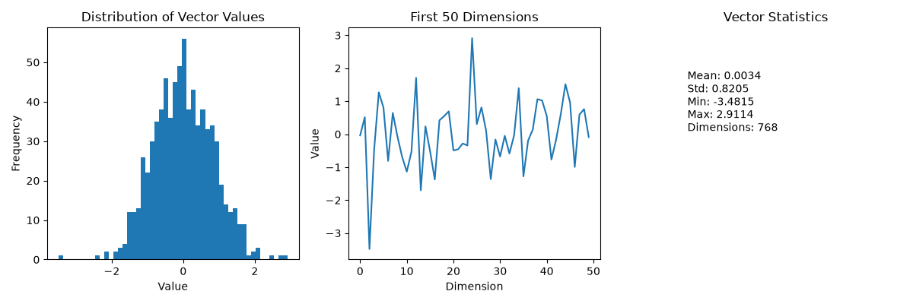
<figcaption>Embedding stats: most values sit near zero, and the vector has 768 dimensions</figcaption>
</figure>
</div>

> **Success:** Checkpoint: `embedding_stats_<timestamp>.png` has three panels, **Distribution of Vector Values**, **First 50 Dimensions** and **Vector Statistics**. **Vector Statistics** lists the mean, standard deviation, minimum and maximum, and `Dimensions: 768`.

The embedding of the prompt `What is the capital of France?` is a 768-dimensional vector: the question turned into a list of 768 numbers the model can compare.

The distribution plot (left) shows most values clustered around zero in a rough bell shape; in the run shown they spread from about -3.5 to +3. `nomic-embed-text` returns its vectors raw, without scaling them to length 1, which is why the values are larger than the -1 to 1 range you may see from other embedding models.

**First 50 Dimensions** (middle) gives a closer view of how the information is encoded. The values swing between roughly -3.5 and +3, with a few strong peaks: different aspects of the question, perhaps the interrogative nature ("what is"), the concept of a capital city and the specific country (France), are spread across many dimensions rather than held in any single one.

In the run shown, the statistical summary (right) gives a mean very close to zero (0.0034) and a standard deviation of 0.82, with values from -3.48 to 2.91. Similarity is measured by cosine, the angle between two vectors and not their length, so the raw scale makes no difference to the comparisons that follow. Your figures may differ slightly on different hardware.

### Similarity Matrix

<div align="center">
<figure>
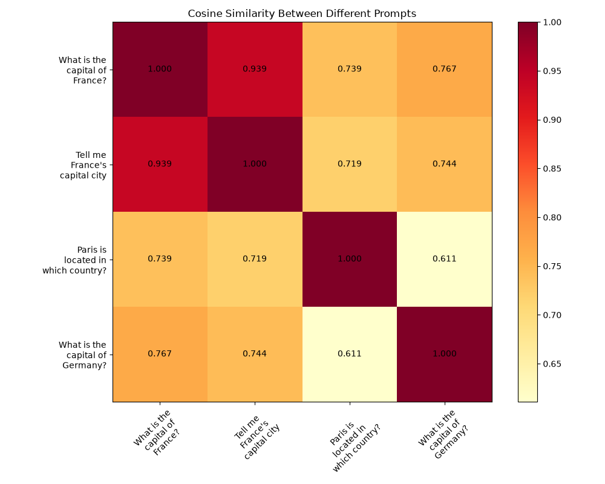
<figcaption>The two ways of asking for France's capital score highest</figcaption>
</figure>
</div>

> **Success:** Checkpoint: `similarity_matrix_<timestamp>.png`, **Cosine Similarity Between Different Prompts**, is a 4 × 4 grid with the four questions on both axes and `1.000` down the diagonal, where each question meets itself. The two questions that ask for the capital of France score highest with each other.

This similarity matrix shows how the embedding model relates the questions about capital cities. In the run shown:

* The first two questions, "What is the capital of France?" and "Tell me France's capital city", score 0.939. They ask the same thing in different words: the embedding model recognizes semantic equivalence even when the syntax differs.
* "Paris is located in which country?" scores clearly lower with the two France questions (0.739 and 0.719) than they score with each other. It involves the same entities, Paris and France, but reverses the relationship: instead of asking what the capital is, it asks which country contains Paris.
* "What is the capital of Germany?" scores 0.767 with the first France question, higher than the Paris question manages despite being about a different country, so the model recognizes the shared shape of a capital-city question. That is still well below the 0.939 of a true paraphrase, so the model keeps the two countries apart. The lowest score in the matrix, 0.611, is between the Germany question and the Paris question: a different country, and the relationship asked the other way around.

The color gradient shows these relationships: the darkest red for perfect self-similarity (1.000) along the diagonal, bright red for near-equivalent questions, and progressively lighter colors for questions that share less meaning.

:::

### 3. Tokenization

> **Note:**
>
> #### Tokenization
>
> In the **Prompt** part, Ollama tokenized the question for you before the model embedded it. Tokenization is the model's way of breaking text into manageable pieces, called tokens: some tokenizers work at the word level, while others split words into subwords or even single characters. `tokenization.py` shows that step with `tiktoken`, OpenAI's open-source tokenizer library.

<div align="center">
<figure>
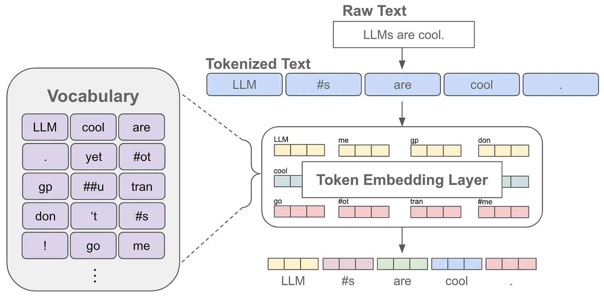
<figcaption>Text becomes tokens from a vocabulary, and each token becomes a vector</figcaption>
</figure>
</div>

Think of tokens as puzzle pieces the model can understand. The tokens then need to be converted into a format the model can process mathematically, and this is where embeddings come in: each token is transformed into a vector, a long list of numbers, that represents its meaning in a high-dimensional space.

The embedding process captures semantic relationships between tokens. Words with similar meanings have similar vectors: "cat" and "kitten" sit closer together in this vector space than "cat" and "automobile".

The quality of the embeddings shapes how well a model performs. Good embeddings preserve meaningful relationships between concepts and let the model make relevant connections. Poor embeddings can lose important distinctions in meaning, or relate concepts that have nothing in common.

Modern language models learn their embeddings during pre-training. That lets them capture both obvious relationships and subtle distinctions in meaning: the embedding space becomes a map of meaning, where similar concepts cluster together and related ideas sit near each other.

Tokenization and embedding work together. A token that is too large, such as a whole phrase, can lose nuance in its embedding; tokens that are too small, such as single letters, can fail to capture meaningful units.

Context windows in language models are measured in tokens, not in characters or words, so tokenization decides how much text fits into a single prompt. Efficient tokenization makes the most of that window.

`tokenization.py` runs entirely on your machine and makes no API calls: you need no OpenAI key, and the script does not use Ollama. The first time it runs, `tiktoken` downloads the vocabulary files of the three encodings it compares and caches them, so that first run needs an internet connection.

1. Read `tokenization.py`:

```python
import numpy as np
import matplotlib.pyplot as plt
import tiktoken
import textwrap
from sklearn.decomposition import PCA
import os
from datetime import datetime

def ensure_output_directory():
    """Create and return the output directory path with timestamp."""
    base_dir = "tokenization_analysis"
    timestamp = datetime.now().strftime("%Y%m%d_%H%M%S")
    output_dir = os.path.join(base_dir, f"analysis_{timestamp}")
    if not os.path.exists(output_dir):
        os.makedirs(output_dir)
    return output_dir

def save_plot(plt, output_dir, filename):
    """Save the current plot to the visualizations directory."""
    full_path = os.path.join(output_dir, filename)
    plt.savefig(full_path)
    print(f"Saved visualization to: {full_path}")
    plt.close()

def explore_vocabulary(output_dir, encoding_name="cl100k_base", n_samples=20):
    """Explore and visualize the tokenizer vocabulary."""
    enc = tiktoken.get_encoding(encoding_name)
    
    print(f"\nSample of {encoding_name} vocabulary:")
    print("-" * 50)
    
    # Get the vocabulary dictionary
    vocab_dict = {}
    for i in range(100000):  # Sample a range of token IDs
        try:
            token_bytes = enc.decode_single_token_bytes(i)
            token_text = token_bytes.decode('utf-8', errors='replace')
            vocab_dict[i] = token_text
            if len(vocab_dict) < n_samples:
                print(f"Token ID: {i:5d} | Token Text: '{token_text}'")
        except:
            continue
        if len(vocab_dict) >= n_samples:
            break
    
    # Save vocabulary sample to a text file
    vocab_file = os.path.join(output_dir, "vocabulary_sample.txt")
    with open(vocab_file, 'w', encoding='utf-8') as f:
        f.write(f"Sample of {encoding_name} vocabulary:\n")
        f.write("-" * 50 + "\n")
        for token_id, token_text in list(vocab_dict.items())[:n_samples]:
            f.write(f"Token ID: {token_id:5d} | Token Text: '{token_text}'\n")

def analyze_token_mapping(text, output_dir, encoding_name="cl100k_base"):
    """Analyze how text is mapped to tokens and back."""
    enc = tiktoken.get_encoding(encoding_name)
    tokens = enc.encode(text)
    
    print(f"\nToken mapping analysis for: '{text}'")
    print("-" * 50)
    
    # Print to console
    print("Step 1: Text to Tokens")
    print(f"Original text: {text}")
    print(f"Token IDs: {tokens}\n")
    
    print("Step 2: Individual Token Analysis")
    for i, token in enumerate(tokens):
        token_text = enc.decode([token])
        print(f"Position {i+1}: Token ID {token:5d} → '{token_text}'")
    
    print("\nStep 3: Reconstruction")
    reconstructed = enc.decode(tokens)
    print(f"Reconstructed text: {reconstructed}")
    print(f"Matches original: {text == reconstructed}")
    
    # Save to file
    safe_filename = "".join(c if c.isalnum() else "_" for c in text[:20])
    analysis_file = os.path.join(output_dir, f"token_mapping_{safe_filename}.txt")
    
    with open(analysis_file, 'w', encoding='utf-8') as f:
        f.write(f"Token mapping analysis for: '{text}'\n")
        f.write("-" * 50 + "\n")
        f.write("Step 1: Text to Tokens\n")
        f.write(f"Original text: {text}\n")
        f.write(f"Token IDs: {tokens}\n\n")
        
        f.write("Step 2: Individual Token Analysis\n")
        for i, token in enumerate(tokens):
            token_text = enc.decode([token])
            f.write(f"Position {i+1}: Token ID {token:5d} → '{token_text}'\n")
        
        f.write("\nStep 3: Reconstruction\n")
        f.write(f"Reconstructed text: {reconstructed}\n")
        f.write(f"Matches original: {text == reconstructed}\n")

def compare_encodings(output_dir):
    """Compare different tiktoken encodings."""
    sample_text = "OpenAI develops GPT-4, an advanced AI model!"
    encodings = [
        "cl100k_base",  # ChatGPT
        "p50k_base",    # GPT-3
        "r50k_base"     # Earlier models
    ]
    
    print("\nComparing different encodings:")
    print("-" * 50)
    
    # Print to console and save to file
    comparison_file = os.path.join(output_dir, "encoding_comparison.txt")
    with open(comparison_file, 'w', encoding='utf-8') as f:
        f.write("Comparing different encodings:\n")
        f.write("-" * 50 + "\n")
        
        for encoding_name in encodings:
            enc = tiktoken.get_encoding(encoding_name)
            tokens = enc.encode(sample_text)
            
            # Print to console
            print(f"\n{encoding_name}:")
            print(f"Number of tokens: {len(tokens)}")
            print("Token breakdown:")
            for token in tokens:
                print(f"  {token:5d} → '{enc.decode([token])}'")
            
            # Write to file
            f.write(f"\n{encoding_name}:\n")
            f.write(f"Number of tokens: {len(tokens)}\n")
            f.write("Token breakdown:\n")
            for token in tokens:
                f.write(f"  {token:5d} → '{enc.decode([token])}'\n")

def main():
    # Create output directory with timestamp
    output_dir = ensure_output_directory()
    print(f"\nAnalysis results will be saved to: {output_dir}")
    
    # Explore vocabulary first
    print("\nExploring tokenizer vocabulary...")
    explore_vocabulary(output_dir)
    
    # Example texts for analysis
    examples = [
        "OpenAI",
        "machine learning",
        "https://example.com",
        "Python3.9",
        "Hello, world!"
    ]
    
    # Analyze each example
    for example in examples:
        analyze_token_mapping(example, output_dir)
    
    # Compare different encodings
    compare_encodings(output_dir)
    
    print(f"\nAll analysis results have been saved to: {output_dir}")

if __name__ == "__main__":
    main()
```

When you run it, the script:

* prints the first token IDs of the `cl100k_base` vocabulary, and saves the first 20 to `vocabulary_sample.txt`;
* for each of five example texts, prints the token IDs, the text of each token and the text rebuilt from the IDs, and saves the same analysis to a `token_mapping_<text>.txt` file;
* encodes `OpenAI develops GPT-4, an advanced AI model!` with three encodings, `cl100k_base`, `p50k_base` and `r50k_base` (labeled ChatGPT, GPT-3 and earlier models in the script's comments), prints each breakdown, and saves them to `encoding_comparison.txt`.

All the files go to a new folder, `tokenization_analysis\analysis_<timestamp>`.

2. Run the script. In PowerShell, run:

::: tabs

### Windows (PowerShell)

```powershell
Set-Location C:\Workshop-AI-Specialty\02-pdi-ai-pipelines\18-key-concepts-workshop
.\.venv\Scripts\python tokenization.py
```

### macOS / Linux

```bash
.venv/bin/python tokenization.py
```

:::

<div align="center">
<figure>
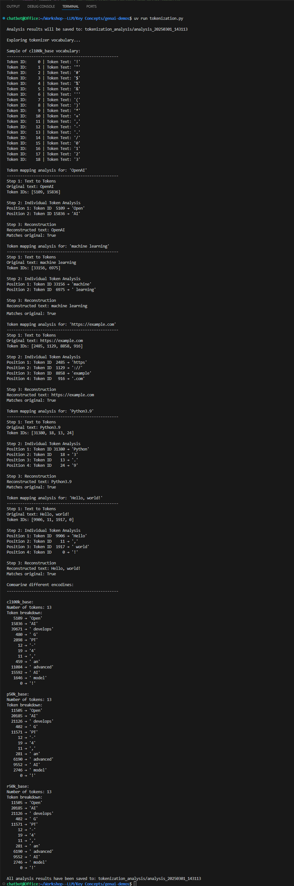
<figcaption>The whole output: vocabulary sample, five token mappings, three encodings</figcaption>
</figure>
</div>

> **Success:** Checkpoint: under `Sample of cl100k_base vocabulary:` the script lists token IDs `0` to `18`: the punctuation marks `!` to `/` and the digits `0` to `3`. Each of the five token mapping analyses ends `Matches original: True`, and under `Comparing different encodings:` all three encodings show `Number of tokens: 13`.

3. Compare your token IDs with this table. `tiktoken` always splits a text the same way, so yours match exactly. A token can start with a space: ` learning` and ` world` carry the space in front of the word.

| Text | Tokens | Token IDs |
| --- | --- | --- |
| `OpenAI` | `Open`, `AI` | `[5109, 15836]` |
| `machine learning` | `machine`, ` learning` | `[33156, 6975]` |
| `https://example.com` | `https`, `://`, `example`, `.com` | `[2485, 1129, 8858, 916]` |
| `Python3.9` | `Python`, `3`, `.`, `9` | `[31380, 18, 13, 24]` |
| `Hello, world!` | `Hello`, `,`, ` world`, `!` | `[9906, 11, 1917, 0]` |

The vocabulary sample starts with the most basic tokens, punctuation marks and digits: the level at which the tokenizer can break down any text.

`OpenAI` is split into two tokens, `Open` and `AI`: the tokenizer handles a compound word by breaking it into pieces it knows. `machine learning` is also two tokens, one per word. Keeping frequent words whole keeps their meaning in one piece while the vocabulary stays a manageable size.

The URL becomes four tokens, `https`, `://`, `example` and `.com`, so a model can recognize the common parts of URLs. `Python3.9` also becomes four, `Python`, `3`, `.` and `9`: numbers, dots and text become separate tokens.

The encoding comparison is the most telling part. All three encodings split `OpenAI develops GPT-4, an advanced AI model!` into the same 13 pieces, including ` G` and `PT` for `GPT`, but `cl100k_base` gives them different IDs from the other two: `Open` is `5109` in `cl100k_base` and `11505` in `p50k_base` and `r50k_base`, which give identical IDs here. Different encodings can represent the same text differently, and each still rebuilds the original exactly.

That is what `Matches original: True` confirms for every example: tokenization is reversible, so the tokens decode back to the original text, which keeps text intact on its way through a language model.

> **Under the hood:**
>
> #### tiktoken looked each piece up in a fixed vocabulary; no model ran
>
> `tiktoken` is a byte-pair encoding (BPE) tokenizer: it splits text into pieces its vocabulary holds and replaces each piece with that piece's fixed ID, so the same text gives the same IDs on any machine. Decoding is the reverse lookup, which is why every example rebuilds its original text exactly. Each model family has its own vocabulary: `cl100k_base` and `p50k_base` gave `Open` different IDs, and the models you run in Ollama, `llama3.2:3b` and `nomic-embed-text`, use their own tokenizers again.
>
> **Why it matters:** context windows and prompt limits are counted in the tokens of the model's own tokenizer, so a count from `tiktoken` is only an estimate for a model in Ollama. Ollama reports the real count for each request as `prompt_eval_count` in its response.

4. Open the folder the script named in its last line, `All analysis results have been saved to:`.

> **Success:** Checkpoint: the folder holds 7 text files: `vocabulary_sample.txt`, `encoding_comparison.txt` and the five token mapping files, `token_mapping_OpenAI.txt`, `token_mapping_machine_learning.txt`, `token_mapping_https___example_com.txt`, `token_mapping_Python3_9.txt` and `token_mapping_Hello__world_.txt`.

`tokenization.py` writes text files only. The three figures below show the four questions from the **Prompt** part tokenized with `cl100k_base`, drawn as token boxes with each token's ID in red underneath. They are the same pieces as the token list `transformers.py` uses in the last part: `What`, `is`, `the`, `capital`, `of`, `France` and `?`.

<div align="center">
<figure>
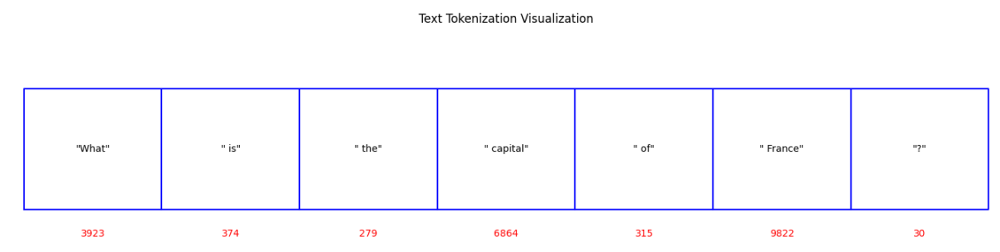
<figcaption>What is the capital of France? as 7 tokens</figcaption>
</figure>
</div>

<div align="center">
<figure>
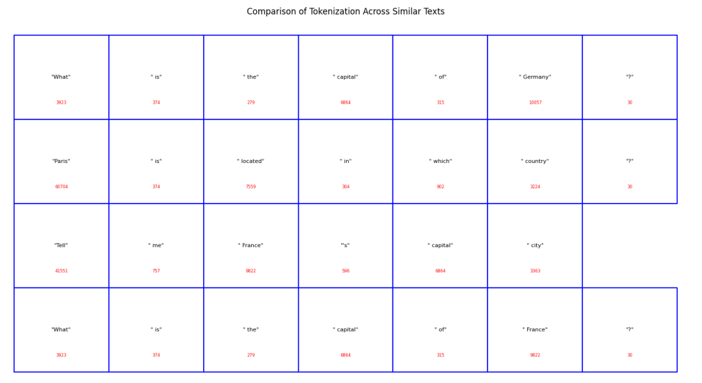
<figcaption>The France and Germany questions share six of their seven tokens</figcaption>
</figure>
</div>

<div align="center">
<figure>
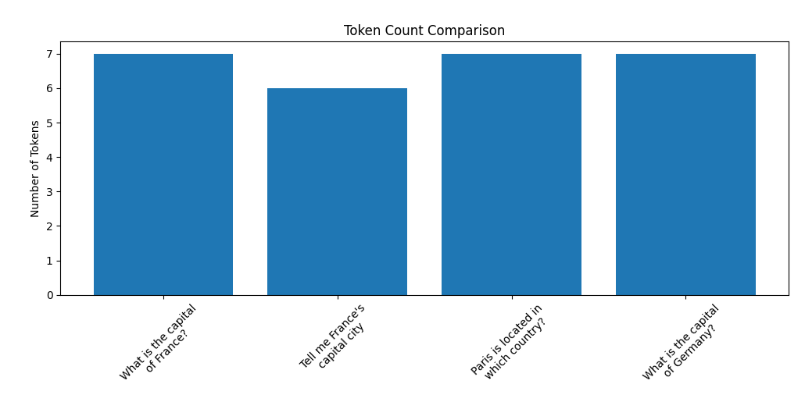
<figcaption>Token counts per question</figcaption>
</figure>
</div>

### 4. Embedding

> **Note:**
>
> #### Embedding
>
> With the text split into token IDs, the model can create embedding vectors. An embedding is a numerical representation of a piece of text, such as a word, a sentence or a paragraph. `embedding.py` uses `nomic-embed-text` to measure similarity, cluster questions by topic, analyze one vector and run a small semantic search.

Why is embedding so important? An embedding maps the text to a point in a high-dimensional vector space, and you can think of each **dimension** as some feature or attribute of the text.

For example, to create an embedding for the word "orange", the model places the word in a space whose dimensions reflect characteristics such as its size, its color, whether it is a noun or a verb, its position in the sentence and its locale: in short, its context. The context decides which "orange" is meant:

* Fruit: in a discussion about fruit, "orange" likely refers to the citrus fruit that is round and typically orange in color.
* Color: in a discussion about color, "orange" might refer to the color between red and yellow, like the color of the fruit.
* Juice: in a discussion about drinks, "orange" might refer to orange juice, made by squeezing oranges.
* Clothing: in a discussion about clothing, "orange" might refer to a garment or accessory colored orange.

By training on a large corpus of text, a model learns to map words to vectors so that words with similar meanings or contexts get similar vectors.

<div class="pcm-embed-card" data-href="https://platform.openai.com/docs/guides/embeddings/what-are-embeddings" data-title="platform.openai.com"></div>

1. Read `embedding.py`:

```python
import numpy as np  # For numerical operations and array handling
from typing import List, Dict, Tuple  # Type hints for better code documentation
import matplotlib
matplotlib.use('Agg')  # Set the backend to Agg for non-interactive environments (e.g., servers)
import matplotlib.pyplot as plt  # For creating visualizations
from sklearn.metrics.pairwise import cosine_similarity  # For calculating similarity between vectors
from sklearn.manifold import TSNE  # For dimensionality reduction to visualize high-dimensional data
import seaborn as sns  # For enhanced visualizations on top of matplotlib
import pandas as pd  # For data manipulation and analysis
import os  # For file and directory operations
from datetime import datetime  # For timestamping output files
import ollama  # Python client for interacting with Ollama API

class EmbeddingAnalyzer:
    """
    A class to analyze and visualize text embeddings using Ollama.
    
    This class provides methods to:
    - Generate embeddings for text using Ollama's nomic-embed-text model
    - Calculate similarities between texts
    - Visualize embedding properties and relationships
    - Create semantic search demonstrations
    """
    def __init__(self, output_dir: str, host: str = "http://localhost:11434"):
        """
        Initialize the analyzer with Ollama client and output directory.
        
        Args:
            output_dir: Directory to save visualizations and analysis results
            host: Ollama server host URL (default: http://localhost:11434)
        """
        # Initialize the Ollama client with the specified host
        self.client = ollama.Client(host=host)
        # Specify which Ollama model to use for embeddings
        self.model = "nomic-embed-text"
        # Cache to store embeddings to avoid regenerating for the same text
        self.cache: Dict[str, np.ndarray] = {}
        # Directory where all output files will be saved
        self.output_dir = output_dir
        
    def get_embedding(self, text: str) -> np.ndarray:
        """
        Generate an embedding vector for the input text, using cache if available.
        
        An embedding is a numerical representation of text in a high-dimensional space,
        where semantic meaning is captured by the relative positions of vectors.
        
        Args:
            text: The text to generate an embedding for
            
        Returns:
            A numpy array containing the embedding vector
        """
        # Check if embedding is already in cache to avoid redundant API calls
        if text in self.cache:
            return self.cache[text]
        
        # Request embedding from Ollama API    
        response = self.client.embeddings(
            model=self.model,  # Using the specified Ollama model
            prompt=text  # The text to embed
        )
        
        # Convert the embedding to numpy array for easier manipulation
        embedding = np.array(response["embedding"])
        
        # Store in cache for future use
        self.cache[text] = embedding
        
        return embedding
    
    def batch_embed(self, texts: List[str]) -> List[np.ndarray]:
        """
        Generate embeddings for multiple texts.
        
        Args:
            texts: List of text strings to embed
            
        Returns:
            List of numpy arrays, each containing an embedding vector
        """
        # Generate embeddings for each text in the list
        return [self.get_embedding(text) for text in texts]
    
    def calculate_similarity_matrix(self, texts: List[str]) -> np.ndarray:
        """
        Calculate pairwise similarities between all provided texts.
        
        This creates a matrix where each cell [i,j] contains the cosine similarity
        between the embeddings of texts[i] and texts[j].
        
        Args:
            texts: List of text strings to compare
            
        Returns:
            A 2D numpy array containing pairwise similarity scores
        """
        # Get embeddings for all texts
        embeddings = self.batch_embed(texts)
        
        # Stack vectors vertically to create a 2D matrix
        # Each row is an embedding vector for one text
        embeddings_matrix = np.vstack(embeddings)
        
        # Calculate cosine similarity between all pairs of vectors
        # Output is a square matrix of size len(texts) × len(texts)
        return cosine_similarity(embeddings_matrix)
    
    def save_plot(self, plt, filename: str) -> str:
        """
        Save plot to the output directory.
        
        Args:
            plt: Matplotlib plot object to save
            filename: Name of the file to save the plot as
            
        Returns:
            Full path to the saved file
        """
        # Create full path for the output file
        full_path = os.path.join(self.output_dir, filename)
        
        # Save the figure to the specified path
        plt.savefig(full_path)
        
        # Close the plot to free memory
        plt.close()
        
        print(f"Saved visualization to: {full_path}")
        return full_path
    
    def visualize_similarities(self, texts: List[str], labels: List[str] = None, filename: str = 'similarity_heatmap.png'):
        """
        Create a heatmap visualization of text similarities and save to file.
        
        Args:
            texts: List of text strings to compare
            labels: Optional labels for each text (default: numbered indices)
            filename: Name of the output file
        """
        # Calculate the similarity matrix for all texts
        similarity_matrix = self.calculate_similarity_matrix(texts)
        
        # Create figure with appropriate size
        plt.figure(figsize=(10, 8))
        
        # Create heatmap using seaborn
        sns.heatmap(
            similarity_matrix,
            annot=True,  # Show the similarity values in each cell
            fmt='.2f',   # Format as 2 decimal places
            cmap='YlOrRd',  # Color map: yellow to orange to red (higher values are redder)
            xticklabels=labels or range(len(texts)),  # Use provided labels or default to indices
            yticklabels=labels or range(len(texts))
        )
        
        # Add title and adjust layout
        plt.title('Semantic Similarity Heatmap')
        plt.tight_layout()
        
        # Save the visualization
        self.save_plot(plt, filename)
    
    def visualize_embedding_clusters(self, texts: List[str], labels: List[str] = None, filename: str = 'embedding_clusters.png'):
        """
        Create a 2D visualization of embedding clusters using t-SNE dimensionality reduction.
        
        This visualizes how different texts relate to each other in the embedding space
        by projecting the high-dimensional embeddings down to 2D.
        
        Args:
            texts: List of text strings to visualize
            labels: Optional category labels for each text
            filename: Name of the output file
        """
        # Get embeddings for all texts
        embeddings = self.batch_embed(texts)
        
        # Stack vectors vertically to create a 2D matrix
        embeddings_matrix = np.vstack(embeddings)
        
        # Calculate appropriate perplexity for t-SNE
        # Perplexity is related to the number of nearest neighbors used in the algorithm
        # It should be smaller than the number of points - 1
        n_samples = len(texts)
        perplexity = min(30, n_samples - 1)
        
        # Create t-SNE model for dimensionality reduction
        # t-SNE (t-Distributed Stochastic Neighbor Embedding) preserves local relationships
        tsne = TSNE(n_components=2, random_state=42, perplexity=perplexity)
        
        # Transform the high-dimensional embeddings to 2D points
        reduced_embeddings = tsne.fit_transform(embeddings_matrix)
        
        # Create DataFrame for easier plotting with seaborn
        df = pd.DataFrame(
            reduced_embeddings,
            columns=['x', 'y']  # 2D coordinates
        )
        # Add labels column for coloring points by category
        df['label'] = labels if labels else range(len(texts))
        
        # Create figure with appropriate size
        plt.figure(figsize=(12, 8))
        
        # Create scatter plot using seaborn
        # Points with the same label will have the same color and marker style
        sns.scatterplot(data=df, x='x', y='y', hue='label', style='label')
        
        # Add title and adjust layout
        plt.title('2D Visualization of Text Embeddings')
        plt.tight_layout()
        
        # Save the visualization
        self.save_plot(plt, filename)

def ensure_output_directory() -> str:
    """
    Create and return the output directory path with timestamp.
    
    Creates a unique directory for each run of the script to prevent
    overwriting previous results.
    
    Returns:
        Full path to the created output directory
    """
    # Base directory for all analysis outputs
    base_dir = "embedding_analysis"
    
    # Generate timestamp for unique directory name
    timestamp = datetime.now().strftime("%Y%m%d_%H%M%S")
    
    # Create full path with timestamp
    output_dir = os.path.join(base_dir, f"analysis_{timestamp}")
    
    # Create directory if it doesn't exist
    if not os.path.exists(output_dir):
        os.makedirs(output_dir)
    
    return output_dir

def get_ollama_host() -> str:
    """
    Prompt for Ollama host URL with default option.
    
    Allows connecting to either the default local Ollama server
    or a custom server specified by the user.
    
    Returns:
        Host URL for the Ollama API
    """
    # Default local Ollama server URL
    default_host = "http://localhost:11434"
    
    print("\nOllama Configuration")
    print("===================")
    print(f"Default Ollama server: {default_host}")
    
    # Ask if user wants to use a different server
    use_custom = input("Use a different Ollama server? (y/N): ").lower()
    
    if use_custom in ('y', 'yes'):
        # Get custom host URL
        host = input(f"Enter Ollama server URL: ")
        # Use provided URL or fall back to default if empty
        return host if host else default_host
    
    return default_host

def save_analysis_results(output_dir: str, results: str):
    """
    Save analysis results to a text file.
    
    Args:
        output_dir: Directory to save the file in
        results: Text content to save
    """
    # Create full path for the output file
    filename = os.path.join(output_dir, "analysis_results.txt")
    
    # Write results to file
    with open(filename, 'w', encoding='utf-8') as f:
        f.write(results)
    
    print(f"Analysis results saved to: {filename}")

def demonstrate_embeddings():
    """
    Demonstrate various applications and properties of embeddings.
    
    This function showcases different ways embeddings can be used:
    1. Measuring semantic similarity between texts
    2. Clustering texts by topic
    3. Analyzing embedding vector properties
    4. Performing semantic search
    """
    # Create output directory for this run
    output_dir = ensure_output_directory()
    print(f"\nAnalysis results will be saved to: {output_dir}")
    
    # Get Ollama host configuration
    host = get_ollama_host()
    
    try:
        # Initialize analyzer with Ollama
        print(f"\nInitializing EmbeddingAnalyzer with Ollama (model: nomic-embed-text)")
        analyzer = EmbeddingAnalyzer(output_dir, host)
        
        # Example 1: Basic Semantic Similarity
        # This demonstrates how embeddings capture semantic relationships
        print("\nExample 1: Basic Semantic Similarity")
        similar_texts = [
            "What is the capital of France?",
            "Tell me the capital city of France",
            "Which city serves as France's capital?",
            "What's the largest city in France?",
            "What's the weather like in Paris?"
        ]
        # Create heatmap of similarities between these related texts
        analyzer.visualize_similarities(
            similar_texts, 
            labels=[f"Text {i+1}" for i in range(len(similar_texts))],
            filename="similarity_heatmap.png"
        )
        
        # Example 2: Topic Clustering
        # This demonstrates how embeddings group semantically related concepts
        print("\nExample 2: Topic Clustering")
        mixed_topics = [
            # Technology
            "How do computers process information?",
            "What is artificial intelligence?",
            "How does machine learning work?",
            # Sports
            "Who won the last World Cup?",
            "What are the rules of basketball?",
            "How do you play tennis?",
            # Cooking
            "What's the best way to cook pasta?",
            "How do you make chocolate cake?",
            "What are common cooking spices?"
        ]
        # Create labels for each topic category
        topic_labels = ["Tech"]*3 + ["Sports"]*3 + ["Cooking"]*3
        
        # Visualize how these topics cluster in the embedding space
        analyzer.visualize_embedding_clusters(
            mixed_topics, 
            labels=topic_labels,
            filename="embedding_clusters.png"
        )
        
        # Example 3: Embedding Properties Analysis
        # This demonstrates the statistical properties of embedding vectors
        print("\nExample 3: Analyzing Embedding Properties")
        sample_text = "This is a sample text for analyzing embedding properties."
        embedding = analyzer.get_embedding(sample_text)
        
        # Create histogram of embedding values
        plt.figure(figsize=(10, 5))
        plt.hist(embedding, bins=50)
        plt.title("Distribution of Embedding Values")
        plt.xlabel("Value")
        plt.ylabel("Frequency")
        plt.tight_layout()
        analyzer.save_plot(plt, 'embedding_distribution.png')
        
        # Collect statistical properties of the embedding
        stats = f"""Embedding Analysis Results
        -------------------------
        Sample Text: "{sample_text}"
        Model: {analyzer.model}
        
        Embedding Statistics:
        - Dimensionality: {len(embedding)} dimensions
        - Mean value: {np.mean(embedding):.4f}
        - Standard deviation: {np.std(embedding):.4f}
        - Vector magnitude: {np.linalg.norm(embedding):.4f}
        """
        
        # Example 4: Semantic Search
        # This demonstrates using embeddings for finding similar documents
        print("\nExample 4: Semantic Search Demo")
        documents = [
            "The quick brown fox jumps over the lazy dog",
            "A fast auburn canine leaps across a sleepy hound",
            "The cat chases the mouse in the garden",
            "A feline pursues a rodent through the flowers",
            "The weather is sunny and warm today",
        ]
        # Query to search for
        query = "A fox jumping over a dog"
        query_embedding = analyzer.get_embedding(query)
        
        # Calculate similarity scores between query and all documents
        doc_embeddings = analyzer.batch_embed(documents)
        similarities = [
            cosine_similarity(query_embedding.reshape(1, -1), doc_emb.reshape(1, -1))[0][0]
            for doc_emb in doc_embeddings
        ]
        
        # Add search results to stats
        stats += "\nSemantic Search Results:\n"
        stats += f"Query: '{query}'\n\n"
        
        # Sort documents by similarity score (highest first)
        for doc, score in sorted(zip(documents, similarities), key=lambda x: x[1], reverse=True):
            stats += f"Score: {score:.4f} | Document: {doc}\n"
        
        # Save all analysis results to text file
        save_analysis_results(output_dir, stats)
        
        print("\nAnalysis complete! All visualizations and results have been saved.")
        
    except Exception as e:
        # Handle errors with helpful troubleshooting information
        print(f"\nError: {str(e)}")
        print("\nTroubleshooting steps:")
        print("1. Ensure Ollama is installed and running (see https://ollama.com)")
        print("2. Check if the nomic-embed-text model is pulled (`ollama pull nomic-embed-text`)")
        print("3. Verify the Ollama server URL is correct")
        print("4. Make sure the ollama Python package is installed (`pip install ollama`)")
        print(f"\nError details: {type(e).__name__}: {str(e)}")

if __name__ == "__main__":
    # Entry point of the script
    # This ensures the script only runs when executed directly, not when imported
    demonstrate_embeddings()
```

The `EmbeddingAnalyzer` class holds the Ollama client and a cache, so a text that appears twice is embedded only once. When you run it, the script works through four examples and saves everything to a new folder, `embedding_analysis\analysis_<timestamp>`:

* Example 1, **Basic Semantic Similarity**: compares five questions about France and saves a similarity heatmap as `similarity_heatmap.png`.
* Example 2, **Topic Clustering**: embeds nine questions, three each about tech, sports and cooking, reduces their vectors to two dimensions with t-SNE, and saves the scatter plot as `embedding_clusters.png`.
* Example 3, **Analyzing Embedding Properties**: embeds one sample sentence, saves the histogram of its values as `embedding_distribution.png`, and records its dimensionality, mean, standard deviation and magnitude.
* Example 4, **Semantic Search Demo**: ranks five sentences by their similarity to the query `A fox jumping over a dog`, and writes the ranking, with the Example 3 statistics, to `analysis_results.txt`.

2. Run the script. In PowerShell, run:

::: tabs

### Windows (PowerShell)

```powershell
Set-Location C:\Workshop-AI-Specialty\02-pdi-ai-pipelines\18-key-concepts-workshop
.\.venv\Scripts\python embedding.py
```

### macOS / Linux

```bash
.venv/bin/python embedding.py
```

:::

3. When the script asks `Use a different Ollama server? (y/N):`, press `Enter`.

One run printed this:

```text
Analysis results will be saved to: embedding_analysis\analysis_20261005_094747

Ollama Configuration
===================
Default Ollama server: http://localhost:11434
Use a different Ollama server? (y/N): 
Initializing EmbeddingAnalyzer with Ollama (model: nomic-embed-text)

Example 1: Basic Semantic Similarity
Saved visualization to: embedding_analysis\analysis_20261005_094747\similarity_heatmap.png

Example 2: Topic Clustering
Saved visualization to: embedding_analysis\analysis_20261005_094747\embedding_clusters.png

Example 3: Analyzing Embedding Properties
Saved visualization to: embedding_analysis\analysis_20261005_094747\embedding_distribution.png

Example 4: Semantic Search Demo
Analysis results saved to: embedding_analysis\analysis_20261005_094747\analysis_results.txt

Analysis complete! All visualizations and results have been saved.
```

> **Success:** Checkpoint: the four `Example` headings appear in order. Three `Saved visualization to:` lines name `similarity_heatmap.png`, `embedding_clusters.png` and `embedding_distribution.png`, `Analysis results saved to:` names `analysis_results.txt`, and the last line is `Analysis complete! All visualizations and results have been saved.`

The heatmap shows the semantic relationship between the questions, and the topic clustering shows how the vectors of related questions group together. Those groups are what let a model find related content, and what search builds on in the next part.

4. Open the folder the script named in its first line, `Analysis results will be saved to:`, and look at its four files, one tab below for each example.

::: tabs

### Semantic Similarity

`similarity_heatmap.png` labels the five questions `Text 1` to `Text 5`:

| Label | Question |
| --- | --- |
| `Text 1` | What is the capital of France? |
| `Text 2` | Tell me the capital city of France |
| `Text 3` | Which city serves as France's capital? |
| `Text 4` | What's the largest city in France? |
| `Text 5` | What's the weather like in Paris? |

<div align="center">
<figure>
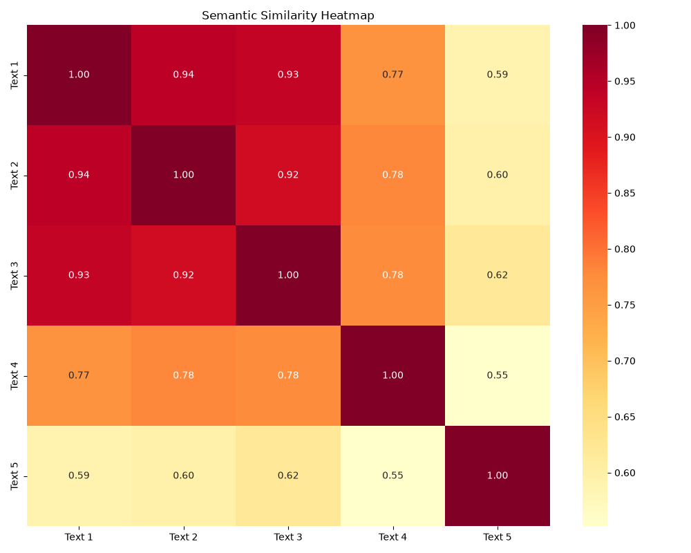
<figcaption>Texts 1 to 3 ask the same question; Text 5 asks about the weather</figcaption>
</figure>
</div>

> **Success:** Checkpoint: **Semantic Similarity Heatmap** is a 5 × 5 grid labeled `Text 1` to `Text 5`, with `1.00` on the diagonal. Texts 1 to 3, the three ways of asking for the capital, score highest with each other, and `Text 5`, the weather question, scores lowest with every other text.

This heatmap, of embeddings from `nomic-embed-text`, shows how similar the questions are to each other, as in the **Prompt** part. The color and number in each square show how closely two texts are related: darker reds for stronger relationships, closer to 1.0, and lighter yellows for weaker ones.

In the run shown, the first three texts are very closely related, with dark red scores of 0.92 to 0.94: they ask the same question. The fourth text ("largest city") is related but clearly less so (0.77 to 0.78): a different question about the same country. The fifth text stands out as the most different from all the others, with consistently lighter colors (0.55 to 0.62) across its row and column.

This kind of view shows how a language model groups similar concepts together and tells different topics apart, even when they share some words.

### Topic Clustering

<div align="center">
<figure>
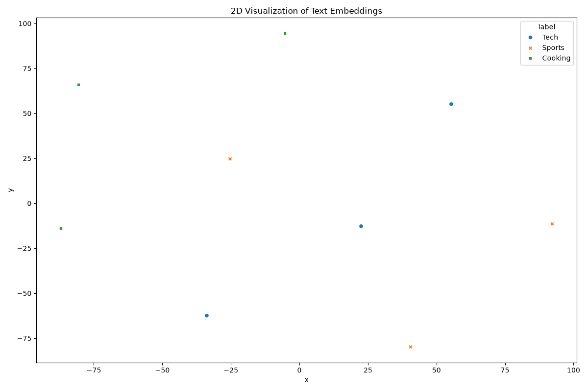
<figcaption>Nine questions in two dimensions: cooking sits apart, tech and sports mix</figcaption>
</figure>
</div>

> **Success:** Checkpoint: `embedding_clusters.png`, **2D Visualization of Text Embeddings**, shows 9 points with a legend of `Tech`, `Sports` and `Cooking`, 3 points each. Where the points land depends on the vectors, so compare the layout with the figure, not the coordinates.

This plot shows how the topics group when their embeddings are reduced to two dimensions with t-SNE, in the script's `visualize_embedding_clusters` method. Each point is one question, colored and shaped by its category: Tech (blue dots), Sports (orange crosses) and Cooking (green squares). The questions include "How do computers process information?" (Tech), "Who won the last World Cup?" (Sports) and "What's the best way to cook pasta?" (Cooking).

With only three questions per topic, the picture is rough. In the run shown, the cooking questions sit apart along the top left, while the tech and sports questions are interleaved. t-SNE, which squeezes 768 dimensions into two, has very little to work with at nine points, and a small change in the vectors can rearrange its layout; the similarity scores, as in the heatmap, are the more reliable view of what the model groups together.

Try adding a few more questions per topic to `mixed_topics` in `demonstrate_embeddings`, with a matching label for each in `topic_labels`, and run the script again: with more points, t-SNE has more to work with when it lays the topics out.

### Analysis

<div align="center">
<figure>
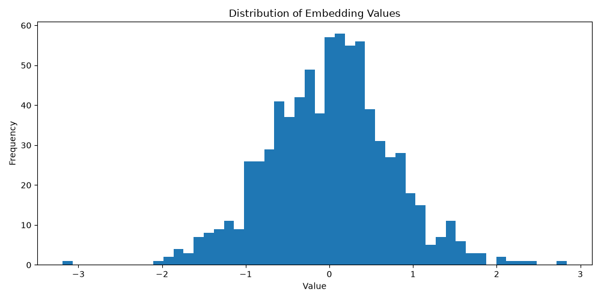
<figcaption>The values of the sample sentence's embedding</figcaption>
</figure>
</div>

> **Success:** Checkpoint: `embedding_distribution.png` is a histogram titled **Distribution of Embedding Values**. `analysis_results.txt` starts `Embedding Analysis Results` and lists `Dimensionality: 768 dimensions`, with the mean value, standard deviation and vector magnitude of the sample sentence's embedding.

In the run shown, the statistics read:

```text
Embedding Statistics:
- Dimensionality: 768 dimensions
- Mean value: 0.0041
- Standard deviation: 0.7362
- Vector magnitude: 20.4033
```

But what is a dimension? A text embedding with 768 dimensions means that each piece of text is converted into a list of 768 numbers. Think of it as a detailed fingerprint of the text, where each number captures a different aspect of its meaning. We picture things in 2 or 3 dimensions (length, width and height); an embedding uses many more to capture the complexity of language.

The 768 numbers work together to represent patterns in the text, from the topic and tone to its structure and style. To compare two pieces of text, you compare their 768-dimensional fingerprints, as the heatmap did. The vector magnitude, about 20 in the run shown, is the vector's length: `nomic-embed-text` does not scale its vectors to length 1, and cosine similarity ignores length anyway. The high number of dimensions lets the model tell different kinds of text apart precisely while still recognizing similarities.

Since nobody can picture 768 dimensions, the topic cluster plot reduces them to two. It is like drawing the shadow of a 3D object on a flat surface: you lose some detail, but you can still see the basic relationships between the points.

### Semantic Search

This digs a little deeper than the **Prompt** example. In training, the model learns that there is a strong relationship between fox and canine and less of one between fox and cat, and that jumping, leaping, chasing and pursuing are related actions.

The query is:

```python
query = "A fox jumping over a dog"
```

The documents are:

```python
documents = [
    "The quick brown fox jumps over the lazy dog",
    "A fast auburn canine leaps across a sleepy hound",
    "The cat chases the mouse in the garden",
    "A feline pursues a rodent through the flowers",
    "The weather is sunny and warm today",
]
```

> **Success:** Checkpoint: at the end of `analysis_results.txt`, `Semantic Search Results:` gives the query `'A fox jumping over a dog'` and lists the 5 documents with their scores, highest first. The fox and canine sentences rank at the top and the weather sentence at the bottom.

In the run shown, the semantic search results were:

```text
Semantic Search Results:
Query: 'A fox jumping over a dog'

Score: 0.9186 | Document: The quick brown fox jumps over the lazy dog
Score: 0.8975 | Document: A fast auburn canine leaps across a sleepy hound
Score: 0.8602 | Document: The cat chases the mouse in the garden
Score: 0.8511 | Document: A feline pursues a rodent through the flowers
Score: 0.7778 | Document: The weather is sunny and warm today
```

This example shows how embedding-based search works: it compares a query with five documents and ranks them by similarity score, which reflects meaning rather than shared keywords. "The quick brown fox jumps over the lazy dog" is the closest match to the query.

The first two results score highest (0.9186 and 0.8975 in the run shown) because they are variations of the same idea: a fox or canine jumping or leaping over a dog or hound. The next two score lower but still fairly high (0.8602 and 0.8511): they share the idea of one animal chasing another, with different animals (cat and mouse, feline and rodent). The last result scores much lower (0.7778), because it is about the weather, an unrelated topic.

The model treats "fox" and "canine" as related, "jumps", "leaps" and even "chases" as similar actions, and the weather as a different topic, whatever words the sentences share.

:::

### 5. Search

> **Note:**
>
> #### Search
>
> The **Embedding** part ranked sentences by the similarity of their embeddings: semantic search. `search.py` sets that against traditional keyword search, which counts the words a document shares with the query, on the same 8 documents and 4 queries.

The idea behind semantic search is to use embeddings to find text with similar or related meanings: the model turns each text into a vector, and texts are compared by their vectors. Retrieval for a Large Language Model (LLM) builds on the same idea, as the diagram shows: your documents are split into chunks, each chunk is embedded and kept in a vector store, the user's query is embedded the same way, and the chunks closest to it are passed to the LLM with the query, within its token limit.

<div align="center">
<figure>
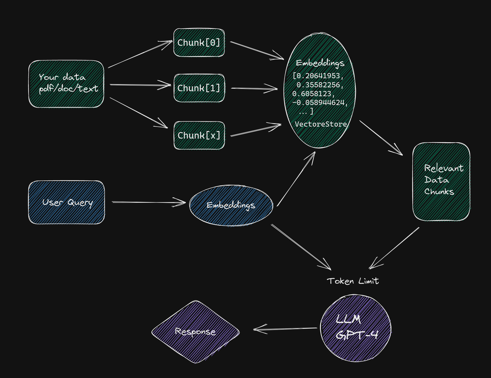
<figcaption>Semantic search: the query's embedding finds the relevant chunks for the LLM</figcaption>
</figure>
</div>

1. Read `search.py`:

```python
import numpy as np  # For numerical operations and array handling
from typing import List, Dict, Tuple  # Type hints for better code documentation
import matplotlib.pyplot as plt  # For creating visualizations
from sklearn.metrics.pairwise import cosine_similarity  # For calculating similarity between vectors
from sklearn.manifold import TSNE  # For dimensionality reduction to visualize high-dimensional data
import seaborn as sns  # For enhanced visualizations on top of matplotlib
import pandas as pd  # For data manipulation and analysis
from collections import Counter  # For counting word frequencies in keyword search
import re  # For regular expressions to extract words
import os  # For file and directory operations
from datetime import datetime  # For timestamping output files
import ollama  # Python client for interacting with Ollama API

def ensure_output_directory() -> str:
    """
    Create and return the output directory path with timestamp.
    
    This function creates a unique directory for each run of the script
    to prevent overwriting previous results.
    
    Returns:
        str: Path to the created output directory
    """
    # Base directory for search analysis outputs
    base_dir = "search_analysis"
    
    # Generate timestamp for unique directory name
    timestamp = datetime.now().strftime("%Y%m%d_%H%M%S")
    
    # Create full path with timestamp
    output_dir = os.path.join(base_dir, f"analysis_{timestamp}")
    
    # Create directory if it doesn't exist
    if not os.path.exists(output_dir):
        os.makedirs(output_dir)
        print(f"Created output directory: {output_dir}")
        
    return output_dir

def get_ollama_host() -> str:
    """
    Prompt for Ollama host URL with default option.
    
    This function allows the user to specify a custom Ollama server
    or use the default localhost URL.
    
    Returns:
        str: Host URL for the Ollama API
    """
    # Default local Ollama server URL
    default_host = "http://localhost:11434"
    
    print("\nOllama Configuration")
    print("===================")
    print(f"Default Ollama server: {default_host}")
    
    # Ask if user wants to use a different server
    use_custom = input("Use a different Ollama server? (y/N): ").lower()
    
    if use_custom in ('y', 'yes'):
        # Get custom host URL
        host = input(f"Enter Ollama server URL: ")
        # Return provided URL or fall back to default if empty
        return host if host else default_host
    
    return default_host

class SearchComparator:
    """
    A class to compare traditional keyword search with embedding-based semantic search.
    
    This class provides methods to:
    - Generate embeddings using Ollama's nomic-embed-text model
    - Perform keyword-based search using term frequency
    - Perform vector-based semantic search using embeddings
    - Visualize and compare results from both search methods
    """
    
    def __init__(self, ollama_host: str, output_dir: str):
        """
        Initialize with Ollama host and output directory.
        
        Args:
            ollama_host: URL of the Ollama API server
            output_dir: Directory to save visualizations and analysis results
        """
        # Initialize the Ollama client with the specified host
        self.client = ollama.Client(host=ollama_host)
        
        # Specify which Ollama model to use for embeddings
        self.model = "nomic-embed-text"
        
        # Cache to store embeddings to avoid regenerating for the same text
        self.cache: Dict[str, np.ndarray] = {}
        
        # Directory where all output files will be saved
        self.output_dir = output_dir
        
    def get_search_type(self, query: str) -> str:
        """
        Determine the type of search based on the query.
        
        This helps categorize different types of searches for analysis and
        provides appropriate naming for output files.
        
        Args:
            query: The search query string
            
        Returns:
            str: A category name for the search type
        """
        # Map queries to search types for analysis and file naming
        search_types = {
            "A fox jumping over a dog": "direct_phrase_match",
            "Canines in natural habitats": "semantic_concept_match",
            "Sleeping animals outdoors": "mixed_concept_match",
            "Forest wildlife activity": "thematic_match"
        }
        # Return the mapped type or "custom_search" if not in the predefined list
        return search_types.get(query, "custom_search")
    
    def get_embedding(self, text: str) -> np.ndarray:
        """
        Generate an embedding vector for the input text using Ollama.
        
        This function uses caching to avoid redundant API calls for the same text.
        
        Args:
            text: The text to generate an embedding for
            
        Returns:
            numpy.ndarray: The embedding vector
        """
        # Check if embedding is already in cache to avoid redundant API calls
        if text in self.cache:
            return self.cache[text]
        
        # Request embedding from Ollama API
        response = self.client.embeddings(
            model=self.model,  # Using nomic-embed-text model
            prompt=text  # The text to embed
        )
        
        # Convert the embedding to numpy array for easier manipulation
        embedding = np.array(response["embedding"])
        
        # Store in cache for future use
        self.cache[text] = embedding
        
        return embedding
    
    def keyword_search(self, query: str, documents: List[str]) -> List[Tuple[str, float]]:
        """
        Perform traditional keyword-based search using term frequency.
        
        This simulates a simple TF (Term Frequency) based search by counting
        how many times each query word appears in each document.
        
        Args:
            query: The search query string
            documents: List of document strings to search
            
        Returns:
            List of (document, score) tuples, sorted by score in descending order
        """
        # Extract lowercase tokens (words) from the query
        query_tokens = set(re.findall(r'\w+', query.lower()))
        
        results = []
        for doc in documents:
            # Count frequency of all words in the document
            doc_tokens = Counter(re.findall(r'\w+', doc.lower()))
            
            # Score is the sum of frequencies of query words that appear in the document
            score = sum(doc_tokens[token] for token in query_tokens if token in doc_tokens)
            
            # Add document and its score to results
            results.append((doc, score))
        
        # Sort results by score in descending order (highest first)
        return sorted(results, key=lambda x: x[1], reverse=True)
    
    def vector_search(self, query: str, documents: List[str]) -> List[Tuple[str, float]]:
        """
        Perform vector-based semantic search using embeddings.
        
        This uses cosine similarity between the query embedding and each document
        embedding to find semantically similar documents.
        
        Args:
            query: The search query string
            documents: List of document strings to search
            
        Returns:
            List of (document, similarity_score) tuples, sorted by score in descending order
        """
        # Get embedding for the query
        query_embedding = self.get_embedding(query)
        results = []
        
        for doc in documents:
            # Get embedding for the document
            doc_embedding = self.get_embedding(doc)
            
            # Calculate cosine similarity between query and document embeddings
            # Reshape is needed because cosine_similarity expects 2D arrays
            similarity = cosine_similarity(
                query_embedding.reshape(1, -1), 
                doc_embedding.reshape(1, -1)
            )[0][0]
            
            # Add document and its similarity score to results
            results.append((doc, similarity))
        
        # Sort results by similarity score in descending order (highest first)
        return sorted(results, key=lambda x: x[1], reverse=True)
    
    def save_visualization(self, fig, search_type: str, viz_type: str) -> str:
        """
        Save visualization with appropriate naming.
        
        Args:
            fig: Matplotlib figure to save
            search_type: Category of the search (e.g., "direct_phrase_match")
            viz_type: Type of visualization (e.g., "comparison")
            
        Returns:
            str: Path to the saved file
        """
        # Create filename using search type and visualization type
        filename = f"{search_type}_{viz_type}.png"
        
        # Create full filepath in the output directory
        filepath = os.path.join(self.output_dir, filename)
        
        # Save the figure
        fig.savefig(filepath)
        
        # Close the figure to free memory
        plt.close(fig)
        
        return filepath
    
    def print_and_save_results(self, query: str, keyword_results: List[Tuple[str, float]], 
                             vector_results: List[Tuple[str, float]], search_type: str):
        """
        Print results to console and save to file.
        
        This function displays the top results from both search methods and
        saves the complete results to a text file.
        
        Args:
            query: The search query string
            keyword_results: Results from keyword search
            vector_results: Results from vector search
            search_type: Category of the search (for filename)
        """
        # Print to console
        print(f"\nAnalyzing search results for query: '{query}'")
        
        # Show top 3 keyword search results
        print("\nKeyword Search Results:")
        for doc, score in keyword_results[:3]:
            print(f"Score: {score:.4f} | {doc}")
        
        # Show top 3 vector search results
        print("\nVector Search Results:")
        for doc, score in vector_results[:3]:
            print(f"Score: {score:.4f} | {doc}")
        
        # Create filename for results text file
        filename = f"{search_type}_results.txt"
        filepath = os.path.join(self.output_dir, filename)
        
        # Save complete results to file
        with open(filepath, 'w', encoding='utf-8') as f:
            f.write(f"Search Results Analysis for Query: '{query}'\n")
            f.write("=" * 50 + "\n\n")
            
            # Write all keyword search results
            f.write("Keyword Search Results:\n")
            f.write("-" * 20 + "\n")
            for doc, score in keyword_results:
                f.write(f"Score: {score:.4f} | {doc}\n")
            
            # Write all vector search results
            f.write("\nVector Search Results:\n")
            f.write("-" * 20 + "\n")
            for doc, score in vector_results:
                f.write(f"Score: {score:.4f} | {doc}\n")
            
            # Add model information
            f.write("\n\nEmbedding Model: Ollama - " + self.model + "\n")
    
    def visualize_search_comparison(self, query: str, documents: List[str]):
        """
        Create visualizations comparing keyword and vector search results.
        
        This function runs both search methods and generates visualizations
        to compare their results.
        
        Args:
            query: The search query string
            documents: List of document strings to search
        """
        # Determine the type of search for categorization and file naming
        search_type = self.get_search_type(query)
        
        # Get search results from both methods
        keyword_results = self.keyword_search(query, documents)
        vector_results = self.vector_search(query, documents)
        
        # Print to console and save to text file
        self.print_and_save_results(query, keyword_results, vector_results, search_type)
        
        # Create visualizations
        print("\nGenerating visualizations...")
        
        # Create and save bar chart comparison
        fig1 = self.create_comparison_plot(keyword_results, vector_results, documents)
        comparison_path = self.save_visualization(fig1, search_type, "comparison")
        
        # Create and save embedding space visualization
        fig2 = self.visualize_query_document_space(query, documents)
        embedding_path = self.save_visualization(fig2, search_type, "embedding_space")
        
        print(f"Visualizations saved as '{os.path.basename(comparison_path)}' and '{os.path.basename(embedding_path)}'")
    
    def create_comparison_plot(self, keyword_results: List[Tuple[str, float]], 
                             vector_results: List[Tuple[str, float]], 
                             documents: List[str]) -> plt.Figure:
        """
        Create comparison plot of keyword and vector search results.
        
        This generates a side-by-side bar chart comparing the scores from
        both search methods.
        
        Args:
            keyword_results: Results from keyword search
            vector_results: Results from vector search
            documents: List of document strings (for ordering)
            
        Returns:
            matplotlib.pyplot.Figure: The generated figure
        """
        # Extract scores from both search results
        # The results are already sorted by score, so we need to match with original document order
        doc_to_keyword = {doc: score for doc, score in keyword_results}
        doc_to_vector = {doc: score for doc, score in vector_results}
        
        # Get scores in document order
        keyword_scores = [doc_to_keyword.get(doc, 0) for doc in documents]
        vector_scores = [doc_to_vector.get(doc, 0) for doc in documents]
        
        # Normalize keyword scores for better comparison with similarity scores
        max_keyword = max(keyword_scores) if max(keyword_scores) > 0 else 1
        keyword_scores = [s/max_keyword for s in keyword_scores]
        
        # Create figure with two subplots side by side
        fig, (ax1, ax2) = plt.subplots(1, 2, figsize=(15, 6))
        
        # Keyword search results - left subplot
        bars1 = ax1.bar(range(len(documents)), keyword_scores, alpha=0.6)
        ax1.set_title('Keyword Search Results')
        ax1.set_xlabel('Document Index')
        ax1.set_ylabel('Normalized Score')
        ax1.set_xticks(range(len(documents)))
        ax1.set_xticklabels([f'Doc {i}' for i in range(len(documents))], rotation=45)
        
        # Add score labels on top of each bar
        for bar in bars1:
            height = bar.get_height()
            ax1.text(bar.get_x() + bar.get_width()/2., height,
                    f'{height:.2f}',
                    ha='center', va='bottom')
        
        # Vector search results - right subplot
        bars2 = ax2.bar(range(len(documents)), vector_scores, alpha=0.6)
        ax2.set_title('Vector Search Results')
        ax2.set_xlabel('Document Index')
        ax2.set_ylabel('Similarity Score')
        ax2.set_xticks(range(len(documents)))
        ax2.set_xticklabels([f'Doc {i}' for i in range(len(documents))], rotation=45)
        
        # Add score labels on top of each bar
        for bar in bars2:
            height = bar.get_height()
            ax2.text(bar.get_x() + bar.get_width()/2., height,
                    f'{height:.2f}',
                    ha='center', va='bottom')
        
        # Add overall title for the figure
        plt.suptitle('Comparison of Search Methods', fontsize=16)
        plt.tight_layout()
        return fig
    
    def visualize_query_document_space(self, query: str, documents: List[str]) -> plt.Figure:
        """
        Create a 2D visualization of query and documents in embedding space.
        
        This uses t-SNE to reduce the high-dimensional embeddings to 2D for visualization,
        showing how the query relates to documents in semantic space.
        
        Args:
            query: The search query string
            documents: List of document strings
            
        Returns:
            matplotlib.pyplot.Figure: The generated figure
        """
        # Combine query and documents into a single list
        all_texts = [query] + documents
        
        # Get embeddings for all texts
        print("Generating embeddings for visualization...")
        embeddings = [self.get_embedding(text) for text in all_texts]
        
        # Stack vectors vertically to create a 2D matrix
        embeddings_matrix = np.vstack(embeddings)
        
        # Calculate appropriate perplexity for t-SNE
        # Perplexity is related to number of nearest neighbors considered
        # It should be smaller than the number of points - 1
        n_samples = len(all_texts)
        perplexity = min(30, n_samples - 1)
        
        # Reduce dimensionality with t-SNE
        print("Reducing dimensionality with t-SNE...")
        tsne = TSNE(
            n_components=2,  # Reduce to 2D for visualization
            random_state=42,  # For reproducibility
            perplexity=perplexity,
            max_iter=1000  # More iterations for better convergence
        )
        reduced_embeddings = tsne.fit_transform(embeddings_matrix)
        
        # Create DataFrame for easier plotting
        df = pd.DataFrame(
            reduced_embeddings,
            columns=['x', 'y']  # 2D coordinates
        )
        # Add type column to distinguish query from documents
        df['type'] = ['Query'] + ['Document'] * len(documents)
        # Add the original text
        df['text'] = all_texts
        
        # Create visualization
        fig = plt.figure(figsize=(12, 8))
        
        # Create scatter plot with seaborn
        sns.scatterplot(
            data=df, 
            x='x', 
            y='y', 
            hue='type',  # Color by type (Query vs Document)
            style='type',  # Different marker styles for Query vs Document
            s=100,  # Marker size
            palette={'Query': 'red', 'Document': 'blue'}  # Color palette
        )
        
        # Add text labels to the points
        for idx, row in df.iterrows():
            text = f"Query" if idx == 0 else f"Doc {idx-1}"
            plt.annotate(
                text,  # The label text
                (row['x'], row['y']),  # Point to label
                xytext=(5, 5),  # Offset text position
                textcoords='offset points',  # How to interpret the offset
                # Add white background to text for better readability
                bbox=dict(facecolor='white', edgecolor='none', alpha=0.7)
            )
        
        # Add descriptive title
        plt.title('2D Visualization of Query and Documents in Embedding Space')
        plt.tight_layout()
        return fig

def demonstrate_search_comparison():
    """
    Demonstrate the differences between keyword and semantic search.
    
    This function:
    1. Sets up the environment (output directory and Ollama connection)
    2. Initializes the SearchComparator
    3. Runs comparisons on several test queries
    4. Generates visualizations for each comparison
    """
    print("Search Comparison Demo: Keyword vs. Vector Search using Ollama")
    print("=" * 65)
    print("This script compares traditional keyword search with embedding-based")
    print("semantic search using the nomic-embed-text model via Ollama.")
    
    try:
        # Create output directory
        output_dir = ensure_output_directory()
        print(f"\nResults will be saved to: {output_dir}")
        
        # Get Ollama host configuration
        ollama_host = get_ollama_host()
        
        # Initialize comparator
        print(f"\nInitializing SearchComparator with Ollama (model: nomic-embed-text)")
        comparator = SearchComparator(ollama_host, output_dir)
        
        # Test documents
        print("\nPreparing test documents...")
        documents = [
            "The rapid brown fox jumps over the lazy dog in the forest",
            "A quick auburn canine leaps across a sleepy hound in the woods",
            "The fox hunts for food in the dense woodland",
            "Dogs and other canines play together in the park",
            "A lazy afternoon in the garden with sleeping pets",
            "Wild animals roaming through the forest at night",
            "The weather is perfect for outdoor activities today",
            "Forest creatures gather near the stream at dusk"
        ]
        
        # Display the test documents
        print("\nTest Documents:")
        for i, doc in enumerate(documents):
            print(f"Doc {i}: {doc}")
        
        # Test queries
        queries = [
            "A fox jumping over a dog",           # Direct phrase match
            "Canines in natural habitats",        # Semantic concept match
            "Sleeping animals outdoors",          # Mixed concept match
            "Forest wildlife activity"            # Thematic match
        ]
        
        # Run comparisons for each query
        print("\nRunning search comparisons...")
        for query in queries:
            print(f"\n{'-' * 40}")
            print(f"Processing query: '{query}'")
            comparator.visualize_search_comparison(query, documents)
        
        print(f"\nAll comparisons complete! Results saved to {output_dir}")
            
    except Exception as e:
        print(f"\nError: {str(e)}")
        print("\nTroubleshooting steps:")
        print("1. Ensure Ollama is installed and running (see https://ollama.com)")
        print("2. Check if the nomic-embed-text model is pulled (`ollama pull nomic-embed-text`)")
        print("3. Verify the Ollama server URL is correct")
        print("4. Make sure the ollama Python package is installed (`pip install ollama`)")
        print(f"\nError details: {type(e).__name__}: {str(e)}")

if __name__ == "__main__":
    # Entry point of the script
    # This ensures the script only runs when executed directly, not when imported
    demonstrate_search_comparison()
```

When you run it, the script:

* lists the 8 test documents as `Doc 0` to `Doc 7`;
* runs 4 queries, each a different kind of search: a direct phrase match, a semantic concept match, a mixed concept match and a thematic match;
* for each query, ranks the documents twice: by keyword search, which adds up how often each query word appears in a document, and by vector search, which ranks them by the cosine similarity of their embeddings to the query's;
* prints the top 3 of each ranking, and saves the full rankings, a bar chart comparing the two methods, and a two-dimensional t-SNE map of the query and the documents.

2. Run the script. In PowerShell, run:

::: tabs

### Windows (PowerShell)

```powershell
Set-Location C:\Workshop-AI-Specialty\02-pdi-ai-pipelines\18-key-concepts-workshop
.\.venv\Scripts\python search.py
```

### macOS / Linux

```bash
.venv/bin/python search.py
```

:::

3. When the script asks `Use a different Ollama server? (y/N):`, press `Enter`.

The output looks like this; the vector scores come from one run:

```text
Search Comparison Demo: Keyword vs. Vector Search using Ollama
=================================================================
This script compares traditional keyword search with embedding-based
semantic search using the nomic-embed-text model via Ollama.
Created output directory: search_analysis\analysis_20261005_094838

Results will be saved to: search_analysis\analysis_20261005_094838

Ollama Configuration
===================
Default Ollama server: http://localhost:11434
Use a different Ollama server? (y/N):
Initializing SearchComparator with Ollama (model: nomic-embed-text)

Preparing test documents...

Test Documents:
Doc 0: The rapid brown fox jumps over the lazy dog in the forest
Doc 1: A quick auburn canine leaps across a sleepy hound in the woods
Doc 2: The fox hunts for food in the dense woodland
Doc 3: Dogs and other canines play together in the park
Doc 4: A lazy afternoon in the garden with sleeping pets
Doc 5: Wild animals roaming through the forest at night
Doc 6: The weather is perfect for outdoor activities today
Doc 7: Forest creatures gather near the stream at dusk

Running search comparisons...

----------------------------------------
Processing query: 'A fox jumping over a dog'

Analyzing search results for query: 'A fox jumping over a dog'

Keyword Search Results:
Score: 3.0000 | The rapid brown fox jumps over the lazy dog in the forest
Score: 2.0000 | A quick auburn canine leaps across a sleepy hound in the woods
Score: 1.0000 | The fox hunts for food in the dense woodland

Vector Search Results:
Score: 0.8355 | The rapid brown fox jumps over the lazy dog in the forest
Score: 0.6854 | A quick auburn canine leaps across a sleepy hound in the woods
Score: 0.6092 | The fox hunts for food in the dense woodland

Generating visualizations...
Generating embeddings for visualization...
Reducing dimensionality with t-SNE...
Visualizations saved as 'direct_phrase_match_comparison.png' and 'direct_phrase_match_embedding_space.png'

----------------------------------------
Processing query: 'Canines in natural habitats'

Analyzing search results for query: 'Canines in natural habitats'

Keyword Search Results:
Score: 2.0000 | Dogs and other canines play together in the park
Score: 1.0000 | The rapid brown fox jumps over the lazy dog in the forest
Score: 1.0000 | A quick auburn canine leaps across a sleepy hound in the woods

Vector Search Results:
Score: 0.7151 | Dogs and other canines play together in the park
Score: 0.6779 | Wild animals roaming through the forest at night
Score: 0.6412 | A quick auburn canine leaps across a sleepy hound in the woods

Generating visualizations...
Generating embeddings for visualization...
Reducing dimensionality with t-SNE...
Visualizations saved as 'semantic_concept_match_comparison.png' and 'semantic_concept_match_embedding_space.png'

----------------------------------------
Processing query: 'Sleeping animals outdoors'

Analyzing search results for query: 'Sleeping animals outdoors'

Keyword Search Results:
Score: 1.0000 | A lazy afternoon in the garden with sleeping pets
Score: 1.0000 | Wild animals roaming through the forest at night
Score: 0.0000 | The rapid brown fox jumps over the lazy dog in the forest

Vector Search Results:
Score: 0.7679 | Wild animals roaming through the forest at night
Score: 0.7211 | A lazy afternoon in the garden with sleeping pets
Score: 0.6970 | A quick auburn canine leaps across a sleepy hound in the woods

Generating visualizations...
Generating embeddings for visualization...
Reducing dimensionality with t-SNE...
Visualizations saved as 'mixed_concept_match_comparison.png' and 'mixed_concept_match_embedding_space.png'

----------------------------------------
Processing query: 'Forest wildlife activity'

Analyzing search results for query: 'Forest wildlife activity'

Keyword Search Results:
Score: 1.0000 | The rapid brown fox jumps over the lazy dog in the forest
Score: 1.0000 | Wild animals roaming through the forest at night
Score: 1.0000 | Forest creatures gather near the stream at dusk

Vector Search Results:
Score: 0.7771 | Wild animals roaming through the forest at night
Score: 0.7053 | Forest creatures gather near the stream at dusk
Score: 0.6808 | The rapid brown fox jumps over the lazy dog in the forest

Generating visualizations...
Generating embeddings for visualization...
Reducing dimensionality with t-SNE...
Visualizations saved as 'thematic_match_comparison.png' and 'thematic_match_embedding_space.png'

All comparisons complete! Results saved to search_analysis\analysis_20261005_094838
```

> **Success:** Checkpoint: the script lists `Doc 0` to `Doc 7`, then for each of the 4 queries prints three `Keyword Search Results:` lines, three `Vector Search Results:` lines and a `Visualizations saved as` line with two PNG names. The keyword scores depend only on the words, so yours match this table exactly; the vector scores come from the model.
>
> | Query | Keyword first | Keyword second | Keyword third |
> | --- | --- | --- | --- |
> | `A fox jumping over a dog` | `Doc 0`, `3.0000` | `Doc 1`, `2.0000` | `Doc 2`, `1.0000` |
> | `Canines in natural habitats` | `Doc 3`, `2.0000` | `Doc 0`, `1.0000` | `Doc 1`, `1.0000` |
> | `Sleeping animals outdoors` | `Doc 4`, `1.0000` | `Doc 5`, `1.0000` | `Doc 0`, `0.0000` |
> | `Forest wildlife activity` | `Doc 0`, `1.0000` | `Doc 5`, `1.0000` | `Doc 7`, `1.0000` |

4. Open the folder the script named in `Results will be saved to:`.

> **Success:** Checkpoint: the folder holds 12 files, three per query: `<type>_results.txt`, `<type>_comparison.png` and `<type>_embedding_space.png`, where `<type>` is `direct_phrase_match`, `semantic_concept_match`, `mixed_concept_match` or `thematic_match`.

5. Open `direct_phrase_match_results.txt` and compare its **Keyword Search Results** with the query, `A fox jumping over a dog`.

> **Under the hood:**
>
> #### Keyword search counted exact words; vector search compared meanings
>
> `keyword_search` lowercases the query and each document, splits them into words with the regular expression `\w+`, and adds up how often each query word occurs in the document. Only exact words count: `jumps` does not match `jumping` and `Dogs` does not match `dog`, while the word `a` does, which is why `Doc 1` scores 2 for this query without mentioning a fox or a dog. `vector_search` embeds the query and each document once, keeps the vectors in a cache, and ranks the documents by cosine similarity, so a document that shares no word with the query can still rank high.
>
> **Why it matters:** keyword search is exact and explainable but misses synonyms and other forms of a word; vector search matches meaning but gives every document some score. Retrieval pipelines often run both and combine the rankings.

These search capabilities come from vector embeddings: by turning words and phrases into vectors, a model can recognize context, related concepts and themes that keyword matching misses.

6. Open each query's `_comparison.png` and `_embedding_space.png` files, one tab below for each query.

::: tabs

### Direct Phrase

**Direct phrase matching** combines keyword matching and vector similarity. Keyword search looks for exact words, such as `fox` and `dog`; vector matching also recognizes variations in phrasing, so it can see that "a quick auburn canine leaps" is close in meaning to "a fox jumping".

Keyword search gave `Doc 0` the top score, 3, for `fox`, `over` and `dog`; `jumps` did not count, because it is not `jumping`. In the run shown, vector search ranked the same documents first with more graded scores, recognizing related phrases such as "canine leaps".

<div align="center">
<figure>
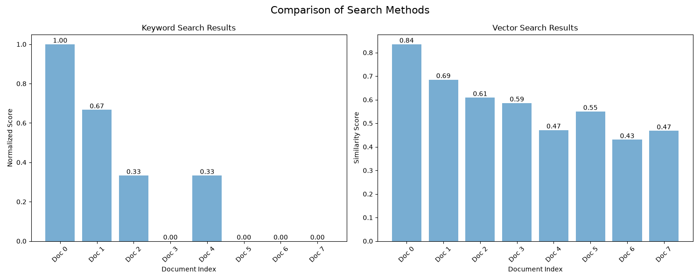
<figcaption>Keyword and vector scores for A fox jumping over a dog</figcaption>
</figure>
</div>

> **Success:** Checkpoint: in `direct_phrase_match_comparison.png`, the **Keyword Search Results** bars read `1.00`, `0.67`, `0.33`, `0.00`, `0.33`, `0.00`, `0.00` and `0.00` for `Doc 0` to `Doc 7`: each keyword score divided by the top score, 3. Every **Vector Search Results** bar is above zero, and `Doc 0` is the highest.

<div align="center">
<figure>
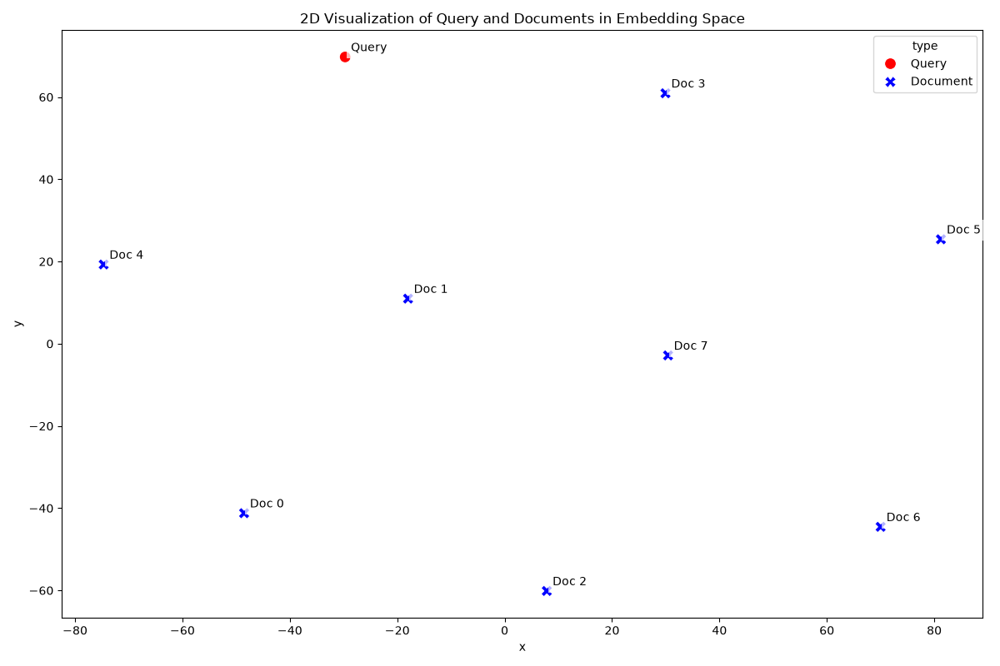
<figcaption>The query and documents after t-SNE: distances on this map are only a rough guide</figcaption>
</figure>
</div>

### Semantic Concept

**Semantic concept matching** goes beyond direct matching by understanding related concepts. It can recognize that `Canines in natural habitats` is related both to dogs in a park and to wild animals in a forest, bridging differences in vocabulary while keeping the meaning.

Keyword search gave `Doc 3` the top score because it holds `canines` and `in`, and gave 1 to every other document that contains `in`. In the run shown, vector search ranked `Doc 3` first and the wild animals in the forest (`Doc 5`) second, connecting canines with both a domestic setting (the park) and a natural habitat (the forest).

<div align="center">
<figure>
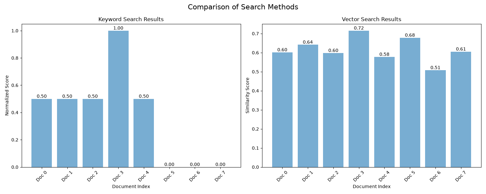
<figcaption>Keyword and vector scores for Canines in natural habitats</figcaption>
</figure>
</div>

> **Success:** Checkpoint: in `semantic_concept_match_comparison.png`, the keyword bars read `0.50` for `Doc 0`, `Doc 1`, `Doc 2` and `Doc 4`, `1.00` for `Doc 3`, and `0.00` for `Doc 5` to `Doc 7`.

<div align="center">
<figure>
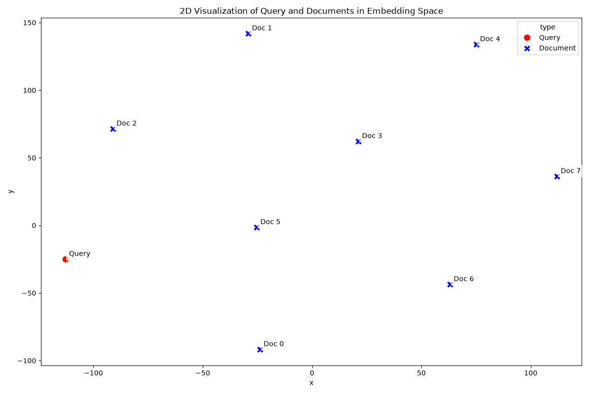
<figcaption>The query and documents for Canines in natural habitats, after t-SNE</figcaption>
</figure>
</div>

### Mixed Concept

**Mixed concept matching** combines several related ideas that don't usually appear together. For `Sleeping animals outdoors`, a search can connect ideas such as "lazy afternoon", "sleeping pets" and "animals roaming at night", though they use different words.

Keyword search found only the exact words, `sleeping` in `Doc 4` and `animals` in `Doc 5`, and scored every other document 0, including `Doc 6`, which says `outdoor`, not `outdoors`. In the run shown, vector search ranked the same two documents first and gave every document a score, connecting "sleeping animals" with both a direct match ("sleeping pets") and a related idea ("animals roaming at night").

<div align="center">
<figure>
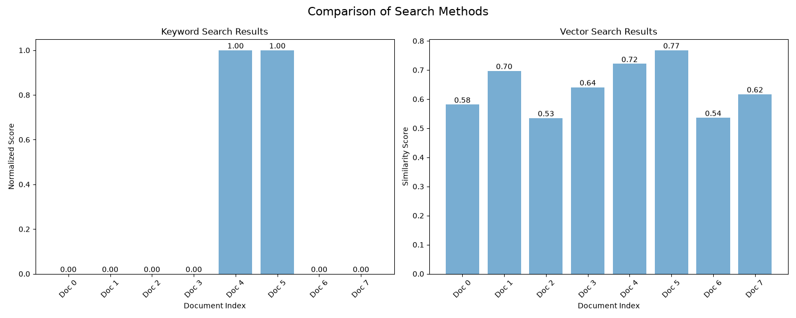
<figcaption>Keyword and vector scores for Sleeping animals outdoors</figcaption>
</figure>
</div>

> **Success:** Checkpoint: in `mixed_concept_match_comparison.png`, the keyword bars read `1.00` for `Doc 4` and `Doc 5`, and `0.00` for every other document.

<div align="center">
<figure>
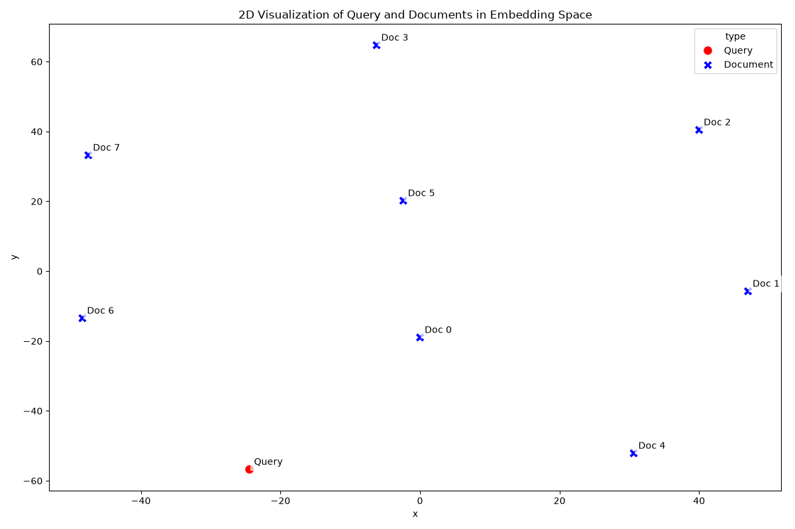
<figcaption>The query and documents for Sleeping animals outdoors, after t-SNE</figcaption>
</figure>
</div>

### Thematic

**Thematic matching** recognizes broader themes and contexts. For `Forest wildlife activity`, it can treat "creatures gathering", "animals roaming" and a fox in the forest as relevant, even when the words don't match.

Keyword search could match only `forest`: no document says `wildlife`, and `Doc 6` says `activities`, not `activity`. So it scored the three forest documents, `Doc 0`, `Doc 5` and `Doc 7`, the same. In the run shown, vector search put the wild animals roaming the forest (`Doc 5`) first and the forest creatures (`Doc 7`) second, recognizing animal behavior in forest settings rather than matching words.

<div align="center">
<figure>
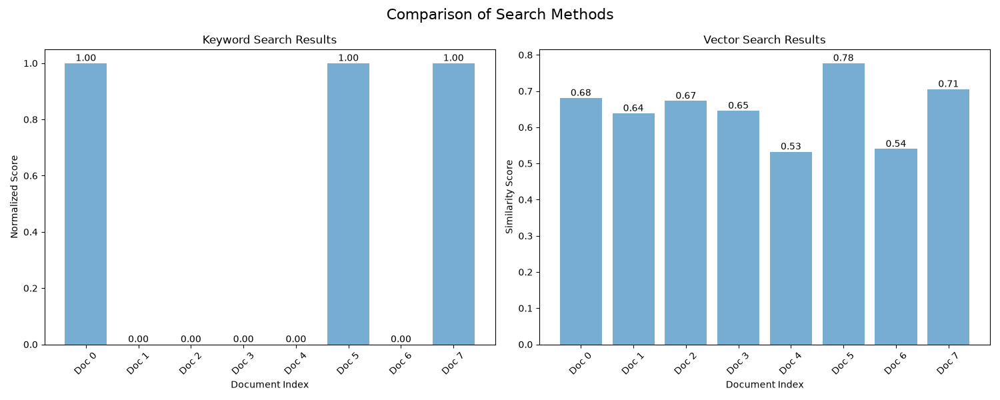
<figcaption>Keyword and vector scores for Forest wildlife activity</figcaption>
</figure>
</div>

> **Success:** Checkpoint: in `thematic_match_comparison.png`, the keyword bars read `1.00` for `Doc 0`, `Doc 5` and `Doc 7`, and `0.00` for every other document.

<div align="center">
<figure>
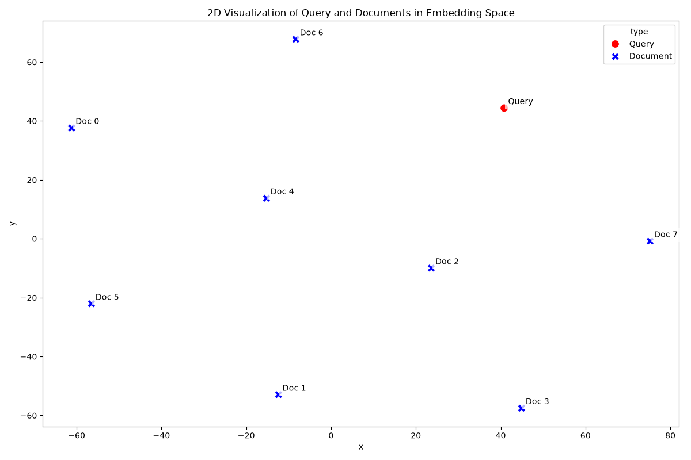
<figcaption>The query and documents for Forest wildlife activity, after t-SNE</figcaption>
</figure>
</div>

:::

### 6. Transformers

> **Note:**
>
> #### Transformers
>
> Everything is now in place for the model to deal with the prompt, in the heart of the LLM: the transformer. The diagram shows the original transformer architecture, an encoder (green) and a decoder (blue); chat models such as `llama3.2` use only the decoder half.

<div align="center">
<figure>
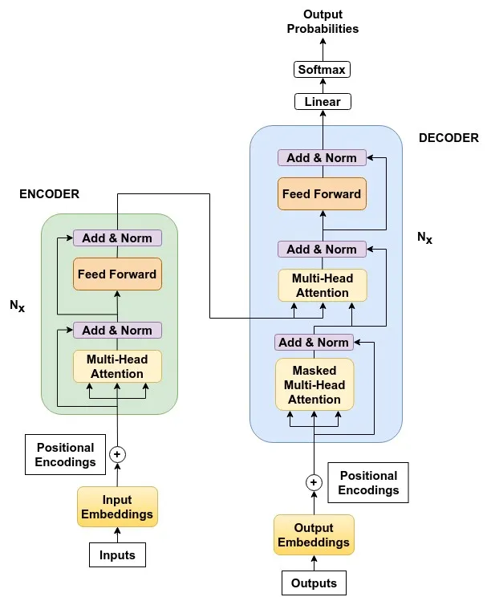
<figcaption>The transformer: encoder in green, decoder in blue</figcaption>
</figure>
</div>

::: tabs

### Encoder

**The encoder structure.** The green section (ENCODER) of the diagram shows how an input sequence is processed. The encoder starts with the raw **Inputs** at the bottom and transforms them through several stages.

**Input processing.** The inputs first become **Input Embeddings** (the yellow box), which are combined with **Positional Encodings** by an addition (+). This combination gives the model both what the words mean and where they appear in the sequence.

**Positional understanding.** The positional encodings added at the bottom of the encoder keep the model aware of word order throughout the processing.

**The main processing block (Nx).** The green block labeled **Nx** repeats N times. It holds two main components, **Multi-Head Attention**, which handles self-attention, and **Feed Forward**, which processes each position on its own. Each is followed by an **Add & Norm** box, for a residual connection and layer normalization.

**Multi-head attention.** The **Multi-Head Attention** box has several arrows pointing in: every position can attend to every position. Letting each word "look at" all the other words in the input creates context-aware representations.

**Feed forward.** After attention, the **Feed Forward** box works on each position separately, transforming the information that attention gathered.

**Add & Norm.** The **Add & Norm** boxes after the attention and feed-forward components stand for:

* an addition, for the residual connection;
* normalization, to keep the values in a manageable range.

**Final output.** The output of the encoder, after the Nx blocks, connects to the decoder (the blue section), where it becomes an input to the next stage of processing.

Together, these components turn raw inputs into rich, context-aware representations of the input sequence.

### Decoder

The decoder turns encoded representations into outputs through several layers.

**Input processing.** The decoder starts at the bottom with the **Output Embeddings**, combined with **Positional Encodings** by an addition (the + in the diagram). This gives the model both the content and the position of each element of the output sequence.

**Core processing blocks (Nx).** The blue section marked **Nx** repeats N times. Each repetition contains three blocks:

* **Masked Multi-Head Attention**: the first attention layer is marked "Masked": the mask keeps the decoder from looking at future positions during training. Its output passes through an **Add & Norm** layer (purple in the diagram), which keeps training stable by controlling the scale of the values.
* **Multi-Head Attention** (cross-attention): this block takes both the output of the masked attention layer and the encoder's output (the horizontal line from the encoder), so the decoder can refer to the whole input sequence while it generates each output element. Another **Add & Norm** layer follows.
* **Feed Forward** (orange in the diagram): the last block in each layer, again followed by **Add & Norm**. It processes each position on its own, applying the same transformation to each element.

**Output generation.** After all the Nx layers, the decoder ends with:

* a **Linear** layer that projects the representations to the size of the output vocabulary;
* a **Softmax** layer that turns those values into a probability for every possible output token.

**Residual connections.** Throughout the architecture, residual connections (the arrows that bypass each block into an **Add & Norm**) let information flow directly from lower layers to higher ones, which prevents information loss and helps the gradients flow during training.

The decoder works with the encoder (in green on the left) to handle sequence-to-sequence tasks such as translation, summarization and question answering. Its balance of attention, normalization and feed-forward processing lets the model generate coherent output that takes account of both the input sequence and the output it has generated so far.

The architecture reflects a few lessons about processing sequences: position matters, the model needs both local and global context through different kinds of attention, and repeating identical layers extracts more and more complex patterns from the data.

:::

<div class="pcm-embed-card" data-href="https://poloclub.github.io/transformer-explainer/" data-title="poloclub.github.io"></div>

1. Read `transformers.py`:

```python
import numpy as np  # For numerical operations and array handling
import matplotlib.pyplot as plt  # For creating visualizations
import seaborn as sns  # For enhanced visualizations (especially heatmaps)
from typing import List, Dict  # Type hints for better code documentation
import pandas as pd  # For data manipulation (used in some visualizations)
import os  # For file and directory operations
from datetime import datetime  # For timestamping output files
import ollama  # Python client for interacting with Ollama API

def ensure_output_directory() -> str:
    """
    Create and return the output directory path with timestamp.
    
    This function creates a unique timestamped directory for each run to prevent
    overwriting previous results and provide easy identification.
    
    Returns:
        str: Path to the created output directory
    """
    # Base directory for transformer analysis outputs
    base_dir = "transformer_analysis"
    
    # Generate timestamp for unique directory name (format: YYYYMMDD_HHMMSS)
    timestamp = datetime.now().strftime("%Y%m%d_%H%M%S")
    
    # Create full path with timestamp
    output_dir = os.path.join(base_dir, f"analysis_{timestamp}")
    
    # Create directory if it doesn't exist
    if not os.path.exists(output_dir):
        os.makedirs(output_dir)
        print(f"Created output directory: {output_dir}")
        
    return output_dir

def get_ollama_host() -> str:
    """
    Prompt for Ollama host URL with default option.
    
    This function allows the user to specify a custom Ollama server
    or use the default localhost URL.
    
    Returns:
        str: Host URL for the Ollama API
    """
    # Default local Ollama server URL
    default_host = "http://localhost:11434"
    
    print("\nOllama Configuration")
    print("===================")
    print(f"Default Ollama server: {default_host}")
    
    # Ask if user wants to use a different server
    use_custom = input("Use a different Ollama server? (y/N): ").lower()
    
    if use_custom in ('y', 'yes'):
        # Get custom host URL
        host = input(f"Enter Ollama server URL: ")
        # Return provided URL or fall back to default if empty
        return host if host else default_host
    
    return default_host

class TransformerDemonstrator:
    """
    Demonstrates transformer processing using Ollama embeddings.
    
    This class provides methods to visualize and understand how transformers work,
    using the nomic-embed-text model from Ollama to generate embeddings and simulate
    the transformer process.
    """
    def __init__(self, ollama_host: str, output_dir: str):
        """
        Initialize the demonstrator with Ollama host and output directory.
        
        Args:
            ollama_host: URL of the Ollama API server
            output_dir: Directory to save visualizations and analysis results
        """
        # Initialize the Ollama client with the specified host
        self.client = ollama.Client(host=ollama_host)
        
        # Specify which Ollama model to use for embeddings
        self.model = "nomic-embed-text"
        
        # Directory where all output files will be saved
        self.output_dir = output_dir
        
        # Example prompt, tokens, and response for demonstration
        self.prompt = "What is the capital of France?"
        self.tokens = ['What', 'is', 'the', 'capital', 'of', 'France', '?']
        self.response = "Paris"
        
        # Create results file path
        self.results_file = os.path.join(output_dir, "analysis_results.txt")
        
        # Initialize the results file with header
        with open(self.results_file, 'w', encoding='utf-8') as f:
            f.write(f"Transformer Analysis Results\n")
            f.write("=========================\n")
            f.write(f"Model: Ollama - {self.model}\n")
            f.write(f"Date: {datetime.now().strftime('%Y-%m-%d %H:%M:%S')}\n\n")
        
    def save_results(self, section: str, content: str):
        """
        Save analysis results to the results file.
        
        This function appends a new section of results to the analysis file
        with proper formatting and section headers.
        
        Args:
            section: Title of the section being added
            content: Text content to save in that section
        """
        # Open file in append mode
        with open(self.results_file, 'a', encoding='utf-8') as f:
            # Add section header with underline
            f.write(f"\n{section}\n")
            f.write("=" * len(section) + "\n")
            # Write the actual content
            f.write(content + "\n")
    
    def get_embeddings(self, text: str) -> np.ndarray:
        """
        Get embeddings from Ollama API.
        
        This function sends a request to Ollama to generate an embedding vector
        for the provided text using the nomic-embed-text model.
        
        Args:
            text: The text to generate an embedding for
            
        Returns:
            numpy.ndarray: The embedding vector
        """
        # Request embedding from Ollama API
        response = self.client.embeddings(
            model=self.model,  # Using nomic-embed-text model
            prompt=text  # The text to embed
        )
        
        # Convert the embedding to numpy array
        return np.array(response["embedding"])
    
    def save_visualization(self, fig, filename: str) -> str:
        """
        Save visualization to the output directory.
        
        Args:
            fig: Matplotlib figure to save
            filename: Name for the saved file
            
        Returns:
            str: Path to the saved file
        """
        # Create full path for the output file
        filepath = os.path.join(self.output_dir, filename)
        
        # Save the figure
        fig.savefig(filepath)
        
        # Close the figure to free memory
        plt.close(fig)
        
        print(f"Saved visualization to: {filepath}")
        return filepath
    
    def demonstrate_process(self):
        """
        Demonstrate the complete transformer process.
        
        This method orchestrates the visualization of different aspects of
        transformer architecture using our example prompt:
        1. Token embeddings
        2. Self-attention between tokens
        3. Transformer processing stages
        4. Response generation
        """
        # Save initial configuration information
        config_info = f"""
        Input Prompt: '{self.prompt}'
        Tokens: {self.tokens}
        Expected Response: '{self.response}'
        """
        self.save_results("Configuration", config_info)
        
        try:
            # 1. Get embeddings for each token
            token_embeddings = {}
            print("\nGenerating embeddings for tokens...")
            for token in self.tokens:
                # Get embedding for each token and store in dictionary
                token_embeddings[token] = self.get_embeddings(token)
            
            # Save embedding information to results file
            embeddings_info = "Generated embeddings for tokens:\n"
            for token in self.tokens:
                embedding = token_embeddings[token]
                # Record shape and basic statistics for each embedding
                embeddings_info += f"{token}: Shape {embedding.shape}, Mean {np.mean(embedding):.4f}\n"
            self.save_results("Token Embeddings", embeddings_info)
            
            # 2. Visualize token attention
            print("\nGenerating token attention visualization...")
            self.visualize_token_attention(token_embeddings)
            
            # 3. Visualize transformer stages
            print("\nGenerating transformer stages visualization...")
            self.visualize_transformer_stages()
            
            # 4. Visualize response generation
            print("\nGenerating response process visualization...")
            self.visualize_response_process()
            
        except Exception as e:
            # Log any errors that occur
            error_msg = f"Error during demonstration: {str(e)}"
            print(f"\nError: {error_msg}")
            self.save_results("Error Log", error_msg)
            raise
        
    def visualize_token_attention(self, token_embeddings: Dict[str, np.ndarray]):
        """
        Visualize attention between tokens.
        
        This method simulates the self-attention mechanism in transformers by calculating
        similarity scores between token embeddings and visualizing them as a heatmap.
        
        Args:
            token_embeddings: Dictionary mapping tokens to their embedding vectors
        """
        # Get the number of tokens
        n_tokens = len(self.tokens)
        
        # Create empty matrix to store attention scores
        attention_matrix = np.zeros((n_tokens, n_tokens))
        
        # Calculate attention scores based on token embeddings similarity
        # In transformers, attention is based on query-key compatibility
        # We simulate this using cosine similarity between token embeddings
        for i, token1 in enumerate(self.tokens):
            for j, token2 in enumerate(self.tokens):
                # Get embeddings for token pair
                emb1 = token_embeddings[token1]  # Query token
                emb2 = token_embeddings[token2]  # Key token
                
                # Calculate cosine similarity
                # Formula: cos(θ) = (a·b)/(||a||·||b||)
                similarity = np.dot(emb1, emb2) / (np.linalg.norm(emb1) * np.linalg.norm(emb2))
                
                # Store in attention matrix
                attention_matrix[i, j] = similarity
        
        # Normalize attention scores to sum to 1 for each query token (row)
        # This simulates the softmax operation in transformer attention
        attention_matrix = attention_matrix / attention_matrix.sum(axis=1, keepdims=True)
        
        # Save attention matrix data to results file
        attention_info = "Attention Matrix:\n"
        for i, token1 in enumerate(self.tokens):
            for j, token2 in enumerate(self.tokens):
                attention_info += f"{token1} -> {token2}: {attention_matrix[i,j]:.4f}\n"
        self.save_results("Token Attention", attention_info)
        
        # Create visualization using seaborn's heatmap
        fig = plt.figure(figsize=(12, 8))
        sns.heatmap(
            attention_matrix, 
            annot=True,           # Show values in each cell
            fmt='.2f',            # Format as 2 decimal places
            xticklabels=self.tokens,  # Labels for columns (key tokens)
            yticklabels=self.tokens,  # Labels for rows (query tokens)
            cmap='YlOrRd'         # Color map: yellow to orange to red
        )
        plt.title('Token Self-Attention Weights')
        plt.xlabel('Context Tokens (Keys)')
        plt.ylabel('Query Tokens')
        plt.tight_layout()
        
        # Save the visualization
        self.save_visualization(fig, 'token_attention.png')
        
    def visualize_transformer_stages(self):
        """
        Visualize the stages of transformer processing.
        
        This method creates a diagram showing the main processing stages
        in a transformer model.
        """
        # Define the main stages of transformer processing
        stages = [
            'Input Embedding',        # Convert tokens to vectors
            'Positional Encoding',    # Add position information
            'Self-Attention',         # Compute attention between tokens
            'Feed Forward',           # Process through neural network
            'Layer Normalization',    # Normalize activations
            'Final Representation'    # Output token representations
        ]
        
        # Save stages information to results file
        stages_info = "Transformer Processing Stages:\n"
        for i, stage in enumerate(stages):
            stages_info += f"{i+1}. {stage}\n"
        self.save_results("Processing Stages", stages_info)
        
        # Create visualization showing information flow between stages
        fig = plt.figure(figsize=(15, 8))
        
        # For each stage, create a horizontal bar and label
        for i, stage in enumerate(stages):
            plt.barh(i, 0.8, color='skyblue', alpha=0.6)
            plt.text(0.9, i, stage, va='center')
            
            # Add arrows between stages to show information flow
            if i < len(stages) - 1:
                plt.arrow(0.4, i, 0, 0.8, head_width=0.05, 
                         head_length=0.1, fc='k', ec='k')
        
        # Set plot limits and title
        plt.ylim(-0.5, len(stages) - 0.5)
        plt.xlim(0, 2)
        plt.title('Transformer Processing Stages')
        plt.axis('off')  # Hide axes
        plt.tight_layout()
        
        # Save the visualization
        self.save_visualization(fig, 'transformer_stages.png')
        
    def visualize_response_process(self):
        """
        Visualize the response generation process.
        
        This method shows the relationship between the input prompt
        and the generated response using embeddings to represent them.
        """
        # Get embeddings for the full prompt and the response
        print("Generating embeddings for prompt and response...")
        prompt_emb = self.get_embeddings(self.prompt)
        response_emb = self.get_embeddings(self.response)
        
        # Save embeddings information to results file
        response_info = f"""
        Prompt: '{self.prompt}'
        - Embedding shape: {prompt_emb.shape}
        - Embedding mean: {np.mean(prompt_emb):.4f}
        - Embedding std: {np.std(prompt_emb):.4f}
        
        Response: '{self.response}'
        - Embedding shape: {response_emb.shape}
        - Embedding mean: {np.mean(response_emb):.4f}
        - Embedding std: {np.std(response_emb):.4f}
        
        Cosine Similarity between prompt and response: 
        {np.dot(prompt_emb, response_emb) / (np.linalg.norm(prompt_emb) * np.linalg.norm(response_emb)):.4f}
        """
        self.save_results("Response Generation", response_info)
        
        # Create visualization showing relationship between prompt and response
        fig, (ax1, ax2) = plt.subplots(1, 2, figsize=(15, 6))
        
        # Prompt processing visualization (left subplot)
        ax1.bar(['Prompt'], [1], color='lightblue')
        ax1.set_title('Input Processing')
        ax1.text(0, 0.5, self.prompt, ha='center', va='center')
        
        # Response generation visualization (right subplot)
        ax2.bar(['Response'], [1], color='lightgreen')
        ax2.set_title('Output Generation')
        ax2.text(0, 0.5, self.response, ha='center', va='center')
        
        # Add title and adjust layout
        plt.suptitle('Transformer Input/Output Process', fontsize=16)
        plt.tight_layout()
        
        # Save the visualization
        self.save_visualization(fig, 'response_generation.png')

def demonstrate_full_process():
    """
    Run complete transformer demonstration.
    
    This function sets up the environment, initializes the demonstrator,
    and runs the full transformer process demonstration.
    """
    print("Transformer Visualization Demo using Ollama")
    print("===========================================")
    print("This script demonstrates transformer processing using")
    print("the nomic-embed-text model via Ollama.\n")
    
    try:
        # Create output directory
        output_dir = ensure_output_directory()
        print(f"\nAnalysis results will be saved to: {output_dir}")
        
        # Get Ollama host configuration
        ollama_host = get_ollama_host()
        
        # Initialize demonstrator
        print(f"\nInitializing TransformerDemonstrator with Ollama (model: nomic-embed-text)")
        demonstrator = TransformerDemonstrator(ollama_host, output_dir)
        
        print("\nDemonstrating Transformer Process:")
        print(f"Input Prompt: '{demonstrator.prompt}'")
        
        # Run demonstration
        demonstrator.demonstrate_process()
        
        print(f"\nAll analysis results have been saved to: {output_dir}")
        print("\nGenerated files:")
        print("1. token_attention.png - Shows attention weights between tokens")
        print("2. transformer_stages.png - Shows stages of transformer processing")
        print("3. response_generation.png - Shows response generation process")
        print("4. analysis_results.txt - Detailed analysis data and metrics")
        
    except Exception as e:
        print(f"\nError: {str(e)}")
        print("\nTroubleshooting steps:")
        print("1. Ensure Ollama is installed and running (see https://ollama.com)")
        print("2. Check if the nomic-embed-text model is pulled (`ollama pull nomic-embed-text`)")
        print("3. Verify the Ollama server URL is correct")
        print("4. Make sure the ollama Python package is installed (`pip install ollama`)")
        print(f"\nError details: {type(e).__name__}: {str(e)}")

if __name__ == "__main__":
    # Entry point of the script
    # This ensures the script only runs when executed directly, not when imported
    demonstrate_full_process()
```

When you run it, the script:

* embeds each of the 7 tokens of `What is the capital of France?` separately: `What`, `is`, `the`, `capital`, `of`, `France` and `?`;
* compares every pair of token vectors and saves the result as a 7 × 7 heatmap, `token_attention.png`;
* draws the six processing stages of a transformer as `transformer_stages.png`;
* embeds the prompt and the response `Paris`, compares the two, and draws them as `response_generation.png`;
* writes the figures behind each step to `analysis_results.txt`.

2. Run the script. In PowerShell, run:

::: tabs

### Windows (PowerShell)

```powershell
Set-Location C:\Workshop-AI-Specialty\02-pdi-ai-pipelines\18-key-concepts-workshop
.\.venv\Scripts\python transformers.py
```

### macOS / Linux

```bash
.venv/bin/python transformers.py
```

:::

3. When the script asks `Use a different Ollama server? (y/N):`, press `Enter`.

One run printed this:

```text
Transformer Visualization Demo using Ollama
===========================================
This script demonstrates transformer processing using
the nomic-embed-text model via Ollama.

Created output directory: transformer_analysis\analysis_20261005_094900

Analysis results will be saved to: transformer_analysis\analysis_20261005_094900

Ollama Configuration
===================
Default Ollama server: http://localhost:11434
Use a different Ollama server? (y/N): 
Initializing TransformerDemonstrator with Ollama (model: nomic-embed-text)

Demonstrating Transformer Process:
Input Prompt: 'What is the capital of France?'

Generating embeddings for tokens...

Generating token attention visualization...
Saved visualization to: transformer_analysis\analysis_20261005_094900\token_attention.png

Generating transformer stages visualization...
Saved visualization to: transformer_analysis\analysis_20261005_094900\transformer_stages.png

Generating response process visualization...
Generating embeddings for prompt and response...
Saved visualization to: transformer_analysis\analysis_20261005_094900\response_generation.png

All analysis results have been saved to: transformer_analysis\analysis_20261005_094900

Generated files:
1. token_attention.png - Shows attention weights between tokens
2. transformer_stages.png - Shows stages of transformer processing
3. response_generation.png - Shows response generation process
4. analysis_results.txt - Detailed analysis data and metrics
```

> **Success:** Checkpoint: three `Saved visualization to:` lines name `token_attention.png`, `transformer_stages.png` and `response_generation.png`, and the script ends with the 4 `Generated files:`, the last `4. analysis_results.txt - Detailed analysis data and metrics`.

4. Open the folder the script named in `Analysis results will be saved to:`, and open `token_attention.png`.

> **Success:** Checkpoint: **Token Self-Attention Weights** is a 7 × 7 heatmap with the tokens `What` to `?` on both axes: **Query Tokens** down the side and **Context Tokens (Keys)** along the bottom. The values in each row add up to 1, give or take the rounding to two decimals.

5. Open `response_generation.png`.

> **Success:** Checkpoint: **Transformer Input/Output Process** has two panels: **Input Processing**, with the prompt `What is the capital of France?`, and **Output Generation**, with `Paris`.

6. Open `analysis_results.txt`.

> **Success:** Checkpoint: after the `Transformer Analysis Results` header, the file has five sections: `Configuration`, `Token Embeddings` (one line per token, each with `Shape (768,)`), `Token Attention` (49 lines, one per pair of tokens), `Processing Stages` (the six stages) and `Response Generation` (the prompt, `Paris`, and the cosine similarity between them).

7. Open `transformer_stages.png`.

<div align="center">
<figure>
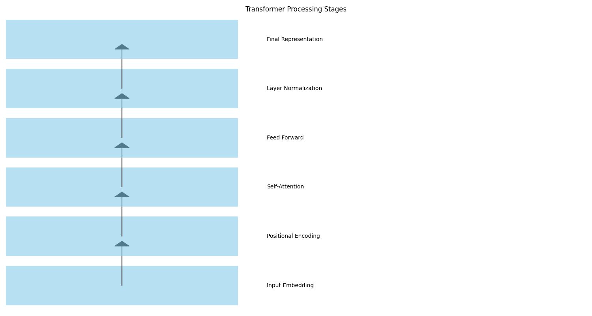
<figcaption>Six stages, from Input Embedding at the bottom to Final Representation at the top</figcaption>
</figure>
</div>

> **Success:** Checkpoint: **Transformer Processing Stages** stacks six stages from the bottom up: `Input Embedding`, `Positional Encoding`, `Self-Attention`, `Feed Forward`, `Layer Normalization` and `Final Representation`.

The diagram shows six stages a transformer processes a prompt through, in order:

**Input Embedding** is the foundation. Each token, such as `What` or `is`, is converted into a dense vector that captures its meaning, with similar words mapped to similar vectors. The script imitates this stage by getting an embedding for each token from `nomic-embed-text` through the Ollama API.

**Positional Encoding** fixes a limit of the basic architecture: a transformer processes all tokens at once rather than in order, so it has no sense of sequence by itself. Positional encodings added to the token embeddings tell the model where each token sits, so it can tell apart different arrangements of the same words.

**Self-Attention** is the key idea of transformers. Each token looks at every token in the sequence, itself included, and computes attention weights that say how relevant each one is. The script's `token_attention.png` imitates this for "What is the capital of France?" with embedding similarity (see **Under the hood** below).

**Feed Forward** networks follow attention. Once the tokens have gathered context through self-attention, each token's representation passes through a fully connected neural network, linear transformations with a non-linear activation, which processes each token on its own and transforms its representation further.

**Layer Normalization** keeps the values in a stable range, which makes training more efficient. In the original transformer it is applied after the self-attention and after the feed-forward networks, in the **Add & Norm** boxes of the architecture diagram.

**Final Representation** is the result of these stages: a set of contextualized token representations that capture both the meaning of each token and its relationship to the others in the sequence. These final representations can then be used for tasks such as predicting the next token ("Paris" in response to "What is the capital of France?").

> **Under the hood:**
>
> #### The script imitated attention with embeddings; no transformer ran on the prompt
>
> `transformers.py` never sends the prompt to a chat model: the 7 tokens are a fixed list in the script, and so is the response, `Paris`. Its "attention" is the cosine similarity between the separate embeddings of each pair of tokens, with each row divided by its sum so that it adds up to 1, a stand-in for the softmax a real transformer applies to its query-key scores. In a real model, attention weights come from learned query and key projections, in every layer and every head, and they change with each token's context.
>
> **Why it matters:** the heatmap shows how related the tokens are on their own, not what a model such as `llama3.2:3b` attends to. Ollama's API does not return a model's attention weights, so reading a real model's attention needs a library that exposes them.

::::

## Troubleshooting <!-- no-step -->

<details>
<summary>The script prints Error: and Troubleshooting steps:</summary>

The scripts that call Ollama catch any error, print `Error:` and `Troubleshooting steps:`, and end with the error's type and message. Confirm that Ollama answers on `http://localhost:11434` and that `ollama list` shows `nomic-embed-text:latest`; if it doesn't, run `ollama pull nomic-embed-text`.

</details>

<details>
<summary>ModuleNotFoundError: No module named 'ollama'</summary>

The script ran with a Python outside the lab's environment. Run it with the environment's Python, `.\.venv\Scripts\python` (Windows) or `.venv/bin/python` (macOS / Linux), from the lab folder, as the steps show. If the `.venv` folder is missing, repeat **1. Set Up the Scripts**.

</details>

<details>
<summary>tokenization.py fails on its first run</summary>

`tiktoken` downloads the vocabulary files of `cl100k_base`, `p50k_base` and `r50k_base` the first time they are used. Run the script once on a machine with an internet connection; later runs use the cached files.

</details>

<details>
<summary>python is not recognized</summary>

Python is not installed, or the terminal was opened before it was. Install Python 3.12 as [Before You Start](../00-before-you-start/guide.md) shows, then open a new terminal.

</details>

## Lab Files

Click a file to download. For `.ktr` and `.kjb` files, **Open in Pentaho Data Integration** launches Pentaho Data Integration with the file loaded. If Pentaho Data Integration is already running, the path is copied to your clipboard — switch to Pentaho Data Integration and press `Ctrl+O`, `Ctrl+V`, `Enter`.

The five scripts this workshop runs, in the order of its parts, and the list of libraries they need:

[prompt.py](./files/prompt.py)

[tokenization.py](./files/tokenization.py)

[embedding.py](./files/embedding.py)

[search.py](./files/search.py)

[transformers.py](./files/transformers.py)

[requirements.txt](./files/requirements.txt)

Also on disk at `C:\Workshop-AI-Specialty\02-pdi-ai-pipelines\18-key-concepts-workshop`.
