# Build the Knowledge Base

> **Warning:**
>
> #### Workshop - Build the Knowledge Base
>
> Build the ingest half of a Retrieval-Augmented Generation (RAG) pipeline: a Pentaho Data Integration transformation that reads six Larkspur Home Appliances documents in three formats, splits them into chunks, embeds each chunk with a local model and writes the chunks to PostgreSQL with pgvector. [Answer Questions](../21-rag-answer-questions/guide.md) searches the table this workshop loads.
>
> **What you'll do**
>
> * Check that pgvector and the embedding model answer
> * Read PDF, Word and text files with **Get File Names** and **Read Unstructured Document**
> * Split the text into overlapping chunks with **AI Segmentation**, and give each chunk a stable ID
> * Embed the chunks with **Text to Vector** and write them to pgvector with **Vector Writer**
> * Inspect the table in `psql`, add an HNSW index, and re-run the load without creating duplicates
>
> **Prerequisites:**
>
> * Ollama running on `http://localhost:11434` with `nomic-embed-text` pulled, the GenAI plugins installed, and the pgvector container `pcm-pgvector` running, as set up in [Before You Start](../00-before-you-start/guide.md)
> * The Retrieval-Augmented Generation [Overview](../19-rag/guide.md): chunks, embeddings and pgvector
>
> **Estimated time:** 50 minutes

<figure>

<figcaption class="pcm-video-caption">Walkthrough: coming soon</figcaption>

</figure>

<div align="center">
<figure>
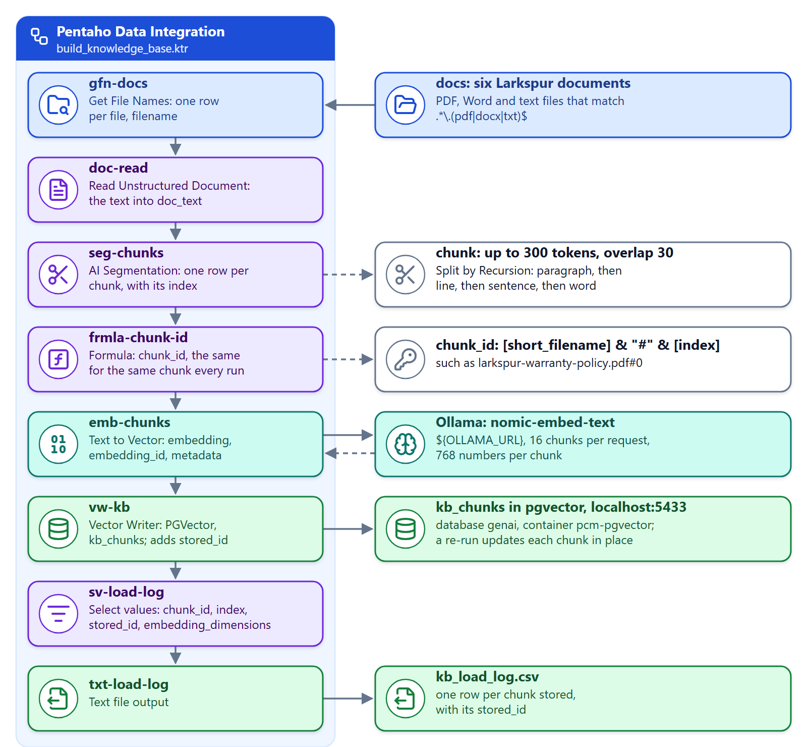
<figcaption>What you build: the steps of build_knowledge_base.ktr and what each one adds, calls and writes</figcaption>
</figure>
</div>

:::: tabs

### 1. The Knowledge Base

> **Note:**
>
> #### Six Documents from Larkspur Home Appliances
>
> Larkspur Home Appliances sells dishwashers, washing machines and coffee machines. Its customer service answers the same questions every day from three product manuals and three policy documents. This workshop loads all six into one table, so that the next workshop can answer those questions from them.

The documents are in the `docs` folder of the workshop folder, `C:\Workshop-AI-Specialty\05-retrieval-augmented-generation\20-rag-knowledge-base\docs`:

| File | Format | What it covers |
| --- | --- | --- |
| `larkspur-cm300-coffee-machine-manual.txt` | Text | BrewMaster CM-300 espresso machine: indicator lights, codes C3 and C5, descaling, taste problems, daily care |
| `larkspur-customer-support-faq.txt` | Text | Service hours, where the serial number is, spare parts, installation |
| `larkspur-dw500-dishwasher-manual.pdf` | PDF | QuietClean DW-500 dishwasher: programs, child lock, error codes E1, E2, E4 and E7, troubleshooting, maintenance |
| `larkspur-returns-policy.docx` | Word | Returns of unused and opened appliances, faulty deliveries, collection fees, refunds |
| `larkspur-warranty-policy.pdf` | PDF | The 2-year warranty, extended cover for motors and tubs, Care+, exclusions, claims |
| `larkspur-wm800-washing-machine-manual.docx` | Word | FreshSpin WM-800 washing machine: transport bolts, programs, error codes F01 to F21, care |

The transformation you build reads every file, whatever its format, in the same five steps:

| Step | Name | What it adds to the row |
| --- | --- | --- |
| **Get File Names** | `gfn-docs` | One row per file: `filename` (the full path), `short_filename` and other file details |
| **Read Unstructured Document** | `doc-read` | `doc_text`: the document's text |
| **AI Segmentation** | `seg-chunks` | One row per chunk: `chunk` and its number in the document, `index` |
| **Formula** | `frmla-chunk-id` | `chunk_id`: the file name and the chunk number, such as `larkspur-warranty-policy.pdf#0` |
| **Text to Vector** | `emb-chunks` | `embedding` (768 numbers), `embedding_id`, `embedding_metadata`, `embedding_dimensions` |
| **Vector Writer** | `vw-kb` | Writes each chunk to the table `kb_chunks`, and adds `stored_id` |

A **Select values** and a **Text file output** step then write a log of what was stored.

### 2. Check pgvector and the Model

> **Note:**
>
> #### Two Services, Checked by Hand
>
> **Vector Writer** writes to the PostgreSQL in the `pcm-pgvector` container, and **Text to Vector** asks Ollama's `nomic-embed-text` model for the vectors. Check both before you build.

1. Check that the container runs. In PowerShell, run:

```powershell
podman ps --filter name=pcm-pgvector --format "{{.Names}} {{.Status}} {{.Ports}}"
```

> **Success:** Checkpoint: one line that starts `pcm-pgvector Up` and ends `127.0.0.1:5433->5432/tcp`.

If nothing is listed, start it with `C:\PGVector\run-podman-pgvector.ps1`.

2. Check that the database has the `vector` extension. In PowerShell, run:

```powershell
podman exec pcm-pgvector psql -U genai -d genai -c "select extversion from pg_extension where extname = 'vector'"
```

> **Success:** Checkpoint: one row with `extversion` `0.8.7` (or a later version).

3. Ask Ollama for the embedding of one sentence, and count its numbers. In PowerShell, run:

```powershell
$body = @{ model = "nomic-embed-text"; input = "How do I descale the coffee machine?" } | ConvertTo-Json
$r = Invoke-RestMethod -Uri http://localhost:11434/api/embed -Method Post -ContentType "application/json" -Body $body
$r.embeddings[0].Count
```

> **Success:** Checkpoint: `768`.

If Ollama says the model is not found, run `ollama pull nomic-embed-text` and try again.

> **Under the hood:**
>
> #### An embedding request returns one vector per text
>
> Ollama's `/api/embed` endpoint takes a model and one or more texts and returns one list of numbers per text in `embeddings`. **Text to Vector** sends the same request, with up to 16 chunks in one request (its **Batch size**), and puts each vector in its row's `embedding` field as a JSON array.
>
> **Why it matters:** `768` is the number you set as the **Vector dimension** of the table. A vector of any other length is rejected, which stops a run with the wrong model from mixing vectors into the table.

### 3. List and Read the Documents

> **Note:**
>
> #### Get File Names and Read Unstructured Document
>
> Create the transformation and its parameters, list the documents with **Get File Names**, and extract their text with **Read Unstructured Document** in Stream mode, which reads the file named in each row.

1. Start Pentaho Data Integration with the **Start Pentaho Data Integration** button below, or from PowerShell:

```powershell
Set-Location C:\Pentaho\design-tools\data-integration
.\Spoon.bat
```

<button data-launch="spoon" data-path="">Start Pentaho Data Integration</button>

2. Select **File > New > Transformation** (`Ctrl+N`).
3. Select **File > Save as** and save it as `build_knowledge_base.ktr` in `C:\Workshop-AI-Specialty\05-retrieval-augmented-generation\20-rag-knowledge-base`, next to the `docs` folder. (On your own machine, download the six documents from **Lab Files** below into a `docs` folder in the folder you save in.)
4. Double-click an empty part of the canvas. **Transformation properties** opens.
5. Open the **Parameters** tab and fill the grid:

| Parameter | Default Value | Description |
| --- | --- | --- |
| `MODEL_NAME` | `llama3.2:3b` | Ollama chat model (AI Segmentation only labels its token estimate with it) |
| `OLLAMA_URL` | `http://localhost:11434` | Ollama server |
| `PG_HOST` | `localhost` | pgvector host (lab kit: localhost) |
| `PG_PORT` | `5433` | pgvector port (lab kit: 5433; 5432 is the Pentaho repository) |
| `PG_DATABASE` | `genai` | Database |
| `PG_USER` | `genai` | User |
| `PG_PASSWORD` | `genai` | Password |

6. Select **OK**.
7. On the **Design** tab, open the **Input** folder and drag **Get File Names** onto the canvas.
8. Double-click **Get File Names** and set **Step name** to `gfn-docs`.
9. On the **File** tab, set **File or directory** to `${Internal.Entry.Current.Directory}/docs` and **Regular Expression** to `.*\.(pdf|docx|txt)$`, then select **Add**. The folder and the expression move to the **Selected files** grid.
10. Select **OK**.
11. Save the transformation (`Ctrl+S`).
12. Select **gfn-docs** on the canvas, press `F10` (**Action > Preview**), and select **Quick Launch**.

> **Success:** Checkpoint: 6 rows, one per document, in alphabetical order of `short_filename` from `larkspur-cm300-coffee-machine-manual.txt` to `larkspur-wm800-washing-machine-manual.docx`. `filename` holds each file's full Windows path, such as `C:\Workshop-AI-Specialty\05-retrieval-augmented-generation\20-rag-knowledge-base\docs\larkspur-cm300-coffee-machine-manual.txt`.

13. Select **Close**.
14. On the **Design** tab, open the **Input** folder and drag **Read Unstructured Document** onto the canvas.
15. Create a hop from **gfn-docs** to **Read Unstructured Document**: hold `Shift` and drag from one step to the other.
16. Double-click **Read Unstructured Document** and set **Step name** to `doc-read`.
17. On the **Main** tab, under **Source**, select **Stream** and set **File field name** to `filename`. Under **Target**, set **Result Field name** to `doc_text`.
<div align="center">
<figure>
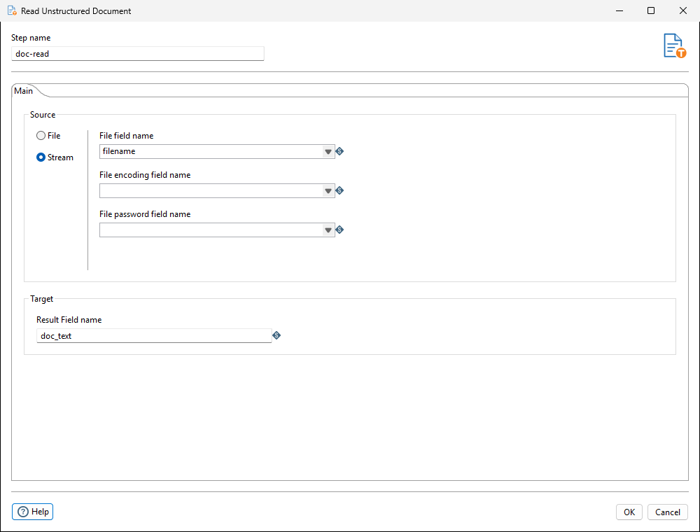
<figcaption>doc-read: its settings</figcaption>
</figure>
</div>

18. Select **OK**.

> **Under the hood:**
>
> #### One step reads three formats, because Apache Tika picks the parser per file
>
> In Stream mode, **Read Unstructured Document** reads the path in `filename` for each row and lets Apache Tika detect the format: the PDF parser for the two PDFs, the Office parser for the two Word files, plain text for the rest. The text, trimmed, goes into `doc_text`; the row keeps every field **Get File Names** added, `short_filename` among them.
>
> **Why it matters:** a new document in the folder is loaded on the next run with no change to the transformation, whatever its format (TXT, PDF, DOC, DOCX, PPT or PPTX).

### 4. Split into Chunks

> **Note:**
>
> #### AI Segmentation and a Chunk ID
>
> **AI Segmentation** turns one row per document into one row per chunk. A **Formula** then gives each chunk an ID built from its file name and its number, so that the same chunk gets the same ID on every run.

1. On the **Design** tab, open the **AI** folder and drag **AI Segmentation** onto the canvas.
2. Create a hop from **doc-read** to **AI Segmentation**.
3. Double-click **AI Segmentation** and set **Step name** to `seg-chunks`.
4. On the **Main** tab:
   * Set **Field name** to `doc_text`.
   * Set **Split strategy** to `Split by Recursion (Paragraph > Line > Sentence > Word)`.
   * Set **Output field Name** to `chunk`.
   * Keep **Add segment index to result** and **Stop on error** selected.
5. On the **Config** tab, select **Using Tokens**, set **LLM provider** to `Ollama`, **Model name** to `${MODEL_NAME}`, **Max Segment size** to `300` and **Max Overlap size** to `30`. Keep the **Using Chars** sizes at `1024` and `0`.
<div align="center">
<figure>
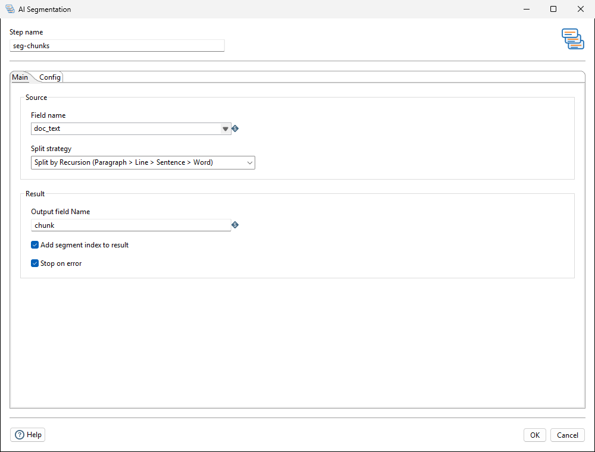
<figcaption>seg-chunks: the Main tab</figcaption>
</figure>
</div>

<div align="center">
<figure>
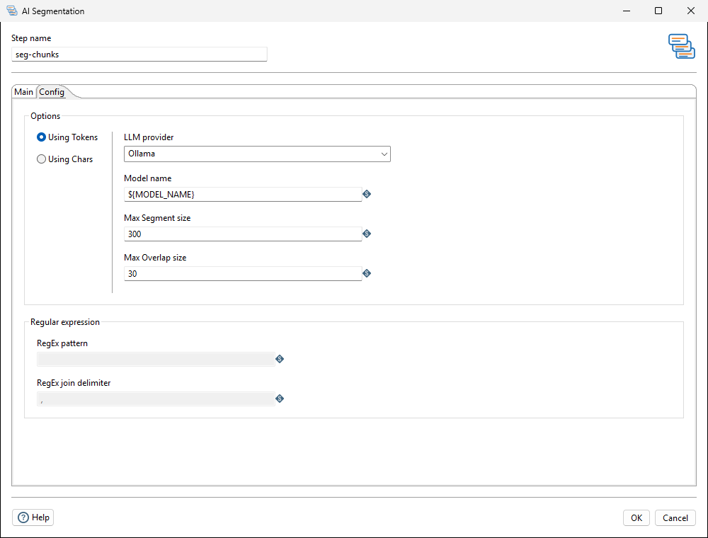
<figcaption>seg-chunks: the Config tab</figcaption>
</figure>
</div>

6. Select **OK**.

> **Under the hood:**
>
> #### The chunks are measured in estimated tokens, with no call to Ollama
>
> With the Ollama provider, **AI Segmentation** makes no network call: it estimates tokens at about 4 characters each, so a chunk holds up to about 1,200 characters and the last 30 tokens of a chunk start the next one. The model name is only a label for that estimate. The step writes one row per chunk with every incoming field, the chunk in `chunk` and its number in `index`, from `0` for each document.
>
> **Why it matters:** the step needs both size pairs to be whole numbers, even the pair it does not use, and stops at start-up when one is empty. That is why **Using Chars** keeps its defaults.

7. On the **Design** tab, open the **Scripting** folder and drag **Formula** onto the canvas.
8. Create a hop from **seg-chunks** to **Formula**.
9. Double-click **Formula** and set **Step name** to `frmla-chunk-id`.
10. Fill the grid with one row: **New field** `chunk_id`, **Formula** `[short_filename] & "#" & [index]`, **Value type** `String`.
11. Select **OK**, and save the transformation (`Ctrl+S`).

> **Under the hood:**
>
> #### A stable ID turns a re-run into an update
>
> Without an ID, every run writes every chunk again as a new record with a random ID, and the table doubles. `chunk_id` is the same for the same chunk of the same file on every run, such as `larkspur-warranty-policy.pdf#0`. **Vector Writer** turns an ID that is not a UUID into a name-based UUID, the same UUID for the same text, and its PostgreSQL insert ends `ON CONFLICT (embedding_id) DO UPDATE`, so an existing chunk is overwritten in place.
>
> **Why it matters:** the knowledge base stays fresh by re-running the load. If a document gets shorter, its last chunks keep their old rows, because the step never deletes; the **Run Again** tab shows how to clear a document's rows first.

### 5. Embed the Chunks

> **Note:**
>
> #### Text to Vector
>
> **Text to Vector** sends the chunks to `nomic-embed-text` in batches and adds each chunk's vector to its row, with the ID and the metadata that **Vector Writer** stores beside it.

1. On the **Design** tab, open the **AI** folder and drag **Text to Vector** onto the canvas.
2. Create a hop from **frmla-chunk-id** to **Text to Vector**.
3. Double-click **Text to Vector** and set **Step name** to `emb-chunks`.
4. On the **Input** tab:
   * Under **Source**, keep **Stream** and set **Input Text Field** to `chunk`.
   * Set **Embedding ID field (optional)** to `chunk_id`.
   * Fill the metadata grid under **Incoming fields added to the embedding metadata**:

| Field | Metadata key |
| --- | --- |
| `short_filename` | `source` |
| `index` | `chunk_index` |

5. On the **Embedding Model** tab, set **LLM Provider** to `Ollama` and **Embedding model name/Deployment name/Model ID** to `nomic-embed-text`. In the **Model Configuration** grid, keep one row: **Parameter** `endpoint`, **Value** `${OLLAMA_URL}`. Keep **Batch size (rows per request)** `16`.
6. On the **Output** tab, keep **Pass the embeddings to the output stream** selected and the field names `embedding`, `embedding_id`, `embedding_metadata` and `embedding_dimensions`, with **Vector format** `JSON array`. Select **Include the input text in the metadata**. Keep **Write the embeddings to a file** cleared and **Stop on error** selected.
<div align="center">
<figure>
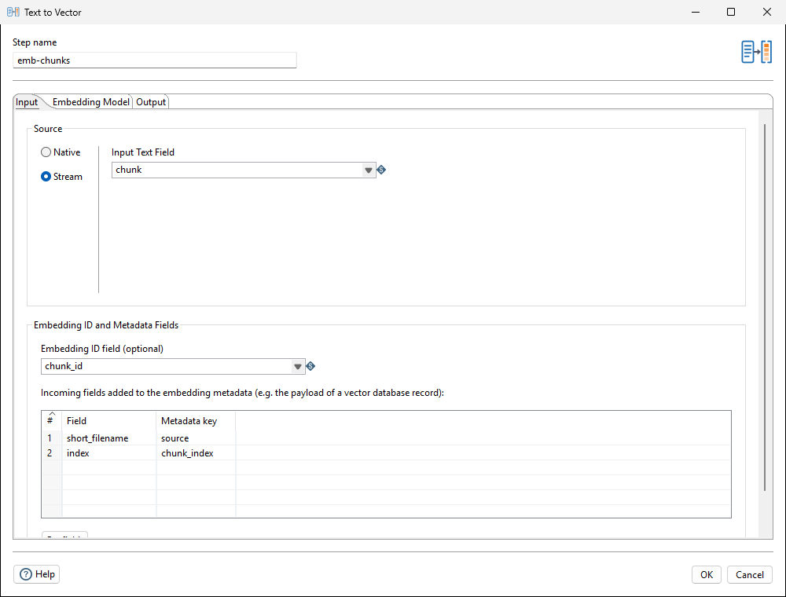
<figcaption>emb-chunks: the Input tab</figcaption>
</figure>
</div>

<div align="center">
<figure>
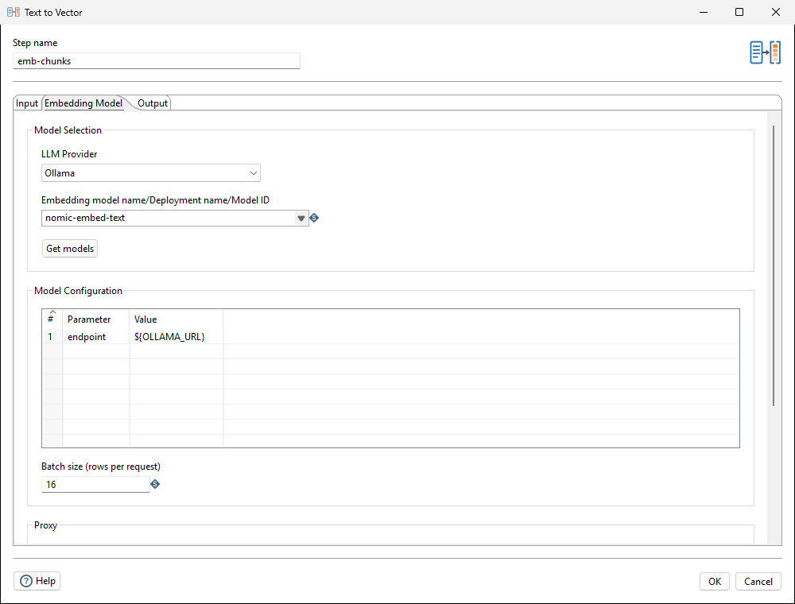
<figcaption>emb-chunks: the Embedding Model tab</figcaption>
</figure>
</div>

<div align="center">
<figure>
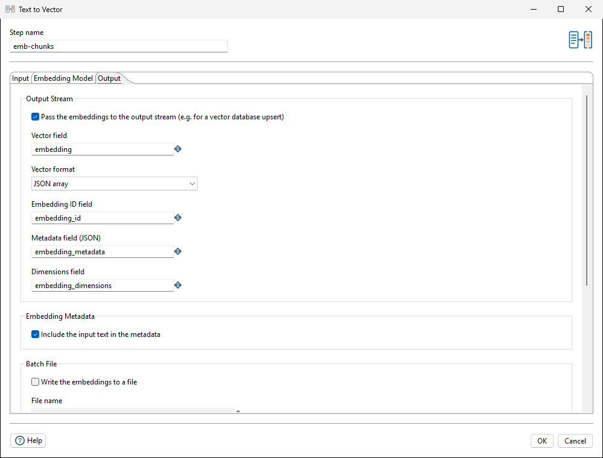
<figcaption>emb-chunks: the Output tab</figcaption>
</figure>
</div>

7. Select **OK**.

> **Under the hood:**
>
> #### The metadata travels with the vector as one JSON object
>
> `embedding_metadata` is a JSON object that **Text to Vector** builds for each row: the provider, the model, the dimension count, the time, the two keys from the grid (`source` and `chunk_index`) and, because you selected the option, the chunk itself under `text`. `embedding_id` is the value of `chunk_id`.
>
> **Why it matters:** `source` is what lets an answer cite its document in the next workshop. A key that is not in the metadata now cannot be filtered on or shown later without loading the table again.

### 6. Write to pgvector

> **Note:**
>
> #### Vector Writer, Select Values and Text File Output
>
> **Vector Writer** writes each row's vector, ID, text and metadata to the table `kb_chunks`, creating the table on the first run. A log file then records which chunk got which stored ID.

1. On the **Design** tab, open the **AI** folder and drag **Vector Writer** onto the canvas.
2. Create a hop from **emb-chunks** to **Vector Writer**.
3. Double-click **Vector Writer** and set **Step name** to `vw-kb`.
4. On the **Connection** tab, keep **Vector database** `PGVector`, set **Collection / index / table** to `kb_chunks`, and fill the **Connection Parameters** grid. Leave **Schema** empty: the table goes in `public`.

| Parameter | Value |
| --- | --- |
| Host | `${PG_HOST}` |
| Port | `${PG_PORT}` |
| Database | `${PG_DATABASE}` |
| Username | `${PG_USER}` |
| Password | `${PG_PASSWORD}` |

5. On the **Fields** tab, set **Vector field** to `embedding`, **ID field (optional)** to `embedding_id`, **Text field (optional)** to `chunk` and **Metadata field (optional)** to `embedding_metadata`. Leave the **Metadata fields** grid empty.
6. On the **Options** tab, keep **Write mode** `Upsert`, **Batch size (records per request)** `100` and **Create the collection if missing** selected. Set **Vector dimension** to `768` and **Stored ID output field (optional)** to `stored_id`. Keep **Stop on error** selected.
<div align="center">
<figure>
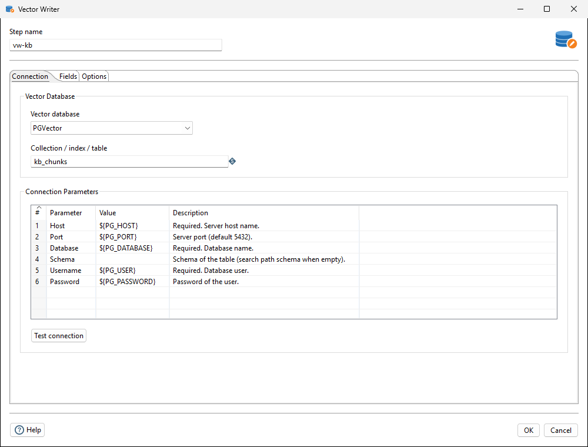
<figcaption>vw-kb: the Connection tab</figcaption>
</figure>
</div>

<div align="center">
<figure>
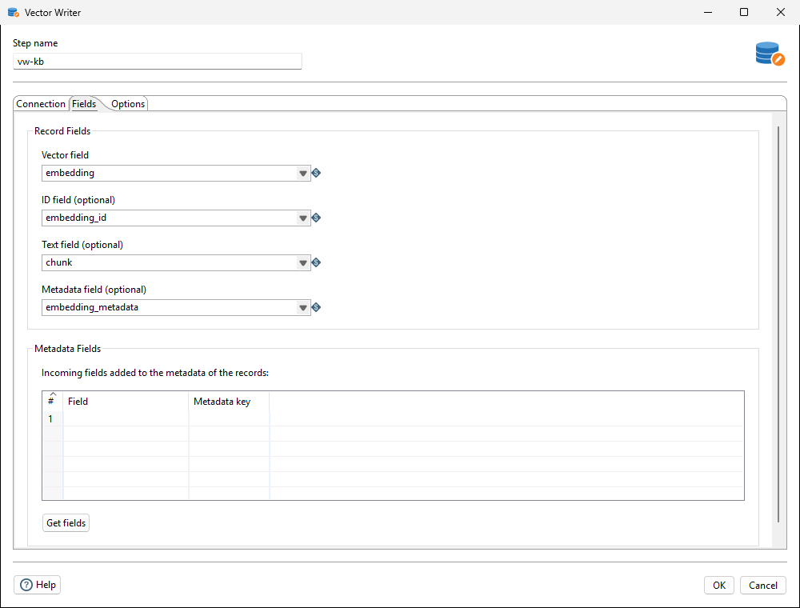
<figcaption>vw-kb: the Fields tab</figcaption>
</figure>
</div>

<div align="center">
<figure>
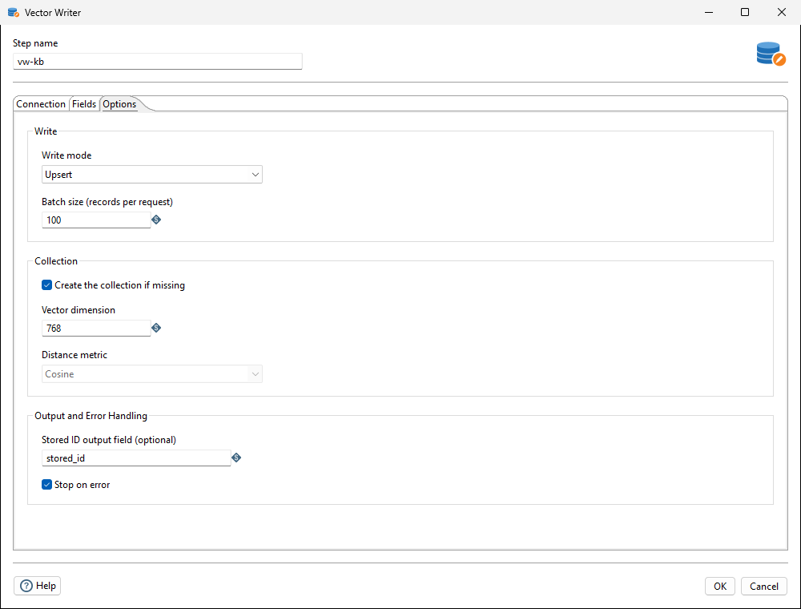
<figcaption>vw-kb: the Options tab</figcaption>
</figure>
</div>

7. Select **OK**.
8. On the **Design** tab, open the **Transform** folder and drag **Select values** onto the canvas.
9. Create a hop from **vw-kb** to **Select values**.
10. Double-click **Select values**, set **Step name** to `sv-load-log`, and on the **Select & Alter** tab list these fields in this order: `chunk_id`, `index`, `stored_id`, `embedding_dimensions`. Select **OK**.
11. On the **Design** tab, open the **Output** folder and drag **Text file output** onto the canvas.
12. Create a hop from **sv-load-log** to **Text file output**.
13. Double-click **Text file output** and set **Step name** to `txt-load-log`.
14. On the **File** tab, set **Filename** to `${Internal.Entry.Current.Directory}/kb_load_log` and **Extension** to `csv`. Select **Create Parent folder**.
15. On the **Content** tab, keep **Separator** `,`, **Enclosure** `"` and **Header** selected, and set **Encoding** to `UTF-8`.
16. On the **Fields** tab, select **Get Fields**, then **Minimal width**. The grid lists the four fields, in the order **sv-load-log** gives them, with no length. Without **Minimal width**, every text field would be padded to its declared length.
17. Select **OK**, and save the transformation (`Ctrl+S`).

> **Under the hood:**
>
> #### Vector Writer creates the table it needs, and nothing more
>
> On its first batch, **Vector Writer** runs `CREATE EXTENSION IF NOT EXISTS vector` and `CREATE TABLE IF NOT EXISTS kb_chunks (embedding_id UUID PRIMARY KEY, embedding vector(768), text TEXT NULL, metadata JSON NULL)`, then writes the rows in batches of 100. It creates no search index. The rows pass through unchanged, plus `stored_id`, the UUID the record was stored under.
>
> **Why it matters:** you can point the step at an empty database and it is ready after one run. Searching it fast is still your job: the **Inspect the Table** tab adds the index the step leaves out.

### 7. Run

> **Note:**
>
> #### Run the Transformation
>
> Each batch of up to 16 chunks is one embedding request to Ollama, and each batch of up to 100 rows one write to PostgreSQL.

1. Press `F9` (**Action > Run**), and select **Run** in the **Run Options** dialog.
2. In **Execution Results**, open the **Step Metrics** tab.

<!-- UNPROVEN: the checkpoints below describe the expected shape; replace with measured figures (chunk count per document) once the GENAI-EE license lets the solution run. -->

> **Success:** Checkpoint: every step finishes without errors. **gfn-docs** and **doc-read** show 6 under **Written**. **seg-chunks** writes more rows than it reads: a few chunks per document, between one for the short support FAQ and several for the dishwasher manual. **emb-chunks**, **vw-kb** and **txt-load-log** each write the same number of rows as **seg-chunks**.

3. Open `C:\Workshop-AI-Specialty\05-retrieval-augmented-generation\20-rag-knowledge-base\kb_load_log.csv`.

> **Success:** Checkpoint: its first line is `chunk_id,index,stored_id,embedding_dimensions`. Every row has a `chunk_id` such as `larkspur-warranty-policy.pdf#0`, a UUID in `stored_id` and `768` in `embedding_dimensions`. Each document's `index` starts at `0`.

### 8. Inspect the Table

> **Note:**
>
> #### Look Inside with psql
>
> The table is plain PostgreSQL. Open `psql` in the container and see what **Vector Writer** stored, then add the search index the step does not create.

1. Open `psql`. In PowerShell, run:

```powershell
podman exec -it pcm-pgvector psql -U genai -d genai
```

The prompt changes to `genai=#`. Type each statement below at that prompt.

2. Show the table's columns:

```sql
\d kb_chunks
```

<!-- UNPROVEN: the table shape is the CREATE TABLE in the bundled langchain4j-pgvector 1.22.0-beta32 jar, checked on a scratch table of that shape; confirm it on the table the solution creates. -->

> **Success:** Checkpoint: four columns, `embedding_id` `uuid` (not null), `embedding` `vector(768)`, `text` `text` and `metadata` `json`, and one index, `kb_chunks_pkey`, the primary key on `embedding_id`.

3. Count the chunks per document:

```sql
SELECT metadata->>'source' AS source, count(*) AS chunks
FROM kb_chunks
GROUP BY 1
ORDER BY 1;
```

<!-- UNPROVEN: the chunk counts depend on AI Segmentation; record them once the solution has run. -->

> **Success:** Checkpoint: 6 rows, one per document, from `larkspur-cm300-coffee-machine-manual.txt` to `larkspur-wm800-washing-machine-manual.docx`. The counts add up to the rows **vw-kb** wrote.

4. List the keys the metadata holds:

```sql
SELECT DISTINCT json_object_keys(metadata) AS metadata_key FROM kb_chunks ORDER BY 1;
```

<!-- UNPROVEN: the exact key list comes from Text to Vector; confirm it once the solution has run. -->

> **Success:** Checkpoint: among the keys, `source` and `chunk_index` from the **Metadata fields** grid, and the keys **Text to Vector** adds, such as `embedding_model`.

5. Read the start of each chunk of the warranty policy:

```sql
SELECT (metadata->>'chunk_index')::int AS chunk_index, vector_dims(embedding) AS dims,
       regexp_replace(left(text, 60), '\s+', ' ', 'g') AS starts_with
FROM kb_chunks
WHERE metadata->>'source' = 'larkspur-warranty-policy.pdf'
ORDER BY 1;
```

<!-- UNPROVEN: the chunk boundaries come from AI Segmentation. -->

> **Success:** Checkpoint: one row per chunk of the warranty policy, numbered from `0`, each with `dims` `768`. Chunk `0` starts `Larkspur Home Appliances - Limited Warranty Policy`.

6. Create the search index:

```sql
CREATE INDEX IF NOT EXISTS kb_chunks_embedding_hnsw ON kb_chunks USING hnsw (embedding vector_cosine_ops);
\di kb_chunks*
```

> **Success:** Checkpoint: `CREATE INDEX`, then two indexes on `kb_chunks`: `kb_chunks_embedding_hnsw` and `kb_chunks_pkey`.

7. Type `\q` to leave `psql`.

> **Under the hood:**
>
> #### The HNSW index answers nearest-neighbor queries without reading every row
>
> Without an index, a similarity search computes the distance from the question to every stored vector. A Hierarchical Navigable Small World (HNSW) index links each vector to its near neighbors in a layered graph, and a search walks that graph to the closest ones. `vector_cosine_ops` builds it for the cosine distance operator `<=>`, the one **Vector Search** orders by. The index is approximate: on a very large table it can miss a close match in exchange for speed.
>
> **Why it matters:** on a few dozen chunks PostgreSQL may still scan the table, because that is faster; on hundreds of thousands, the index is the difference between milliseconds and seconds per question. Build it once the load is done: inserts into an indexed table are slower.

### 9. Run Again

> **Note:**
>
> #### Re-run Without Duplicates
>
> Run the load a second time and check that the table has the same number of rows.

1. In Spoon, press `F9` (**Action > Run**), and select **Run** in the **Run Options** dialog.
2. Count the rows. In PowerShell, run:

```powershell
podman exec pcm-pgvector psql -U genai -d genai -c "select count(*) from kb_chunks"
```

<!-- UNPROVEN: the row count depends on AI Segmentation; record it once the solution has run. -->

> **Success:** Checkpoint: the same count as after the first run, equal to the rows **vw-kb** wrote, and `kb_load_log.csv` lists the same `stored_id` for each `chunk_id` as before.

3. When a document changes and gets shorter, delete its rows before the next run, so that no chunk of the old version stays behind. For example, for the warranty policy, in PowerShell, run:

```powershell
podman exec pcm-pgvector psql -U genai -d genai -c "delete from kb_chunks where metadata->>'source' = 'larkspur-warranty-policy.pdf'"
```

Then run the transformation again, and the warranty policy's chunks are written fresh.

::::

## Troubleshooting <!-- no-step -->

<details>
<summary>Error initializing step: License validation failed</summary>

The Pentaho license on this machine has no GenAI rights. Every GenAI plugin step checks for a license with the GenAI Plugin Suite (GENAI-EE) subscription when the transformation starts. Install a license that includes it, as described in [Before You Start](../00-before-you-start/guide.md).

</details>

<details>
<summary>vw-kb fails with Connection refused</summary>

The pgvector container is not running, or the port is wrong. Run `C:\PGVector\run-podman-pgvector.ps1`, and check that `PG_PORT` is `5433`: port 5432 is the Pentaho Server repository's PostgreSQL, which has no `genai` database.

</details>

<details>
<summary>vw-kb rejects rows with a dimension error</summary>

The vectors are not 768 numbers long: **Text to Vector** is using another model than `nomic-embed-text`. Set the model back, or, to change models on purpose, drop the table (`drop table kb_chunks`) and load it again with the new model and its dimension.

</details>

<details>
<summary>seg-chunks stops at start-up</summary>

One of the four size fields on its **Config** tab is empty or not a whole number. All four must hold a number, including the **Using Chars** pair the step does not use.

</details>

<details>
<summary>doc-read stops on a file</summary>

**Read Unstructured Document** has no error hop: a file it cannot read stops the transformation. Check that the **Regular Expression** of **gfn-docs** only lets PDF, Word and text files through, and that no document is open in another program.

</details>

## Lab Files

Click a file to download. For `.ktr` and `.kjb` files, **Open in Pentaho Data Integration** launches Pentaho Data Integration with the file loaded. If Pentaho Data Integration is already running, the path is copied to your clipboard — switch to Pentaho Data Integration and press `Ctrl+O`, `Ctrl+V`, `Enter`.

The six Larkspur Home Appliances documents the transformation loads, in the `docs` folder:

[larkspur-cm300-coffee-machine-manual.txt](./files/docs/larkspur-cm300-coffee-machine-manual.txt)

[larkspur-customer-support-faq.txt](./files/docs/larkspur-customer-support-faq.txt)

[larkspur-dw500-dishwasher-manual.pdf](./files/docs/larkspur-dw500-dishwasher-manual.pdf)

[larkspur-returns-policy.docx](./files/docs/larkspur-returns-policy.docx)

[larkspur-warranty-policy.pdf](./files/docs/larkspur-warranty-policy.pdf)

[larkspur-wm800-washing-machine-manual.docx](./files/docs/larkspur-wm800-washing-machine-manual.docx)

### Solution <!-- no-step -->

The finished transformation for this lab. Open it alongside your own to compare, or run it to see the expected result. It reads the documents from the lab folder's `docs` folder, loads the table `kb_chunks` and writes `kb_load_log.csv` beside itself.

Also on disk at `C:\Workshop-AI-Specialty\05-retrieval-augmented-generation\20-rag-knowledge-base\solution`.

[build_knowledge_base.ktr](./files/solution/build_knowledge_base.ktr) <button data-launch="spoon" data-path="files/solution/build_knowledge_base.ktr">Open in Pentaho Data Integration</button> <button data-graph="files/solution/build_knowledge_base.ktr">View graph</button>

build_knowledge_base in Spoon, with its note:

<div align="center">
<figure>
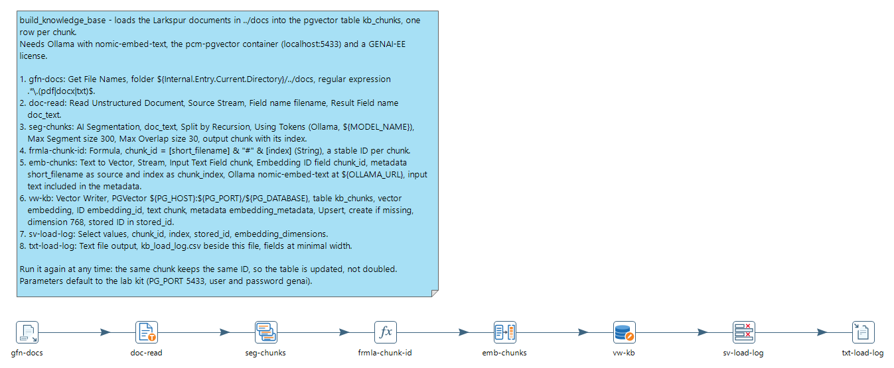
<figcaption>build_knowledge_base.ktr in Spoon</figcaption>
</figure>
</div>
