# Answer Questions

> **Warning:**
>
> #### Workshop - Answer Questions
>
> Build the query half of a Retrieval-Augmented Generation (RAG) pipeline: a Pentaho Data Integration transformation that takes customer questions, finds the matching passages of the Larkspur Home Appliances documents in pgvector, and has a local Large Language Model (LLM) answer from those passages only, naming the documents it used. Then tune the search and watch what changes.
>
> **What you'll do**
>
> * Embed each question with **Text to Vector** and find its closest passages with **Vector Search**
> * Build a prompt from the passages and their sources with **Modified JavaScript value**
> * Answer from the passages only, with citations, with **AI Chat**, and parse the answer with **JSON input**
> * See the model say so when the documents do not hold the answer
> * Change the number of passages and the minimum score, and compare what is retrieved and answered
>
> **Prerequisites:**
>
> * [Build the Knowledge Base](../20-rag-knowledge-base/guide.md), completed and run: this workshop searches the table `kb_chunks` it loads
> * Ollama running on `http://localhost:11434` with `llama3.2:3b` and `nomic-embed-text` pulled, the GenAI plugins installed, and the pgvector container `pcm-pgvector` running, as set up in [Before You Start](../00-before-you-start/guide.md)
>
> **Estimated time:** 60 minutes

<figure>

<figcaption class="pcm-video-caption">Walkthrough: coming soon</figcaption>

</figure>

<div align="center">
<figure>
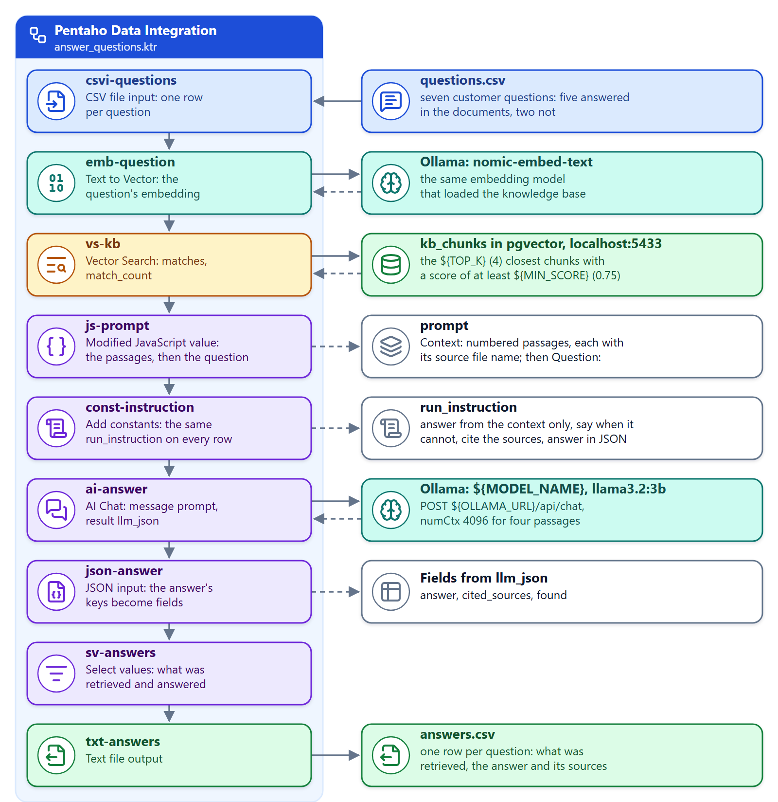
<figcaption>What you build: the steps of answer_questions.ktr and what each one searches, builds, calls and writes</figcaption>
</figure>
</div>

:::: tabs

### 1. The Questions

> **Note:**
>
> #### Seven Customer Questions
>
> `questions.csv` holds seven questions a Larkspur customer might ask. Five are answered in one of the documents loaded in Build the Knowledge Base; two are not, so the pipeline has to say it cannot find them.

Check first that the knowledge base is loaded. In PowerShell, run:

```powershell
podman exec pcm-pgvector psql -U genai -d genai -c "select count(*) from kb_chunks"
```

> **Success:** Checkpoint: one row with a count above 0, the number of chunks Build the Knowledge Base wrote. If PostgreSQL says `relation "kb_chunks" does not exist`, run that workshop's transformation first.

The questions, the document that holds each answer (`expected_source`), and what that document says:

| `question_id` | `question` | `expected_source` | What the document says |
| --- | --- | --- | --- |
| 1 | My dishwasher shows error E2. What should I do? | `larkspur-dw500-dishwasher-manual.pdf` | E2 means the water does not drain: switch off, clean the filter assembly in the bottom of the tub, check the drain hose and the sink waste, and contact Larkspur Service if the code returns |
| 2 | How often should I descale the BrewMaster coffee machine? | `larkspur-cm300-coffee-machine-manual.txt` | Every 200 cups, or as soon as the amber light flashes, whichever comes first; with Larkspur DescalePro, never vinegar |
| 3 | How long is the motor of the FreshSpin washing machine covered? | `larkspur-warranty-policy.pdf` | The inverter motor is covered for 10 years from purchase, parts only; labor is charged after the second year |
| 4 | Can I return a washing machine I have already unpacked because I changed my mind, and is there a fee? | `larkspur-returns-policy.docx` | Yes, within 14 days of delivery, with a 15% restocking fee; collecting a washing machine that is not faulty also costs $49 |
| 5 | Is damage caused by limescale covered by the warranty? | `larkspur-warranty-policy.pdf` | No, when the appliance was not descaled as the manual instructs |
| 6 | What is the energy rating of the DW-500 dishwasher? | `none` | No document gives an energy rating |
| 7 | What is the Larkspur share price today? | `none` | No document mentions it |

Question 6 is the harder test: the search finds dishwasher passages that look relevant, but none holds the answer, so only the instruction stops the model from inventing a rating.

### 2. Embed and Search

> **Note:**
>
> #### CSV File Input, Text to Vector and Vector Search
>
> Read the questions, turn each into a vector with the same model that embedded the chunks, and find each question's closest chunks in `kb_chunks`.

1. Start Pentaho Data Integration with the **Start Pentaho Data Integration** button below, or from PowerShell:

```powershell
Set-Location C:\Pentaho\design-tools\data-integration
.\Spoon.bat
```

<button data-launch="spoon" data-path="">Start Pentaho Data Integration</button>

2. Select **File > New > Transformation** (`Ctrl+N`).
3. Select **File > Save as** and save it as `answer_questions.ktr` in `C:\Workshop-AI-Specialty\05-retrieval-augmented-generation\21-rag-answer-questions`, next to `questions.csv`. (On your own machine, download `questions.csv` from **Lab Files** below into the folder you save in.)
4. Double-click an empty part of the canvas. **Transformation properties** opens.
5. Open the **Parameters** tab and fill the grid:

| Parameter | Default Value | Description |
| --- | --- | --- |
| `MODEL_NAME` | `llama3.2:3b` | Ollama chat model |
| `OLLAMA_URL` | `http://localhost:11434` | Ollama server |
| `PG_HOST` | `localhost` | pgvector host (lab kit: localhost) |
| `PG_PORT` | `5433` | pgvector port (lab kit: 5433; 5432 is the Pentaho repository) |
| `PG_DATABASE` | `genai` | Database |
| `PG_USER` | `genai` | User |
| `PG_PASSWORD` | `genai` | Password |
| `TOP_K` | `4` | Passages retrieved per question |
| `MIN_SCORE` | `0.75` | Lowest score a passage needs, 0 to 1 ((1 + cosine similarity) / 2) |

6. Select **OK**.
7. On the **Design** tab, open the **Input** folder and drag **CSV file input** onto the canvas.
8. Double-click **CSV file input** and set **Step name** to `csvi-questions`.
9. Set **Filename** to `${Internal.Entry.Current.Directory}/questions.csv`.
10. Keep **Delimiter** `,`, **Enclosure** `"` and **Header row present?** selected. Clear **Lazy conversion?**.
11. Select **Get Fields**, then **Close** on the summary, and compare the **Fields** grid with this table:

| Name | Type | Length |
| --- | --- | --- |
| `question_id` | Integer | 15 |
| `question` | String | 101 |
| `expected_source` | String | 40 |

12. Select **OK**.
13. Save the transformation (`Ctrl+S`).
14. Select **csvi-questions** on the canvas, press `F10` (**Action > Preview**), and select **Quick Launch**.

> **Success:** Checkpoint: 7 rows, `question_id` `1` to `7`. The first is `My dishwasher shows error E2. What should I do?` with `expected_source` `larkspur-dw500-dishwasher-manual.pdf`; the last two have `expected_source` `none`.

15. Select **Close**.
16. On the **Design** tab, open the **AI** folder and drag **Text to Vector** onto the canvas.
17. Create a hop from **csvi-questions** to **Text to Vector**: hold `Shift` and drag from one step to the other.
18. Double-click **Text to Vector** and set **Step name** to `emb-question`.
19. On the **Input** tab, keep **Stream** and set **Input Text Field** to `question`. Leave **Embedding ID field (optional)** and the metadata grid under it empty.
20. On the **Embedding Model** tab, set **LLM Provider** to `Ollama` and **Embedding model name/Deployment name/Model ID** to `nomic-embed-text`. In the **Model Configuration** grid, keep one row: **Parameter** `endpoint`, **Value** `${OLLAMA_URL}`.
21. On the **Output** tab, keep the defaults: the vector in `embedding` as a `JSON array`, and **Include the input text in the metadata** cleared.
<div align="center">
<figure>
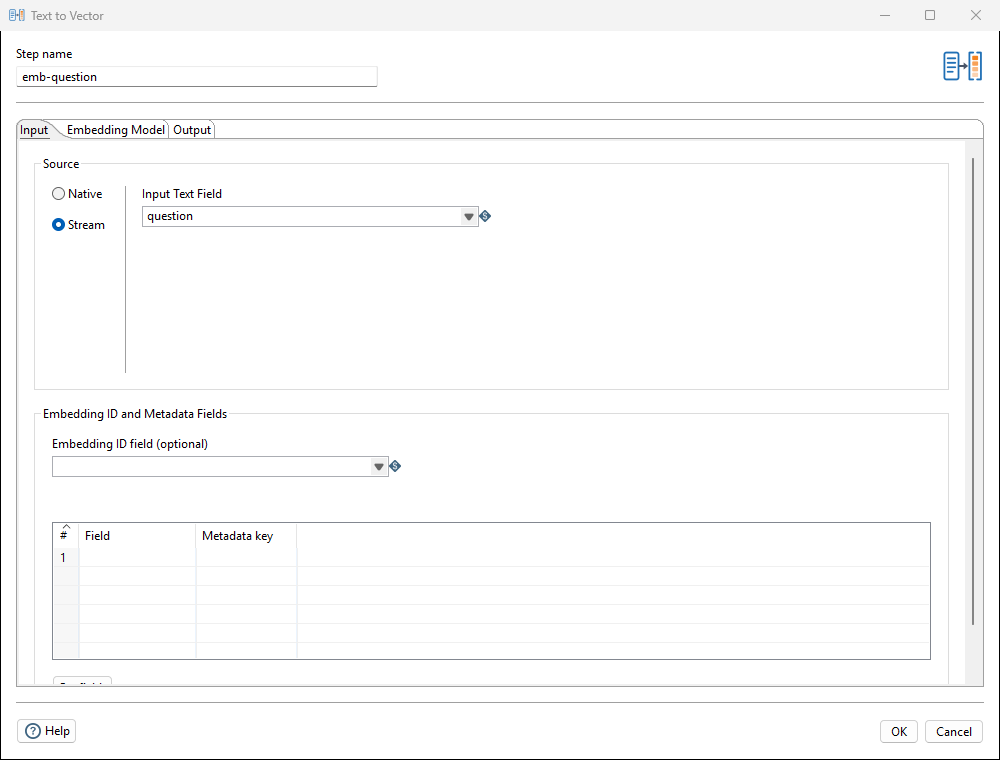
<figcaption>emb-question: the Input tab</figcaption>
</figure>
</div>

<div align="center">
<figure>
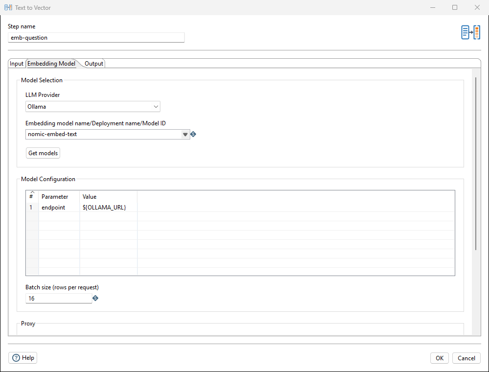
<figcaption>emb-question: the Embedding Model tab</figcaption>
</figure>
</div>

<div align="center">
<figure>
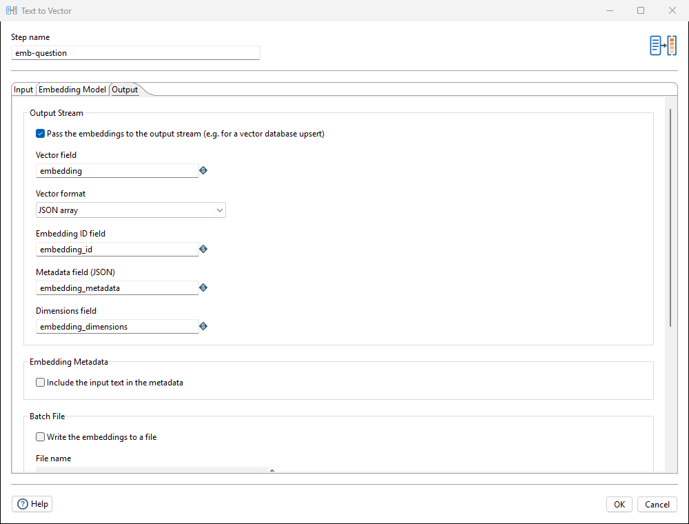
<figcaption>emb-question: the Output tab</figcaption>
</figure>
</div>

<div align="center">
<figure>
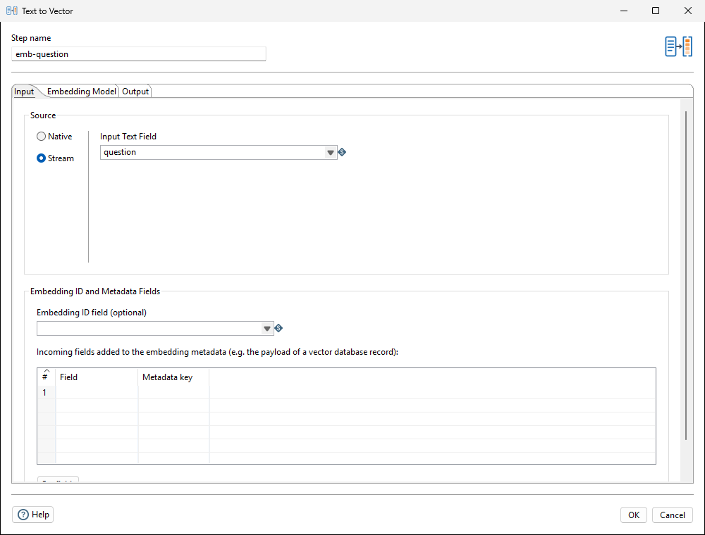
<figcaption>emb-question in explore_retrieval.ktr: the same Input tab</figcaption>
</figure>
</div>

<div align="center">
<figure>
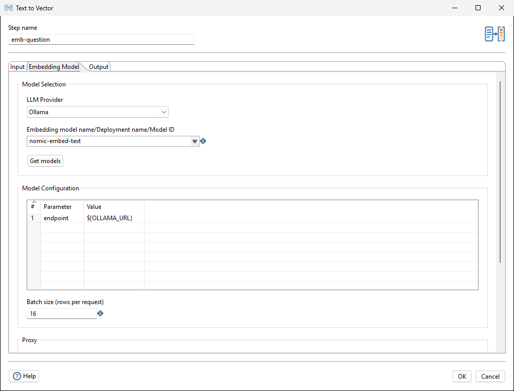
<figcaption>emb-question in explore_retrieval.ktr: the same Embedding Model tab</figcaption>
</figure>
</div>

<div align="center">
<figure>
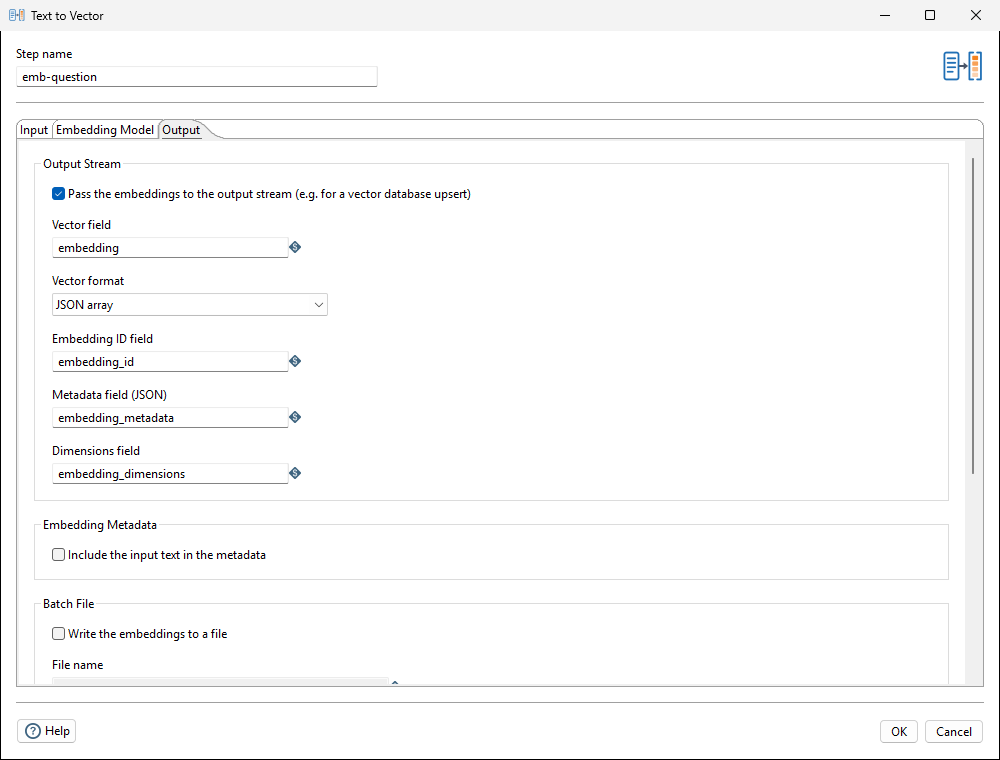
<figcaption>emb-question in explore_retrieval.ktr: the same Output tab</figcaption>
</figure>
</div>

22. Select **OK**.
23. On the **Design** tab, open the **AI** folder and drag **Vector Search** onto the canvas.
24. Create a hop from **emb-question** to **Vector Search**.
25. Double-click **Vector Search** and set **Step name** to `vs-kb`.
26. On the **Connection** tab, keep **Vector database** `PGVector`, set **Collection / index / table** to `kb_chunks`, and fill the **Connection Parameters** grid as in Build the Knowledge Base: **Host** `${PG_HOST}`, **Port** `${PG_PORT}`, **Database** `${PG_DATABASE}`, **Username** `${PG_USER}`, **Password** `${PG_PASSWORD}`, and **Schema** empty.
27. On the **Search** tab, set **Query vector field** to `embedding`, **Max results** to `${TOP_K}`, **Min score (0 to 1)** to `${MIN_SCORE}` and **Vector dimension (optional)** to `768`. Leave the **Metadata Filter** grid empty.
28. On the **Output** tab, set **Output mode** to `One row per input (JSON array)`. **Keep the rows without match** turns gray in this mode, because every question keeps its row. Keep **Stop on error** selected, and the field names **Matches field** `matches` and **Match count field** `match_count`.
<div align="center">
<figure>
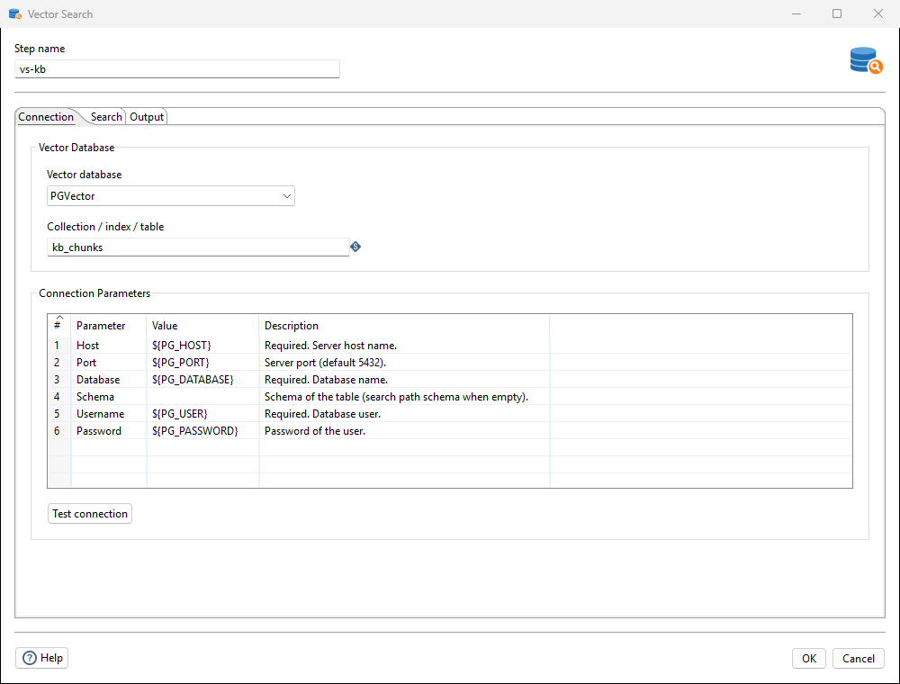
<figcaption>vs-kb: the Connection tab</figcaption>
</figure>
</div>

<div align="center">
<figure>
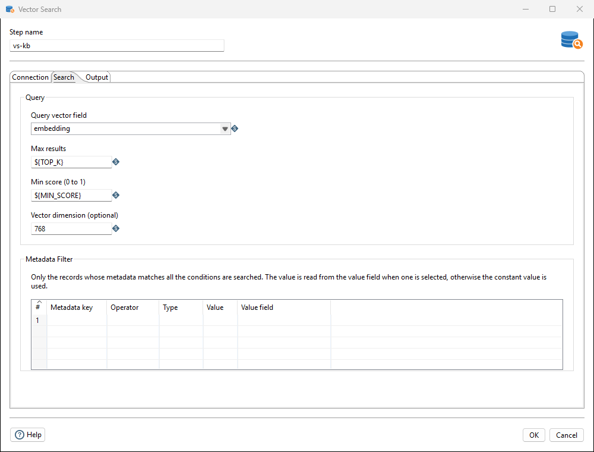
<figcaption>vs-kb: the Search tab</figcaption>
</figure>
</div>

<div align="center">
<figure>
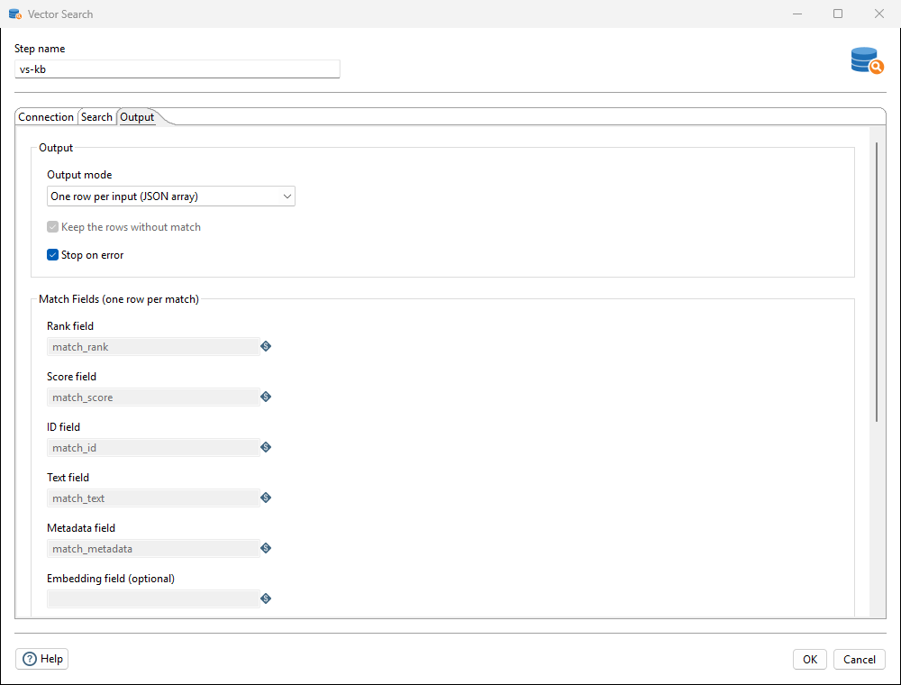
<figcaption>vs-kb: the Output tab</figcaption>
</figure>
</div>

29. Select **OK**, and save the transformation (`Ctrl+S`).

> **Under the hood:**
>
> #### Vector Search is one SQL query per question
>
> For each row, **Vector Search** on PGVector runs a query of this form, with the question's vector in place of `q`: `SELECT (2 - (embedding <=> q)) / 2 AS score, embedding_id, embedding, text, metadata FROM kb_chunks WHERE (embedding <=> q) <= 2 - 2 * min_score ORDER BY embedding <=> q LIMIT top_k`. `<=>` is pgvector's cosine distance, 1 minus the cosine similarity, so `(2 - distance) / 2` is the score `(1 + cosine similarity) / 2`. In `One row per input (JSON array)` mode, the matches of a question become one JSON array in `matches`, each with `rank`, `score`, `id`, `text` and `metadata`, and their number goes in `match_count`.
>
> **Why it matters:** the step searches by meaning, but the work is ordinary PostgreSQL. You can run the same query in `psql` to see why a passage was or was not retrieved, as the **Tune the Retrieval** tab does.

### 3. Build the Prompt

> **Note:**
>
> #### Modified JavaScript Value
>
> Turn each question's `matches` array into a numbered context, one passage per match with its source file name, and put the question after it. The result, `prompt`, is the message **AI Chat** sends.

1. On the **Design** tab, open the **Scripting** folder and drag **Modified JavaScript value** onto the canvas.
2. Create a hop from **vs-kb** to **Modified JavaScript value**.
3. Double-click **Modified JavaScript value** and set **Step name** to `js-prompt`.
4. Replace the text in the script pane with this script:

```javascript
// matches: the JSON array Vector Search wrote for this question
var list = [];
if (matches != null && String(matches) != "") {
  list = JSON.parse(String(matches));
}
var passages = [];
var sources = [];
for (var i = 0; i < list.length; i++) {
  var md = list[i].metadata;
  if (typeof md == "string") {
    md = JSON.parse(md);
  }
  var src = (md != null && md.source != null) ? String(md.source) : "unknown";
  passages.push("[" + (i + 1) + "] Source: " + src + "\n" + list[i].text);
  if (sources.indexOf(src) < 0) {
    sources.push(src);
  }
}
var context = passages.length > 0 ? passages.join("\n\n") : "(no passages were found)";
var prompt = "Context:\n" + context + "\n\nQuestion: " + question;
var retrieved_sources = sources.join(", ");
```

5. Fill the **Fields** grid at the bottom:

| Fieldname | Type | Replace value 'Fieldname' or 'Rename to' |
| --- | --- | --- |
| `prompt` | String | N |
| `retrieved_sources` | String | N |

6. Select **OK**, and save the transformation (`Ctrl+S`).

For the E2 question, with three matches, `prompt` looks like this (the passages are the ones Vector Search found):

```text
Context:
[1] Source: larkspur-dw500-dishwasher-manual.pdf
E2 - Water does not drain. ...

[2] Source: larkspur-dw500-dishwasher-manual.pdf
...

[3] Source: larkspur-wm800-washing-machine-manual.docx
...

Question: My dishwasher shows error E2. What should I do?
```

and `retrieved_sources` is `larkspur-dw500-dishwasher-manual.pdf, larkspur-wm800-washing-machine-manual.docx`. A question with no matches gets `(no passages were found)` as its context and an empty `retrieved_sources`.

> **Under the hood:**
>
> #### The prompt is built before AI Chat, because AI Chat does not insert field values
>
> In **AI Chat**'s Script mode, `${...}` in the message is a Pentaho Data Integration variable, set once for the whole run; the step does not replace it with a field of the current row. A prompt that changes per row is therefore built upstream, in a field, and **AI Chat** reads that field in Stream mode. The script handles the match's `metadata` whether it arrives as a JSON object or as JSON text, and labels each passage with its source, so the model can cite it.
>
> **Why it matters:** the context is where retrieval and generation meet. Numbered passages with their file names give the model what it needs to cite, and give you a prompt you can read in a preview when an answer looks wrong.

### 4. The Instruction

> **Note:**
>
> #### Add Constants
>
> The instruction tells the model to answer from the context only, to say when the context does not hold the answer, to cite its sources, and to answer in JSON. It is the same for every question, so **Add constants** adds it as the field `run_instruction`.

1. On the **Design** tab, open the **Transform** folder and drag **Add constants** onto the canvas.
2. Create a hop from **js-prompt** to **Add constants**.
3. Double-click **Add constants** and set **Step name** to `const-instruction`.
4. In the **Fields** grid, add one row: **Name** `run_instruction`, **Type** `String`, and in **Value** this text:

```text
You answer questions from customers of Larkspur Home Appliances.
Use only the numbered passages under "Context". Do not use any other knowledge.
If the passages do not contain the answer, set "found" to false and set "answer" to "I could not find this in the Larkspur documents."
Cite the source file name of every passage you used.
Answer with one JSON object and nothing else, in exactly this shape:
{"answer": "the answer in two or three sentences", "sources": ["the source file names you used"], "found": true or false}
```

5. Select **OK**.

> **Under the hood:**
>
> #### The instruction gives the model a way to say "I don't know"
>
> A model asked a question tends to answer it. The instruction removes its other knowledge ("Use only the numbered passages"), gives it an exact sentence for the case where the passages fall short, and asks for `found` so that a pipeline can count unanswered questions without reading the text. `sources` asks it to name the files it used, from the labels the script put on each passage.
>
> **Why it matters:** a RAG answer is only as trustworthy as its refusal. An answer that says where it came from can be checked; a question the documents cannot answer is flagged instead of answered with a guess.

### 5. Ask the Model

> **Note:**
>
> #### AI Chat
>
> **AI Chat** sends each prompt to the chat model with `run_instruction` as the run instruction, and adds the answer to the row as `llm_json`.

1. On the **Design** tab, open the **AI** folder and drag **AI Chat** onto the canvas.
2. Create a hop from **const-instruction** to **AI Chat**.
3. Double-click **AI Chat** and set **Step name** to `ai-answer`.
4. On the **Message** tab, under **Message/Prompt**, select **Stream**. Set **Message Field name** to `prompt` and **Run instruction for LLM Field name** to `run_instruction`. Keep **Attach Document(s)** cleared.
5. On the **Model** tab, set **LLM Provider** to `Ollama` and **Model name** to `${MODEL_NAME}`.
6. Fill the **Model Configuration** grid. Delete any row that is not in this table:

| Parameter | Value |
| --- | --- |
| `endpoint` | `${OLLAMA_URL}` |
| `temperature` | `0` |
| `numCtx` | `4096` |
| `timeout` | `180` |

7. On the **Response** tab, keep **Response format** `text`, set **Result Field name** to `llm_json`, and keep **Stop on error** selected.
<div align="center">
<figure>
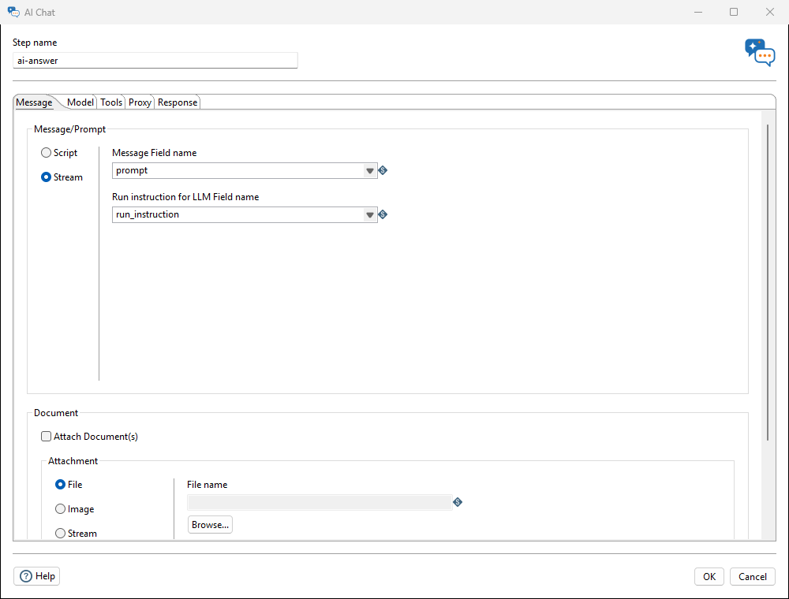
<figcaption>ai-answer: the Message tab</figcaption>
</figure>
</div>

<div align="center">
<figure>
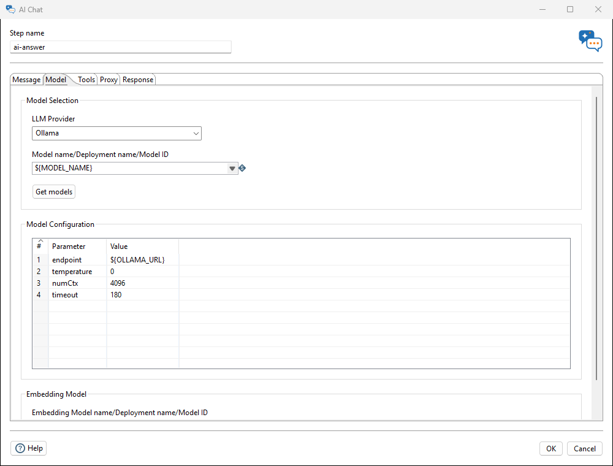
<figcaption>ai-answer: the Model tab</figcaption>
</figure>
</div>

<div align="center">
<figure>
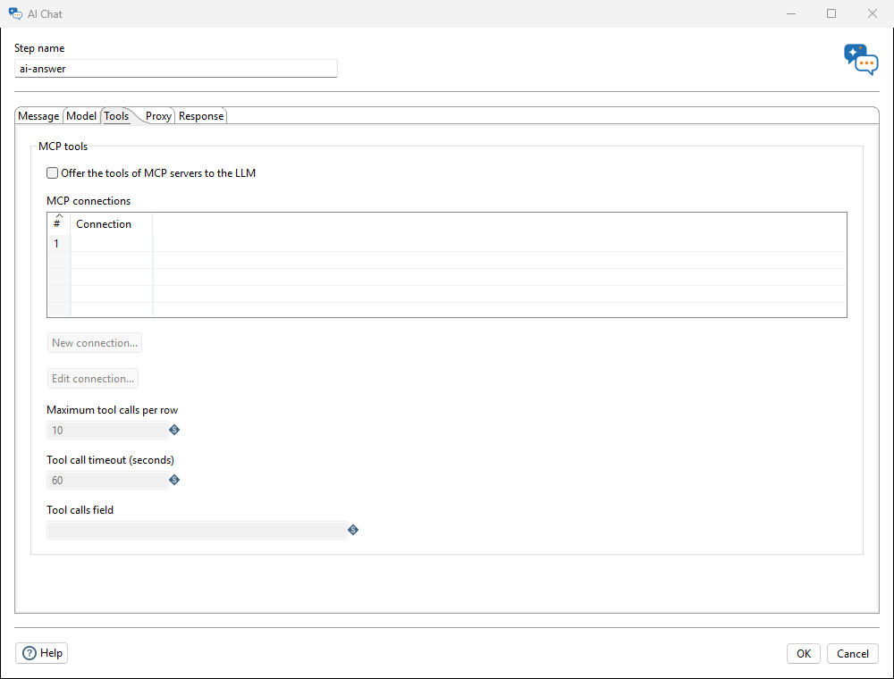
<figcaption>ai-answer: the Tools tab</figcaption>
</figure>
</div>

<div align="center">
<figure>
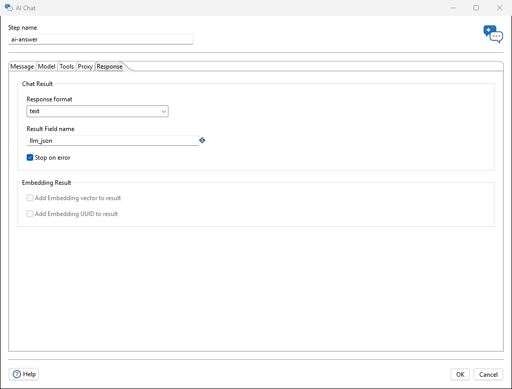
<figcaption>ai-answer: the Response tab</figcaption>
</figure>
</div>

8. Select **OK**.

> **Under the hood:**
>
> #### Four passages need a larger context window than one review
>
> `numCtx` is the number of tokens the model can read and write in one request. Four chunks of up to 300 tokens, their labels, the instruction, the question and the answer come close to 2,048 tokens, so the window is `4096`, which leaves room for a few more passages. A window that is too small makes Ollama drop the start of the prompt, which here is the context itself. `temperature` `0` makes the model pick its most likely words, so the same passages give the same answer.
>
> **Why it matters:** raising **Max results** raises the prompt's length. When you try a larger `TOP_K` in the last tab, keep it within what `numCtx` holds.

### 6. Parse and Write

> **Note:**
>
> #### JSON Input, Select Values and Text File Output
>
> Split the model's JSON into fields, and write each question with what was retrieved and what was answered to `answers.csv`.

1. On the **Design** tab, open the **Input** folder and drag **JSON input** onto the canvas.
2. Create a hop from **ai-answer** to **JSON input**.
3. Double-click **JSON input** and set **Step name** to `json-answer`.
4. On the **File** tab, select **Source is from a previous step** and set **Select field** to `llm_json`.
5. On the **Content** tab, make sure **Ignore missing path** and **Default path leaf to null** are selected.
6. On the **Fields** tab, fill the grid:

| Name | Path | Type |
| --- | --- | --- |
| `answer` | `$.answer` | String |
| `cited_sources` | `$.sources` | String |
| `found` | `$.found` | String |

7. Select **OK**.
8. On the **Design** tab, open the **Transform** folder and drag **Select values** onto the canvas.
9. Create a hop from **json-answer** to **Select values**.
10. Double-click **Select values**, set **Step name** to `sv-answers`, and on the **Select & Alter** tab list these fields in this order: `question_id`, `question`, `expected_source`, `match_count`, `retrieved_sources`, `found`, `answer`, `cited_sources`. Select **OK**.
11. On the **Design** tab, open the **Output** folder and drag **Text file output** onto the canvas.
12. Create a hop from **sv-answers** to **Text file output**.
13. Double-click **Text file output** and set **Step name** to `txt-answers`.
14. On the **File** tab, set **Filename** to `${Internal.Entry.Current.Directory}/answers` and **Extension** to `csv`. Select **Create Parent folder**.
15. On the **Content** tab, keep **Separator** `,`, **Enclosure** `"` and **Header** selected, and set **Encoding** to `UTF-8`.
16. On the **Fields** tab, select **Get Fields**, then **Minimal width**.
17. Select **OK**, and save the transformation (`Ctrl+S`).

### 7. Run

> **Note:**
>
> #### Run the Transformation
>
> Each question is one embedding request, one search and one model call. The model call takes longest, so on a CPU-only machine allow several minutes for the seven questions.

1. Press `F9` (**Action > Run**), and select **Run** in the **Run Options** dialog.
2. In **Execution Results**, open the **Step Metrics** tab.

<!-- UNPROVEN: the checkpoints below describe the expected shape; replace with measured figures (match counts, answers) once the GENAI-EE license lets the solution run. -->

> **Success:** Checkpoint: every step finishes without errors, and every step from **csvi-questions** to **txt-answers** shows 7 under **Written**: one row per question, whatever the number of matches.

3. Select **txt-answers** on the canvas and open the **Preview data** tab.

> **Success:** Checkpoint: 7 rows. For questions 1 to 5, `match_count` is between 1 and 4, `retrieved_sources` includes the `expected_source`, `found` is `true`, the `answer` says what the table in **The Questions** tab says, and `cited_sources` names the `expected_source`. For questions 6 and 7, `found` is `false` and `answer` is `I could not find this in the Larkspur documents.`, even when `retrieved_sources` lists dishwasher or policy documents. The wording is the model's and can differ between models.

4. Open `C:\Workshop-AI-Specialty\05-retrieval-augmented-generation\21-rag-answer-questions\answers.csv`.

> **Success:** Checkpoint: its first line is `question_id,question,expected_source,match_count,retrieved_sources,found,answer,cited_sources`, followed by 7 rows.

### 8. Tune the Retrieval

> **Note:**
>
> #### Change Top-k and the Minimum Score
>
> The answers are only as good as the passages. Save a copy of the transformation that stops after the search and writes one row per match with its score, then run it and the full pipeline with other values of `TOP_K` and `MIN_SCORE`.

1. Select **File > Save as** and save the transformation as `explore_retrieval.ktr` in the same folder.
2. Select **js-prompt** and every step after it on the canvas (hold `Ctrl` and select each one), and press `Delete`.
3. Double-click **vs-kb** and set **Step name** to `vs-matches`.
4. On the **Output** tab, set **Output mode** to `One row per match`. Keep **Keep the rows without match** selected and the match field names `match_rank`, `match_score`, `match_id`, `match_text` and `match_metadata`.
5. Fill the **Metadata output fields** grid:

| Metadata key | Output field | Type |
| --- | --- | --- |
| `source` | `match_source` | String |
| `chunk_index` | `match_chunk` | Integer |

<div align="center">
<figure>
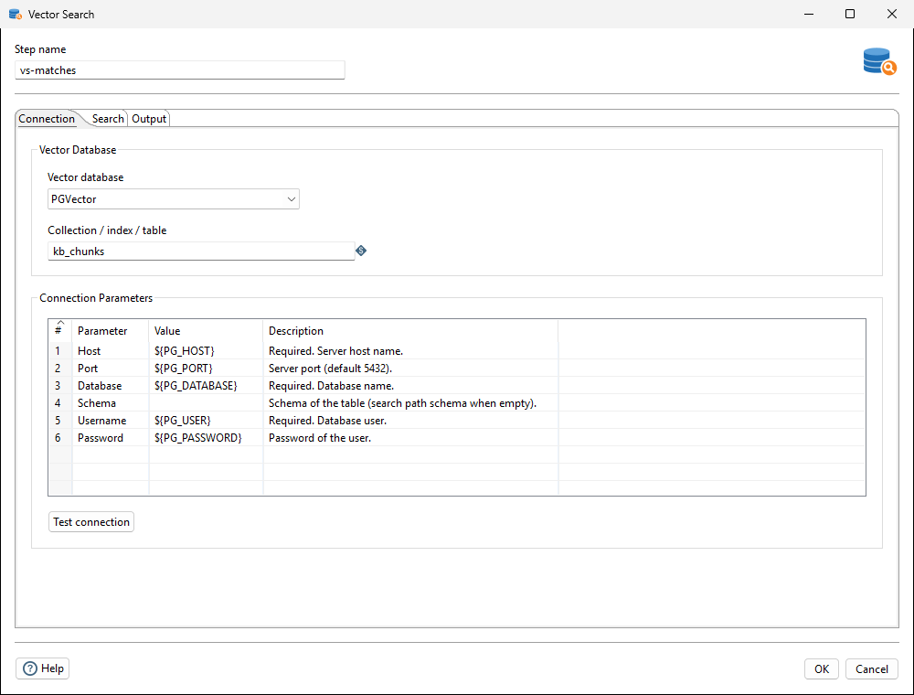
<figcaption>vs-matches: the Connection tab</figcaption>
</figure>
</div>

<div align="center">
<figure>
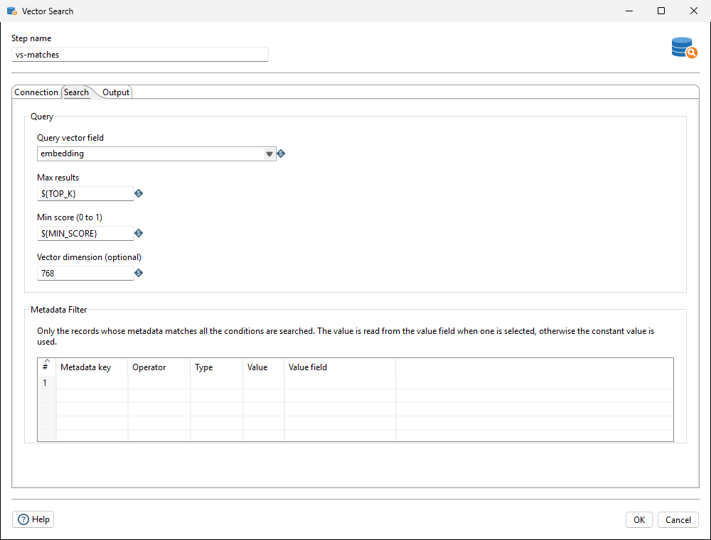
<figcaption>vs-matches: the Search tab</figcaption>
</figure>
</div>

<div align="center">
<figure>
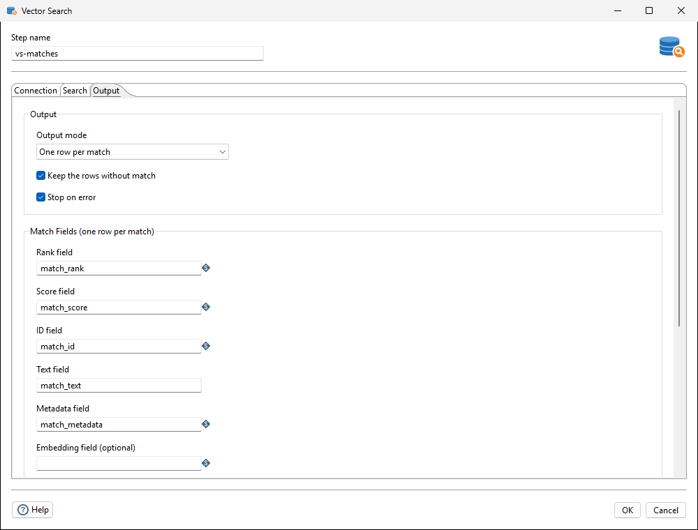
<figcaption>vs-matches: the Output tab</figcaption>
</figure>
</div>

6. Select **OK**.
7. On the **Design** tab, open the **Transform** folder and drag **Select values** onto the canvas, and create a hop from **vs-matches** to it.
8. Double-click **Select values**, set **Step name** to `sv-matches`, and on the **Select & Alter** tab list these fields in this order: `question_id`, `question`, `expected_source`, `match_rank`, `match_score`, `match_source`, `match_chunk`. Select **OK**.
9. On the **Design** tab, open the **Output** folder and drag **Text file output** onto the canvas, and create a hop from **sv-matches** to it.
10. Double-click **Text file output** and set **Step name** to `txt-matches`. On the **File** tab, set **Filename** to `${Internal.Entry.Current.Directory}/retrieval_matches`, **Extension** to `csv`, and select **Create Parent folder**. On the **Content** tab, set **Encoding** to `UTF-8`. On the **Fields** tab, select **Get Fields**, then **Minimal width**. Select **OK**.
11. Save the transformation (`Ctrl+S`), press `F9` (**Action > Run**), and select **Run** in the **Run Options** dialog.

<!-- UNPROVEN: the scores and ranks come from Text to Vector and Vector Search; record them once the solution has run. -->

> **Success:** Checkpoint: `retrieval_matches.csv` has up to 4 rows per question, ranked from `1`, with `match_score` falling as the rank rises. For questions 1 to 5, the `expected_source` appears among the matches; for question 3 it may not be first, because the washing machine manual also talks about its motor.

12. Press `F9` again. In the **Run Options** dialog, on the **Parameters** tab, set the **Value** of `MIN_SCORE` to `0.85`, and select **Run**. Open `retrieval_matches.csv` again.

<!-- UNPROVEN: which questions keep a match at 0.85 depends on the scores of a real run. -->

> **Success:** Checkpoint: fewer rows. A question whose best match scores below 0.85 keeps one row with empty `match_rank`, `match_score` and `match_source`: the step kept the row without a match.

13. Press `F9` again. On the **Parameters** tab, set `MIN_SCORE` back to `0.75` and `TOP_K` to `1`, and select **Run**.

<!-- UNPROVEN: the best match of question 3 depends on a real run. -->

> **Success:** Checkpoint: one row per question, its best match only. Check question 3: if its single match is not `larkspur-warranty-policy.pdf`, the answer to it can no longer come from the warranty policy.

14. Select **File > Open** (`Ctrl+O`) and open `answer_questions.ktr`. Press `F9`, set `TOP_K` to `1` on the **Parameters** tab, select **Run**, and compare the new `answers.csv` with the first one. Then run it with `TOP_K` `4` and `MIN_SCORE` `0.9`.

<!-- UNPROVEN: the answers depend on a real run of the retrieval and the model. -->

> **Success:** Checkpoint: with `TOP_K` `1`, an answer whose passage was lost now has `found` `false` or a less complete answer, such as question 4 without the $49 collection fee if that fact sits in another chunk. With `MIN_SCORE` `0.9`, most questions get `match_count` `0`, the context `(no passages were found)`, and `found` `false`: the model does not fall back on what it knows.

15. In PowerShell, open `psql` with `podman exec -it pcm-pgvector psql -U genai -d genai` and run the search **Vector Search** runs, using the first chunk of the warranty policy as the question:

```sql
WITH q AS (
  SELECT embedding FROM kb_chunks
  WHERE metadata->>'source' = 'larkspur-warranty-policy.pdf' AND (metadata->>'chunk_index')::int = 0
)
SELECT k.metadata->>'source' AS source, (k.metadata->>'chunk_index')::int AS chunk_index,
       round(((2 - (k.embedding <=> q.embedding)) / 2)::numeric, 3) AS score
FROM kb_chunks k, q
ORDER BY k.embedding <=> q.embedding
LIMIT 4;
```

> **Success:** Checkpoint: 4 rows. The first is `larkspur-warranty-policy.pdf`, chunk `0`, with score `1.000`: a vector is at distance 0 from itself. The other three have lower scores.

16. Type `\q` to leave `psql`.

> **Under the hood:**
>
> #### Top-k and min score trade recall against noise
>
> **Max results** caps how many passages reach the prompt; **Min score** drops the ones that are not similar enough. A higher top-k gives the answer more chances to be in the context, and gives the model more unrelated text to ignore and a longer prompt to read. A higher min score removes weak matches, and with a small embedding model it removes some right ones too, because related and unrelated passages can score close together. **One row per match** shows each score; **One row per input (JSON array)** packs them for the prompt. A **Group by** on `question_id` after one row per match would rebuild one row per question, which the JSON array mode does in the step.
>
> **Why it matters:** retrieval is tuned on retrieval output, before any model call. A question whose right passage is not in `retrieval_matches.csv` will not be answered well by any model.

::::

## Troubleshooting <!-- no-step -->

<details>
<summary>Error initializing step: License validation failed</summary>

The Pentaho license on this machine has no GenAI rights. Every GenAI plugin step checks for a license with the GenAI Plugin Suite (GENAI-EE) subscription when the transformation starts. Install a license that includes it, as described in [Before You Start](../00-before-you-start/guide.md).

</details>

<details>
<summary>vs-kb fails with relation "kb_chunks" does not exist</summary>

The knowledge base has not been loaded, or was loaded into another database. Run the transformation of [Build the Knowledge Base](../20-rag-knowledge-base/guide.md) with the same `PG_` parameters, then run this one again.

</details>

<details>
<summary>vs-kb fails with a dimension error</summary>

The question vectors are not 768 numbers long: **emb-question** uses another model than `nomic-embed-text`. The question must be embedded with the model that embedded the chunks.

</details>

<details>
<summary>Every answer says it could not find the answer</summary>

Look at `match_count` first. If it is `0` for every question, `MIN_SCORE` is too high for this model: run `explore_retrieval.ktr` with `MIN_SCORE` `0` to see the real scores. If the passages are there, preview **js-prompt** and read `prompt`, and check that **ai-answer** reads `prompt` and `run_instruction` in Stream mode.

</details>

<details>
<summary>The answer fields are null on a row</summary>

The model's answer was not the JSON the instruction asked for. Preview **ai-answer** and read `llm_json` for that row. A larger model, such as `qwen2.5:7b`, usually follows the JSON shape more reliably.

</details>

## Lab Files

Click a file to download. For `.ktr` and `.kjb` files, **Open in Pentaho Data Integration** launches Pentaho Data Integration with the file loaded. If Pentaho Data Integration is already running, the path is copied to your clipboard — switch to Pentaho Data Integration and press `Ctrl+O`, `Ctrl+V`, `Enter`.

The seven questions, with the document that holds each answer (`none` for the two the documents cannot answer):

[questions.csv](./files/questions.csv)

### Solution <!-- no-step -->

The finished transformations for this lab. Open them alongside your own to compare, or run them to see the expected result. Both read `questions.csv` from the lab folder and search the table `kb_chunks` that [Build the Knowledge Base](../20-rag-knowledge-base/guide.md) loads, so run that workshop's transformation first.

Also on disk at `C:\Workshop-AI-Specialty\05-retrieval-augmented-generation\21-rag-answer-questions\solution`.

`answer_questions.ktr` answers the questions and writes `answers.csv` beside itself:

[answer_questions.ktr](./files/solution/answer_questions.ktr) <button data-launch="spoon" data-path="files/solution/answer_questions.ktr">Open in Pentaho Data Integration</button> <button data-graph="files/solution/answer_questions.ktr">View graph</button>

answer_questions in Spoon, with its note:

<div align="center">
<figure>
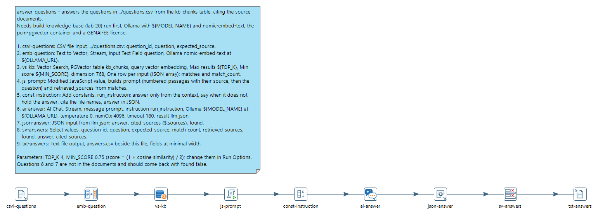
<figcaption>answer_questions.ktr in Spoon</figcaption>
</figure>
</div>

`explore_retrieval.ktr` stops after the search and writes one row per match, with its score and source, to `retrieval_matches.csv` beside itself:

[explore_retrieval.ktr](./files/solution/explore_retrieval.ktr) <button data-launch="spoon" data-path="files/solution/explore_retrieval.ktr">Open in Pentaho Data Integration</button> <button data-graph="files/solution/explore_retrieval.ktr">View graph</button>

explore_retrieval in Spoon, with its note:

<div align="center">
<figure>
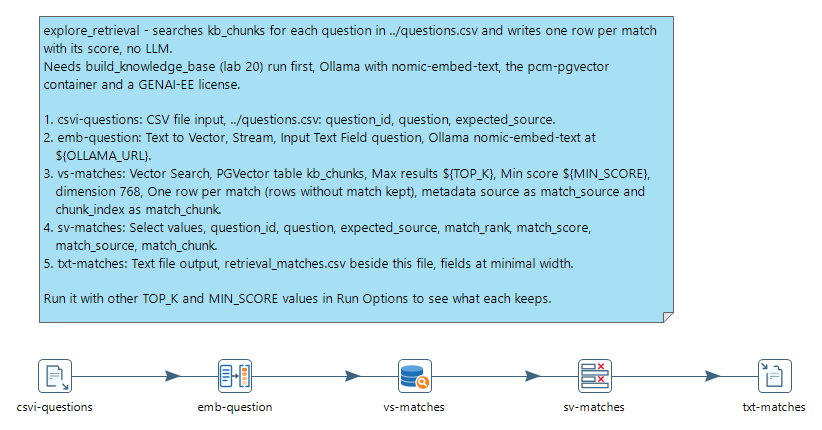
<figcaption>explore_retrieval.ktr in Spoon</figcaption>
</figure>
</div>
