# MCP Tools

> **Warning:**
>
> #### Workshop - MCP Tools
>
> Connect Pentaho Data Integration to a Model Context Protocol (MCP) server: a small Python server, shipped with this lab, that answers questions about the orders, stock and return policies of Ridgeline Outfitters, a fictional outdoor retailer. You call its tools two ways: directly with the **MCP Client** step, the same tool for every row, and through the **AI Chat** step's **Tools** tab, where the model decides which tools to call.
>
> **What you'll do**
>
> * Start the course's MCP server by hand and see its four tools
> * Create the MCP connection `retail-tools` and list the server's tools with **MCP Client**
> * Call the `lookup_order` tool once per order with an arguments template, and parse its JSON answer
> * Offer the tools to a local model with **AI Chat**, and read which tools it called for each customer question
> * Restrict what the model may call with the connection's **Allowed tools**
>
> **Prerequisites:**
>
> * Python, Ollama with `qwen2.5:7b` pulled, and the GenAI plugins installed, as set up in [Before You Start](../00-before-you-start/guide.md)
> * The Agents and Tools [Overview](../16-agent-as-a-service/guide.md): what MCP is
> * **AI Chat** in Stream mode and **JSON input**, as used in [Sentiment Analysis](../06-llm-sentiment-analysis/guide.md)
>
> **Estimated time:** 60 minutes

<figure>

<figcaption class="pcm-video-caption">Walkthrough: coming soon</figcaption>

</figure>

:::: tabs

### 1. The MCP Server

> **Note:**
>
> #### Start the Server by Hand
>
> An MCP server is a program that offers *tools* (functions a client can call, each with a name, a description and a JSON schema for its arguments) and *resources* (content a client can read by URI). Before Pentaho Data Integration talks to the course's server, start it yourself with a short Python client and see what it offers.

The lab folder, `C:\Workshop-AI-Specialty\07-agents-and-tools\22-mcp-tools`, holds the server in `mcp-server`:

| File | What it is |
| --- | --- |
| `retail_mcp_server.py` | The MCP server, written with the official MCP Python SDK (`FastMCP`), on the stdio transport |
| `retail_data.json` | Its data: 6 products, 5 orders, `A1001` to `A1005`, and the return policies of 5 product categories |
| `check_server.py` | A small MCP client: starts the server, lists its tools, calls one and reads the resource |

The server offers four tools and one resource:

| Tool or resource | Arguments | What it returns |
| --- | --- | --- |
| `lookup_order` | `order_id` | The order's status (`processing`, `shipped`, `delayed` or `delivered`), carrier, tracking number, estimated delivery, delivery date, a status note and its items |
| `check_stock` | `sku` | The product's name and category, units on hand, warehouse and restock date |
| `get_return_policy` | `category` | The return window in days, the condition the item must be in, and how the refund is paid |
| `start_return` | `order_id`, `sku`, `reason` | Starts a return and gives it an RMA number. The one tool that changes something: it appends a line to `returns_log.jsonl` beside the server |
| `retail://policies/shipping` | (a resource) | The shipping policy, as text |

What you build: in parts 3 and 4, **MCP Client** steps that call the tool you name; in parts 5 and 6, an **AI Chat** step that lets the model choose. Both reach the same server through one connection, `retail-tools`:

<div align="center">
<figure>
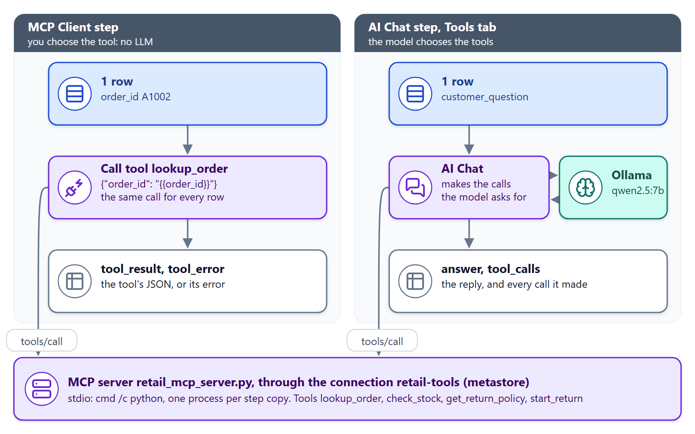
<figcaption>Two ways to call the same MCP server: the tool you choose, or the tools the model chooses</figcaption>
</figure>
</div>

1. Install the MCP Python SDK into the Python you installed in Before You Start. In PowerShell, run:

```powershell
python -m pip install "mcp<2"
```

> **Success:** Checkpoint: pip ends with a line that starts `Successfully installed` and names `mcp`, or reports `Requirement already satisfied: mcp`.

2. Run the check script:

```powershell
Set-Location C:\Workshop-AI-Specialty\07-agents-and-tools\22-mcp-tools\mcp-server
python check_server.py
```

> **Success:** Checkpoint: the script prints `Server: ridgeline-retail, protocol 2025-06-18`, then `4 tools:` with `lookup_order(order_id)`, `check_stock(sku)`, `get_return_policy(category)` and `start_return(order_id, sku, reason)`. Under `lookup_order A1001:` comes a JSON object with `"customer_first_name": "Maya"`, `"status": "shipped"` and `"estimated_delivery": "2026-11-28"`, and the resource's first line is `Ridgeline Outfitters shipping policy`.

The script started the server and stopped it again when it ended: nothing is left running.

> **Under the hood:**
>
> #### The client started the server as a child process and talked JSON-RPC over its standard input and output
>
> `check_server.py` started `retail_mcp_server.py` with the same Python, then wrote JSON-RPC 2.0 messages to the server's standard input and read the answers from its standard output: `initialize`, then `tools/list`, `tools/call` with `{"order_id": "A1001"}`, and `resources/read`. That is the *stdio* transport. When the script ended, the server process ended with it. This is why the server writes nothing else to standard output: one stray `print` would corrupt the protocol.
>
> **Why it matters:** the **MCP Client** step does exactly this for you, from a connection you define once. The tool's description and argument schema are what a model reads in part 5 to decide which tool to call, so a server's docstrings are part of its interface.

### 2. Create the Connection

> **Note:**
>
> #### The MCP Connection
>
> An MCP connection tells Pentaho Data Integration how to reach a server. You create it from an **MCP Client** step; it is saved in the Pentaho Data Integration metastore, so every transformation on this machine can use it by name.

1. Start Pentaho Data Integration with the **Start Pentaho Data Integration** button below, or from PowerShell:

```powershell
Set-Location C:\Pentaho\design-tools\data-integration
.\Spoon.bat
```

<button data-launch="spoon" data-path="">Start Pentaho Data Integration</button>

2. Select **File > New > Transformation** (`Ctrl+N`).
3. Select **File > Save as** and save it as `mcp_list_tools.ktr` in `C:\Workshop-AI-Specialty\07-agents-and-tools\22-mcp-tools`.
4. On the **Design** tab, open the **AI** folder and drag **MCP Client** onto the canvas.
5. Double-click **MCP Client**. Set **Step name** to `mcp-list-tools`.
6. Next to **MCP connection**, select **New...**. The MCP connection dialog opens.
7. Enter these settings. **Arguments** takes one argument per line:

| Setting | Value |
| --- | --- |
| **Connection name** | `retail-tools` |
| **Transport** | `Local process (stdio)` |
| **Connection timeout (seconds)** | `30` |
| **Command** | `cmd` |
| **Arguments** | `/c`<br>`python`<br>`C:\Workshop-AI-Specialty\07-agents-and-tools\22-mcp-tools\mcp-server\retail_mcp_server.py` |

8. Leave **Environment variables** and **Allowed tools** empty, and select **OK**. **MCP connection** now reads `retail-tools`.
9. Select **List tools**.

> **Success:** Checkpoint: the **Tool name** list opens with the server's four tools: `lookup_order`, `check_stock`, `get_return_policy` and `start_return`.

<div align="center">
<figure>
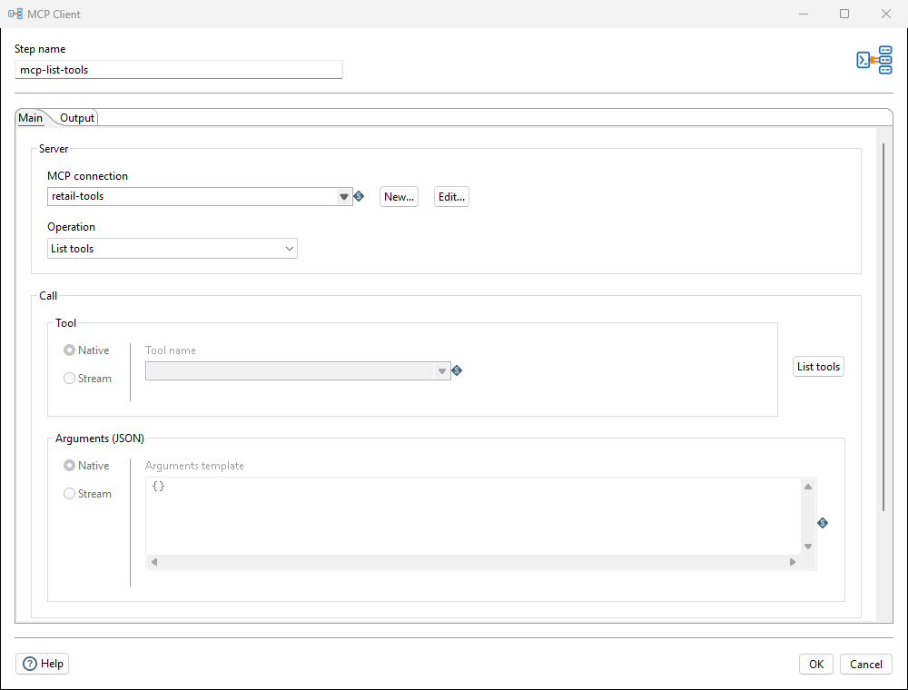
<figcaption>mcp-list-tools: the Main tab</figcaption>
</figure>
</div>

<div align="center">
<figure>
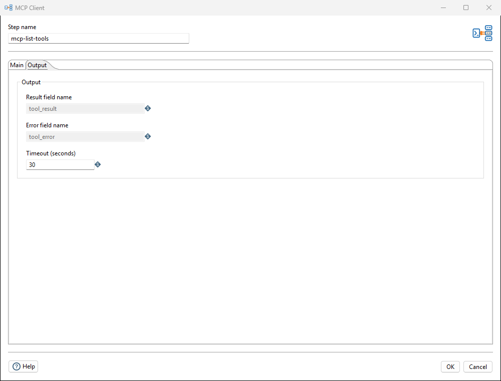
<figcaption>mcp-list-tools: the Output tab</figcaption>
</figure>
</div>

10. Select **OK** to close **mcp-list-tools**, and save the transformation (`Ctrl+S`).

> **Under the hood:**
>
> #### The connection went into the metastore, not into the transformation
>
> Spoon saved `retail-tools` in the Pentaho Data Integration metastore, under your user profile, as an element of type MCP Connection. The `.ktr` stores only the name `retail-tools`. **List tools** started the server with `cmd /c python ...\retail_mcp_server.py`, asked it for `tools/list`, and stopped it. On Windows the command is `cmd` with `/c`: script launchers such as `npx.cmd` and `uvx.cmd` cannot be started as a process on their own, and the same form works for `python`.
>
> **Why it matters:** a transformation that uses an MCP connection runs only where that connection exists. To run it on another machine, a Carte server or the Pentaho Server, create the connection there (or copy the metastore), and install the server's runtime, here Python with `mcp`, on that machine too.

### 3. List Tools and Read a Resource

> **Note:**
>
> #### List Tools and Read Resource
>
> **List tools** writes one row per tool, with its name, description and argument schema; it needs no input step. **Read resource** reads a resource for each row it receives, so a one-row **Generate rows** step drives it once.

1. Double-click **mcp-list-tools** and set **Operation** to `List tools`. Select **OK**.
2. On the **Design** tab, open the **Output** folder and drag **Text file output** onto the canvas.
3. Create a hop from **mcp-list-tools** to **Text file output**: hold `Shift` and drag from one step to the other.
4. Double-click **Text file output** and set **Step name** to `txt-tools`. On the **File** tab, set **Filename** to `${Internal.Entry.Current.Directory}/tools` and **Extension** to `csv`, and select **Create Parent folder**.
5. On the **Content** tab, set **Separator** to `,`, keep **Enclosure** `"` and **Header** selected, and set **Encoding** to `UTF-8`. On the **Fields** tab, select **Get Fields**, then **Minimal width**: the grid lists `tool_name`, `tool_description` and `tool_schema`. Select **OK**.
6. On the **Design** tab, open the **Input** folder and drag **Generate rows** onto the canvas, below **mcp-list-tools**.
7. Double-click **Generate rows**. Set **Step name** to `gr-one-row` and **Limit** to `1`. Leave the **Fields** grid empty, and select **OK**.
8. From the **AI** folder, drag a second **MCP Client** onto the canvas. Create a hop from **gr-one-row** to it.
9. Double-click the new **MCP Client** and set **Step name** to `mcp-shipping-policy`. Select `retail-tools` in **MCP connection** and set **Operation** to `Read resource`.

<div align="center">
<figure>
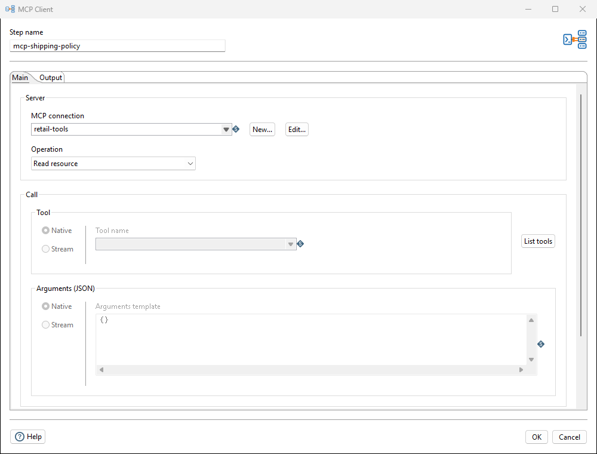
<figcaption>mcp-shipping-policy: the Main tab</figcaption>
</figure>
</div>

<div align="center">
<figure>
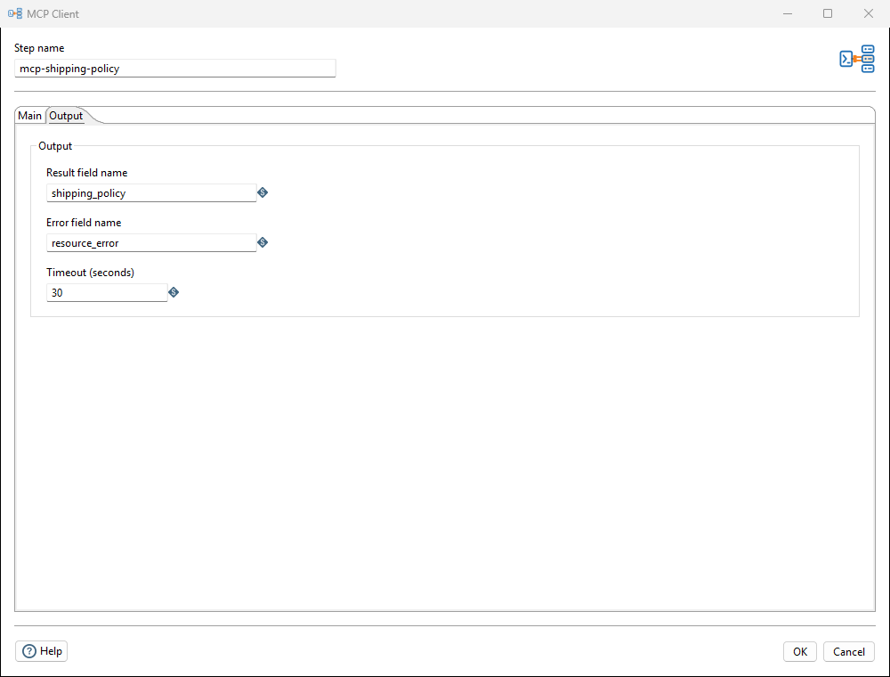
<figcaption>mcp-shipping-policy: the Output tab</figcaption>
</figure>
</div>

10. Under **Resource URI**, select **Native** and set **URI** to `retail://policies/shipping`.
11. On the **Output** tab, set **Result field name** to `shipping_policy` and **Error field name** to `resource_error`. Keep **Timeout (seconds)** `30`. Select **OK**.
12. On the **Design** tab, open the **Utility** folder and drag **Write to log** onto the canvas. Create a hop from **mcp-shipping-policy** to it.
13. Double-click **Write to log**, set **Step name** to `wlog-shipping` and **Log level** to `Basic logging`, select **Print header**, set **Write to log** to `Shipping policy`, and add `shipping_policy` and `resource_error` to the **Fields** grid. Select **OK**.
14. Save the transformation (`Ctrl+S`).
15. Press `F9` (**Action > Run**), and select **Run** in the **Run Options** dialog.

> **Success:** Checkpoint: in **Execution Results**, **Step Metrics** shows 4 under **Written** for **mcp-list-tools** and **txt-tools**, and 1 for **mcp-shipping-policy**. `tools.csv` in the lab folder has a header `tool_name,tool_description,tool_schema` and one row per tool: `lookup_order`, `check_stock`, `get_return_policy` and `start_return`; the `tool_schema` of `lookup_order` names one required string property, `order_id`. On the **Logging** tab, **wlog-shipping** prints the shipping policy as `shipping_policy = Ridgeline Outfitters shipping policy`, followed by the rest of its text, and `resource_error = null`.

16. Open `tools.csv` and read each tool's description: these are the words a model reads in part 5 to choose a tool.

> **Under the hood:**
>
> #### Each MCP Client step started its own copy of the server
>
> When the transformation started, **mcp-list-tools** and **mcp-shipping-policy** each read `retail-tools` from the metastore and started a server process: two steps, two processes, and two more for each extra copy of a step. **mcp-list-tools** sent `tools/list` once and wrote a row per tool; **mcp-shipping-policy** sent `resources/read` for its one input row. Both processes stopped when the transformation ended.
>
> **Why it matters:** a stdio server costs a process per step copy and starts with every run. For a server many machines share, run it once over Streamable HTTP and point the connection at its URL instead; the steps do not change.

### 4. Call a Tool per Row

> **Note:**
>
> #### Call Tool with an Arguments Template
>
> **Call tool** calls one tool for every row. The arguments are a JSON template whose `{{field}}` placeholders take the row's values. No model is involved: the same tool, with arguments built the same way, every time.

1. Select **File > New > Transformation** (`Ctrl+N`), then **File > Save as**, and save it as `mcp_call_tools.ktr` in `C:\Workshop-AI-Specialty\07-agents-and-tools\22-mcp-tools`, next to `order_ids.csv`.
2. On the **Design** tab, open the **Input** folder and drag **CSV file input** onto the canvas.
3. Double-click **CSV file input**. Set **Step name** to `csvi-orders` and **Filename** to `${Internal.Entry.Current.Directory}/order_ids.csv`. Keep **Delimiter** `,` and **Header row present?** selected, and clear **Lazy conversion?**.
4. Select **Get Fields**, then **Close** on the summary. The grid has one field, `order_id`, **Type** `String`. Set its **Length** to `10`, and select **OK**.
5. From the **AI** folder, drag **MCP Client** onto the canvas. Create a hop from **csvi-orders** to it.
6. Double-click **MCP Client** and set **Step name** to `mcp-lookup-order`. Select `retail-tools` in **MCP connection** and keep **Operation** `Call tool`.

<div align="center">
<figure>
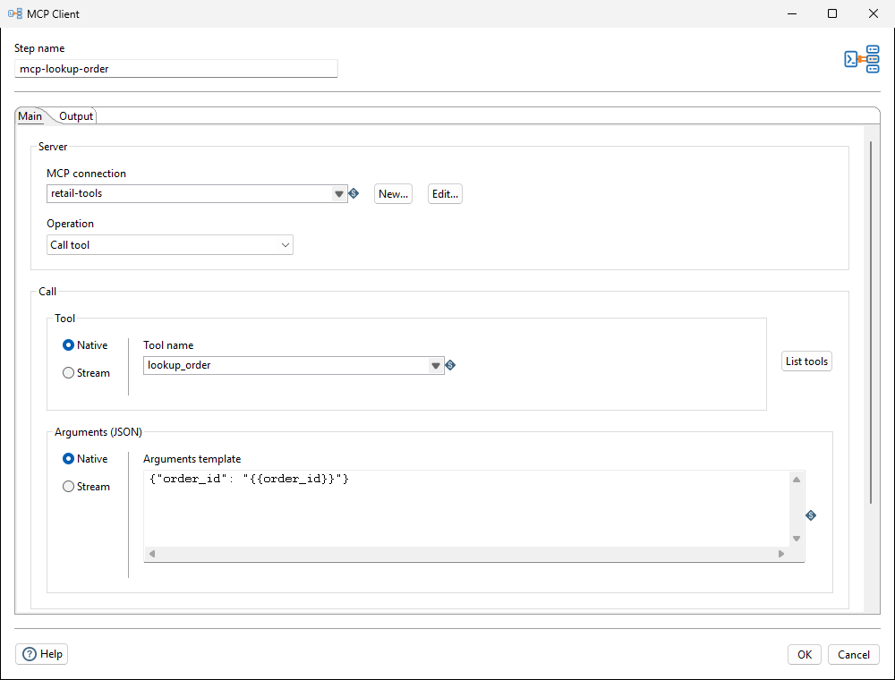
<figcaption>mcp-lookup-order: the Main tab</figcaption>
</figure>
</div>

<div align="center">
<figure>
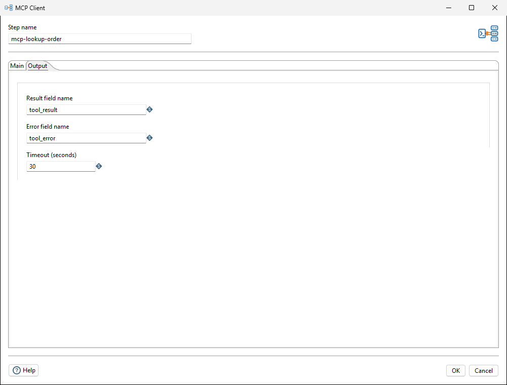
<figcaption>mcp-lookup-order: the Output tab</figcaption>
</figure>
</div>

7. Under **Tool**, keep **Native**, and select `lookup_order` in **Tool name** (select **List tools** first if the list is empty).
8. Under **Arguments (JSON)**, keep **Native** and set **Arguments template** to:

```json
{"order_id": "{{order_id}}"}
```

9. On the **Output** tab, keep **Result field name** `tool_result`, **Error field name** `tool_error` and **Timeout (seconds)** `30`. Select **OK**.
10. On the **Design** tab, open the **Flow** folder and drag **Filter rows** onto the canvas. Create a hop from **mcp-lookup-order** to it.
11. From the **Input** folder, drag **JSON input** onto the canvas, to the right of **Filter rows**. From the **Output** folder, drag **Text file output** below **Filter rows**.
12. Create a hop from **Filter rows** to **JSON input** and select **Result is TRUE**. Create a hop from **Filter rows** to **Text file output** and select **Result is FALSE**.
13. Double-click **Text file output** and set **Step name** to `txt-order-errors`. On the **File** tab, set **Filename** to `${Internal.Entry.Current.Directory}/order_errors` and **Extension** to `csv`, and select **Create Parent folder**. On the **Content** tab, set **Separator** to `,` and **Encoding** to `UTF-8`. On the **Fields** tab, select **Get Fields**, then **Minimal width**, and select **OK**.
14. Double-click **JSON input** and set **Step name** to `json-order`. Select **OK** for now.
15. Double-click **Filter rows** and set **Step name** to `frow-tool-ok`. **Send 'true' data to step** reads `json-order`, and **Send 'false' data to step** reads `txt-order-errors`.
16. In **The condition**, select `<field>` on the left and select `tool_error`. Select the function button, which shows `=`, and select **IS NULL** in the list that opens; leave the right-hand value empty. The condition reads `tool_error IS NULL`. Select **OK**.
17. Double-click **json-order**. On the **File** tab, select **Source is from a previous step** and set **Select field** to `tool_result`.
18. On the **Content** tab, make sure **Ignore missing path** and **Default path leaf to null** are selected.
19. On the **Fields** tab, fill the grid:

| Name | Path | Type |
| --- | --- | --- |
| `customer_first_name` | `$.customer_first_name` | String |
| `status` | `$.status` | String |
| `carrier` | `$.carrier` | String |
| `tracking_number` | `$.tracking_number` | String |
| `estimated_delivery` | `$.estimated_delivery` | String |
| `delivered_on` | `$.delivered_on` | String |
| `item_count` | `$.item_count` | Integer |
| `status_note` | `$.status_note` | String |

20. Select **OK**.
21. From the **Transform** folder, drag **Select values** onto the canvas. Create a hop from **json-order** to it. Double-click it, set **Step name** to `sv-order`, and on the **Select & Alter** tab list these fields in this order: `order_id`, `customer_first_name`, `status`, `carrier`, `tracking_number`, `estimated_delivery`, `delivered_on`, `item_count`, `status_note`. Select **OK**.
22. From the **Output** folder, drag **Text file output** onto the canvas. Create a hop from **sv-order** to it. Double-click it and set **Step name** to `txt-order-status`. On the **File** tab, set **Filename** to `${Internal.Entry.Current.Directory}/order_status` and **Extension** to `csv`, and select **Create Parent folder**. On the **Content** tab, set **Separator** to `,` and **Encoding** to `UTF-8`. On the **Fields** tab, select **Get Fields**, then **Minimal width**, and select **OK**.
23. Save the transformation (`Ctrl+S`).
24. Press `F9` (**Action > Run**), and select **Run** in the **Run Options** dialog.

> **Success:** Checkpoint: **Step Metrics** shows **csvi-orders** 6 under **Written**, **mcp-lookup-order** 6, **json-order** and **txt-order-status** 5, and **txt-order-errors** 1. `order_status.csv` holds `A1001` to `A1005`: `A1001` `Maya` `shipped` (estimated `2026-11-28`), `A1002` `Daniel` `delayed` (`Held at the regional hub after a weather closure`, estimated `2026-12-03`, 3 items), `A1003` `Priya` `delivered` on `2026-11-20`, `A1004` `Tom` `processing` with no carrier yet, and `A1005` `Lena` `delivered` on `2026-10-30`. `order_errors.csv` holds `A9999`, with an empty `tool_result` and the `tool_error` `The tool 'lookup_order' reported an error: Error executing tool lookup_order: No order 'A9999'. Order numbers look like A1001.`

25. Compare `order_status.csv` with the orders in `mcp-server\retail_data.json`: every value came from the server unchanged.

> **Under the hood:**
>
> #### The step filled the template from each row and sent one tools/call per row
>
> For each row, **mcp-lookup-order** replaced `{{order_id}}` with the row's value, escaping any quote or line break in it, and sent `tools/call` for `lookup_order`. A value that is exactly one placeholder, such as `"{{order_id}}"`, keeps the field's type, so an Integer field arrives as a number. The server's answer went into `tool_result` as text, here a JSON object. For `A9999` the server reported an error (MCP `isError`), so the step wrote the message to `tool_error`, left `tool_result` empty, and passed the row on instead of stopping. Without the plugin, this is a script that starts the server, keeps the session open and calls the tool row by row: `check_server.py` in a loop.
>
> **Why it matters:** this is a deterministic integration. You chose the tool and its arguments, so every row gets exactly that call, with no model to get it wrong and nothing to pay per token. Use it whenever you know which tool to call.

### 5. Let the Model Choose

> **Note:**
>
> #### AI Chat with the Tools Tab
>
> Customer questions do not say which tool they need. With the **Tools** tab, **AI Chat** offers the server's tools to the model with every question; the model asks for the calls it needs, the step makes them, and the model answers from the results. First, take `start_return` away: a support assistant should answer questions, not change orders.

1. Open `mcp_list_tools.ktr` (or any transformation with an **MCP Client** step), double-click **mcp-list-tools**, select **Edit...** next to **MCP connection**, and set **Allowed tools** to these three names, one per line:

```text
lookup_order
check_stock
get_return_policy
```

2. Select **OK**, then select **List tools**.

> **Success:** Checkpoint: the **Tool name** list now has three tools: `start_return` is gone.

3. Select **Cancel** to close **mcp-list-tools** without changes.
4. Select **File > New > Transformation** (`Ctrl+N`), then **File > Save as**, and save it as `mcp_ai_chat_tools.ktr` in `C:\Workshop-AI-Specialty\07-agents-and-tools\22-mcp-tools`, next to `customer_questions.csv`.
5. Double-click an empty part of the canvas. On the **Parameters** tab of **Transformation properties**, fill the grid:

| Parameter | Default Value | Description |
| --- | --- | --- |
| `TOOL_MODEL` | `qwen2.5:7b` | Ollama chat model with tool calling |
| `OLLAMA_URL` | `http://localhost:11434` | Ollama server |

6. Select **OK**. If `qwen2.5:7b` is not pulled yet, run `ollama pull qwen2.5:7b` in PowerShell.
7. From the **Input** folder, drag **CSV file input** onto the canvas. Double-click it, set **Step name** to `csvi-questions` and **Filename** to `${Internal.Entry.Current.Directory}/customer_questions.csv`, and clear **Lazy conversion?**. Select **Get Fields**, then **Close**, and set the **Length** of `question_id` to `10` and of `customer_question` to `500`, both **Type** `String`. Select **OK**.

The six questions in `customer_questions.csv`:

| `question_id` | `customer_question` |
| --- | --- |
| `Q1` | Where is my order A1002? It should be here by now. |
| `Q2` | Is the TrailLite 2-person tent, SKU TENT-2P-TL, in stock? When can I get one? |
| `Q3` | I slept in my Glacier sleeping bag once. Can I still return it? |
| `Q4` | The boots from my order A1005 are too small. Can I return them? |
| `Q5` | What time does your Denver store open on Saturdays? |
| `Q6` | Please start a return for the boots in my order A1005. They are too small. |

8. From the **Transform** folder, drag **Add constants** onto the canvas. Create a hop from **csvi-questions** to it. Double-click it, set **Step name** to `const-instruction`, and add one row: **Name** `run_instruction`, **Type** `String`, and in **Value** this text:

```text
You are the customer support assistant of Ridgeline Outfitters, an outdoor gear retailer.
Answer only what the customer asks, in two or three sentences.
Use the tools for every fact: lookup_order for an order, check_stock for a product's stock, get_return_policy for a return policy.
Never state a return window or condition without calling get_return_policy first; for an item in an order, look the order up and use its category.
If no tool can answer the question, say so and suggest contacting the store.
```

9. Select **OK**.
10. From the **AI** folder, drag **AI Chat** onto the canvas. Create a hop from **const-instruction** to it. Double-click it and set **Step name** to `ai-support`.

<div align="center">
<figure>
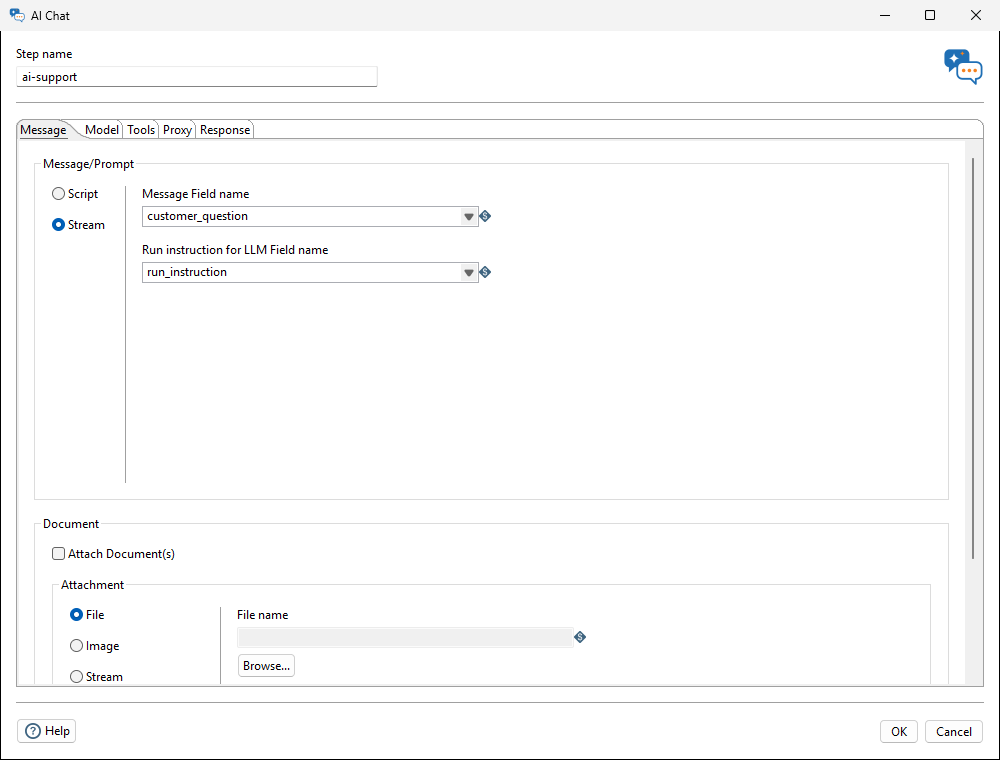
<figcaption>ai-support: the Message tab</figcaption>
</figure>
</div>

<div align="center">
<figure>
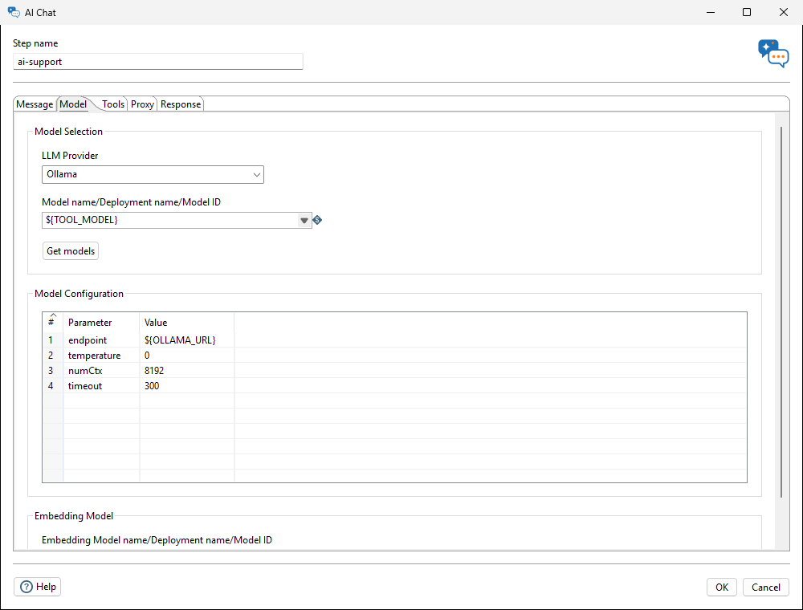
<figcaption>ai-support: the Model tab</figcaption>
</figure>
</div>

<div align="center">
<figure>
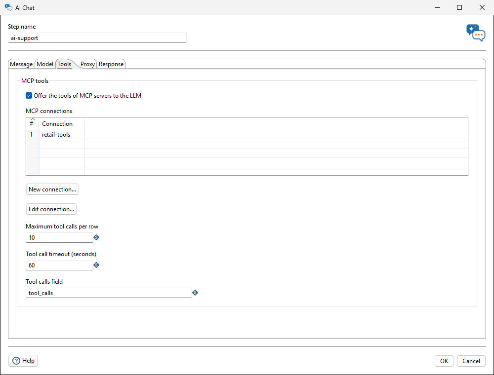
<figcaption>ai-support: the Tools tab</figcaption>
</figure>
</div>

<div align="center">
<figure>
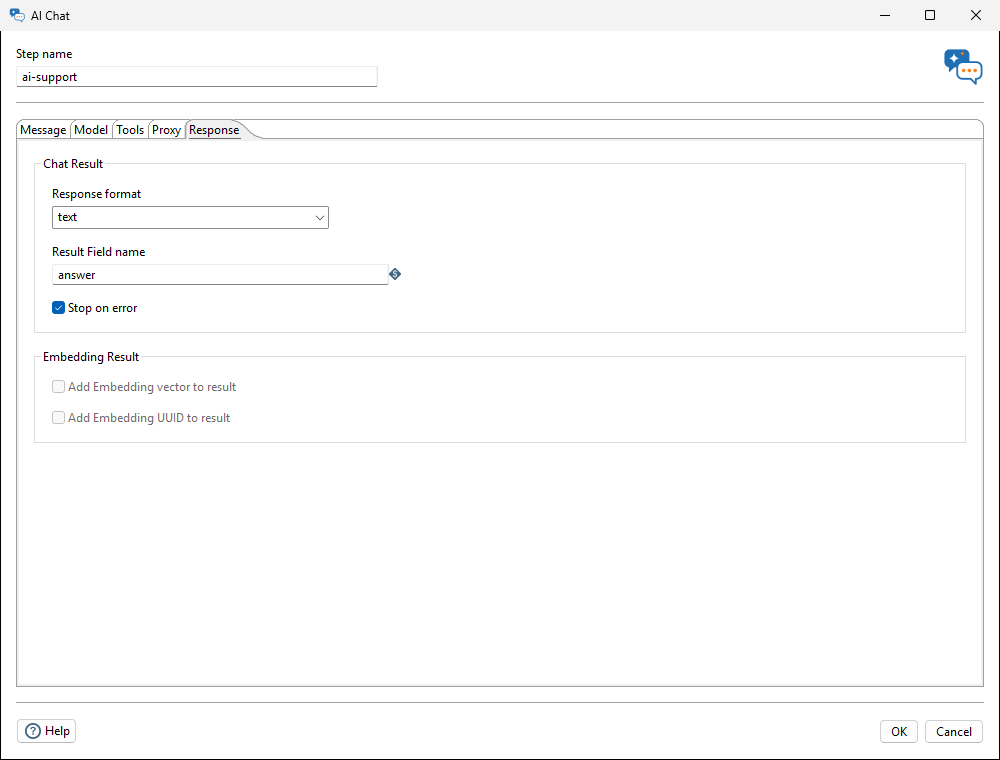
<figcaption>ai-support: the Response tab</figcaption>
</figure>
</div>

11. On the **Message** tab, under **Message/Prompt**, select **Stream**. Set **Message Field name** to `customer_question` and **Run instruction for LLM Field name** to `run_instruction`. Keep **Attach Document(s)** cleared.
12. On the **Model** tab, set **LLM Provider** to `Ollama` and **Model name** to `${TOOL_MODEL}`. Fill the **Model Configuration** grid, and delete any row that is not in this table:

| Parameter | Value |
| --- | --- |
| `endpoint` | `${OLLAMA_URL}` |
| `temperature` | `0` |
| `numCtx` | `8192` |
| `timeout` | `300` |

13. Open the **Tools** tab. Select **Offer the tools of MCP servers to the LLM**, and add `retail-tools` as the one row of **MCP connections**. Keep **Maximum tool calls per row** `10` and **Tool call timeout (seconds)** `60`, and set **Tool calls field** to `tool_calls`.
14. On the **Response** tab, keep **Response format** `text`, set **Result Field name** to `answer`, and keep **Stop on error** selected. Select **OK**.

> **Under the hood:**
>
> #### The step runs the tool-calling loop the model asks for
>
> When the transformation starts, **ai-support** connects to `retail-tools` and lists its tools once: the three **Allowed tools**, so the model never learns that `start_return` exists. For each row, it sends Ollama the run instruction, the question, and each tool's name, description and argument schema. If the model answers with tool calls instead of text, the step makes each call over MCP, adds the results to the conversation and asks again, until the model answers in text or makes more than **Maximum tool calls per row**. A tool error goes back to the model as a result, not as a failed row. **Tool calls field** records every call: its connection, tool, arguments, result and whether it failed.
>
> **Why it matters:** the plugin does the loop that an agent framework would otherwise do for you. The model needs tool-calling support, which `qwen2.5:7b` has, and `numCtx` must hold the instruction, the tool descriptions and every tool result: 8,192 tokens leaves room for several calls.

15. From the **Scripting** folder, drag **Modified JavaScript value** onto the canvas. Create a hop from **ai-support** to it. Double-click it, set **Step name** to `js-tools-used`, and replace the text on the **Script 1** tab with:

```javascript
// tool_calls holds a JSON array: one object per tool call the model made,
// with connection, tool, arguments, result and error.
var tools_used = "";
var tool_call_count = 0;
if (tool_calls != null && (tool_calls + "") != "") {
  var calls = JSON.parse(tool_calls + "");
  var names = [];
  for (var i = 0; i < calls.length; i++) {
    names.push(calls[i].tool + "");
  }
  tool_call_count = calls.length;
  tools_used = names.join(", ");
}
```

16. Fill the **Fields** grid: `tools_used`, **Type** `String`, and `tool_call_count`, **Type** `Integer`. Select **OK**.
17. From the **Transform** folder, drag **Select values** onto the canvas. Create a hop from **js-tools-used** to it. Double-click it, set **Step name** to `sv-answers`, and list these fields in this order: `question_id`, `customer_question`, `answer`, `tool_call_count`, `tools_used`, `tool_calls`. Select **OK**.
18. From the **Output** folder, drag **Text file output** onto the canvas. Create a hop from **sv-answers** to it. Double-click it and set **Step name** to `txt-answers`. On the **File** tab, set **Filename** to `${Internal.Entry.Current.Directory}/support_answers` and **Extension** to `csv`, and select **Create Parent folder**. On the **Content** tab, set **Separator** to `,` and **Encoding** to `UTF-8`. On the **Fields** tab, select **Get Fields**, then **Minimal width**, and select **OK**.
19. Save the transformation (`Ctrl+S`).

### 6. Run and Compare

> **Note:**
>
> #### Run the Transformation
>
> Each question is one conversation with the model, with one or more tool calls in it. With a GPU the six questions take under a minute; on a CPU-only machine allow a minute or more per question.

1. Press `F9` (**Action > Run**), and select **Run** in the **Run Options** dialog.
2. When the run ends, select **txt-answers** on the canvas and open the **Preview data** tab.

> **Success:** Checkpoint: 6 rows, one per question, each with an `answer`. `tools_used` shows the model's choices, which can vary between runs: in a measured run with `qwen2.5:7b`, `lookup_order` for `Q1`, `check_stock` for `Q2`, `get_return_policy` for `Q3`, `lookup_order` only for `Q4` and `Q6`, and nothing for `Q5` (`tool_call_count` `0`), whose answer says the assistant has no information about store hours. For `Q6`, `tools_used` never contains `start_return`, because the model was never offered it, and `returns_log.jsonl` does not appear in `mcp-server`.

3. Open `support_answers.csv` in the lab folder and read each `answer` against its `tools_used`.

> **Warning:** A model can answer from what it thinks it knows instead of calling a tool. In the same measured run, the answers to `Q4` and `Q6` both gave a 30-day return window for the boots: only `lookup_order` was called, and 30 days is not the footwear policy's 60. The `tool_calls` field is how you catch it: an answer that states a policy without `get_return_policy` in `tools_used` is not grounded.

4. Compare the two ways you called the server:

| | **MCP Client** (part 4) | **AI Chat** with **Tools** (parts 5 and 6) |
| --- | --- | --- |
| Who chooses the tool | You, in the step | The model, for each row |
| Arguments | A template filled from the row's fields | Built by the model from the question |
| Same input, same calls? | Always | Not guaranteed; check `tool_calls` |
| A model involved | No | Yes, with tool-calling support |
| Result | The tool's own output, ready to parse | The model's answer, written from the tool results |
| Use it when | You know which tool to call: lookups, enrichment, automation | The input is free text and the right tool depends on what it asks |

5. Optional: to see **Allowed tools** at work the other way, edit `retail-tools`, clear **Allowed tools**, and run again. `Q6` may now call `start_return`, and `returns_log.jsonl` in `mcp-server` gets a line. Set **Allowed tools** back to the three names afterwards. In a measured run without **Allowed tools**, the model was offered all four tools and still did not call `start_return` for `Q6`, but its answer announced a return authorization number, `RMA-123456`, that no tool had created: an answer that reports an action without the tool that does it in `tools_used` is not grounded either.

> **Under the hood:**
>
> #### Allowed tools filtered the server before the model saw it
>
> The connection's **Allowed tools** applies to every step that uses it: tools outside the list are neither listed nor called. **MCP Client** fails a row that asks for one with `MCP_NOT_ALLOWED`, and **AI Chat** never offers it to the model, so no wording of a question can make the model call `start_return`. The restriction lives in the connection, in the metastore, not in the prompt.
>
> **Why it matters:** an instruction such as "never start a return" is a request the model can ignore; **Allowed tools** is a control. Give a model only the tools its task needs, especially tools that change data, and put a deterministic **MCP Client** call wherever you already know which tool to use.

::::

## Troubleshooting <!-- no-step -->

<details>
<summary>Error initializing step: License validation failed</summary>

The Pentaho license on this machine has no GenAI rights. Every GenAI plugin step, **MCP Client** included, checks for a license with the GenAI Plugin Suite (GENAI-EE) subscription when the transformation starts. Install a license that includes it, as described in [Before You Start](../00-before-you-start/guide.md).

</details>

<details>
<summary>The MCP connection 'retail-tools' does not exist</summary>

The transformation names a connection this machine's metastore does not have. Create it as in **2. Create the Connection**, with exactly the name `retail-tools`. Connections are per machine and per user: they are not inside the `.ktr`.

</details>

<details>
<summary>Cannot connect with the MCP connection 'retail-tools'</summary>

The server did not start. Run `python check_server.py` from the `mcp-server` folder: `No module named 'mcp'` means the SDK is not installed in the Python that `python` starts, so run `python -m pip install "mcp<2"` again. Check that the third line of **Arguments** is the full path of `retail_mcp_server.py`, and that **Command** is `cmd` with `/c` as the first argument.

</details>

<details>
<summary>tools_used is empty for every question</summary>

The model did not call any tool. Check that **Offer the tools of MCP servers to the LLM** is selected and `retail-tools` is in **MCP connections**, and that `TOOL_MODEL` is a model with tool calling, such as `qwen2.5:7b`. A model without tool support fails the row or answers without the tools.

</details>

## Lab Files

Click a file to download. For `.ktr` and `.kjb` files, **Open in Pentaho Data Integration** launches Pentaho Data Integration with the file loaded. If Pentaho Data Integration is already running, the path is copied to your clipboard — switch to Pentaho Data Integration and press `Ctrl+O`, `Ctrl+V`, `Enter`.

The MCP server, its data and the check script. Keep the three files together in a folder named `mcp-server`:

[retail_mcp_server.py](./files/mcp-server/retail_mcp_server.py)

[retail_data.json](./files/mcp-server/retail_data.json)

[check_server.py](./files/mcp-server/check_server.py)

The six order ids part 4 looks up, and the six customer questions of part 5:

[order_ids.csv](./files/order_ids.csv)

[customer_questions.csv](./files/customer_questions.csv)

### Solution <!-- no-step -->

The finished transformations for this lab. Open them alongside your own to compare, or run them to see the expected result. They read the CSV files from the lab folder and write their output beside themselves. They need the MCP connection `retail-tools` in your metastore, created as in part 2; the solution does not create it.

Also on disk at `C:\Workshop-AI-Specialty\07-agents-and-tools\22-mcp-tools\solution`.

[mcp_list_tools.ktr](./files/solution/mcp_list_tools.ktr) <button data-launch="spoon" data-path="files/solution/mcp_list_tools.ktr">Open in Pentaho Data Integration</button> <button data-graph="files/solution/mcp_list_tools.ktr">View graph</button>

mcp_list_tools in Spoon, with its note:

<div align="center">
<figure>
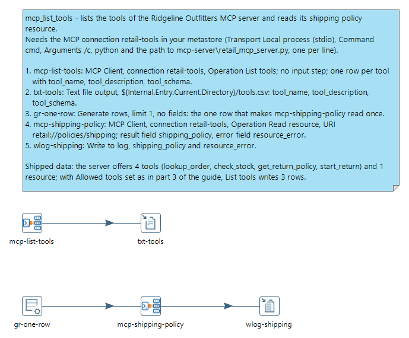
<figcaption>mcp_list_tools.ktr in Spoon</figcaption>
</figure>
</div>

[mcp_call_tools.ktr](./files/solution/mcp_call_tools.ktr) <button data-launch="spoon" data-path="files/solution/mcp_call_tools.ktr">Open in Pentaho Data Integration</button> <button data-graph="files/solution/mcp_call_tools.ktr">View graph</button>

mcp_call_tools in Spoon, with its note:

<div align="center">
<figure>
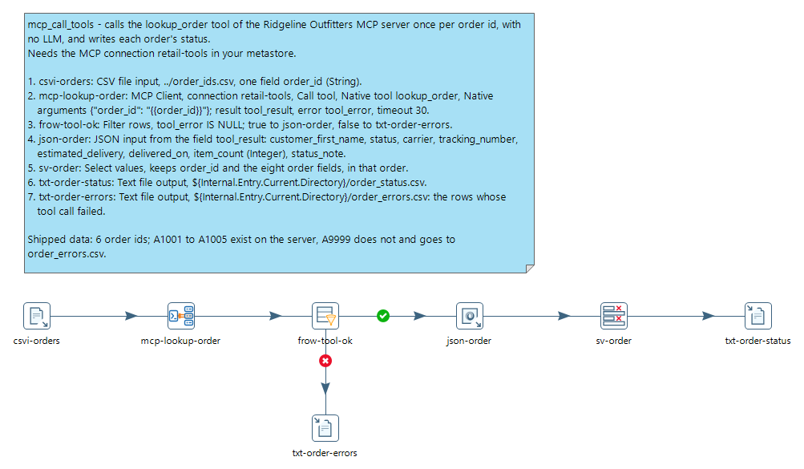
<figcaption>mcp_call_tools.ktr in Spoon</figcaption>
</figure>
</div>

[mcp_ai_chat_tools.ktr](./files/solution/mcp_ai_chat_tools.ktr) <button data-launch="spoon" data-path="files/solution/mcp_ai_chat_tools.ktr">Open in Pentaho Data Integration</button> <button data-graph="files/solution/mcp_ai_chat_tools.ktr">View graph</button>

mcp_ai_chat_tools in Spoon, with its note:

<div align="center">
<figure>
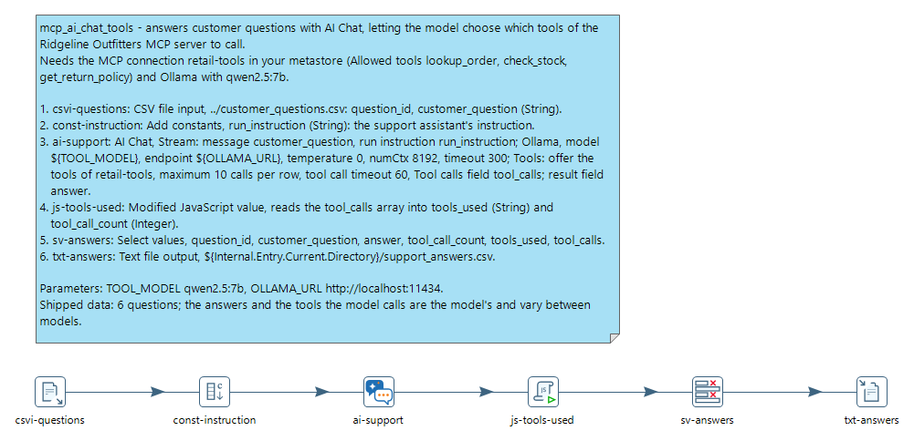
<figcaption>mcp_ai_chat_tools.ktr in Spoon</figcaption>
</figure>
</div>
