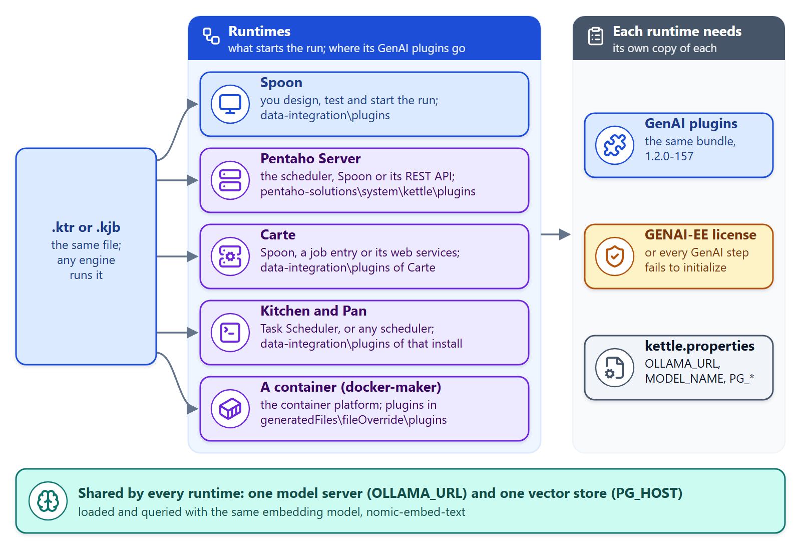

# Overview

<div class="pcm-intro">

The workshops so far ran every pipeline in Spoon, on one machine, with Ollama and pgvector beside it. In production the same transformations run unattended: on Pentaho Server's scheduler, on Carte, from Kitchen or Pan, or in a container, against a shared model server and a managed vector store. This module covers what has to change for that, and what stays the same, so the pipelines you built keep giving the same answers when nobody is watching.

</div>

<div align="center">
<figure>

<figcaption>Where a pipeline runs, and what every runtime needs</figcaption>
</figure>
</div>

**What You'll Learn**

* The runtimes that run a transformation outside Spoon, and what each one needs
* Why the GenAI plugins and the GENAI-EE license must be on every runtime
* How to configure a pipeline per environment with variables, and keep secrets out of the files
* What the model server and the vector store need in production
* How to make the pipelines safe to re-run, observable, governed, evaluated and affordable

:::: tabs

### 1. Where They Run

> **Note:**
>
> #### Four Runtimes Besides Spoon
>
> A transformation or job is a file, `.ktr` or `.kjb`, and any Pentaho Data Integration (PDI) engine can run it. Spoon is where you design and test; production runs it somewhere that starts the work on its own.

| Runtime | What starts the run | Where the GenAI plugins go | Whose `kettle.properties` it reads |
| --- | --- | --- | --- |
| **Pentaho Server** | Its scheduler (the User Console's **Schedule...**), Spoon's **Pentaho server** run configuration, or its REST API | `pentaho-server\pentaho-solutions\system\kettle\plugins` | The `.kettle` folder under `KETTLE_HOME`, or else the home folder of the Windows account that runs the server |
| **Carte** | Spoon's **Slave server** run configuration, a job entry, or Carte's own web services | `data-integration\plugins` of the Carte installation | The account that runs `Carte.bat` |
| **Kitchen and Pan** | Windows Task Scheduler, or any scheduler that can run a command | `data-integration\plugins` of that installation | The account the task runs as |
| **A container** (a Carte image built with docker-maker) | The container platform | `generatedFiles\fileOverride\plugins`, before the image is built | The `.kettle` folder inside the image |

**Pentaho Server** keeps the files in the Pentaho Repository, runs them in its own Java process, and gives you a scheduler and a log in one place. The [Run on Pentaho Server](../25-production-server/guide.md) workshop takes the RAG pipeline there.

**Kitchen and Pan** run a job or a transformation from the command line and stop. On Windows, Task Scheduler can start them:

```powershell
$run = New-ScheduledTaskAction -Execute "C:\Pentaho\design-tools\data-integration\Kitchen.bat" `
  -Argument '/file:"C:\ai-pipelines\jb_rag_pipeline.kjb" /level:Basic /logfile:"C:\ai-pipelines\logs\jb_rag_pipeline.log"'
Register-ScheduledTask -TaskName "AI RAG pipeline" -Action $run -Trigger (New-ScheduledTaskTrigger -Daily -At 2am)
```

Kitchen's exit code tells the scheduler how the run went: `0` for success, `1` when the job finished with errors. When a GenAI step fails its license check, Kitchen returns `1` for the job and Pan returns `2` for a transformation, because the transformation could not start.

**Carte** is a small web server that runs work sent to it. Several Carte servers can share the load of one job.

**A container** packages Carte, the plugins and the configuration into one image, so every copy runs the same versions. Pentaho's docker-maker builds the image.

> **Tip:** Inside a job, keep each **Transformation** entry on the run configuration **Pentaho local**. The transformations then run where the job runs, on the server or Carte that runs the job; the **Pentaho server** run configuration is for the job you start from Spoon.

### 2. Plugins and License

> **Note:**
>
> #### Every Runtime Needs Both
>
> The GenAI steps are plugins. A runtime that does not have them cannot load a transformation that uses them, and a runtime without the license cannot start them.

**Install the plugins everywhere the pipelines run.** The GenAI Plugin Installation User Guide lists the folders (section 3): Spoon and Carte use `data-integration\plugins`, Pentaho Server uses `pentaho-server\pentaho-solutions\system\kettle\plugins`, and docker-maker uses `generatedFiles\fileOverride\plugins`.

| Rule | Why |
| --- | --- |
| Extract each plugin archive of the bundle, so every `pdi-step-...` folder, with its `lib` folder, sits directly under `plugins` | PDI loads plugin folders, not `.zip` files; a step without its `lib` folder fails to load |
| Use the same bundle, `pdi-genai-plugins-bundle-1.2.0-157.zip`, for Spoon, Carte, Pentaho Server and every image | A transformation saved by one version and run by another can meet settings the other does not know |
| Stop the server, or close Spoon, before installing, and start it afterwards | Plugins are found only when the engine starts |
| On an upgrade, delete the old `pdi-step-...` folders first, then extract the new ones | Extracting over an old folder leaves old libraries in `lib` beside the new ones |

**The license.** Every GenAI step checks for a Pentaho license with the GenAI Plugin Suite (GENAI-EE) subscription when its transformation starts. On a runtime without it, the step fails to initialize and the log says:

```text
License validation failed. Ensure you have the GenAI Plugin Suite (GENAI-EE) subscription available.
```

The license belongs to the machine and the process, not to the person who built the transformation. Pentaho Server reads its license from the file that `-Dpentaho.license.information.file` names when the server starts; the suite installer sets it from `PENTAHO_LICENSE_INFORMATION_PATH`, and puts the file at `C:\Pentaho\.elmLicInfo.plt`. Carte, Kitchen and Pan read the license of the account that runs them.

### 3. Configuration and Secrets

> **Note:**
>
> #### Variables, Not Hard-Coded Values
>
> The same transformation runs in development, test and production. What differs between them, the model server, the database and the folders, belongs in variables, and each environment gives them its own values.

The workshops already use variables for every connection:

| Variable | Read by | Development | Production (example) |
| --- | --- | --- | --- |
| `OLLAMA_URL` | AI Chat, Text to Vector | `http://localhost:11434` | `http://gpu-ollama.example.internal:11434` |
| `MODEL_NAME` | AI Chat, AI Segmentation | `llama3.2:3b` | `qwen2.5:7b` |
| `PG_HOST`, `PG_PORT`, `PG_DATABASE` | Vector Writer, Vector Search | `localhost`, `5433`, `genai` | the managed PostgreSQL service |
| `PG_USER`, `PG_PASSWORD` | Vector Writer, Vector Search | `genai`, `genai` | a service account |
| `RAG_DATA_DIR`, `RAG_OUT_DIR` | Get File Names, CSV file input, Text file output | the workshop folder | a folder the server can read and write |

**Set them in `kettle.properties`, one file per environment.** Each runtime reads its own file when it starts, so the same `.ktr` meets development values on a laptop and production values on the server. Use forward slashes in paths there, `C:/ai-pipelines/data`: a backslash is an escape character in a `.properties` file.

**A parameter's default beats `kettle.properties`.** The workshop transformations declare `OLLAMA_URL`, `PG_HOST` and the others as parameters with workshop defaults, so they run anywhere without setup. A run that passes no value uses that default, whatever the runtime's `kettle.properties` says. A production copy removes those parameters, so every run takes the runtime's values; the [Run on Pentaho Server](../25-production-server/guide.md) workshop does exactly that.

**No hard-coded hosts or paths.** `${Internal.Entry.Current.Directory}` is the folder of the file being run. On disk that is a folder; in the Pentaho Repository it is a repository folder such as `/public/ai-pipelines`, which no file step can read a document from. Data files go in a disk folder (or a VFS location, a `pvfs://` connection to shared storage) that a variable names.

**Secrets.** A password typed into a GenAI step's **Password** or `apiKey` field is stored in the `.ktr` as `Encrypted ...`. That is an obfuscation with a seed every PDI installation knows, not protection: anyone who has the file can reverse it. Keep the value out of the file instead:

* Put `${PG_PASSWORD}` in the step, and the value in the runtime's `kettle.properties`, readable only by the account that runs the server.
* To keep the clear text out of `kettle.properties` too, store the output of `Encr.bat -kettle <password>` there (it starts with `Encrypted `). Setting `KETTLE_TWO_WAY_PASSWORD_ENCODER_SEED` to your own seed on every runtime makes that value useless on other installations.
* Never commit a `.ktr` that holds a password or an API key to Git or a shared repository folder.

<!-- UNPROVEN: the GenAI step classes call Kettle's decryptPasswordOptionallyEncrypted, but whether an "Encrypted ..." value that arrives through a variable is decrypted has not been run. Check it with one Vector Search before relying on it. -->

> **Warning:** AI Chat's Model Configuration rows other than `apiKey`, `secretAccessKey` and `tokenCredentialClientId` are stored as entered, `embeddingApiKey` included. Give them a variable too.

### 4. The Model Server

> **Note:**
>
> #### One Model Server for Everyone
>
> In the workshops each machine ran its own Ollama. In production the model runs on a machine sized for it, and every runtime calls that one.

| Option | How the steps reach it | Think about |
| --- | --- | --- |
| A shared Ollama on a GPU host | `OLLAMA_URL` names the host; Ollama listens on every interface when `OLLAMA_HOST` is `0.0.0.0:11434` | Ollama has no sign-in: allow only the Pentaho servers through the firewall, or put a proxy in front and send its token with the `customHeaders` row |
| A hosted provider | AI Chat's **LLM Provider**: OpenAI, Azure OpenAI, AWS Bedrock, Anthropic Claude or Google Gemini, with `apiKey` and `endpoint` | The data leaves your network; per-token cost; OpenAI accepts only the model names in the plugin's list |
| Ollama beside each runtime | `http://localhost:11434` | Every server needs the memory for the model; fine for a single server |

**Settings that matter in production** (AI Chat and Text to Vector Model Configuration rows):

| Row | Why |
| --- | --- |
| `timeout` | A busy shared server answers more slowly than a laptop did; a row that waits past it fails |
| `maxRetries` | Retries a failed request before the row fails |
| `temperature` `0` | The same input gives the same answer, run after run |
| `numCtx` | Must hold the instruction, the passages and the answer; a larger window costs memory on the model server |

**Concurrency.** Each copy of an AI Chat step has one request open at a time. Four copies in each of three runs at once make twelve open requests. Ollama works on `OLLAMA_NUM_PARALLEL` requests per model at a time and queues the rest, so more copies than that only make requests wait longer, and a `timeout` set for one user can start failing rows.

**Keep the model loaded.** Ollama unloads a model five minutes after its last request, and loading it again can take many seconds. A RAG pipeline uses two models, the embedding model and the chat model. On the model server, set `OLLAMA_KEEP_ALIVE` (for example `30m`) and `OLLAMA_MAX_LOADED_MODELS` to at least `2`, so neither model is unloaded between rows.

**The embedding model is part of the data.** Text to Vector must use the same embedding model, `nomic-embed-text` here, for loading and for questions. Changing it is a re-embedding project (see **The Vector Store**), never a variable change.

### 5. The Vector Store

> **Note:**
>
> #### pgvector as a Production Database
>
> The `kb_chunks` table is a database table like any other: it needs a server that is backed up, an index, and a clear owner.

**A managed PostgreSQL with pgvector.** Most managed PostgreSQL services offer the `vector` extension. Vector Writer creates the extension and the table when **Create the collection if missing** is selected, so the account needs the rights to do that. In production, a database administrator usually creates both once, and the pipeline's account only writes rows; then clear **Create the collection if missing**, so a misspelled collection stops the step instead of creating a new one.

**An index.** Vector Writer creates no search index for PGVector, so every question compares its vector with every row. Create an HNSW index once, after the first load. In a SQL client connected to the database, run:

```sql
CREATE INDEX kb_chunks_hnsw ON kb_chunks USING hnsw (embedding vector_cosine_ops);
```

`vector_cosine_ops` indexes the cosine distance, `<=>`, that the Vector Writer guide's PGVector queries order by. Vector Search reports its scores on the same cosine basis.

<!-- UNPROVEN: that Vector Search's PGVector query uses the HNSW cosine index (the guides do not name the metric for PGVector). Check with EXPLAIN on the database while a search runs. -->
**Backups.** The table can be rebuilt from the documents, but a rebuild embeds every chunk again. Back it up with the database: the managed service's backups, or `pg_dump`.

**One embedding model per collection.** Vectors from two models cannot be compared, and Vector Writer rejects rows with another dimension only when **Vector dimension** is set. Name the collection after its model, `kb_chunks_nomic_768` for example, and keep the collection name in a variable.

**Re-embedding when the model changes.** Load a new collection with the new model beside the old one, run the evaluation (tab 9) against both, switch the question pipeline's collection variable, and drop the old collection when nothing reads it.

### 6. Reliability

> **Note:**
>
> #### Failures You Can Re-Run
>
> An unattended pipeline fails at 3 a.m. with nobody watching. It should fail in a known place, keep the rows it could not process, and be safe to run again.

**Error hops.** Some GenAI steps can send a failed row down an error hop, so one bad document or one model timeout does not stop the run:

| Supports the error hop | Stops the transformation on an error |
| --- | --- |
| AI Chat, AI Segmentation, Text to Vector (`AIEMBED001`), Vector Writer (`VUPSERT001`), Vector Search (`VSEARCH001`), MCP Client, Discover Metadata | AI Chat Message Box, NER Extractor, Read Unstructured Document, HTML Parser, Base64 Encoder |

On a step that supports it, clear **Stop on error**, create a hop from the step to a **Text file output** and select **Error handling of step**. The failed rows, with their error code and message, land in a file you can read and feed back in. Text to Vector sends failed rows to the error hop whenever one exists.

**Idempotent loads.** The knowledge base load gives each chunk an ID, `chunk_id` (the file name and the chunk number), and Vector Writer upserts by it: running the load twice updates the same rows instead of adding copies. Without an ID field, every run adds every chunk again.

**What an upsert does not do.** Vector Writer cannot delete. When a document gets shorter, or is removed, its old chunks stay and keep being retrieved. Before loading a changed document, delete its chunks with an **Execute SQL script** step:

```sql
DELETE FROM kb_chunks WHERE metadata->>'source' = 'larkspur-warranty-policy.pdf';
```

**Jobs that stop at the first failure.** Wrap the pipeline in a job whose entries follow **Follow When Result is False** hops to **Abort job**, so the question pipeline never runs against a half-loaded knowledge base, and the scheduler records the run as failed.

### 7. Observability

> **Note:**
>
> #### Know What Ran and What It Said
>
> When an answer is questioned a week later, you need to know which run produced it, with which model, from which passages.

| Source | What it gives you |
| --- | --- |
| The PDI log | Each step's start, finish and errors. Pentaho Server writes it to `pentaho-server\logs\pdi.log`, one line per job entry, prefixed with the repository path of the job |
| **Step Metrics** | Rows read, written and rejected per step, and per copy |
| Logging tables | **Transformation properties > Logging** writes each run's status and row counts to a database table; the `KETTLE_TRANS_LOG_*` and `KETTLE_STEP_LOG_*` variables in `kettle.properties` set them for every transformation |
| AI Chat's **Tool calls field** | A JSON array of every tool the model called, with its arguments, result and error |
| Text to Vector's metadata | Stores `embedding_model`, `dimensions` and `created_at` with every chunk |

**Record the model with every answer.** Add a **Get variables** step that copies `${MODEL_NAME}` into a field, and a **Get system info** step for the run's date, and write both beside each answer. A drift in answers can then be traced to a model change.

**Logging levels and data.** `Row Level` and `Debug` logging write row values, prompts included, to the log. Ollama's `logRequests` and `logResponses` are on by default; set both rows to `false` in production so prompts and answers stay out of the server log.

### 8. Data Governance

> **Note:**
>
> #### What the Model Sees
>
> A model sees everything in its prompt. Governance decides what goes into the prompt, where it is processed, and who checks what comes out.

| Concern | What to do |
| --- | --- |
| **Where the data goes** | With Ollama on your own servers, documents, prompts and answers never leave your network. A hosted provider processes them on its servers: check its data terms before sending customer data |
| **Personal data before prompts** | Send only the fields the task needs. Find names with **NER Extractor** and email addresses or card numbers with **Regex evaluation**, and mask them with **Replace in string** before the prompt is built. The [Guard Personal Data](../28-pii-guardrails/guide.md) workshop builds this |
| **Prompt injection from documents** | A retrieved passage can contain text such as "ignore your instructions". Keep the instruction in the run instruction field, mark the passages as data ("Use only the numbered passages under Context"), and parse the answer as JSON so free text cannot become an action |
| **Tools** | With MCP tools, list only the tools the task needs in **Allowed tools**, and prefer read-only ones |
| **Human review** | Flag the rows a person must check, as the capstone's `needs_human` column does when the documents hold no answer, and route them to a person instead of sending them on |

### 9. Evaluation and Drift

> **Note:**
>
> #### A Fixed Test Before Every Change
>
> An LLM pipeline has no compiler. A fixed set of questions with known answers is how you know a change made it better, not only different.

**The question set.** Lab 21's `questions.csv` is the start of one: 7 questions, each with the document that should answer it in `expected_source`. A production set holds a few dozen, including questions the documents cannot answer.

| Measure | How |
| --- | --- |
| Retrieval | The expected source is among the retrieved sources. Lab 21's `explore_retrieval.ktr` measures it without calling the chat model |
| Answer found | `found` is `true` for answerable questions and `false` for the others |
| Citation | The cited sources include the expected source |

**Run it again whenever something changes:** the chat model or its version, the embedding model, the chunk size or overlap, `TOP_K` or `MIN_SCORE`, the instruction, or the documents. Keep each run's results with the model name and date, and compare them with the last accepted run before the change goes to production. The [Evaluate the Answers](../27-rag-evaluation/guide.md) workshop builds such a test, with a second model as judge.

### 10. Cost and Throughput

> **Note:**
>
> #### Where the Time and Money Go
>
> Each row is one request to the model. The model's time per request, not Pentaho Data Integration, sets the pace.

| Lever | Effect |
| --- | --- |
| Step copies | More requests at once, up to what the model server runs in parallel |
| `TOP_K` and chunk size | Every retrieved passage is input tokens in every prompt: 4 passages of 300 tokens is 1,200 tokens per question before the question and instruction. A hosted provider bills them |
| Model size | A smaller model answers faster and on cheaper hardware; measure its answers with the question set first |
| Re-embedding | Upserting unchanged documents embeds them again. Load only new and changed files: **Get File Names** gives each file's `lastmodifiedtime` |
| Text to Vector **Batch size** | Embeds several rows per request (16 by default), so loading costs fewer requests than answering |
| GPU | Turns tens of seconds per answer on a CPU into seconds |

Estimate a run as rows × seconds per row ÷ requests in parallel, measured on the production model server, and set the schedule and the `timeout` from that figure.

::::

## Workshops <!-- no-step -->

* [Run on Pentaho Server](../25-production-server/guide.md): install the GenAI plugins on the server, give it its settings, store the RAG pipeline in the Pentaho Repository, run it on the server, schedule it, and read its log.
* [Guard Personal Data](../28-pii-guardrails/guide.md): mask the personal data in support messages before a model sees them, check what slipped through, guard against prompt injection, and audit what was masked.

<div class="pcm-embed-card" data-href="https://docs.pentaho.com/pdia-try-pdia/about-pentaho-workflows" data-title="About Pentaho workflows: Go Live"></div>

<div class="pcm-embed-card" data-href="https://docs.pentaho.com/pdia-data-integration/collaborating-with-pdi" data-title="Collaborating with PDI: the Pentaho Repository"></div>

<div class="pcm-embed-card" data-href="https://docs.pentaho.com/pba/pentaho-user-console/modern-design/scheduler/schedule-a-transformation-or-job" data-title="Schedule a transformation or job"></div>
