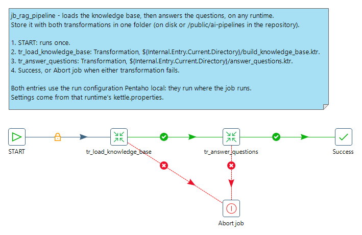
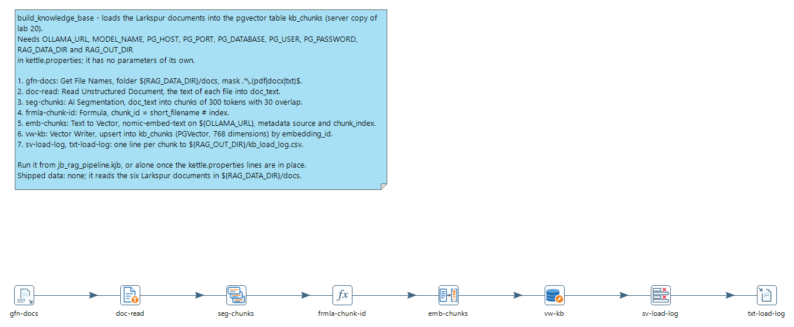
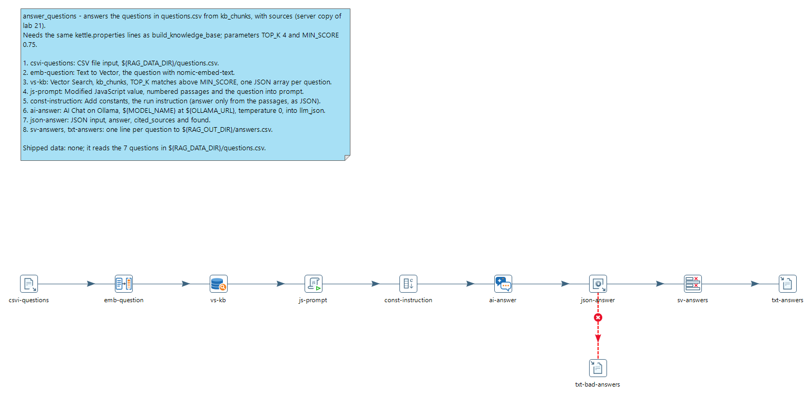

# Run on Pentaho Server

> **Warning:**
>
> #### Workshop - Run on Pentaho Server
>
> Take the RAG pipeline of the Retrieval-Augmented Generation module, the knowledge base load and the question answering, from Spoon to Pentaho Server. You install the GenAI plugins on the server, give it its own settings, wrap both transformations in one job, store it in the Pentaho Repository, and let the server run it on a schedule.
>
> **What you'll do**
>
> * Find the account and the `kettle.properties` file the server runs with
> * Install the GenAI plugins in the server's plugins folder, and give the server its settings
> * Make the two RAG transformations server-ready: settings from `kettle.properties`, data from a disk folder
> * Wrap them in the job `jb_rag_pipeline.kjb` and store it in `/public/ai-pipelines`
> * Run it on the server from Spoon, schedule it in the User Console, and read the result and the log
>
> **Prerequisites:**
>
> * [Build the Knowledge Base](../20-rag-knowledge-base/guide.md) and [Answer Questions](../21-rag-answer-questions/guide.md), with `build_knowledge_base.ktr` and `answer_questions.ktr` working in Spoon
> * The Pentaho Server installed in `C:\Pentaho\server\pentaho-server`, a license with GenAI rights on it, and the bundle `pdi-genai-plugins-bundle-1.2.0-157.zip` in your `Downloads` folder, as in [Before You Start](../00-before-you-start/guide.md)
> * Ollama and the pgvector container running, as for the RAG workshops
> * The production [Overview](../24-production/guide.md)
>
> **Estimated time:** 75 minutes

<figure>

<figcaption class="pcm-video-caption">Walkthrough: coming soon</figcaption>

</figure>

<div align="center">
<figure>

<figcaption>What you deploy: the job on the server, and what its settings point at</figcaption>
</figure>
</div>

:::: tabs

### 1. Find the Server's Settings

> **Note:**
>
> #### The Server Is Another Process
>
> Pentaho Server runs transformations in its own Java process, started by its own Windows account. It reads the GenAI plugins from its own plugins folder and its variables from the `kettle.properties` of that account, not from Spoon's.

1. Check that the server is running. In PowerShell, run:

```powershell
(Invoke-WebRequest http://localhost:8080/pentaho/Login -UseBasicParsing).StatusCode
```

> **Success:** Checkpoint: `200`. If the command fails, start the server with `C:\Pentaho\server\pentaho-server\start-pentaho.bat` and run it again after a minute or two.

2. Find the account that runs the server, and whether it sets `KETTLE_HOME`. In PowerShell, run:

```powershell
Get-CimInstance Win32_Process | Where-Object { $_.CommandLine -match 'catalina\.home' -and $_.CommandLine -match 'pentaho' } | ForEach-Object {
  $o  = Invoke-CimMethod -InputObject $_ -MethodName GetOwner
  $kh = if ($_.CommandLine -match '-DKETTLE_HOME=("[^"]+"|\S+)') { $Matches[1] } else { '(not set)' }
  [pscustomobject]@{ Process = $_.Name; Id = $_.ProcessId; Account = "$($o.Domain)\$($o.User)"; KETTLE_HOME = $kh }
} | Format-List
```

> **Success:** Checkpoint: one process, `java.exe` (or `tomcat10.exe` when the server runs as a Windows service), with **Account** your own Windows account and **KETTLE_HOME** `(not set)` on a lab machine where you started the server yourself.

3. Read off the server's `kettle.properties` from the result:

| What step 2 showed | The server's `kettle.properties` |
| --- | --- |
| Your account, `KETTLE_HOME` `(not set)` | `%USERPROFILE%\.kettle\kettle.properties`, the same file Spoon reads |
| `KETTLE_HOME` set | `<KETTLE_HOME>\.kettle\kettle.properties` |
| `NT AUTHORITY\SYSTEM` (a service as Local System), `KETTLE_HOME` `(not set)` | `C:\Windows\System32\config\systemprofile\.kettle\kettle.properties` |

> **Under the hood:**
>
> #### Variables come from the account that runs the engine
>
> When a Pentaho Data Integration engine starts, it reads `kettle.properties` from the `.kettle` folder under `KETTLE_HOME`, or under the account's home folder when `KETTLE_HOME` is not set, and keeps those variables until it stops. On a lab machine you start Spoon and the server with the same account, so they share one file. In production the server runs on its own machine, often as a service account, and has a file of its own.
>
> **Why it matters:** a pipeline that works in Spoon and fails on the server with an empty `${PG_HOST}` almost always found the variables in the wrong file.

### 2. Install the Plugins on the Server

> **Note:**
>
> #### The Server's Plugins Folder
>
> The GenAI steps run on the server only if their plugins are in `pentaho-server\pentaho-solutions\system\kettle\plugins`. The server finds plugins when it starts, so it is stopped while they go in.
>
> The server must be Pentaho Server 11.x: suite 1.2.0 supports Pentaho 11 only, not 10.2.x. This workshop's steps follow Pentaho 11.0.0.3.

1. Stop the Pentaho Server. In PowerShell, run:

```powershell
C:\Pentaho\server\pentaho-server\stop-pentaho.bat
```

Where the server runs as a Windows service (step 2 of the previous tab showed `tomcat10.exe`), run `Stop-Service pentahoserver` in a PowerShell window opened as administrator instead.

2. Install every plugin of the bundle into the server's plugins folder, deleting any older copy of each first. In PowerShell, run:

```powershell
$Bundle  = "$env:USERPROFILE\Downloads\pdi-genai-plugins-bundle-1.2.0-157.zip"
$Plugins = "C:\Pentaho\server\pentaho-server\pentaho-solutions\system\kettle\plugins"
$Temp    = Join-Path $env:TEMP "genai-bundle"
Remove-Item $Temp -Recurse -Force -ErrorAction SilentlyContinue
Expand-Archive $Bundle -DestinationPath $Temp
Get-ChildItem "$Temp\*.zip" | ForEach-Object {
  $name = $_.BaseName -replace '-\d+(\.\d+)*-\d+$', ''
  Remove-Item (Join-Path $Plugins $name) -Recurse -Force -ErrorAction SilentlyContinue
  Expand-Archive $_.FullName -DestinationPath $Plugins
}
Remove-Item $Temp -Recurse -Force
Get-ChildItem $Plugins -Directory -Filter "pdi-step-*" | Select-Object -ExpandProperty Name
```

> **Success:** Checkpoint: 12 folders, from `pdi-step-ai-chat-messagebox-plugin` to `pdi-step-tika-plugin`, each with its own `lib` folder. The server's other plugins are unchanged.

Leave the server stopped: the next tab gives it its settings, then starts it.

> **Under the hood:**
>
> #### Each plugin archive holds one folder, and the old one goes first
>
> The bundle holds one `.zip` per plugin, and each of those holds one `pdi-step-...` folder with the step's `.jar`, its `lib` folder and its samples. The script strips the version from each archive's name (`pdi-step-ai-chat-plugin-1.2.0-157` becomes `pdi-step-ai-chat-plugin`), deletes that folder if it exists, and extracts the new one, so no library of an older version stays behind in `lib`.
>
> **Why it matters:** the same script installs and upgrades, and the same bundle goes to Spoon, the server and Carte, so every runtime runs the same plugin version.

### 3. Give the Server Its Settings

> **Note:**
>
> #### Data Folder and kettle.properties
>
> On the server, a transformation stored in the repository has no disk folder of its own, so its documents and questions go in a disk folder the server can read, and its output in one it can write. Then the server's `kettle.properties` names those folders, the model server and the database.

1. Copy the documents and the questions into a `data` folder of this workshop, and create its `out` folder. In PowerShell, run:

```powershell
$ws  = "C:\Workshop-AI-Specialty"
$lab = "$ws\08-moving-to-production\25-production-server"
New-Item -ItemType Directory -Force "$lab\data\docs", "$lab\out" | Out-Null
Copy-Item "$ws\05-retrieval-augmented-generation\20-rag-knowledge-base\docs\*" "$lab\data\docs"
Copy-Item "$ws\05-retrieval-augmented-generation\21-rag-answer-questions\questions.csv" "$lab\data"
Get-ChildItem "$lab\data" -Recurse -File -Name
```

> **Success:** Checkpoint: 7 files: `questions.csv` and the six Larkspur documents in `docs`, from `larkspur-cm300-coffee-machine-manual.txt` to `larkspur-wm800-washing-machine-manual.docx`.

2. Open `server-kettle.properties` in this workshop's folder (on your own machine, download it from **Lab Files** below into `C:\Workshop-AI-Specialty\08-moving-to-production\25-production-server`). It holds the 9 settings the transformations read: `OLLAMA_URL`, `MODEL_NAME`, `PG_HOST`, `PG_PORT`, `PG_DATABASE`, `PG_USER`, `PG_PASSWORD`, `RAG_DATA_DIR` and `RAG_OUT_DIR`.
3. Add them to the server's `kettle.properties`, replacing a line that already sets the same name and keeping every other line. If the first tab pointed at another file, set `$props` to that path first. In PowerShell, run:

```powershell
$lab   = "C:\Workshop-AI-Specialty\08-moving-to-production\25-production-server"
$props = "$env:USERPROFILE\.kettle\kettle.properties"
New-Item -ItemType Directory -Force (Split-Path $props) | Out-Null
$lines = @(if (Test-Path $props) { Get-Content $props })
foreach ($row in Get-Content "$lab\server-kettle.properties") {
  if ($row -match '^\s*#' -or $row -notmatch '=') { continue }
  $key = $row.Split('=')[0]
  $hit = $false
  $lines = @($lines | ForEach-Object { if ($_ -match "^$key=") { $hit = $true; $row } else { $_ } })
  if (-not $hit) { $lines += $row }
}
Set-Content $props $lines -Encoding ASCII
Get-Content $props | Select-String '^(OLLAMA_URL|MODEL_NAME|PG_|RAG_)'
```

> **Success:** Checkpoint: 9 lines, from `OLLAMA_URL=http://localhost:11434` to `RAG_OUT_DIR=C:/Workshop-AI-Specialty/08-moving-to-production/25-production-server/out`. A `MODEL_NAME` or `OLLAMA_URL` line your file already had now has the value from `server-kettle.properties`.

4. Start the Pentaho Server. In PowerShell, run:

```powershell
C:\Pentaho\server\pentaho-server\start-pentaho.bat
```

Where the server is a service, run `Start-Service pentahoserver` as administrator instead.

5. Wait until the server has started: run the command of the first tab's step 1 until it answers.

> **Success:** Checkpoint: `200`.

The server now runs with the GenAI plugins and the new settings.

> **Under the hood:**
>
> #### Forward slashes, because a .properties file reads backslashes as escapes
>
> Java reads `kettle.properties` as a properties file, where `\` starts an escape: `C:\Workshop-AI-Specialty` would arrive as `C:Workshop-AI-Specialty`. Windows accepts forward slashes in a path, so `RAG_DATA_DIR=C:/Workshop-AI-Specialty/...` reaches the steps intact. The server reads the file once, when it starts, which is why it was stopped while the file changed.
>
> **Why it matters:** the folder names, the model server and the database now live in one file per machine. Moving the pipeline to another server is a different `kettle.properties`, not a different transformation.

### 4. Make the Transformations Server-Ready

> **Note:**
>
> #### Two Changes to Each Transformation
>
> Two things in the RAG transformations only work in Spoon: their connection parameters carry workshop defaults, which would beat the server's `kettle.properties`, and their file paths hang off `${Internal.Entry.Current.Directory}`, which on the server is a repository folder. Save a copy of each in this workshop, and change both.

1. If Spoon is already open, close it: Spoon reads `kettle.properties` when it starts, and the previous tab changed it. Start Spoon with the **Start Pentaho Data Integration** button below, or from PowerShell:

```powershell
Set-Location C:\Pentaho\design-tools\data-integration
.\Spoon.bat
```

<button data-launch="spoon" data-path="">Start Pentaho Data Integration</button>

2. Select **File > Open** (`Ctrl+O`) and open `build_knowledge_base.ktr` from `C:\Workshop-AI-Specialty\05-retrieval-augmented-generation\20-rag-knowledge-base` (or the solution in its `solution` folder).
3. Select **File > Save as** and save it as `build_knowledge_base.ktr` in `C:\Workshop-AI-Specialty\08-moving-to-production\25-production-server`.
4. Double-click an empty part of the canvas. **Transformation properties** opens.
5. Open the **Parameters** tab. Select each of these rows and press `Delete`, so the grid is empty: `MODEL_NAME`, `OLLAMA_URL`, `PG_HOST`, `PG_PORT`, `PG_DATABASE`, `PG_USER` and `PG_PASSWORD`. Select **OK**.
6. Double-click **gfn-docs**. On the **File** tab, in the **Selected files** grid, change **File/Directory** to `${RAG_DATA_DIR}/docs`. It was `${Internal.Entry.Current.Directory}/docs` in your own transformation, `${Internal.Entry.Current.Directory}/../docs` in the solution. Keep **Wildcard (RegExp)** `.*\.(pdf|docx|txt)$`. Select **OK**.
7. Double-click **txt-load-log**. On the **File** tab, change **Filename** from `${Internal.Entry.Current.Directory}/kb_load_log` to `${RAG_OUT_DIR}/kb_load_log`. Keep the **Fields** grid as it is. Select **OK**.
8. Save the transformation (`Ctrl+S`).
9. Select **File > Open** (`Ctrl+O`) and open `answer_questions.ktr` from `C:\Workshop-AI-Specialty\05-retrieval-augmented-generation\21-rag-answer-questions` (or its `solution` folder).
10. Select **File > Save as** and save it as `answer_questions.ktr` in `C:\Workshop-AI-Specialty\08-moving-to-production\25-production-server`.
11. Double-click an empty part of the canvas. On the **Parameters** tab, delete the same seven rows. Keep `TOP_K` (`4`) and `MIN_SCORE` (`0.75`): they tune retrieval, not the environment. Select **OK**.
12. Double-click **csvi-questions** and change **Filename** to `${RAG_DATA_DIR}/questions.csv`. It was `${Internal.Entry.Current.Directory}/questions.csv` in your own transformation, `${Internal.Entry.Current.Directory}/../questions.csv` in the solution. Select **OK**.
13. Double-click **txt-answers**. On the **File** tab, change **Filename** from `${Internal.Entry.Current.Directory}/answers` to `${RAG_OUT_DIR}/answers`. Keep the **Fields** grid as it is. Select **OK**.
14. Double-click **txt-bad-answers**, the target of **json-answer**'s error hop. On the **File** tab, change **Filename** from `${Internal.Entry.Current.Directory}/bad_answers` to `${RAG_OUT_DIR}/bad_answers`. Select **OK**.
15. Save the transformation (`Ctrl+S`).
16. Select **csvi-questions** on the canvas, press `F10` (**Action > Preview**), and select **Quick Launch**.

> **Success:** Checkpoint: **Examine preview data** shows 7 rows, `question_id` `1` to `7`; the first is `My dishwasher shows error E2. What should I do?` with `expected_source` `larkspur-dw500-dishwasher-manual.pdf`. The rows came through `${RAG_DATA_DIR}` from `kettle.properties`.

17. Select **Close**.

> **Under the hood:**
>
> #### A parameter default is used before kettle.properties
>
> When a transformation starts, each parameter it declares is set from the value the run passes, or else from its default. Only names the transformation does not declare fall through to the variables of `kettle.properties`. With the seven connection parameters gone, `${OLLAMA_URL}`, `${PG_HOST}` and the others in the steps now come from the runtime's file, whichever runtime that is. `TOP_K` and `MIN_SCORE` stay parameters because they belong to the pipeline's design, and a schedule can still override them.
>
> **Why it matters:** the same two files now run unchanged in Spoon, with Kitchen, and on the server, each against its own model server and database.

### 5. Build the Job

> **Note:**
>
> #### One Job, Two Transformations
>
> The question answering reads what the load writes, so the job runs the load first and the questions only when the load succeeded. One job is also one thing to schedule and one line in the log.

1. Select **File > New > Job** (`Ctrl+Alt+N`).
2. Select **File > Save as** and save it as `jb_rag_pipeline.kjb` in `C:\Workshop-AI-Specialty\08-moving-to-production\25-production-server`.
3. On the **Design** tab, open the **General** folder and drag **Start** onto the canvas.
4. On the **Design** tab, open the **General** folder and drag **Transformation** onto the canvas.
5. Create a hop from **Start** to **Transformation**: hold `Shift` and drag from one entry to the other.
6. Double-click **Transformation**. Set **Entry Name** to `tr_load_knowledge_base`.
7. Set **Transformation** to `${Internal.Entry.Current.Directory}/build_knowledge_base.ktr`.
8. On the **Options** tab, keep **Run configuration** `Pentaho local` and **Wait for remote transformation to finish** selected. On the **Parameters** tab, keep **Pass parameter values to sub transformation** selected. Select **OK**.
9. Add a second **Transformation** entry the same way, with a hop from **tr_load_knowledge_base** to it: **Entry Name** `tr_answer_questions`, **Transformation** `${Internal.Entry.Current.Directory}/answer_questions.ktr`.
10. On the **Design** tab, open the **General** folder and drag **Success** onto the canvas, and create a hop from **tr_answer_questions** to it.
11. On the **Design** tab, open the **Utility** folder and drag **Abort job** onto the canvas. Double-click it, set **Message** to `The RAG pipeline failed: read the log of the failed entry.`, and select **OK**.
12. Create a hop from **tr_load_knowledge_base** to **Abort job** and one from **tr_answer_questions** to **Abort job**. Right-click each of those two hops and select **Evaluation > Follow When Result is False**, so it turns red. The hops to **tr_answer_questions** and **Success** stay green, **Follow When Result is True**.
13. Right-click an empty part of the canvas and select **New Note...**. On the **Note** tab, enter:

```text
jb_rag_pipeline - loads the knowledge base, then answers the questions, on any runtime.
Store it with both transformations in one folder (on disk or /public/ai-pipelines in the repository).

1. START: runs once.
2. tr_load_knowledge_base: Transformation, ${Internal.Entry.Current.Directory}/build_knowledge_base.ktr.
3. tr_answer_questions: Transformation, ${Internal.Entry.Current.Directory}/answer_questions.ktr.
4. Success, or Abort job when either transformation fails.

Both entries use the run configuration Pentaho local: they run where the job runs.
Settings come from that runtime's kettle.properties.
```

(This is the note the shipped solution carries.)

14. Select **OK**, drag the note above the entries, and save the job (`Ctrl+S`).

> **Success:** Checkpoint: a lock hop from **Start**, green hops through **tr_load_knowledge_base** and **tr_answer_questions** to **Success**, and two red hops into **Abort job**.

15. Press `F9` (**Action > Run**), and select **Run** in the **Run Options** dialog. This run is in Spoon, with `Pentaho local`, from the disk folder.

> **Success:** Checkpoint: in **Execution Results**, the **Job metrics** tab shows `tr_load_knowledge_base` and `tr_answer_questions` with result `Success`, then **Success**. `C:\Workshop-AI-Specialty\08-moving-to-production\25-production-server\out` holds `kb_load_log.csv`, a header and 15 lines, one per chunk, and `answers.csv`, a header and 7 lines, one per question with its answer and sources. On the **Logging** tab, **vw-kb** reports `15 records written to PGVector (kb_chunks)` and **vs-kb** `7 searches, 28 matches found in PGVector (kb_chunks)`.

Spoon ran the job from disk. The same file runs from the repository next.

> **Under the hood:**
>
> #### The job finds its transformations beside itself, on disk or in the repository
>
> `${Internal.Entry.Current.Directory}` is the folder of the job being run. Run from disk, it is this workshop's folder. Run from the repository, it is the repository folder, `/public/ai-pipelines`, and the entry loads the transformation of that name from the repository. **Pentaho local** on each entry means "where this job runs", so on the server both transformations run inside the server too.
>
> **Why it matters:** the job is the same file in both places. Only where its data lives had to change, and that is now in `kettle.properties`.

### 6. Store It in the Repository

> **Note:**
>
> #### Upload to /public/ai-pipelines
>
> The server schedules and runs files from the Pentaho Repository. The job and its two transformations go into one folder, so the job finds them there.

1. Open the User Console with the button below, and sign in as `admin` with the password `password`.

<button data-launch="puc">Log into Pentaho User Console</button>

2. Open the **Browse Files** perspective, and select the **Public** folder.
3. Under **Folder Actions**, select **New Folder...**, enter `ai-pipelines`, and select **OK**.
4. Select the `ai-pipelines` folder. Under **Folder Actions**, select **Upload...**.
5. Select **Browse...**, choose `jb_rag_pipeline.kjb` from `C:\Workshop-AI-Specialty\08-moving-to-production\25-production-server`, and select **OK**.
6. Upload `build_knowledge_base.ktr` and `answer_questions.ktr` from the same folder the same way.

<!-- NOT RUN HERE: needs a Pentaho Server. The course build never changes the owner's server, so the upload was not done; the wording follows the User Console as used in the Data Preparation course's scheduling workshop on Pentaho 11.0.0.3. -->

> **Success:** Checkpoint: `ai-pipelines` lists the job `jb_rag_pipeline` and the transformations `answer_questions` and `build_knowledge_base`.

Uploading a file again replaces it, which is how a changed pipeline reaches the server.

### 7. Run It on the Server from Spoon

> **Note:**
>
> #### The Pentaho Server Run Configuration
>
> Spoon can hand a job to the server instead of running it itself. The **Pentaho server** run configuration appears only while Spoon is connected to the Pentaho Repository.

1. In Spoon, select **Connect** in the upper right corner of the toolbar. **Repository Manager** opens.
2. Select **Add**, then **Pentaho Repository**. Set **Display Name** to `Pentaho Server` and keep **URL** `http://localhost:8080/pentaho`. Select **Save**.
3. Select **Connect**, sign in as `admin` with the password `password`, and select **Login**.

> **Success:** Checkpoint: `admin` and `Pentaho Server` show in the upper right corner of the Spoon toolbar.

4. Select **File > Open** (`Ctrl+O`). In the repository browser, open **public > ai-pipelines**, select `jb_rag_pipeline` and select **Open**.
5. Open the **View** tab, right-click **Run configurations** and select **New**.
6. Set **Name** to `pentaho-server`, **Engine** to `Pentaho` and, under **Settings**, select **Pentaho server**. Select **OK**.
7. Press `F9` (**Action > Run**). In the **Run Options** dialog, set **Run configuration** to `pentaho-server` and select **Run**.

<!-- NOT RUN HERE: needs a Pentaho Server with the GenAI plugins and the GENAI-EE license. The job itself was measured with Kitchen (15 chunks loaded, 7 questions answered); the run through the pentaho-server run configuration was not, because the course build never changes the owner's server. -->

> **Success:** Checkpoint: **Execution Results** follows the run as the server reports it, and ends with `tr_answer_questions` and **Success**. `kb_load_log.csv` and `answers.csv` in the `out` folder carry the time of this run.

The run took place on the server, not in Spoon.

> **Under the hood:**
>
> #### Spoon sent the job; the server ran it
>
> With **Pentaho server** selected, Spoon asks the server to run the job from the repository and polls it for the log and the status. The server loads the job and both transformations from `/public/ai-pipelines`, starts the GenAI steps in its own process (with its own plugins and license), and reads `${OLLAMA_URL}`, `${PG_HOST}` and `${RAG_DATA_DIR}` from its own `kettle.properties`. Spoon could be closed now and the run would carry on.
>
> **Why it matters:** this is the test that the server has everything the pipeline needs, before a schedule runs it with nobody watching.

### 8. Schedule It in the User Console

> **Note:**
>
> #### A Schedule Belongs to the Server
>
> The schedule runs the job every night, whether or not anyone is signed in, and **Execute Now** runs it once at your word with the same settings.

1. In the User Console, open **Browse Files** and the `ai-pipelines` folder, and select `jb_rag_pipeline`. Under **File Actions**, select **Schedule...**.
2. Leave **Schedule Name** as `jb_rag_pipeline`, and select **Next**.
3. Set **Recurrence** to **Daily** and **Start Time** to `03`, `00` and **AM**. Select **Every**, enter `1` before **day(s)**, and select **Next**.
4. The job has no parameters, so the next page has nothing to fill. Select **Next**.
5. Leave **No** selected for email, and select **Finish**. When the console asks to view your list of schedules, select **Yes**.
6. In **Manage Schedules**, select `jb_rag_pipeline`. On the toolbar, select **Execute Now** and select **OK**.
7. Wait a few minutes, and select **Refresh** on the toolbar.

<!-- NOT RUN HERE: needs a Pentaho Server. The schedule was not created, because the course build never changes the owner's server; the checkpoint gives the expected shape. -->

> **Success:** Checkpoint: **Manage Schedules** lists `jb_rag_pipeline`, every day at 03:00, with **Last Run** the time of **Execute Now** and **Next Run** 03:00 tomorrow.

### 9. Read the Result and the Log

> **Note:**
>
> #### What the Server Wrote
>
> A scheduled run has no Spoon window. Its result is in the `out` folder and its log in the server's `pdi.log`.

1. Read the answers. In PowerShell, run:

```powershell
Import-Csv C:\Workshop-AI-Specialty\08-moving-to-production\25-production-server\out\answers.csv |
  Format-Table question_id, found, cited_sources, expected_source -AutoSize
```

> **Success:** Checkpoint: 7 rows, `question_id` `1` to `7`, each with `found` and the sources the model cited. Questions 1 to 5 have `found` `true` and a `cited_sources` that includes `expected_source`, sometimes with a second document; questions 6 and 7, whose `expected_source` is `none`, have `found` `false`.

2. Read the run in the server's log. In PowerShell, run:

```powershell
Select-String -Path C:\Pentaho\server\pentaho-server\logs\pdi.log -Pattern 'jb_rag_pipeline' | Select-Object -Last 10 | ForEach-Object Line
```

> **Success:** Checkpoint: lines prefixed with `[/public/ai-pipelines/jb_rag_pipeline.kjb]`, such as `Finished job entry [tr_answer_questions] (result=[true])`, ending with `Job execution finished`. A failed run shows the first error a few lines before `Abort job`.

The pipeline now runs every night on the server, and its log is one search away.

> **Under the hood:**
>
> #### Every run on the server logs under the repository path of its job
>
> The server writes the log of every job and transformation it runs to `pentaho-server\logs\pdi.log`, each line prefixed with the time, the level and the repository path of the job. Scheduled runs, **Execute Now** and runs sent from Spoon all land there, so one search by job name shows every run of the pipeline.
>
> **Why it matters:** when an answer is questioned, the log tells you which run wrote it and whether every entry succeeded; recording `MODEL_NAME` with each answer, as the [Overview](../24-production/guide.md) suggests, tells you which model gave it.

::::

## Troubleshooting <!-- no-step -->

<details>
<summary>The server's log says License validation failed</summary>

The license the server reads has no GenAI rights. The log shows `License validation failed. Ensure you have the GenAI Plugin Suite (GENAI-EE) subscription available.`, often after `License response status: This license server URL does not contain the necessary license for access to this feature.` Spoon's license does not count: the server reads the file that `-Dpentaho.license.information.file` names when it starts, `C:\Pentaho\.elmLicInfo.plt` on a suite installation. Install a license with the GenAI Plugin Suite for the server (the license installer is in `C:\Pentaho\license-installer`), and restart the server.

</details>

<details>
<summary>The run fails with a missing plugin or an unknown step</summary>

The server does not have the plugin, typically with `Unable to load class for step/plugin with id [AiChat]` or a list of missing plugins. Check `C:\Pentaho\server\pentaho-server\pentaho-solutions\system\kettle\plugins`: it must hold the 12 `pdi-step-...` folders directly, each with its `lib` folder, not another folder level and not `.zip` files. Run the second tab again, and restart the server: it finds plugins only when it starts.

</details>

<details>
<summary>Connection refused from the GenAI steps on the server</summary>

The server's account cannot reach Ollama at `${OLLAMA_URL}`. Check, in order:

* The value: `Select-String` the server's `kettle.properties` for `OLLAMA_URL`. An empty value usually means the server reads another `kettle.properties` (first tab), or was not restarted after the change.
* Ollama is running when the server runs. The Ollama app starts when a user signs in; a server that runs as a service after a restart, with nobody signed in, finds no Ollama. Run Ollama as a service on the server, or point `OLLAMA_URL` at a shared model server.
* On another machine, Ollama listens only on `127.0.0.1` unless `OLLAMA_HOST` is `0.0.0.0:11434` on the model server, and the firewall must allow port 11434 from the Pentaho Server.

The same checks apply to pgvector with `PG_HOST` and `PG_PORT`: the course's container listens on `127.0.0.1:5433`, so it is reachable only from the same machine.

</details>

<details>
<summary>A file or folder is not found, or the output goes nowhere</summary>

The server looks for files on its own disk, as its own account. A path that still uses `${Internal.Entry.Current.Directory}` resolves to the repository folder `/public/ai-pipelines`, which no file step can read: change it to `${RAG_DATA_DIR}` or `${RAG_OUT_DIR}` as in the fourth tab. Check that the folders exist and that the server's account can read `data` and write `out`; a service account may not see your user folders or mapped drives. For storage shared between servers, use a VFS connection (`pvfs://`) instead of a local folder.

</details>

<details>
<summary>The steps read the workshop defaults, not the server's values</summary>

A transformation still declares the parameter, so its default wins over `kettle.properties`. Open **Transformation properties > Parameters** and delete the connection parameters, as in the fourth tab, then upload the transformation again.

</details>

## Lab Files

Click a file to download. For `.ktr` and `.kjb` files, **Open in Pentaho Data Integration** launches Pentaho Data Integration with the file loaded. If Pentaho Data Integration is already running, the path is copied to your clipboard — switch to Pentaho Data Integration and press `Ctrl+O`, `Ctrl+V`, `Enter`.

The nine settings the server-ready transformations read, to merge into the server's `kettle.properties`:

[server-kettle.properties](./files/server-kettle.properties)

### Solution <!-- no-step -->

The finished job and the two server-ready transformations for this lab. Open them alongside your own to compare, or run the job to see the expected result. They read their settings and folders from `kettle.properties`, so add `server-kettle.properties` to it first; run from this folder or from `/public/ai-pipelines` in the repository, the job runs the transformations beside it.

Also on disk at `C:\Workshop-AI-Specialty\08-moving-to-production\25-production-server\solution`.

[jb_rag_pipeline.kjb](./files/solution/jb_rag_pipeline.kjb) <button data-launch="spoon" data-path="files/solution/jb_rag_pipeline.kjb">Open in Pentaho Data Integration</button> <button data-graph="files/solution/jb_rag_pipeline.kjb">View graph</button>

jb_rag_pipeline in Spoon, with its note:

<div align="center">
<figure>

<figcaption>jb_rag_pipeline.kjb in Spoon</figcaption>
</figure>
</div>

[build_knowledge_base.ktr](./files/solution/build_knowledge_base.ktr) <button data-launch="spoon" data-path="files/solution/build_knowledge_base.ktr">Open in Pentaho Data Integration</button> <button data-graph="files/solution/build_knowledge_base.ktr">View graph</button>

build_knowledge_base in Spoon, with its note:

<div align="center">
<figure>

<figcaption>build_knowledge_base.ktr in Spoon</figcaption>
</figure>
</div>

[answer_questions.ktr](./files/solution/answer_questions.ktr) <button data-launch="spoon" data-path="files/solution/answer_questions.ktr">Open in Pentaho Data Integration</button> <button data-graph="files/solution/answer_questions.ktr">View graph</button>

answer_questions in Spoon, with its note:

<div align="center">
<figure>

<figcaption>answer_questions.ktr in Spoon</figcaption>
</figure>
</div>
