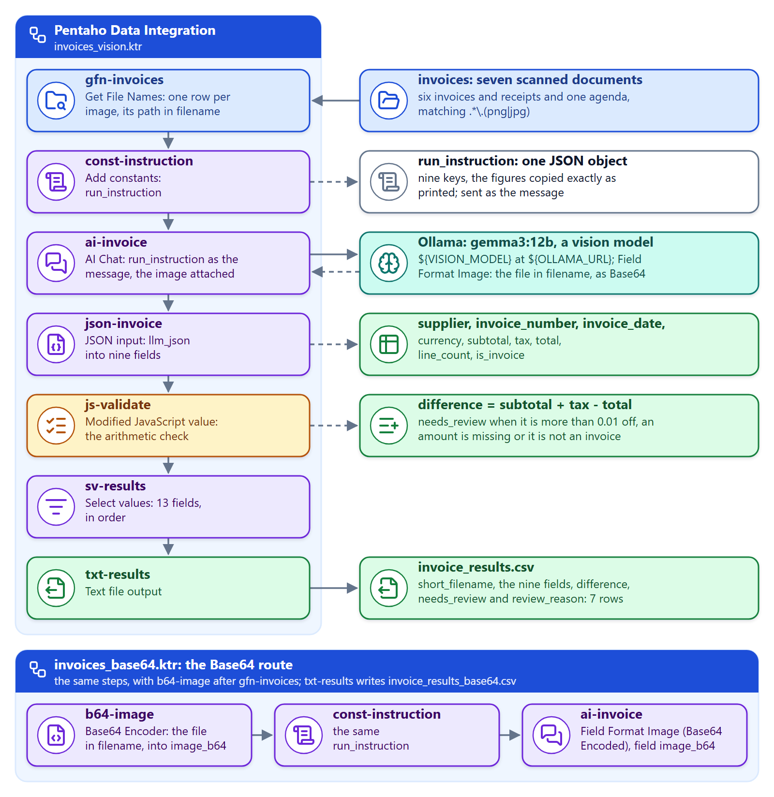
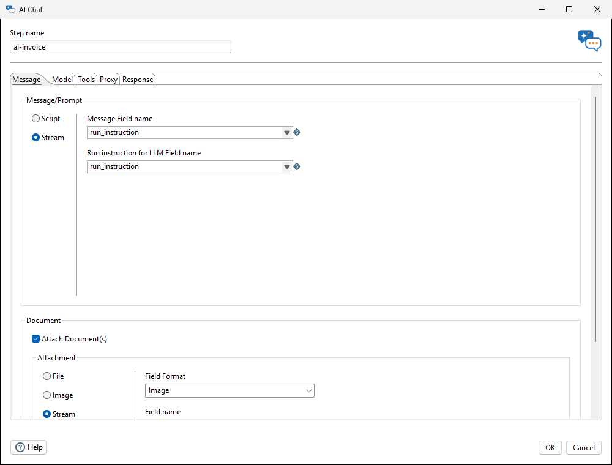
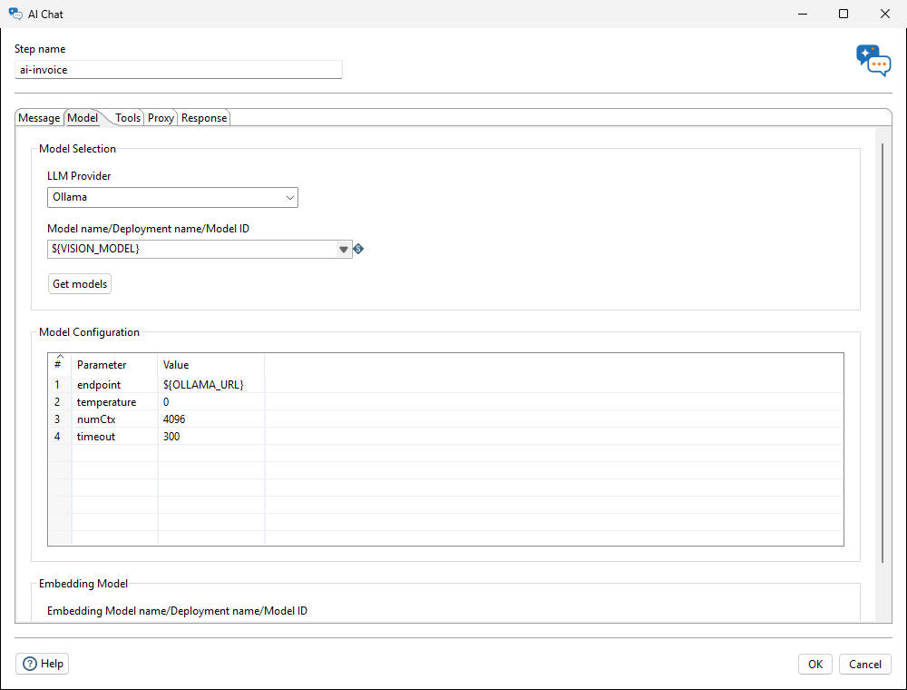
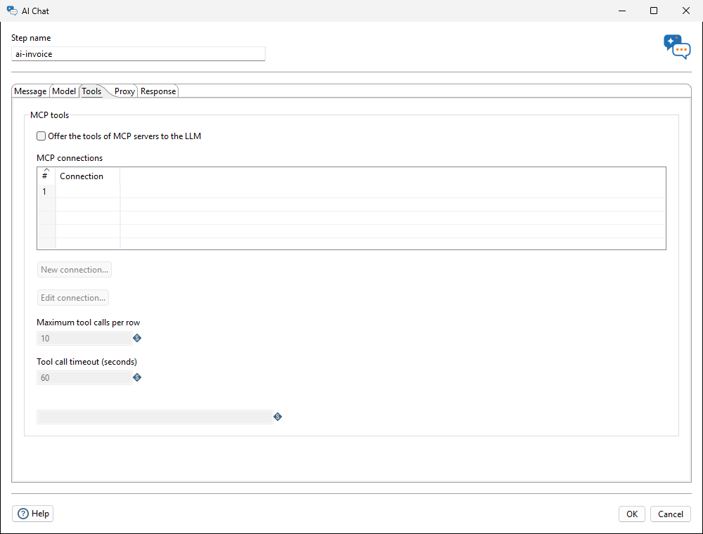
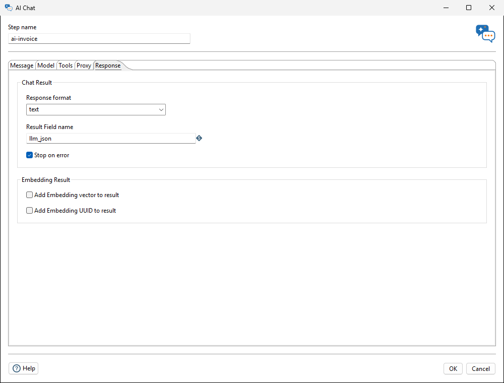
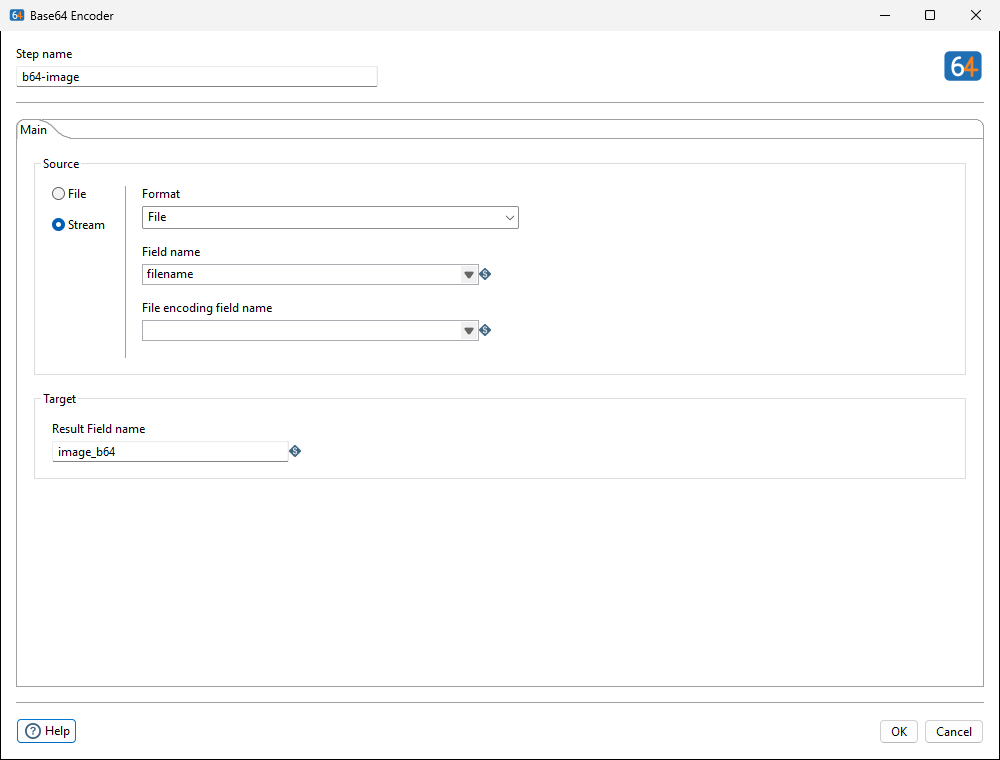
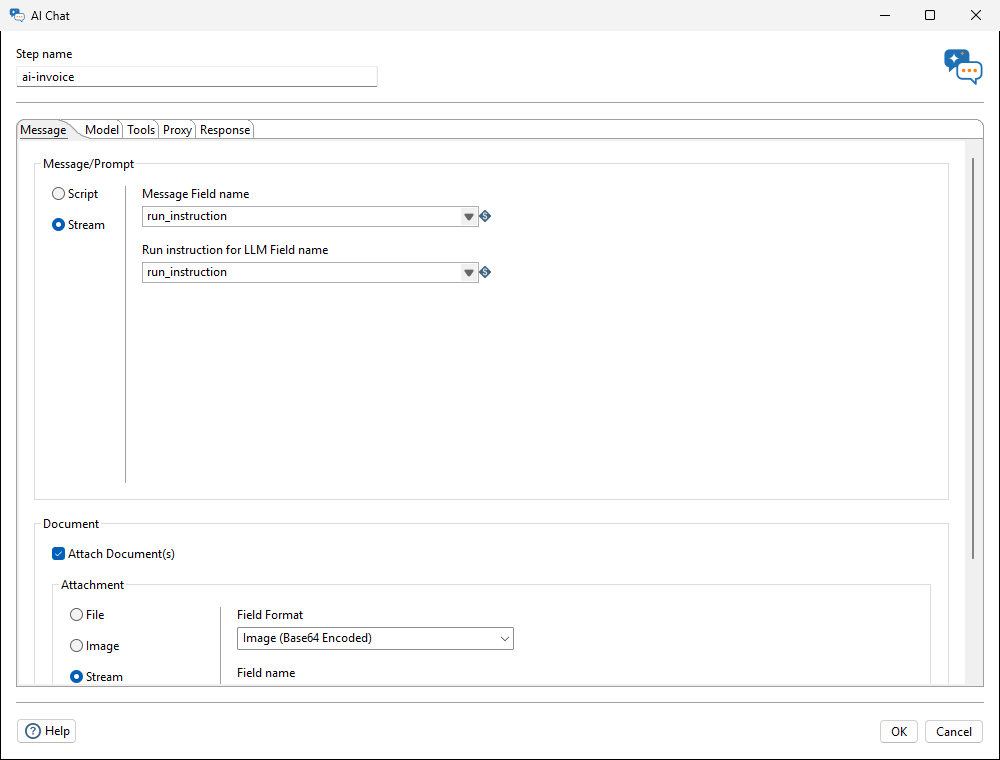
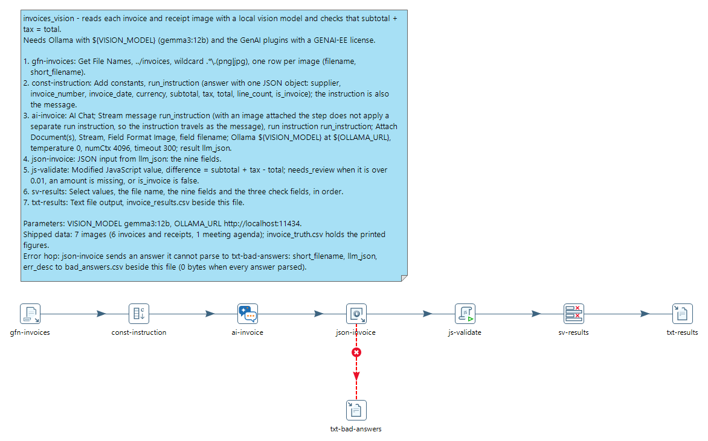
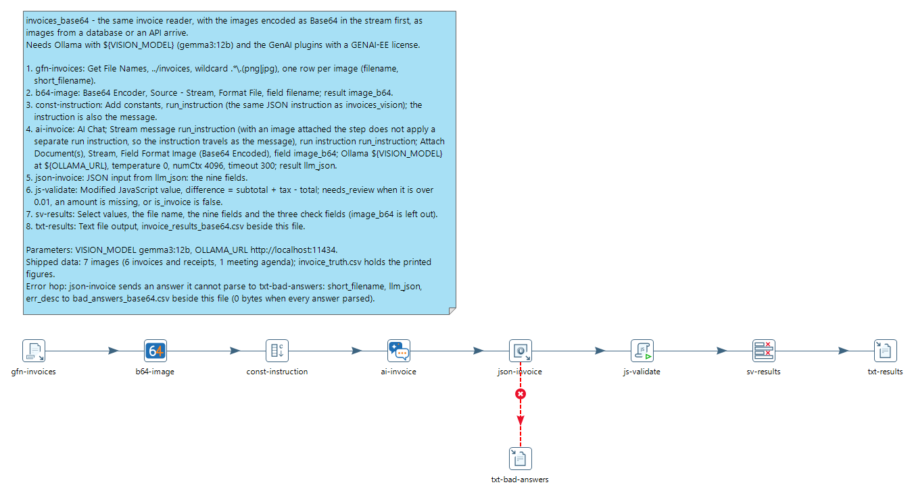

# Invoices with a Vision Model

> **Warning:**
>
> #### Workshop - Invoices with a Vision Model
>
> Build a Pentaho Data Integration transformation that reads seven scanned invoices and receipts with a local vision model, through the **AI Chat** step, turns each answer into fields, and checks the model's figures before anything downstream trusts them. Then build a second version that sends the images as Base64 text, the way images arrive from a database or an API.
>
> **What you'll do**
>
> * Check that Ollama has a vision model, and send it one invoice by hand
> * List the image files with **Get File Names** and attach each one to an **AI Chat** request
> * Parse the model's JSON answer with **JSON input**
> * Check that subtotal plus tax equals total with **Modified JavaScript value**, and flag the rows that need review
> * Send the same images as Base64 with **Base64 Encoder**, and learn when each mode fits
>
> **Prerequisites:**
>
> * Ollama running on `http://localhost:11434` with the vision model `gemma3:12b` pulled (8.1 GB; it needs about 8.3 GB of memory while it runs), and the GenAI plugins installed, as set up in [Before You Start](../00-before-you-start/guide.md)
> * [Sentiment Analysis](../06-llm-sentiment-analysis/guide.md): a run instruction, **AI Chat** in Stream mode and **JSON input**
>
> **Estimated time:** 50 minutes

<figure>

<figcaption class="pcm-video-caption">Walkthrough: coming soon</figcaption>

</figure>

<div align="center">
<figure>

<figcaption>The two transformations: the image attached as a file, and as Base64 text</figcaption>
</figure>
</div>

:::: tabs

### 1. Reading Documents with a Vision Model

> **Note:**
>
> #### What Is a Vision Model?
>
> A vision model is a Large Language Model (LLM) that takes an image as well as text. It reads the printed words and numbers in a picture, so a scanned invoice can become fields without a separate optical character recognition (OCR) step. This workshop asks it for nine fields per document and then checks its arithmetic.

**The data:** the `invoices` folder holds seven images of fictional documents, each with a different layout:

| File | What it is | What makes it hard |
| --- | --- | --- |
| `inv_01_cedar_ridge.png` | A classic US invoice, 4 lines | Nothing: the baseline |
| `inv_02_blue_heron.jpg` | A modern invoice with a color band, 3 lines | A note line inside the totals box |
| `inv_03_atelier_lumen.png` | A German invoice in EUR, 3 lines | Comma decimals (`2.800,00 €`) and the date `21.10.2026` |
| `rcpt_04_maple_street.png` | A till receipt, 6 lines | Narrow layout, `#` in the receipt number |
| `rcpt_05_harbor_deli_photo.jpg` | A phone photo of a receipt, 4 lines | Rotated, blurred, small (460 by 638 pixels) and heavily compressed |
| `inv_06_northgate_it.png` | A UK invoice in GBP, 7 lines | The longest table |
| `memo_07_all_hands_agenda.png` | A meeting agenda | Not an invoice, but full of numbers |

`invoice_truth.csv`, next to the folder, holds what is printed on each document: the answer key you compare the model's answers with.

**The fields this workshop extracts:**

| Field | Meaning | Example |
| --- | --- | --- |
| `supplier` | The company that issued the document | `"Cedar Ridge Office Supply"` |
| `invoice_number` | The invoice or receipt number as printed | `"INV-2026-0417"` |
| `invoice_date` | The date, as `YYYY-MM-DD` | `"2026-10-03"` |
| `currency` | A three-letter code | `"USD"` |
| `subtotal`, `tax`, `total` | The printed amounts, as numbers | `383.68`, `31.65`, `415.33` |
| `line_count` | The number of line items | `4` |
| `is_invoice` | `true` for an invoice or a receipt | `true` |

Three more fields come from the check you build: `difference` (subtotal + tax - total), `needs_review` and `review_reason`.

### 2. Check Ollama

> **Note:**
>
> #### A Vision Model, and One Request by Hand
>
> Not every model can read images. Ollama lists what a model can do as its capabilities; a vision model has `vision`. Check that, then send one invoice to the model yourself: the **AI Chat** step makes this same call for every row.

1. Check that the model reads images. In PowerShell, run:

```powershell
ollama show gemma3:12b
```

> **Success:** Checkpoint: under **Capabilities**, the list shows `completion` and `vision`. If Ollama answers that the model is not found, pull it with `ollama pull gemma3:12b`.

2. Send the first invoice to the model, with a question. In PowerShell, run:

```powershell
Set-Location C:\Workshop-AI-Specialty\04-llm-integration\26-llm-vision-documents
$image = [Convert]::ToBase64String([IO.File]::ReadAllBytes("$PWD\invoices\inv_01_cedar_ridge.png"))
$image.Length
$body = @{
  model    = "gemma3:12b"
  stream   = $false
  options  = @{ temperature = 0 }
  messages = @(
    @{ role = "user"; content = "Who issued this invoice, and what is its total? Answer in one line."; images = @($image) }
  )
} | ConvertTo-Json -Depth 4
(Invoke-RestMethod -Uri http://localhost:11434/api/chat -Method Post -ContentType "application/json" -Body $body).message.content
```

The first call takes longer while Ollama loads the model into memory.

> **Success:** Checkpoint: `$image.Length` is `120120`, and the model answers with one line such as `Cedar Ridge Office Supply issued the invoice, and its total is $415.33.` The wording is the model's and can differ.

The **AI Chat** step you set up in the **Ask the Model** tab sends this same request for every image, with the instruction as the message text.

> **Under the hood:**
>
> #### The image travels inside the request, as Base64 text
>
> Ollama's chat API is JSON, and JSON carries text, not bytes. So the picture is encoded as Base64, which writes every 3 bytes as 4 ordinary characters, and goes in the message's `images` list beside the question. The 90,089-byte PNG became 120,120 characters, a third larger. Ollama decodes it, and the model's image encoder turns the picture into image tokens that the model reads together with the words of the question.
>
> **Why it matters:** whichever way you give **AI Chat** an image (a file path, a URL or Base64 already in the stream), the request it sends to Ollama is this one. The modes differ only in where the step finds the bytes.

### 3. List the Images

> **Note:**
>
> #### Get File Names
>
> Create the transformation, give it its parameters, and list the images with **Get File Names**: one row per file, with its full path in `filename`.

1. Start Pentaho Data Integration with the **Start Pentaho Data Integration** button below, or from PowerShell:

```powershell
Set-Location C:\Pentaho\design-tools\data-integration
.\Spoon.bat
```

<button data-launch="spoon" data-path="">Start Pentaho Data Integration</button>

2. Select **File > New > Transformation** (`Ctrl+N`).
3. Select **File > Save as** and save it as `invoices_vision.ktr` in `C:\Workshop-AI-Specialty\04-llm-integration\26-llm-vision-documents`, next to the `invoices` folder. (On your own machine, download the images and `invoice_truth.csv` from **Lab Files** below, and put the images in an `invoices` folder next to the transformation.)
4. Double-click an empty part of the canvas. **Transformation properties** opens.
5. Open the **Parameters** tab and fill the grid:

| Parameter | Default Value | Description |
| --- | --- | --- |
| `VISION_MODEL` | `gemma3:12b` | Ollama vision model |
| `OLLAMA_URL` | `http://localhost:11434` | Ollama server |

6. Select **OK**.
7. On the **Design** tab, open the **Input** folder and drag **Get File Names** onto the canvas.
8. Double-click **Get File Names**.
9. Set **Step name** to `gfn-invoices`.
10. On the **File** tab, set **File or directory** to `${Internal.Entry.Current.Directory}/invoices` and **Regular Expression** to `.*\.(png|jpg)`, then select **Add**. The **Selected files** grid shows the folder and the expression.
11. Select **OK**.
12. Save the transformation (`Ctrl+S`).
13. Select **gfn-invoices** on the canvas, press `F10` (**Action > Preview**), and select **Quick Launch**.

> **Success:** Checkpoint: **Examine preview data** shows 7 rows, in file-name order: `inv_01_cedar_ridge.png`, `inv_02_blue_heron.jpg`, `inv_03_atelier_lumen.png`, `inv_06_northgate_it.png`, `memo_07_all_hands_agenda.png`, `rcpt_04_maple_street.png` and `rcpt_05_harbor_deli_photo.jpg` in `short_filename`, and the full path of each in `filename`.

14. Select **Close**.

### 4. The Instruction

> **Note:**
>
> #### Add Constants
>
> In Stream mode, **AI Chat** reads the message from a field. The instruction is the same for every image, so **Add constants** adds it as one field, `run_instruction`, which names the JSON shape to answer in. The next tab sends it as the message.

1. On the **Design** tab, open the **Transform** folder and drag **Add constants** onto the canvas.
2. Create a hop from **gfn-invoices** to **Add constants**: hold `Shift` and drag from one step to the other.
3. Double-click **Add constants**.
4. Set **Step name** to `const-instruction`.
5. In the **Fields** grid, add a row: **Name** `run_instruction`, **Type** `String`, and in **Value** this text:

```text
You read one scanned business document: an invoice, a receipt, or something else.
Answer with one JSON object and nothing else, without code fences, in exactly this shape:
{"supplier": "the company that issued the document", "invoice_number": "the invoice or receipt number as printed", "invoice_date": "the date as YYYY-MM-DD", "currency": "a three-letter code such as USD, EUR or GBP", "subtotal": the amount before tax as a number, "tax": the tax amount as a number, "total": the amount due as a number, "line_count": the number of line items as an integer, "is_invoice": true for an invoice or a receipt, otherwise false}
Write numbers without currency symbols or thousands separators, with a dot for decimals.
Copy the figures exactly as printed; do not calculate or correct them.
If the document is not an invoice or a receipt, set is_invoice to false and every other value to null.
```

6. Select **OK**.

> **Under the hood:**
>
> #### The instruction tells the model to copy, not to calculate
>
> A model asked for a total can work one out from the lines and return a correct-looking number that is not on the page. "Copy the figures exactly as printed" keeps the three amounts independent readings of the document, which is what makes the check in the **Check the Figures** tab mean something. The format rules (no symbols, a dot for decimals, dates as `YYYY-MM-DD`) turn `2.800,00 €` and `21.10.2026` into values **JSON input** can type.
>
> **Why it matters:** the instruction is the contract between the model and the rest of the pipeline. Every key it names is a field downstream, and every rule it states is one fewer clean-up step.

### 5. Ask the Model

> **Note:**
>
> #### AI Chat with an Image
>
> **AI Chat** sends one request per row: the instruction as the message, and the image whose path is in `filename`. The model's answer goes into `llm_json`.

1. On the **Design** tab, open the **AI** folder and drag **AI Chat** onto the canvas.
2. Create a hop from **const-instruction** to **AI Chat**.
3. Double-click **AI Chat**.
4. Set **Step name** to `ai-invoice`.
5. On the **Message** tab, under **Message/Prompt**, select **Stream**. Set **Message Field name** to `run_instruction`, and **Run instruction for LLM Field name** to `run_instruction` too. With an image attached, the step does not apply a separate run instruction, so the instruction has to travel as the message itself.
6. Under **Document**, select **Attach Document(s)**, then **Stream**. Set **Field Format** to `Image` and **Field name** to `filename`.

> **Under the hood:**
>
> #### The step reads the file and does the encoding itself
>
> With **Field Format** `Image`, **AI Chat** reads the file each row's `filename` names (a local path or any Pentaho Virtual File System (VFS) location), encodes it as Base64 and adds it to the user message, exactly as the PowerShell request in the **Check Ollama** tab did. PNG, JPG, WEBP and GIF are accepted.
>
> **Why it matters:** without the plugin this takes a script that reads the bytes and encodes them, another that builds the JSON request, a **REST client** and a **JSON input** to dig out the reply. Here the image is one setting.

7. On the **Model** tab, set **LLM Provider** to `Ollama` and **Model name/Deployment name/Model ID** to `${VISION_MODEL}`.
8. Fill the **Model Configuration** grid. Delete any row that is not in this table:

| Parameter | Value |
| --- | --- |
| `endpoint` | `${OLLAMA_URL}` |
| `temperature` | `0` |
| `numCtx` | `4096` |
| `timeout` | `300` |

`numCtx` `4096` leaves room for the image's tokens, the instruction and the answer. `timeout` `300` allows for a slow first request while the model loads, or a machine without a graphics card.

9. Keep the **Embedding Model** as it is: the step does not use it for images.
10. On the **Response** tab, keep **Response format** `text`, set **Result Field name** to `llm_json`, and keep **Stop on error** selected.

<div align="center">
<figure>

<figcaption>ai-invoice: the Message tab</figcaption>
</figure>
</div>

<div align="center">
<figure>

<figcaption>ai-invoice in invoices_vision.ktr: the Model tab</figcaption>
</figure>
</div>

<div align="center">
<figure>

<figcaption>ai-invoice in invoices_vision.ktr: the Tools tab</figcaption>
</figure>
</div>

<div align="center">
<figure>

<figcaption>ai-invoice in invoices_vision.ktr: the Response tab</figcaption>
</figure>
</div>

11. Select **OK**.

> **Under the hood:**
>
> #### Model choice: the smallest model that reads images and answers in plain JSON
>
> Three installed models list `vision`. Sent this workshop's request through Ollama's API, `gemma3:12b` answered every image with bare JSON. `gemma4:12b`, slightly smaller on disk, read the same figures but wrapped most answers in a Markdown code fence, which **JSON input** cannot parse. `gemma4:e4b` answered `is_invoice: false` with nulls for all seven images. `llama3.2:3b`, the course's chat model, has no `vision` capability at all.
>
> **Why it matters:** check the capability with `ollama show`, then test the model on your own documents and your own instruction before you build on it. The model is a parameter, `VISION_MODEL`, so trying another one is a change in the **Run Options** dialog.

### 6. Parse the Answer

> **Note:**
>
> #### JSON Input
>
> **JSON input** reads the model's answer from `llm_json` and splits it into the nine fields.

1. On the **Design** tab, open the **Input** folder and drag **JSON input** onto the canvas.
2. Create a hop from **ai-invoice** to **JSON input**.
3. Double-click **JSON input**.
4. Set **Step name** to `json-invoice`.
5. On the **File** tab, select **Source is from a previous step** and set **Select field** to `llm_json`.
6. On the **Content** tab, make sure **Ignore missing path** and **Default path leaf to null** are selected.
7. On the **Fields** tab, fill the grid:

| Name | Path | Type |
| --- | --- | --- |
| `supplier` | `$.supplier` | String |
| `invoice_number` | `$.invoice_number` | String |
| `invoice_date` | `$.invoice_date` | String |
| `currency` | `$.currency` | String |
| `subtotal` | `$.subtotal` | Number |
| `tax` | `$.tax` | Number |
| `total` | `$.total` | Number |
| `line_count` | `$.line_count` | Integer |
| `is_invoice` | `$.is_invoice` | Boolean |

8. Select **OK**.

> **Under the hood:**
>
> #### The answer is parsed once, because the step already unwrapped it
>
> Ollama's own response is a JSON object with the reply inside it as text. **AI Chat** takes the reply out, so `llm_json` holds only the model's JSON, and one **JSON input** reads it. With **Ignore missing path** selected, a key the model leaves out becomes a null field instead of failing the row, and so does an answer that is plain text with no JSON in it.
>
> **Why it matters:** an answer that *starts* as JSON but is broken, with a missing brace or a stray bracket, is different: **JSON input** cannot parse it and stops the whole transformation. The **Catch the Answers the Parser Cannot Read** tab catches those rows.

### 7. Check the Figures

> **Note:**
>
> #### Modified JavaScript Value
>
> A model's answer is a reading, not a fact. Printed invoices add up, so subtotal plus tax must equal total; when the model's three amounts do not, at least one of them is misread. **Modified JavaScript value** works out the difference and flags the rows a person should look at.

1. On the **Design** tab, open the **Scripting** folder and drag **Modified JavaScript value** onto the canvas.
2. Create a hop from **json-invoice** to **Modified JavaScript value**.
3. Double-click **Modified JavaScript value**.
4. Set **Step name** to `js-validate`.
5. Replace the script with:

```javascript
// Is the model's reading consistent? subtotal + tax must equal total, to the cent.
var difference = null;
var needs_review = false;
var review_reason = "ok";
if (is_invoice == null || is_invoice == false) {
  needs_review = true;
  review_reason = "not an invoice";
} else if (subtotal == null || tax == null || total == null) {
  needs_review = true;
  review_reason = "an amount is missing";
} else {
  difference = Math.round((subtotal + tax - total) * 100) / 100;
  if (Math.abs(difference) > 0.01) {
    needs_review = true;
    review_reason = "subtotal + tax is not total";
  }
}
```

6. Fill the **Fields** grid under the script:

| Fieldname | Type |
| --- | --- |
| `difference` | Number |
| `needs_review` | Boolean |
| `review_reason` | String |

7. Select **OK**.

> **Under the hood:**
>
> #### Vision models misread digits, and the arithmetic check catches the inconsistent ones
>
> A vision model does not look a digit up; it predicts the most likely text for a patch of pixels. On a sharp scan that is almost always right. On a small, blurred photo a `5` and a `0`, or an `8` and a `9`, look alike, and the model returns a confident, well-formed wrong number. In the measured run, `gemma3:12b` read the amounts of the other five invoices and receipts exactly, but on the blurred receipt it returned subtotal `42.35` (printed `42.55`) and tax `2.99` (printed `2.98`), with the total right at `45.53`: 42.35 + 2.99 - 45.53 is `-0.19`, so this check flags the row. The check has limits: on the same photo the model also read the receipt number as `7793` (printed `7781`) and the year as `2020`, which no sum can catch, and a misreading that still adds up passes.
>
> **Why it matters:** a rule that costs nothing catches the errors that would otherwise reach the ledger unnoticed. Route `needs_review` rows to a person, and compare a sample of the rest with the documents.

### 8. Write the Results

> **Note:**
>
> #### Select Values and Text File Output
>
> Keep the file name, the nine fields and the three check fields, in order, and write them to `invoice_results.csv`.

1. On the **Design** tab, open the **Transform** folder and drag **Select values** onto the canvas.
2. Create a hop from **js-validate** to **Select values**.
3. Double-click **Select values**, set **Step name** to `sv-results`, and on the **Select & Alter** tab list these fields in this order: `short_filename`, `supplier`, `invoice_number`, `invoice_date`, `currency`, `subtotal`, `tax`, `total`, `line_count`, `is_invoice`, `difference`, `needs_review`, `review_reason`. Select **OK**.
4. On the **Design** tab, open the **Output** folder and drag **Text file output** onto the canvas.
5. Create a hop from **sv-results** to **Text file output**.
6. Double-click **Text file output** and set **Step name** to `txt-results`.
7. On the **File** tab, set **Filename** to `${Internal.Entry.Current.Directory}/invoice_results` and **Extension** to `csv`. Select **Create Parent folder**.
8. On the **Content** tab, keep **Separator** `,`, **Enclosure** `"` and **Header** selected, and set **Encoding** to `UTF-8`.
9. On the **Fields** tab, select **Get Fields**, then **Minimal width**. The grid lists the 13 fields in the order **sv-results** gives them, with no fixed lengths.
10. Select **OK**, and save the transformation (`Ctrl+S`).

### 9. Catch the Answers the Parser Cannot Read

> **Note:**
>
> #### Error Handling on JSON Input
>
> A small model sometimes closes a JSON answer with the wrong bracket. An error hop sends such a row to a file of its own, with the parser's message, and the other documents carry on.

1. On the **Design** tab, open the **Output** folder and drag **Text file output** onto the canvas, below **json-invoice**.
2. Double-click it and set **Step name** to `txt-bad-answers`. On the **File** tab, set **Filename** to `${Internal.Entry.Current.Directory}/bad_answers` and **Extension** to `csv`. Select **OK**.
3. Create a hop from **json-invoice** to **txt-bad-answers**, and select **Error handling of step** in the menu that opens. The hop is drawn red, with a red error icon.
4. Right-click **json-invoice** and select **Error Handling...**. In **Step error handling settings**, enter these settings, then select **OK**:

| Setting | Value |
| --- | --- |
| **Target step** | `txt-bad-answers` |
| **Enable the error handling?** | Selected |
| **Nr of errors fieldname** | `err_count` |
| **Error descriptions fieldname** | `err_desc` |

5. Double-click **txt-bad-answers**. On the **Fields** tab, select **Get Fields**, then **Minimal width**, and delete every row except `short_filename`, `llm_json` and `err_desc`. Select **OK**, and save the transformation (`Ctrl+S`).

> **Under the hood:**
>
> #### A row the step cannot process leaves by the error hop instead of stopping the run
>
> Without error handling, the first unparsable answer fails **json-invoice** and stops the transformation, so the documents behind it are never written. With it, **JSON input** adds the parser's message to the row as `err_desc` and sends that row down the red hop. The step's **Errors** count in **Step Metrics** shows how many rows went that way.
>
> **Why it matters:** this is how a production pipeline treats a model: most answers are good, some are not, and the bad ones are kept with their reason so a person, or a rerun with a stronger model, can deal with them.

### 10. Run

> **Note:**
>
> #### Run the Transformation
>
> Each image is one model call. With `gemma3:12b` on a graphics card, the seven took about 55 seconds, loading the model included; without one, allow several minutes.

1. Press `F9` (**Action > Run**), and select **Run** in the **Run Options** dialog.
2. In **Execution Results**, open the **Step Metrics** tab.

> **Success:** Checkpoint: **gfn-invoices** shows 7 under **Written**, and so do **ai-invoice**, **json-invoice** and **txt-results**. In the measured run **json-invoice** showed 0 under **Errors**: every answer parsed. A row whose answer the parser cannot read would leave **json-invoice** by the error hop instead: it counts under that step's **Errors**, and **txt-bad-answers** writes it.

3. Open `C:\Workshop-AI-Specialty\04-llm-integration\26-llm-vision-documents\invoice_results.csv`.

> **Success:** Checkpoint: the header `short_filename,supplier,invoice_number,invoice_date,currency,subtotal,tax,total,line_count,is_invoice,difference,needs_review,review_reason` and 7 rows. Six documents are invoices or receipts, with `is_invoice` `Y`, and the agenda has `is_invoice` `N` with `needs_review` `Y` and `not an invoice`. The answers are the model's: compare them with `invoice_truth.csv`. In the measured run `gemma3:12b` returned these:

| Document | Returned subtotal, tax, total | Printed | `needs_review` |
| --- | --- | --- | --- |
| `inv_01_cedar_ridge.png` | 383.68, 31.65, 415.33 | the same | `N` |
| `inv_02_blue_heron.jpg` | 565.85, 33.95, 599.80 | the same | `N` |
| `inv_03_atelier_lumen.png` | 2800.00, 532.00, 3332.00 | the same | `N` |
| `rcpt_04_maple_street.png` | 72.67, 4.00, 76.67 | the same | `N` |
| `rcpt_05_harbor_deli_photo.jpg` | 42.35, 2.99, 45.53 | 42.55, 2.98, 45.53 | `Y`, difference `-0.19`, `subtotal + tax is not total` |
| `inv_06_northgate_it.png` | 2359.50, 471.90, 2831.40 | the same | `N` |
| `memo_07_all_hands_agenda.png` | empty | not an invoice | `Y`, `not an invoice` |

It also returned the supplier names in the case they are printed in (`BLUE HERON Coffee Roasters`, `MAPLE STREET HARDWARE`), the receipt number `#004512` with its `#`, and for the photo the wrong receipt number `7793` (printed `7781`) and date `2020-10-29` (printed `2026-10-29`). Every line count was right except the Maple Street receipt's, `5` for 6 lines. For the agenda, the model ignored "every other value to null": it returned `invoice_date` `2026-12-10` and `line_count` `6`, which **js-validate** ignores because `is_invoice` is false. The figures can differ from run to run.

4. Open `bad_answers.csv` in the same folder.

> **Success:** Checkpoint: the file exists. It is empty, without even a header line, when every answer parsed; a row that went down the error hop appears under the header `short_filename,llm_json,err_desc`.

### 11. Base64 Images

> **Note:**
>
> #### Base64 Encoder and Field Format Image (Base64 Encoded)
>
> Images do not always arrive as files. A document management system's API returns them as Base64 text, and a database keeps them in a column. **AI Chat** takes that text directly with **Field Format** `Image (Base64 Encoded)`. To see that mode with the same images, encode the files first with **Base64 Encoder**.

1. Select **File > Save as** and save the transformation as `invoices_base64.ktr` in the same folder.
2. Right-click the hop from **gfn-invoices** to **const-instruction** and select **Delete**.
3. On the **Design** tab, open the **Transform** folder and drag **Base64 Encoder** onto the canvas.
4. Create a hop from **gfn-invoices** to **Base64 Encoder**, and another from **Base64 Encoder** to **const-instruction**.
5. Double-click **Base64 Encoder**.
6. Set **Step name** to `b64-image`.
7. Under **Source**, select **Stream**. Keep **Format** `File`, set **Field name** to `filename`, and leave **File encoding field name** empty.
8. Under **Target**, set **Result Field name** to `image_b64`.

<div align="center">
<figure>

<figcaption>b64-image: its settings</figcaption>
</figure>
</div>

9. Select **OK**.
10. Double-click **ai-invoice**. On the **Message** tab, under **Document**, set **Field Format** to `Image (Base64 Encoded)` and **Field name** to `image_b64`. The other tabs keep the settings of **Ask the Model**.

<div align="center">
<figure>

<figcaption>ai-invoice in invoices_base64.ktr: the Message tab</figcaption>
</figure>
</div>


11. Select **OK**.
12. Double-click **txt-results**. On the **File** tab, set **Filename** to `${Internal.Entry.Current.Directory}/invoice_results_base64`. Select **OK**.
13. Double-click **txt-bad-answers**. On the **File** tab, set **Filename** to `${Internal.Entry.Current.Directory}/bad_answers_base64`. Select **OK**.
14. Save the transformation (`Ctrl+S`).
15. Press `F9` (**Action > Run**), and select **Run** in the **Run Options** dialog.

> **Success:** Checkpoint: **b64-image** shows 7 under **Written**, and so do **ai-invoice**, **json-invoice** (0 under **Errors**) and **txt-results**. `invoice_results_base64.csv` has the same 13 columns and 7 rows as `invoice_results.csv`; in the measured run they were identical, the photo receipt's `-0.19` included. `bad_answers_base64.csv` is empty when every answer parsed. `image_b64` is not in the file: **sv-results** keeps only the fields it lists.

The model sees the same pictures either way, so its answers should match the first run's, row for row.

> **Under the hood:**
>
> #### Both modes send the same request; they differ in where the bytes come from
>
> With **Field Format** `Image`, **AI Chat** reads the file and encodes it. With `Image (Base64 Encoded)`, the encoding is already done upstream, and the step detects PNG or JPG from the decoded content. Use `Image` when the images are files on disk or on a VFS location: the rows stay small, because only paths travel through the transformation. Use `Image (Base64 Encoded)` when the images come from a database column or an API response that is already Base64, so you never write them to disk. `Image (via web URL)` covers a third case, images on a web server: the step downloads each one and sends it as Base64.
>
> **Why it matters:** Base64 is a third larger than the file, and every field travels with its row through every step after the encoder. The receipt photo was 13,192 characters, the Northgate invoice 135,216. Drop the field (as **sv-results** does) as soon as **AI Chat** has used it.

::::

## Troubleshooting <!-- no-step -->

<details>
<summary>Error initializing step: License validation failed</summary>

The Pentaho license on this machine has no GenAI rights. Every GenAI plugin step, **Base64 Encoder** included, checks for a license with the GenAI Plugin Suite (GENAI-EE) subscription when the transformation starts. Install a license that includes it, as described in [Before You Start](../00-before-you-start/guide.md).

</details>

<details>
<summary>ai-invoice fails with model not found</summary>

Ollama does not have the model named in `VISION_MODEL`. Run `ollama pull gemma3:12b`, or change the parameter to a vision model you have (`ollama show <model>` lists `vision` under **Capabilities**).

</details>

<details>
<summary>The model answers, but says nothing about the image</summary>

The model has no `vision` capability, so it never saw the picture. `llama3.2:3b` is one of these. Set `VISION_MODEL` to a vision model such as `gemma3:12b`.

</details>

<details>
<summary>json-invoice fails on a row, or the nine fields are null</summary>

The model's answer was not bare JSON: a model can wrap it in a Markdown code fence or add a sentence. An answer **json-invoice** cannot parse goes down the error hop to `bad_answers.csv`, with the parser's message in `err_desc`; without that hop it stops the transformation. Preview **ai-invoice** and read `llm_json` for that row. Use a model that follows the instruction, such as `gemma3:12b`.

When every row comes out with the nine fields empty and `not an invoice`, double-click **ai-invoice**: on its **Message** tab, **Message Field name** must be `run_instruction`. With an image attached, the step does not apply the **Run instruction for LLM Field name** field, so a model given only a short message answers in a JSON shape of its own, often in a code fence, and **JSON input** finds none of the nine keys.

</details>

<details>
<summary>ai-invoice times out</summary>

The model is loading, or the machine has no graphics card and a call takes longer than the `timeout` of 300 seconds. Run the first request in the **Check Ollama** tab to load the model, or raise `timeout`.

</details>

## Lab Files

Click a file to download. For `.ktr` and `.kjb` files, **Open in Pentaho Data Integration** launches Pentaho Data Integration with the file loaded. If Pentaho Data Integration is already running, the path is copied to your clipboard — switch to Pentaho Data Integration and press `Ctrl+O`, `Ctrl+V`, `Enter`.

The seven documents, which go in an `invoices` folder next to your transformation:

[inv_01_cedar_ridge.png](./files/invoices/inv_01_cedar_ridge.png)

[inv_02_blue_heron.jpg](./files/invoices/inv_02_blue_heron.jpg)

[inv_03_atelier_lumen.png](./files/invoices/inv_03_atelier_lumen.png)

[rcpt_04_maple_street.png](./files/invoices/rcpt_04_maple_street.png)

[rcpt_05_harbor_deli_photo.jpg](./files/invoices/rcpt_05_harbor_deli_photo.jpg)

[inv_06_northgate_it.png](./files/invoices/inv_06_northgate_it.png)

[memo_07_all_hands_agenda.png](./files/invoices/memo_07_all_hands_agenda.png)

What is printed on each document, to compare with the model's answers:

[invoice_truth.csv](./files/invoice_truth.csv)

### Solution <!-- no-step -->

The finished transformations for this lab. Open them alongside your own to compare, or run them to see the expected result. They read the images from the `invoices` folder in the lab folder and write `invoice_results.csv` and `invoice_results_base64.csv` beside themselves, and any answer the parser cannot read to `bad_answers.csv` and `bad_answers_base64.csv`.

Also on disk at `C:\Workshop-AI-Specialty\04-llm-integration\26-llm-vision-documents\solution`.

[invoices_vision.ktr](./files/solution/invoices_vision.ktr) <button data-launch="spoon" data-path="files/solution/invoices_vision.ktr">Open in Pentaho Data Integration</button> <button data-graph="files/solution/invoices_vision.ktr">View graph</button>

invoices_vision in Spoon, with its note:

<div align="center">
<figure>

<figcaption>invoices_vision.ktr in Spoon</figcaption>
</figure>
</div>

[invoices_base64.ktr](./files/solution/invoices_base64.ktr) <button data-launch="spoon" data-path="files/solution/invoices_base64.ktr">Open in Pentaho Data Integration</button> <button data-graph="files/solution/invoices_base64.ktr">View graph</button>

invoices_base64 in Spoon, with its note:

<div align="center">
<figure>

<figcaption>invoices_base64.ktr in Spoon</figcaption>
</figure>
</div>
