# Evaluate the Answers

> **Warning:**
>
> #### Workshop - Evaluate the Answers
>
> Build a Pentaho Data Integration transformation that tests the Retrieval-Augmented Generation (RAG) pipeline of [Answer Questions](../21-rag-answer-questions/guide.md) against a fixed evaluation set. It measures the retrieval, has a second, stronger model grade every answer as a judge, compares two settings in one run, and writes a scorecard you can keep and compare after every change.
>
> **What you'll do**
>
> * Write an evaluation set: questions with the facts a right answer gives and the document they come from, and questions the documents cannot answer
> * Measure the retrieval with core steps: was the expected document in the top-k, at which rank, and were the expected facts in the passages
> * Grade every answer with a second **AI Chat** step as judge, against a rubric, with the passages the answering model saw
> * Compare two retrieval settings in one run, and summarize them with **Group by** into a scorecard
> * Check the judge itself, and re-run the set when the model or the documents change
>
> **Prerequisites:**
>
> * [Answer Questions](../21-rag-answer-questions/guide.md), completed: this workshop reuses its search, prompt and instruction, and searches the table `kb_chunks` that [Build the Knowledge Base](../20-rag-knowledge-base/guide.md) loads
> * Ollama running on `http://localhost:11434` with `llama3.2:3b`, `qwen2.5:7b` and `nomic-embed-text` pulled, the GenAI plugins installed, and the pgvector container `pcm-pgvector` running, as set up in [Before You Start](../00-before-you-start/guide.md)
>
> **Estimated time:** 75 minutes

<figure>

<figcaption class="pcm-video-caption">Walkthrough: coming soon</figcaption>

</figure>

<div align="center">
<figure>
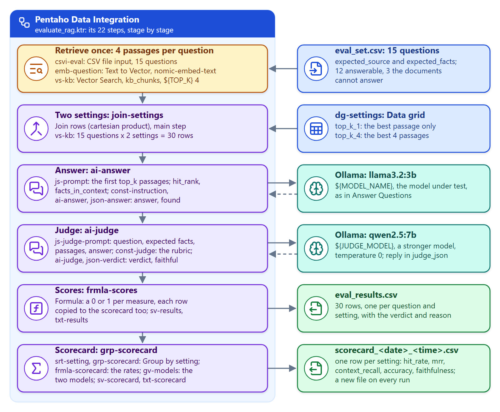
<figcaption>evaluate_rag.ktr, stage by stage: retrieve, two settings, answer, judge, scores and scorecard</figcaption>
</figure>
</div>

:::: tabs

### 1. The Evaluation Set

> **Note:**
>
> #### A Fixed Test for the Pipeline
>
> A RAG pipeline has no compiler. A change to the model, the chunk size, the number of passages or the instruction can make some answers better and others worse, and reading a few answers does not show which. An *evaluation set* is a fixed list of questions with what a right answer contains, run after every change, so that you compare numbers instead of impressions.

Check first that the knowledge base is loaded. In PowerShell, run:

```powershell
podman exec pcm-pgvector psql -U genai -d genai -c "select count(*) from kb_chunks"
```

> **Success:** Checkpoint: one row with a count above 0, the number of chunks Build the Knowledge Base wrote. If PostgreSQL says `relation "kb_chunks" does not exist`, run that workshop's transformation first.

`eval_set.csv` holds 15 questions. Questions 1 to 7 are the seven questions of Answer Questions, word for word; questions 8 to 15 are new. Each has four columns:

| Column | What it holds |
| --- | --- |
| `question_id` | `1` to `15` |
| `question` | What a Larkspur customer asks |
| `expected_source` | The document that holds the answer, or `none` for a question the documents cannot answer |
| `expected_facts` | The facts a right answer gives, as phrases copied from that document, separated by ` \| `; empty for `none` |

The questions, with their expected source and facts:

| `question_id` | `question` | `expected_source` | `expected_facts` |
| --- | --- | --- | --- |
| 1 | My dishwasher shows error E2. What should I do? | `larkspur-dw500-dishwasher-manual.pdf` | clean the filter assembly in the bottom of the tub \| drain hose is not kinked \| contact Larkspur Service |
| 2 | How often should I descale the BrewMaster coffee machine? | `larkspur-cm300-coffee-machine-manual.txt` | every 200 cups \| as soon as the amber light flashes |
| 3 | How long is the motor of the FreshSpin washing machine covered? | `larkspur-warranty-policy.pdf` | 10 years from the date of purchase \| parts only \| Labor is charged after the second year |
| 4 | Can I return a washing machine I have already unpacked because I changed my mind, and is there a fee? | `larkspur-returns-policy.docx` | within 14 days of delivery \| restocking fee of 15% \| Collection costs a fee of $49 |
| 5 | Is damage caused by limescale covered by the warranty? | `larkspur-warranty-policy.pdf` | What the warranty does not cover \| damage caused by limescale when the appliance has not been descaled |
| 6 | What is the energy rating of the DW-500 dishwasher? | `none` | |
| 7 | What is the Larkspur share price today? | `none` | |
| 8 | What does error F03 mean on my FreshSpin washing machine, and how do I fix it? | `larkspur-wm800-washing-machine-manual.docx` | Drain fault \| emergency drain tube \| drain pump filter |
| 9 | How do I lock the dishwasher controls so that children cannot start it? | `larkspur-dw500-dishwasher-manual.pdf` | Start/Pause and Program buttons together for 3 seconds |
| 10 | Where do I find the serial number of my coffee machine? | `larkspur-customer-support-faq.txt` | Coffee machines: under the drip tray |
| 11 | How many years does Larkspur Care+ add to the warranty, and when do I have to buy it? | `larkspur-warranty-policy.pdf` | extends the standard warranty by 3 years \| to 5 years in total \| within 60 days |
| 12 | What must I remove before I use the WM-800 washing machine for the first time? | `larkspur-wm800-washing-machine-manual.docx` | Remove the four transport bolts |
| 13 | How much does Larkspur charge to install a new dishwasher? | `larkspur-customer-support-faq.txt` | fee of $89 \| removing the old appliance |
| 14 | Can I use vinegar to descale my BrewMaster? | `larkspur-cm300-coffee-machine-manual.txt` | Never use vinegar \| damages the seals and the heating block |
| 15 | Does the WM-800 washing machine connect to Wi-Fi or a phone app? | `none` | |

Every expected fact appears word for word in its expected document, and no document mentions an energy rating, a share price, Wi-Fi or an app: the set was checked against the documents' text before it was shipped.

> **Under the hood:**
>
> #### The set tests the pipeline's edges, not only its happy path
>
> Questions 9 and 11 use other words than the documents ("lock the controls" for the child lock, "add to the warranty" for "extends"), so they test search by meaning. Question 10's answer is in the support FAQ, while the dishwasher manual also says where its serial number is, so the right document competes with a close one. Questions 6, 7 and 15 have no answer: question 6 and 15 retrieve dishwasher and washing machine passages that look relevant, and only the instruction stops the model from inventing a rating or a feature. The facts are phrases from the documents, so a step can find them in the passages without a model.
>
> **Why it matters:** a set of easy questions gives a high score that says little. Questions the documents cannot answer measure the refusals, which matter more to a customer than one more right answer.

### 2. Check the Judge by Hand

> **Note:**
>
> #### One Grading Request by Hand
>
> The judge is a chat model with a grading instruction, the *rubric*. Before Pentaho Data Integration sends the requests, send one yourself, with a hand-written answer that adds a claim the documents do not make: once with the passage the answer should come from, and once without it.

1. Start Pentaho Data Integration with the **Start Pentaho Data Integration** button below, or from PowerShell, so that it is ready for the next tab:

```powershell
Set-Location C:\Pentaho\design-tools\data-integration
.\Spoon.bat
```

<button data-launch="spoon" data-path="">Start Pentaho Data Integration</button>

2. Check that Ollama has the judge model. In PowerShell, run:

```powershell
(Invoke-RestMethod http://localhost:11434/api/tags).models | Select-Object name
```

> **Success:** Checkpoint: the list of models includes `qwen2.5:7b`, `llama3.2:3b` and `nomic-embed-text:latest`. If `qwen2.5:7b` is missing, run `ollama pull qwen2.5:7b`.

3. Grade one answer twice, with and without its passage. `judge_instruction.txt` in the workshop folder holds the rubric you give the judge in the **The Judge** tab. In PowerShell, run:

```powershell
Set-Location C:\Workshop-AI-Specialty\05-retrieval-augmented-generation\27-rag-evaluation
$rubric = [IO.File]::ReadAllText("$PWD\judge_instruction.txt")
$answer = 'Installation costs $89, includes removing the old appliance, and the old appliance is recycled free of charge.'
function Get-Verdict($passages) {
  $msg = "Question: How much does Larkspur charge to install a new dishwasher?`n`n" +
    "Expected facts: fee of `$89; removing the old appliance`n`n" +
    "Passages:`n$passages`n`nAnswer: $answer`nThe system says it found the answer: true"
  $body = @{
    model    = "qwen2.5:7b"
    stream   = $false
    options  = @{ temperature = 0; num_ctx = 4096 }
    messages = @(
      @{ role = "system"; content = $rubric }
      @{ role = "user";   content = $msg }
    )
  } | ConvertTo-Json -Depth 4
  (Invoke-RestMethod -Uri http://localhost:11434/api/chat -Method Post -ContentType "application/json" -Body $body).message.content
}
Get-Verdict "[1] Source: larkspur-customer-support-faq.txt`nInstallation`n`nLarkspur can install a new dishwasher or washing machine on the day of delivery for a fee of `$89, which includes removing the old appliance."
Get-Verdict "(not shown)"
```

The first call can take longer while Ollama loads the model.

> **Success:** Checkpoint: two lines of JSON. With the passage, `unsupported_claims` names `the old appliance is recycled free of charge` and `faithful` is `false`. Without it, `unsupported_claims` is empty and `faithful` is `true`: the judge had nothing to check the answer against. On a test machine, `qwen2.5:7b` gave the same two answers on every run; with the passage it also listed `fee of $89` under `missing_facts` and graded the answer `partially_correct`, although the answer states the fee.

The **ai-judge** step you set up in **The Judge** tab sends this same request for every answer, with the passages the answering model was given.

> **Under the hood:**
>
> #### The judge can only check faithfulness against passages it sees
>
> *Faithfulness* asks whether every claim in an answer is in the passages the model was given; *correctness* asks whether the answer gives the expected facts. The expected facts here say nothing about recycling, so without the passage the judge has no way to see that the claim was made up, and the answer looks correct. With the passage, the judge compares each sentence with it. The same run also shows the judge's own mistake: it missed that "costs $89" states the "fee of $89". A judge is a model too, which is why the **Is the Judge Right?** tab checks it.
>
> **Why it matters:** a RAG pipeline that answers correctly from the model's own knowledge, and not from the documents, passes a correctness check and fails a faithfulness check. Only the second tells you whether the answer can be traced back to a document.

### 3. Retrieve Once for Two Settings

> **Note:**
>
> #### CSV File Input, Text to Vector, Vector Search, Data Grid and Join Rows
>
> Read the evaluation set and search the knowledge base as Answer Questions does, retrieving the 4 closest passages once per question. Then pair every question with two settings to compare in the same run: the model gets the best passage only (`top_k_1`) or the best 4 (`top_k_4`).

1. In Spoon, select **File > New > Transformation** (`Ctrl+N`).
2. Select **File > Save as** and save it as `evaluate_rag.ktr` in `C:\Workshop-AI-Specialty\05-retrieval-augmented-generation\27-rag-evaluation`, next to `eval_set.csv`. (On your own machine, download `eval_set.csv` and `judge_instruction.txt` from **Lab Files** below into the folder you save in.)
3. Double-click an empty part of the canvas. **Transformation properties** opens.
4. Open the **Parameters** tab and fill the grid:

| Parameter | Default Value | Description |
| --- | --- | --- |
| `MODEL_NAME` | `llama3.2:3b` | Ollama chat model that answers (the model under test) |
| `JUDGE_MODEL` | `qwen2.5:7b` | Ollama chat model that grades the answers (stronger than MODEL_NAME) |
| `OLLAMA_URL` | `http://localhost:11434` | Ollama server |
| `PG_HOST` | `localhost` | pgvector host (lab kit: localhost) |
| `PG_PORT` | `5433` | pgvector port (lab kit: 5433; 5432 is the Pentaho repository) |
| `PG_DATABASE` | `genai` | Database |
| `PG_USER` | `genai` | User |
| `PG_PASSWORD` | `genai` | Password |
| `TOP_K` | `4` | Passages retrieved per question: the largest top_k in dg-settings |
| `MIN_SCORE` | `0.75` | Lowest score a passage needs, 0 to 1 ((1 + cosine similarity) / 2) |

5. Select **OK**.
6. On the **Design** tab, open the **Input** folder and drag **CSV file input** onto the canvas.
7. Double-click **CSV file input** and set **Step name** to `csvi-eval`.
8. Set **Filename** to `${Internal.Entry.Current.Directory}/eval_set.csv`.
9. Keep **Delimiter** `,`, **Enclosure** `"` and **Header row present?** selected. Clear **Lazy conversion?**.
10. Select **Get Fields**, then **Close** on the summary, and compare the **Fields** grid with this table:

| Name | Type | Length |
| --- | --- | --- |
| `question_id` | Integer | 15 |
| `question` | String | 101 |
| `expected_source` | String | 42 |
| `expected_facts` | String | 104 |

11. Select **OK**, and save the transformation (`Ctrl+S`).
12. Select **csvi-eval** on the canvas, press `F10` (**Action > Preview**), and select **Quick Launch**.

> **Success:** Checkpoint: 15 rows, `question_id` `1` to `15`. Rows 6, 7 and 15 have `expected_source` `none` and an empty `expected_facts`; the others name one of the six Larkspur documents.

13. Select **Close**.
14. Add the search as in Answer Questions. On the **Design** tab, open the **AI** folder and drag **Text to Vector** onto the canvas, and create a hop from **csvi-eval** to it: hold `Shift` and drag from one step to the other.
15. Double-click **Text to Vector** and set **Step name** to `emb-question`. On the **Input** tab, keep **Stream** and set **Input Text Field** to `question`. On the **Embedding Model** tab, set **LLM Provider** to `Ollama`, **Embedding model name/Deployment name/Model ID** to `nomic-embed-text`, and keep one row in the **Model Configuration** grid: **Parameter** `endpoint`, **Value** `${OLLAMA_URL}`. Keep the **Output** tab's defaults. Select **OK**.

<div align="center">
<figure>
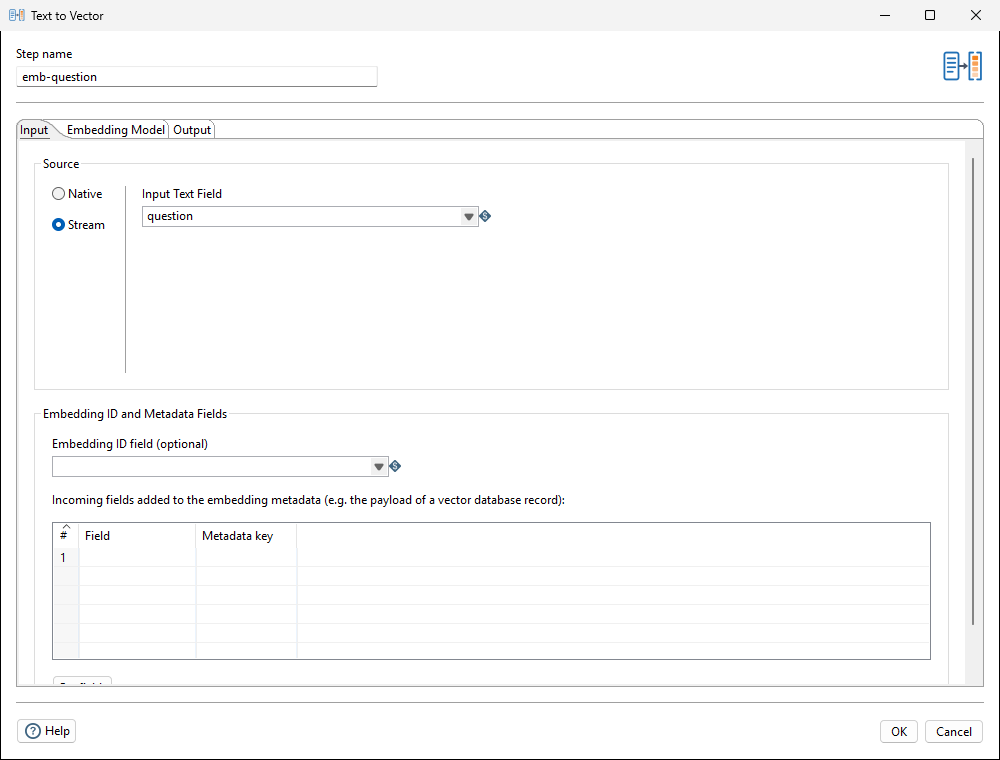
<figcaption>emb-question: the Input tab</figcaption>
</figure>
</div>

<div align="center">
<figure>
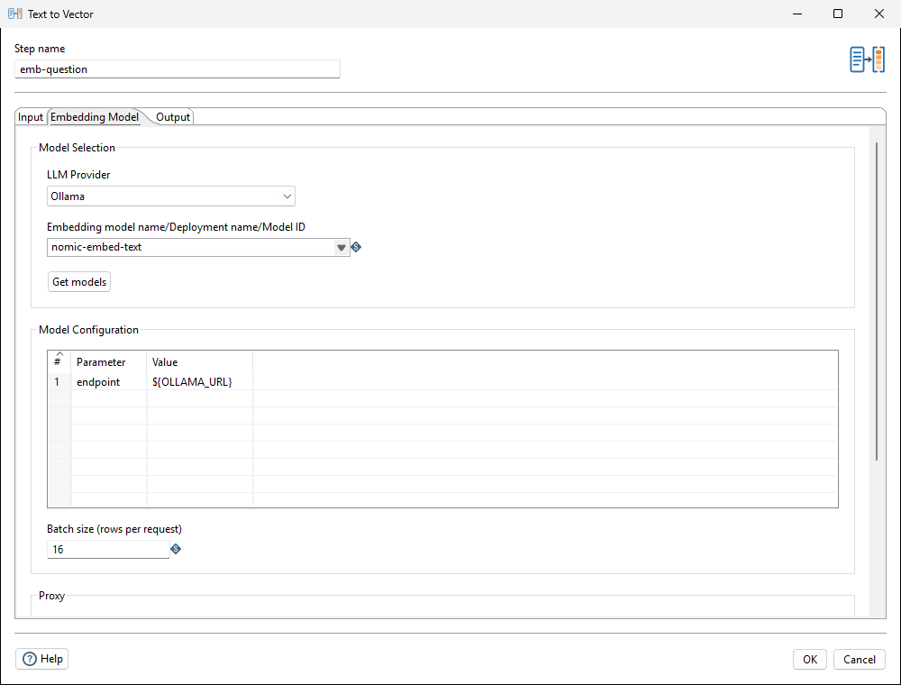
<figcaption>emb-question: the Embedding Model tab</figcaption>
</figure>
</div>

<div align="center">
<figure>
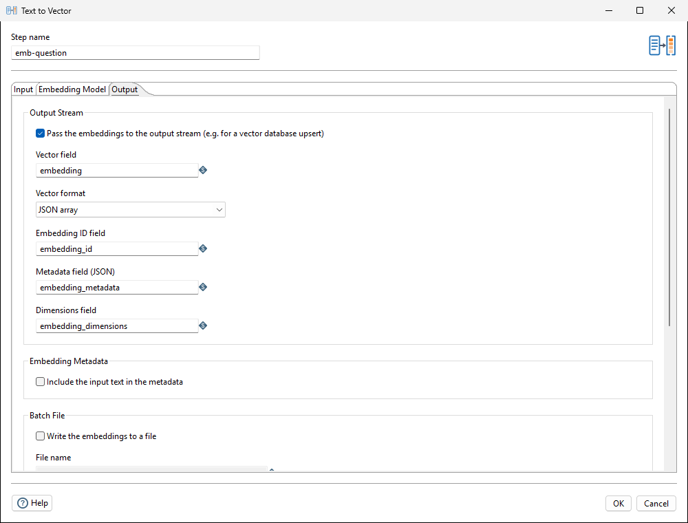
<figcaption>emb-question: the Output tab</figcaption>
</figure>
</div>

16. On the **Design** tab, open the **AI** folder and drag **Vector Search** onto the canvas, and create a hop from **emb-question** to it.
17. Double-click **Vector Search** and set **Step name** to `vs-kb`.

<div align="center">
<figure>
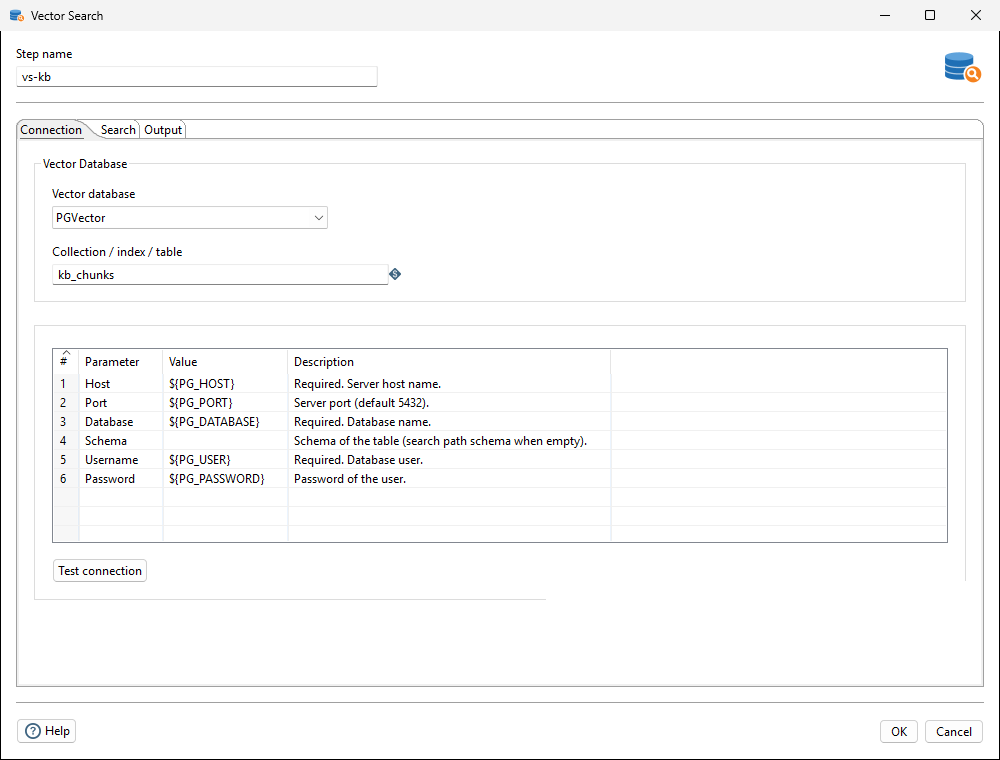
<figcaption>vs-kb: the Connection tab</figcaption>
</figure>
</div>

<div align="center">
<figure>
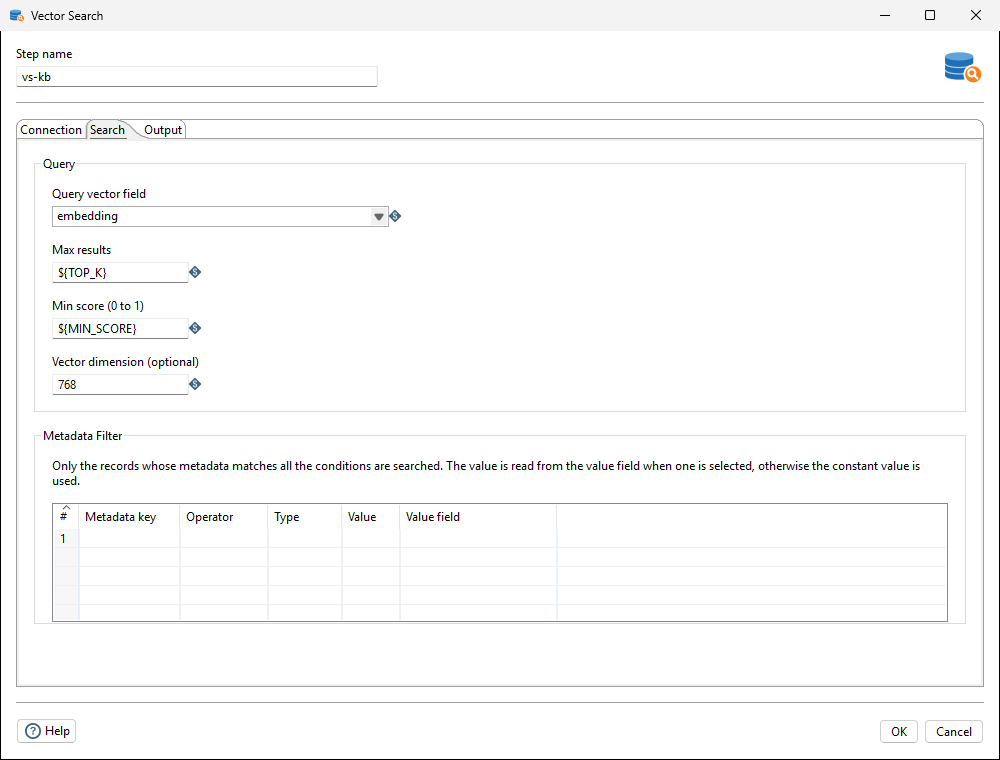
<figcaption>vs-kb: the Search tab</figcaption>
</figure>
</div>

<div align="center">
<figure>
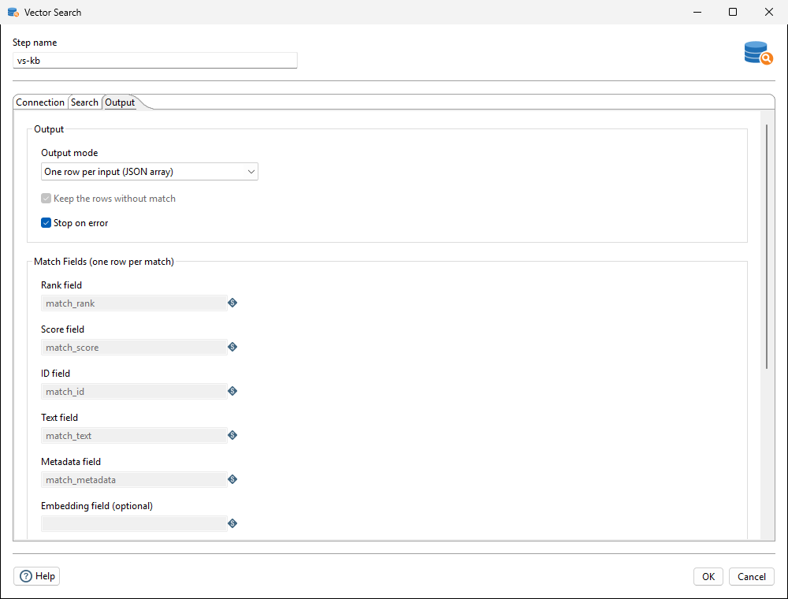
<figcaption>vs-kb: the Output tab</figcaption>
</figure>
</div>

18. On the **Connection** tab, keep **Vector database** `PGVector`, set **Collection / index / table** to `kb_chunks`, and fill the **Connection Parameters** grid: **Host** `${PG_HOST}`, **Port** `${PG_PORT}`, **Database** `${PG_DATABASE}`, **Username** `${PG_USER}`, **Password** `${PG_PASSWORD}`, and **Schema** empty.
19. On the **Search** tab, set **Query vector field** to `embedding`, **Max results** to `${TOP_K}`, **Min score (0 to 1)** to `${MIN_SCORE}` and **Vector dimension (optional)** to `768`.
20. On the **Output** tab, set **Output mode** to `One row per input (JSON array)`. **Keep the rows without match** turns gray in this mode, because every question keeps its row. Keep **Stop on error** selected, and the field names `matches` and `match_count`. Select **OK**.
21. On the **Design** tab, open the **Input** folder and drag **Data grid** onto the canvas.
22. Double-click **Data grid** and set **Step name** to `dg-settings`. On the **Meta** tab, fill the grid:

| Name | Type |
| --- | --- |
| `setting` | String |
| `top_k` | Integer |

23. On the **Data** tab, enter two rows: `top_k_1` with `1`, and `top_k_4` with `4`. Select **OK**.
24. On the **Design** tab, open the **Joins** folder and drag **Join rows (cartesian product)** onto the canvas, to the right of **vs-kb**.
25. Create a hop from **vs-kb** to **Join rows (cartesian product)**, and one from **dg-settings** to it.
26. Double-click **Join rows (cartesian product)** and set **Step name** to `join-settings`. Set **Main step to read from** to `vs-kb`, and leave the condition empty. Select **OK**, and save the transformation (`Ctrl+S`).
27. Select **dg-settings** on the canvas, press `F10` (**Action > Preview**), and select **Quick Launch**.

> **Success:** Checkpoint: 2 rows: `top_k_1` with `top_k` `1`, and `top_k_4` with `top_k` `4`.

28. Select **Close**.

> **Under the hood:**
>
> #### Join Rows pairs every question with every setting, so one run compares both
>
> **Join rows (cartesian product)** keeps the rows of the steps that are not the main step in memory (here the 2 rows of `dg-settings`) and writes each row of the main step once for each of them: 15 questions times 2 settings is 30 rows, each with `setting` and `top_k`. The search runs before the join, once per question at the largest number of passages, `${TOP_K}` `4`; the next step gives each setting the first `top_k` of those passages. A setting that needs a different model or another search, such as two values of `MIN_SCORE`, cannot be cut from one result this way: run the transformation once per value from **Run Options** and compare the scorecards.
>
> **Why it matters:** both settings see the same questions, the same passages in the same order, and the same judge in the same run. The scorecard then differs only by the setting, which is what a comparison needs.

### 4. Build the Prompt and Measure the Retrieval

> **Note:**
>
> #### Modified JavaScript Value
>
> Build the prompt as Answer Questions does, from the first `top_k` passages only, and measure what the retrieval gave this setting before any model answers: the rank of the first passage from the expected document, and how many expected facts are in the passages.

1. On the **Design** tab, open the **Scripting** folder and drag **Modified JavaScript value** onto the canvas.
2. Create a hop from **join-settings** to **Modified JavaScript value**.
3. Double-click **Modified JavaScript value** and set **Step name** to `js-prompt`.
4. Replace the text in the script pane with this script. Its middle is Answer Questions' script; the lines that use `top_k`, `hit_rank` and the facts are new:

```javascript
// matches: the JSON array Vector Search wrote for this question, best match first
// top_k: how many of those passages this setting gives the model (dg-settings)
var list = [];
if (matches != null && String(matches) != "") {
  list = JSON.parse(String(matches));
}
var use = Math.min(list.length, Number(top_k));
var passages = [];
var sources = [];
var hit_rank = 0;
for (var i = 0; i < use; i++) {
  var md = list[i].metadata;
  if (typeof md == "string") {
    md = JSON.parse(md);
  }
  var src = (md != null && md.source != null) ? String(md.source) : "unknown";
  passages.push("[" + (i + 1) + "] Source: " + src + "\n" + list[i].text);
  if (sources.indexOf(src) < 0) {
    sources.push(src);
  }
  // retrieval: the rank of the first passage from the expected document, 0 when none of them is
  if (hit_rank == 0 && src == String(expected_source)) {
    hit_rank = i + 1;
  }
}
var context = passages.length > 0 ? passages.join("\n\n") : "(no passages were found)";
var prompt = "Context:\n" + context + "\n\nQuestion: " + question;
var retrieved_sources = sources.join(", ");
// retrieval: how many expected facts appear word for word in the passages the model gets
var facts = (expected_facts == null || String(expected_facts) == "") ? [] : String(expected_facts).split(" | ");
var flat = context.replace(/\s+/g, " ").toLowerCase();
var facts_total = facts.length;
var facts_in_context = 0;
for (var f = 0; f < facts.length; f++) {
  if (flat.indexOf(facts[f].toLowerCase()) >= 0) {
    facts_in_context++;
  }
}
```

5. Fill the **Fields** grid at the bottom:

| Fieldname | Type | Replace value 'Fieldname' or 'Rename to' |
| --- | --- | --- |
| `prompt` | String | N |
| `retrieved_sources` | String | N |
| `context` | String | N |
| `hit_rank` | Integer | N |
| `facts_in_context` | Integer | N |
| `facts_total` | Integer | N |

6. Select **OK**, and save the transformation (`Ctrl+S`).

> **Under the hood:**
>
> #### Three retrieval measures, counted before any model call
>
> `hit_rank` is the position of the first passage from `expected_source` among the passages the setting uses, `1` for the best match, and `0` when the expected document is not among them; for the questions with `expected_source` `none` it is always `0`. Summed over the set, a `hit_rank` above 0 gives the *hit rate* (the share of answerable questions whose document was retrieved), and `1 / hit_rank` gives the *mean reciprocal rank* (MRR), which is 1 when the right document always comes first and 0.5 when it always comes second. `facts_in_context` counts the expected facts that appear in the passages word for word, after spaces and line breaks are made single spaces: a passage can come from the right document and still be the wrong part of it. The script measures only text, so it runs the same way with any model.
>
> **Why it matters:** a question whose facts are not in the passages cannot be answered faithfully by any model. When the scorecard's accuracy falls, these measures tell you whether to look at the search or at the model.

### 5. Answer

> **Note:**
>
> #### Add Constants, AI Chat and JSON Input
>
> Answer each question exactly as Answer Questions does: the same instruction, the same model settings and the same parse. The pipeline under test must be the pipeline you run in production.

1. On the **Design** tab, open the **Transform** folder and drag **Add constants** onto the canvas, and create a hop from **js-prompt** to it.
2. Double-click **Add constants** and set **Step name** to `const-instruction`. In the **Fields** grid, add one row: **Name** `run_instruction`, **Type** `String`, and in **Value** Answer Questions' instruction:

```text
You answer questions from customers of Larkspur Home Appliances.
Use only the numbered passages under "Context". Do not use any other knowledge.
If the passages do not contain the answer, set "found" to false and set "answer" to "I could not find this in the Larkspur documents."
Cite the source file name of every passage you used.
Answer with one JSON object and nothing else, in exactly this shape:
{"answer": "the answer in two or three sentences", "sources": ["the source file names you used"], "found": true or false}
```

3. Select **OK**.
4. On the **Design** tab, open the **AI** folder and drag **AI Chat** onto the canvas, and create a hop from **const-instruction** to it.
5. Double-click **AI Chat** and set **Step name** to `ai-answer`.

<div align="center">
<figure>

<figcaption>ai-answer: the Message tab</figcaption>
</figure>
</div>

<div align="center">
<figure>
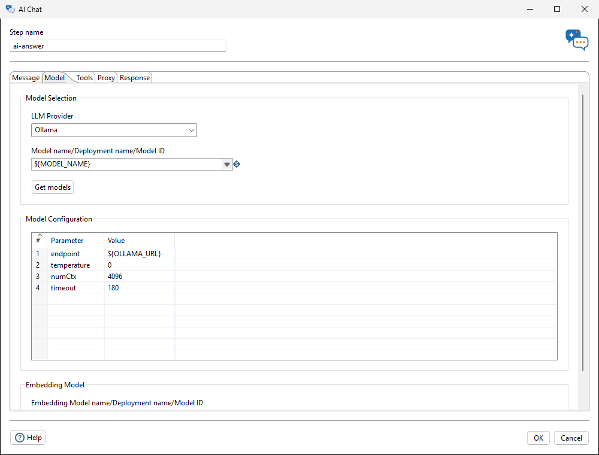
<figcaption>ai-answer: the Model tab</figcaption>
</figure>
</div>

<div align="center">
<figure>
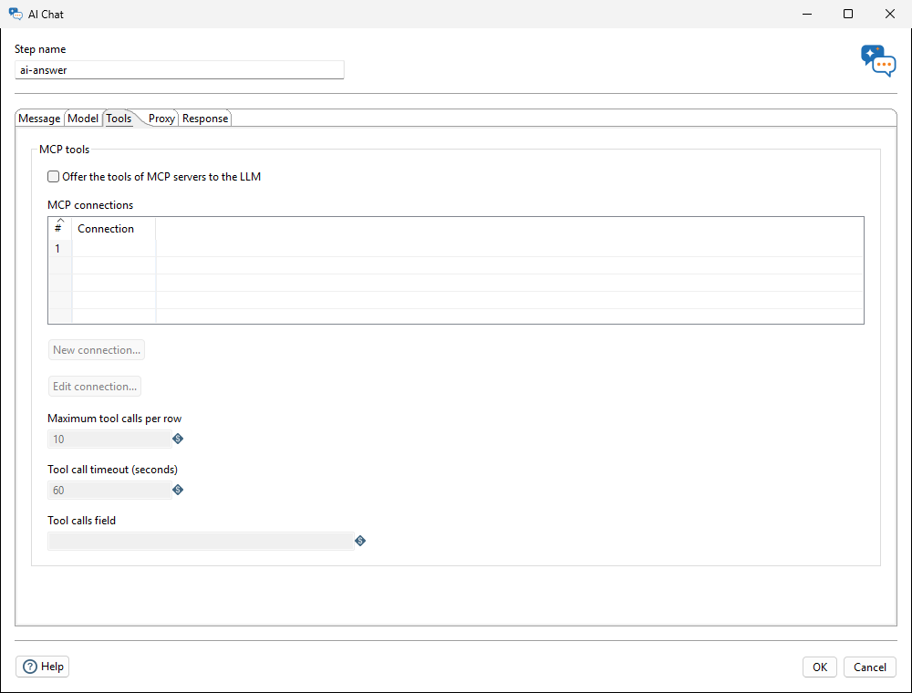
<figcaption>ai-answer: the Tools tab</figcaption>
</figure>
</div>

<div align="center">
<figure>
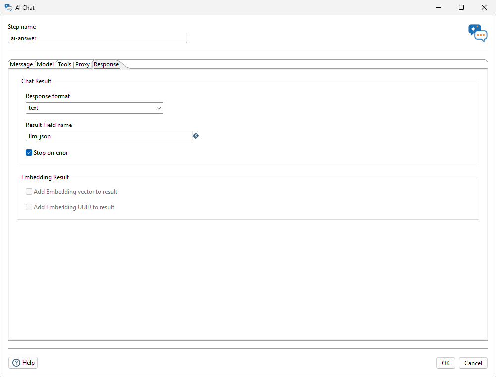
<figcaption>ai-answer: the Response tab</figcaption>
</figure>
</div>

6. On the **Message** tab, under **Message/Prompt**, select **Stream**. Set **Message Field name** to `prompt` and **Run instruction for LLM Field name** to `run_instruction`. Keep **Attach Document(s)** cleared.
7. On the **Model** tab, set **LLM Provider** to `Ollama` and **Model name** to `${MODEL_NAME}`.
8. Fill the **Model Configuration** grid. Delete any row that is not in this table:

| Parameter | Value |
| --- | --- |
| `endpoint` | `${OLLAMA_URL}` |
| `temperature` | `0` |
| `numCtx` | `4096` |
| `timeout` | `180` |

9. On the **Response** tab, keep **Response format** `text`, set **Result Field name** to `llm_json`, and keep **Stop on error** selected. Select **OK**.
10. On the **Design** tab, open the **Input** folder and drag **JSON input** onto the canvas, and create a hop from **ai-answer** to it.
11. Double-click **JSON input** and set **Step name** to `json-answer`. On the **File** tab, select **Source is from a previous step** and set **Select field** to `llm_json`. On the **Content** tab, make sure **Ignore missing path** and **Default path leaf to null** are selected.
12. On the **Fields** tab, fill the grid:

| Name | Path | Type |
| --- | --- | --- |
| `answer` | `$.answer` | String |
| `cited_sources` | `$.sources` | String |
| `found` | `$.found` | String |

13. Select **OK**, and save the transformation (`Ctrl+S`).

> **Tip:** to save typing, open `answer_questions.ktr` from Answer Questions, select **const-instruction**, **ai-answer** and **json-answer** (hold `Ctrl`), press `Ctrl+C`, and press `Ctrl+V` on this canvas. Then create the hops and check each step against the settings above.

### 6. The Judge

> **Note:**
>
> #### Modified JavaScript Value, Add Constants, AI Chat and JSON Input
>
> A second **AI Chat** step grades each answer. Its message holds everything the judge needs: the question, the expected facts, the passages the answering model was given, and the answer. Its run instruction is the rubric, and it answers in JSON, which **JSON input** splits into fields.

1. On the **Design** tab, open the **Scripting** folder and drag **Modified JavaScript value** onto the canvas, below **json-answer**, and create a hop from **json-answer** to it.
2. Double-click **Modified JavaScript value** and set **Step name** to `js-judge-prompt`. Replace the text in the script pane with this script:

```javascript
// One message for the judge: the question, what a right answer says, the passages the model was given, its answer
var expected = (expected_facts == null || String(expected_facts) == "") ? "none" : String(expected_facts).split(" | ").join("; ");
var judge_prompt = "Question: " + question + "\n\n" +
  "Expected facts: " + expected + "\n\n" +
  "Passages:\n" + context + "\n\n" +
  "Answer: " + (answer == null ? "(no answer)" : answer) + "\n" +
  "The system says it found the answer: " + (found == null ? "unknown" : found);
```

3. Fill the **Fields** grid with one row: **Fieldname** `judge_prompt`, **Type** `String`, **Replace value 'Fieldname' or 'Rename to'** `N`. Select **OK**.
4. On the **Design** tab, open the **Transform** folder and drag **Add constants** onto the canvas, to the left of **js-judge-prompt**, and create a hop from **js-judge-prompt** to it.
5. Double-click **Add constants** and set **Step name** to `const-judge`. In the **Fields** grid, add one row: **Name** `judge_instruction`, **Type** `String`, and in **Value** this text (it is also in `judge_instruction.txt`):

```text
You grade one answer given by a question-answering system for Larkspur Home Appliances.
You get the question, the expected facts, the numbered passages the system was given, and the system's answer.
"Expected facts: none" means the Larkspur documents do not answer the question.
Work in this order:
1. missing_facts: list every expected fact the answer does not state. A fact counts as stated when the answer gives the same information in other words.
2. unsupported_claims: list every claim in the answer that the passages do not state, word for word or in other words. Check each sentence of the answer against the passages only, never against what you know. An answer that only says it could not find the answer makes no claims.
3. verdict, from this rubric:
- "correct": there are expected facts and missing_facts is empty.
- "partially_correct": the answer states some of the expected facts and misses others.
- "incorrect": the answer states none of the expected facts, contradicts them, or says it could not find the answer although there are expected facts; or the expected facts are none and the answer gives an answer anyway.
- "correctly_declined": the expected facts are none and the answer says it could not find the answer.
4. faithful: true when unsupported_claims is empty, false otherwise.
Answer with one JSON object and nothing else, in exactly this shape:
{"missing_facts": ["..."], "unsupported_claims": ["..."], "verdict": "correct" | "partially_correct" | "incorrect" | "correctly_declined", "faithful": true or false, "reason": "one short sentence"}
```

6. Select **OK**.
7. On the **Design** tab, open the **AI** folder and drag **AI Chat** onto the canvas, to the left of **const-judge**, and create a hop from **const-judge** to it.
8. Double-click **AI Chat** and set **Step name** to `ai-judge`.

<div align="center">
<figure>
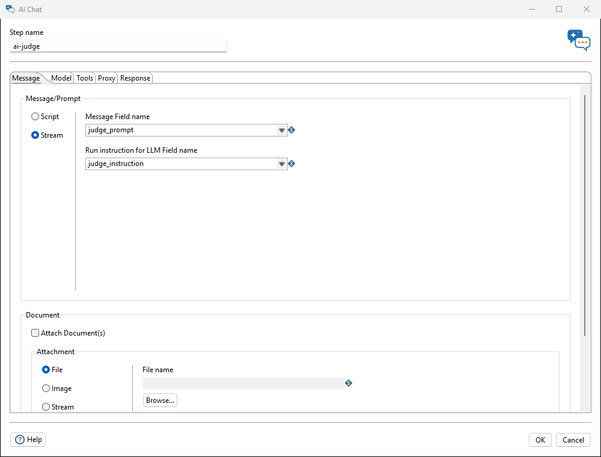
<figcaption>ai-judge: the Message tab</figcaption>
</figure>
</div>

<div align="center">
<figure>
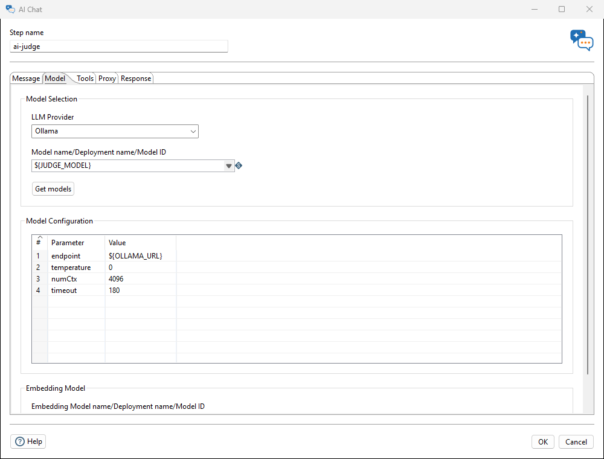
<figcaption>ai-judge: the Model tab</figcaption>
</figure>
</div>

<div align="center">
<figure>
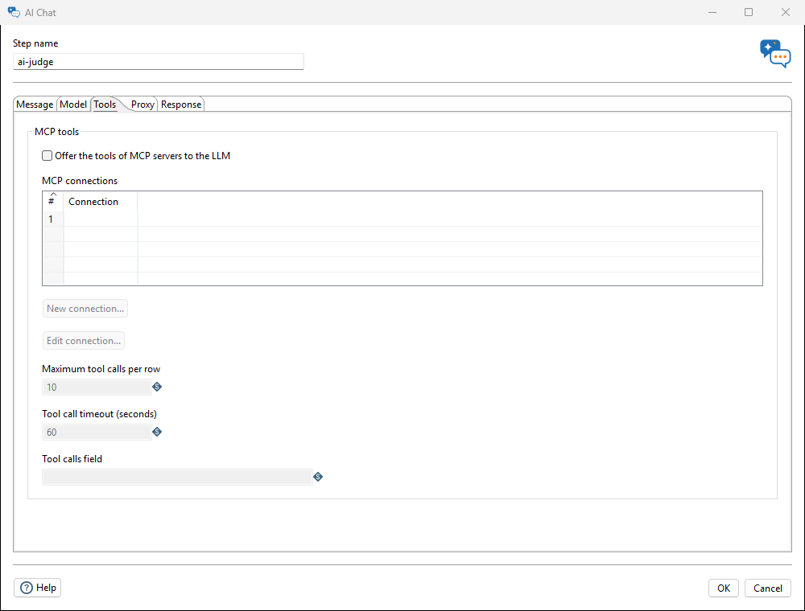
<figcaption>ai-judge: the Tools tab</figcaption>
</figure>
</div>

<div align="center">
<figure>

<figcaption>ai-judge: the Response tab</figcaption>
</figure>
</div>

9. On the **Message** tab, under **Message/Prompt**, select **Stream**. Set **Message Field name** to `judge_prompt` and **Run instruction for LLM Field name** to `judge_instruction`. Keep **Attach Document(s)** cleared.
10. On the **Model** tab, set **LLM Provider** to `Ollama` and **Model name** to `${JUDGE_MODEL}`.
11. Fill the **Model Configuration** grid. Delete any row that is not in this table:

| Parameter | Value |
| --- | --- |
| `endpoint` | `${OLLAMA_URL}` |
| `temperature` | `0` |
| `numCtx` | `4096` |
| `timeout` | `180` |

12. On the **Response** tab, keep **Response format** `text`, set **Result Field name** to `judge_json`, and keep **Stop on error** selected. Select **OK**.
13. On the **Design** tab, open the **Input** folder and drag **JSON input** onto the canvas, to the left of **ai-judge**, and create a hop from **ai-judge** to it.
14. Double-click **JSON input** and set **Step name** to `json-verdict`. On the **File** tab, select **Source is from a previous step** and set **Select field** to `judge_json`. On the **Content** tab, make sure **Ignore missing path** and **Default path leaf to null** are selected.
15. On the **Fields** tab, fill the grid:

| Name | Path | Type |
| --- | --- | --- |
| `verdict` | `$.verdict` | String |
| `faithful` | `$.faithful` | String |
| `reason` | `$.reason` | String |
| `missing_facts` | `$.missing_facts` | String |
| `unsupported_claims` | `$.unsupported_claims` | String |

16. Select **OK**, and save the transformation (`Ctrl+S`).

> **Under the hood:**
>
> #### The judge lists what is missing and what is unsupported before it gives a verdict
>
> An *LLM as judge* is a chat model asked to grade text instead of writing it. The rubric makes it work in a fixed order: the expected facts the answer misses, the claims the passages do not support, and only then the verdict and `faithful`, which follow from those two lists. A model writes its answer one token after another, so a verdict written after the lists is decided by them; a verdict asked for first tends to be a general impression. With the first version of this rubric, which asked for the verdict straight away, `qwen2.5:7b` called every decline unfaithful and passed an answer that left out the $49 collection fee as `correct`. In a trial against Ollama, the rubric that lists the facts first graded the declines faithful and that answer no longer `correct`. The lists also go to the results file, so you can see why each verdict was given. `temperature` `0` makes the judge pick its most likely words, so the same answer gets the same grade on the next run.
>
> **Why it matters:** the judge does the reading a person would do for every answer, every run. It is only useful if its grades can be checked and repeated, and the lists and the temperature are what make them so.

### 7. Score

> **Note:**
>
> #### Formula, Select Values, Text File Output, Sort Rows, Group By and Get Variables
>
> Turn every verdict into numbers, write one row per question and setting to `eval_results.csv`, and summarize each setting into one scorecard row, with the models and the date, in a new `scorecard_<date>_<time>.csv` on every run.

1. On the **Design** tab, open the **Scripting** folder and drag **Formula** onto the canvas, to the left of **json-verdict**, and create a hop from **json-verdict** to it.
2. Double-click **Formula** and set **Step name** to `frmla-scores`. Fill the grid; keep **Length**, **Precision** and **Replace value** empty:

| New field | Formula | Value type |
| --- | --- | --- |
| `answerable` | `IF([expected_source]="none";0;1)` | Integer |
| `hit` | `IF([hit_rank]>0;1;0)` | Integer |
| `reciprocal_rank` | `IF([hit_rank]>0;1/[hit_rank];0)` | Number |
| `is_correct` | `IF([verdict]="correct";1;0)` | Integer |
| `is_partial` | `IF([verdict]="partially_correct";1;0)` | Integer |
| `is_declined_ok` | `IF([verdict]="correctly_declined";1;0)` | Integer |
| `is_faithful` | `IF([faithful]="true";1;0)` | Integer |
| `is_wrong_decline` | `IF(AND([expected_source]<>"none";[found]="false");1;0)` | Integer |
| `is_ungraded` | `IF(ISBLANK([verdict]);1;0)` | Integer |

3. Select **OK**.
4. On the **Design** tab, open the **Transform** folder and drag **Select values** onto the canvas, to the left of **frmla-scores**, and create a hop from **frmla-scores** to it.
5. Double-click **Select values**, set **Step name** to `sv-results`, and on the **Select & Alter** tab list these fields in this order: `setting`, `top_k`, `question_id`, `question`, `expected_source`, `retrieved_sources`, `hit_rank`, `facts_in_context`, `facts_total`, `found`, `answer`, `cited_sources`, `verdict`, `faithful`, `reason`, `missing_facts`, `unsupported_claims`. Select **OK**.
6. On the **Design** tab, open the **Output** folder and drag **Text file output** onto the canvas, to the left of **sv-results**, and create a hop from **sv-results** to it.
7. Double-click **Text file output** and set **Step name** to `txt-results`. On the **File** tab, set **Filename** to `${Internal.Entry.Current.Directory}/eval_results` and **Extension** to `csv`, and select **Create Parent folder**. On the **Content** tab, keep **Separator** `,`, **Enclosure** `"` and **Header** selected, and set **Encoding** to `UTF-8`. On the **Fields** tab, select **Get Fields**, then **Minimal width**. Select **OK**.
8. On the **Design** tab, open the **Transform** folder and drag **Sort rows** onto the canvas, below **frmla-scores**.
9. Create a hop from **frmla-scores** to **Sort rows**. When Spoon asks, select **Copy**: both **sv-results** and **Sort rows** get every row.
10. Double-click **Sort rows** and set **Step name** to `srt-setting`. In the **Fields** grid, add `setting`, **Ascending** `Y`. Select **OK**.
11. On the **Design** tab, open the **Statistics** folder and drag **Group by** onto the canvas, and create a hop from **srt-setting** to it.
12. Double-click **Group by** and set **Step name** to `grp-scorecard`. Keep **Include all rows?** cleared. In **The fields that make up the group**, add `setting` and `top_k`.
13. Fill the **Aggregates** grid:

| Name | Subject | Type |
| --- | --- | --- |
| `questions` | `question_id` | Number of Values (N) |
| `answerable_n` | `answerable` | Sum |
| `hits` | `hit` | Sum |
| `rr_sum` | `reciprocal_rank` | Sum |
| `facts_found` | `facts_in_context` | Sum |
| `facts_all` | `facts_total` | Sum |
| `correct` | `is_correct` | Sum |
| `partial` | `is_partial` | Sum |
| `correct_declines` | `is_declined_ok` | Sum |
| `faithful_n` | `is_faithful` | Sum |
| `wrong_declines` | `is_wrong_decline` | Sum |
| `ungraded` | `is_ungraded` | Sum |

14. Select **OK**.
15. On the **Design** tab, open the **Scripting** folder and drag **Formula** onto the canvas, and create a hop from **grp-scorecard** to it.
16. Double-click **Formula** and set **Step name** to `frmla-scorecard`. Fill the grid:

| New field | Formula | Value type |
| --- | --- | --- |
| `hit_rate` | `[hits]/[answerable_n]` | Number |
| `mrr` | `[rr_sum]/[answerable_n]` | Number |
| `context_recall` | `[facts_found]/[facts_all]` | Number |
| `accuracy` | `([correct]+0.5*[partial])/[answerable_n]` | Number |
| `faithfulness` | `[faithful_n]/[questions]` | Number |
| `decline_rate` | `[correct_declines]/([questions]-[answerable_n])` | Number |
| `run_date` | `TODAY()` | Date |

17. Select **OK**.
18. On the **Design** tab, open the **Job** folder and drag **Get variables** onto the canvas, and create a hop from **frmla-scorecard** to it.
19. Double-click **Get variables** and set **Step name** to `gv-models`. Fill the grid, with **Trim type** `none`:

| Name | Variable | Type |
| --- | --- | --- |
| `answer_model` | `${MODEL_NAME}` | String |
| `judge_model` | `${JUDGE_MODEL}` | String |

20. Select **OK**.
21. On the **Design** tab, open the **Transform** folder and drag **Select values** onto the canvas, and create a hop from **gv-models** to it.
22. Double-click **Select values**, set **Step name** to `sv-scorecard`, and on the **Select & Alter** tab list these fields in this order: `run_date`, `answer_model`, `judge_model`, `setting`, `top_k`, `questions`, `answerable_n`, `hit_rate`, `mrr`, `context_recall`, `accuracy`, `correct`, `partial`, `faithfulness`, `correct_declines`, `decline_rate`, `wrong_declines`, `ungraded`. Select **OK**.
23. On the **Design** tab, open the **Output** folder and drag **Text file output** onto the canvas, and create a hop from **sv-scorecard** to it.
24. Double-click **Text file output** and set **Step name** to `txt-scorecard`. On the **File** tab, set **Filename** to `${Internal.Entry.Current.Directory}/scorecard` and **Extension** to `csv`, and select **Create Parent folder**, **Include date in filename?** and **Include time in filename?**.
25. On the **Content** tab, keep **Separator** `,`, **Enclosure** `"` and **Header** selected, and set **Encoding** to `UTF-8`.
26. On the **Fields** tab, select **Get Fields**, then **Minimal width**. Set **Format** to `yyyy-MM-dd` for `run_date`, and to `0.00` for the six Number fields: `hit_rate`, `mrr`, `context_recall`, `accuracy`, `faithfulness` and `decline_rate`.
27. Select **OK**, and save the transformation (`Ctrl+S`).

> **Under the hood:**
>
> #### Group by sums counts; the rates are divided afterwards
>
> **Group by** reads its rows in order and starts a new group when `setting` changes, so **Sort rows** puts the 30 rows in setting order first. Every measure is a 0 or 1 per row, so **Sum** counts them, and the second **Formula** divides each count by the number of questions it applies to: answerable questions for the hit rate, the MRR and the accuracy, every question for faithfulness, the questions with no answer for the decline rate. A partially correct answer counts as half a correct one. `ISBLANK` catches a judge answer that is not JSON: **JSON input** with **Ignore missing path** leaves its fields null and keeps the row, and `ungraded` counts it instead of letting it pass as incorrect. A judge answer that *starts* as JSON but is broken is different: **JSON input** cannot parse it and stops the whole transformation, which the next section prevents. PDI's **Formula** step has no `ROUND` function, so the rates keep their full precision and the `0.00` format rounds them only in the file.
>
> **Why it matters:** the arithmetic of a scorecard is plain Pentaho Data Integration, so it can be checked without a model. These steps were run with hand-written answers and verdicts in place of the model calls, and gave the figures the formulas predict.

### 8. Catch the Answers the Parser Cannot Read

> **Note:**
>
> #### Error Handling on JSON Input
>
> A small model sometimes closes a JSON answer with the wrong bracket. An error hop sends such a row to a file of its own, with the parser's message, and the other questions carry on. Both **json-answer** and **json-verdict** parse a model's answer, so each gets one.

1. On the **Design** tab, open the **Output** folder and drag **Text file output** onto the canvas, below **json-answer**.
2. Double-click it and set **Step name** to `txt-bad-answers`. On the **File** tab, set **Filename** to `${Internal.Entry.Current.Directory}/bad_answers` and **Extension** to `csv`. Select **OK**.
3. Create a hop from **json-answer** to **txt-bad-answers**, and select **Error handling of step** in the menu that opens. The hop is drawn red, with a red error icon.
4. Right-click **json-answer** and select **Error Handling...**. In **Step error handling settings**, enter these settings, then select **OK**:

| Setting | Value |
| --- | --- |
| **Target step** | `txt-bad-answers` |
| **Enable the error handling?** | Selected |
| **Nr of errors fieldname** | `err_count` |
| **Error descriptions fieldname** | `err_desc` |

5. Double-click **txt-bad-answers**. On the **Fields** tab, select **Get Fields**, then **Minimal width**, and delete every row except `question_id`, `setting`, `llm_json` and `err_desc`. Select **OK**, and save the transformation (`Ctrl+S`).
6. Repeat steps 1 to 5 for the judge, with these names. **Nr of errors fieldname** and **Error descriptions fieldname** stay `err_count` and `err_desc`:

| JSON input | Text file output | Filename | Fields kept |
| --- | --- | --- | --- |
| `json-verdict` | `txt-bad-verdicts` | `${Internal.Entry.Current.Directory}/bad_verdicts` | `question_id`, `setting`, `judge_json`, `err_desc` |

7. Save the transformation (`Ctrl+S`).

> **Under the hood:**
>
> #### A row the step cannot process leaves by the error hop instead of stopping the run
>
> Without error handling, the first unparsable answer fails **json-answer** or **json-verdict** and stops the transformation, so the questions behind it are never written. With it, **JSON input** adds the parser's message to the row as `err_desc` and sends that row down the red hop. The step's **Errors** count in **Step Metrics** shows how many rows went that way.
>
> **Why it matters:** this is how a production pipeline treats a model: most answers are good, some are not, and the bad ones are kept with their reason so a person, or a rerun with a stronger model, can deal with them.

### 9. Run and Read the Scorecard

> **Note:**
>
> #### Run the Transformation
>
> The run makes 30 answer calls and 30 judge calls. On a GPU each took about a second in a trial against Ollama; on a CPU-only machine each call takes far longer, the judge's most, so allow time.

1. Press `F9` (**Action > Run**), and select **Run** in the **Run Options** dialog.
2. In **Execution Results**, open the **Step Metrics** tab.

> **Success:** Checkpoint: **dg-settings** shows 2 under **Written**; **csvi-eval**, **emb-question** and **vs-kb** show 15; **join-settings** and every step after it up to **json-verdict** show 30; **frmla-scores** shows 60, because it copies each row to two steps; **txt-results** shows 30; **grp-scorecard** and every step after it show 2. **json-answer** and **json-verdict** normally show 0 under **Errors**. A row whose answer the parser cannot read leaves **json-answer** or **json-verdict** by the error hop instead: it counts under that step's **Errors**, **txt-bad-answers** or **txt-bad-verdicts** writes it, and the counts after that step are lower. With a GPU, the whole run takes under two minutes.

3. Select **txt-scorecard** on the canvas and open the **Preview data** tab.

> **Success:** Checkpoint: 2 rows, `top_k_1` and `top_k_4`, each with `questions` `15`, `answerable_n` `12` and the two model names. `top_k_4` has a `hit_rate` and a `context_recall` at least as high as `top_k_1`, because its passages include `top_k_1`'s: in a measured run, `hit_rate` `0.83` and `1.00`, `context_recall` `0.73` and `0.96`. `ungraded` should be `0`. The other figures are the models' and can differ between runs and machines: the same run had `accuracy` `0.58` and `0.79`, `faithfulness` `0.73` and `0.80`, and `decline_rate` `1.00` and `0.67`.

4. Open the new `scorecard_<date>_<time>.csv` in `C:\Workshop-AI-Specialty\05-retrieval-augmented-generation\27-rag-evaluation`, and then `eval_results.csv`.

> **Success:** Checkpoint: the scorecard's first line is `run_date,answer_model,judge_model,setting,top_k,questions,answerable_n,hit_rate,mrr,context_recall,accuracy,correct,partial,faithfulness,correct_declines,decline_rate,wrong_declines,ungraded`, followed by 2 rows. `eval_results.csv` has a header and 30 rows, the two settings of each question next to each other. `bad_answers.csv` and `bad_verdicts.csv` are beside them, empty (0 bytes) when every answer and verdict parsed: **Text file output** writes its header with the first row. When a row fails to parse, the file holds the header `question_id,setting,llm_json,err_desc` or `question_id,setting,judge_json,err_desc` and that row.

5. Read the scorecard from left to right, and look up the rows behind each figure in `eval_results.csv`:

| Measure | What it tells you | Where to look when it is low |
| --- | --- | --- |
| `hit_rate`, `mrr` | The search found the right document, and how high | Rows with `hit_rank` `0`: the chunking, the embedding model, `MIN_SCORE` |
| `context_recall` | The passages hold the facts the answer needs | Rows where `facts_in_context` is below `facts_total`: chunk size and overlap, `top_k` |
| `accuracy` | The answers give the expected facts | Rows with `verdict` `incorrect` or `partially_correct`, and their `missing_facts` |
| `faithfulness` | The answers claim nothing the passages do not say | Rows with `faithful` `false`, and their `unsupported_claims`: the instruction, the model |
| `decline_rate`, `wrong_declines` | Unanswerable questions are declined, answerable ones are not | `found` against `expected_source`: the instruction, `top_k` |

> **Under the hood:**
>
> #### The measures separate the search from the model
>
> When `top_k_1` scores lower on `accuracy` than `top_k_4`, compare their `context_recall` first. If the facts were not in the single passage, the model had nothing to answer from, and a `found` of `false` there is the instruction working, not the model failing: `wrong_declines` counts those cases. If `context_recall` is the same and `accuracy` still differs, the extra passages helped or distracted the model itself. `faithfulness` below `1` with a high `accuracy` is the warning sign of an answer the model knew from elsewhere.
>
> **Why it matters:** "the answers got worse" is not something you can fix. "Question 10's document ranks third, so with one passage the answer is missing" is.

### 10. Is the Judge Right?

> **Note:**
>
> #### Check the Judge Before You Trust the Scorecard
>
> The scorecard is only as good as the judge. Check that it repeats itself, that it is stronger than the model it grades, and that its verdicts agree with yours on a sample.

1. **Temperature 0.** Save a copy of `eval_results.csv` under another name, such as `eval_results_run1.csv`, because the next run overwrites it. Press `F9` again and select **Run**. Compare the `verdict` and `faithful` columns of the two files. With `temperature` `0` on **ai-judge**, the verdicts should be the same; a verdict that changes marks an answer the rubric does not decide clearly.

> **Success:** Checkpoint: the same `verdict` on almost every row. In the measured pair of runs, 28 of the 30 verdicts matched. The two that changed (question 5 and question 14, both at `top_k_1`) had a differently worded answer in the second run: the answering model, not the judge, moved, because `temperature` `0` makes a model repeatable only as far as the server computes each token the same way. 27 of the 30 answers were word for word the same. A `reason` can also be worded differently.

2. **A stronger judge.** The answering model is `llama3.2:3b` and the judge `qwen2.5:7b`, a larger model that follows long instructions better. A judge weaker than, or the same as, the model it grades tends to accept that model's mistakes. To test a stronger answering model, press `F9`, and on the **Parameters** tab of the **Run Options** dialog set the **Value** of `MODEL_NAME` to `qwen2.5:7b`. Keep the judge larger than the model it grades: set `JUDGE_MODEL` to `gemma3:12b`, the 12-billion-parameter model the course installed for [Invoices with a Vision Model](../26-llm-vision-documents/guide.md). Select **Run** and compare the new scorecard with the first. A new judge starts a new baseline, so compare it with the first run as a different measurement, not as a better or worse pipeline.
3. **Spot-check a sample by hand.** Open `eval_results.csv` and pick 6 rows: 2 `correct`, 2 that are not, and 2 `correctly_declined`. For each, read `answer` and the question's `expected_facts` in the **The Evaluation Set** tab, and decide the verdict and `faithful` yourself before you read the judge's. Then read `missing_facts` and `unsupported_claims` for the rows where you disagree.

> **Success:** Checkpoint: a table of your 6 verdicts next to the judge's. Count the rows where you agree. In a trial of this rubric directly against Ollama, `qwen2.5:7b` agreed with a careful reader on the verdict of 7 of 9 `llama3.2:3b` answers and on 8 of 9 faithfulness flags; its mistakes were all too strict, such as listing a fact as missing that the answer states in other words. In a measured PDI run, two verdicts were worth a second look: question 15's `top_k_4` answer, `I could not find this in the Larkspur documents.`, was graded `incorrect` although declining is right (which is why that run's `decline_rate` was `0.67`), and question 1 got the same answer under both settings but `partially_correct` for one and `incorrect` for the other.

4. When you disagree with the judge, fix the cause, not the score: reword an expected fact that the judge reads too literally, make a rule of the rubric clearer, or try a stronger `JUDGE_MODEL`. Then run the set again and spot-check again.

> **Under the hood:**
>
> #### Four habits make a judge's scores worth comparing
>
> **Temperature 0** removes sampling: the judge picks its most likely words, so two runs differ only when the inputs do. **A stronger judge** than the answering model catches mistakes that the answering model would make itself. **A sample checked by hand** measures how often the judge agrees with a person; if that rate is low, the scorecard is measuring the judge. **The passages in the judge's message** are what lets it grade faithfulness at all, as the **Check the Judge by Hand** tab showed: without them, an answer from the model's own knowledge looks right. Keep `JUDGE_MODEL` and the rubric fixed while you compare runs; a new judge or rubric starts a new baseline.
>
> **Why it matters:** an evaluation is a measurement, and a measurement needs a calibrated instrument. The spot-check is cheap, and it is the only part of the evaluation no model can do for you.

### 11. Re-run When Something Changes

> **Note:**
>
> #### Make the Evaluation Part of Every Change
>
> [Moving to Production](../24-production/guide.md) lists what must be tested again before a change goes live (its **Evaluation and Drift** tab). This transformation is that test: run it before and after every change, and compare the two scorecards.

1. Run `evaluate_rag.ktr` after any of these changes, with the same `JUDGE_MODEL`:

| What changed | Why the answers can change |
| --- | --- |
| The chat model (`MODEL_NAME`) or its version | It reads the same passages differently, and may follow the instruction less well |
| The documents | New or removed passages change what the search finds; a fact the set expects may have moved or gone |
| The embedding model, the chunk size or the overlap | Every vector and every chunk changes: run Build the Knowledge Base again first |
| `TOP_K` or `MIN_SCORE` | The model gets more, fewer or other passages |
| The run instruction | The model answers, cites and declines differently |

2. When the documents change, update `eval_set.csv` first: check that each `expected_facts` phrase is still in its document, and add questions for what is new. An expected fact that is no longer in the documents makes the scorecard wrong, not the pipeline.
3. Keep every `scorecard_<date>_<time>.csv`. Each row names the date, the two models and the setting, so you can put the files side by side.
4. Decide your acceptance thresholds before you change anything, for example: `hit_rate` and `decline_rate` stay at `1.00`, `accuracy` and `faithfulness` drop by no more than 0.05, and `ungraded` is `0`. A change that misses them does not go to production.

> **Under the hood:**
>
> #### A scorecard per run is a regression test for a pipeline with no compiler
>
> **Include date in filename?** and **Include time in filename?** add the run's date and time to the file name, so each run writes a new scorecard and keeps the old ones. The scorecard carries the models from **Get variables** and the date from `TODAY()`, so a file still says what it measured after it has been copied elsewhere. On a server, the same transformation runs from a job after the knowledge base is reloaded, as the [Run on Pentaho Server](../25-production-server/guide.md) workshop runs the RAG pipeline.
>
> **Why it matters:** models are updated, documents are edited, and settings are tuned. A fixed set and a saved scorecard turn "it seems fine" into a figure you can compare with the last accepted run.

::::

## Troubleshooting <!-- no-step -->

<details>
<summary>Error initializing step: License validation failed</summary>

The Pentaho license on this machine has no GenAI rights. Every GenAI plugin step checks for a license with the GenAI Plugin Suite (GENAI-EE) subscription when the transformation starts. Install a license that includes it, as described in [Before You Start](../00-before-you-start/guide.md).

</details>

<details>
<summary>The PowerShell grading request fails with "cannot unmarshal object"</summary>

The rubric was read with `Get-Content`, which in Windows PowerShell 5.1 adds properties that `ConvertTo-Json` writes as an object. Read it with `[IO.File]::ReadAllText` as the command in the **Check the Judge by Hand** tab does.

</details>

<details>
<summary>vs-kb fails with relation "kb_chunks" does not exist</summary>

The knowledge base has not been loaded, or was loaded into another database. Run the transformation of [Build the Knowledge Base](../20-rag-knowledge-base/guide.md) with the same `PG_` parameters, then run this one again.

</details>

<details>
<summary>The scorecard's ungraded is above 0</summary>

The judge's answer for those rows was not the JSON the rubric asks for, so `verdict` is empty. Preview **ai-judge** and read `judge_json` for the rows with an empty `verdict` in `eval_results.csv`. A judge answer that was broken JSON is not among them: it is in `bad_verdicts.csv`, with the parser's message in `err_desc`. A larger `numCtx` helps when the passages are long; a stronger `JUDGE_MODEL` follows the JSON shape more reliably.

</details>

<details>
<summary>Every row of top_k_1 has the same figures as top_k_4</summary>

`TOP_K` is `1`, so **vs-kb** retrieves one passage and both settings get it. Keep `TOP_K` at least as large as the largest `top_k` in **dg-settings**.

</details>

<details>
<summary>frmla-scorecard fails with a division by zero</summary>

The set has no answerable questions, or none that are not: `decline_rate` divides by the number of `none` questions and the other rates by `answerable_n`. Keep both kinds of question in `eval_set.csv`.

</details>

## Lab Files

Click a file to download. For `.ktr` and `.kjb` files, **Open in Pentaho Data Integration** launches Pentaho Data Integration with the file loaded. If Pentaho Data Integration is already running, the path is copied to your clipboard — switch to Pentaho Data Integration and press `Ctrl+O`, `Ctrl+V`, `Enter`.

The evaluation set: 15 questions with their expected source and facts (`none` for the three the documents cannot answer):

[eval_set.csv](./files/eval_set.csv)

The judge's rubric, the same text as `const-judge`'s `judge_instruction`, read by the PowerShell check:

[judge_instruction.txt](./files/judge_instruction.txt)

### Solution <!-- no-step -->

The finished transformation for this lab. Open it alongside your own to compare, or run it to see the expected result. It reads `eval_set.csv` from the lab folder, searches the table `kb_chunks` that [Build the Knowledge Base](../20-rag-knowledge-base/guide.md) loads, and writes `eval_results.csv` and a `scorecard_<date>_<time>.csv` beside itself, and any answer or verdict the parser cannot read to `bad_answers.csv` or `bad_verdicts.csv`.

Also on disk at `C:\Workshop-AI-Specialty\05-retrieval-augmented-generation\27-rag-evaluation\solution`.

[evaluate_rag.ktr](./files/solution/evaluate_rag.ktr) <button data-launch="spoon" data-path="files/solution/evaluate_rag.ktr">Open in Pentaho Data Integration</button> <button data-graph="files/solution/evaluate_rag.ktr">View graph</button>

evaluate_rag in Spoon, with its note:

<div align="center">
<figure>
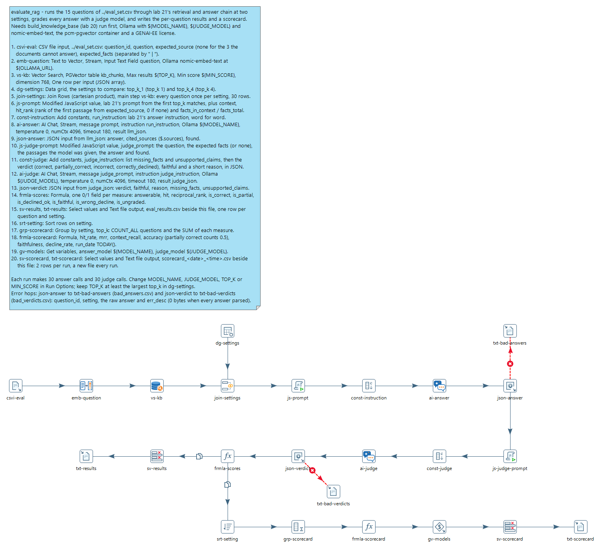
<figcaption>evaluate_rag.ktr in Spoon</figcaption>
</figure>
</div>
