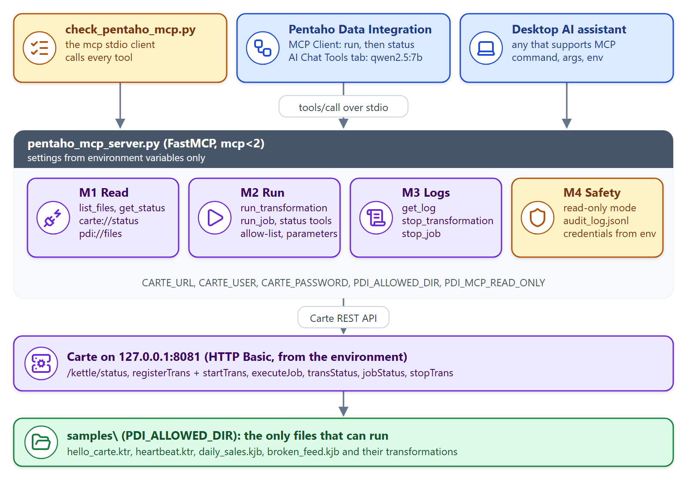
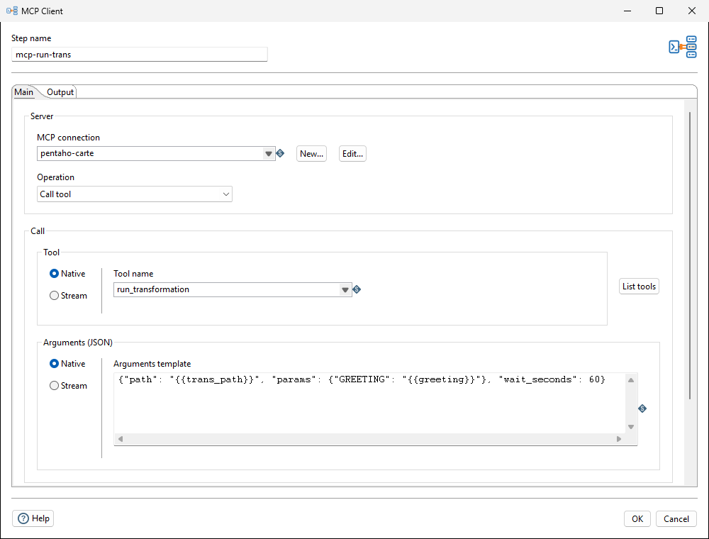
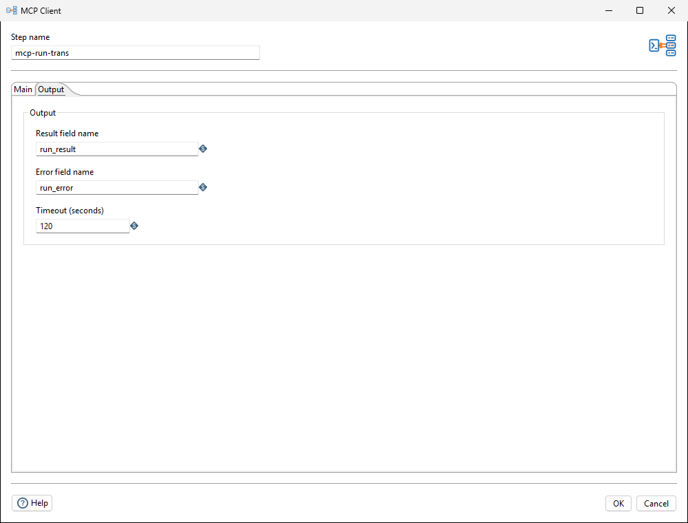
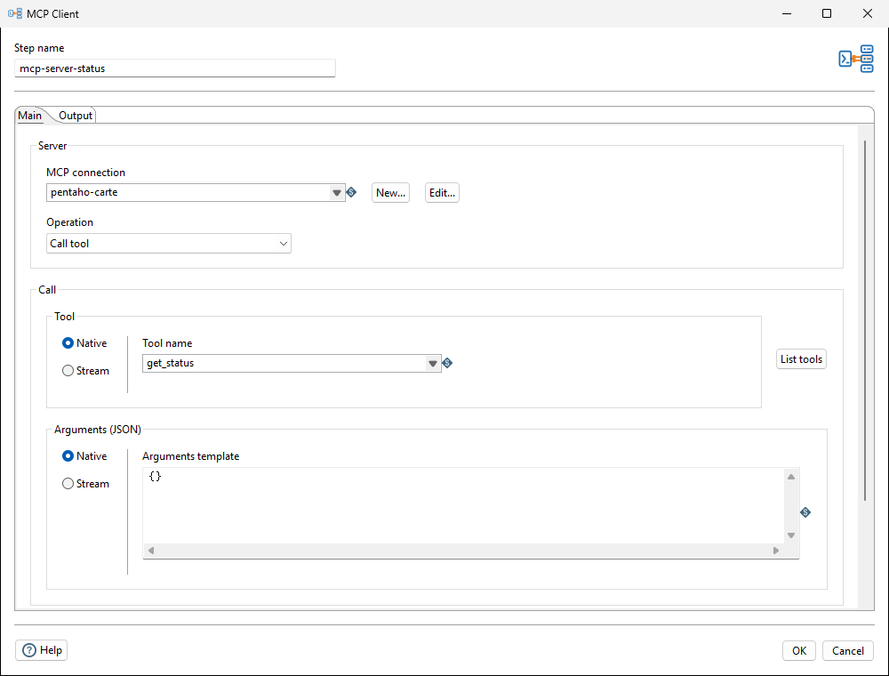
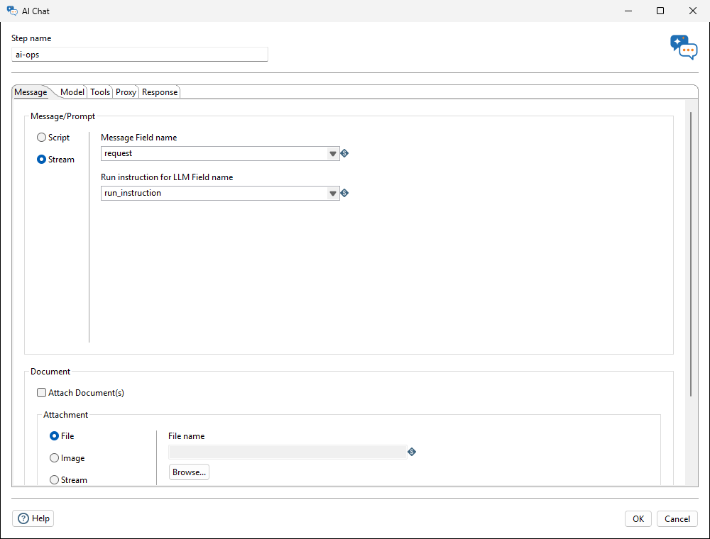
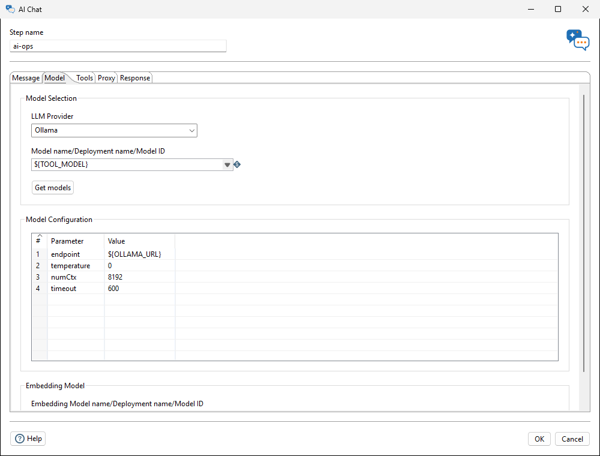
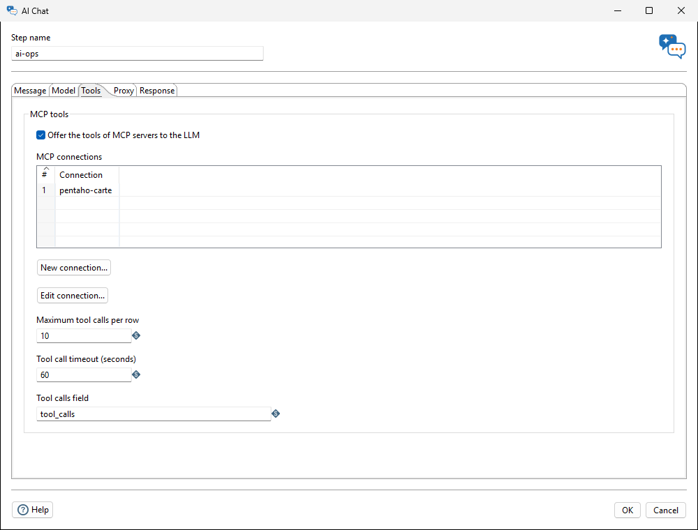
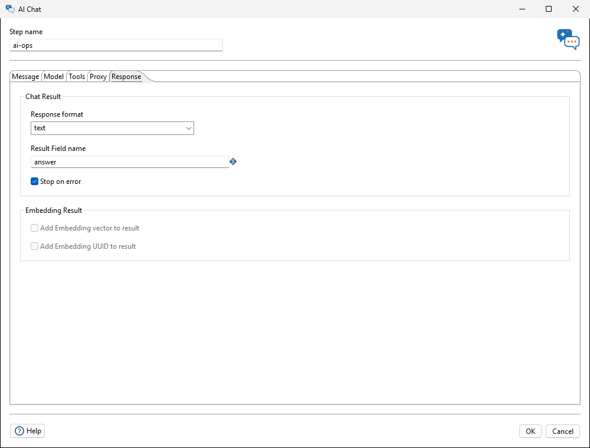
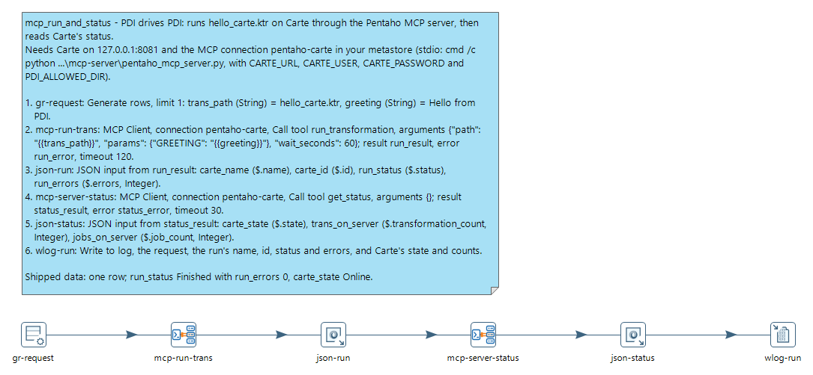
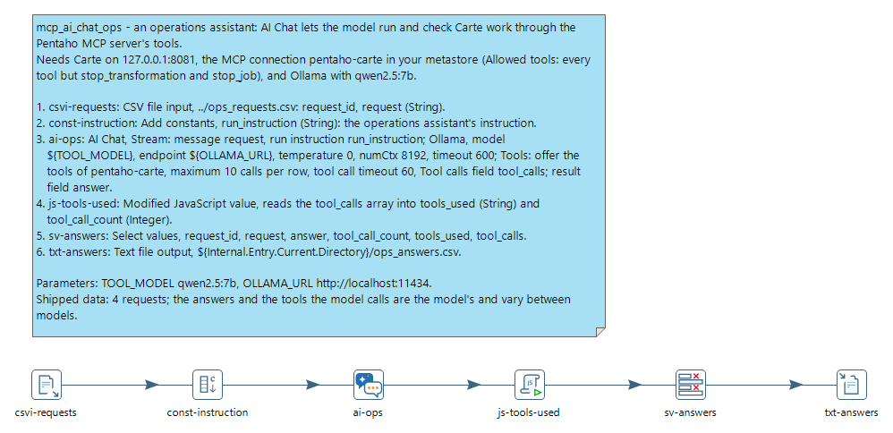

# Project: Pentaho MCP Server

> **Warning:**
>
> #### Workshop - Project: Pentaho MCP Server
>
> **This is a project**: larger and more open-ended than a workshop, built over several sessions, and not assessed. You build a Model Context Protocol (MCP) server in Python that puts Carte, the lightweight server of Pentaho Data Integration (PDI), in front of AI assistants, so they can list, run and monitor transformations and jobs. A guided build takes you through four milestones; the project brief and the stretch goals leave room to take it further.
>
> **What you'll do**
>
> * Start your own Carte and call its REST API by hand
> * Build the server in four milestones: read-only tools, run and status, logs and errors, safety and an audit log
> * Prove every tool with a check script, including the requests the server must refuse
> * Let Pentaho Data Integration drive Carte through the server, with **MCP Client** and with **AI Chat**'s **Tools** tab
> * Connect a desktop AI assistant that supports MCP
>
> **Prerequisites:**
>
> * Python, Ollama with `qwen2.5:7b` pulled, and the GenAI plugins installed, as set up in [Before You Start](../00-before-you-start/guide.md)
> * [MCP Tools](../22-mcp-tools/guide.md): the course's first MCP server, the MCP connection, **MCP Client** and the **Tools** tab
> * The Agents and Tools [Overview](../16-agent-as-a-service/guide.md): what MCP is and the transports the plugin supports
>
> **Estimated time:** 180 minutes, over several sessions
>
> No GenAI license is needed until part 6: Carte, the server and its check script run on any Pentaho Data Integration 11 install.

<figure>

<figcaption class="pcm-video-caption">Walkthrough: coming soon</figcaption>

</figure>

<div align="center">
<figure>

<figcaption>What you build: one MCP server in front of Carte, three clients, four milestones</figcaption>
</figure>
</div>

## Project Brief <!-- no-step -->

**The problem.** An operations team runs Pentaho Data Integration jobs on Carte and wants to ask an AI assistant "run the daily sales job and tell me if it failed" instead of opening a browser or a terminal. The assistant needs tools it can call, and the team needs to know those tools can only do what they were built for.

**The brief.** Build an MCP server, `pentaho-carte`, in Python with the official MCP SDK, that:

* lists the transformations and jobs it may run, and reports Carte's status;
* runs a transformation or a job with parameters, and reports when it finished and whether it failed;
* returns the log of a run, with the lines that say why it failed, and stops a run;
* runs nothing outside one folder, takes no arbitrary path, can be made read-only, keeps its Carte credentials out of every tool, and records every call.

> **Note:** Pentaho has planned a native **MCP Server Job step** that exposes PDI jobs as MCP tools to AI agents; it is not released and has no date yet. What this project teaches still applies when it arrives: which folder the tools may run from, whether a client may only watch (read-only mode), and an audit line for every call are choices you make for any MCP server, native or your own.

**The milestones.** Each one ends with a check you can run, so you can stop after any of them and come back later:

| Milestone | You add | Done when `check_pentaho_mcp.py` shows |
| --- | --- | --- |
| M1 Read-only tools | `list_files`, `get_status`, the resources `carte://status` and `pdi://files` | 2 tools, 6 files, Carte `Online` |
| M2 Run and status | `run_transformation`, `run_job`, `get_transformation_status`, `get_job_status`, the allow-list and declared parameters | `daily_sales` succeeded, `broken_feed` did not, four requests refused |
| M3 Logs and errors | `get_log`, `stop_transformation`, `stop_job` | why `broken_feed` failed, `heartbeat` stopped |
| M4 Safety and audit log | read-only mode, the audit log | 5 tools in read-only mode, one audit line per call |

Then you use the server three ways: from the check script, from Pentaho Data Integration (parts 6 and 7), and from a desktop AI assistant (part 8). The **Stretch Goals** after the parts are yours to choose.

**The files.** The lab folder, `C:\Workshop-AI-Specialty\07-agents-and-tools\29-project-pentaho-mcp`, holds:

| File | What it is |
| --- | --- |
| `samples\hello_carte.ktr` | Generates `${ROWS}` rows (default 3) carrying `${GREETING}` and writes them to the log |
| `samples\heartbeat.ktr` | Writes a row to the log every 2 seconds until it is stopped |
| `samples\daily_sales.kjb` | The daily sales job: runs `daily_sales_load.ktr`, which totals 4 orders; parameter `SALES_DATE` |
| `samples\broken_feed.kjb` | A job that fails on purpose: its transformation, `broken_feed.ktr`, aborts |
| `mcp-server\check_pentaho_mcp.py` | The check script: an MCP client that starts your server and calls every tool it has |
| `ops_requests.csv` | Four requests in plain words, for part 7 |

`samples` is the server's *allowed folder*: the only files it will run. Every sample uses core steps only.

:::: tabs

### 1. Start Carte

> **Note:**
>
> #### Your Own Carte
>
> Carte is a small web server that comes with Pentaho Data Integration. It runs transformations and jobs sent to it and reports on them through a REST API, the API your MCP server calls. Start your own Carte on port `8081`: port `8080` belongs to the Pentaho Server, so never use it here.

1. Check that port `8081` is free. In PowerShell, run:

```powershell
Get-NetTCPConnection -LocalPort 8081 -State Listen -ErrorAction SilentlyContinue
```

> **Success:** Checkpoint: the command prints nothing. If it prints a line, another program listens on `8081`: use `8082` or the next free port instead, here and in every `CARTE_URL` of this project.

2. Open a second PowerShell window for Carte, and run:

```powershell
Set-Location C:\Pentaho\design-tools\data-integration
.\Carte.bat 127.0.0.1 8081
```

> **Success:** Checkpoint: after about 20 seconds the window prints `Carte - Created listener for webserver @ address : 127.0.0.1:8081`. Leave the window open: Carte runs as long as it does. Press `Ctrl+C` in it to stop Carte.

3. In your first PowerShell window, ask Carte for its status. Carte's default user is `cluster`, with the password `cluster`:

```powershell
$cred = [Convert]::ToBase64String([Text.Encoding]::ASCII.GetBytes("cluster:cluster"))
$h = @{ Authorization = "Basic $cred" }
(Invoke-RestMethod "http://127.0.0.1:8081/kettle/status/?xml=Y" -Headers $h).serverstatus.statusdesc
```

> **Success:** Checkpoint: the command prints `Online`.

4. Run the daily sales job on Carte by hand, then ask for its status:

```powershell
$job = [uri]::EscapeDataString("C:\Workshop-AI-Specialty\07-agents-and-tools\29-project-pentaho-mcp\samples\daily_sales.kjb")
$r = Invoke-RestMethod "http://127.0.0.1:8081/kettle/executeJob/?job=$job&level=Basic&xml=Y" -Headers $h
$r.webresult
Start-Sleep 2
(Invoke-RestMethod "http://127.0.0.1:8081/kettle/jobStatus/?name=daily_sales&id=$($r.webresult.id)&xml=Y" -Headers $h).jobstatus.status_desc
```

> **Success:** Checkpoint: `$r.webresult` shows `result` `OK`, `message` `Job started` and an `id`, a long id such as `5f854ff5-3a40-495d-8467-0b3b52827b32` that is different every run. The last line prints `Finished`. The Carte window logs `Daily sales for 2026-11-27` and `total_sales = 3000.0`.

Leave Carte running: every part of the project uses it.

> **Under the hood:**
>
> #### Carte ran the job from its own disk and gave the run an id
>
> `executeJob` read `daily_sales.kjb` from the path you gave, started it in the background, and answered at once with a *Carte id*. A run on Carte is known by its name (the job's name, `daily_sales`) and that id; `jobStatus` and `transStatus` need both, and answer with the status (`Running`, `Finished`, `Finished (with errors)`), the error count and the log, gzipped and Base64-encoded. Without credentials, every call gets `401`. The endpoints this project uses:
>
> | Endpoint | What it does |
> | --- | --- |
> | `/kettle/status/?xml=Y` | Carte's state, and every transformation and job it holds |
> | `/kettle/executeJob/?job=<path>` | Runs a `.kjb` from Carte's disk; any other query value sets a job parameter of that name |
> | `/kettle/registerTrans/?xml=Y`, then `/kettle/startTrans/?name=..&id=..` | Registers a transformation sent as XML in the request, then starts it: the id comes back from the first call |
> | `/kettle/transStatus/?name=..&id=..&xml=Y`, `/kettle/jobStatus/...` | One run's status, step counts, errors and log |
> | `/kettle/stopTrans/?name=..&id=..`, `/kettle/stopJob/...` | Stops a run |
>
> `/kettle/executeTrans/?trans=<path>` also exists, but it holds the request open until the transformation ends and returns no id, so nothing could ask for its status or its log afterwards: the server uses `registerTrans` and `startTrans` instead, as Spoon does when it runs a transformation on a Carte server.
>
> **Why it matters:** every tool you build is a few lines around one of these calls. And `cluster` / `cluster` is a well-known default: on a real Carte, change it. A Carte started from a configuration file uses the `<username>` and `<password>` of the file's `<slaveserver>` instead (tested: `cluster` then gets `401`), and one started with a host and port reads its users from `pwd\kettle.pwd`, one `user: password` line each, the password obfuscated with `Encr.bat -carte <password>`.

### 2. M1 Read-Only Tools

> **Note:**
>
> #### Milestone 1: List and Report
>
> Start with tools that only read: they cannot change anything, so they are safe to try. `list_files` lists what the server may run; `get_status` reports Carte's state. The same two answers are also *resources*, content a client can read by URI.

1. Install the MCP Python SDK, the version 1 line the course uses. In PowerShell, run:

```powershell
python -m pip install "mcp<2"
```

> **Success:** Checkpoint: pip ends with a line that starts `Successfully installed` and names `mcp`, or reports `Requirement already satisfied: mcp`.

2. Create the server file in the `mcp-server` folder, next to the check script. In PowerShell, run:

```powershell
Set-Location C:\Workshop-AI-Specialty\07-agents-and-tools\29-project-pentaho-mcp\mcp-server
notepad pentaho_mcp_server.py
```

3. When Notepad asks, select **Yes** to create the file. Paste in this code and save it (`Ctrl+S`):

```python
"""Pentaho MCP server: lets an AI assistant list, run and monitor Pentaho Data Integration work on Carte.

A Model Context Protocol (MCP) server, written with the official MCP Python SDK (FastMCP), in front of
Carte, Pentaho Data Integration's lightweight server. It talks to Carte's REST API and offers:

  list_files()                                   the .ktr and .kjb files in the allowed folder
  get_status()                                   Carte's state and every transformation and job it holds
  get_transformation_status(name, id)            one transformation's status, errors and step counts
  get_job_status(name, id)                       one job's status, errors and result
  run_transformation(path, params, wait_seconds) runs a .ktr from the allowed folder on Carte
  run_job(path, params, wait_seconds)            runs a .kjb from the allowed folder on Carte
  get_log(name, id, kind, tail_lines)            the last lines of a run's log, and its ERROR lines
  stop_transformation(name, id)                  stops a running transformation
  stop_job(name, id)                             stops a running job
  carte://status, pdi://files                    the same status and file list, as resources

Settings, from environment variables only (never from a tool's arguments):
  CARTE_URL          Carte's address, default http://127.0.0.1:8081
  CARTE_USER         Carte user name    (required: no default, never logged)
  CARTE_PASSWORD     Carte password     (required: no default, never logged)
  PDI_ALLOWED_DIR    the only folder whose files may run (required: no default)
  PDI_MCP_READ_ONLY  1 = only the read tools exist: no run_ and no stop_ tool is offered at all
  PDI_MCP_AUDIT_LOG  the JSON Lines audit log, default audit_log.jsonl beside this file

Start it with:  python pentaho_mcp_server.py              (stdio: an MCP client starts it)
           or:  python pentaho_mcp_server.py --http      (Streamable HTTP on http://127.0.0.1:8766/mcp)
Over stdio the client talks to it through its standard input and output, so it writes nothing else there.

Needs the MCP Python SDK:  python -m pip install "mcp<2"
"""
import argparse
import base64
import functools
import gzip
import json
import os
import re
import time
import urllib.error
import urllib.parse
import urllib.request
import xml.etree.ElementTree as ET
from datetime import datetime, timezone
from pathlib import Path
from typing import Literal

from mcp.server.fastmcp import FastMCP

HERE = Path(__file__).resolve().parent
CARTE_URL = os.environ.get("CARTE_URL", "http://127.0.0.1:8081").rstrip("/")
CARTE_USER = os.environ.get("CARTE_USER", "")
CARTE_PASSWORD = os.environ.get("CARTE_PASSWORD", "")
# No default: until PDI_ALLOWED_DIR names a folder, the server lists and runs nothing.
ALLOWED_DIR = Path(os.environ["PDI_ALLOWED_DIR"]).resolve() if os.environ.get("PDI_ALLOWED_DIR") else None
READ_ONLY = os.environ.get("PDI_MCP_READ_ONLY", "").strip().lower() in ("1", "true", "yes", "y")
AUDIT_LOG = Path(os.environ.get("PDI_MCP_AUDIT_LOG") or HERE / "audit_log.jsonl")

cli = argparse.ArgumentParser(description="Pentaho MCP server in front of Carte")
cli.add_argument("--http", action="store_true", help="serve Streamable HTTP instead of stdio")
cli.add_argument("--port", type=int, default=8766, help="the HTTP port (with --http), default 8766")
ARGS, _ = cli.parse_known_args()

# 127.0.0.1 only: Streamable HTTP here has no token yet (a stretch goal), so it must not listen on the network.
# WARNING keeps the SDK's per-request INFO lines out of the client's log (they go to stderr).
mcp = FastMCP("pentaho-carte", host="127.0.0.1", port=ARGS.port, log_level="WARNING")


# ================================================================== M1: Carte's REST API

def _carte(path: str, query: dict | None = None, body: bytes | None = None) -> ET.Element:
    """Calls Carte and returns its XML answer. Credentials come from the environment, never from a tool."""
    if not CARTE_USER or not CARTE_PASSWORD:
        raise ValueError("CARTE_USER and CARTE_PASSWORD are not set in the server's environment.")
    url = f"{CARTE_URL}{path}?{urllib.parse.urlencode(dict(query or {}, xml='Y'))}"
    token = base64.b64encode(f"{CARTE_USER}:{CARTE_PASSWORD}".encode()).decode()
    req = urllib.request.Request(url, data=body, headers={"Authorization": f"Basic {token}",
                                                          "Content-Type": "text/xml; charset=utf-8"})
    try:
        with urllib.request.urlopen(req, timeout=30) as r:
            text = r.read().decode("utf-8", "replace")
    except urllib.error.HTTPError as e:
        if e.code == 401:
            raise ValueError("Carte refused the user name or password (HTTP 401).") from None
        text = e.read().decode("utf-8", "replace")
        msg = re.search(r"<message>(.*?)</message>", text, re.S)
        first = (msg.group(1) if msg else text).strip().splitlines()
        raise ValueError(f"Carte answered HTTP {e.code}: {first[0] if first else ''}".strip()) from None
    except urllib.error.URLError as e:
        raise ValueError(f"Cannot reach Carte at {CARTE_URL}: {e.reason}") from None
    root = ET.fromstring(text.strip())
    if root.tag == "webresult" and root.findtext("result") == "ERROR":
        raise ValueError(f"Carte: {(root.findtext('message') or '').strip().splitlines()[0]}")
    return root


def _num(el: ET.Element, tag: str) -> int:
    try:
        return int(el.findtext(tag) or 0)
    except ValueError:
        return 0


# ================================================================== M1: the allowed folder and the read tools

def _allowed() -> Path:
    if ALLOWED_DIR is None or not ALLOWED_DIR.is_dir():
        raise ValueError("PDI_ALLOWED_DIR is not set to an existing folder in the server's environment.")
    return ALLOWED_DIR


def _declared(full: Path) -> tuple[str, dict]:
    """The file's name and its declared parameters with their defaults, read from its XML."""
    root = ET.parse(full).getroot()
    info = root.find("info") if root.tag == "transformation" else root
    params = {p.findtext("name"): p.findtext("default_value") or ""
              for p in info.iterfind("parameters/parameter")}
    return info.findtext("name") or full.stem, params


def _files() -> dict:
    files, allowed = [], _allowed()
    for f in sorted(allowed.rglob("*")):
        if f.suffix.lower() in (".ktr", ".kjb") and f.is_file():
            name, params = _declared(f)
            files.append({"path": f.relative_to(allowed).as_posix(), "name": name, "parameters": params,
                          "kind": "transformation" if f.suffix.lower() == ".ktr" else "job"})
    return {"read_only": READ_ONLY, "count": len(files), "files": files}


def _server_status() -> dict:
    root = _carte("/kettle/status/")
    trans = [{"name": t.findtext("transname"), "id": t.findtext("id"), "status": t.findtext("status_desc")}
             for t in root.iterfind("transstatuslist/transstatus")]
    jobs = [{"name": j.findtext("jobname"), "id": j.findtext("id"), "status": j.findtext("status_desc")}
            for j in root.iterfind("jobstatuslist/jobstatus")]
    return {"server": CARTE_URL, "state": root.findtext("statusdesc"), "threads": _num(root, "thread_count"),
            "memory_free_mb": _num(root, "memory_free") // 1048576, "uptime_seconds": _num(root, "uptime") // 1000,
            "transformation_count": len(trans), "job_count": len(jobs), "transformations": trans, "jobs": jobs}


def list_files() -> dict:
    """List the transformations (.ktr) and jobs (.kjb) this server may run, with the parameters each
    declares and their defaults. Only files in the allowed folder are listed, and only they can run.
    Use the path exactly as listed with run_transformation or run_job."""
    return _files()


def get_status() -> dict:
    """Get the Carte server's state (Online), its threads, free memory and uptime, and every
    transformation and job it holds, each with its name, Carte id and status."""
    return _server_status()


@mcp.resource("carte://status", mime_type="application/json")
def status_resource() -> str:
    """The Carte server's status, as returned by get_status."""
    return json.dumps(_server_status(), indent=2)


@mcp.resource("pdi://files", mime_type="application/json")
def files_resource() -> str:
    """The transformations and jobs this server may run, as returned by list_files."""
    return json.dumps(_files(), indent=2)


READ_TOOLS = [list_files, get_status]  # tools that only read
RUN_TOOLS = []                         # tools that change something on Carte


# ================================================================== register the tools

for fn in READ_TOOLS + RUN_TOOLS:
    mcp.tool()(fn)


if __name__ == "__main__":
    mcp.run(transport="streamable-http" if ARGS.http else "stdio")
```

The code has three parts. The settings come from environment variables only, and three of them have no default: without `CARTE_USER`, `CARTE_PASSWORD` and `PDI_ALLOWED_DIR` the server answers every call with an error instead of guessing. `_carte` makes every call to Carte, with the credentials in an HTTP Basic header and `xml=Y` on every URL. The tools are plain functions with type hints and docstrings; the block at the end registers them with `mcp.tool()`. The two resources use the `@mcp.resource` decorator.

4. Run the check script. It starts your server with Carte's address, `cluster` / `cluster` and the `samples` folder in the server's environment:

```powershell
python check_pentaho_mcp.py
```

> **Success:** Checkpoint: the script prints `Server: pentaho-carte, protocol 2025-06-18, Carte http://127.0.0.1:8081`, then `2 tools: list_files, get_status` and `2 resources: carte://status, pdi://files`. Under `-- M1: read`, `list_files: 6 files: broken_feed.kjb, broken_feed.ktr, daily_sales.kjb, daily_sales_load.ktr, heartbeat.ktr, hello_carte.ktr` and `get_status: state=Online`, with the transformation and job counts of your Carte (`transformation_count=0, job_count=1` after the job you ran by hand in part 1). Every M2 and M3 tool prints `not built yet`.

Read the answers against Carte: the counts are those of `/kettle/status/`, the call you made by hand in part 1.

> **Under the hood:**
>
> #### FastMCP turned each function into a tool, and its docstring into the tool's description
>
> `mcp.tool()` read each function's name, type hints and docstring, and published them in `tools/list`: the name as the tool's name, the hints as the JSON schema of its arguments, and the docstring as its description. The returned `dict` goes back as JSON text. The check script started the server as a child process with `stdio_client`, passing an explicit `env`: the SDK starts a server with only a few safe variables (such as `PATH` and `APPDATA`), never your whole environment, so a server that needs settings must be given them, by the script here, by the MCP connection's **Environment variables** in part 6.
>
> **Why it matters:** a model chooses tools by reading those descriptions, so "use the path exactly as listed" in `list_files`'s docstring is an instruction to the model as much as documentation. And the credentials never pass through a tool: no argument a model writes can change the Carte user, the password or the folder.

### 3. M2 Run and Status

> **Note:**
>
> #### Milestone 2: Run Work and Report on It
>
> Now the tools that change something: they start runs on Carte. Two rules come with them. A path is relative to the allowed folder, and anything else is refused. A parameter must be one the file declares, or it is refused too.

1. Open `pentaho_mcp_server.py` in Notepad. Paste this code above the line `# ================================================================== register the tools`, and save the file:

```python
# ================================================================== M2: run and status

DONE = ("Finished", "Stopped")  # Carte's status_desc starts with one of these when a run has ended
PARAM_NAME = re.compile(r"^[A-Za-z_][A-Za-z0-9_.]{0,63}$")


def _run_summary(el: ET.Element, kind: str) -> dict:
    """The fields every status answer shares, from a <transstatus> or <jobstatus> element."""
    status = el.findtext("status_desc") or ""
    if status.startswith("Finished") and el.findtext("result/is_stopped") == "Y":
        status = "Stopped"  # Carte reports a stopped run as Finished; its result says it was stopped
    errors = _num(el, "result/nr_errors")
    if kind == "transformation":
        errors = max(errors, sum(_num(s, "errors") for s in el.iter("stepstatus")))
    finished = status.startswith(DONE)
    return {"kind": kind, "name": el.findtext("transname") or el.findtext("jobname") or "",
            "id": el.findtext("id") or "", "status": status, "errors": errors, "finished": finished,
            "succeeded": (status == "Finished" and errors == 0) if finished else None,
            "error_desc": (el.findtext("error_desc") or "").strip()}


def _status(kind: str, name: str, carte_id: str) -> ET.Element:
    path = "/kettle/transStatus/" if kind == "transformation" else "/kettle/jobStatus/"
    return _carte(path, {"name": name, "id": carte_id})


def _wait(kind: str, name: str, carte_id: str, seconds: int) -> dict:
    end = time.monotonic() + max(0, min(seconds, 120))
    while True:
        out = _run_summary(_status(kind, name, carte_id), kind)
        if out["finished"] or time.monotonic() >= end:
            return out
        time.sleep(1)


def _resolve(path: str, suffix: str) -> Path:
    """A file the server may run: relative, inside PDI_ALLOWED_DIR, with the right extension, and existing."""
    allowed = _allowed()
    p = Path((path or "").strip())
    if not p.parts:
        raise ValueError("No path given. Call list_files to see what can run.")
    if p.is_absolute() or p.drive or p.anchor:
        raise ValueError(f"Refused {path!r}: give a path relative to the allowed folder, as list_files shows it.")
    if ".." in p.parts:
        raise ValueError(f"Refused {path!r}: '..' is not allowed.")
    if p.suffix.lower() != suffix:
        raise ValueError(f"Refused {path!r}: this tool runs {suffix} files only.")
    full = (allowed / p).resolve()
    if not full.is_relative_to(allowed):
        raise ValueError(f"Refused {path!r}: it is outside the allowed folder.")
    if not full.is_file():
        raise ValueError(f"No file {path!r} in the allowed folder. Call list_files to see what can run.")
    return full


def _check_params(full: Path, params: dict | None) -> dict:
    """Only parameters the file declares, with short text values: nothing else reaches Carte."""
    _, declared = _declared(full)
    out = {}
    for k, v in (params or {}).items():
        if not PARAM_NAME.match(str(k)) or k not in declared:
            raise ValueError(f"Refused parameter {k!r}: {full.name} declares "
                             f"{', '.join(declared) if declared else 'no parameters'}.")
        v = str(v)
        if len(v) > 500:
            raise ValueError(f"Refused parameter {k!r}: values are at most 500 characters.")
        out[k] = v
    return out


def _xml(v: str) -> str:
    return v.replace("&", "&amp;").replace("<", "&lt;").replace(">", "&gt;")


def run_transformation(path: str, params: dict[str, str] | None = None, wait_seconds: int = 0) -> dict:
    """Run a transformation (.ktr) from the allowed folder on Carte. path is relative, as list_files
    shows it; params sets the parameters the file declares. With wait_seconds above 0 (at most 120),
    waits for the run to end and returns its final status. Returns the run's name and Carte id."""
    full = _resolve(path, ".ktr")
    values = _check_params(full, params)
    xml = re.sub(r"^<\?xml[^>]*\?>\s*", "", full.read_text(encoding="utf-8"))
    ps = "".join(f"<parameter><name>{k}</name><value>{_xml(v)}</value></parameter>" for k, v in values.items())
    config = ("<transformation_configuration>\n" + xml + "<transformation_execution_configuration>"
              "<exec_remote>Y</exec_remote><log_level>Basic</log_level>"
              f"<parameters>{ps}</parameters></transformation_execution_configuration>\n"
              "</transformation_configuration>\n")
    carte_id = _carte("/kettle/registerTrans/", body=config.encode("utf-8")).findtext("id")
    name, _ = _declared(full)
    _carte("/kettle/startTrans/", {"name": name, "id": carte_id})
    out = _wait("transformation", name, carte_id, wait_seconds)
    return out | {"path": path, "params": values}


def run_job(path: str, params: dict[str, str] | None = None, wait_seconds: int = 0) -> dict:
    """Run a job (.kjb) from the allowed folder on Carte. path is relative, as list_files shows it;
    params sets the parameters the file declares. With wait_seconds above 0 (at most 120), waits for
    the job to end and returns its final status. Returns the run's name and Carte id."""
    full = _resolve(path, ".kjb")
    values = _check_params(full, params)
    carte_id = _carte("/kettle/executeJob/", {"job": str(full), "level": "Basic", **values}).findtext("id")
    name, _ = _declared(full)
    out = _wait("job", name, carte_id, wait_seconds)
    return out | {"path": path, "params": values}


def get_transformation_status(name: str, id: str) -> dict:
    """Get one transformation run's status (Running, Finished, Finished (with errors) or Stopped),
    its error count, whether it succeeded, and the rows each step read, wrote and rejected.
    Give the name and Carte id that run_transformation or get_status returned."""
    el = _status("transformation", name, id)
    out = _run_summary(el, "transformation")
    out["steps"] = [{"step": s.findtext("stepname"), "written": _num(s, "linesWritten"),
                     "read": _num(s, "linesRead"), "rejected": _num(s, "linesRejected"),
                     "errors": _num(s, "errors"), "status": s.findtext("statusDescription")}
                    for s in el.iter("stepstatus")]
    return out


def get_job_status(name: str, id: str) -> dict:
    """Get one job run's status (Running, Finished, Finished (with errors) or Stopped), its error count
    and whether it succeeded. Give the name and Carte id that run_job or get_status returned."""
    el = _status("job", name, id)
    out = _run_summary(el, "job")
    out["result"] = (el.findtext("result/result") or "") == "Y"
    return out


READ_TOOLS += [get_transformation_status, get_job_status]
RUN_TOOLS += [run_transformation, run_job]
```

2. Run the check script again:

```powershell
python check_pentaho_mcp.py
```

> **Success:** Checkpoint: `6 tools: list_files, get_status, get_transformation_status, get_job_status, run_transformation, run_job`. Under `-- M2: run and status`: `run_transformation hello_carte.ktr: name=hello_carte, status=Finished, errors=0, succeeded=True`; `get_transformation_status: gr-greetings wrote 3, gv-greeting wrote 3, wlog-greetings wrote 3`; `run_job daily_sales.kjb: name=daily_sales, status=Finished, errors=0, succeeded=True`; `get_job_status daily_sales: status=Finished, errors=0, result=True`; and `run_job broken_feed.kjb: name=broken_feed, status=Finished (with errors), errors=1, succeeded=False`.

3. Read the four lines under `-- the allow-list`: the requests the server refused.

> **Success:** Checkpoint: four `REFUSED` lines. `C:\Windows\Temp\cleanup.kjb`: `give a path relative to the allowed folder, as list_files shows it`. `..\..\22-mcp-tools\job.kjb`: `'..' is not allowed`. `hello_carte.ktr` given to `run_job`: `this tool runs .kjb files only`. And `daily_sales.kjb` with a parameter `KETTLE_HOME`: `Refused parameter 'KETTLE_HOME': daily_sales.kjb declares SALES_DATE`.

None of the four reached Carte: the server refused them before it made a call.

> **Under the hood:**
>
> #### The server checked the path and the parameters before Carte saw anything
>
> `_resolve` refused any absolute path, drive or `..`, joined what was left to the allowed folder, resolved it, and refused it unless the result is still inside that folder, has the right extension and exists. `_check_params` read the file's own `<parameters>` and let through only those names, as text of at most 500 characters. For a job, the server passed the checked path and parameters to `executeJob`. For a transformation, it read the `.ktr`, wrapped it in a `<transformation_configuration>` with the parameter values and sent it to `registerTrans`, then `startTrans`. With `wait_seconds`, `_wait` asked for the status once a second until the run ended. A refusal is an MCP error result (`isError`), so the client gets the reason as text, and nothing reaches Carte.
>
> **Why it matters:** a tool that took any path would run any file Carte can read, including one a model was talked into naming. The allow-list makes the server's reach a folder you choose, and the parameter check stops a caller from setting variables the file never asked for.

### 4. M3 Logs and Errors

> **Note:**
>
> #### Milestone 3: Why Did It Fail?
>
> "It failed" is half an answer. `get_log` returns the end of a run's log and every `ERROR` line in it, which says why. And a run that never ends, `heartbeat.ktr`, needs a way to stop it.

1. Paste this code above the line `# ================================================================== register the tools`, and save the file:

```python
# ================================================================== M3: logs, errors and stopping

def get_log(name: str, id: str, kind: Literal["transformation", "job"] = "transformation",
            tail_lines: int = 40) -> dict:
    """Get the log of one run: its last tail_lines lines (at most 200) and every line that contains
    ERROR, which says why a run failed. kind is transformation or job."""
    el = _status(kind, name, id)
    raw = (el.findtext("logging_string") or "").strip()
    raw = raw.removeprefix("<![CDATA[").removesuffix("]]>").strip()
    text = gzip.decompress(base64.b64decode(raw)).decode("utf-8", "replace") if raw else ""
    lines = [ln for ln in text.splitlines() if ln.strip()]
    tail = max(1, min(tail_lines, 200))
    return {"kind": kind, "name": name, "id": id, "status": el.findtext("status_desc") or "",
            "line_count": len(lines), "error_lines": [ln for ln in lines if " ERROR " in ln or "ERROR (" in ln][:20],
            "tail": lines[-tail:]}


def stop_transformation(name: str, id: str) -> dict:
    """Stop a running transformation. Give the name and Carte id that run_transformation returned."""
    _carte("/kettle/stopTrans/", {"name": name, "id": id})
    return _wait("transformation", name, id, 10)  # Halting first, then Stopped


def stop_job(name: str, id: str) -> dict:
    """Stop a running job. Give the name and Carte id that run_job returned."""
    _carte("/kettle/stopJob/", {"name": name, "id": id})
    return _wait("job", name, id, 10)


READ_TOOLS += [get_log]
RUN_TOOLS += [stop_transformation, stop_job]
```

2. Run the check script again:

```powershell
python check_pentaho_mcp.py
```

> **Success:** Checkpoint: `9 tools`, now with `get_log`, `stop_transformation` and `stop_job`. Under `-- M3: logs, errors and stopping`: `get_log hello_carte: 27 lines, message = Hello from MCP`, the greeting the check script passed as a parameter; `get_log broken_feed` with three or four `ERROR` lines, among them `Supplier price feed is missing: this sample fails on purpose`; `run_transformation heartbeat.ktr: status=Running, finished=False`, then `stop_transformation heartbeat: status=Stopped, finished=True`.

In the Carte window, the `Heartbeat` lines stop when the check script stops the transformation.

> **Under the hood:**
>
> #### The log came back gzipped and Base64-encoded, and a stopped run said Finished
>
> `transStatus` and `jobStatus` return the log in `<logging_string>` as Base64 of gzipped text inside a CDATA marker; `get_log` strips the marker, decodes and unzips it, and picks out the lines with `ERROR`. Stopping a transformation takes a moment: it reads `Halting`, then `Finished`, and only the `<is_stopped>Y</is_stopped>` in its result tells it apart from a run that ended by itself. `_run_summary` reports such a run as `Stopped` with `succeeded` false.
>
> **Why it matters:** the status string alone would have told an assistant that a stopped run succeeded. Read the whole answer of an API, not the first field that looks right, and give the client the facts it needs (`finished`, `succeeded`, `errors`) as separate values instead of a string to interpret.

### 5. M4 Safety and Audit Log

> **Note:**
>
> #### Milestone 4: Read-Only Mode and an Audit Log
>
> Two last controls. A *read-only mode* for clients that should watch but never run anything: in it, the tools that change something are not registered at all. And an *audit log*: one line per tool call, with its arguments and whether it worked.

1. Replace everything from the line `# ================================================================== register the tools` to the end of the file with this code, and save the file:

```python
# ================================================================== M4: the audit log

def _audit(tool: str, arguments: dict, outcome: str, detail: str = "") -> None:
    rec = {"time": datetime.now(timezone.utc).isoformat(timespec="seconds"), "tool": tool,
           "arguments": arguments, "outcome": outcome, "detail": detail[:300]}
    try:
        with AUDIT_LOG.open("a", encoding="utf-8") as fh:
            fh.write(json.dumps(rec) + "\n")
    except OSError:
        pass  # an unwritable audit log must not break the tool; the client still gets its answer


def audited(fn):
    """Records every call of a tool, with its arguments and whether it succeeded, in the audit log."""
    @functools.wraps(fn)
    def wrapper(*a, **kw):
        try:
            out = fn(*a, **kw)
        except Exception as e:
            _audit(fn.__name__, kw, "error", str(e))
            raise
        _audit(fn.__name__, kw, "ok", out.get("status", "") if isinstance(out, dict) else "")
        return out
    return wrapper


# ================================================================== register the tools (M4 version)
# In read-only mode the run and stop tools are never registered: a client cannot list them,
# so no model can call them, whatever it is asked.

for fn in READ_TOOLS + ([] if READ_ONLY else RUN_TOOLS):
    mcp.tool()(audited(fn))


if __name__ == "__main__":
    mcp.run(transport="streamable-http" if ARGS.http else "stdio")
```

2. Run the check script again:

```powershell
python check_pentaho_mcp.py
```

> **Success:** Checkpoint: under `-- M4: read-only mode`, `5 tools: list_files, get_status, get_transformation_status, get_job_status, get_log`: no tool that runs or stops anything. The last line reads `audit_log.jsonl: 15 lines` (15 more each time you run the script again), and the last of them is the refused `KETTLE_HOME` request, with `"outcome": "error"` and the reason in `detail`.

3. Open `audit_log.jsonl` in the `mcp-server` folder and read the 15 lines: one per tool call of the first session, read-only or not, refused or not.

4. Compare your file with the solution's, blank lines aside. In PowerShell, run:

```powershell
$mine = Get-Content .\pentaho_mcp_server.py | Where-Object { $_.Trim() }
$theirs = Get-Content ..\solution\pentaho_mcp_server.py | Where-Object { $_.Trim() }
Compare-Object $mine $theirs
```

> **Success:** Checkpoint: the command prints nothing: your server is the solution's, line for line.

The controls the server now has, and what each one stops:

| Control | Where | What it stops |
| --- | --- | --- |
| Credentials from environment variables | `CARTE_USER`, `CARTE_PASSWORD`; `_carte` | A model, a prompt or a tool argument reading or changing them; a password in a log or a tool's description |
| The allowed folder | `PDI_ALLOWED_DIR`; `_resolve` | Running any file Carte can read: system paths, `..`, another lab's jobs |
| No arbitrary paths | `_resolve` | Absolute paths and drives, files of the wrong kind, files that do not exist |
| Declared parameters only | `_check_params` | Setting variables a file never asked for, long values |
| Read-only mode | `PDI_MCP_READ_ONLY=1`; the registration block | Any run or stop: the tools are not offered, so no client can call them |
| The audit log | `PDI_MCP_AUDIT_LOG`; `audited` | Calls nobody can account for afterwards |
| Streamable HTTP on `127.0.0.1` only | `FastMCP(..., host="127.0.0.1")` | Other machines reaching a server that has no token yet |

> **Under the hood:**
>
> #### Read-only mode removed the tools; it did not tell the model to avoid them
>
> In read-only mode the loop at the end registers `READ_TOOLS` only, so `tools/list` answers with five tools and a call to `run_job` fails as an unknown tool. Every registered tool is wrapped by `audited` first: `functools.wraps` keeps its name, docstring and signature for FastMCP, and the wrapper appends one JSON line per call, even when the tool raises. The arguments are logged, never the credentials, because the credentials are never arguments.
>
> **Why it matters:** this is the server-side twin of the connection's **Allowed tools** in [MCP Tools](../22-mcp-tools/guide.md). An instruction such as "never run anything" is a request a model can ignore; a tool that does not exist is a control. Use both: the server decides what it can ever do, and each client restricts it further.

### 6. PDI Drives PDI

> **Note:**
>
> #### MCP Client Runs a Transformation on Carte
>
> A transformation that runs another transformation on Carte, through your MCP server: **MCP Client** calls `run_transformation`, then `get_status`, with no model involved. First, the MCP connection that starts your server, with its settings as environment variables.

1. Start Pentaho Data Integration with the **Start Pentaho Data Integration** button below, or from PowerShell:

```powershell
Set-Location C:\Pentaho\design-tools\data-integration
.\Spoon.bat
```

<button data-launch="spoon" data-path="">Start Pentaho Data Integration</button>

2. Select **File > New > Transformation** (`Ctrl+N`).
3. Select **File > Save as** and save it as `mcp_run_and_status.ktr` in `C:\Workshop-AI-Specialty\07-agents-and-tools\29-project-pentaho-mcp`.
4. On the **Design** tab, open the **Input** folder and drag **Generate rows** onto the canvas.
5. Double-click **Generate rows**. Set **Step name** to `gr-request` and **Limit** to `1`, and fill the **Fields** grid:

| Name | Type | Value |
| --- | --- | --- |
| `trans_path` | String | `hello_carte.ktr` |
| `greeting` | String | `Hello from PDI` |

6. Select **OK**.
7. From the **AI** folder, drag **MCP Client** onto the canvas. Create a hop from **gr-request** to it: hold `Shift` and drag from one step to the other.
8. Double-click **MCP Client** and set **Step name** to `mcp-run-trans`. Next to **MCP connection**, select **New...**, and enter these settings. **Arguments** takes one argument per line:

| Setting | Value |
| --- | --- |
| **Connection name** | `pentaho-carte` |
| **Transport** | `Local process (stdio)` |
| **Connection timeout (seconds)** | `30` |
| **Command** | `cmd` |
| **Arguments** | `/c`<br>`python`<br>`C:\Workshop-AI-Specialty\07-agents-and-tools\29-project-pentaho-mcp\mcp-server\pentaho_mcp_server.py` |

9. Fill the **Environment variables** grid, and leave **Allowed tools** empty:

| Name | Value |
| --- | --- |
| `CARTE_URL` | `http://127.0.0.1:8081` |
| `CARTE_USER` | `cluster` |
| `CARTE_PASSWORD` | `cluster` |
| `PDI_ALLOWED_DIR` | `C:\Workshop-AI-Specialty\07-agents-and-tools\29-project-pentaho-mcp\samples` |

<div align="center">
<figure>

<figcaption>mcp-run-trans: the Main tab</figcaption>
</figure>
</div>

<div align="center">
<figure>

<figcaption>mcp-run-trans: the Output tab</figcaption>
</figure>
</div>

10. Select **OK**, then select **List tools**.

> **Success:** Checkpoint: the **Tool name** list has the server's nine tools, from `list_files` to `stop_job`.

11. Keep **Operation** `Call tool` and **Native**, and select `run_transformation` in **Tool name**. Under **Arguments (JSON)**, keep **Native** and set **Arguments template** to:

```json
{"path": "{{trans_path}}", "params": {"GREETING": "{{greeting}}"}, "wait_seconds": 60}
```

12. On the **Output** tab, set **Result field name** to `run_result`, **Error field name** to `run_error` and **Timeout (seconds)** to `120`. Select **OK**.
13. From the **Input** folder, drag **JSON input** onto the canvas. Create a hop from **mcp-run-trans** to it. Double-click it and set **Step name** to `json-run`. On the **File** tab, select **Source is from a previous step** and set **Select field** to `run_result`. On the **Content** tab, make sure **Ignore missing path** and **Default path leaf to null** are selected. On the **Fields** tab, fill the grid:

| Name | Path | Type |
| --- | --- | --- |
| `carte_name` | `$.name` | String |
| `carte_id` | `$.id` | String |
| `run_status` | `$.status` | String |
| `run_errors` | `$.errors` | Integer |

14. Select **OK**.
15. From the **AI** folder, drag a second **MCP Client** onto the canvas. Create a hop from **json-run** to it. Double-click it and set **Step name** to `mcp-server-status`. Select `pentaho-carte` in **MCP connection**, keep **Call tool**, select `get_status` in **Tool name**, and keep **Arguments template** `{}`. On the **Output** tab, set **Result field name** to `status_result` and **Error field name** to `status_error`, and keep **Timeout (seconds)** `30`. Select **OK**.

<div align="center">
<figure>

<figcaption>mcp-server-status: the Main tab</figcaption>
</figure>
</div>

<div align="center">
<figure>

<figcaption>mcp-server-status: the Output tab</figcaption>
</figure>
</div>

16. Drag a second **JSON input** onto the canvas. Create a hop from **mcp-server-status** to it. Double-click it and set **Step name** to `json-status`, with **Source is from a previous step** and **Select field** `status_result`, and the same two **Content** options. Fill the **Fields** grid:

| Name | Path | Type |
| --- | --- | --- |
| `carte_state` | `$.state` | String |
| `trans_on_server` | `$.transformation_count` | Integer |
| `jobs_on_server` | `$.job_count` | Integer |

17. Select **OK**.
18. On the **Design** tab, open the **Utility** folder and drag **Write to log** onto the canvas. Create a hop from **json-status** to it. Double-click it, set **Step name** to `wlog-run` and **Log level** to `Basic logging`, select **Print header**, set **Write to log** to `PDI drove PDI`, and add these fields to the **Fields** grid: `trans_path`, `carte_name`, `carte_id`, `run_status`, `run_errors`, `run_error`, `carte_state`, `trans_on_server`, `jobs_on_server`. Select **OK**.
19. Save the transformation (`Ctrl+S`).
20. Press `F9` (**Action > Run**), and select **Run** in the **Run Options** dialog.

> **Success:** Checkpoint: **Step Metrics** shows 1 under **Written** for every step, from **gr-request** to **wlog-run**. On the **Logging** tab, **wlog-run** prints `PDI drove PDI` with `trans_path = hello_carte.ktr`, `carte_name = hello_carte`, a `carte_id`, `run_status = Finished`, `run_errors = 0`, `run_error = null` and `carte_state = Online`, with the counts of your Carte in `trans_on_server` and `jobs_on_server` (in a measured run, `2` and `0`). The Carte window logs `message = Hello from PDI`: the greeting went from a field, through the arguments template and the server, into the transformation's parameter.

Run it a second time and `trans_on_server` grows by one: Carte keeps the runs it was given until it purges them.

> **Under the hood:**
>
> #### One Pentaho Data Integration asked another to run a transformation, through MCP
>
> When the transformation started, each **MCP Client** step read `pentaho-carte` from the metastore and started its own copy of the server with `cmd /c python ...\pentaho_mcp_server.py` and the four environment variables, which the metastore stores encrypted and never logs. **mcp-run-trans** filled the template from the row, escaping the values, and sent `tools/call` for `run_transformation`; the server checked the path and the parameter, registered and started `hello_carte` on Carte, and waited for it to end. **mcp-server-status** then called `get_status`. Both answers are JSON text, parsed by **JSON input** as in MCP Tools.
>
> **Why it matters:** this is orchestration through a controlled door. The transformation can run only what is in `samples`, with only the parameters each file declares, and every call is in the audit log, whoever made it. The same connection serves the model in part 7.

### 7. Ask in Plain Words

> **Note:**
>
> #### AI Chat Runs and Checks Jobs
>
> Now the model chooses the tools. Each row of `ops_requests.csv` is a request in plain words; **AI Chat** offers the server's tools to `qwen2.5:7b`, makes the calls the model asks for, and writes the model's answer. First, take the stop tools away from this connection: an assistant that answers questions should not stop anyone's work.

1. In `mcp_run_and_status.ktr`, double-click **mcp-run-trans**, select **Edit...** next to **MCP connection**, and set **Allowed tools** to these seven names, one per line:

```text
list_files
get_status
get_transformation_status
get_job_status
get_log
run_transformation
run_job
```

2. Select **OK**, then select **List tools**.

> **Success:** Checkpoint: the **Tool name** list now has seven tools: `stop_transformation` and `stop_job` are gone.

3. Select **Cancel** to close **mcp-run-trans** without changes.
4. Select **File > New > Transformation** (`Ctrl+N`), then **File > Save as**, and save it as `mcp_ai_chat_ops.ktr` in `C:\Workshop-AI-Specialty\07-agents-and-tools\29-project-pentaho-mcp`, next to `ops_requests.csv`.
5. Double-click an empty part of the canvas. On the **Parameters** tab of **Transformation properties**, fill the grid:

| Parameter | Default Value | Description |
| --- | --- | --- |
| `TOOL_MODEL` | `qwen2.5:7b` | Ollama chat model with tool calling |
| `OLLAMA_URL` | `http://localhost:11434` | Ollama server |

6. Select **OK**.
7. From the **Input** folder, drag **CSV file input** onto the canvas. Double-click it, set **Step name** to `csvi-requests` and **Filename** to `${Internal.Entry.Current.Directory}/ops_requests.csv`, and clear **Lazy conversion?**. Select **Get Fields**, then **Close**, and set the **Length** of `request_id` to `10` and of `request` to `500`, both **Type** `String`. Select **OK**.

The four requests in `ops_requests.csv`:

| `request_id` | `request` |
| --- | --- |
| `R1` | Run the daily sales job and tell me if it failed. |
| `R2` | Run the broken feed job and tell me if it failed and why. |
| `R3` | Which jobs and transformations can you run? |
| `R4` | Run C:\Windows\Temp\cleanup.kjb and tell me if it worked. |

8. From the **Transform** folder, drag **Add constants** onto the canvas. Create a hop from **csvi-requests** to it. Double-click it, set **Step name** to `const-instruction`, and add one row: **Name** `run_instruction`, **Type** `String`, and in **Value** this text:

```text
You are the operations assistant for a Pentaho Data Integration team. You run and check jobs and transformations on a Carte server with your tools.
Use list_files to find the file a request names; never guess a path.
To run a job, call run_job with wait_seconds 30; to run a transformation, call run_transformation with wait_seconds 30.
A run failed if its status is not Finished or its errors are more than 0. When a run failed, call get_log and quote the line that says why.
Answer in two or three sentences: what you ran, its Carte id, whether it succeeded or failed, and why it failed.
```

9. Select **OK**.
10. From the **AI** folder, drag **AI Chat** onto the canvas. Create a hop from **const-instruction** to it. Double-click it and set **Step name** to `ai-ops`.

<div align="center">
<figure>

<figcaption>ai-ops: the Message tab</figcaption>
</figure>
</div>

<div align="center">
<figure>

<figcaption>ai-ops: the Model tab</figcaption>
</figure>
</div>

<div align="center">
<figure>

<figcaption>ai-ops: the Tools tab</figcaption>
</figure>
</div>

<div align="center">
<figure>

<figcaption>ai-ops: the Response tab</figcaption>
</figure>
</div>

11. On the **Message** tab, under **Message/Prompt**, select **Stream**. Set **Message Field name** to `request` and **Run instruction for LLM Field name** to `run_instruction`. Keep **Attach Document(s)** cleared.
12. On the **Model** tab, set **LLM Provider** to `Ollama` and **Model name** to `${TOOL_MODEL}`. Fill the **Model Configuration** grid, and delete any row that is not in this table:

| Parameter | Value |
| --- | --- |
| `endpoint` | `${OLLAMA_URL}` |
| `temperature` | `0` |
| `numCtx` | `8192` |
| `timeout` | `600` |

13. Open the **Tools** tab. Select **Offer the tools of MCP servers to the LLM**, and add `pentaho-carte` as the one row of **MCP connections**. Keep **Maximum tool calls per row** `10` and **Tool call timeout (seconds)** `60`, and set **Tool calls field** to `tool_calls`.
14. On the **Response** tab, keep **Response format** `text`, set **Result Field name** to `answer`, and keep **Stop on error** selected. Select **OK**.
15. From the **Scripting** folder, drag **Modified JavaScript value** onto the canvas. Create a hop from **ai-ops** to it. Double-click it, set **Step name** to `js-tools-used`, and replace the text on the **Script 1** tab with:

```javascript
// tool_calls holds a JSON array: one object per tool call the model made,
// with connection, tool, arguments, result and error.
var tools_used = "";
var tool_call_count = 0;
if (tool_calls != null && (tool_calls + "") != "") {
  var calls = JSON.parse(tool_calls + "");
  var names = [];
  for (var i = 0; i < calls.length; i++) {
    names.push(calls[i].tool + "");
  }
  tool_call_count = calls.length;
  tools_used = names.join(", ");
}
```

16. Fill the **Fields** grid: `tools_used`, **Type** `String`, and `tool_call_count`, **Type** `Integer`. Select **OK**.
17. From the **Transform** folder, drag **Select values** onto the canvas. Create a hop from **js-tools-used** to it. Double-click it, set **Step name** to `sv-answers`, and list these fields in this order: `request_id`, `request`, `answer`, `tool_call_count`, `tools_used`, `tool_calls`. Select **OK**.
18. From the **Output** folder, drag **Text file output** onto the canvas. Create a hop from **sv-answers** to it. Double-click it and set **Step name** to `txt-answers`. On the **File** tab, set **Filename** to `${Internal.Entry.Current.Directory}/ops_answers` and **Extension** to `csv`, and select **Create Parent folder**. On the **Content** tab, set **Separator** to `,` and **Encoding** to `UTF-8`. On the **Fields** tab, select **Get Fields**, then **Minimal width**, and select **OK**.
19. Save the transformation (`Ctrl+S`).
20. Press `F9` (**Action > Run**), and select **Run** in the **Run Options** dialog. With a GPU the four requests take under a minute; on a CPU-only machine allow a minute or more per request.
21. When the run ends, select **txt-answers** on the canvas and open the **Preview data** tab.

> **Success:** Checkpoint: 4 rows, one per request. Which tools the model calls varies between runs; in a measured run with `qwen2.5:7b`: `R1`: `run_job` with `daily_sales.kjb` alone, and the answer says the job finished with no errors. `R2`: `run_job` with `broken_feed.kjb`, whose result is `Finished (with errors)`, then `get_log`, and the answer says the job failed because the supplier price feed is missing. `R3`: `list_files`, then `get_status` and a `get_log` the request did not ask for; that `get_log` asked for a transformation by a job's id, and its result in `tool_calls` is an error, `Carte answered HTTP 500`. `R4`: a `run_job` call whose result in `tool_calls` is the server's refusal, `give a path relative to the allowed folder`, and the answer says the file cannot be run. No row calls `stop_transformation` or `stop_job`: they are not among the tools the model was offered.

Read each answer next to the tools it called: a call that worked does not mean the answer used it.

> **Warning:** An answer can miss the question even when the right tool ran. In the same measured run, `R3`'s answer did not list the 6 files `list_files` returned: it reported on the failed `broken_feed` run and the `get_log` error instead. Read each `answer` against its `tool_calls`: here the facts were in `tool_calls` and the answer left them out.

22. Open `ops_answers.csv` in the lab folder and read each `answer` against its `tool_calls`, then open `mcp-server\audit_log.jsonl`: every call the model made is there too, with its arguments.

> **Under the hood:**
>
> #### The model asked for the calls; the server decided which ones could happen
>
> For each row, **ai-ops** sent Ollama the run instruction, the request and the seven allowed tools' names, descriptions and argument schemas. When the model answered with tool calls, the step made each one over MCP, added the results to the conversation and asked again, until the model answered in text. For `R4` the model may well ask to run `C:\Windows\Temp\cleanup.kjb`: the server refuses it in `_resolve`, the refusal goes back to the model as the tool's result, and the row does not fail.
>
> **Why it matters:** three layers kept this model in bounds, and none of them was the prompt. **Allowed tools** in the connection removed the stop tools, the server's allow-list refused the path, and the audit log recorded what was asked. The prompt only asks the model to look a file up before running it.

### 8. A Desktop AI Assistant

> **Note:**
>
> #### Any Assistant That Supports MCP
>
> Desktop AI assistants that support MCP start a stdio server the same way the check script and the MCP connection do: a command, its arguments and its environment variables. Nothing in your server is specific to Pentaho Data Integration's client.

1. Find where your assistant takes MCP servers: its settings, or a configuration file its documentation names. Many take a JSON entry in this shape; the key names and the file differ between products, so follow your assistant's documentation:

```json
{
  "mcpServers": {
    "pentaho-carte": {
      "command": "python",
      "args": ["C:\\Workshop-AI-Specialty\\07-agents-and-tools\\29-project-pentaho-mcp\\mcp-server\\pentaho_mcp_server.py"],
      "env": {
        "CARTE_URL": "http://127.0.0.1:8081",
        "CARTE_USER": "cluster",
        "CARTE_PASSWORD": "cluster",
        "PDI_ALLOWED_DIR": "C:\\Workshop-AI-Specialty\\07-agents-and-tools\\29-project-pentaho-mcp\\samples",
        "PDI_MCP_READ_ONLY": "1"
      }
    }
  }
}
```

2. Start with `PDI_MCP_READ_ONLY` set to `1`, as above: the assistant can list files and read status and logs, and cannot run anything. Ask it "What is the status of the Carte server?" and "Why did the last broken_feed run fail?". Remove the line when you want it to run jobs too.
3. An assistant that takes a URL instead of a command needs the Streamable HTTP form. In PowerShell, set the four environment variables, then start the server with `--http`:

```powershell
$env:CARTE_URL = "http://127.0.0.1:8081"
$env:CARTE_USER = "cluster"
$env:CARTE_PASSWORD = "cluster"
$env:PDI_ALLOWED_DIR = "C:\Workshop-AI-Specialty\07-agents-and-tools\29-project-pentaho-mcp\samples"
python C:\Workshop-AI-Specialty\07-agents-and-tools\29-project-pentaho-mcp\mcp-server\pentaho_mcp_server.py --http
```

The server listens on `http://127.0.0.1:8766/mcp` until you press `Ctrl+C`: on this machine only, because it has no token yet (a stretch goal).

4. When you are done, stop what you started: press `Ctrl+C` in the server's window if you started it with `--http`, and in the Carte window. Then check that nothing listens on `8081` any more:

```powershell
Get-NetTCPConnection -LocalPort 8081 -State Listen -ErrorAction SilentlyContinue
```

> **Success:** Checkpoint: the command prints nothing. Servers started over stdio need no cleanup: each ended with the client that started it.

Your work stays in the lab folder for the next session: the server, its audit log and the two transformations.

> **Under the hood:**
>
> #### The same server, three clients, one set of rules
>
> The check script, the MCP connection and a desktop assistant each started their own copy of `pentaho_mcp_server.py` with their own environment, and each copy enforced the same allow-list, parameter check and read-only switch, because the rules live in the server and its environment, not in the client. Over Streamable HTTP, one long-running copy serves every client that reaches its URL.
>
> **Why it matters:** you can hand the same server to an assistant you do not control, and its reach is what the environment you give it allows. Give each client the narrowest environment that does its job: read-only for an assistant that watches, a folder of approved jobs for one that runs them.

::::

## Stretch Goals <!-- no-step -->

Open-ended, in any order: each one is a project of its own.

* **Pentaho Server instead of Carte.** Point the tools at the Pentaho Server's REST API, where transformations and jobs live in the repository: list a repository folder instead of `samples`, and run with the server's own endpoints. Keep the same safety rules: an allowed repository folder, declared parameters only, credentials from environment variables. Never point it at the Pentaho Server on `8080` of a machine you share.
* **Scheduling.** Add `schedule_job(path, cron)` and `list_schedules()`. Decide first who may schedule: probably not the model of part 7, which should get the read tools only.
* **Streamable HTTP with a token.** Make `--http` require an `Authorization: Bearer` header whose value comes from an environment variable, refuse every request without it, and only then consider listening beyond `127.0.0.1`. In the MCP connection, put the header in **HTTP headers** with the value `${PDI_MCP_TOKEN}` from `kettle.properties`.
* **A server-side allow-list of tools per client.** Read a client name from the environment and register a different set of tools for each.
* **Run history.** Keep the last runs in a small SQLite file, and add `list_runs(since)` so an assistant can answer "what failed last night?" without Carte's memory.

## Troubleshooting <!-- no-step -->

<details>
<summary>Carte refused the user name or password (HTTP 401)</summary>

The server sent credentials Carte does not accept. A Carte started with `Carte.bat 127.0.0.1 8081` accepts `cluster` / `cluster` unless `pwd\kettle.pwd` was changed; one started from a configuration file accepts the `<username>` and `<password>` of its `<slaveserver>`. Check `CARTE_USER` and `CARTE_PASSWORD` in the environment the client passes: the check script's defaults, the MCP connection's **Environment variables**, or your assistant's `env`.

</details>

<details>
<summary>Cannot reach Carte at http://127.0.0.1:8081</summary>

Carte is not running, or runs on another port. Check the Carte window for `Created listener for webserver @ address : 127.0.0.1:8081`, and set `CARTE_URL` to the port you started it on.

</details>

<details>
<summary>CARTE_USER and CARTE_PASSWORD are not set, or PDI_ALLOWED_DIR is not set to an existing folder</summary>

The server was started without its settings. An MCP client passes a server only the environment you give it: fill the MCP connection's **Environment variables** grid as in part 6, or the `env` of your assistant's entry. The server has no defaults for these three on purpose.

</details>

<details>
<summary>Error initializing step: License validation failed</summary>

The Pentaho license on this machine has no GenAI rights. **MCP Client** and **AI Chat** check for a license with the GenAI Plugin Suite (GENAI-EE) subscription when the transformation starts. Parts 1 to 5 and 8 do not need it.

</details>

<details>
<summary>A run stays Running</summary>

`wait_seconds` is at most 120, and a run that takes longer comes back with `finished` false. Ask for its status later with `get_transformation_status` or `get_job_status` and the name and id it returned. `heartbeat.ktr` never ends by itself: stop it with `stop_transformation`, or stop Carte.

</details>

## Lab Files

Click a file to download. For `.ktr` and `.kjb` files, **Open in Pentaho Data Integration** launches Pentaho Data Integration with the file loaded. If Pentaho Data Integration is already running, the path is copied to your clipboard — switch to Pentaho Data Integration and press `Ctrl+O`, `Ctrl+V`, `Enter`.

The check script. Keep it in a folder named `mcp-server`, where you create `pentaho_mcp_server.py`:

[check_pentaho_mcp.py](./files/mcp-server/check_pentaho_mcp.py)

The samples the server may run. Keep them together in a folder named `samples`, the server's allowed folder:

[hello_carte.ktr](./files/samples/hello_carte.ktr) <button data-launch="spoon" data-path="files/samples/hello_carte.ktr">Open in Pentaho Data Integration</button> <button data-graph="files/samples/hello_carte.ktr">View graph</button>

[heartbeat.ktr](./files/samples/heartbeat.ktr) <button data-launch="spoon" data-path="files/samples/heartbeat.ktr">Open in Pentaho Data Integration</button> <button data-graph="files/samples/heartbeat.ktr">View graph</button>

[daily_sales.kjb](./files/samples/daily_sales.kjb) <button data-launch="spoon" data-path="files/samples/daily_sales.kjb">Open in Pentaho Data Integration</button> <button data-graph="files/samples/daily_sales.kjb">View graph</button>

[daily_sales_load.ktr](./files/samples/daily_sales_load.ktr) <button data-launch="spoon" data-path="files/samples/daily_sales_load.ktr">Open in Pentaho Data Integration</button> <button data-graph="files/samples/daily_sales_load.ktr">View graph</button>

[broken_feed.kjb](./files/samples/broken_feed.kjb) <button data-launch="spoon" data-path="files/samples/broken_feed.kjb">Open in Pentaho Data Integration</button> <button data-graph="files/samples/broken_feed.kjb">View graph</button>

[broken_feed.ktr](./files/samples/broken_feed.ktr) <button data-launch="spoon" data-path="files/samples/broken_feed.ktr">Open in Pentaho Data Integration</button> <button data-graph="files/samples/broken_feed.ktr">View graph</button>

The four requests of part 7:

[ops_requests.csv](./files/ops_requests.csv)

### Solution <!-- no-step -->

The finished server and transformations for this project. Open them alongside your own to compare, or run them to see the expected result. `mcp_ai_chat_ops.ktr` reads `ops_requests.csv` from the lab folder and writes `ops_answers.csv` beside itself; `mcp_run_and_status.ktr` writes only to the log. They need Carte on `127.0.0.1:8081` and the MCP connection `pentaho-carte` in your metastore, created as in part 6 and pointing at your own `mcp-server\pentaho_mcp_server.py`; the solution does not create it. To check the solution's server, run `python check_pentaho_mcp.py ..\solution\pentaho_mcp_server.py` from the `mcp-server` folder.

Also on disk at `C:\Workshop-AI-Specialty\07-agents-and-tools\29-project-pentaho-mcp\solution`.

[pentaho_mcp_server.py](./files/solution/pentaho_mcp_server.py)

[mcp_run_and_status.ktr](./files/solution/mcp_run_and_status.ktr) <button data-launch="spoon" data-path="files/solution/mcp_run_and_status.ktr">Open in Pentaho Data Integration</button> <button data-graph="files/solution/mcp_run_and_status.ktr">View graph</button>

mcp_run_and_status in Spoon, with its note:

<div align="center">
<figure>

<figcaption>mcp_run_and_status.ktr in Spoon</figcaption>
</figure>
</div>

[mcp_ai_chat_ops.ktr](./files/solution/mcp_ai_chat_ops.ktr) <button data-launch="spoon" data-path="files/solution/mcp_ai_chat_ops.ktr">Open in Pentaho Data Integration</button> <button data-graph="files/solution/mcp_ai_chat_ops.ktr">View graph</button>

mcp_ai_chat_ops in Spoon, with its note:

<div align="center">
<figure>

<figcaption>mcp_ai_chat_ops.ktr in Spoon</figcaption>
</figure>
</div>
