# Catalog Duplicates and Enrichment

> **Warning:**
>
> #### Workshop - Catalog Duplicates and Enrichment
>
> Product catalogs fill up with near-duplicates and weak descriptions. Build three Pentaho Data Integration transformations for the online catalog of Fernmoor Outdoor Co., an invented outdoor store: one loads every product into pgvector as a vector, one finds the products that are listed twice under other words and has a local Large Language Model (LLM) confirm each pair, and one finds the weak descriptions and has the model write better ones from the product's own facts.
>
> **What you'll do**
>
> * Embed every product with **Text to Vector** and load it into pgvector with **Vector Writer**
> * Find each product's closest look-alikes with **Vector Search**, and keep one row per pair with **Modified JavaScript value**, **Filter rows** and **Sort rows**
> * Choose the duplicate threshold from the scores your run measures
> * Ask **AI Chat** whether each pair is the same product, and catch the answers the parser cannot read
> * Find the weak descriptions with a rule, and have **AI Chat** rewrite them from the title, brand, category and price only
>
> **Prerequisites:**
>
> * [Answer Questions](../21-rag-answer-questions/guide.md): how **Vector Search** scores a match
> * Ollama running on `http://localhost:11434` with `llama3.2:3b` and `nomic-embed-text` pulled, the GenAI plugins installed, and the pgvector container `pcm-pgvector` running, as set up in [Before You Start](../00-before-you-start/guide.md)
>
> **Estimated time:** 75 minutes

<figure>

<figcaption class="pcm-video-caption">Walkthrough: coming soon</figcaption>

</figure>

<div align="center">
<figure>

<figcaption>What you build: the three transformations, what each one reads, calls and writes</figcaption>
</figure>
</div>

:::: tabs

### 1. The Catalog

> **Note:**
>
> #### Forty Products, Some Listed Twice
>
> `catalog.csv` holds 40 products of Fernmoor Outdoor Co., one per row: `product_id`, `title`, `brand`, `category`, `description` and `price`. Like most real catalogs, it was filled by several people over several years.

Some products are listed twice. The second listing was typed by someone else, so it never matches the first exactly:

| Listed as | And again as | What differs |
| --- | --- | --- |
| `FM-1003` Pinebeck TrailRunner 2 Men's Trail Running Shoe | `FM-1027` Pinebeck Trail Runner II mens trail-running shoes | The wording, `2` written `II` |
| `FM-1005` Aldermoor Insulated Steel Water Bottle 750 ml | `FM-1031` Aldermoor Insulted Stainless Water Botle 750ml | Two typos, the size written without a space |
| `FM-1014` Tarnwick Hydration Bladder 2L (HB-200) | `FM-1039` Tarnwick HB200 2 Liter Hydration Reservoir | The SKU written two ways |

Other products only look alike: `FM-1006` is the same bottle in the 500 ml size, and `FM-1012` is the 2-person version of a 3-person tent. They are different products, and must stay apart.

Some descriptions are of no use to a customer: empty, one word such as `Stove.`, `see title`, `N/A`, or shouted in capitals, such as `BEST SELLER!!! TOP RATED SLEEPING PAD`.

Look at the file: open `C:\Workshop-AI-Specialty\05-retrieval-augmented-generation\30-catalog-duplicates\catalog.csv` in Notepad. (On your own machine, download `catalog.csv` from **Lab Files** below into a folder of your own, and save the transformations of this workshop in that folder.)

> **Success:** Checkpoint: a header line `product_id,title,brand,category,description,price` and 40 products, from `FM-1001` to `FM-1040`.

Check that the vector store and the models answer. In PowerShell, run:

```powershell
podman exec pcm-pgvector psql -U genai -d genai -c "select version()"
ollama list
```

> **Success:** Checkpoint: PostgreSQL prints one row with its version, and `ollama list` includes `llama3.2:3b` and `nomic-embed-text`.

Both answer, so the transformations can reach them through the parameters you set in the next tab.

> **Under the hood:**
>
> #### Exact matching cannot see these duplicates
>
> A **Unique rows** step, a `GROUP BY title` or a lookup on the title finds rows whose text is equal. No two titles in `catalog.csv` are equal, not even in lower case, so exact matching finds none of the duplicates. Rules that normalize the text (remove spaces, fix case, strip punctuation) catch some, and every new kind of difference needs another rule: `II` for `2`, `Liter` for `L`, `Botle` for `Bottle`.
>
> **Why it matters:** an embedding model turns each product into a vector that stands for its meaning. Two listings of the same product land close together whatever the spelling, so one search finds them all. The rest of this workshop is about the price of that: a vector is close for things that are *similar*, and similar is not always *the same*.

### 2. Index the Catalog

> **Note:**
>
> #### CSV File Input, Modified JavaScript Value, Text to Vector and Vector Writer
>
> Give each product one text that says what it is, embed that text, and write the vector to the pgvector table `catalog_items`, with the product's ID, so that the next transformation can search it.

1. Start Pentaho Data Integration with the **Start Pentaho Data Integration** button below, or from PowerShell:

```powershell
Set-Location C:\Pentaho\design-tools\data-integration
.\Spoon.bat
```

<button data-launch="spoon" data-path="">Start Pentaho Data Integration</button>

2. Select **File > New > Transformation** (`Ctrl+N`).
3. Select **File > Save as** and save it as `index_catalog.ktr` in `C:\Workshop-AI-Specialty\05-retrieval-augmented-generation\30-catalog-duplicates`, next to `catalog.csv`.
4. Double-click an empty part of the canvas. **Transformation properties** opens.
5. Open the **Parameters** tab and fill the grid:

| Parameter | Default Value | Description |
| --- | --- | --- |
| `OLLAMA_URL` | `http://localhost:11434` | Ollama server |
| `PG_HOST` | `localhost` | pgvector host (lab kit: localhost) |
| `PG_PORT` | `5433` | pgvector port (lab kit: 5433; 5432 is the Pentaho repository) |
| `PG_DATABASE` | `genai` | Database |
| `PG_USER` | `genai` | User |
| `PG_PASSWORD` | `genai` | Password |

6. Select **OK**.
7. On the **Design** tab, open the **Input** folder and drag **CSV file input** onto the canvas.
8. Double-click **CSV file input** and set **Step name** to `csvi-catalog`.
9. Set **Filename** to `${Internal.Entry.Current.Directory}/catalog.csv`.
10. Keep **Delimiter** `,`, **Enclosure** `"` and **Header row present?** selected. Clear **Lazy conversion?**.
11. Select **Get Fields**, then **Close** on the summary. Set the **Type** of `price` to `String`, so that `119.00` stays `119.00`, and compare the **Fields** grid with this table:

| Name | Type | Length |
| --- | --- | --- |
| `product_id` | String | 7 |
| `title` | String | 49 |
| `brand` | String | 9 |
| `category` | String | 14 |
| `description` | String | 118 |
| `price` | String | 6 |

12. Select **OK**, and save the transformation (`Ctrl+S`).
13. On the **Design** tab, open the **Scripting** folder and drag **Modified JavaScript value** onto the canvas.
14. Create a hop from **csvi-catalog** to **Modified JavaScript value**: hold `Shift` and drag from one step to the other.
15. Double-click **Modified JavaScript value** and set **Step name** to `js-embed-text`.
16. Replace the text in the script pane with this script:

```javascript
// the one text each product is embedded by: every field that says what the product is
var d = (description == null) ? "" : String(description).trim();
var embed_text = title + " | " + brand + " | " + category + " | " + d;
```

17. Fill the **Fields** grid at the bottom with one row: **Fieldname** `embed_text`, **Type** `String`, **Replace value 'Fieldname' or 'Rename to'** `N`. Select **OK**.
18. On the **Design** tab, open the **AI** folder and drag **Text to Vector** onto the canvas.
19. Create a hop from **js-embed-text** to **Text to Vector**.
20. Double-click **Text to Vector** and set **Step name** to `emb-catalog`.

<div align="center">
<figure>
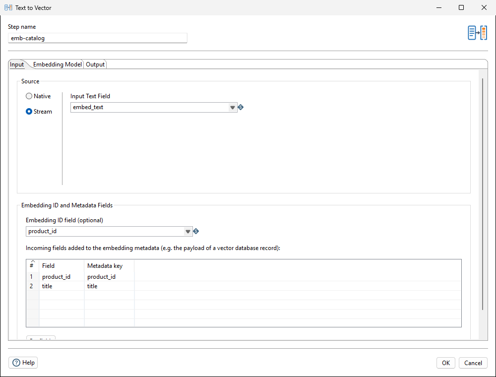
<figcaption>emb-catalog: the Input tab</figcaption>
</figure>
</div>

<div align="center">
<figure>
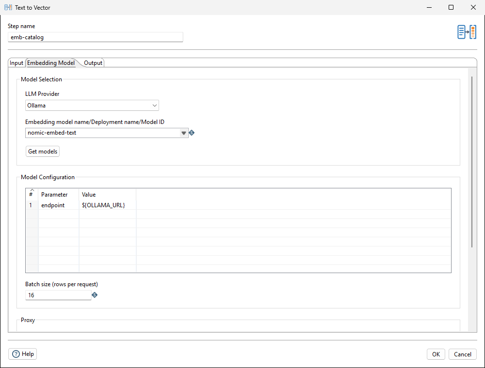
<figcaption>emb-catalog: the Model tab</figcaption>
</figure>
</div>

<div align="center">
<figure>
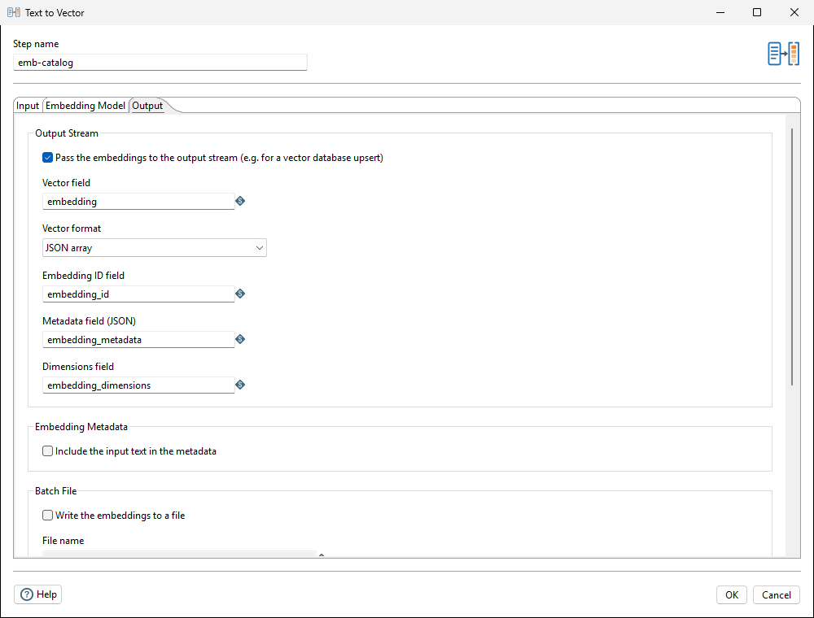
<figcaption>emb-catalog: the Output tab</figcaption>
</figure>
</div>

21. On the **Input** tab:
    * Under **Source**, keep **Stream** and set **Input Text Field** to `embed_text`.
    * Set **Embedding ID field (optional)** to `product_id`.
    * Fill the metadata grid under **Incoming fields added to the embedding metadata**:

| Field | Metadata key |
| --- | --- |
| `product_id` | `product_id` |
| `title` | `title` |

22. On the **Embedding Model** tab, set **LLM Provider** to `Ollama` and **Embedding model name/Deployment name/Model ID** to `nomic-embed-text`. In the **Model Configuration** grid, keep one row: **Parameter** `endpoint`, **Value** `${OLLAMA_URL}`. Keep **Batch size (rows per request)** `16`.
23. On the **Output** tab, keep the defaults: **Pass the embeddings to the output stream** selected, the field names `embedding`, `embedding_id`, `embedding_metadata` and `embedding_dimensions`, **Vector format** `JSON array`, and **Include the input text in the metadata** cleared. Select **OK**.
24. On the **Design** tab, open the **AI** folder and drag **Vector Writer** onto the canvas.
25. Create a hop from **emb-catalog** to **Vector Writer**.
26. Double-click **Vector Writer** and set **Step name** to `vw-catalog`.

<div align="center">
<figure>

<figcaption>vw-catalog: the Connection tab</figcaption>
</figure>
</div>

<div align="center">
<figure>
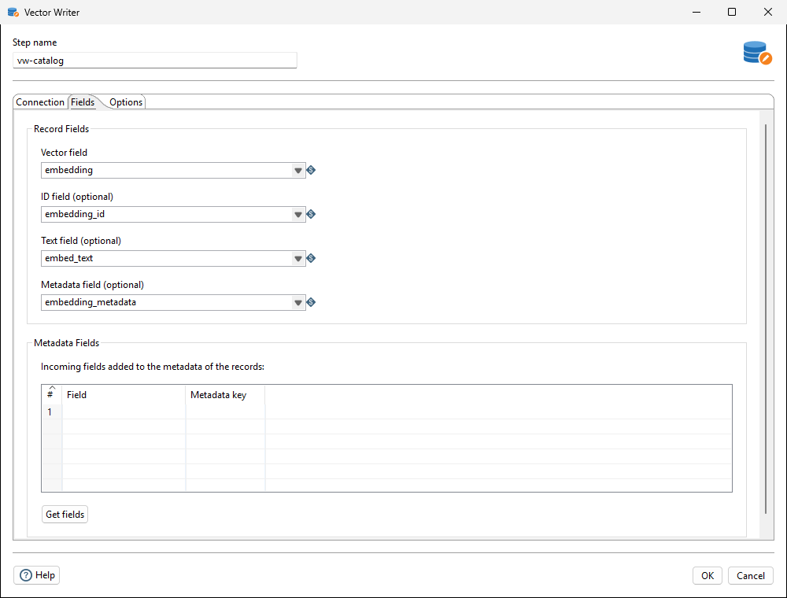
<figcaption>vw-catalog: the Fields tab</figcaption>
</figure>
</div>

<div align="center">
<figure>
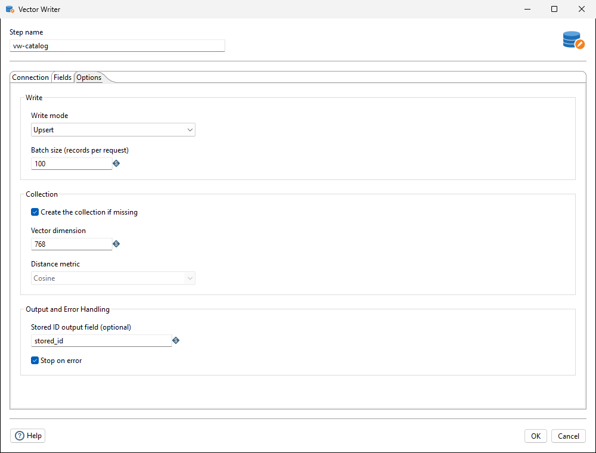
<figcaption>vw-catalog: the Options tab</figcaption>
</figure>
</div>

27. On the **Connection** tab, keep **Vector database** `PGVector`, set **Collection / index / table** to `catalog_items`, and fill the **Connection Parameters** grid: **Host** `${PG_HOST}`, **Port** `${PG_PORT}`, **Database** `${PG_DATABASE}`, **Username** `${PG_USER}`, **Password** `${PG_PASSWORD}`, and **Schema** empty.
28. On the **Fields** tab, set **Vector field** to `embedding`, **ID field (optional)** to `embedding_id`, **Text field (optional)** to `embed_text` and **Metadata field (optional)** to `embedding_metadata`. Leave the **Metadata fields** grid empty.
29. On the **Options** tab, keep **Write mode** `Upsert`, **Batch size (records per request)** `100` and **Create the collection if missing** selected. Set **Vector dimension** to `768` and **Stored ID output field (optional)** to `stored_id`. Keep **Stop on error** selected. Select **OK**.
30. On the **Design** tab, open the **Transform** folder and drag **Select values** onto the canvas, and create a hop from **vw-catalog** to it.
31. Double-click **Select values**, set **Step name** to `sv-load-log`, and on the **Select & Alter** tab list these fields in this order: `product_id`, `stored_id`, `embedding_dimensions`. Select **OK**.
32. On the **Design** tab, open the **Output** folder and drag **Text file output** onto the canvas, and create a hop from **sv-load-log** to it.
33. Double-click **Text file output** and set **Step name** to `txt-load-log`. On the **File** tab, set **Filename** to `${Internal.Entry.Current.Directory}/catalog_load_log`, **Extension** to `csv`, and select **Create Parent folder**. On the **Content** tab, set **Encoding** to `UTF-8`. On the **Fields** tab, select **Get Fields**, then **Minimal width**. Select **OK**.
34. Save the transformation (`Ctrl+S`), press `F9` (**Action > Run**), and select **Run** in the **Run Options** dialog. Open the **Step Metrics** tab of **Execution Results**.

> **Success:** Checkpoint: every step finishes without errors, and every step from **csvi-catalog** to **txt-load-log** shows 40 under **Written**. On the course's test machine the run took about 7 seconds, most of it **emb-catalog**.

35. In PowerShell, count the rows and look for titles that are exactly equal:

```powershell
podman exec pcm-pgvector psql -U genai -d genai -c "select count(*) from catalog_items"
podman exec pcm-pgvector psql -U genai -d genai -c "select lower(metadata->>'title') as title, count(*) from catalog_items group by 1 having count(*) > 1"
```

> **Success:** Checkpoint: the count is `40`, and the second query returns `(0 rows)`: not one duplicate has a title equal to another's, even in lower case. Run the transformation again and count once more: still `40`.

The table now holds what the next transformation searches: one row per product, with its vector and its metadata.

> **Under the hood:**
>
> #### The product ID makes the load repeatable
>
> **Text to Vector** copies `product_id` into `embedding_id`. **Vector Writer** turns an ID that is not a UUID into a name-based UUID, the same UUID for the same ID on every run, and writes with an upsert, so loading the catalog again overwrites each product in place instead of adding a second copy. The table `catalog_items` has four columns: `embedding_id`, `embedding` (a `vector(768)`), `text` (the `embed_text`) and `metadata`, a JSON object with `product_id` and `title` from the grid, plus the model's name and the time.
>
> **Why it matters:** a catalog changes every day. A load you can re-run safely is one you can schedule; a load without IDs doubles the table on every run, and then every product looks like its own duplicate.

### 3. Search for Look-alikes

> **Note:**
>
> #### Text to Vector and Vector Search, One Row per Match
>
> The second transformation embeds every product again and asks **Vector Search** for its closest products in `catalog_items`. A product is always its own closest match, so ask for three: itself and two look-alikes.

1. With `index_catalog.ktr` open, select **File > Save as** and save it as `find_duplicates.ktr` in the same folder.
2. Select **vw-catalog**, **sv-load-log** and **txt-load-log** on the canvas (hold `Ctrl` and select each one), and press `Delete`.
3. Double-click an empty part of the canvas, open the **Parameters** tab, and add these rows to the grid:

| Parameter | Default Value | Description |
| --- | --- | --- |
| `MODEL_NAME` | `llama3.2:3b` | Ollama chat model |
| `TOP_K` | `3` | Matches per product, the product itself included |
| `MIN_SCORE` | `0.9` | Lowest score Vector Search returns, 0 to 1 ((1 + cosine similarity) / 2) |
| `DUP_THRESHOLD` | `0.93` | Lowest score a pair needs to be checked as a duplicate |

4. Select **OK**.
5. Double-click **emb-catalog**. On the **Input** tab, clear **Embedding ID field (optional)** and delete the two rows of the metadata grid: a search vector needs neither. Select **OK**.
6. On the **Design** tab, open the **AI** folder and drag **Vector Search** onto the canvas.
7. Create a hop from **emb-catalog** to **Vector Search**.
8. Double-click **Vector Search** and set **Step name** to `vs-similar`.
9. On the **Connection** tab, keep **Vector database** `PGVector`, set **Collection / index / table** to `catalog_items`, and fill the **Connection Parameters** grid as in **vw-catalog**: **Host** `${PG_HOST}`, **Port** `${PG_PORT}`, **Database** `${PG_DATABASE}`, **Username** `${PG_USER}`, **Password** `${PG_PASSWORD}`, and **Schema** empty.
10. On the **Search** tab, set **Query vector field** to `embedding`, **Max results** to `${TOP_K}`, **Min score (0 to 1)** to `${MIN_SCORE}` and **Vector dimension (optional)** to `768`. Leave the **Metadata Filter** grid empty.
11. On the **Output** tab, keep **Output mode** `One row per match`, **Keep the rows without match** and **Stop on error** selected, and the match field names `match_rank`, `match_score`, `match_id`, `match_text` and `match_metadata`. Fill the **Metadata output fields** grid:

| Metadata key | Output field | Type |
| --- | --- | --- |
| `product_id` | `match_product_id` | String |
| `title` | `match_title` | String |

<div align="center">
<figure>
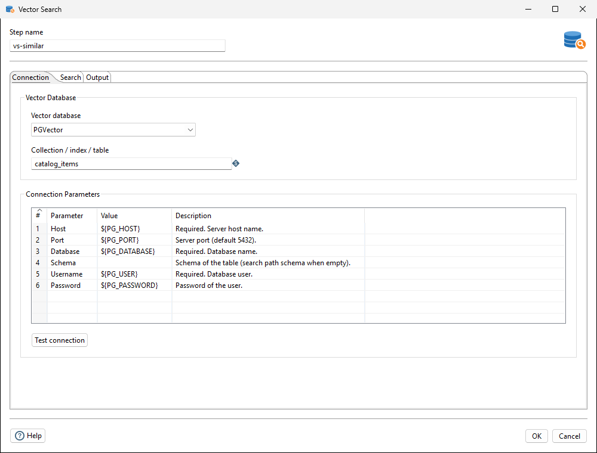
<figcaption>vs-similar: the Connection tab</figcaption>
</figure>
</div>

<div align="center">
<figure>
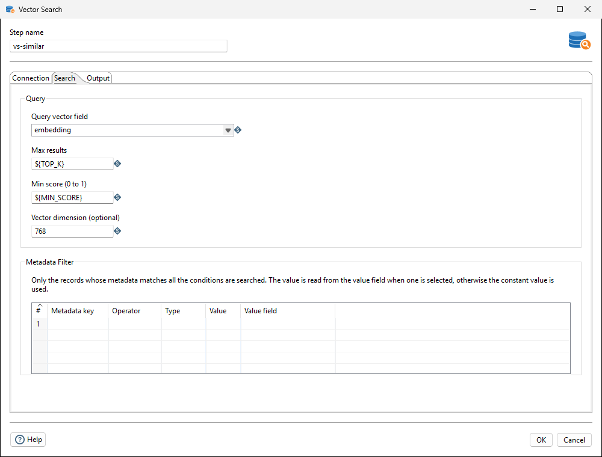
<figcaption>vs-similar: the Search tab</figcaption>
</figure>
</div>

<div align="center">
<figure>
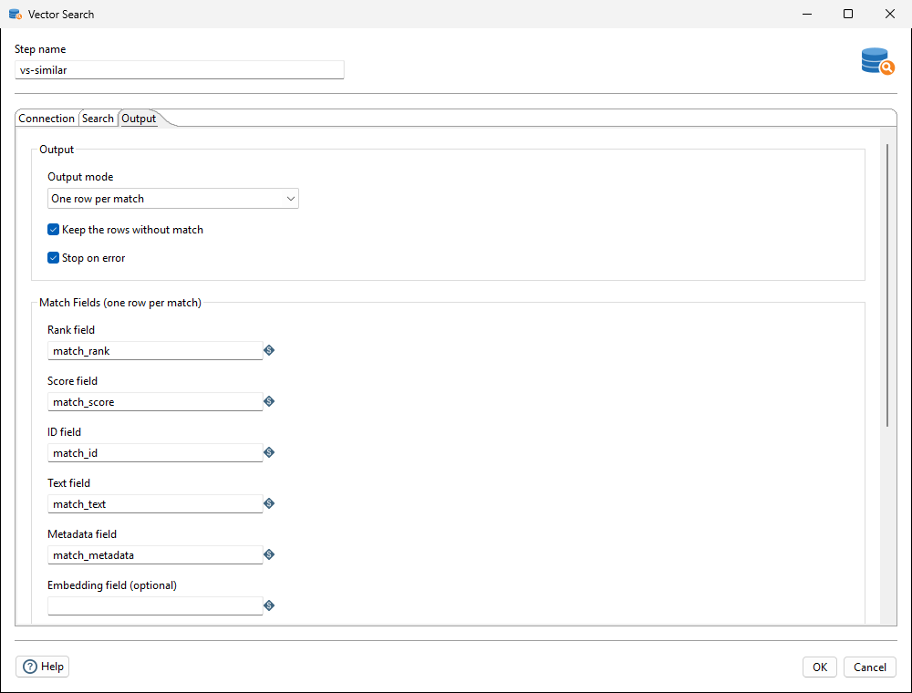
<figcaption>vs-similar: the Output tab</figcaption>
</figure>
</div>

12. Select **OK**, and save the transformation (`Ctrl+S`).
13. Select **vs-similar** on the canvas, press `F10` (**Action > Preview**), and select **Quick Launch**.

> **Success:** Checkpoint: the preview's first rows are `FM-1001` with `match_rank` `1`, `match_product_id` `FM-1001` and a `match_score` of `1.0` or a hair under: the jacket found itself. Products that have a look-alike show more rows; the course's test run wrote 74 rows for the 40 products, 40 self-matches and 34 look-alikes scoring 0.9 or more.

14. Select **Close**.

> **Under the hood:**
>
> #### Vector Search compares every product with the whole catalog in SQL
>
> For each row, **Vector Search** on PGVector runs one query: `SELECT (2 - (embedding <=> q)) / 2 AS score, ... FROM catalog_items WHERE (embedding <=> q) <= 2 - 2 * min_score ORDER BY embedding <=> q LIMIT top_k`, with the product's vector in place of `q`. `<=>` is pgvector's cosine distance, so the score is `(1 + cosine similarity) / 2`, and a product compared with itself scores 1. With 40 products, that is 40 queries, each over 40 rows: a self-join of the catalog, written for you. `match_text` is the `text` column, the `embed_text` of the match; the metadata output fields lift `product_id` and `title` out of its metadata JSON.
>
> **Why it matters:** with an index (Build the Knowledge Base shows how to add one), the same query finds look-alikes among millions of products, where comparing every pair of rows by hand would not finish.

### 4. One Row per Pair

> **Note:**
>
> #### Modified JavaScript Value, Filter Rows and Sort Rows
>
> Each row is now a product and one of its matches. Drop the match with itself, keep the pairs that score at least `DUP_THRESHOLD`, and keep each pair once: `FM-1005` finds `FM-1031`, and `FM-1031` finds `FM-1005`.

1. On the **Design** tab, open the **Scripting** folder and drag **Modified JavaScript value** onto the canvas, and create a hop from **vs-similar** to it.
2. Double-click it and set **Step name** to `js-pair`.
3. Replace the text in the script pane with this script:

```javascript
// one row per match: drop the product's match with itself, put the pair in a fixed order,
// and build the prompt that shows the model both records
var threshold = parseFloat(getVariable("DUP_THRESHOLD", "0.93"));
var is_pair = "N";
var product_a = null, product_b = null, title_a = null, title_b = null, prompt = null;
if (match_product_id != null && String(match_product_id) != String(product_id) && match_score >= threshold) {
  is_pair = "Y";
  var me = String(product_id), other = String(match_product_id);
  var mine = String(embed_text), theirs = String(match_text);
  if (me < other) {
    product_a = me; title_a = String(title); product_b = other; title_b = String(match_title);
    prompt = "Record A: " + mine + "\nRecord B: " + theirs;
  } else {
    product_a = other; title_a = String(match_title); product_b = me; title_b = String(title);
    prompt = "Record A: " + theirs + "\nRecord B: " + mine;
  }
}
```

4. Fill the **Fields** grid at the bottom, every row with **Replace value 'Fieldname' or 'Rename to'** `N`:

| Fieldname | Type |
| --- | --- |
| `is_pair` | String |
| `product_a` | String |
| `product_b` | String |
| `title_a` | String |
| `title_b` | String |
| `prompt` | String |

5. Select **OK**.
6. On the **Design** tab, open the **Flow** folder and drag **Filter rows** onto the canvas, and create a hop from **js-pair** to it.
7. Double-click **Filter rows** and set **Step name** to `flt-pairs`. In **The condition**, select the field `is_pair`, the function `=`, and as the value type `Y` with the type `String`. Leave **Send 'true' data to step** and **Send 'false' data to step** for now. Select **OK**.
8. On the **Design** tab, open the **Transform** folder and drag **Sort rows** onto the canvas, and create a hop from **flt-pairs** to it. When a menu asks which kind of hop, select **Result is TRUE**.
9. Double-click **Sort rows** and set **Step name** to `srt-pairs`. Fill the **Fields** grid with `product_a` and `product_b`, both **Ascending** `Y`, and select **Only pass unique rows? (verifies keys only)**. Select **OK**.
10. Double-click **flt-pairs** and check that **Send 'true' data to step** is `srt-pairs` and **Send 'false' data to step** is empty: rows that are not pairs are dropped. Select **OK**, and save the transformation (`Ctrl+S`).
11. Select **srt-pairs**, press `F10`, and select **Quick Launch**.

> **Success:** Checkpoint: 14 rows, each pair once, ordered by `product_a`, from `FM-1003` / `FM-1004` to `FM-1025` / `FM-1033`. Before **srt-pairs** there were 28: every pair was found from both sides.

12. Select **Close**.

> **Under the hood:**
>
> #### Ordering the pair turns A-B and B-A into the same key
>
> Cosine similarity is symmetric: the score of `FM-1005` against `FM-1031` is the score of `FM-1031` against `FM-1005`, so each pair arrives twice. The script writes the smaller ID first, so both copies get the same `product_a` and `product_b`, and **Only pass unique rows?** keeps the first of them. `getVariable` reads the `DUP_THRESHOLD` parameter, which **Filter rows** could not, because a **Filter rows** value is a constant. The prompt carries both products' full `embed_text`, title, brand, category and description, from the row and from `match_text`.
>
> **Why it matters:** with one row per pair, each pair costs one model call in the next tab, and the list a person reviews has no repeats.

### 5. Choose the Threshold

> **Note:**
>
> #### Read the Scores Before You Pick a Number
>
> A threshold is not a constant of nature. It depends on the embedding model and on how the text is built, so choose it from the scores of your own run.

These are the scores the course's test run measured for the 15 highest-scoring pairs, with the answer key. (Two more pairs score between 0.9 and 0.92, the women's shoe and the second shoe listing, and the leggings and the second top listing; both are look-alikes.)

| Pair | `match_score` | Same product? |
| --- | --- | --- |
| `FM-1005` / `FM-1006` | 0.98964 | No: 750 ml and 500 ml |
| `FM-1011` / `FM-1022` | 0.98826 | Yes |
| `FM-1011` / `FM-1012` | 0.97792 | No: 3-person and 2-person |
| `FM-1008` / `FM-1036` | 0.97639 | Yes |
| `FM-1003` / `FM-1027` | 0.97527 | Yes |
| `FM-1012` / `FM-1022` | 0.97484 | No: 2-person and 3-person |
| `FM-1005` / `FM-1031` | 0.97247 | Yes |
| `FM-1014` / `FM-1039` | 0.97232 | Yes |
| `FM-1017` / `FM-1025` | 0.96590 | Yes |
| `FM-1006` / `FM-1031` | 0.96421 | No: 500 ml and 750 ml |
| `FM-1025` / `FM-1033` | 0.94047 | Yes |
| `FM-1017` / `FM-1033` | 0.93863 | Yes |
| `FM-1008` / `FM-1009` | 0.93727 | No: a top and leggings |
| `FM-1003` / `FM-1004` | 0.93426 | No: men's and women's |
| `FM-1007` / `FM-1013` | 0.92940 | No: a 40 L backpack and a 20 L daypack |

Read the table from the top. The highest score of all, 0.98964, is two *different* bottles. The lowest true duplicates are the trekking poles listed in capitals with the description `SEE TITLE` (`FM-1033`), at 0.93863 and 0.94047. There is no line where the duplicates stop and the look-alikes begin.

So the threshold has a different job. It decides which pairs are worth a closer look: set it just below the lowest duplicate you have seen, 0.93, and every duplicate goes on to the check in the next tab, with the look-alikes above it. Below 0.93 the next pair is two different backpacks.

> **Under the hood:**
>
> #### An embedding measures how alike two texts are, not whether they are the same thing
>
> `nomic-embed-text` places `750 ml` and `500 ml` close together because the rest of the two records is nearly the same, word for word; a typo or a new word order moves the vector very little too. Similarity is what makes the search find `Botle` and `HB200`; it is also why a different size scores higher than a typo. A bare description such as `SEE TITLE` pulls a product away from its twins, which is why `FM-1033` scores lowest.
>
> **Why it matters:** a threshold alone would either merge different products or miss duplicates. Use the vector search to narrow 780 possible pairs down to a short list, and a check that can read to decide.

### 6. Ask the Model: Same Product?

> **Note:**
>
> #### Add Constants, AI Chat, JSON Input, Select Values and Text File Output
>
> Show the model both records of each pair, with a rule for what counts as the same product, and write its verdict and reason beside the score.

1. On the **Design** tab, open the **Transform** folder and drag **Add constants** onto the canvas, and create a hop from **srt-pairs** to it.
2. Double-click **Add constants** and set **Step name** to `const-instruction`. In the **Fields** grid, add one row: **Name** `run_instruction`, **Type** `String`, and in **Value** this text:

```text
You compare two product records from the Fernmoor Outdoor Co. catalog and decide whether they are the same product listed twice.
Each record is: title | brand | category | description.
The same product: the same brand, model, size, capacity and version, even when the title is worded differently, has typos or other capitals, or writes the SKU another way.
A different product: any difference in size, capacity, volume, number of people, gender, garment type or model, even when everything else matches.
Use only the two records. Answer with one JSON object and nothing else, in exactly this shape:
{"same_product": true or false, "reason": "one short sentence that names the difference or why they match"}
```

3. Select **OK**.
4. On the **Design** tab, open the **AI** folder and drag **AI Chat** onto the canvas, and create a hop from **const-instruction** to it.
5. Double-click **AI Chat** and set **Step name** to `ai-same`.

<div align="center">
<figure>
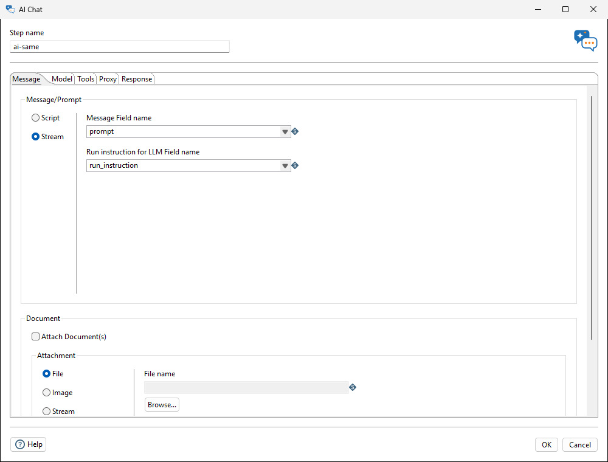
<figcaption>ai-same: the Message tab</figcaption>
</figure>
</div>

<div align="center">
<figure>
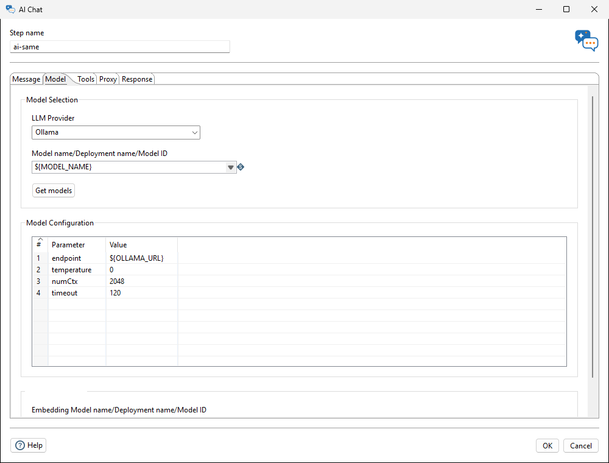
<figcaption>ai-same: the Model tab</figcaption>
</figure>
</div>

<div align="center">
<figure>
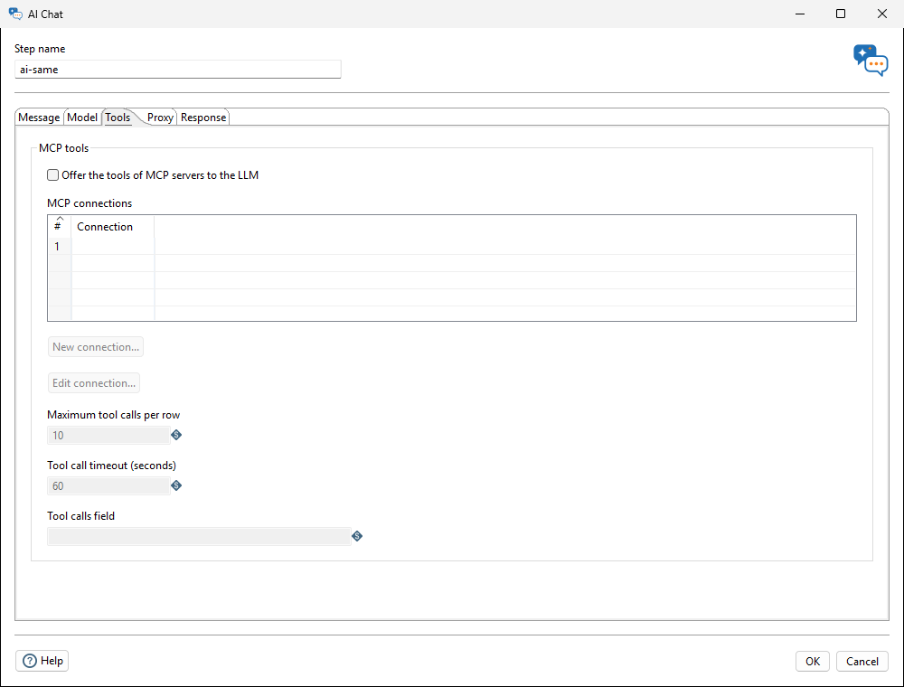
<figcaption>ai-same: the Tools tab</figcaption>
</figure>
</div>

<div align="center">
<figure>
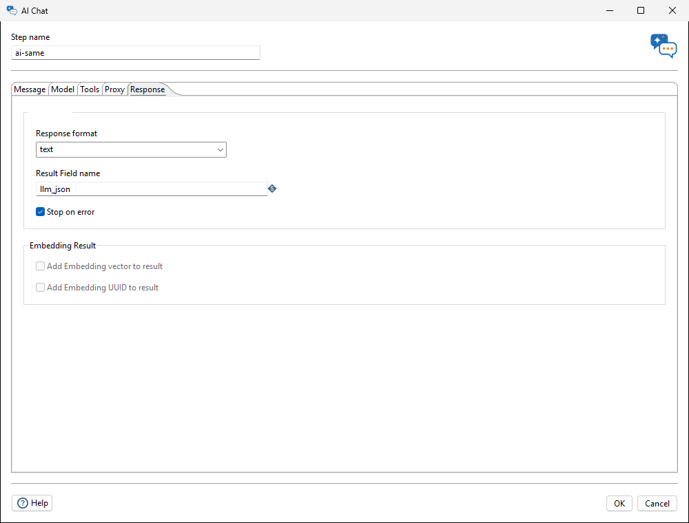
<figcaption>ai-same: the Response tab</figcaption>
</figure>
</div>

6. On the **Message** tab, under **Message/Prompt**, select **Stream**. Set **Message Field name** to `prompt` and **Run instruction for LLM Field name** to `run_instruction`. Keep **Attach Document(s)** cleared.
7. On the **Model** tab, set **LLM Provider** to `Ollama` and **Model name** to `${MODEL_NAME}`. Fill the **Model Configuration** grid, and delete any row that is not in this table:

| Parameter | Value |
| --- | --- |
| `endpoint` | `${OLLAMA_URL}` |
| `temperature` | `0` |
| `numCtx` | `2048` |
| `timeout` | `120` |

8. On the **Response** tab, keep **Response format** `text`, set **Result Field name** to `llm_json`, and keep **Stop on error** selected. Select **OK**.
9. On the **Design** tab, open the **Input** folder and drag **JSON input** onto the canvas, and create a hop from **ai-same** to it.
10. Double-click **JSON input** and set **Step name** to `json-same`. On the **File** tab, select **Source is from a previous step** and set **Select field** to `llm_json`. On the **Content** tab, make sure **Ignore missing path** and **Default path leaf to null** are selected. On the **Fields** tab, fill the grid:

| Name | Path | Type |
| --- | --- | --- |
| `same_product` | `$.same_product` | String |
| `reason` | `$.reason` | String |

11. Select **OK**.
12. On the **Design** tab, open the **Transform** folder and drag **Select values** onto the canvas, and create a hop from **json-same** to it.
13. Double-click **Select values**, set **Step name** to `sv-pairs`, and on the **Select & Alter** tab list these fields in this order: `product_a`, `product_b`, `title_a`, `title_b`, `match_score`, `same_product`, `reason`. Select **OK**.
14. On the **Design** tab, open the **Output** folder and drag **Text file output** onto the canvas, and create a hop from **sv-pairs** to it.
15. Double-click **Text file output** and set **Step name** to `txt-pairs`. On the **File** tab, set **Filename** to `${Internal.Entry.Current.Directory}/duplicate_candidates`, **Extension** to `csv`, and select **Create Parent folder**. On the **Content** tab, keep **Separator** `,`, **Enclosure** `"` and **Header** selected, and set **Encoding** to `UTF-8`. On the **Fields** tab, select **Get Fields**, then **Minimal width**. Select **OK**, and save the transformation (`Ctrl+S`).

> **Under the hood:**
>
> #### The model reads what the vector blurs
>
> The vector of a record is one point; the difference between `750 ml` and `500 ml` is a few characters of it. The model reads both records as text, and the instruction tells it which differences make a different product. That is the same rule a person merging the catalog would apply, written down once. `temperature` `0` makes the verdict repeatable: two runs on the course's test machine wrote the same file byte for byte. Two short records, the instruction and the answer fit in `numCtx` `2048` with room to spare.
>
> **Why it matters:** the search keeps the model's work small, 14 calls instead of 780, and the model keeps the search honest. Neither is enough alone.

### 7. Catch the Answers the Parser Cannot Read

> **Note:**
>
> #### Error Handling on JSON Input
>
> A small model sometimes closes a JSON answer with the wrong bracket. An error hop sends such a row to a file of its own, with the parser's message, and the other pairs carry on.

1. On the **Design** tab, open the **Output** folder and drag **Text file output** onto the canvas, below **json-same**.
2. Double-click it and set **Step name** to `txt-bad-answers`. On the **File** tab, set **Filename** to `${Internal.Entry.Current.Directory}/bad_pair_answers` and **Extension** to `csv`. Select **OK**.
3. Create a hop from **json-same** to **txt-bad-answers**, and select **Error handling of step** in the menu that opens. The hop is drawn red, with a red error icon.
4. Right-click **json-same** and select **Error Handling...**. In **Step error handling settings**, enter these settings, then select **OK**:

| Setting | Value |
| --- | --- |
| **Target step** | `txt-bad-answers` |
| **Enable the error handling?** | Selected |
| **Nr of errors fieldname** | `err_count` |
| **Error descriptions fieldname** | `err_desc` |

5. Double-click **txt-bad-answers**. On the **Fields** tab, select **Get Fields**, then **Minimal width**, and delete every row except `product_a`, `product_b`, `llm_json` and `err_desc`. Select **OK**, and save the transformation (`Ctrl+S`).

> **Under the hood:**
>
> #### A row the step cannot process leaves by the error hop instead of stopping the run
>
> Without error handling, the first unparsable answer fails **json-same** and stops the transformation, so the pairs behind it are never written. With it, **JSON input** adds the parser's message to the row as `err_desc` and sends that row down the red hop. The step's **Errors** count in **Step Metrics** shows how many rows went that way.
>
> **Why it matters:** this is how a production pipeline treats a model: most answers are good, some are not, and the bad ones are kept with their reason so a person, or a rerun with a stronger model, can deal with them.

### 8. Run and Compare with the Key

> **Note:**
>
> #### Run find_duplicates
>
> One embedding request per product, one search per product, and one model call per pair. On the course's test machine, with a GPU, the 14 model calls took about 16 seconds; on a CPU-only machine allow a few minutes.

1. Press `F9` (**Action > Run**), and select **Run** in the **Run Options** dialog.
2. In **Execution Results**, open the **Step Metrics** tab.

> **Success:** Checkpoint: every step finishes without errors. **csvi-catalog**, **js-embed-text** and **emb-catalog** write 40 rows; **vs-similar** and **js-pair** write 74; **flt-pairs** writes 28; **srt-pairs** and every step after it write 14. **json-same** shows 0 under **Errors**.

3. Open `C:\Workshop-AI-Specialty\05-retrieval-augmented-generation\30-catalog-duplicates\duplicate_candidates.csv`.

> **Success:** Checkpoint: the header `product_a,product_b,title_a,title_b,match_score,same_product,reason` and 14 rows. In the course's test run with `llama3.2:3b`, `same_product` was `true` for exactly the 8 pairs the key calls duplicates (the shoes, the 750 ml bottles, the base layer tops, the 3-person tents, the hydration bladders, and the three pairs of the three trekking pole listings) and `false` for the 6 look-alikes, with reasons such as `different capacity`, `different number of people` and `different garment type`. `bad_pair_answers.csv` holds only its header.

Read the `reason` column too. For `FM-1003` / `FM-1027` the test run's verdict was `true`, the right answer, with the reason `different product due to different model numbers`, which says the opposite. A 3-billion-parameter model's verdict is more reliable than its explanation.

4. Press `F9` again. In the **Run Options** dialog, on the **Parameters** tab, set the **Value** of `MODEL_NAME` to `qwen2.5:7b` (pull it first with `ollama pull qwen2.5:7b`), and select **Run**.

> **Success:** Checkpoint: the same 14 pairs and, in the course's test run, the same 14 verdicts, with reasons that match them, such as `Title and description match, only capitalization differs` for `FM-1017` / `FM-1033`. The run took about a minute longer.

5. Press `F9` again. Set `MODEL_NAME` back to `llama3.2:3b` and `DUP_THRESHOLD` to `0.95`, and select **Run**.

> **Success:** Checkpoint: **flt-pairs** writes 20 rows and `duplicate_candidates.csv` has 10 pairs. The two pairs of `FM-1033`, the listing in capitals, are gone: a duplicate the model never sees cannot be found. The four look-alikes that score above 0.95, the bottles and the tents, are still there.

6. Press `F9` once more, set `DUP_THRESHOLD` back to `0.93`, and select **Run**, so that `duplicate_candidates.csv` holds the full list again.

> **Under the hood:**
>
> #### Two dials: the threshold sets recall, the model sets precision
>
> Raising `DUP_THRESHOLD` makes the list shorter by dropping the lowest scores, and the lowest scores here were true duplicates, so it lost two of them while the look-alikes that score highest stayed. The model's check is what removes the look-alikes. Keep the threshold low enough that no duplicate is lost, and let the check decide.
>
> **Why it matters:** in a real catalog, merging two different products is worse than missing a duplicate. `duplicate_candidates.csv` is a review list for a person, sorted and explained, not a set of merges to apply blindly.

### 9. Find the Weak Descriptions

> **Note:**
>
> #### CSV File Input, Modified JavaScript Value and Filter Rows
>
> The third transformation finds the descriptions a customer cannot use. That needs no model: a rule decides, and only the rows it marks go on to the model.

1. Select **File > New > Transformation** (`Ctrl+N`), and save it as `enrich_descriptions.ktr` in the same folder.
2. Double-click an empty part of the canvas, open the **Parameters** tab, and fill the grid:

| Parameter | Default Value | Description |
| --- | --- | --- |
| `MODEL_NAME` | `llama3.2:3b` | Ollama chat model |
| `OLLAMA_URL` | `http://localhost:11434` | Ollama server |

3. Select **OK**.
4. In `index_catalog.ktr`, right-click **csvi-catalog** and select **Copy**; back in `enrich_descriptions.ktr`, right-click the canvas and select **Paste**. The pasted step keeps its name and its **Fields** grid.
5. On the **Design** tab, open the **Scripting** folder and drag **Modified JavaScript value** onto the canvas, and create a hop from **csvi-catalog** to it.
6. Double-click it and set **Step name** to `js-quality`. Replace the text in the script pane with this script:

```javascript
// the house rule for a description that needs rewriting
var d = (description == null) ? "" : String(description).trim();
var quality_issue = null;
if (d.length == 0) {
  quality_issue = "empty";
} else if (d.length < 25) {
  quality_issue = "too short";
} else if (d == d.toUpperCase()) {
  quality_issue = "all caps";
}
```

7. Fill the **Fields** grid with one row: **Fieldname** `quality_issue`, **Type** `String`, **Replace value 'Fieldname' or 'Rename to'** `N`. Select **OK**.
8. On the **Design** tab, open the **Flow** folder and drag **Filter rows** onto the canvas, and create a hop from **js-quality** to it.
9. Double-click **Filter rows** and set **Step name** to `flt-weak`. In **The condition**, select the field `quality_issue` and the function `IS NOT NULL`. Select **OK**, and save the transformation (`Ctrl+S`).
10. Select **flt-weak**, press `F10`, and select **Quick Launch**.

> **Success:** Checkpoint: 9 rows: `FM-1002` and `FM-1040` `empty`; `FM-1010`, `FM-1019`, `FM-1024`, `FM-1029` and `FM-1033` `too short` (`Stove.`, `see title`, `N/A`, `Warm.`, `SEE TITLE`); `FM-1015` and `FM-1037` `all caps`.

11. Select **Close**.

> **Under the hood:**
>
> #### A rule where a rule is enough
>
> Length and capitals are facts a script can test exactly, for free, on every row. `quality_issue` also says *why* a row was picked, which goes into the output for the person who reviews it. A model call per product to ask "is this description good?" would cost 40 calls for the 9 this rule finds.
>
> **Why it matters:** use the model for what needs language, writing the new text, and plain steps for everything that does not. The pipeline is faster, cheaper and easier to test.

### 10. Write Descriptions from the Facts

> **Note:**
>
> #### Modified JavaScript Value, Add Constants, AI Chat and JSON Input
>
> The model may use only what the catalog knows about the product: its title, brand, category and price. The old description is not sent; it is the problem.

1. On the **Design** tab, open the **Scripting** folder and drag **Modified JavaScript value** onto the canvas, and create a hop from **flt-weak** to it. When a menu asks which kind of hop, select **Result is TRUE**.
2. Double-click it and set **Step name** to `js-prompt`. Replace the text in the script pane with this script:

```javascript
// the only facts the model may use
var prompt = "Title: " + title + "\nBrand: " + brand + "\nCategory: " + category + "\nPrice: " + price + " USD";
```

3. Fill the **Fields** grid with one row: **Fieldname** `prompt`, **Type** `String`, **Replace value 'Fieldname' or 'Rename to'** `N`. Select **OK**.
4. Double-click **flt-weak** and check that **Send 'true' data to step** is `js-prompt` and **Send 'false' data to step** is empty. Select **OK**.
5. On the **Design** tab, open the **Transform** folder and drag **Add constants** onto the canvas, and create a hop from **js-prompt** to it.
6. Double-click **Add constants** and set **Step name** to `const-instruction`. In the **Fields** grid, add one row: **Name** `run_instruction`, **Type** `String`, and in **Value** this text:

```text
You write product descriptions for the Fernmoor Outdoor Co. online catalog.
Use only the facts in the record: the title, brand, category and price. Do not add materials, weights, sizes, ratings, features or numbers that are not in the record.
Write two sentences in plain American English, in normal sentence case with the product name capitalized as in the title, and no exclamation marks. Do not mention the price or the store.
Answer with one JSON object and nothing else, in exactly this shape:
{"description": "the new description", "basis": "the facts from the record you used, separated by semicolons"}
```

7. Select **OK**.
8. On the **Design** tab, open the **AI** folder and drag **AI Chat** onto the canvas, and create a hop from **const-instruction** to it.
9. Double-click **AI Chat** and set **Step name** to `ai-describe`. Give it the same settings as **ai-same**: on the **Message** tab **Stream**, **Message Field name** `prompt` and **Run instruction for LLM Field name** `run_instruction`; on the **Model** tab **LLM Provider** `Ollama`, **Model name** `${MODEL_NAME}`, and the **Model Configuration** rows `endpoint` `${OLLAMA_URL}`, `temperature` `0`, `numCtx` `2048` and `timeout` `120`; on the **Response** tab **Result Field name** `llm_json`. Select **OK**.

<div align="center">
<figure>

<figcaption>ai-describe: the Message tab</figcaption>
</figure>
</div>

<div align="center">
<figure>
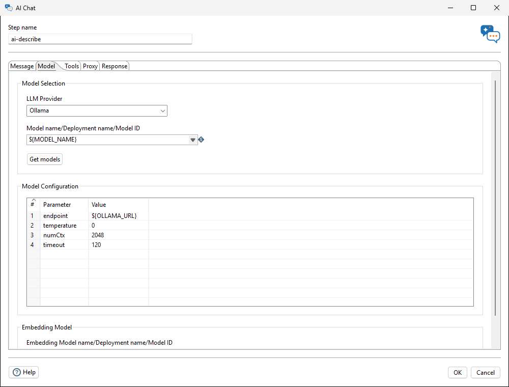
<figcaption>ai-describe: the Model tab</figcaption>
</figure>
</div>

<div align="center">
<figure>

<figcaption>ai-describe: the Tools tab</figcaption>
</figure>
</div>

<div align="center">
<figure>
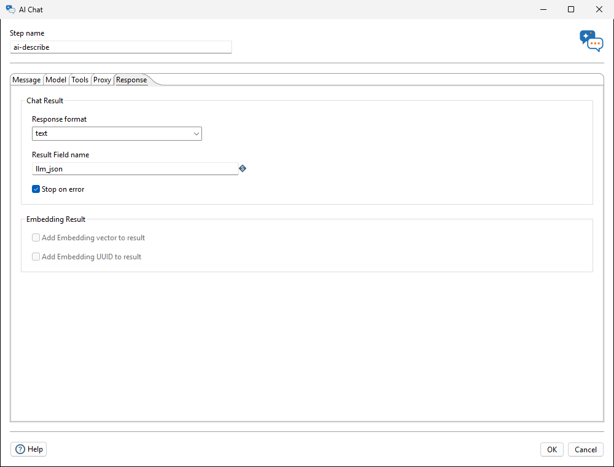
<figcaption>ai-describe: the Response tab</figcaption>
</figure>
</div>

10. On the **Design** tab, open the **Input** folder and drag **JSON input** onto the canvas, and create a hop from **ai-describe** to it.
11. Double-click **JSON input** and set **Step name** to `json-describe`. On the **File** tab, select **Source is from a previous step** and set **Select field** to `llm_json`. On the **Content** tab, make sure **Ignore missing path** and **Default path leaf to null** are selected. On the **Fields** tab, fill the grid:

| Name | Path | Type |
| --- | --- | --- |
| `new_description` | `$.description` | String |
| `basis` | `$.basis` | String |

12. Select **OK**.
13. Catch the answers the parser cannot read, as in the **Catch the Answers the Parser Cannot Read** tab: add a **Text file output** named `txt-bad-answers` below **json-describe**, with **Filename** `${Internal.Entry.Current.Directory}/bad_answers` and **Extension** `csv`; create a hop from **json-describe** to it and select **Error handling of step**; in **Error Handling...** of **json-describe**, set **Target step** `txt-bad-answers`, select **Enable the error handling?**, and set **Nr of errors fieldname** `err_count` and **Error descriptions fieldname** `err_desc`; in its **Fields** tab, select **Get Fields**, then **Minimal width**, and keep only `product_id`, `llm_json` and `err_desc`.
14. On the **Design** tab, open the **Scripting** folder and drag **Modified JavaScript value** onto the canvas, and create a hop from **json-describe** to it. When a menu asks which kind of hop, select **Main output of step**.
15. Double-click it and set **Step name** to `js-check-facts`. Replace the text in the script pane with this script:

```javascript
// a number in the new description that is not in the record is a fact the model invented
var facts = (title + " " + brand + " " + category + " " + price).toLowerCase();
var found = (new_description == null) ? null : String(new_description).match(/\d+(\.\d+)?/g);
var invented = [];
if (found != null) {
  for (var i = 0; i < found.length; i++) {
    if (facts.indexOf(found[i]) < 0 && invented.indexOf(found[i]) < 0) {
      invented.push(found[i]);
    }
  }
}
var unsupported_numbers = invented.join(" ");
```

16. Fill the **Fields** grid with one row: **Fieldname** `unsupported_numbers`, **Type** `String`, **Replace value 'Fieldname' or 'Rename to'** `N`. Select **OK**.
17. On the **Design** tab, open the **Transform** folder and drag **Select values** onto the canvas, and create a hop from **js-check-facts** to it. Double-click it, set **Step name** to `sv-enriched`, and on the **Select & Alter** tab list these fields in this order: `product_id`, `title`, `quality_issue`, `description`, `new_description`, `basis`, `unsupported_numbers`. Select **OK**.
18. On the **Design** tab, open the **Output** folder and drag **Text file output** onto the canvas, and create a hop from **sv-enriched** to it. Double-click it and set **Step name** to `txt-enriched`. On the **File** tab, set **Filename** to `${Internal.Entry.Current.Directory}/enriched_descriptions`, **Extension** to `csv`, and select **Create Parent folder**. On the **Content** tab, set **Encoding** to `UTF-8`. On the **Fields** tab, select **Get Fields**, then **Minimal width**. Select **OK**, and save the transformation (`Ctrl+S`).

> **Under the hood:**
>
> #### The model may use only the facts it is given, and a step checks the ones it can
>
> Asked to describe a product, a model writes what such products usually have: a weight, a fabric, a warranty. For a catalog that is worse than an empty description, because it is a promise the store did not make. The instruction lists the only facts allowed and names the kinds of facts it must not add, and `basis` asks the model to say which facts it used. **js-check-facts** then tests what can be tested exactly: every number in `new_description` must appear in the title, brand, category or price, so `10 L` in `Corrin Dry Bag 10 L` passes and an invented `450 g` would not.
>
> **Why it matters:** the check catches invented numbers, not invented adjectives. "Durable" or "waterproof" pass it. That is why the output keeps the old description, the rule that picked the row, and the model's basis side by side, for a person to approve before anything is published.

### 11. Run and Review

> **Note:**
>
> #### Run enrich_descriptions
>
> Nine model calls, one per weak description.

1. Press `F9` (**Action > Run**), and select **Run** in the **Run Options** dialog. Open the **Step Metrics** tab.

> **Success:** Checkpoint: every step finishes without errors. **csvi-catalog** and **js-quality** write 40 rows, **flt-weak** writes 9, and every step from **js-prompt** to **txt-enriched** writes 9. **json-describe** shows 0 under **Errors**. On the course's test machine **ai-describe** took about 6 seconds.

2. Open `C:\Workshop-AI-Specialty\05-retrieval-augmented-generation\30-catalog-duplicates\enriched_descriptions.csv`.

> **Success:** Checkpoint: the header `product_id,title,quality_issue,description,new_description,basis,unsupported_numbers` and 9 rows. In the course's test run with `llama3.2:3b`, every `new_description` was two sentences in sentence case, such as `The Corrin Dry Bag 10 L is a versatile accessory for outdoor activities. It provides a secure and dry space for your gear.`, every `basis` listed facts from the record, and `unsupported_numbers` was empty on all 9 rows. `bad_answers.csv` holds only its header. Your wording can differ.

3. Read the nine descriptions as the person who approves them would. In the test run, some added claims the record does not hold, which **js-check-facts** cannot see: `durable` for the paracord, `support and stability on various terrain` for the trekking poles, `warm and comfortable` for the beanie.
4. Press `F9` again, set `MODEL_NAME` to `qwen2.5:7b` on the **Parameters** tab, and select **Run**. Compare the new `enriched_descriptions.csv` with the first.

> **Success:** Checkpoint: 9 rows again, and no unsupported numbers. In the course's test run, `qwen2.5:7b` was more cautious and worse at the format: mostly one sentence instead of two, and for the beanie and the trekking poles the `new_description` was only the product's name, `kestwyn carbon trekking poles` in lower case. A larger model is not always the better choice for a task; compare them on your own rows.

Keep the model whose output needs the fewest corrections from the person who approves it.

> **Under the hood:**
>
> #### Write the first version of the instruction, then read the output
>
> The first instruction this workshop was tested with said "no capitals for emphasis". `llama3.2:3b` read that as no capitals at all and wrote every description in lower case. The instruction you used names what is wanted instead, "normal sentence case with the product name capitalized as in the title", and the next run was right on all nine. Small models follow the words of an instruction closely, including words that were meant as an example.
>
> **Why it matters:** an instruction is code. Change one sentence, run the nine rows again, and read every output; with `temperature` `0`, a difference in the output is the difference you made.

::::

## Troubleshooting <!-- no-step -->

<details>
<summary>Error initializing step: License validation failed</summary>

The Pentaho license on this machine has no GenAI rights. Every GenAI plugin step checks for a license with the GenAI Plugin Suite (GENAI-EE) subscription when the transformation starts. Install a license that includes it, as described in [Before You Start](../00-before-you-start/guide.md).

</details>

<details>
<summary>vs-similar fails with relation "catalog_items" does not exist</summary>

The catalog has not been loaded, or was loaded into another database. Run `index_catalog.ktr` with the same `PG_` parameters, then run `find_duplicates.ktr` again.

</details>

<details>
<summary>Every product matches only itself</summary>

`MIN_SCORE` is too high, or the products were embedded with another text than the one searched. Both transformations must build `embed_text` with the same script and embed it with `nomic-embed-text`. Run `find_duplicates.ktr` with `MIN_SCORE` `0` and preview **vs-similar** to see the real scores.

</details>

<details>
<summary>catalog_items has more than 40 rows</summary>

**emb-catalog** in `index_catalog.ktr` has no **Embedding ID field (optional)**, so each run added the products again under new random IDs. Set it to `product_id`, empty the table with `podman exec pcm-pgvector psql -U genai -d genai -c "drop table catalog_items"`, and run `index_catalog.ktr` once more.

</details>

<details>
<summary>Every pair appears twice in duplicate_candidates.csv</summary>

**srt-pairs** does not have **Only pass unique rows? (verifies keys only)** selected, or sorts on fields other than `product_a` and `product_b`.

</details>

<details>
<summary>The verdict or description fields are null on a row</summary>

The model's answer was not the JSON the instruction asked for. Preview **ai-same** or **ai-describe** and read `llm_json` for that row. A larger model, such as `qwen2.5:7b`, or an instruction that repeats "nothing else", usually fixes it.

</details>

## Lab Files

Click a file to download. For `.ktr` and `.kjb` files, **Open in Pentaho Data Integration** launches Pentaho Data Integration with the file loaded. If Pentaho Data Integration is already running, the path is copied to your clipboard — switch to Pentaho Data Integration and press `Ctrl+O`, `Ctrl+V`, `Enter`.

The 40 products of Fernmoor Outdoor Co., with their near-duplicates and weak descriptions:

[catalog.csv](./files/catalog.csv)

### Solution <!-- no-step -->

The finished transformations for this lab. Open them alongside your own to compare, or run them to see the expected result. All three read `catalog.csv` from the lab folder and write their files beside themselves. Run `index_catalog.ktr` first: the other two search the table it loads.

Also on disk at `C:\Workshop-AI-Specialty\05-retrieval-augmented-generation\30-catalog-duplicates\solution`.

`index_catalog.ktr` loads the 40 products into the pgvector table `catalog_items` and writes `catalog_load_log.csv`:

[index_catalog.ktr](./files/solution/index_catalog.ktr) <button data-launch="spoon" data-path="files/solution/index_catalog.ktr">Open in Pentaho Data Integration</button> <button data-graph="files/solution/index_catalog.ktr">View graph</button>

index_catalog in Spoon, with its note:

<div align="center">
<figure>
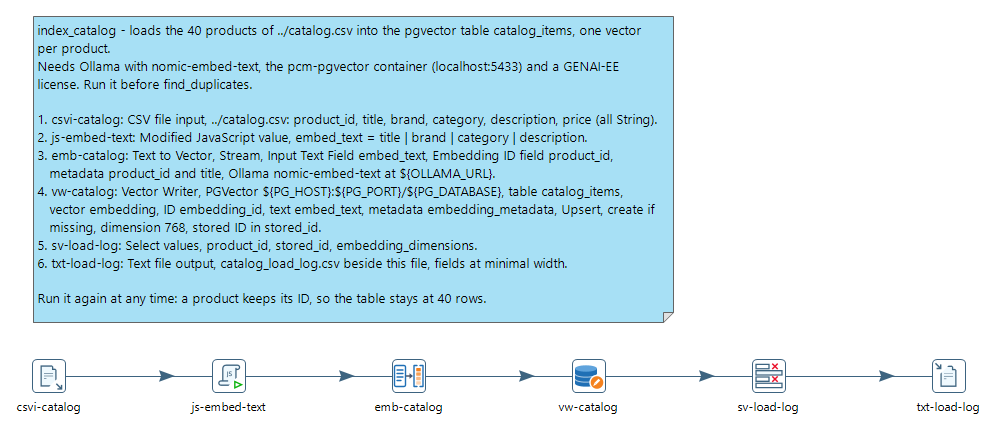
<figcaption>index_catalog.ktr in Spoon</figcaption>
</figure>
</div>

`find_duplicates.ktr` finds the near-duplicate pairs, has the model check each one, and writes `duplicate_candidates.csv`, and any answer the parser cannot read to `bad_pair_answers.csv`:

[find_duplicates.ktr](./files/solution/find_duplicates.ktr) <button data-launch="spoon" data-path="files/solution/find_duplicates.ktr">Open in Pentaho Data Integration</button> <button data-graph="files/solution/find_duplicates.ktr">View graph</button>

find_duplicates in Spoon, with its note:

<div align="center">
<figure>
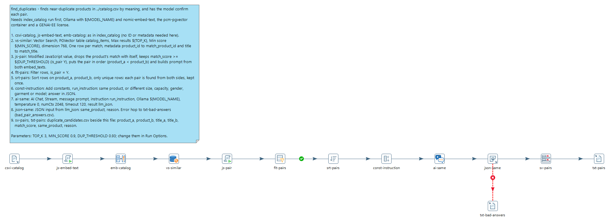
<figcaption>find_duplicates.ktr in Spoon</figcaption>
</figure>
</div>

`enrich_descriptions.ktr` rewrites the weak descriptions from the product's facts and writes `enriched_descriptions.csv`, and any answer the parser cannot read to `bad_answers.csv`:

[enrich_descriptions.ktr](./files/solution/enrich_descriptions.ktr) <button data-launch="spoon" data-path="files/solution/enrich_descriptions.ktr">Open in Pentaho Data Integration</button> <button data-graph="files/solution/enrich_descriptions.ktr">View graph</button>

enrich_descriptions in Spoon, with its note:

<div align="center">
<figure>
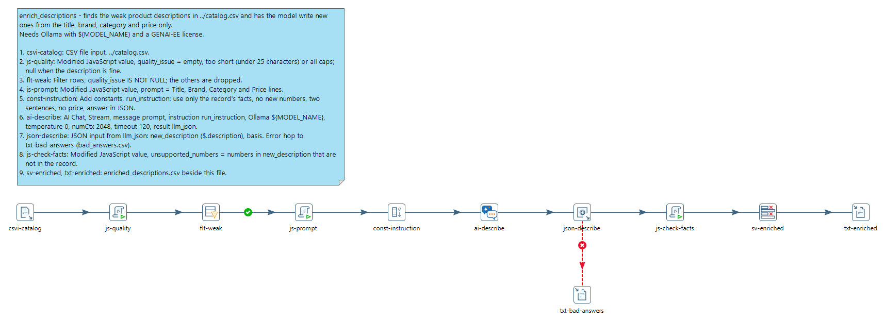
<figcaption>enrich_descriptions.ktr in Spoon</figcaption>
</figure>
</div>
