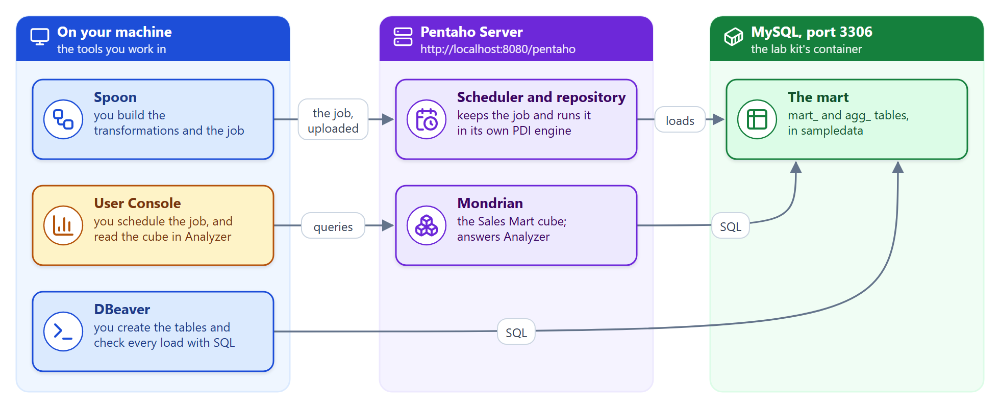

# Before You Start

> **Note:**
>
> #### Get Ready — Before You Start
>
> Before the first workshop, check that MySQL, Pentaho Data Integration
> (PDI) and the Pentaho Server are up, and that the workshop folder is in
> place. Over the course you build a sales data mart in MySQL with Spoon,
> schedule its load on the Pentaho Server, and point a cube at it. **None
> of the lab time should go on setup**: this page does it in advance.
>
> **What you'll do:**
>
> * Learn how the guide works: progress, copy buttons, the assistant.
> * See how Spoon, MySQL and the Pentaho Server fit together.
> * Confirm MySQL, PDI, the Pentaho Server and Analyzer all answer.
> * Check the workshop folder: *C:\Workshop-DP-Specialty*
>
> **Prerequisites:** Developer - DI Practitioner, or the same skills: building, previewing and running a transformation and a job in Spoon. Basic SQL.
>
> **Estimated time:** 5 minutes on a lab VM; about 30 minutes the first
> time on your own machine.

## Meet your lab guide

This panel stays beside your tools for the whole workshop:

- **Float or dock** — drag the title bar to move the window anywhere
  (any monitor), or use the dock button to pin it to the right edge of
  the screen so maximized apps make room for it.
- **The sidebar** lists every section and lab. A <span data-icon="video"></span> badge means the lab
  includes a video; the `~15 min` tag is a time estimate.
- Use the **font-size** and **reading-mode** controls in the toolbar if
  you're on a small VM screen.

## Track your progress

Each workshop's steps sit in a numbered row at the top of the lab, one
dot per step. Work through them in order: the button at the end of a
step names the next one, and moving on puts a check mark on the step
you leave. Your progress is saved on this machine and survives
restarts, so you can pick up exactly where you left off. (This page has
no steps: tracking starts in the first workshop.)

## Copy code from the guide

Every code block has a **copy button**: hover over the block and select
it, then paste into your tool. Try it:

```sql
SELECT 'hello from the lab guide' AS greeting;
```

## How the pieces fit

Four things run on your machine for this course:

<div align="center">
<figure>

<figcaption>Your tools, the Pentaho Server and MySQL</figcaption>
</figure>
</div>

* **Spoon**, the PDI client, is where you design the transformations and the job that load the mart. Run there, they write to MySQL directly.
* **MySQL** holds the `sampledata` database: the Steel Wheels sample tables, and beside them the mart you build.
* **The Pentaho Server** stores the finished job in its repository and runs it on a schedule. **Mondrian**, its cube engine, reads the mart to answer **Analyzer** in the User Console.
* **DBeaver** runs SQL: you create each table in it, and check each load with it.

> **Under the hood:**
>
> #### Two programs run the same transformations
>
> Spoon and the Pentaho Server each carry their own copy of the PDI engine, and each opens its own connection to MySQL with its own JDBC driver. A transformation that runs in Spoon runs the same way on the server, as long as the server has the driver and can reach every file it reads.
>
> **Why it matters:** a load that works in Spoon and fails on a schedule is usually missing one of those two things on the server.

## Set up your environment

Launch your tools straight from the guide:

<button data-launch="spoon" data-path="">Start Pentaho Data Integration</button>

<button data-launch="puc">Log into Pentaho User Console</button>

If Spoon is already open from a previous session, its button focuses the
running window instead of starting a second copy.

### Do you need to set anything up?

:::: tabs

### I'm using a lab VM

Nothing to install. Everything is already on the machine: the Pentaho
Server starts with it. If the **MySQL (sampledata)** row in the panel
below is red, start MySQL with `C:\MySQL\run-podman-mysql.ps1`.

> **Note:** **Give the Pentaho Server time to load.** It needs **3 to 5
> minutes** after the machine starts. **Check your environment**, below
> these tabs, shows **Starting up** while it loads and turns green by
> itself.

If something looks wrong later, tell your instructor rather than
reinstalling anything.

### I'm installing on my own machine

Everything here is a **one-off setup** for your own laptop. Work through
the tabs in order: the panel underneath checks your machine as you go.

::: tabs

### 1. Start MySQL

MySQL runs in a container, from the lab kit the installer laid down in
`C:\MySQL`.

1. Install **Podman Desktop**, which brings the Podman engine with it. In PowerShell, run:

   ```powershell
   winget install -e --id RedHat.Podman-Desktop
   ```

2. Build and start MySQL. The first run loads the Steel Wheels data and takes a few minutes. In PowerShell, run:

   ```powershell
   C:\MySQL\run-podman-mysql.ps1
   ```

   > **Success:** Checkpoint: the script ends by printing the connection details.

3. Install DBeaver, to run SQL. In PowerShell, run:

   ```powershell
   winget install -e --id dbeaver.dbeaver
   ```

4. In DBeaver, create a MySQL connection named `sampledata` with the values in **Check the database** below. On **Driver properties**, set `allowPublicKeyRetrieval` to `true`.

After a reboot, run the kit's script again: the Podman machine does not
start by itself.

### 2. Start the Pentaho Server

The server ships with Pentaho, so there is nothing to install: you
start it. It brings up the User Console, Analyzer, the
repository your job is stored in.

1. Start the server's repository database, PostgreSQL, if it is not
   already running. An installer-based install runs it as the
   **Pentaho Solution Repository** service. In PowerShell, run:

   ```powershell
   Start-Service "Pentaho Solution Repository"
   ```

   On an install with no such service, start it with PostgreSQL's own
   tool instead:

   ```powershell
   & "C:\Pentaho\postgresql\bin\pg_ctl.exe" start -D "C:\Pentaho\postgresql\data" -l "$env:TEMP\postgresql.log"
   ```

2. Start the server. In PowerShell, run:

   ```powershell
   C:\Pentaho\server\pentaho-server\start-pentaho.bat
   ```

3. Wait for it to finish loading: 3 to 5 minutes. Leave the **Tomcat**
   window open, because closing it stops the server.

4. Browse to **http://localhost:8080/pentaho**.

   > **Success:** Checkpoint: the User Console's sign-in page opens.

To shut it down later, run `stop-pentaho.bat` from the same folder.

<details>
<summary>Troubleshooting</summary>

**The server never finishes starting.** Its repository database is
down. The **Pentaho repository database** row in the panel below is
red: start PostgreSQL (step 1), then stop and start the server again.
A server started before its database does not recover by itself.

**The browser cannot reach localhost:8080.** The server is still
starting, or it stopped. Watch the **Tomcat** window for
`Server startup in ... ms`, then retry.

**"Port 8080 already in use".** Something else has the port, often a
second Pentaho Server or another Tomcat. Stop it, or change the port in
`tomcat\conf\server.xml`.

**The window closes immediately.** The server could not find a usable
Java. It checks `PENTAHO_JAVA_HOME` first, then the bundled
`C:\Pentaho\java`, and only then `JAVA_HOME` (a JDK newer than 21 stops
the server). Check them with `echo $env:PENTAHO_JAVA_HOME, $env:JAVA_HOME`,
and see `set-pentaho-env.bat` in the same folder for what the server
expects.

</details>

### 3. Start Pentaho Data Integration

1. Install the Pentaho design tools to `C:\Pentaho`, so Spoon is at `C:\Pentaho\design-tools\data-integration\Spoon.bat`.
2. Check that PDI has the MySQL JDBC driver, `mysql-connector-j-*.jar`, in `C:\Pentaho\design-tools\data-integration\lib`. The installer downloads it there; the **MySQL JDBC driver (PDI)** row in the panel below checks it.
3. Start Spoon with the button at the top of this section, and let it finish loading.

### 4. Ports and logins

| Service | Address | Username | Password |
| ------- | ------- | -------- | -------- |
| Pentaho User Console | `http://localhost:8080/pentaho` | `admin` | `password` |
| MySQL `sampledata` | `localhost:3306` | `pentaho_admin` | `password` |
| Ollama, the Chat tab | `127.0.0.1:11434` | *none* | *none* |

> **Warning:** These are the stock workshop sign-ins and are widely known. Change them on any machine others can reach.

:::

::::

## Check your environment

This panel probes the machine live. Each row reports one of four states:

* **<span class="pcm-c-ok">Green</span>** — the check passed; that piece is present and answering.
* **<span class="pcm-c-warn">Amber</span>** — usable, but worth tidying before you start.
* **<span class="pcm-c-danger">Red</span>** — it will block a lab, and the row tells you the exact fix.
* **<span class="pcm-c-muted">Grey</span>** — skipped, because this course doesn't use it.

<div data-env-check="server"></div>

**MySQL driver (Pentaho Server)** is amber until you add the driver in
[Schedule the Load on the Pentaho Server](../09-schedule-the-load-on-the-pentaho-server/guide.md).

## Check the working folders

The installer lays the lab files out under **`C:\Workshop-DP-Specialty`**,
one folder per section, in the order the sidebar reads. Save each
transformation in its workshop's folder, beside the data it reads.

```text
C:\Workshop-DP-Specialty\
├── 02-modeling-the-star\
│   ├── 04-build-a-date-dimension\                       dim_date.sql
│   └── 05-load-dimensions-with-slowly-changing-history\ dim_customer_product.sql, customers_*.csv, products.csv
├── 03-loading-facts\
│   ├── 07-load-the-fact-table\                          fact_sales.sql, order_lines_2003-01_2005-04.csv
│   └── 08-summary-tables-for-aggregates\                agg_tables.sql
├── 04-automate-and-publish\
│   ├── 09-schedule-the-load-on-the-pentaho-server\      order_lines_2005-05.csv
│   └── 10-refresh-the-cube-after-a-load\                sales_mart.xml, order_lines_2005-06.csv
└── capstone\
    ├── data\                                            the capstone's source files
    ├── solution\                                        your transformations, job, schema and README.md
    └── out\                                             what your job writes
```

Each workshop's `solution` folder holds a **complete, working** solution
with its own copy of the data it reads. **Open the first workshop's
folder** and check that it holds `dim_date.sql`.

## Check the database

The mart is built in the MySQL `sampledata` database. You create the PDI
connection, `MySQL:sampledata`, in the first workshop, with these values:

|          |                 |
| -------- | --------------- |
| Host     | `localhost`     |
| Port     | `3306`          |
| Database | `sampledata`    |
| Username | `pentaho_admin` |
| Password | `password`      |

This is the MySQL database the DI Practitioner course uses, not the
HSQLDB sample database bundled with the Pentaho Server: the HSQLDB sample
has no user that can create tables.

The workshops add these tables. They start with `mart_` (the two
summaries with `agg_`), so they never clash with the sample tables or
with tables other courses leave in `sampledata`:

| Table | What it holds | Built in |
| ----- | ------------- | -------- |
| `mart_dim_date` | One row per day, 2003 to 2005 | [Build a Date Dimension](../04-build-a-date-dimension/guide.md) |
| `mart_dim_customer` | Customers, with a new version each time a customer moves | [Load Dimensions with Slowly Changing History](../05-load-dimensions-with-slowly-changing-history/guide.md) |
| `mart_dim_product` | Products | [Load Dimensions with Slowly Changing History](../05-load-dimensions-with-slowly-changing-history/guide.md) |
| `mart_fact_sales` | One row per order line, with the three dimensions' keys | [Load the Fact Table](../07-load-the-fact-table/guide.md) |
| `agg_ym_line_mart_fact_sales`, `agg_y_terr_mart_fact_sales` | Sales summed by month and product line, and by year and territory | [Summary Tables for Aggregates](../08-summary-tables-for-aggregates/guide.md) |

The source data is the Steel Wheels sample, exported to CSV files that stand in for the extracts of an order system. The workshops load January 2003 to April 2005 first, then May 2005 through a scheduled job, then a few June orders that show why a cube needs refreshing after a load. The June orders are made up for the course; everything else is the Steel Wheels data as the sample ships it.

Each workshop starts from the tables the one before it left, so do them
in order. If a checkpoint does not match, compare your tables with this
list first:

| After | The mart holds |
| ----- | -------------- |
| Build a Date Dimension | `mart_dim_date`: 1,096 days |
| Load Dimensions with Slowly Changing History | `mart_dim_customer`: 125 rows; `mart_dim_product`: 111 rows |
| Load the Fact Table | `mart_fact_sales`: 2,867 order lines, January 2003 to April 2005 |
| Summary Tables for Aggregates | The two summary tables, in step with `mart_fact_sales` |
| Schedule the Load on the Pentaho Server | `mart_fact_sales`: 2,996 order lines, through May 2005 |
| Refresh the Cube After a Load | `mart_fact_sales`: 3,004 order lines, through June 2005, and the Sales Mart cube on the Pentaho Server |

Re-running a workshop's SQL script empties that workshop's tables; run
its transformation again to refill them, and then the later ones.

## Ask the AI assistant

The **Chat** tab in the bottom panel answers questions about Pentaho —
ask it anything from "what is a degenerate dimension?" to "why does my
cube not load?". A model on this machine writes the answers, and it
grounds them in a live search of the official Pentaho documentation.
Without an internet connection that search is unavailable, so only the
local model answers, without the documentation behind it.

## How this course is organized

Each section starts with an **overview page** (<span data-icon="page"></span> — background reading,
no check boxes) followed by **hands-on workshops** (<span data-icon="workshop"></span> — tracked steps).
Select a heading to open that section's page, or the chevron beside it to
expand the workshops underneath.

## The exam and your course accreditation

When you have worked through the sections, the **Exam** in the sidebar
checks what you have picked up. It is open-book: browse any section to
refresh your memory, or ask the assistant. Your answers are saved as you
go, and the explanations show afterwards. The pass mark is **80%**.

You are asked for your name, email and organization before you begin
(and your Partner ID, if you are taking it as part of the Pentaho Partner
Program); those are what your accreditation is made out to. Complete the
capstone project and pass the exam, and your **course accreditation**
appears on the results screen to download. It is valid for two years.

---

> **Tip:** Next, the route from an order system's tables to a star schema an analyst can model: [From Source Data to a Star Schema](../02-from-source-data-to-a-star-schema/guide.md).
