# Load the Fact Table

> **Warning:**
>
> #### Workshop - Load the Fact Table
>
> Load `mart_fact_sales`, one row per order line, from the order system's extract of January 2003 to April 2005. Each line swaps its order date, customer number and product code for the keys of `mart_dim_date`, `mart_dim_customer` and `mart_dim_product`, gets its `sales_amount`, and is written so that running the load twice never counts a sale twice.
>
> **What you'll do**
>
> * Create the `mart_fact_sales` table, keyed on the order line.
> * Read 2,867 order lines from a file named by a parameter.
> * Find `date_key` and `product_key` with cached **Database lookup** steps.
> * Find the customer version valid on each order date with **Dimension lookup/update** in lookup mode.
> * Compute `sales_amount` and write the rows with **Insert / Update**, then check the totals against the source.
> * Add the summary note that tells the next reader what it does.
>
> **Prerequisites:** [Load Dimensions with Slowly Changing History](../05-load-dimensions-with-slowly-changing-history/guide.md), with both customer extracts loaded; [Overview of Loading Facts](../06-overview-of-loading-facts/guide.md); DBeaver connected to `sampledata` as `pentaho_admin`.
>
> **Estimated time:** 40 minutes

<figure>

<figcaption class="pcm-video-caption">Walkthrough: coming soon</figcaption>

</figure>

---

<div align="center">
<figure>
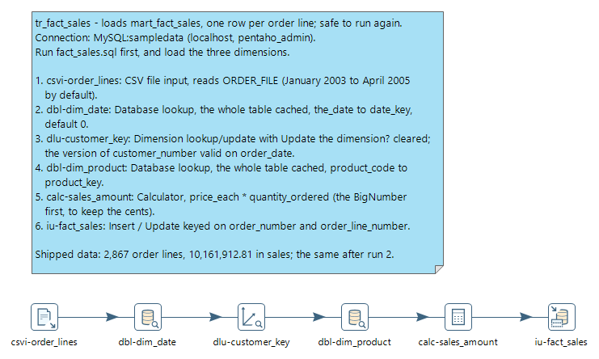
<figcaption>What you build</figcaption>
</figure>
</div>

<div align="center">
<figure>
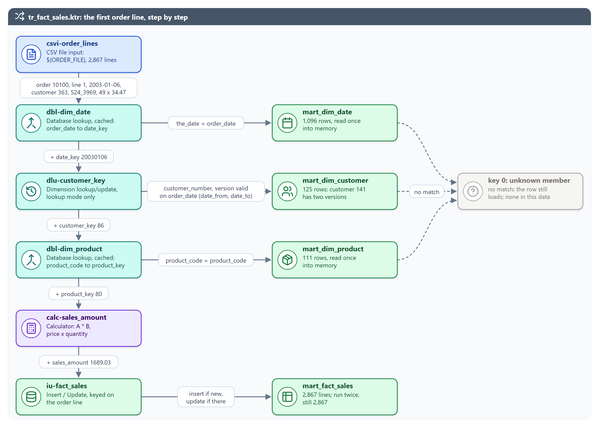
<figcaption>One order line through the fact load: three lookups, a calculation, and a write that is safe to repeat</figcaption>
</figure>
</div>

Read the diagram top to bottom. The left column is the six steps of `tr_fact_sales.ktr` in order, and the tag on each arrow between them is what the first order line carries forward: the natural keys from the file, then one new field per step. Each lookup reaches right to its dimension and swaps a natural key for a surrogate key: `date_key` and `product_key` from tables read once into memory, and `customer_key` from the version of customer 363 valid on the order date. The dashed grey arrows show what happens when a lookup finds nothing: the row gets key 0, the unknown member, and still loads, although nothing in this data needs it. The last two steps compute `sales_amount` (49 × 34.47) and write the line to `mart_fact_sales`, keyed on the order line, so a second run updates the same 2,867 rows instead of adding more.

:::: tabs

### 1. Create the Table

> **Note:**
>
> #### Create the Table
>
> `mart_fact_sales` holds the three surrogate keys, the order's degenerate dimension (`order_number`, `order_line_number`, `status`) and the measures. Its primary key is the order line, so a line can only be in the table once.

1. In DBeaver, open `fact_sales.sql` from `C:\Workshop-DP-Specialty\03-loading-facts\07-load-the-fact-table` (also under **Lab Files** below), with the `sampledata` connection selected.
2. Run the whole script: press `Alt+X` (**SQL Editor > Execute SQL Script**).
3. In DBeaver, run:

   ```sql
   SELECT COUNT(*) FROM mart_fact_sales;
   ```

> **Success:** Checkpoint: the query returns `0`.

### 2. Read the Order Lines

> **Note:**
>
> #### Read the Order Lines
>
> The extract has one row per order line, with the order's date, status and customer on every line. A parameter, `ORDER_FILE`, names the file, as `CUSTOMER_FILE` did for the customers.

1. Start Spoon with the **Start Pentaho Data Integration** button below, or from PowerShell:

```powershell
Set-Location C:\Pentaho\design-tools\data-integration
.\spoon.bat
```

<button data-launch="spoon" data-path="">Start Pentaho Data Integration</button>

2. Select **File > New > Transformation** (`Ctrl+N`).
3. Select **File > Save as** and save it as `tr_fact_sales.ktr` in `C:\Workshop-DP-Specialty\03-loading-facts\07-load-the-fact-table`.
4. Double-click an empty part of the canvas. On the **Parameters** tab of **Transformation properties**, fill the grid with one row:

   | Parameter | Default value | Description |
   | --------- | ------------- | ----------- |
   | `ORDER_FILE` | `C:\Workshop-DP-Specialty\03-loading-facts\07-load-the-fact-table\order_lines_2003-01_2005-04.csv` | The order line extract to load |

5. Select **OK**.
6. On the **Design** tab, open the **Input** folder and drag **CSV file input** onto the canvas.
7. Double-click **CSV file input**. Set **Step name** to `csvi-order_lines`.
8. Set **Filename** to `${ORDER_FILE}`, **Delimiter** to `,`, **Enclosure** to `"` and **File encoding** to `UTF-8`. Leave **Header row present?** selected, and clear **Lazy conversion?**.
9. Select **Get Fields**, and set the **Fields** grid to these types, each with **Trim type** `both`:

   | Name | Type | Format | Precision |
   | ---- | ---- | ------ | --------- |
   | `order_number` | Integer | | |
   | `order_line_number` | Integer | | |
   | `order_date` | Date | `yyyy-MM-dd` | |
   | `status` | String | | |
   | `customer_number` | Integer | | |
   | `product_code` | String | | |
   | `quantity_ordered` | Integer | | |
   | `price_each` | BigNumber | | `2` |

<div align="center">
<figure>
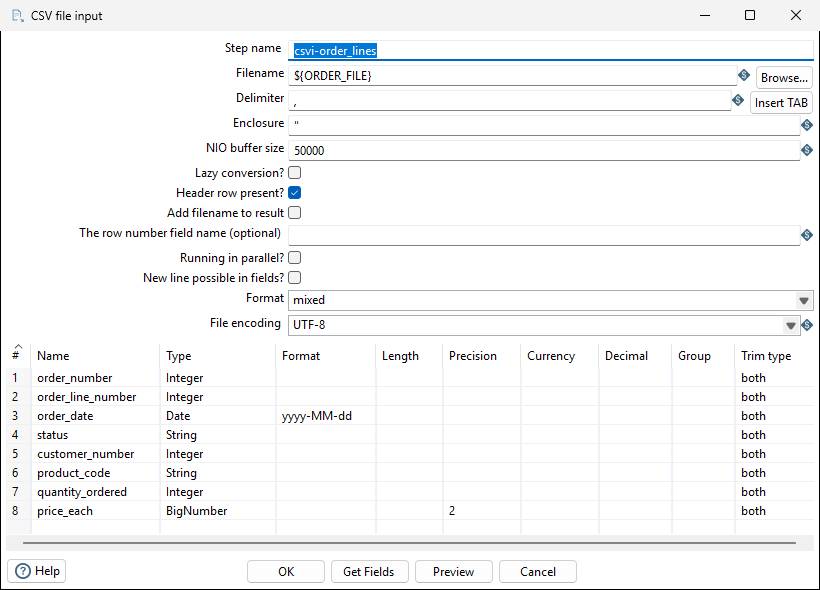
<figcaption>csvi-order_lines: eight fields</figcaption>
</figure>
</div>

10. Select **Preview**, and select **OK** to preview 100 rows.

> **Success:** Checkpoint: the first row is order `10100`, line `1`, `2003/01/06`, `Shipped`, customer `363`, product `S24_3969`, 49 at `34.47`.

11. Select **Close**, then **OK**.
12. Save the transformation (`Ctrl+S`).

### 3. Look Up the Date Key

> **Note:**
>
> #### Look Up the Date Key
>
> **Database lookup** finds a row in a table by key fields and adds the values you ask for to the stream. With the cache on and **Load all data from table** selected, it reads `mart_dim_date` once, before the first row, and answers every order line from memory.

1. On the **Design** tab, open the **Lookup** folder and drag **Database lookup** onto the canvas.
2. Create a hop from **csvi-order_lines** to **Database lookup**: hold `Shift` and drag from one step to the other.
3. Double-click **Database lookup**. Set **Step name** to `dbl-dim_date`.
4. Set **Connection** to `MySQL:sampledata` and **Lookup table** to `mart_dim_date`. Select **Enable cache?** and **Load all data from table**.
5. Fill **The key(s) to look up the value(s)** grid with one row:

   | Table field | Comparator | Field1 |
   | ----------- | ---------- | ------ |
   | `the_date` | = | `order_date` |

6. Fill the **Values to return from the lookup table** grid with one row:

   | Field | New name | Default | Type |
   | ----- | -------- | ------- | ---- |
   | `date_key` | | `0` | Integer |

<div align="center">
<figure>
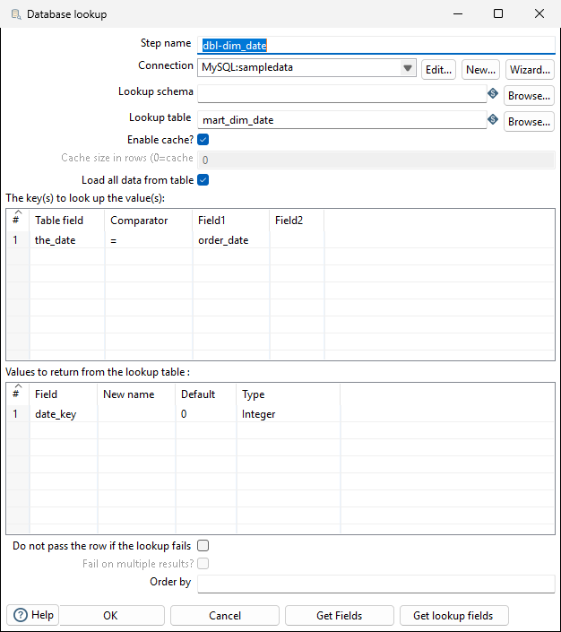
<figcaption>dbl-dim_date: the whole table in memory</figcaption>
</figure>
</div>

7. Select **OK**.

<div align="center">
<figure>
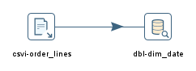
<figcaption>The canvas after dbl-dim_date</figcaption>
</figure>
</div>

### 4. Look Up the Customer Version

> **Note:**
>
> #### Look Up the Customer Version
>
> With **Update the dimension?** cleared, **Dimension lookup/update** writes nothing: it finds the version of each customer that was valid on the **Stream Datefield**, here the order date, and returns its technical key.

1. On the **Design** tab, open the **Data Warehouse** folder and drag **Dimension lookup/update** onto the canvas.
2. Create a hop from **dbl-dim_date** to **Dimension lookup/update**.
3. Double-click **Dimension lookup/update**. Set **Step name** to `dlu-customer_key`, and clear **Update the dimension?**.
4. Set **Connection** to `MySQL:sampledata` and **Target table** to `mart_dim_customer`.
5. On the **Keys** tab, map the dimension field `customer_number` to the stream field `customer_number`.
6. Set **Technical key field** to `customer_key`, **Version field** to `version`, **Stream Datefield** to `order_date`, **Date range start field** to `date_from` and **Table date range end** to `date_to`, with **Min. year** `1900` and **Max. year** `2199`, as in `dlu-dim_customer`.
7. On the **Fields** tab, delete every row: the fact load needs only the key. If the grid has rows, select them, right-click and select **Delete selected lines**.

<div align="center">
<figure>
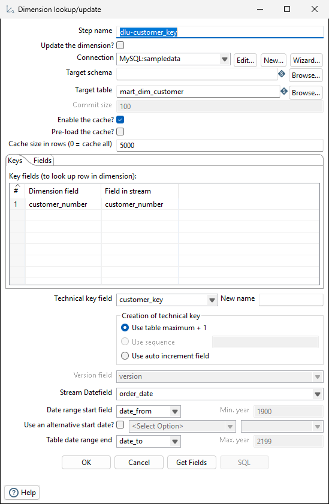
<figcaption>dlu-customer_key: lookup only, by order date</figcaption>
</figure>
</div>

8. Select **OK**.

> **Under the hood:**
>
> #### The lookup asks for a key and a date
>
> In lookup mode the step runs, in effect, `SELECT customer_key FROM mart_dim_customer WHERE customer_number = ? AND date_from <= ? AND ? < date_to`, with the order date in both date places. Customer `141` has two versions, so when the May 2005 orders arrive in lesson 09, its lines from 3 and 13 May will find key 11, Madrid, and a line from 31 May key 123, Barcelona. A customer number with no version at all returns key `0`, the unknown member, and the row carries on. The step caches what it has found, so a customer with many orders costs one query, not one per line.
>
> **Why it matters:** this is where type 2 history pays off. A lookup on `customer_number` alone would hand every Euro+ order, 2003 included, whichever version came back first, and the cube would move sales between cities depending on the order the rows were stored in.

<div align="center">
<figure>
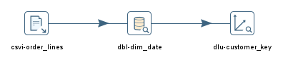
<figcaption>The canvas after dlu-customer_key</figcaption>
</figure>
</div>

### 5. Look Up the Product Key

> **Note:**
>
> #### Look Up the Product Key
>
> `mart_dim_product` is type 1: one row per product code. A cached **Database lookup** on the code is enough.

1. On the **Design** tab, open the **Lookup** folder and drag **Database lookup** onto the canvas.
2. Create a hop from **dlu-customer_key** to **Database lookup**.
3. Double-click **Database lookup**. Set **Step name** to `dbl-dim_product`.
4. Set **Connection** to `MySQL:sampledata` and **Lookup table** to `mart_dim_product`. Select **Enable cache?** and **Load all data from table**.
5. Fill **The key(s) to look up the value(s)** grid with one row: **Table field** `product_code`, **Comparator** `=`, **Field1** `product_code`.
6. Fill the **Values to return from the lookup table** grid with one row: **Field** `product_key`, **Default** `0`, **Type** Integer.

<div align="center">
<figure>
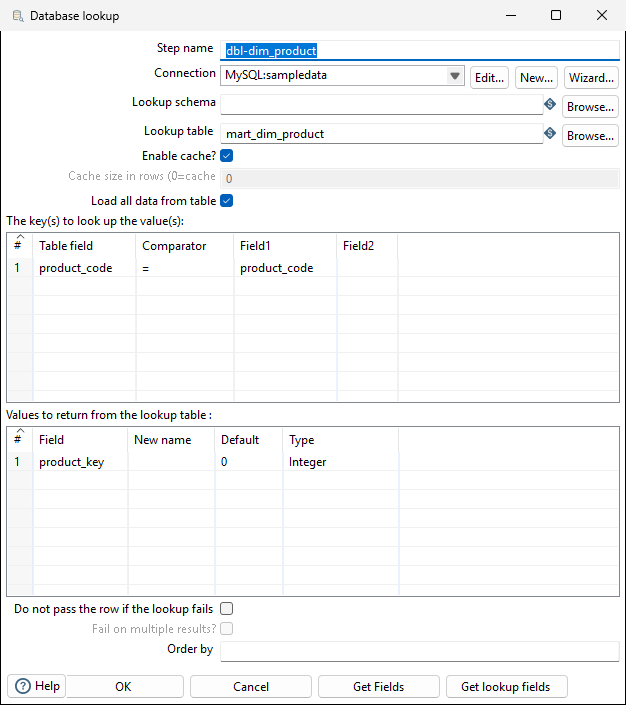
<figcaption>dbl-dim_product: product_code to product_key</figcaption>
</figure>
</div>

7. Select **OK**.
8. Save the transformation (`Ctrl+S`).
9. Select **dbl-dim_product** on the canvas, press `F10` (**Action > Preview**), and select **Quick Launch**.

> **Success:** Checkpoint: the first row now ends with `date_key` `20030106`, `customer_key` `86` and `product_key` `80`.

10. Select **Close**.

<div align="center">
<figure>
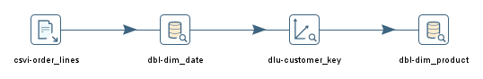
<figcaption>The canvas after dbl-dim_product</figcaption>
</figure>
</div>

### 6. Calculate and Write

> **Note:**
>
> #### Calculate and Write
>
> **Insert / Update** looks each row up by the keys you give it, inserts the row when it is not there, and updates it when it is. Keyed on the order line, it makes the load safe to run again.

1. On the **Design** tab, open the **Transform** folder and drag **Calculator** onto the canvas.
2. Create a hop from **dbl-dim_product** to **Calculator**.
3. Double-click **Calculator**. Set **Step name** to `calc-sales_amount`.
4. Fill the **Fields** grid with one row: **New field** `sales_amount`, **Calculation** A * B, **Field A** `price_each`, **Field B** `quantity_ordered`, **Value type** BigNumber, **Precision** `2`, **Remove** `N`.
   Keep the price in **Field A**: **A * B** works in the type of **Field A**, so an Integer quantity there would drop the cents from the price.

<div align="center">
<figure>
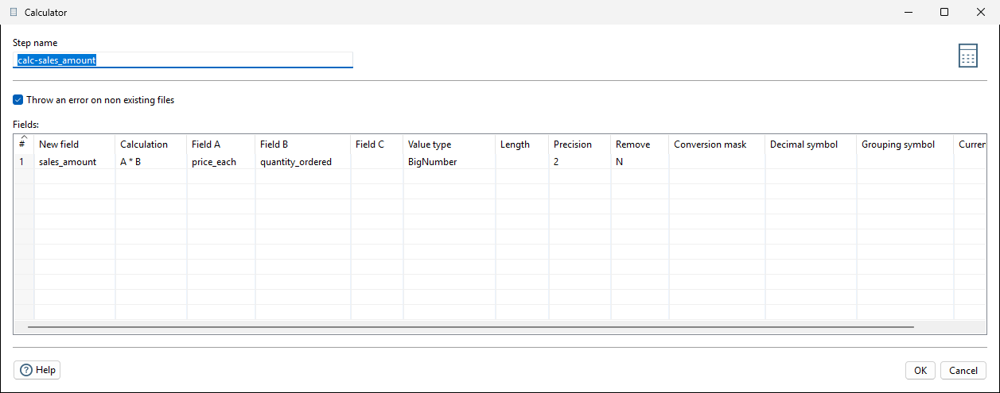
<figcaption>calc-sales_amount: the price in Field A</figcaption>
</figure>
</div>

5. Select **OK**.
6. On the **Design** tab, open the **Output** folder and drag **Insert / Update** onto the canvas.
7. Create a hop from **calc-sales_amount** to **Insert / Update**.
8. Double-click **Insert / Update**. Set **Step name** to `iu-fact_sales`.
9. Set **Connection** to `MySQL:sampledata`, **Target table** to `mart_fact_sales` and **Commit size** to `500`.
10. Fill **The key(s) to look up the value(s)** grid with two rows:

    | Table field | Comparator | Stream field1 |
    | ----------- | ---------- | ------------- |
    | `order_number` | = | `order_number` |
    | `order_line_number` | = | `order_line_number` |

11. Fill the **Update fields** grid with nine rows:

    | Table field | Stream field | Update |
    | ----------- | ------------ | ------ |
    | `order_number` | `order_number` | N |
    | `order_line_number` | `order_line_number` | N |
    | `date_key` | `date_key` | Y |
    | `customer_key` | `customer_key` | Y |
    | `product_key` | `product_key` | Y |
    | `status` | `status` | Y |
    | `quantity_ordered` | `quantity_ordered` | Y |
    | `price_each` | `price_each` | Y |
    | `sales_amount` | `sales_amount` | Y |

<div align="center">
<figure>
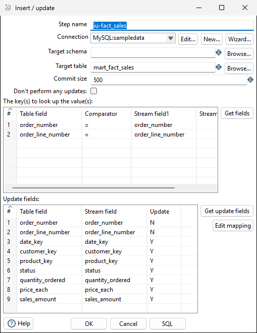
<figcaption>iu-fact_sales: two keys, nine fields</figcaption>
</figure>
</div>

12. Select **OK**.
13. Save the transformation (`Ctrl+S`).
14. Press `F9` (**Action > Run**). In the **Run Options** dialog, `ORDER_FILE` shows its default, the January 2003 to April 2005 extract. Select **Run**.
15. In **Execution Results**, open the **Step Metrics** tab.

> **Success:** Checkpoint: every step shows 2,867 rows passing through, and **iu-fact_sales** has no errors.

16. In DBeaver, run:

    ```sql
    SELECT COUNT(*), COUNT(DISTINCT order_number), SUM(quantity_ordered), SUM(sales_amount) FROM mart_fact_sales;
    SELECT COUNT(*) FROM mart_fact_sales WHERE date_key = 0 OR customer_key = 0 OR product_key = 0;
    SELECT d.year_id, SUM(f.sales_amount) FROM mart_fact_sales f JOIN mart_dim_date d ON d.date_key = f.date_key
    GROUP BY d.year_id ORDER BY d.year_id;
    ```

> **Success:** Checkpoint: 2,867 order lines in 311 orders, 100,675 units and 10,161,912.81 in sales; no row with an unknown key; 3,677,384.00 in 2003, 4,987,739.78 in 2004 and 1,496,789.03 in January to April 2005.

17. Press `F9` (**Action > Run**) and select **Run** again, with the same file. Then run the first query again.

> **Success:** Checkpoint: still 2,867 order lines and 10,161,912.81. The second run found every line and wrote no new row.

Two runs, one copy of every line. Here is how the step made sure of it.

> **Under the hood:**
>
> #### A lookup, then an insert or an update, for every row
>
> For each row, **Insert / Update** runs a `SELECT` on `mart_fact_sales` by `order_number` and `order_line_number`. On the first run it found nothing 2,867 times and inserted every line, in batches committed every 500 rows. On the second run it found every line, compared the fields marked `Y` with the table, and found nothing to change. That per-row `SELECT` is the price of safety: on millions of rows a load would delete the window it is reloading and use **Table output** instead.
>
> **Why it matters:** the scheduled job in [Schedule the Load on the Pentaho Server](../09-schedule-the-load-on-the-pentaho-server/guide.md) can be run again after a failure, or by mistake, and the mart still holds every order line once. A corrected quantity in a later extract updates the line instead of adding a second one.

### 7. Add the Summary Note

> **Note:**
>
> #### Add the Summary Note
>
> A note on the canvas says what the transformation does, step by step, and what a run should give. Whoever opens the file next reads it before running anything.

1. Right-click an empty part of the canvas and select **New Note...**. The **Notes** dialog opens.
2. On the **Note** tab, enter:

   ```text
   tr_fact_sales - loads mart_fact_sales, one row per order line; safe to run again.
   Connection: MySQL:sampledata (localhost, pentaho_admin).
   Run fact_sales.sql first, and load the three dimensions.

   1. csvi-order_lines: CSV file input, reads ORDER_FILE (January 2003 to April 2005
      by default).
   2. dbl-dim_date: Database lookup, the whole table cached, the_date to date_key,
      default 0.
   3. dlu-customer_key: Dimension lookup/update with Update the dimension? cleared;
      the version of customer_number valid on order_date.
   4. dbl-dim_product: Database lookup, the whole table cached, product_code to
      product_key.
   5. calc-sales_amount: Calculator, price_each * quantity_ordered (the BigNumber
      first, to keep the cents).
   6. iu-fact_sales: Insert / Update keyed on order_number and order_line_number.

   Shipped data: 2,867 order lines, 10,161,912.81 in sales; the same after run 2.
   ```

3. Optional: to give the note the course's look, open the **Font style** tab. Set **Font name** to `Segoe UI` and **Font size** to `10`, set **Background color** to red `167`, green `224`, blue `245`, and **Border color** to red, green and blue `100`.
4. Select **OK**, and drag the note above the steps.
5. Save the transformation (`Ctrl+S`).

> **Success:** Checkpoint: the canvas looks like the **What you build** picture at the top of the page, note included.

::::

## Troubleshooting <!-- no-step -->

<details>

<summary>Every row has customer_key 0</summary>

The lookup is not finding the versions. Check that **Stream Datefield** is `order_date`, that `mart_dim_customer` holds 125 rows, and that **Date range start field** and **Table date range end** name `date_from` and `date_to`.

</details>

<details>

<summary>dlu-customer_key fails with an error about the technical key or the table</summary>

**Update the dimension?** is still selected, so the step is trying to insert into `mart_dim_customer`. Clear it: the fact load only reads the dimension.

</details>

<details>

<summary>The sales total is 10,112,650.00, with no cents</summary>

`quantity_ordered` is **Field A** in **calc-sales_amount**. **A * B** works in the type of **Field A**, so the price was cut to a whole number first. Set **Field A** to `price_each` and **Field B** to `quantity_ordered`, and run again: **Insert / Update** corrects every line.

</details>

<details>

<summary>The sales total is off by a few cents</summary>

`price_each` or `sales_amount` is a Number instead of a BigNumber, so the products are binary floating point. Set both to BigNumber with **Precision** `2`, run `fact_sales.sql`, and load again.

</details>

## Lab Files

Click a file to download. For `.ktr` and `.kjb` files, **Open in Pentaho Data Integration** launches Pentaho Data Integration with the file loaded. If Pentaho Data Integration is already running, the path is copied to your clipboard — switch to Pentaho Data Integration and press `Ctrl+O`, `Ctrl+V`, `Enter`.

The `CREATE TABLE mart_fact_sales` script from part 1, for MySQL:

[fact_sales.sql](./files/fact_sales.sql)

The order line extract, January 2003 to April 2005 (2,867 lines):

[order_lines_2003-01_2005-04.csv](./files/order_lines_2003-01_2005-04.csv)

### Solution <!-- no-step -->

The finished transformation for this lab. Open it alongside your own to compare, or run to see the expected result.

Also on disk at `C:\Workshop-DP-Specialty\03-loading-facts\07-load-the-fact-table\solution`.

[tr_fact_sales.ktr](./files/tr_fact_sales.ktr) <button data-launch="spoon" data-path="files/tr_fact_sales.ktr">Open in Pentaho Data Integration</button> <button data-graph="files/tr_fact_sales.ktr">View graph</button>

---

> **Tip:** The fact table holds every order line. Next, the summary tables a cube reads for its high-level views, named the way Mondrian expects: [Summary Tables for Aggregates](../08-summary-tables-for-aggregates/guide.md).
