# Schedule the Load on the Pentaho Server

> **Warning:**
>
> #### Workshop - Schedule the Load on the Pentaho Server
>
> Wrap the four transformations of the mart in one job that loads the dimensions, then the facts, then the summaries, and stops at the first failure. Store it in the Pentaho Repository and let the Pentaho Server run it on a schedule: every night, and once at your word, to load the May 2005 orders.
>
> **What you'll do**
>
> * Build a job with three parameters that runs the four transformations in order.
> * Give the Pentaho Server the MySQL driver the transformations need.
> * Upload the job to the Pentaho Repository in the User Console.
> * Schedule it nightly, run it at once with **Execute Now**, and check what it loaded.
>
> **Prerequisites:** [Summary Tables for Aggregates](../08-summary-tables-for-aggregates/guide.md), with `tr_dim_customer.ktr`, `tr_dim_product.ktr`, `tr_fact_sales.ktr` and `tr_agg_sales.ktr` saved and working; the Pentaho Server running at `http://localhost:8080/pentaho`; DBeaver connected to `sampledata` as `pentaho_admin`.
>
> **Estimated time:** 35 minutes

<figure>

<figcaption class="pcm-video-caption">Walkthrough: coming soon</figcaption>

</figure>

---

What you build:

<div align="center">
<figure>
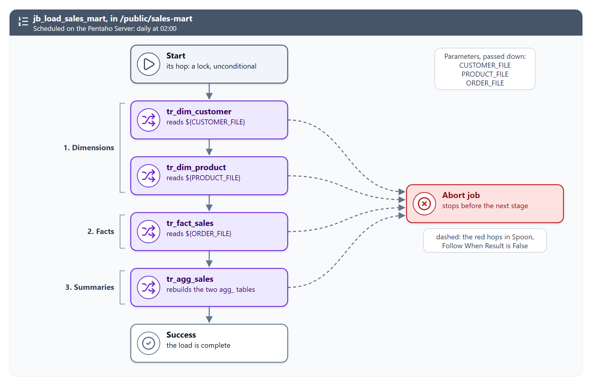
<figcaption>jb_load_sales_mart: dimensions, then facts, then summaries, and Abort job at the first failure</figcaption>
</figure>
</div>

Read the diagram top to bottom. Start's hop runs the dimensions first, then the facts, then the summaries: the fact load looks up keys that the dimension loads write, and the summaries sum the facts. Each transformation reads the file its parameter names, and the three parameters in the box at the top right are set on the job and passed down to all of them. The dashed hops are the ones Spoon draws in red, followed when an entry fails, so a failure ends at **Abort job** before the next stage runs on incomplete data. The heading gives where the job lives and how it runs: in `/public/sales-mart`, daily at 02:00, and at once with **Execute Now**.

:::: tabs

### 1. Put the Files Together

> **Note:**
>
> #### Put the Files Together
>
> The job finds its transformations beside itself, so they go in one folder. The whole folder then moves to the Pentaho Server as it is.

1. Copy the four transformations you built into this workshop's folder. In PowerShell, run:

   ```powershell
   $lab = "C:\Workshop-DP-Specialty\04-automate-and-publish\09-schedule-the-load-on-the-pentaho-server"
   Copy-Item C:\Workshop-DP-Specialty\02-modeling-the-star\05-load-dimensions-with-slowly-changing-history\tr_dim_*.ktr $lab
   Copy-Item C:\Workshop-DP-Specialty\03-loading-facts\07-load-the-fact-table\tr_fact_sales.ktr $lab
   Copy-Item C:\Workshop-DP-Specialty\03-loading-facts\08-summary-tables-for-aggregates\tr_agg_sales.ktr $lab
   Get-ChildItem $lab -Filter *.ktr -Name
   ```

> **Success:** Checkpoint: four files: `tr_agg_sales.ktr`, `tr_dim_customer.ktr`, `tr_dim_product.ktr` and `tr_fact_sales.ktr`.

The database connection `MySQL:sampledata` travels with each transformation, so the copies need no other change.

### 2. Build the Job

> **Note:**
>
> #### Build the Job
>
> A job runs its entries one after another, following the hops. Each **Transformation** entry passes the job's parameters down, so one set of file names drives the whole load.

1. Start Spoon with the **Start Pentaho Data Integration** button below, or from PowerShell:

```powershell
Set-Location C:\Pentaho\design-tools\data-integration
.\spoon.bat
```

<button data-launch="spoon" data-path="">Start Pentaho Data Integration</button>

2. Select **File > New > Job** (`Ctrl+Alt+N`).
3. Select **File > Save as** and save it as `jb_load_sales_mart.kjb` in `C:\Workshop-DP-Specialty\04-automate-and-publish\09-schedule-the-load-on-the-pentaho-server`.
4. Double-click an empty part of the canvas. On the **Parameters** tab of **Job properties**, fill the grid with three rows:

   | Parameter | Default value |
   | --------- | ------------- |
   | `CUSTOMER_FILE` | `C:\Workshop-DP-Specialty\02-modeling-the-star\05-load-dimensions-with-slowly-changing-history\customers_2005-05-15.csv` |
   | `PRODUCT_FILE` | `C:\Workshop-DP-Specialty\02-modeling-the-star\05-load-dimensions-with-slowly-changing-history\products.csv` |
   | `ORDER_FILE` | `C:\Workshop-DP-Specialty\04-automate-and-publish\09-schedule-the-load-on-the-pentaho-server\order_lines_2005-05.csv` |

<div align="center">
<figure>
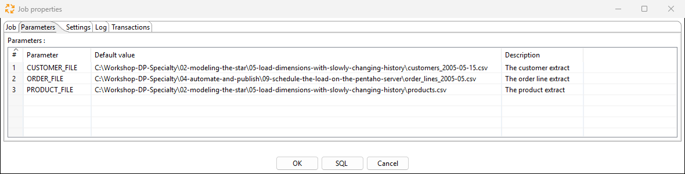
<figcaption>The three file parameters</figcaption>
</figure>
</div>

5. Select **OK**.
6. On the **Design** tab, open the **General** folder and drag **Start** onto the canvas.
7. On the **Design** tab, open the **General** folder and drag **Transformation** onto the canvas.
8. Create a hop from **Start** to **Transformation**: hold `Shift` and drag from one entry to the other.
9. Double-click **Transformation**. Set **Entry Name** to `tr_dim_customer`.
10. Select **Browse** beside **Transformation**, and select `tr_dim_customer.ktr` in the same folder. The field reads `${Internal.Entry.Current.Directory}/tr_dim_customer.ktr`; if it shows the full path, replace the folder with the variable.

<div align="center">
<figure>
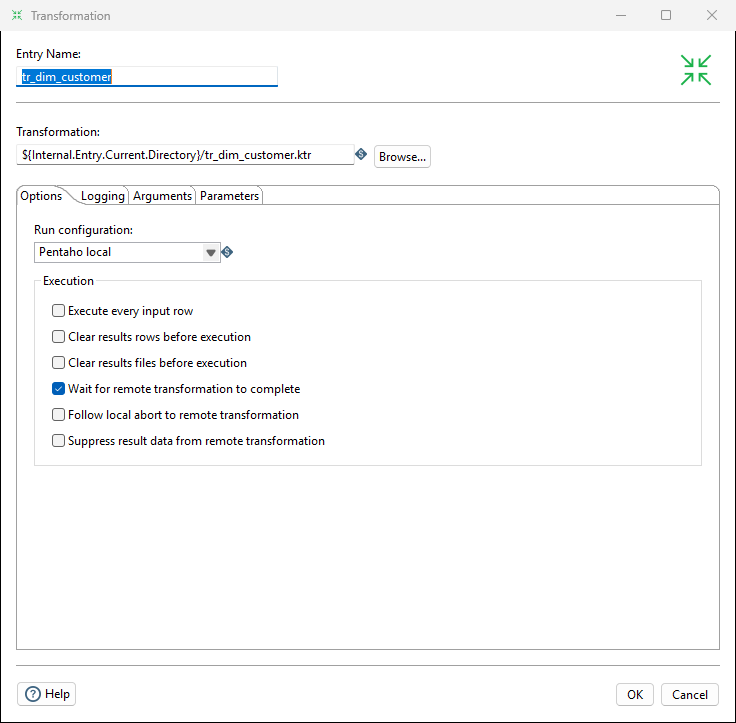
<figcaption>tr_dim_customer: the transformation beside the job</figcaption>
</figure>
</div>

11. Open the **Parameters** tab and select **Pass parameter values to sub transformation**.

<div align="center">
<figure>
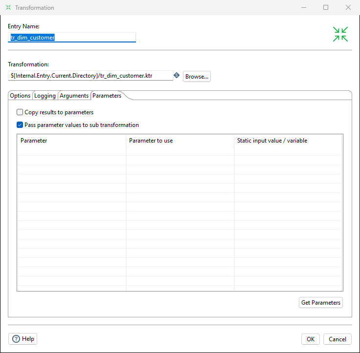
<figcaption>Pass the parameter values down</figcaption>
</figure>
</div>

12. Select **OK**.
13. Add three more **Transformation** entries the same way, each in a line after the last, with a hop from the one before: `tr_dim_product`, `tr_fact_sales` and `tr_agg_sales`, each pointing at the transformation of the same name, each passing its parameter values down.
14. On the **Design** tab, open the **General** folder and drag **Success** onto the canvas, and create a hop from **tr_agg_sales** to it.
15. On the **Design** tab, open the **Utility** folder and drag **Abort job** onto the canvas.
16. Create a hop from each of the four transformation entries to **Abort job**. Right-click each of those hops and select **Evaluation > Follow When Result is False**, so it turns red.
17. Right-click an empty part of the canvas and select **New Note...**. On the **Note** tab, enter:

    ```text
    jb_load_sales_mart - loads the Sales Mart: dimensions, then facts, then summaries.
    Parameters CUSTOMER_FILE, PRODUCT_FILE and ORDER_FILE name the extracts in
    C:/Workshop-DP-Specialty; every entry passes them down.

    1. tr_dim_customer, tr_dim_product: load the dimensions.
    2. tr_fact_sales: loads the order lines of ORDER_FILE.
    3. tr_agg_sales: rebuilds both summary tables.
    4. Success, or Abort job at the first failure.

    Shipped data: with the May 2005 extract, 2,996 lines and 10,645,949.18 in sales.
    ```

18. Select **OK**, and drag the note above the entries.
19. Save the job (`Ctrl+S`).

<div align="center">
<figure>
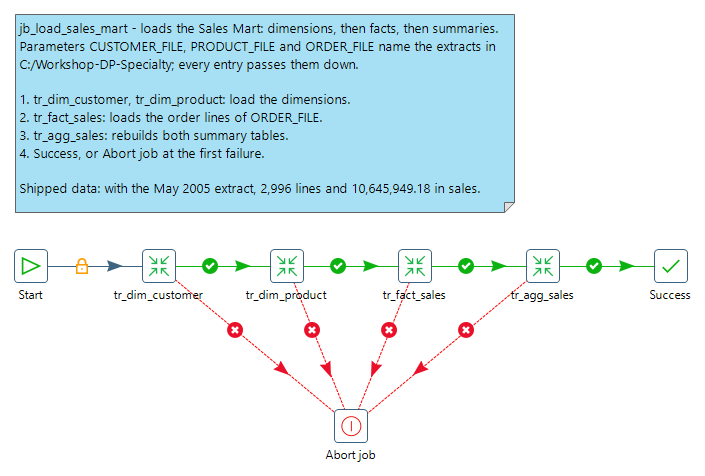
<figcaption>The finished job in Spoon</figcaption>
</figure>
</div>

> **Success:** Checkpoint: the canvas matches the **What you build** diagram: a lock hop from **Start**, green hops through the four transformations to **Success**, and four red hops into **Abort job**. The note sits above them.

The order of the entries is the design. The dimensions load before the facts, so every customer in May's orders already has a version when `tr_fact_sales` looks for it. The summaries load last, so they always describe the fact table as it is after the load. A failure anywhere stops the job before the next stage, so the summaries are never rebuilt from a half-loaded fact table.

### 3. Give the Server the Driver

> **Note:**
>
> #### Give the Server the Driver
>
> On the server, the transformations run inside the Pentaho Server's own Java process, with its own libraries. The MySQL driver Spoon uses is not among them: without a copy of its own, every database step fails to connect.

1. Stop the Pentaho Server. In PowerShell, run:

   ```powershell
   C:\Pentaho\server\pentaho-server\stop-pentaho.bat
   ```

2. Copy the MySQL driver from Spoon to the server. In PowerShell, run:

   ```powershell
   Copy-Item C:\Pentaho\design-tools\data-integration\lib\mysql-connector-j-*.jar C:\Pentaho\server\pentaho-server\tomcat\lib
   ```

3. Start the server again, and wait for it to finish loading. In PowerShell, run:

   ```powershell
   C:\Pentaho\server\pentaho-server\start-pentaho.bat
   ```

> **Success:** Checkpoint: `tomcat\lib` holds `mysql-connector-j-8.4.0.jar` (or a later version), and the User Console's sign-in page opens at `http://localhost:8080/pentaho`.

Where the server runs as a Windows service, restart the service instead of using the two `.bat` files.

### 4. Upload to the Repository

> **Note:**
>
> #### Upload to the Repository
>
> The server runs jobs from the Pentaho Repository. Uploading a job and its transformations to one folder keeps them beside each other, so `${Internal.Entry.Current.Directory}` finds them there too.

1. Open the User Console with the button below, and sign in as `admin` with the password `password`.

<button data-launch="puc">Log into Pentaho User Console</button>

2. Open the **Browse Files** perspective, and select the **Public** folder.
3. Under **Folder Actions**, select **New Folder...**, enter `sales-mart`, and select **OK**.
4. Select the `sales-mart` folder. Under **Folder Actions**, select **Upload...**.
5. Select **Browse...**, choose `jb_load_sales_mart.kjb` from `C:\Workshop-DP-Specialty\04-automate-and-publish\09-schedule-the-load-on-the-pentaho-server`, and select **OK**.

<div align="center">
<figure>
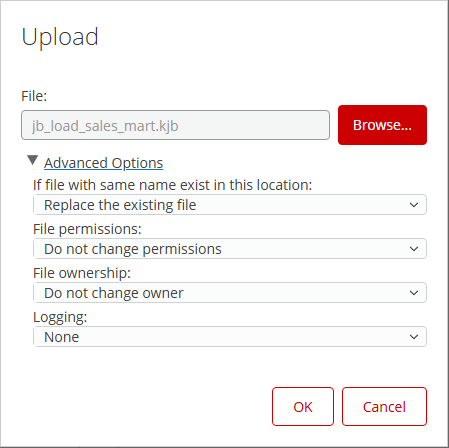
<figcaption>Upload, with its default options</figcaption>
</figure>
</div>

6. Upload the four `.ktr` files from the same folder the same way.

<div align="center">
<figure>
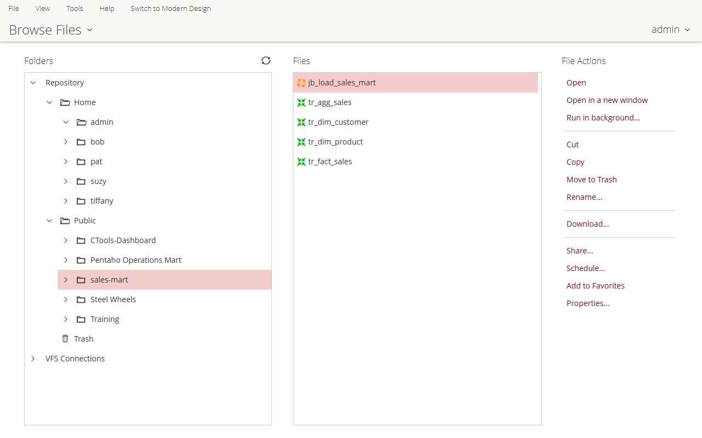
<figcaption>The job and its transformations in the repository</figcaption>
</figure>
</div>

> **Success:** Checkpoint: `sales-mart` lists the job `jb_load_sales_mart` and four transformations.

Uploading a file again replaces it, which is how a changed job reaches the server.

### 5. Schedule It Nightly

> **Note:**
>
> #### Schedule It Nightly
>
> The schedule belongs to the server: it runs the job every night, after the order system's extracts arrive, whether or not anyone is signed in.

1. Select `jb_load_sales_mart`. Under **File Actions**, select **Schedule...**.
2. Leave **Schedule Name** as `jb_load_sales_mart`, and select **Next**.

<div align="center">
<figure>
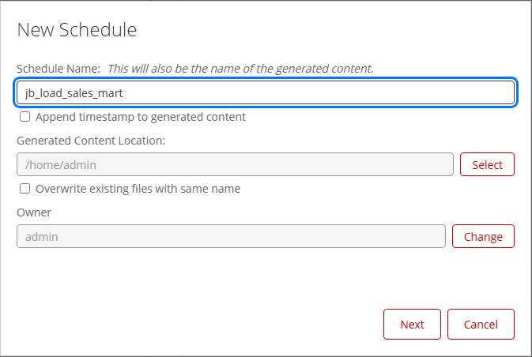
<figcaption>The schedule name</figcaption>
</figure>
</div>

3. Set **Recurrence** to **Daily** and **Start Time** to `02`, `00` and **AM**.
4. Select **Every**, and enter `1` before **day(s)**. Select **Next**.

<div align="center">
<figure>
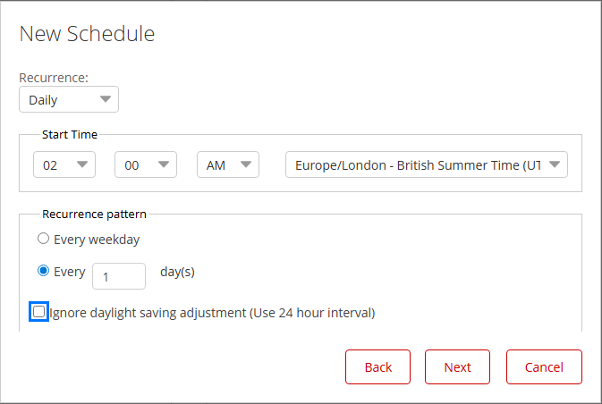
<figcaption>Every day at 02:00</figcaption>
</figure>
</div>

5. The next page lists the job's three parameters. Leave them empty, so each run uses the defaults in the job, and select **Next**.

<div align="center">
<figure>
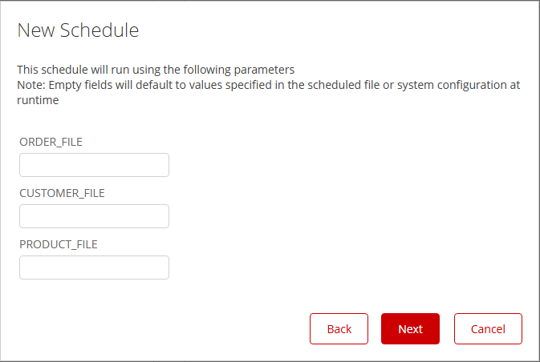
<figcaption>Empty fields keep the job defaults</figcaption>
</figure>
</div>

6. Leave **No** selected for email, and select **Finish**.
7. When the console asks to view your list of schedules, select **Yes**.

> **Success:** Checkpoint: **Manage Schedules** lists `jb_load_sales_mart`, every day at 02:00, with 3 under **Parameters & Variables** and **Next Run** at 02:00 tomorrow. **Last Run** is empty.

A real feed would put a date in each file name and pass it as a parameter. In this lab the files stay the same, and the load stays the same because it is safe to repeat.

### 6. Run It Now

> **Note:**
>
> #### Run It Now
>
> **Execute Now** runs a schedule at once, with the schedule's own settings, and leaves its nightly time alone. It proves tonight's run before tonight.

1. In **Manage Schedules**, select `jb_load_sales_mart`.
2. On the toolbar, select **Execute Now**, the calendar icon with a clock. Select **OK**.
3. Wait half a minute, and select **Refresh** on the toolbar.

<div align="center">
<figure>
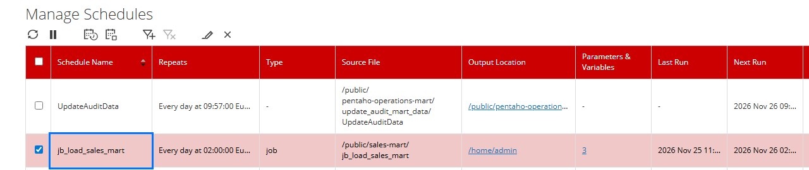
<figcaption>After Execute Now: Last Run is filled in</figcaption>
</figure>
</div>

> **Success:** Checkpoint: **Last Run** now shows the time of this run, and **Next Run** is still 02:00 tomorrow.

Spoon took no part in the run: the server did the work.

> **Under the hood:**
>
> #### The server's scheduler runs the job in the server's own process
>
> The scheduler started the job inside the Pentaho Server's Java process. It read the job and its four transformations from the repository, resolved `${Internal.Entry.Current.Directory}` to `/public/sales-mart`, and opened its own connections to MySQL with the driver in `tomcat\lib`. The job's log goes to the server log, `C:\Pentaho\server\pentaho-server\logs\pentaho.log`, not to Spoon.
>
> **Why it matters:** the load no longer depends on a designer's laptop being on at 2 a.m. It also means that anything the job needs, a file path or a JDBC driver, has to exist on the server, not only in Spoon.

### 7. Check the Load

> **Note:**
>
> #### Check the Load
>
> The scheduled run loaded the 15 May customer extract (no changes since you loaded it), the products (no changes) and the May orders, then rebuilt both summaries. The fact table should now hold every order line of the Steel Wheels data.

1. In DBeaver, run:

   ```sql
   SELECT COUNT(*), COUNT(DISTINCT order_number), SUM(quantity_ordered), SUM(sales_amount) FROM mart_fact_sales;
   SELECT order_number, date_key, customer_key, COUNT(*) FROM mart_fact_sales
   WHERE order_number IN (10417, 10424) GROUP BY order_number, date_key, customer_key;
   SELECT (SELECT COUNT(*) FROM agg_ym_line_mart_fact_sales) AS ym_line, (SELECT COUNT(*) FROM agg_y_terr_mart_fact_sales) AS y_terr;
   ```

> **Success:** Checkpoint: 2,996 order lines in 326 orders, 105,331 units and 10,645,949.18 in sales. Euro+ Shopping Channel's order `10417` of 13 May carries `customer_key` 11, Madrid, and its order `10424` of 31 May `customer_key` 123, Barcelona. The summaries hold 182 and 12 rows.

If the counts did not change, the job failed. Look in `pentaho.log` for the first error, fix it, and select **Execute Now** again: the job is safe to run again.

::::

## Troubleshooting <!-- no-step -->

<details>

<summary>The scheduled run fails with "Driver class 'com.mysql.cj.jdbc.Driver' could not be found"</summary>

The Pentaho Server has no MySQL driver. Copy it as in part 4, and restart the server: it loads drivers only when it starts.

</details>

<details>

<summary>The run fails because a file is not found</summary>

The parameters name files on the server's disk. On the lab machine the server and the workshop folder are on the same machine; check the paths in **Job properties** against `C:\Workshop-DP-Specialty`.

</details>

<details>

<summary>The job runs, but tr_fact_sales loads the April file again</summary>

The **Transformation** entry is not passing the job's parameters down, so the transformation uses its own default for `ORDER_FILE`. Select **Pass parameter values to sub transformation** on each entry's **Parameters** tab.

</details>

## Lab Files

Click a file to download. For `.ktr` and `.kjb` files, **Open in Pentaho Data Integration** launches Pentaho Data Integration with the file loaded. If Pentaho Data Integration is already running, the path is copied to your clipboard — switch to Pentaho Data Integration and press `Ctrl+O`, `Ctrl+V`, `Enter`.

The order line extract for May 2005, which the scheduled job loads (129 lines in 15 orders):

[order_lines_2005-05.csv](./files/order_lines_2005-05.csv)

### Solution <!-- no-step -->

The finished job for this lab. Open it alongside your own to compare, or run to see the expected result.

The four transformations it runs are beside it on disk. The job's three parameters name the files in `C:\Workshop-DP-Specialty`, so it runs from disk or from the repository.

Also on disk at `C:\Workshop-DP-Specialty\04-automate-and-publish\09-schedule-the-load-on-the-pentaho-server\solution`.

[jb_load_sales_mart.kjb](./files/jb_load_sales_mart.kjb) <button data-launch="spoon" data-path="files/jb_load_sales_mart.kjb">Open in Pentaho Data Integration</button> <button data-graph="files/jb_load_sales_mart.kjb">View graph</button>

---

> **Tip:** The mart now loads itself every night. Next, the part most often forgotten: telling the cube that its data has changed: [Refresh the Cube After a Load](../10-refresh-the-cube-after-a-load/guide.md).
