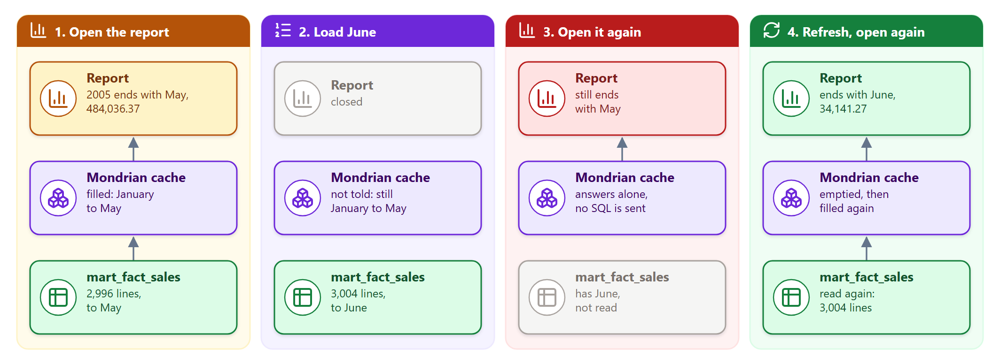
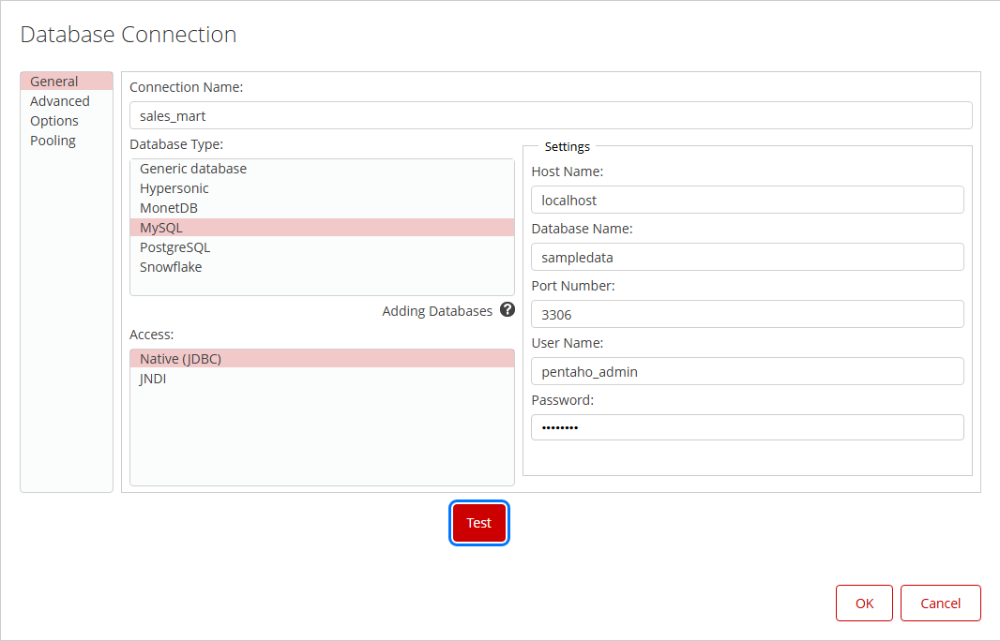
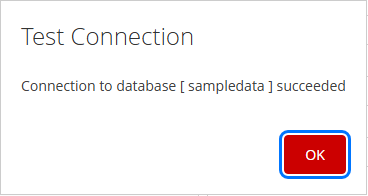
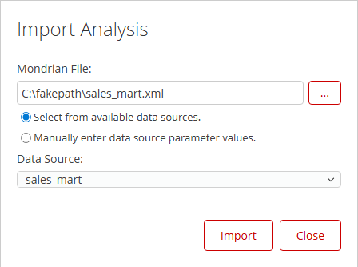
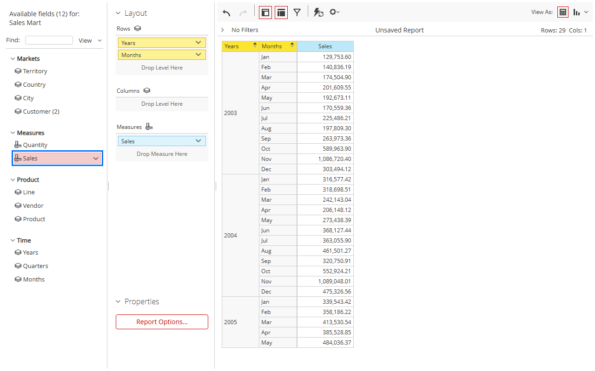
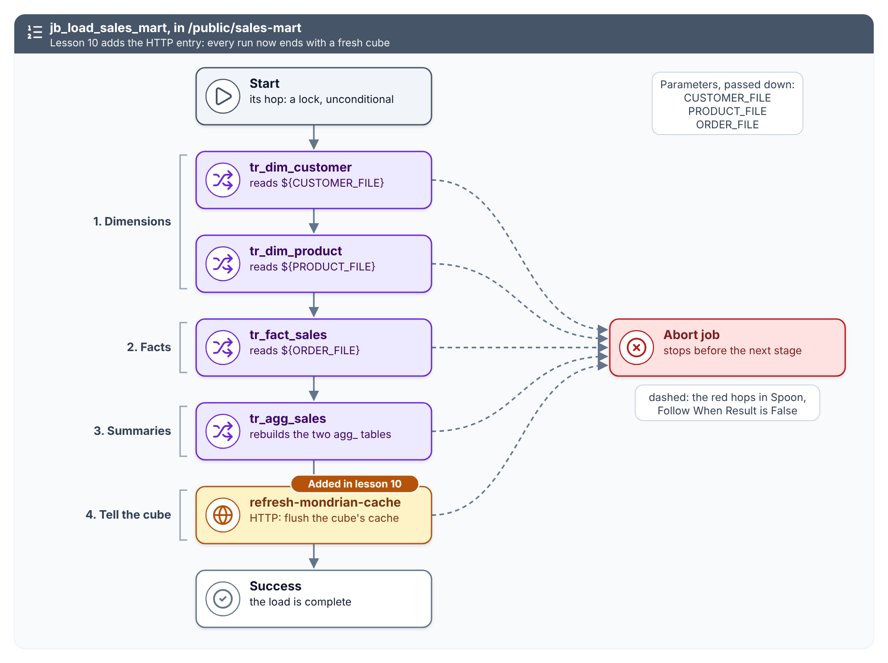
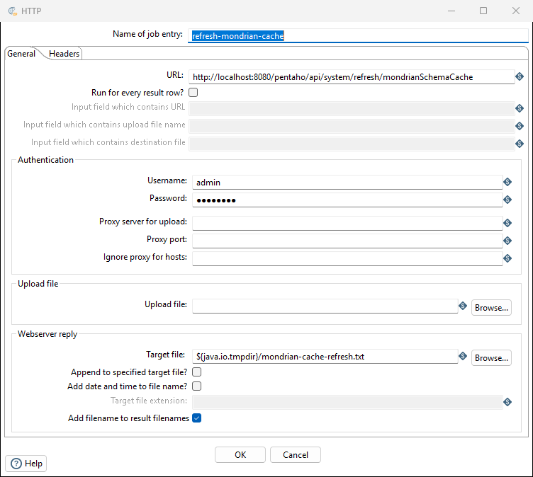
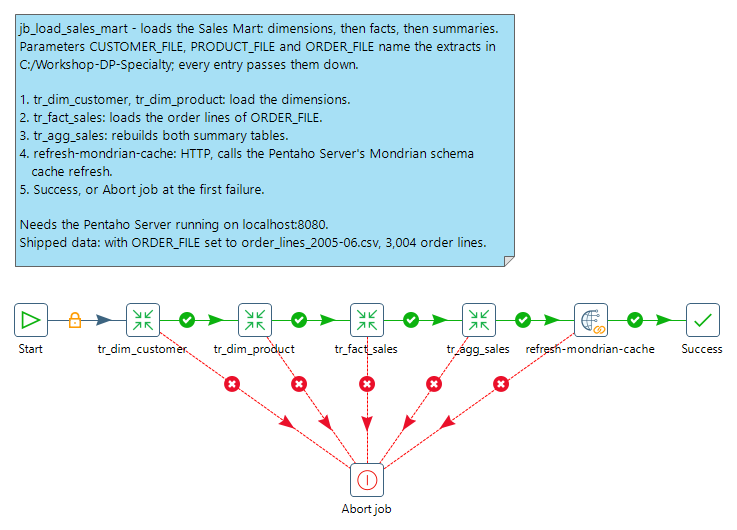

# Refresh the Cube After a Load

> **Warning:**
>
> #### Workshop - Refresh the Cube After a Load
>
> Publish the Sales Mart cube on the Pentaho Server, load three June orders into the mart, and watch the cube keep showing May: Mondrian answers from its cache until it is told the data has changed. Then flush the cache by hand, and finally make the load job flush it at the end of every run.
>
> **What you'll do**
>
> * Create the `sales_mart` data source in the User Console, and switch Mondrian's aggregate tables on.
> * Import the `sales_mart.xml` schema and build an Analyzer report of sales by month.
> * Load the June orders and see the report stay unchanged.
> * Flush the Mondrian cache with **Tools > Refresh > Mondrian Schema Cache**, and see June appear.
> * Add an **HTTP** entry to the load job that refreshes the cache after every load.
>
> **Prerequisites:** [Schedule the Load on the Pentaho Server](../09-schedule-the-load-on-the-pentaho-server/guide.md), with `mart_fact_sales` holding 2,996 order lines and `jb_load_sales_mart` in `/public/sales-mart`; an Analyzer license on the Pentaho Server; DBeaver connected to `sampledata` as `pentaho_admin`.
>
> **Estimated time:** 40 minutes

<figure>

<figcaption class="pcm-video-caption">Walkthrough: coming soon</figcaption>

</figure>

---

<div align="center">
<figure>

<figcaption>Why June is in the mart before it is in the report</figcaption>
</figure>
</div>

Read the diagram left to right, one moment per column, and each column bottom to top: the table, the cache in front of it, and the report. The arrows show what was read. In the third column nothing is read from the table, and that is the problem this workshop solves.

:::: tabs

### 1. Create the Data Source

> **Note:**
>
> #### Create the Data Source
>
> The cube reads the mart through a database connection defined on the Pentaho Server, separate from the one in your transformations. The schema names it, so its name must be exactly `sales_mart`.

1. Open the User Console with the button below, and sign in as `admin`.

<button data-launch="puc">Log into Pentaho User Console</button>

2. Select **File > Manage Data Sources**.
3. Select the gear, **More actions and options**, then **New Connection...**.
4. In **Database Connection**, set:

   | Field | Value |
   | ----- | ----- |
   | **Connection Name** | `sales_mart` |
   | **Database Type** | MySQL |
   | **Access** | Native (JDBC) |
   | **Host Name** | `localhost` |
   | **Database Name** | `sampledata` |
   | **Port Number** | `3306` |
   | **User Name** | `pentaho_admin` |
   | **Password** | `password` |

<div align="center">
<figure>

<figcaption>The sales_mart connection</figcaption>
</figure>
</div>

5. Select **Test**.

<div align="center">
<figure>

<figcaption>The connection test</figcaption>
</figure>
</div>

> **Success:** Checkpoint: the test reports that the connection to `sampledata` succeeded.

6. Select **OK** to close the test message, then **OK** to save the connection.

The connection uses the MySQL driver you copied to the server's `tomcat\lib` in [Schedule the Load on the Pentaho Server](../09-schedule-the-load-on-the-pentaho-server/guide.md).

### 2. Switch Aggregates On

> **Note:**
>
> #### Switch Aggregates On
>
> Mondrian ignores aggregate tables until two properties are true. The Pentaho BI Developer - SW course sets them for its own cubes; if you have done that course on this server, they are already set.

1. Open `C:\Pentaho\server\pentaho-server\pentaho-solutions\system\mondrian\mondrian.properties`.
2. Make sure it holds these two lines, and add them if not:

   ```properties
   mondrian.rolap.aggregates.Use=true
   mondrian.rolap.aggregates.Read=true
   ```

3. Save the file, and restart the Pentaho Server.

> **Success:** Checkpoint: the User Console's sign-in page opens again at `http://localhost:8080/pentaho`.

### 3. Publish the Schema

> **Note:**
>
> #### Publish the Schema
>
> `sales_mart.xml` is a finished Mondrian schema for the mart: a **Sales Mart** cube with **Time**, **Markets** and **Product** dimensions, the **Sales** and **Quantity** measures, and an `AggName` for each summary table. Importing it makes the cube available to Analyzer.

1. Sign in to the User Console as `admin`, and select **File > Manage Data Sources**.
2. Select the gear, then **Import Analysis...**.
3. Select the **...** button beside **Mondrian File** and choose `sales_mart.xml` from `C:\Workshop-DP-Specialty\04-automate-and-publish\10-refresh-the-cube-after-a-load` (also under **Lab Files** below).
4. Leave **Select from available data sources.** selected, set **Data Source** to `sales_mart`, and select **Import**.

<div align="center">
<figure>

<figcaption>Import Analysis on sales_mart</figcaption>
</figure>
</div>

> **Success:** Checkpoint: **Manage Data Sources** lists `SalesMart` as an Analysis data source.

5. Select **Close**.

The cube is now on the server, reading the mart through `sales_mart`.

> **Under the hood:**
>
> #### Mondrian keys the Markets dimension on the version, not the customer
>
> The schema's **Markets** hierarchy has `customer_key` as its primary key, and its **Customer** level uses `customer_key` as the member key with `customer_name` as the caption. So Euro+ Shopping Channel's two versions are two members, one under Madrid and one under Barcelona, each with the sales of the orders that point at it. When the schema loads, Mondrian also reads the two `AggName` elements and checks each summary table's columns against the cube.
>
> **Why it matters:** the history kept in [Load Dimensions with Slowly Changing History](../05-load-dimensions-with-slowly-changing-history/guide.md) reaches the analyst only because the cube is keyed on the surrogate key. Key the level on `customer_number` and the two versions collapse into one member again.

### 4. Sales by Month

> **Note:**
>
> #### Sales by Month
>
> An Analyzer report of sales by year and month shows what the cube knows. Open it once now, so Mondrian caches the answer.

1. In the User Console, select **Create New > Analysis Report**.
2. Select the `Sales Mart` cube of the `SalesMart` schema, and select **OK**.
3. Drag **Years** and then **Months** to **Rows**, and **Sales** to **Measures**.
<div align="center">
<figure>

<figcaption>Five months of 2005, ending with May</figcaption>
</figure>
</div>

4. Select **Save As** on the toolbar, and save the report as `Sales by Month` in `/public/sales-mart`.

> **Success:** Checkpoint: 2005 shows five months: Jan 339,543.42, Feb 358,186.22, Mar 413,530.54, Apr 385,528.85 and May 484,036.37. The months of 2003 add up to 3,677,384.00 and those of 2004 to 4,987,739.78.

5. Close the report's tab.

### 5. Load June

> **Note:**
>
> #### Load June
>
> The June extract holds three orders, eight lines in all, from customers who changed in May: Euro+ Shopping Channel in its new city, La Rochelle Gifts with its new credit limit, and Northwind Scale Models, the new customer. Load it with the job, from Spoon.

1. In Spoon, select **File > Open** (`Ctrl+O`) and open `jb_load_sales_mart.kjb` from `C:\Workshop-DP-Specialty\04-automate-and-publish\09-schedule-the-load-on-the-pentaho-server`.
2. Press `F9` (**Action > Run**). In the **Run Options** dialog, open the **Parameters** tab and set the **Value** of `ORDER_FILE` to:

   ```text
   C:\Workshop-DP-Specialty\04-automate-and-publish\10-refresh-the-cube-after-a-load\order_lines_2005-06.csv
   ```

3. Select **Run**.
4. In DBeaver, run:

   ```sql
   SELECT COUNT(*), SUM(sales_amount) FROM mart_fact_sales;
   SELECT order_number, customer_key, COUNT(*), SUM(sales_amount) FROM mart_fact_sales
   WHERE date_key >= 20050601 GROUP BY order_number, customer_key;
   ```

> **Success:** Checkpoint: 3,004 order lines and 10,680,090.45 in sales. The three June orders carry the current versions: `10426` key 123 (Euro+, Barcelona), `10427` key 124 (Northwind Scale Models) and `10428` key 4 (La Rochelle Gifts), 34,141.27 between them.

5. In the User Console, open `Sales by Month` from `/public/sales-mart` again.

> **Success:** Checkpoint: the report still shows five months for 2005, ending with May 484,036.37. June is in the mart, but not in the cube.


### 6. Flush the Cache by Hand

> **Note:**
>
> #### Flush the Cache by Hand
>
> **Tools > Refresh > Mondrian Schema Cache** tells every Mondrian schema on the server to drop what it has cached. The next query reads the database again.

1. In the User Console, select **Tools > Refresh > Mondrian Schema Cache**.
2. Open `Sales by Month` from `/public/sales-mart` again.

<div align="center">
<figure>

<figcaption>After the refresh: June appears</figcaption>
</figure>
</div>

> **Success:** Checkpoint: 2005 now shows six months, ending with Jun 34,141.27: 2,014,966.67 for the year so far.

The cache is what made the second look fast, and also what made it wrong.

> **Under the hood:**
>
> #### Mondrian caches members and cells, and never checks the database for changes
>
> The first time the report ran, Mondrian read the members of each level (the years, then the months of each year) into its member cache, and the summed cells into its segment cache. When the report opened again, every member and cell it needed was already in memory, so no SQL reached MySQL at all, and the June member, which did not exist when the months of 2005 were read, could not appear. Refreshing the schema cache discards both caches, so the next query reads the months again, finds June, and sums its sales.
>
> **Why it matters:** a cube on a nightly-loaded mart is wrong from the moment the load finishes until the cache is flushed. The flush belongs in the load job, right after the last table is written, not in a note asking someone to select a menu item every morning.

### 7. Flush the Cache from the Job

> **Note:**
>
> #### Flush the Cache from the Job
>
> The menu item calls a REST service on the Pentaho Server. An **HTTP** entry at the end of the load job calls the same service, so every successful load ends with a fresh cube.

<div align="center">
<figure>

<figcaption>The load job with refresh-mondrian-cache between tr_agg_sales and Success</figcaption>
</figure>
</div>

1. In Spoon, with `jb_load_sales_mart` open, delete the hop from **tr_agg_sales** to **Success**: right-click it and select **Delete**.
2. On the **Design** tab, open the **File management** folder and drag **HTTP** onto the canvas.
3. Create a hop from **tr_agg_sales** to **HTTP**, a hop from **HTTP** to **Success**, and a hop from **HTTP** to **Abort job**. Right-click the hop to **Abort job** and select **Evaluation > Follow When Result is False**.
4. Double-click **HTTP**. Set **Name of job entry** to `refresh-mondrian-cache`, and set:

   | Field | Value |
   | ----- | ----- |
   | **URL** | `http://localhost:8080/pentaho/api/system/refresh/mondrianSchemaCache` |
   | **Username** | `admin` |
   | **Password** | `password` |
   | **Target file** | `${java.io.tmpdir}/mondrian-cache-refresh.txt` |

   The service answers a plain GET, and needs a user who may administer the server.

<div align="center">
<figure>

<figcaption>refresh-mondrian-cache</figcaption>
</figure>
</div>

5. Select **OK**.
6. Double-click the note. After line 3, change the last lines to these, and select **OK**:

   ```text
   4. refresh-mondrian-cache: HTTP, calls the Pentaho Server's Mondrian schema
      cache refresh.
   5. Success, or Abort job at the first failure.

   Needs the Pentaho Server running on localhost:8080.
   Shipped data: with ORDER_FILE set to order_lines_2005-06.csv, 3,004 order lines.
   ```

7. Save the job (`Ctrl+S`).
8. Press `F9` (**Action > Run**), and select **Run** in the **Run Options** dialog with the default parameters. The load changes nothing, and the job ends by calling the service.
9. In **Execution Results**, open the **Job metrics** tab.

> **Success:** Checkpoint: every entry, `refresh-mondrian-cache` included, ends with **Result** `Success`, and the job reaches **Success**.

<div align="center">
<figure>

<figcaption>The finished job in Spoon</figcaption>
</figure>
</div>

10. In the User Console, upload `jb_load_sales_mart.kjb` to `/public/sales-mart` again, as in [Schedule the Load on the Pentaho Server](../09-schedule-the-load-on-the-pentaho-server/guide.md). It replaces the copy the schedule runs.

Every scheduled run of `jb_load_sales_mart` now ends with the cube refreshed. On a server cluster each node keeps its own cache, so the job would call each node in turn.

::::

## Troubleshooting <!-- no-step -->

<details>

<summary>Import Analysis fails, or the cube is not offered in Analyzer</summary>

The schema could not load. The most common causes are a data source name other than `sales_mart`, or a summary table whose columns do not match its `AggName`. Look in `C:\Pentaho\server\pentaho-server\logs\pentaho.log` for the Mondrian error, which names the element at fault.

</details>

<details>

<summary>refresh-mondrian-cache fails with a 401 or 403 error</summary>

The server refused the credentials. Compare **Username** and **Password** on the **HTTP** entry with the ones `admin` signs in to the User Console with.

</details>

<details>

<summary>June still does not appear after the refresh</summary>

The load did not reach `mart_fact_sales`, or `mart_dim_date` has no June 2005 rows. Run the queries of part 5; `mart_dim_date` covers all of 2005, so a missing June there means the date dimension was built with a smaller **Limit**.

</details>

## Lab Files

Click a file to download. For `.ktr` and `.kjb` files, **Open in Pentaho Data Integration** launches Pentaho Data Integration with the file loaded. If Pentaho Data Integration is already running, the path is copied to your clipboard — switch to Pentaho Data Integration and press `Ctrl+O`, `Ctrl+V`, `Enter`.

The Mondrian schema for the Sales Mart, with the two summary tables declared as aggregates:

[sales_mart.xml](./files/sales_mart.xml)

The June 2005 order line extract, three orders made up for this workshop (8 lines):

[order_lines_2005-06.csv](./files/order_lines_2005-06.csv)

### Solution <!-- no-step -->

The finished job for this lab. Open it alongside your own to compare, or run to see the expected result.

The four transformations it runs are beside it on disk. The job's three parameters name the files in `C:\Workshop-DP-Specialty`, so it runs from disk or from the repository.

Also on disk at `C:\Workshop-DP-Specialty\04-automate-and-publish\10-refresh-the-cube-after-a-load\solution`.

[jb_load_sales_mart.kjb](./files/jb_load_sales_mart.kjb) <button data-launch="spoon" data-path="files/jb_load_sales_mart.kjb">Open in Pentaho Data Integration</button> <button data-graph="files/jb_load_sales_mart.kjb">View graph</button>

---

> **Tip:** You have built every part of a mart: a generated date dimension, dimensions with history, a fact load, summaries, a schedule and a refresh. Next, build one on your own: [Capstone: A Mart for the Sales Cube](../11-capstone-a-mart-for-the-sales-cube/guide.md).
