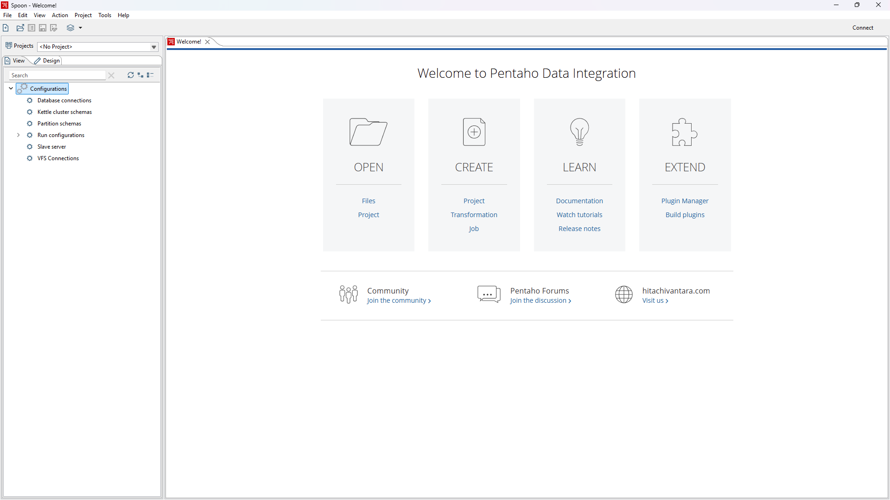
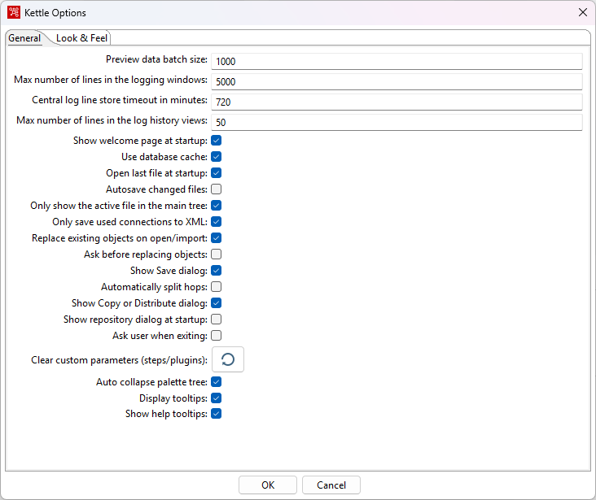
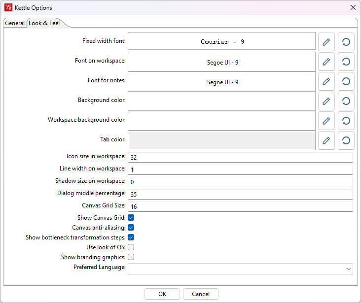
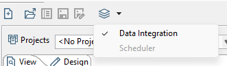

# Configuring Pentaho Data Integration

> **Warning:**
>
> #### Workshop - Configuring Pentaho Data Integration
>
> Set up Spoon, the Pentaho Data Integration designer, before you build anything in it: a few defaults that save time every day, and a look round the workspace you will use in every workshop.
>
> **What you'll do**
>
> * Start Spoon and find your way round its Welcome page
> * Change two General options: the Welcome page and the database cache
> * Turn on the canvas grid in Look & Feel
> * Switch perspectives, and see why Scheduler is unavailable
>
> **Prerequisites:** Pentaho Data Integration installed (see [Before You Start](../00-before-you-start/guide.md))
>
> **Estimated time:** 20 minutes

<figure>

<figcaption class="pcm-video-caption">Walkthrough: coming soon</figcaption>

</figure>

---

> **Note:**
>
> #### Spoon's options
>
> **Tools > Options** opens the **Kettle Options** dialog, where Spoon keeps its own settings. Its two tabs are **General** (how Spoon behaves) and **Look & Feel** (how the canvas looks). The settings are saved for your user, so they apply to every transformation and job you open.

:::: tabs

### 1. Start Spoon and read the Welcome page

1. Start Pentaho Data Integration with the button below, or from PowerShell:

```powershell
Set-Location C:\Pentaho\design-tools\data-integration
.\spoon.bat
```

<button data-launch="spoon" data-path="">Start Pentaho Data Integration</button>

2. Wait for Spoon to open. It loads all its plugins first, so it takes longer to start than most applications.
3. Look at the **Welcome!** tab. It has four panels:
   * **OPEN**: **Files**, to open a transformation or job you already have, and **Project**.
   * **CREATE**: **Project**, **Transformation** and **Job**. **Transformation** and **Job** are the same as **File > New**.
   * **LEARN**: **Documentation**, **Watch tutorials** and **Release notes**.
   * **EXTEND**: **Plugin Manager** and **Build plugins**, for adding plugins to Spoon.

   This course doesn't use projects: leave the **Projects** list above the **View** and **Design** tabs at `<No Project>`.

   Below them are links to the community and the forums.

<div align="center">
<figure>

<figcaption>The Welcome page</figcaption>
</figure>
</div>

> **Success:** Checkpoint: the title bar reads **Spoon - Welcome!**, and the left side has two tabs, **View** and **Design**.

### 2. Change the General options

1. Select **Tools > Options**. The **Kettle Options** dialog opens on the **General** tab.
2. Clear **Show welcome page at startup**. **Help > Welcome Screen** brings the page back whenever you want it.
3. Clear **Use database cache**.
4. Check that **Show repository dialog at startup** and **Ask user when exiting** are cleared. They are cleared by default; if either is selected, clear it.
5. Leave every other option as it is, and stay in the dialog for the next tab.

<div align="center">
<figure>

<figcaption>Kettle Options, General tab, before your changes</figcaption>
</figure>
</div>

> **Under the hood:**
>
> #### That option controls a metadata cache, not your data
>
> **Use database cache** tells Spoon to remember what it learns about a connection (table names, column names and types) and save it to disk in your `.kettle` folder, so the next **Get Fields** or SQL preview doesn't have to ask the database again. It never caches rows, only the *shape* of tables.
>
> Clearing it means every dialog re-reads the live schema. That is a little slower on a large database, and exactly what you want while you are still creating and altering tables, as the workshops ahead do: a cached column list can lag behind an `ALTER TABLE` and make a step insist a column doesn't exist when it does.
>
> **Why it matters:** when a step "can't see" a column you just added, the cache is the first suspect. Right-click the connection in the **View** tab and select **Clear DB Cache**; no restart needed.

### 3. Turn on the canvas grid

1. Still in **Kettle Options**, open the **Look & Feel** tab.
2. Select **Show Canvas Grid**.
3. Check that **Canvas Grid Size** is `16`. Steps you place on the canvas snap to this grid, so they line up.
4. Leave **Canvas anti-aliasing** selected and the other options as they are.
5. Select **OK** to save the options and close the dialog.

<div align="center">
<figure>

<figcaption>Kettle Options, Look & Feel tab</figcaption>
</figure>
</div>

6. Select **File > New > Transformation** (or `Ctrl+N`) to open an empty canvas.

> **Success:** Checkpoint: the new transformation's canvas shows a grid of dots. Close the empty transformation without saving it.

<div class="pcm-embed-card" data-href="https://docs.pentaho.com/pdia-data-integration/customizing-pdi" data-title="Customizing Pentaho Data Integration | Pentaho Documentation"></div>

### 4. Switch perspectives

A perspective is a whole-window layout for one kind of work. You design transformations and jobs in **Data Integration**, and schedule them in **Scheduler**.

1. On the toolbar, select the arrow beside the **Perspective** icon (the stack of layers).
2. The menu lists **Data Integration**, with a check mark, and **Scheduler**, which is grayed out: **Scheduler** needs a connection to a repository on a Pentaho Server, because the server runs the schedules. These workshops save files to disk, so you stay in **Data Integration** throughout.
3. Select **Data Integration** to close the menu and stay in the design perspective.

<div align="center">
<figure>

<figcaption>The perspective menu</figcaption>
</figure>
</div>

> **Success:** Checkpoint: **Data Integration** has a check mark, and **Scheduler** can't be selected.

<div class="pcm-embed-card" data-href="https://docs.pentaho.com/pdia-data-integration/use-the-pdi-client-perspectives" data-title="Use the Pentaho Data Integration client perspectives | Pentaho Documentation"></div>

### 5. Restart Spoon

1. Close Spoon (**File > Exit**). It closes without asking, because **Ask user when exiting** is cleared.
2. Start Spoon again.

> **Success:** Checkpoint: Spoon opens on an empty workspace with no **Welcome!** tab, and no repository dialog appears.

::::

## Lab Files

_No bundled files for this lab._
