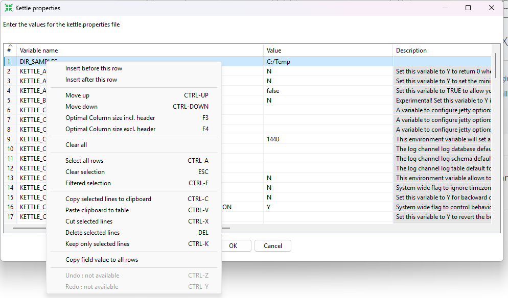
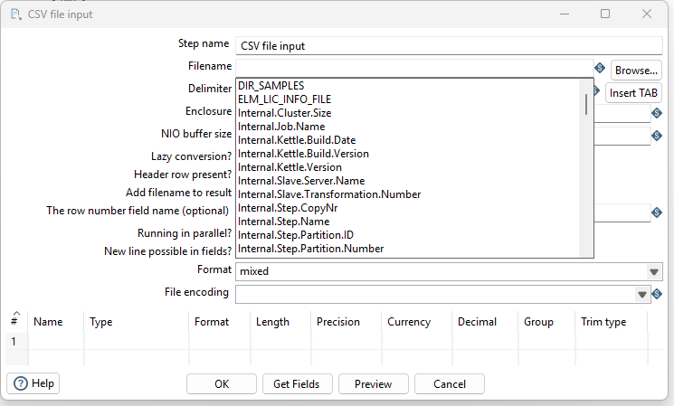
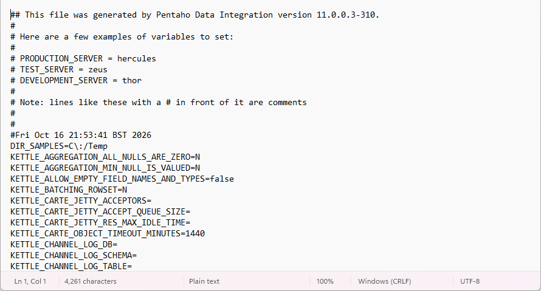

# KETTLE Variables

> **Warning:**
>
> #### Workshop - Kettle Variables
>
> Keep paths and values out of your transformations. A variable in `kettle.properties` holds a value for every transformation and job you run on this machine; the files hold only its name.
>
> **What you'll do**
>
> * Add a global variable, `DIR_SAMPLES`, from Spoon's kettle.properties editor
> * Insert it into a step's setting with `Ctrl+Space`
> * Check which variables a transformation uses, and their values
> * Write the same reference in both formats, `${VAR}` and `%%VAR%%`
> * Edit `kettle.properties` in a text editor, and know when Spoon reads it
>
> **Prerequisites:** [Configuring PDI](../01-mod1-configuring-pdi/guide.md)
>
> **Estimated time:** 25 minutes

<div class="pcm-embed-card" data-href="https://www.loom.com/share/89d5419da317432eb272b583e30f8904?hideEmbedTopBar=true&amp;hide_owner=true&amp;hide_share=true&amp;hide_title=true" data-title="Defining and Managing Variables in Kettle.Properties" data-description="In this video, I demonstrate how to define variables in the Kettle.Properties file and view the variables currently loaded into memory using Spoon. I guide you through the process of editing the Kettle.Properties file to add new variables, specifically for our sales database server name and database name, while emphasizing the importance of using case sensitivity. After editing, I show you how these new variables appear in the run dialog, confirming they are loaded into memory. Please remember that this file is meant for global variables across environments, and I recommend creating separate properties files for specific transformations or jobs. Your action is to review the steps and consider how you might implement variable definitions in your own projects." data-thumb="../_assets/embeds/2d94cd73b9b2.png"></div>

> **Note:**
>
> #### Global variables and kettle.properties
>
> A variable is a name with a value. You set global variables in the `kettle.properties` file in your `.kettle` folder, and a **Set variables** step can set them while a job runs.
>
> A step setting refers to a variable by name, in either of two formats, which you can mix:
>
> * `${VARIABLE}`, the Unix style
> * `%%VARIABLE%%`, the Windows style
>
> A setting that accepts variables shows a small `$` icon at its right. Press `Ctrl+Space` in that setting to pick from the variables PDI knows.


## 1. Add a variable from Spoon

1. Start Pentaho Data Integration with the button below, or from a terminal:

::: tabs

### Windows (PowerShell)

```powershell
Set-Location C:\Pentaho\design-tools\data-integration
.\spoon.bat
```

### macOS / Linux

```bash
cd ~/Pentaho/design-tools/data-integration
./spoon.sh
```

:::

<button data-launch="spoon" data-path="">Start PDI</button>

2. Select **Edit > Edit the kettle.properties file** (`Ctrl+Alt+P`). The **Kettle properties** dialog opens, with the columns **Variable name**, **Value** and **Description**. It lists PDI's own variables (most of their names start with `KETTLE_`) and any variables already in the file.
3. Right-click the first row and select **Insert before this row**.
4. In the new row, set **Variable name** to `DIR_SAMPLES`, and **Value** to the folder for your operating system:

::: tabs

### Windows

```properties
C:/Temp
```

### Linux/macOS

```properties
/home/pentaho/Temp
```

:::

5. Select **OK**. Spoon writes the file.

<figure>



<div align="center">
<figcaption><em>Edit kettle.properties from Spoon</em></figcaption>
</div>
</figure>

> **Success:** Checkpoint: select **Edit > Edit the kettle.properties file** again. The `DIR_SAMPLES` row is there with your value. Select **Cancel**.

Variable names are case-sensitive: `${DIR_SAMPLES}` and `${dir_samples}` are two different variables. Use one style, such as capitals with underscores, everywhere.

## 2. Use the variable in a step

1. Select **File > New > Transformation** (`Ctrl+N`).
2. On the **Design** tab, open the **Input** folder and drag **CSV file input** onto the canvas.
3. Double-click the step to open it.
4. Click in **Filename**, at the start of the empty field, and press `Ctrl+Space`. A list of variables opens.
5. Double-click `DIR_SAMPLES` in the list (or select it and press `Enter`). The field shows `${DIR_SAMPLES}`.
6. Type `/sales.csv` after it, so the field reads `${DIR_SAMPLES}/sales.csv`.
7. Select **OK**. The file does not need to exist for this workshop.

<figure>



<div align="center">
<figcaption><em><code>Ctrl+Space</code> in a field lists the variables</em></figcaption>
</div>
</figure>

8. Select **Edit > Show Used Environment Variables** (`Ctrl+L`). The **Existing variables** dialog lists the variables that the open files refer to.

> **Success:** Checkpoint: `DIR_SAMPLES` is in the list, with the value you set (`C:/Temp` or `/home/pentaho/Temp`).

9. Close the **Existing variables** dialog.

> **Under the hood:**
>
> #### The `.ktr` stores the name, never the value
>
> When you inserted `${DIR_SAMPLES}`, the step saved exactly that text into its XML. Nothing resolved it. Resolution happens at run time, when the transformation starts: the engine looks the name up in its variables (`kettle.properties`, plus anything set by a parent job or the run dialog) and substitutes the value into the step's settings just before the step opens the file.
>
> That is why the same transformation opens `C:/Temp` on this machine and `/home/pentaho/Temp` on a Linux server without a single edit. The file carries the *name*; each environment supplies the *value*.
>
> **Why it matters:** a `.ktr` with no literal paths in it can be committed to git, copied to a server and handed to a colleague, and it runs in all three places. The environment is configuration, not code.

## 3. Write the Windows-style format

1. Double-click **CSV file input** again.
2. Change **Filename** to `%%DIR_SAMPLES%%/sales.csv`.
3. Select **OK**.
4. Select **Edit > Show Used Environment Variables** (`Ctrl+L`) again.

> **Success:** Checkpoint: `DIR_SAMPLES` is still listed with the same value. PDI reads `${DIR_SAMPLES}` and `%%DIR_SAMPLES%%` as the same variable.

5. Close the transformation without saving it.

> **Note:** The courses use `${...}` throughout, because it is the form PDI writes when you insert a variable with `Ctrl+Space`. You may meet `%%...%%` in older transformations.

## 4. Edit kettle.properties in a text editor

`kettle.properties` is a plain text file, one `name=value` line per variable, so you can also edit it outside Spoon: on a server with no Spoon, for example.

1. Open the file in a text editor. It is in your `.kettle` folder: `C:\Users\<username>\.kettle\kettle.properties` on Windows, `~/.kettle/kettle.properties` on Linux and macOS.

::: tabs

### Windows (PowerShell)

```powershell
notepad $env:USERPROFILE\.kettle\kettle.properties
```

### Linux/macOS

```bash
nano ~/.kettle/kettle.properties
```

:::

2. Find the `DIR_SAMPLES` line that Spoon wrote in step 1. On Windows it reads `DIR_SAMPLES=C\:/Temp`: Spoon saves the file in Java's properties format, which escapes a colon with a backslash. `C\:/Temp` and `C:/Temp` mean the same value, so either works when you type a line yourself.
<figure>



<div align="center">
<figcaption><em>The same file in a text editor, on Linux</em></figcaption>
</div>
</figure>

> **Success:** Checkpoint: the file has a `DIR_SAMPLES=` line with your folder.

3. Close the editor without changing anything.

> **Warning:** Spoon's editor rewrites the whole file each time you select **OK**: comments you typed by hand are lost, and those of PDI's own variables that have a default value are written out with it. Keep notes about your variables somewhere else, such as a README beside your project.
>
> Spoon and the PDI engine read `kettle.properties` when they start. A value you add in Spoon's editor (step 1) takes effect at once, because Spoon also applies it to every open file. A value you change in a text editor takes effect only after you restart Spoon, or in the next Pan or Kitchen run.

<div class="pcm-embed-card" data-href="https://docs.pentaho.com/pdia-data-integration/data-integration-perspective-in-the-pdi-client/advanced-topics-pdi-perspective/pdi-run-modifiers/variables/kettle-variables" data-title="Kettle Variables | Pentaho" data-thumb="../_assets/embeds/267325a87400.png"></div>

## Lab Files

Click a file to download. For `.ktr` and `.kjb` files, **Open in Pentaho Data Integration** launches PDI with the file loaded. If PDI is already running, the path is copied to your clipboard — switch to PDI and press `Ctrl+O`, `Ctrl+V`, `Enter`.

### Solution <!-- no-step -->

The finished result of this lab: the `DIR_SAMPLES` line it adds. **Merge** that line into your own `kettle.properties`; don't copy this file over yours, or you lose any variables you have already set.

Also on disk at `C:\Workshop-DI-Practitioner\02-components-concepts\01-components\02-mod1-kettle-variables\solution`.

[kettle.properties](./files/solution/kettle.properties)
