# Hello World

> **Warning:**
>
> #### Workshop - Hello World
>
> Build a minimal transformation in Spoon. Use steps, hops, and notes. Preview data and review execution metrics.
>
> **What you'll do**
>
> * Create and save a transformation
> * Add and configure **Generate rows** and **Dummy (do nothing)**
> * Connect the steps with a hop
> * Add a note and set the transformation's properties
> * Preview data from a step
> * Run the transformation and review the results
>
> **Prerequisites:** Pentaho Data Integration installed and configured (see [Configuring PDI](../01-mod1-configuring-pdi/guide.md))
>
> **Estimated time:** 25 minutes

<figure>
<figcaption class="pcm-video-caption">Walkthrough: coming soon</figcaption>
</figure>

<div align="center">
<figure>

<figcaption>What you build</figcaption>
</figure>
</div>

:::: tabs

### 1. Generate Rows

> **Note:**
>
> #### Generate Rows
>
> **Generate rows** outputs a set number of rows. By default the rows are empty, but you can also give every row the same field values, as test data: for example, generate 12 rows for 12 months.
>
> **Generate rows** is also useful as a one-row "starter" step.

1. Start Spoon with the **Start PDI** button below, or from PowerShell:

```powershell
Set-Location C:\Pentaho\design-tools\data-integration
.\spoon.bat
```

<button data-launch="spoon" data-path="">Start Pentaho Data Integration</button>

2. Select **File > New > Transformation** (`Ctrl+N`).
3. Select **File > Save as** and save it as `tr_hello_world.ktr` in `C:\Workshop-DI-Practitioner\02-components-concepts\02-key-concepts\03-mod2-hello-world`. The Logging workshop starts from this file.
4. On the **Design** tab, open the **Input** folder and drag **Generate rows** onto the canvas.

> **Tip:** To find a step faster, type part of its name, such as `generate`, in the search box at the top of the **Design** tab.

<div align="center">
<figure>
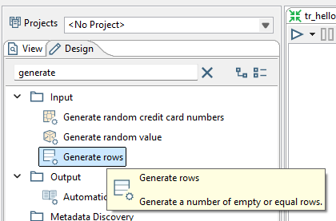
<figcaption>Generate rows in the Input folder</figcaption>
</figure>
</div>

5. Double-click **Generate rows**.
6. Set **Step name** to `gr_hello-world`.
7. Set **Limit** to `10`.
8. Fill the **Fields** grid with one row:

| Name      | Type   | Value         |
| --------- | ------ | ------------- |
| `message` | String | `hello world` |

<div align="center">
<figure>
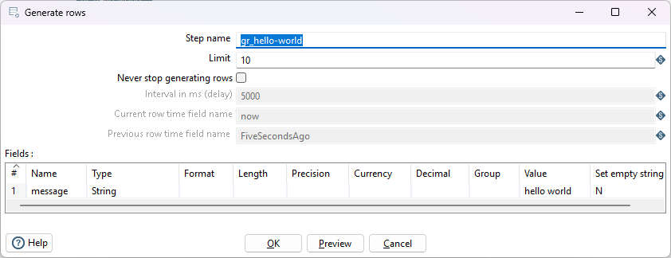
<figcaption>Generate rows settings; name the step gr_hello-world</figcaption>
</figure>
</div>

9. Select **Preview**, enter `100` rows in the **Enter preview size** dialog, and select **OK**. The step makes only as many rows as its **Limit**.

<div align="center">
<figure>
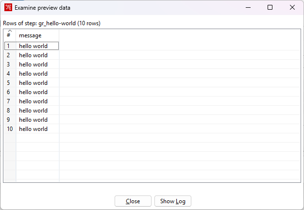
<figcaption>Examine preview data</figcaption>
</figure>
</div>

> **Success:** Checkpoint: **Examine preview data** shows 10 rows, and every row's `message` is `hello world`.

10. Select **Close**.
11. Select **OK**.
12. Save the transformation (`Ctrl+S`).

> **Under the hood:**
>
> #### Preview built a throwaway transformation and ran it
>
> The **Preview** button inside a step dialog doesn't simulate
> anything. Spoon generated a tiny transformation in memory — this one
> step, hopped to a hidden **Dummy** — handed it to the same engine
> that runs your real work, let it produce the number of rows you
> asked for, then threw it away. Your canvas and the step's saved
> settings were never touched.
>
> Because a transformation is not compiled or deployed, spinning one
> up like this costs milliseconds. That is why Preview is worth
> pressing after every change rather than once at the end.
>
> **Why it matters:** what you see in Preview is exactly what the step
> will emit at run time — same types, same formats, same values — so a
> preview that looks right *is* the test.

### 2. Dummy

> **Note:**
>
> #### Dummy
>
> **Dummy (do nothing)** passes on the rows it receives without changing them. Use it as a placeholder during development: it is handy when you need a second step to connect.

1. On the **Design** tab, open the **Flow** folder and drag **Dummy (do nothing)** onto the canvas, below **gr_hello-world**. Keep its step name, `Dummy (do nothing)`.

<div align="center">
<figure>
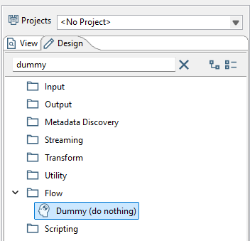
<figcaption>Dummy (do nothing) in the Flow folder</figcaption>
</figure>
</div>

### 3. Hops and Notes

> **Note:**
>
> #### Hops and Notes
>
> Hops define row flow between steps. PDI buffers rows between steps as the transformation runs. A note is text on the canvas that documents the flow for the next person who opens the file.

1. Create a hop from **gr_hello-world** to **Dummy (do nothing)**: hold `Shift` and drag from one step to the other. An arrow now joins the two steps.

> **Under the hood:**
>
> #### A hop is a buffer between two threads
>
> That arrow isn't a pointer from one step to the next. At run time it
> becomes a **row set**: an in-memory queue, 10,000 rows deep by
> default (**Transformation properties > Miscellaneous > Nr of rows in
> rowset**), with `gr_hello-world` writing into one end from its own
> thread and **Dummy** reading from the other end on *its* thread.
>
> The queue is bounded on purpose. If the reader is slower, the buffer
> fills and the writer blocks until space frees up. The engine calls
> this back-pressure, and it is what keeps a transformation's memory
> flat no matter how many rows pass through.
>
> **Why it matters:** rows flow; they don't accumulate. A pipeline
> that handles 10 rows in this lab handles 10 million the same way,
> holding only what is in flight.

2. Right-click an empty part of the canvas and select **New Note...**. The **Notes** dialog opens.
3. On the **Note** tab, enter the note in the form every solution in this course uses: the file name and what it does, a numbered line for each step, then what a run gives you:

   ```text
   tr_hello_world - generates 10 rows with the message hello world.

   1. gr_hello-world: Generate Rows, limit 10, one field message (String) = hello world.
   2. Dummy (do nothing): receives the rows and passes them on.

   Shipped data: 10 rows, each with message hello world.
   ```

4. Optional: to give the note the course's look, open the **Font style** tab. Set **Font name** to `Segoe UI` and **Font size** to `10`, set **Background color** to red `167`, green `224`, blue `245`, and **Border color** to red, green and blue `100`.
5. Select **OK**.
6. Drag the note above the two steps.

> **Tip:** Every solution in this course carries one note like this, above its steps. Open a solution, and its note tells you what each step does and what the run should give you before you run it.

<div align="center">
<figure>
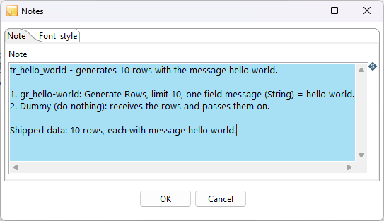
<figcaption>Notes - the Note tab</figcaption>
</figure>
</div>

<div align="center">
<figure>
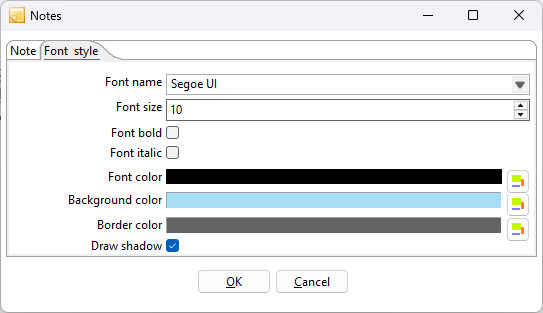
<figcaption>Notes - font and style</figcaption>
</figure>
</div>

### 4. Transformation Properties

> **Note:**
>
> #### Transformation Properties
>
> The **Transformation properties** dialog holds the transformation's name and description, and the settings that apply to the whole transformation, such as the size of the row sets between steps.

1. Double-click an empty part of the canvas (or select **Edit > Settings...**). The **Transformation properties** dialog opens on the **Transformation** tab.
2. Set **Transformation name** to `tr_hello_world`.
3. Set **Description** to `Hello World Transformation`.
4. Set **Extended description** to `This transformation generates 10 rows with the message Hello World.`
5. In **Status**, select **Production**.
6. Set **Version** to `1.0`.

<div align="center">
<figure>
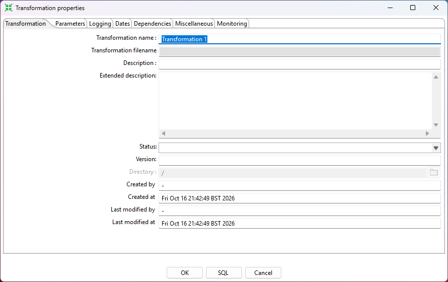
<figcaption>Transformation properties, before your changes</figcaption>
</figure>
</div>

7. Select **OK**.
8. Save the transformation (`Ctrl+S`).

### 5. Run

> **Note:**
>
> #### Run the Transformation
>
> Run the transformation on this machine, with the **Pentaho local** run configuration, and read what happened in **Execution Results**.

1. Press `F9` (**Action > Run**), or select **Run** on the toolbar. The **Run Options** dialog opens.

<div align="center">
<figure>
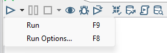
<figcaption>Run from the toolbar</figcaption>
</figure>
</div>

2. Keep **Run configuration** as **Pentaho local** and **Log level** as **Basic**, and select **Run**.
3. If the **File has changed!** dialog asks you to save the transformation, select **Yes**. Select **Automatically save the transformation.** first if you want Spoon to save without asking next time.

<div align="center">
<figure>
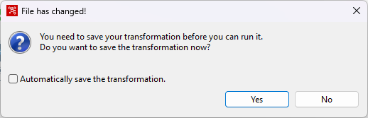
<figcaption>Save before running</figcaption>
</figure>
</div>

<div align="center">
<figure>
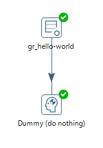
<figcaption>Green check marks indicate successful execution</figcaption>
</figure>
</div>

> **Success:** Checkpoint: both steps show a green check mark on the canvas. A check mark means the step finished without an error; it doesn't prove the data is right. The tabs of **Execution Results**, below the canvas, show what each step did.

4. In **Execution Results**, open the **Logging** tab. It shows the log lines each step wrote.

<div align="center">
<figure>
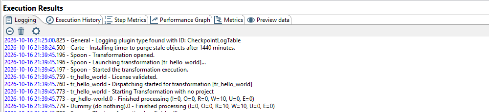
<figcaption>Logging</figcaption>
</figure>
</div>

> **Success:** Checkpoint: the log has a `Finished processing` line for each step: `gr_hello-world.0` with `W=10`, and `Dummy (do nothing).0` with `R=10, W=10`.

5. Open the **Step Metrics** tab. It has a row of statistics for every step: rows read and written, errors, time and speed (rows per second).

> **Success:** Checkpoint: **gr_hello-world** shows **Written** 10, and **Dummy (do nothing)** shows **Read** 10 and **Written** 10. **Errors** is 0 for both.

<div align="center">
<figure>
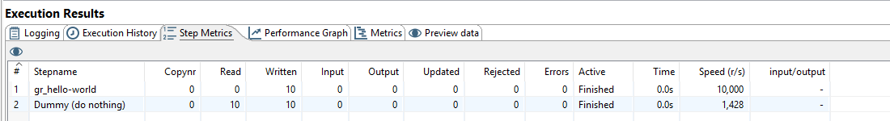
<figcaption>Step Metrics</figcaption>
</figure>
</div>

> **Under the hood:**
>
> #### Read, Written, Input and Output are four different counters
>
> Step Metrics shows two pairs that look alike but measure different
> things. **Read** and **Written** count rows moving *between steps*
> over hops — taken from an incoming row set, placed on an outgoing
> one. **Input** and **Output** count traffic with the *outside
> world* — lines read from a file, rows fetched from a database,
> records written to a table.
>
> So `gr_hello-world` reports 10 Written and 0 Input (it invented its
> rows), and **Dummy** reports 10 Read and 0 Output (it wrote nothing
> anywhere). A **Table output** at the end of a real pipeline should
> show Output equal to Read — and if it doesn't, rows were rejected
> inside it.
>
> **Why it matters:** these four numbers are the fastest audit you
> have. A writer whose Output is lower than its Read, or a pass-through
> step whose Written is lower than its Read, names the step to
> investigate before anyone opens a log.

6. Open the **Metrics** tab. It draws how long each part of the run took: the transformation, each step's initialization, and each step's execution.

<div align="center">
<figure>
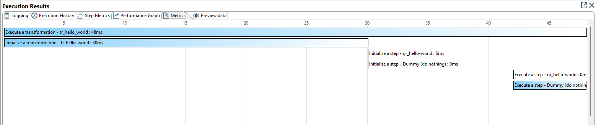
<figcaption>Metrics</figcaption>
</figure>
</div>

In the screenshot the whole run took 30 ms, and `gr_hello-world` and `Dummy (do nothing)` initialize at the same moment: each step runs in its own thread, in parallel. On a slow run, these bars help you find the bottleneck.

7. Select **Dummy (do nothing)** on the canvas and open the **Preview data** tab. It shows the rows of the step selected on the canvas.

<div align="center">
<figure>
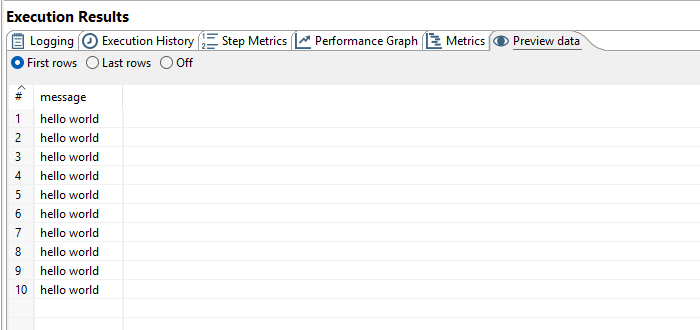
<figcaption>Preview data</figcaption>
</figure>
</div>

> **Success:** Checkpoint: 10 rows, each with `message` `hello world`.

8. Select the **View** tab, at the top left beside **Design**. Under **Configurations**, it lists what a transformation can use besides its steps: database connections, cluster and partition schemas, run configurations, slave servers and VFS connections. The steps themselves are on the canvas.

<div align="center">
<figure>
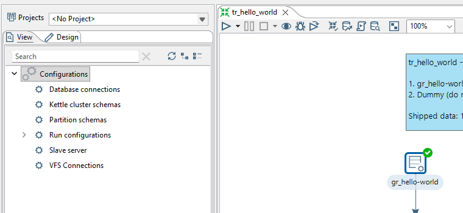
<figcaption>View</figcaption>
</figure>
</div>

> **Success:** Checkpoint: under **Configurations**, the tree lists **Database connections**, **Run configurations**, **Slave server** and **VFS Connections**, among others.

::::

## Lab Files

Click a file to download. For `.ktr` and `.kjb` files, **Open in Pentaho Data Integration** launches PDI with the file loaded. If PDI is already running, the path is copied to your clipboard — switch to PDI and press `Ctrl+O`, `Ctrl+V`, `Enter`.

### Solution <!-- no-step -->

The finished transformation for this lab. Open it alongside your own to compare, or run to see the expected result.

Also on disk at `C:\Workshop-DI-Practitioner\02-components-concepts\02-key-concepts\03-mod2-hello-world\solution`.

[tr_hello_world.ktr](./files/tr_hello_world.ktr) <button data-launch="spoon" data-path="files/tr_hello_world.ktr">Open in Pentaho Data Integration</button> <button data-graph="files/tr_hello_world.ktr">View graph</button>
