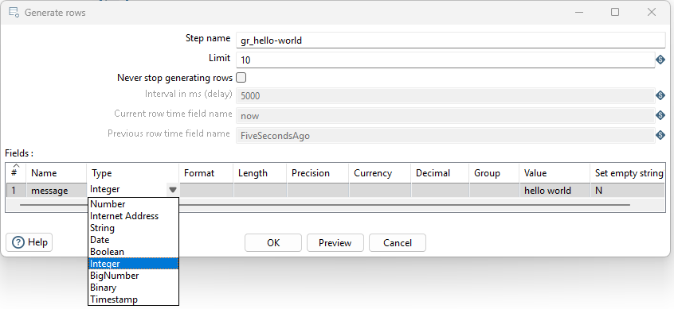
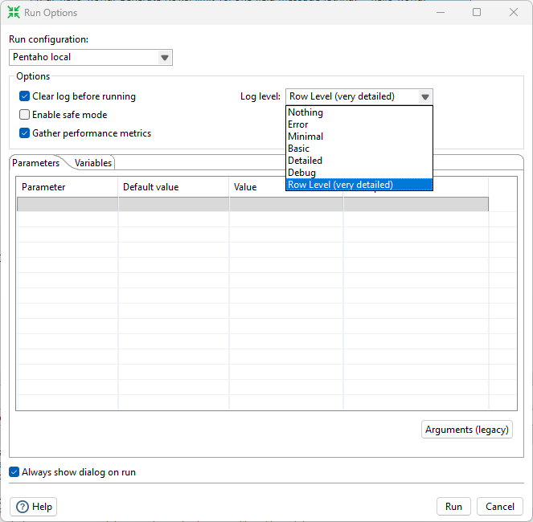
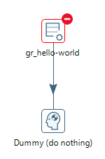
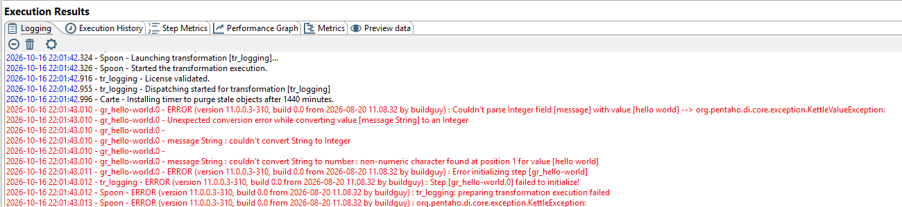
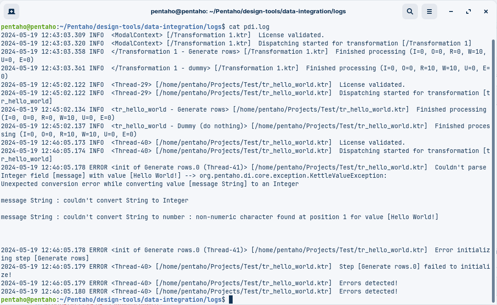

# Logging

> **Warning:**
>
> #### Workshop - Logging
> 
> Use logging to diagnose a failing transformation. You create a controlled data-type error, then use the log level and the log output to find its cause.
> 
> **What you’ll do**
> 
> * Change field metadata to trigger an error
> * Run with **Basic** and **Row Level (very detailed)** logging
> * Use **Execution Results** to find the failing step
> * Locate the same error in `pdi.log`
> 
> **Prerequisites:** Complete the **[Hello World](../03-mod2-hello-world/guide.md)** workshop
> 
> **Estimated time:** 20 minutes

<div class="pcm-embed-card" data-href="https://www.loom.com/share/868c1e73bdeb464e9ef5c2dd3c220d61?hideEmbedTopBar=true&amp;hide_owner=true&amp;hide_share=true&amp;hide_title=true" data-title="Mastering Spoon's Logging Tab for Effective Error Tracking 🛠️" data-description="In this video, I demonstrate how to effectively use Spoon's Logging tab to troubleshoot execution errors in transformations. We explore the log's contents, including how to identify error messages and their associated steps, and I show you how to filter for error lines to simplify the debugging process. I also highlight the importance of checking data types, as we encountered an unexpected conversion error due to a mismatch between defined field types and entered data. After correcting the configuration, I ran the transformation successfully and compared the logging levels. I encourage you to practice these techniques in your PDI test environment by intentionally misconfiguring transformations and analyzing the logs to track down errors." data-thumb="../_assets/embeds/2d94cd73b9b2.png"></div>

> **Note:** **Create a new transformation**
> 
> Use any of these options to open a new transformation tab:
> 
> * Select **File** > **New** > **Transformation**
> * Use `Ctrl+N` (Windows/Linux) or `Cmd+N` (macOS)

<figure>


<div align="center">
<figcaption><em>Start from your Hello World transformation</em></figcaption>
</div>
</figure>

:::: tabs

### 1. Modify Generate Rows

> **Note:** Start from the transformation you built in **Hello World**.

> **Note:**
>
> #### **Generate Rows**
> 
> **Generate Rows** makes test data, which makes it a quick way to try out logging and error handling.

> **Warning:** To create an error, change the field type for `message` from **String** to **Integer**.

1. Double-click the **Generate Rows** step.
2. Change the type for `message` to **Integer**.

<div align="center"><figure><figcaption><p>Change data type</p></figcaption></figure></div>

3. Select **OK**.

### 2. Run

> **Note:**
>
> #### Run the transformation
> 
> Run with a higher log level to see row-level detail.

1. Select **Run** in the toolbar. **Run Options** opens.
2. Set **Log level** to **Basic** and select **Run**. The run fails.
3. Select **Run** again, and this time set **Log level** to **Row Level (very detailed)**.

<div align="center"><figure><figcaption><p>Set the log level to Row Level (very detailed)</p></figcaption></figure></div>

4. Select **Run**. The run fails again, and the failing step is marked on the canvas.

<figure><figcaption><p>The failing step is marked</p></figcaption></figure>

5. In **Execution Results**, open the **Logging** tab.

<figure><figcaption><p>Logging - error</p></figcaption></figure>

Look for the first **ERROR** line. It names the step and the value it couldn't convert:

```text
Couldn't parse Integer field [message] with value [hello world]
```

The lines after it say the step `gr_hello-world` failed to initialize, so the transformation stopped before any row moved.

> **Under the hood:**
>
> #### The log level is a filter, not a search
>
> Every step runs with its own logging channel, and every line it
> writes is tagged with the step name and a severity. The **Log
> level** you pick in the run dialog doesn't change what the engine
> checks — the same conversion failed the same way at **Basic** and at
> **Row level** — it changes how much of each channel is shown. Row
> level adds an entry for every row that passes every step, which is
> why it is slow and why it should never be left on for a scheduled
> run.
>
> The error itself came from **Generate Rows** trying to turn the text
> `hello world` into the Integer you declared. Conversion happens in
> the step that owns the field, so the log names *that* step — not
> whichever step happened to be downstream — and the canvas highlights
> the same one.
>
> **Why it matters:** find the first **ERROR** line, read the step
> name in it, and you have the culprit. Everything after it is
> consequence.

> **Tip:** On the **Logging** tab, select **Show error lines** to see only the error lines.

Spoon also writes every log line to `pdi.log`:

::: tabs

### Windows

> `C:\Pentaho\design-tools\data-integration\logs\pdi.log`
>

### macOS / Linux

> `~/Pentaho/design-tools/data-integration/logs/pdi.log`
>

:::

<figure><figcaption><p>pdi.log on Linux</p></figcaption></figure>

::::

Next: [Error Handling](../05-mod2-error-handling/guide.md) - keep the rows that fail instead of stopping the run.

## Lab Files

_No bundled files for this lab._
