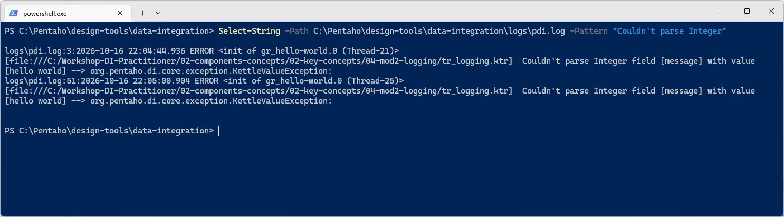

# Logging

> **Warning:**
>
> #### Workshop - Logging
>
> Use logging to diagnose a failing transformation. You create a controlled data-type error, then use the log level and the log output to find its cause.
>
> **What you'll do**
>
> * Change field metadata to trigger an error
> * Run with **Basic** and **Row Level (very detailed)** logging
> * Use **Execution Results** to find the failing step
> * Locate the same error in `pdi.log`
> * Fix the error and run the transformation again
>
> **Prerequisites:** Complete the **[Hello World](../03-mod2-hello-world/guide.md)** workshop
>
> **Estimated time:** 20 minutes

<figure>

<figcaption class="pcm-video-caption">Walkthrough: coming soon</figcaption>

</figure>

<div align="center">
<figure>

<figcaption>Start from your Hello World transformation</figcaption>
</figure>
</div>

:::: tabs

### 1. Modify Generate Rows

> **Note:**
>
> #### Generate Rows
>
> Start from the transformation you built in [Hello World](../03-mod2-hello-world/guide.md). **Generate rows** makes test data, which makes it a quick way to try out logging and error handling. To create an error, you declare `message` as an Integer while its value stays `hello world`, which is not a number.

1. Start Spoon with the **Start Pentaho Data Integration** button below, or from PowerShell:

```powershell
Set-Location C:\Pentaho\design-tools\data-integration
.\spoon.bat
```

<button data-launch="spoon" data-path="">Start Pentaho Data Integration</button>

2. Select **File > Open** (`Ctrl+O`) and open `tr_hello_world.ktr` in `C:\Workshop-DI-Practitioner\02-components-concepts\02-key-concepts\03-mod2-hello-world`. If you don't have your own, open the Hello World solution in that folder's `solution` subfolder.
3. Select **File > Save as** and save it as `tr_logging.ktr` in `C:\Workshop-DI-Practitioner\02-components-concepts\02-key-concepts\04-mod2-logging`. Your Hello World transformation stays as it was.
4. Double-click **gr_hello-world**.
5. In the **Fields** grid, select **Integer** in the **Type** cell of `message`.

<div align="center">
<figure>

<figcaption>Change the type to Integer</figcaption>
</figure>
</div>

6. Select **OK**.
7. Save the transformation (`Ctrl+S`).

### 2. Run

> **Note:**
>
> #### Run the Transformation
>
> Run at **Basic** and read the error, then run again at **Row Level (very detailed)** to see how much more the log shows.

1. Press `F9` (**Action > Run**). In the **Run Options** dialog, select **Basic** in **Log level**, and select **Run**.

<div align="center">
<figure>

<figcaption>The failing step is marked</figcaption>
</figure>
</div>

> **Success:** Checkpoint: the run stops at once, and **gr_hello-world** has a red error icon on the canvas.

2. In **Execution Results**, open the **Logging** tab.
3. Find the first line that contains `ERROR`. In a long log, the first button on the **Logging** tab's toolbar, **Show error lines**, lists only the error lines.

<div align="center">
<figure>

<figcaption>Logging - error</figcaption>
</figure>
</div>

> **Success:** Checkpoint: the first **ERROR** line comes from `gr_hello-world.0` and names the field and the value it couldn't convert:
>
> ```text
> Couldn't parse Integer field [message] with value [hello world]
> ```
>
> The lines after it say `Error initializing step [gr_hello-world]` and `Step [gr_hello-world.0] failed to initialize!`: the transformation stopped before any row moved.

4. Press `F9` again. In the **Run Options** dialog, select **Row Level (very detailed)** in **Log level**, and select **Run**.

<div align="center">
<figure>

<figcaption>Set the log level to Row Level (very detailed)</figcaption>
</figure>
</div>

5. On the **Logging** tab, find the first `ERROR` line again.

> **Success:** Checkpoint: the first **ERROR** line is the same as in the **Basic** run: `Couldn't parse Integer field [message] with value [hello world]`.

6. Compare the lines above it with the **Basic** log. Row Level adds lines that Basic leaves out, such as `Initialising 2 steps...` and, for each step, the rowsets it found (`Found input rowset [gr_hello-world.0 - Dummy (do nothing).0]`): the engine's own account of how it wired the steps together before the error.

> **Under the hood:**
>
> #### The log level is a filter, not a search
>
> Every step runs with its own logging channel, and every line it
> writes is tagged with the step name and a severity. The **Log
> level** you pick in the run dialog doesn't change what the engine
> checks — the same conversion failed the same way at **Basic** and at
> **Row level** — it changes how much of each channel is shown. Row
> level adds an entry for every row that passes every step, which is
> why it is slow and why it should never be left on for a scheduled
> run.
>
> The error itself came from **Generate rows** trying to turn the text
> `hello world` into the Integer you declared. Conversion happens in
> the step that owns the field, so the log names *that* step — not
> whichever step happened to be downstream — and the canvas highlights
> the same one.
>
> **Why it matters:** find the first **ERROR** line, read the step
> name in it, and you have the culprit. Everything after it is
> consequence.

### 3. Find the Error in pdi.log

> **Note:**
>
> #### pdi.log
>
> Spoon also writes the log of every run to `pdi.log`, in Pentaho Data Integration's `logs` folder. A run started by Pan or Kitchen writes there too, so the file is where you look when no Spoon window was open. Each day starts a new `pdi.log`; the previous day's is kept as `pdi.<date>.log`.

1. In PowerShell, run:

```powershell
Select-String -Path C:\Pentaho\design-tools\data-integration\logs\pdi.log -Pattern "Couldn't parse Integer"
```

<div align="center">
<figure>

<figcaption>pdi.log, searched in PowerShell</figcaption>
</figure>
</div>

> **Success:** Checkpoint: a line for each failed run of `tr_logging.ktr` today (two, after the **Basic** and **Row Level** runs). Each one has `ERROR`, then `<init of gr_hello-world.0` and a thread name, the path of your `tr_logging.ktr`, and `Couldn't parse Integer field [message] with value [hello world]`.

### 4. Fix and Run Again

> **Note:**
>
> #### Fix the Error
>
> Put the field's type back to String, and run the transformation again to prove the fix.

1. Double-click **gr_hello-world**.
2. In the **Fields** grid, select **String** in the **Type** cell of `message`.
3. Select **OK**.
4. Save the transformation (`Ctrl+S`).
5. Press `F9` (**Action > Run**). In the **Run Options** dialog, select **Basic** in **Log level**, and select **Run**.
6. In **Execution Results**, open the **Step Metrics** tab.

> **Success:** Checkpoint: both steps show a green check mark, and the log has no **ERROR** line. **gr_hello-world** shows **Written** 10, and **Dummy (do nothing)** shows **Read** 10 and **Written** 10.

::::

Next: [Error Handling](../05-mod2-error-handling/guide.md) - keep the rows that fail instead of stopping the run.

## Lab Files

Click a file to download. For `.ktr` and `.kjb` files, **Open in Pentaho Data Integration** launches Pentaho Data Integration with the file loaded. If Pentaho Data Integration is already running, the path is copied to your clipboard — switch to Pentaho Data Integration and press `Ctrl+O`, `Ctrl+V`, `Enter`.

### Solution <!-- no-step -->

The finished transformation for this lab, as the last step leaves it: `message` is a String again, so it runs and writes 10 rows. To see the error the lab reads in the log, set the **Type** of `message` to Integer in **gr_hello-world**.

Also on disk at `C:\Workshop-DI-Practitioner\02-components-concepts\02-key-concepts\04-mod2-logging\solution`.

[tr_logging.ktr](./files/tr_logging.ktr) <button data-launch="spoon" data-path="files/tr_logging.ktr">Open in Pentaho Data Integration</button> <button data-graph="files/tr_logging.ktr">View graph</button>
