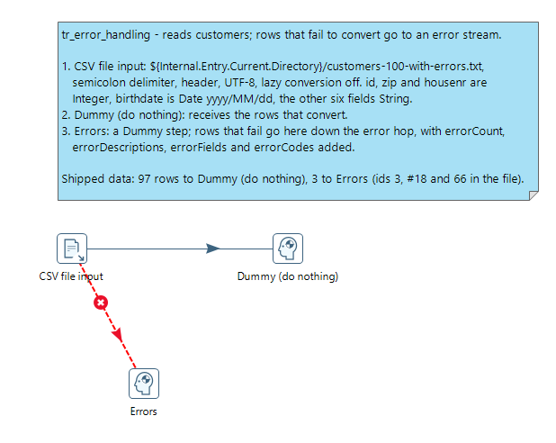
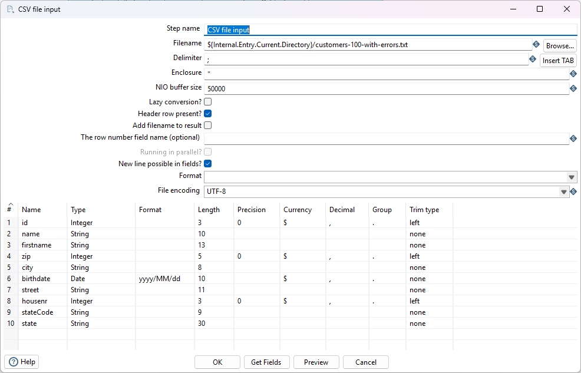
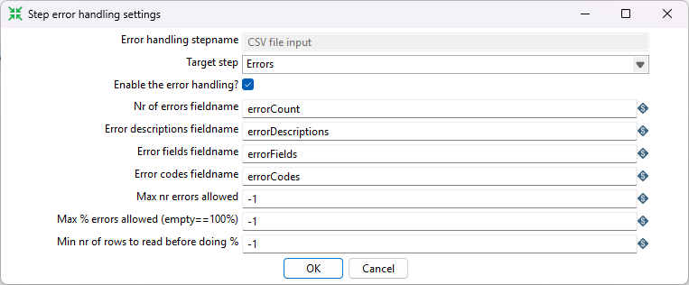
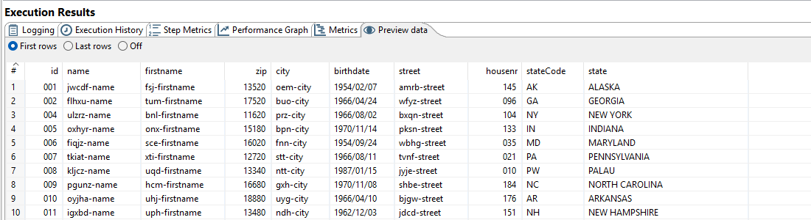
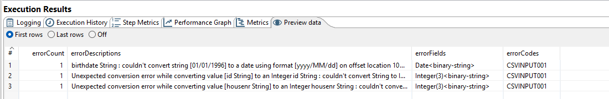

# Error Handling

> **Warning:**
>
> #### Workshop - Error Handling
>
> Bad data happens. Don't let a few bad rows fail the whole transformation: route them to a separate stream for review and cleanup.
>
> **What you'll do**
>
> * Read a semicolon-delimited customer file, with a type for every field
> * Find the rows whose values don't convert to their field's type
> * Configure an error hop to capture failing rows
> * Review the error metadata fields (description, field name, error code)
> * Decide what to do with the rows that fail
>
> **Prerequisites:** Complete the **[Hello World](../03-mod2-hello-world/guide.md)** and **[Logging](../04-mod2-logging/guide.md)** workshops
>
> **Estimated time:** 15 minutes

<figure>



<div align="center">
<figcaption><em>What you build: good rows one way, bad rows the other</em></figcaption>
</div>
</figure>

:::: tabs

### 1. CSV file input

> **Note:**
>
> #### CSV file input
>
> **CSV file input** reads delimited text files. Despite its name it handles other separators too, such as semicolons, pipes or tabs.
>
> Its **Delimiter** defaults to a comma (`,`). This lab's file, `customers-100-with-errors.txt`, uses semicolons: a header line, then 100 customers.

1. Start Spoon with the **Start PDI** button below, or from PowerShell:

```powershell
Set-Location C:\Pentaho\design-tools\data-integration
.\spoon.bat
```

<button data-launch="spoon" data-path="">Start PDI</button>

2. Select **File > New > Transformation** (`Ctrl+N`).
3. Select **File > Save as** and save it as `tr_error_handling.ktr` in `C:\Workshop-DI-Practitioner\02-components-concepts\02-key-concepts\05-mod2-error-handling`, next to `customers-100-with-errors.txt`. Saving first gives `${Internal.Entry.Current.Directory}` a value. (On your own machine, download the file from **Lab Files** below into the folder you save in.)
4. On the **Design** tab, open the **Input** folder and drag **CSV file input** onto the canvas.
5. Double-click **CSV file input**. Keep its step name, `CSV file input`.
6. Set **Filename** to `${Internal.Entry.Current.Directory}/customers-100-with-errors.txt`.
7. Set **Delimiter** to `;`.
8. Clear **Lazy conversion?**.
9. Select **New line possible in fields?**.
10. Set **File encoding** to `UTF-8`.
11. Select **Get Fields**. In the **Sample size** dialog, select **OK**, then close the **Scan results** dialog.
12. Fill the **Fields** grid. **Get Fields** lists the ten fields of the header line, but guesses some types and formats differently: change every row to match the table. An empty cell in the table means an empty cell in the grid, so clear any value **Get Fields** put there. Leave **Currency** as it is.

| Name        | Type    | Format       | Length | Precision | Decimal | Group | Trim type |
| ----------- | ------- | ------------ | ------ | --------- | ------- | ----- | --------- |
| `id`        | Integer |              | 3      | 0         | `,`     | `.`   | left      |
| `name`      | String  |              | 10     |           |         |       | none      |
| `firstname` | String  |              | 13     |           |         |       | none      |
| `zip`       | Integer |              | 5      | 0         | `,`     | `.`   | left      |
| `city`      | String  |              | 8      |           |         |       | none      |
| `birthdate` | Date    | `yyyy/MM/dd` | 10     |           | `,`     | `.`   | none      |
| `street`    | String  |              | 11     |           |         |       | none      |
| `housenr`   | Integer |              | 3      | 0         | `,`     | `.`   | left      |
| `stateCode` | String  |              | 9      |           |         |       | none      |
| `state`     | String  |              | 30     |           |         |       | none      |

<figure><figcaption><p>CSV file input after Get Fields; set id, zip and housenr as the table shows</p></figcaption></figure>

> **Warning:** Keep these types and the `yyyy/MM/dd` format. 99 of the 100 birthdates use that format, and all but one `id` and all but one `housenr` are whole numbers. The few values that don't fit are what send rows to the error stream. Customer 87's `zip` is written `18,00`; with these settings it converts, so customer 87 is not an error row.

13. Select **OK**.
14. On the **Design** tab, open the **Flow** folder and drag **Dummy (do nothing)** onto the canvas, to the right of **CSV file input**.
15. Create a hop from **CSV file input** to **Dummy (do nothing)**: hold `Shift` and drag from one step to the other. When Spoon asks, select **Main output of step**.
16. From the **Flow** folder, drag a second **Dummy (do nothing)** onto the canvas, below **CSV file input**.
17. Double-click the new step.
18. Set **Step name** to `Errors`.
19. Select **OK**.

### 2. Error hop

> **Note:**
>
> #### Error hop
>
> An error hop sends the rows that fail in a step to a separate step, so the valid rows keep flowing. Each failed row arrives with extra fields that say why it failed.

1. Create a hop from **CSV file input** to **Errors** and select **Error handling of step**. Spoon draws the hop red and dashed, with an error icon at the **CSV file input** end.
2. Right-click **CSV file input** and select **Error Handling...**. The **Step error handling settings** dialog opens.
3. Check that **Target step** is `Errors` and that **Enable the error handling?** is selected. Spoon set both when you selected **Error handling of step**.

Next, name the four fields that PDI adds to every failed row. The names are yours to choose; these are the solution's.

4. Set **Nr of errors fieldname** to `errorCount`: the number of errors in the row.
5. Set **Error descriptions fieldname** to `errorDescriptions`: the error messages.
6. Set **Error fields fieldname** to `errorFields`: the fields that failed.
7. Set **Error codes fieldname** to `errorCodes`: a code you can filter or group by.
8. Leave **Max nr errors allowed** and the two settings under it as they are. The solution has `-1` in all three.

<figure><figcaption><p>Step error handling settings</p></figcaption></figure>

9. Select **OK**.
10. Save the transformation (`Ctrl+S`).

### 3. Run

> **Note:**
>
> #### Run the Transformation
>
> Run it, then preview both streams: one holds the valid rows, the other the failed rows with their error fields.

1. Press `F9` (**Action > Run**), and select **Run** in the **Run Options** dialog.
2. In **Execution Results**, open the **Step Metrics** tab.

> **Success:** Checkpoint: **CSV file input** shows **Input** 101 (the header line and 100 customers) and **Written** 97, and **Rejected** 3: a row sent down the error hop counts as rejected, not as an error of the step. **Dummy (do nothing)** shows **Read** 97, and **Errors** shows **Read** 3.

3. Select **Dummy (do nothing)** on the canvas and open the **Preview data** tab.

<figure><figcaption><p>The valid rows</p></figcaption></figure>

> **Success:** Checkpoint: the valid customers. The first rows are customers 1, 2, 4 and 5: customer 3 is not among them.

4. Select **Errors** on the canvas and open the **Preview data** tab.

<figure><figcaption><p>The rejected rows and their error fields</p></figcaption></figure>

> **Success:** Checkpoint: 3 rows, for the customers whose `id` is `3`, `#18` and `66` in the file. Each has `errorCount` `1` and `errorCodes` `CSVINPUT001`. Customer `3` has `errorFields` `Date<binary-string>` and an `errorDescriptions` that starts `birthdate String : couldn't convert string [01/01/1996] to a date using format [yyyy/MM/dd]`; the other two have `Integer(3)<binary-string>` and start `Unexpected conversion error while converting value [id String] to an Integer` (`#18`) and `... [housenr String] ...` (`#11`, customer `66`). `<binary-string>` is how CSV file input holds a field before it converts it, whatever **Lazy conversion?** says.

**Decide what to do with the rejected rows**

5. Compare the three rows in **Errors** with their lines in `customers-100-with-errors.txt`. Each one is bad *data*, not a wrong setting:

| Customer | Field       | Value        | Why it fails                                |
| -------- | ----------- | ------------ | ------------------------------------------- |
| 3        | `birthdate` | `01/01/1996` | Day/month/year, not the `yyyy/MM/dd` mask   |
| 18       | `id`        | `#18`        | Not an Integer                              |
| 66       | `housenr`   | `#11`        | Not an Integer                              |

Don't change the mask to make customer 3 pass: it is right for the other 99 birthdates, and changing it would send *them* to the error stream instead. In a real pipeline the `Errors` stream goes somewhere a person can act on it, such as a reject file or a table, while the good rows carry on. To send each kind of error to its own cleanup logic, route on `errorFields` or `errorCodes`.

> **Under the hood:**
>
> #### The row failed; the step didn't
>
> Without an error hop, a value that won't parse throws an exception
> inside the step, the step stops, and the whole transformation stops
> with it. Defining error handling changes what the engine does with
> that exception: the step catches it, appends the four fields you
> named — count, description, field, code — to the offending row,
> pushes that row onto the red hop's row set, and carries on with the
> next row. The normal hop only ever sees rows that parsed.
>
> Nothing about *how* the date is validated changed. The same
> `yyyy/MM/dd` mask is applied to every row; only the fate of a row
> that fails it is different.
>
> **Why it matters:** one bad row in a million no longer costs you the
> other 999,999. And because rejects arrive as ordinary rows with the
> reason attached, "what do we do with bad data" becomes a visible
> branch on the canvas — a file, a table, an email — rather than a
> stack trace at 3am.

::::

## Lab Files

Click a file to download. For `.ktr` and `.kjb` files, **Open in Pentaho Data Integration** launches PDI with the file loaded. If PDI is already running, the path is copied to your clipboard — switch to PDI and press `Ctrl+O`, `Ctrl+V`, `Enter`.

[customers-100-with-errors.txt](./files/customers-100-with-errors.txt) (PDI's own sample, from `data-integration\samples\transformations\files`)

### Solution <!-- no-step -->

The finished transformation for this lab. Open it alongside your own to compare, or run it to see the expected result: 97 rows to **Dummy (do nothing)** and 3 to **Errors**.

Also on disk at `C:\Workshop-DI-Practitioner\02-components-concepts\02-key-concepts\05-mod2-error-handling\solution`.

[tr_error_handling.ktr](./files/tr_error_handling.ktr) <button data-launch="spoon" data-path="files/tr_error_handling.ktr">Open in Pentaho Data Integration</button> <button data-graph="files/tr_error_handling.ktr">View graph</button>
