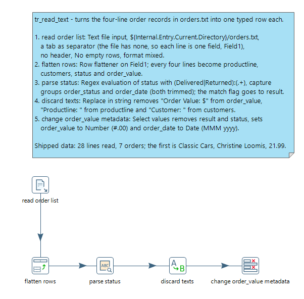
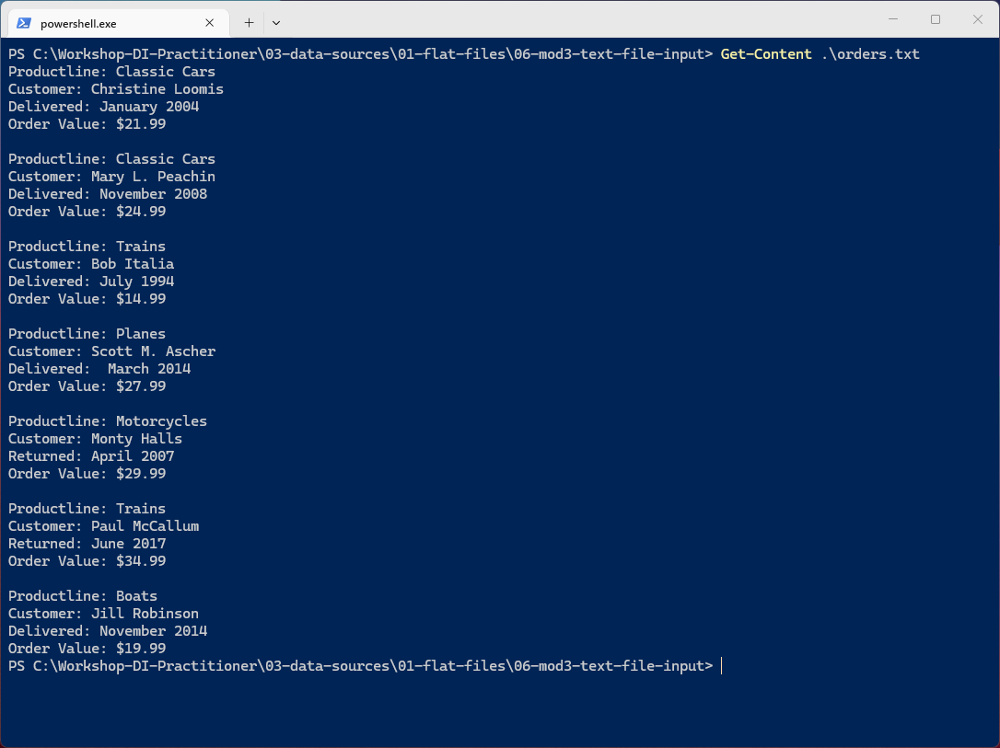
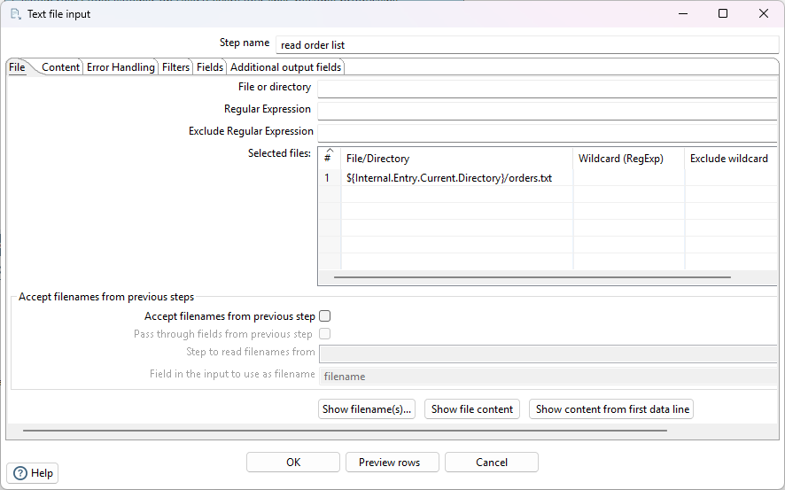
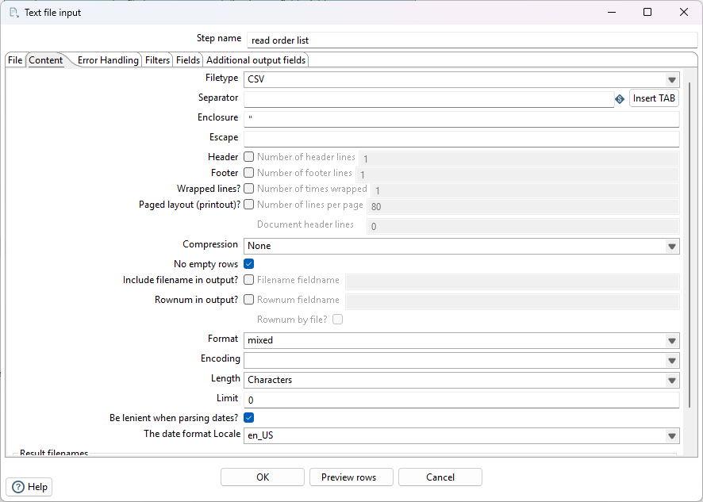
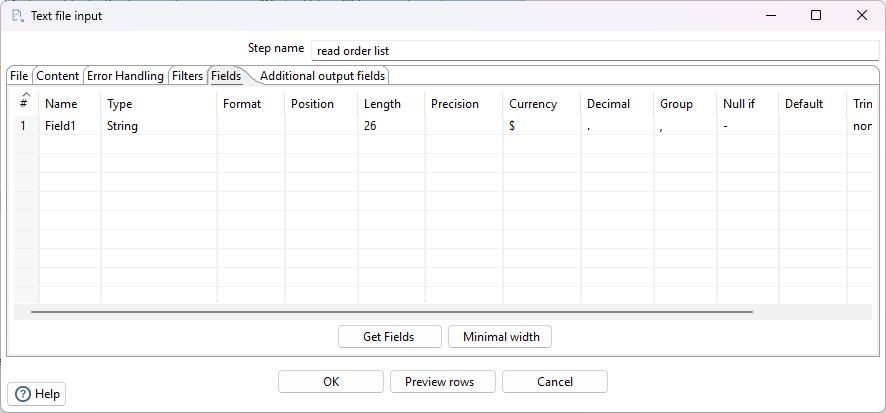
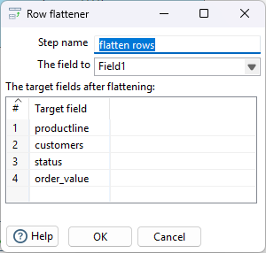
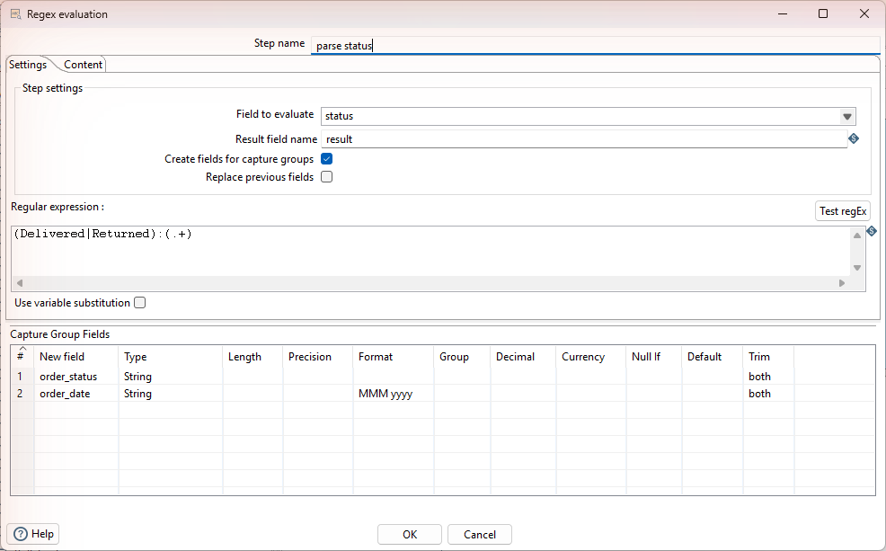
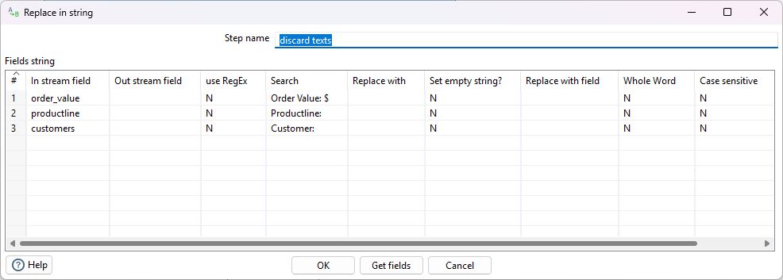
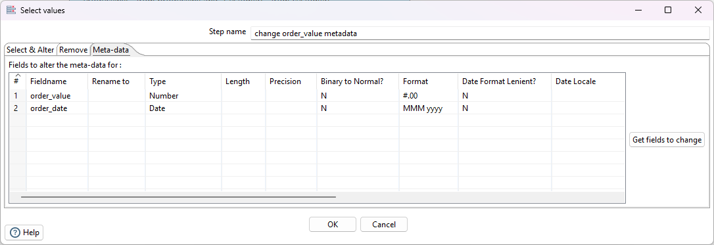
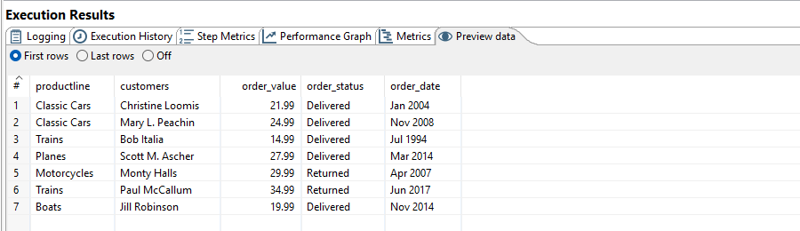

# Text File Input

> **Warning:**
>
> #### Workshop - Text File Input
> 
> Real-world data rarely arrives ready for loading. Text files often need parsing and cleansing before they can be analyzed.
> 
> In this workshop, you build a transformation that turns messy, multi-line Steel Wheels order records into clean, structured rows suitable for a database.
> 
> **What you'll do**
> 
> * Read unstructured text with **Text file input**
> * Turn multi-line records into single rows with **Row flattener**
> * Extract values into capture groups with **Regex evaluation**
> * Remove labels and symbols with **Replace in string**
> * Set data types and formats with **Select values**
> 
> **Prerequisites:** [Hello World](../03-mod2-hello-world/guide.md) - steps, hops and preview.
> 
> **Estimated time:** 30 minutes

<figure>

<figcaption class="pcm-video-caption">Walkthrough: coming soon</figcaption>

</figure>

---

<div align="center">
<figure>

<figcaption>What you build</figcaption>
</figure>
</div>

Look at the input file first; it decides the parsing approach.

<div align="center">
<figure>

<figcaption>orders.txt</figcaption>
</figure>
</div>

> **Note:**
>
> #### What to notice, and the approach
>
> `orders.txt` has 34 lines: 7 orders of four lines each, with a blank line between one order and the next.
>
> * Every value is prefixed with a label (`Productline:`, `Customer:`).
> * Line 3 holds two values: the order status and the order date.
> * The order value carries a label and a currency symbol (`Order Value: $21.99`).
>
> You will:
>
> 1. Flatten each four-line record into a single row.
> 2. Split line 3 into a status and a date (capture groups).
> 3. Remove the labels and the currency symbol.
> 4. Set the data types and formats (number and date).

:::: tabs

### 1. Text File Input

> **Note:**
>
> #### Text File Input
> 
> Use **Text file input** to read the raw lines from `orders.txt`. Treat each line as a single string field for now.

1. Start Spoon with the **Start Pentaho Data Integration** button below, or from PowerShell:

```powershell
Set-Location C:\Pentaho\design-tools\data-integration
.\spoon.bat
```

<button data-launch="spoon" data-path="">Start Pentaho Data Integration</button>

2. Select **File > New > Transformation** (`Ctrl+N`).
3. Select **File > Save as** and save it as `tr_read_text.ktr` in `C:\Workshop-DI-Practitioner\03-data-sources\01-flat-files\06-mod3-text-file-input`, next to `orders.txt`. Saving first gives `${Internal.Entry.Current.Directory}` a value.
4. On the **Design** tab, open the **Input** folder and drag **Text file input** onto the canvas.
5. Double-click **Text file input**.
6. Set **Step name** to `read order list`.
7. On the **File** tab, enter the path below in **File or directory**, then select **Add**:

   ```text
   ${Internal.Entry.Current.Directory}/orders.txt
   ```

<div align="center">
<figure>

<figcaption>The file path, using an internal variable</figcaption>
</figure>
</div>

> **Note:** `${Internal.Entry.Current.Directory}` is the folder of the saved transformation, so the path keeps working wherever the lab folder is.

8. Open the **Content** tab and set:

   | Setting | Value |
   | --- | --- |
   | **Filetype** | `CSV` (the default) |
   | **Separator** | a tab: delete the default `;`, then select **Insert TAB** |
   | **Header** | cleared: `orders.txt` has no header line |
   | **No empty rows** | selected (the default): drops the blank lines between orders |
   | **Format** | `mixed` |

   `orders.txt` contains no tab characters, so with a tab as the separator each whole line becomes one field.

<div align="center">
<figure>

<figcaption>The Content tab</figcaption>
</figure>
</div>

9. Open the **Fields** tab and select **Get Fields**.
10. In the **Sample data** dialog, leave **Number of lines to sample** at `100` and select **OK**. (If you select **Show sample summary** first, a **Scan results** window also opens; select **Close**.)

<div align="center">
<figure>

<figcaption>One field per line</figcaption>
</figure>
</div>

> **Success:** Checkpoint: the **Fields** tab lists one field, `Field1`, of type **String**.

11. Select **Preview rows**, enter `100` rows, and select **OK**.

> **Success:** Checkpoint: **Examine preview data** shows 28 rows of `Field1`: the 28 lines of `orders.txt` that are not blank. Row 1 is `Productline: Classic Cars` and row 4 is `Order Value: $21.99`.

12. Select **Close**.
13. Select **OK**.

### 2. Row flattener

> **Note:**
>
> #### Row Flattener
> 
> Use **Row flattener** to turn each group of four lines into a single output row. Each target field takes one line of the group, by position: target field 1 gets line 1, and so on.

1. On the **Design** tab, open the **Transform** folder and drag **Row flattener** onto the canvas.
2. Create a hop from **read order list** to **Row flattener**: hold `Shift` and drag from one step to the other.
3. Double-click **Row flattener**.
4. Set **Step name** to `flatten rows`.
5. Set **The field to flatten** to `Field1`.
6. Fill **The target fields after flattening** grid, in this order:

   | Target field |
   | --- |
   | `productline` |
   | `customers` |
   | `status` |
   | `order_value` |

<div align="center">
<figure>

<figcaption>Four lines become four fields</figcaption>
</figure>
</div>

7. Select **OK**.

> **Under the hood:**
>
> #### Flattener counts lines; it doesn't understand records
>
> The step collects the flatten field from consecutive rows until it
> has as many as you listed target fields, emits them side by side as
> one row, then starts counting again. There is no key and no marker —
> it never looks at the *content* of a line to decide where a record
> ends. Line 1 goes to target 1, line 2 to target 2, purely by
> position.
>
> That makes it fast and simple, and it makes the file's regularity a
> hard requirement: one stray blank line and every record after it is
> shifted by one field. That is why **No empty rows** stays selected in
> **Text file input**: the blank lines between orders never reach the
> Flattener.
>
> **Why it matters:** preview three records here, not one. If the
> third looks right, the counting is right. If it has drifted, the fix
> belongs upstream in **Text file input** (filters, blank-line
> handling), not in the Flattener.

8. Select **flatten rows** on the canvas, press `F10` (**Action > Preview**), and select **Quick Launch**.

> **Success:** Checkpoint: **Examine preview data** shows 7 rows, one per order, with four fields. Row 1 is `Productline: Classic Cars`, `Customer: Christine Loomis`, `Delivered: January 2004`, `Order Value: $21.99`, and row 7 is `Productline: Boats`, `Customer: Jill Robinson`, `Delivered: November 2014`, `Order Value: $19.99`.

9. Select **Close**.

### 3. Regex Evaluation

> **Note:**
>
> #### Regex Evaluation
> 
> Use **Regex evaluation** to match a field against a regular expression and capture substrings into new fields.
> 
> Here you split `status` into two capture groups, `order_status` and `order_date`, with the pattern `(Delivered|Returned):(.+)`:
>
> * It has two capture groups, each in parentheses, separated by a colon.
> * `(Delivered|Returned)` matches either status.
> * `(.+)` matches the rest of the line - the date.
>
> **Test regEx**, on the step's **Settings** tab, opens a dialog where you can try the expression on sample values.

1. On the **Design** tab, open the **Scripting** folder and drag **Regex evaluation** onto the canvas.
2. Create a hop from **flatten rows** to **Regex evaluation**.
3. Double-click **Regex evaluation**.
4. Set **Step name** to `parse status`.
5. On the **Settings** tab, set:

   | Setting | Value |
   | --- | --- |
   | **Field to evaluate** | `status` |
   | **Result field name** | `result` |
   | **Create fields for capture groups** | selected |
   | **Regular expression** | `(Delivered\|Returned):(.+)` |

6. Fill the **Capture Group Fields** grid with two rows:

   | New field | Type | Format | Trim |
   | --- | --- | --- | --- |
   | `order_status` | String | | both |
   | `order_date` | String | `MMM yyyy` | both |

<div align="center">
<figure>

<figcaption>Two capture groups, two fields</figcaption>
</figure>
</div>

> **Warning:** Set **Trim** to **both** on both fields. The date follows the colon with a space (two spaces in the fourth order), and an untrimmed ` January 2004` won't parse as a date later.

7. Select **OK**.

> **Under the hood:**
>
> #### The pattern must match the whole field, not part of it
>
> At start-up the step compiles your expression once into a Java
> `Pattern`. For every row it then asks whether the *entire* field
> matches — not whether the pattern occurs somewhere inside it. That
> is why `(.+)` is there: without it, `Delivered:` would satisfy the
> first group and then fail on the trailing date text, the result
> field would be `false`, and both capture fields would be empty.
>
> Each parenthesized group becomes exactly one output field, in
> order, and the step refuses to start if the group count and the
> field count disagree: "The number of capture groups in the regular
> expression ... does not match the number of fields specified". You
> get that error at initialization instead of silently wrong columns.
>
> **Why it matters:** a regex that works in a tester but yields empty
> fields here is almost always anchoring, not syntax. Wrap the part
> you don't care about in `.*`, re-test in the dialog, then run.

8. Select **parse status** on the canvas, press `F10` (**Action > Preview**), and select **Quick Launch**.

> **Success:** Checkpoint: **Examine preview data** shows 7 rows, each with an `order_status` and an `order_date`: every `status` line matched. Row 1 has `Delivered` and `January 2004`; row 5 has `Returned` and `April 2007`.

9. Select **Close**.

To learn or test regular expressions, regex101 is a good start:

<div class="pcm-embed-card" data-href="https://regex101.com/" data-title="regex101: build, test, and debug regex" data-description="Regular expression tester with syntax highlighting, explanation, cheat sheet for PHP/PCRE, Python, GO, JavaScript, Java, C#/.NET, Rust." data-thumb="../_assets/embeds/c264d50371b0.png"></div>

### 4. Replace in String

> **Note:**
>
> #### Replace in string
> 
> Use **Replace in string** for search-and-replace, with optional regex and group references (`$n`).
> 
> Here you replace three labels with nothing.

1. On the **Design** tab, open the **Transform** folder and drag **Replace in string** onto the canvas.
2. Create a hop from **parse status** to **Replace in string**.
3. Double-click **Replace in string**.
4. Set **Step name** to `discard texts`.
5. Fill the **Fields string** grid with three rows. Leave **Out stream field** and **Replace with** empty, so each field is changed in place and the label is replaced with nothing:

   | In stream field | use RegEx | Search | Set empty string? |
   | --- | --- | --- | --- |
   | `order_value` | `N` | `Order Value: $` | `N` |
   | `productline` | `N` | `Productline: ` | `N` |
   | `customers` | `N` | `Customer: ` | `N` |

<div align="center">
<figure>

<figcaption>Three labels removed</figcaption>
</figure>
</div>

> **Warning:** Type each label exactly, including the trailing space. If you set **use RegEx** to `Y`, use `Order Value:\s*\$` instead: the dollar sign must go too, or **Select values** can't read the number.

6. Select **OK**.
7. Select **discard texts** on the canvas, press `F10` (**Action > Preview**), and select **Quick Launch**.

> **Success:** Checkpoint: **Examine preview data** shows 7 rows without labels. Row 1 has `productline` `Classic Cars`, `customers` `Christine Loomis` and `order_value` `21.99`.

8. Select **Close**.

### 5. Select Values

> **Note:**
>
> #### Select values
> 
> **Select values** selects, removes and renames fields, and changes their type, length and precision. It has three tabs:
> 
> * **Select & Alter** - which fields to keep, in what order, and under what names
> * **Remove** - fields to drop
> * **Meta-data** - a field's type, format, length and precision

1. On the **Design** tab, open the **Transform** folder and drag **Select values** onto the canvas.
2. Create a hop from **discard texts** to **Select values**.
3. Double-click **Select values**.
4. Set **Step name** to `change order_value metadata`.
5. Open the **Remove** tab and fill **Fields to remove** with two rows, `result` and `status`: the regex's match flag and the raw line you split.
6. Open the **Meta-data** tab and fill **Fields to alter the meta-data for**:

   | Fieldname | Type | Format |
   | --- | --- | --- |
   | `order_value` | Number | `#.00` |
   | `order_date` | Date | `MMM yyyy` |

<div align="center">
<figure>

<figcaption>Typed fields</figcaption>
</figure>
</div>

7. Select **OK**.

> **Under the hood:**
>
> #### A format mask is a parser, not a display setting
>
> Until this step, `order_value` and `order_date` were strings —
> cleaned-up text, but text. On the **Meta-data** tab you told the
> engine what each string *means*, and the mask is the instruction for
> reading it: `#.00` says "decimal point, two places", so `21.99`
> becomes the number 21.99. `MMM yyyy` says "month name, then year";
> when Java parses text, `MMM` accepts the full month name as well, so
> `January 2004` becomes a real date, the first of that month. When
> Spoon displays the date, the same mask writes it as `Jan 2004`.
>
> From this step onward the row metadata declares those fields as
> Number and Date, and every later step — sort, calculator, table
> output — works with the typed value. A mask the data doesn't fit
> fails *here*, at the step that knows the rule, rather than producing
> garbage three steps downstream.
>
> **Why it matters:** a date that is really a date sorts
> chronologically, subtracts to give days, and lands in a `DATE`
> column without a cast. Getting types right at the boundary is what
> lets everything after it stay simple.

### 6. Run

> **Note:**
>
> #### Run the transformation
> 
> Run the transformation and check the result.

1. Save the transformation (`Ctrl+S`).
2. Press `F9` (**Action > Run**), and select **Run** in the **Run Options** dialog.
3. In **Execution Results**, open the **Step Metrics** tab.

> **Success:** Checkpoint: **read order list** shows `28` in **Written**, and **flatten rows** shows `28` in **Read** and `7` in **Written**. **parse status**, **discard texts** and **change order_value metadata** each write 7 rows.

4. Select **change order_value metadata** on the canvas and open the **Preview data** tab.

<div align="center">
<figure>

<figcaption>Seven clean orders</figcaption>
</figure>
</div>

> **Success:** Checkpoint: 7 orders with the fields `productline`, `customers`, `order_value`, `order_status` and `order_date`. The first is `Classic Cars`, `Christine Loomis`, `21.99`, `Delivered`, `Jan 2004`: no labels, no `$`, a real number, and a real date that the file wrote as `January 2004` and Spoon displays with its `MMM yyyy` mask.

::::

## Lab Files

Click a file to download. For `.ktr` and `.kjb` files, **Open in Pentaho Data Integration** launches Pentaho Data Integration with the file loaded. If Pentaho Data Integration is already running, the path is copied to your clipboard — switch to Pentaho Data Integration and press `Ctrl+O`, `Ctrl+V`, `Enter`.

[orders.txt](./files/orders.txt)

### Solution <!-- no-step -->

The finished transformation for this lab. Open it alongside your own to compare, or run to see the expected result.

Also on disk at `C:\Workshop-DI-Practitioner\03-data-sources\01-flat-files\06-mod3-text-file-input\solution`.

[tr_read_text.ktr](./files/tr_read_text.ktr) <button data-launch="spoon" data-path="files/tr_read_text.ktr">Open in Pentaho Data Integration</button> <button data-graph="files/tr_read_text.ktr">View graph</button>
