# Text File Output

> **Warning:**
>
> #### Workshop - Text File Output
> 
> Reading files is only half the job. You also need to generate files for users and systems.
> 
> In this workshop you build a transformation that writes a customer survey for Steel Wheels. You assemble the survey from several streams, and pass the customer's name in when you run it.
> 
> **What you'll do**
> 
> * Read a customer name from a transformation argument
> * Build header and body sections with static rows and file-driven rows
> * Format text with **User defined Java expression**
> * Merge streams in a fixed order with **Append streams**
> * Write the result with **Text file output**
> 
> **Prerequisites:** [Text File Input](../06-mod3-text-file-input/guide.md).
> 
> **Estimated time:** 35 minutes

<figure>

<figcaption class="pcm-video-caption">Walkthrough: coming soon</figcaption>

</figure>

---

<div align="center">
<figure>
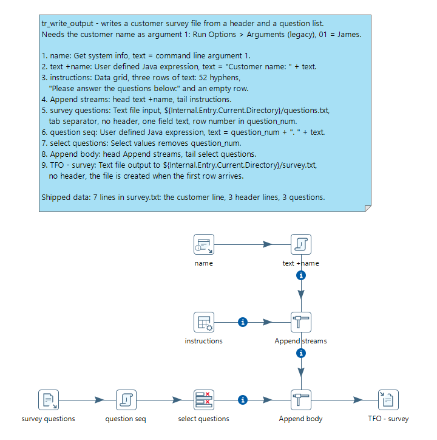
<figcaption>What you build</figcaption>
</figure>
</div>

:::: tabs

### 1. Get System Info

> **Note:**
>
> #### Get System Info
> 
> Use **Get system info** to read a value passed in at run time. Here that value is the customer's name.

1. Start Spoon with the **Start Pentaho Data Integration** button below, or from PowerShell:

```powershell
Set-Location C:\Pentaho\design-tools\data-integration
.\spoon.bat
```

<button data-launch="spoon" data-path="">Start Pentaho Data Integration</button>

2. Select **File > New > Transformation** (`Ctrl+N`).
3. Select **File > Save as** and save it as `tr_write_output.ktr` in `C:\Workshop-DI-Practitioner\03-data-sources\01-flat-files\07-mod3-text-file-output`, next to `questions.txt`.
4. On the **Design** tab, open the **Input** folder and drag **Get system info** onto the canvas.
5. Double-click **Get system info**.
6. Set **Step name** to `name`.
7. Fill the **Fields** grid with one row. Set **Name** to `text`; select the **Type** cell and pick `command line argument 1` in the **Select info type** list:

   | Name | Type |
   | --- | --- |
   | `text` | `command line argument 1` |

<div align="center">
<figure>
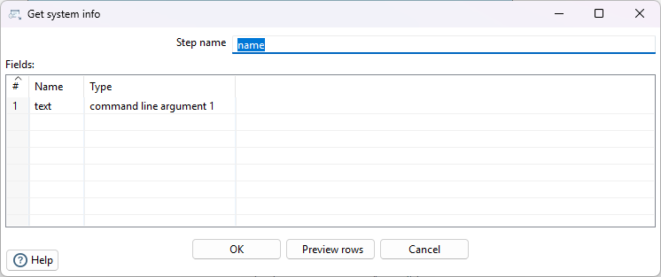
<figcaption>The customer name arrives as argument 1</figcaption>
</figure>
</div>

8. Select **OK**.

### 2. User Defined Java Expression

> **Note:**
>
> #### User Defined Java Expression
> 
> Use **User defined Java expression** to build the header line from a label and the customer's name. **Replace value** overwrites `text` with the formatted line, so the field is still called `text`.

1. On the **Design** tab, open the **Scripting** folder and drag **User defined Java expression** onto the canvas.
2. Create a hop from **name** to **User defined Java expression**: hold `Shift` and drag from one step to the other.
3. Double-click **User defined Java expression**.
4. Set **Step name** to `text +name`.
5. Fill the **Fields** grid with one row:

   | New field | Java expression | Value type | Replace value |
   | --- | --- | --- | --- |
   | `text` | `"Customer name: " + text` | String | `text` |

<div align="center">
<figure>
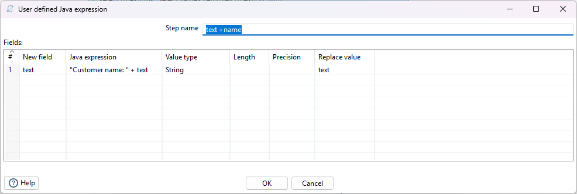
<figcaption>A Java expression builds the header line</figcaption>
</figure>
</div>

6. Select **OK**.

<div class="pcm-embed-card" data-href="https://docs.oracle.com/javase/tutorial/java/nutsandbolts/opsummary.html" data-title="Summary of Operators (The Java&amp;trade; Tutorials > Learning the Java Language > Language Basics)"></div>

### 3. Data Grid

> **Note:**
>
> #### Data Grid
> 
> Use **Data grid** for the fixed header lines, so the top of the file lives inside the transformation.
> 
> Define the field on the **Meta** tab, then type the rows on the **Data** tab.

1. On the **Design** tab, open the **Input** folder and drag **Data grid** onto the canvas.
2. Double-click **Data grid**.
3. Set **Step name** to `instructions`.
4. On the **Meta** tab, fill the grid with one row: **Name** `text`, **Type** `String`.
5. Open the **Data** tab and enter three rows in the `text` column:
   1. A line of ~50 hyphens:

      ```text
      ----------------------------------------------------
      ```

   2. `Please answer the questions below:`
   3. Nothing: leave the third row empty. It becomes the blank line before the questions. If the grid has only two rows, right-click the second row and select **Insert after this row**.

<div align="center">
<figure>
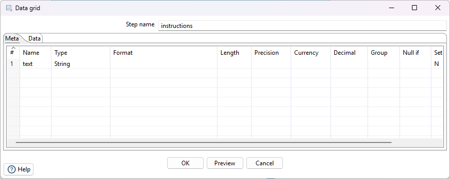
<figcaption>Meta: one field</figcaption>
</figure>
</div>

<div align="center">
<figure>
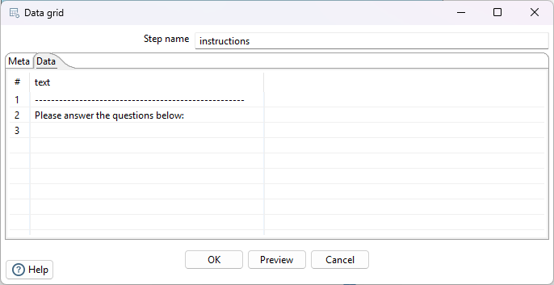
<figcaption>Data: the header rows</figcaption>
</figure>
</div>

6. Select **Preview**, enter `100` rows, and select **OK**.

> **Success:** Checkpoint: **Examine preview data** shows 3 rows: the hyphens, `Please answer the questions below:`, and a third row with no value, which Spoon shows as `<null>`.

7. Select **Close**.
8. Select **OK**.

### 4. Append streams (head)

> **Note:**
>
> #### Append streams
> 
> Use **Append streams** when order matters. It outputs every row from its **Head hop**, then every row from its **Tail hop**.
> 
> Both inputs must have the same field names, in the same order, with the same types. Every stream in this workshop has a single String field, `text`, so they can all be appended.

1. On the **Design** tab, open the **Flow** folder and drag **Append streams** onto the canvas. Its default step name, `Append streams`, is the name the solution uses.
2. Create a hop from **text +name** to **Append streams**.
3. Create a hop from **instructions** to **Append streams**.
4. Double-click **Append streams**.
5. Set **Head hop** to `text +name` (the customer line) and **Tail hop** to `instructions`.

<div align="center">
<figure>
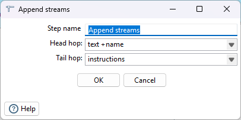
<figcaption>The customer line comes first</figcaption>
</figure>
</div>

6. Select **OK**.

> **Under the hood:**
>
> #### Most steps read their inputs round-robin; Append is the exception
>
> When two hops enter an ordinary step, the engine gives it two row
> sets and the step takes rows from whichever has one ready,
> alternating between them. Both upstream steps are running at once,
> so the interleaving depends on timing — run it twice and the order
> can differ. If order doesn't matter, that plain merge is all you
> need: hop several steps into one step.
>
> **Append streams** deliberately breaks that rule. It reads its head
> hop's row set until that stream is exhausted and only then starts on
> the tail hop. It cannot pass a single tail row early, which is why
> it needs to know which hop is which, and why the header lines
> reliably come out on top.
>
> **Why it matters:** if output order matters — a report header, a
> file trailer, a sequence a downstream system checks — a plain merge
> is a bug waiting for a busy server. Append is the guarantee.

### 5. Text file input (questions)

> **Note:**
>
> #### Text file input
> 
> Use **Text file input** to read the question list. Each question becomes one row, and the row number becomes the question number.

1. On the **Design** tab, open the **Input** folder and drag **Text file input** onto the canvas.
2. Double-click **Text file input**.
3. Set **Step name** to `survey questions`.
4. On the **File** tab, enter `${Internal.Entry.Current.Directory}/questions.txt` in **File or directory**, then select **Add**.

<div align="center">
<figure>
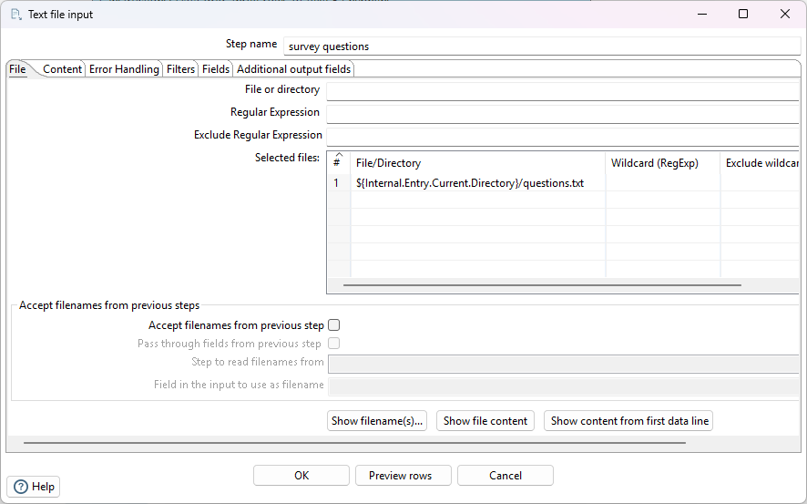
<figcaption>The question list</figcaption>
</figure>
</div>

5. Open the **Content** tab and set:

   | Setting | Value |
   | --- | --- |
   | **Separator** | a tab: delete the default `;`, then select **Insert TAB** |
   | **Header** | cleared: `questions.txt` has no header line |
   | **No empty rows** | selected (the default) |
   | **Rownum in output?** | selected |
   | **Rownum fieldname** | `question_num` |
   | **Format** | `mixed` |

<div align="center">
<figure>
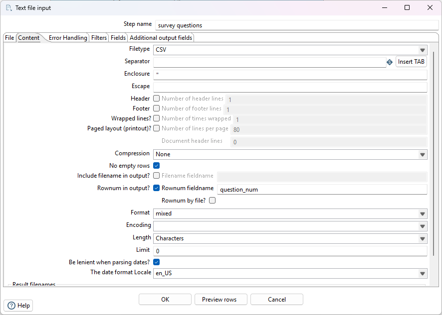
<figcaption>Row numbers become question numbers</figcaption>
</figure>
</div>

6. Open the **Fields** tab and select **Get Fields**.
7. In the **Sample data** dialog, leave **Number of lines to sample** at `100` and select **OK**.
8. In the grid, change the field's **Name** from `Field1` to `text`.

<div align="center">
<figure>
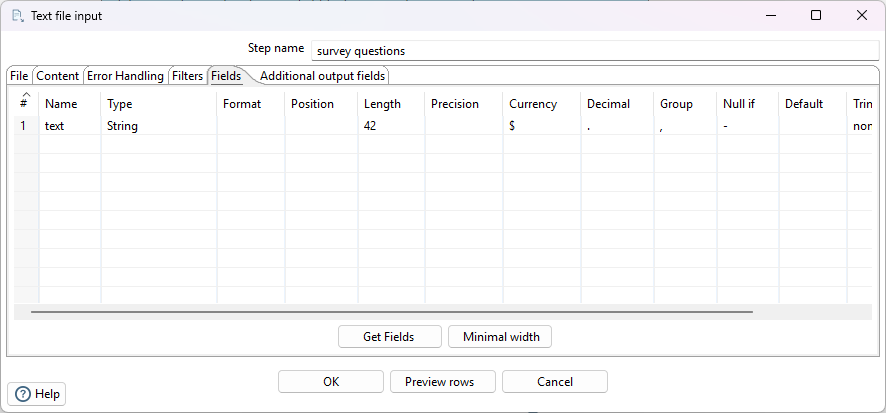
<figcaption>One field, text</figcaption>
</figure>
</div>

9. Select **Preview rows**, enter `100` rows, and select **OK**.

> **Success:** Checkpoint: **Examine preview data** shows 3 rows. `text` holds the three questions from `questions.txt`, starting with `How many people does your organization employ?`, and `question_num` holds `1`, `2` and `3`.

10. Select **Close**.
11. Select **OK**.

### 6. User Defined Java Expression (number questions)

> **Note:**
>
> #### User Defined Java Expression
> 
> Use a second **User defined Java expression** to prefix each question line with its question number.

1. On the **Design** tab, open the **Scripting** folder and drag **User defined Java expression** onto the canvas.
2. Create a hop from **survey questions** to the new **User defined Java expression**.
3. Double-click the new step.
4. Set **Step name** to `question seq`.
5. Fill the **Fields** grid with one row:

   | New field | Java expression | Value type | Replace value |
   | --- | --- | --- | --- |
   | `text` | `question_num + ". " + text` | String | `text` |

<div align="center">
<figure>
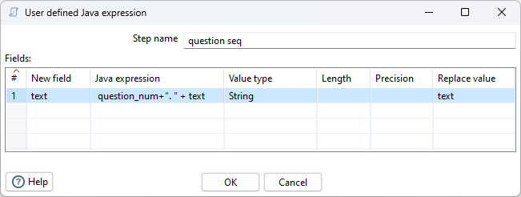
<figcaption>Number each question</figcaption>
</figure>
</div>

6. Select **OK**.
7. Select **question seq** on the canvas, press `F10` (**Action > Preview**), and select **Quick Launch**.

> **Success:** Checkpoint: **Examine preview data** shows 3 rows. `text` now reads `1. How many people does your organization employ?`, `2. Which ETL tool do you currently use?` and `3. What would you do if you had a magic wand?`.

8. Select **Close**.

### 7. Select values

> **Note:**
>
> #### Select values
> 
> Use **Select values** to drop `question_num`, so this stream has the same single `text` field as the header stream.

1. On the **Design** tab, open the **Transform** folder and drag **Select values** onto the canvas.
2. Create a hop from **question seq** to **Select values**.
3. Double-click **Select values**.
4. Set **Step name** to `select questions`.
5. Open the **Remove** tab and enter `question_num` in **Fields to remove**.

<div align="center">
<figure>
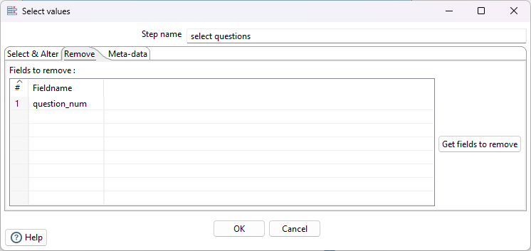
<figcaption>Remove question_num</figcaption>
</figure>
</div>

6. Select **OK**.

### 8. Append streams (body)

> **Note:**
>
> #### Append streams
> 
> Put the header lines first and the numbered questions after them.

1. On the **Design** tab, open the **Flow** folder and drag a second **Append streams** onto the canvas.
2. Create a hop from **Append streams** to the new step.
3. Create a hop from **select questions** to the new step.
4. Double-click the new step.
5. Set **Step name** to `Append body`.
6. Set **Head hop** to `Append streams` and **Tail hop** to `select questions`.

<div align="center">
<figure>
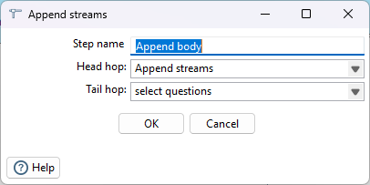
<figcaption>Header first, then the questions</figcaption>
</figure>
</div>

7. Select **OK**.

> **Note:** You now have one stream. It contains one field named `text`.

### 9. Text file output

> **Note:**
>
> #### Text file output
> 
> Use **Text file output** to write the survey file to disk.

1. On the **Design** tab, open the **Output** folder and drag **Text file output** onto the canvas.
2. Create a hop from **Append body** to **Text file output**.
3. Double-click **Text file output**.
4. Set **Step name** to `TFO - survey`.
5. On the **File** tab, set:

   | Setting | Value |
   | --- | --- |
   | **Filename** | `${Internal.Entry.Current.Directory}/survey` |
   | **Extension** | `txt` (the default) |
   | **Do not create file at start** | selected |
   | **Add filenames to result** | cleared |

6. Open the **Content** tab and set:

   | Setting | Value |
   | --- | --- |
   | **Header** | cleared, so the file doesn't start with the word `text` |
   | **Disable the enclosure fix?** | selected |

<div align="center">
<figure>
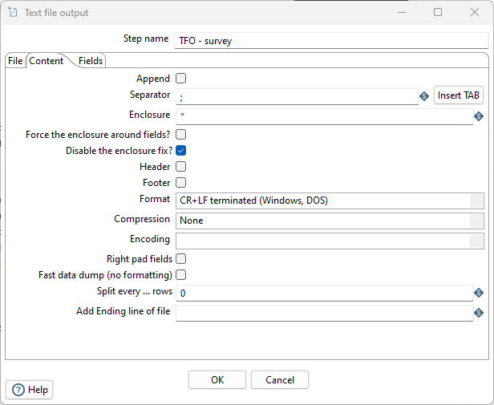
<figcaption>The Content tab</figcaption>
</figure>
</div>

7. Open the **Fields** tab and select **Get Fields**. The grid lists one field, `text`, of type **String**.

<div align="center">
<figure>
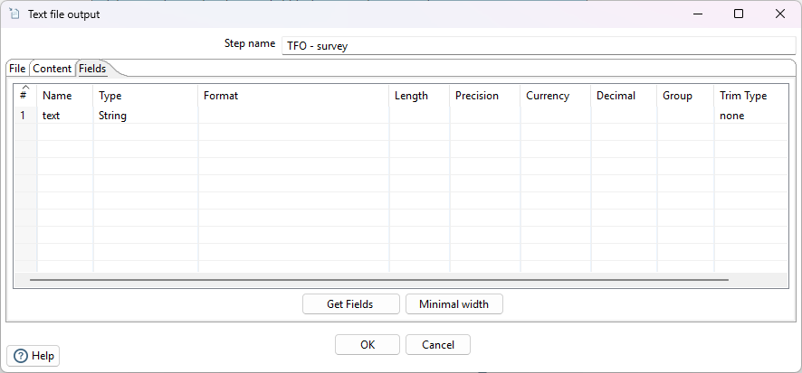
<figcaption>One field, text</figcaption>
</figure>
</div>

8. Select **OK**.

> **Under the hood:**
>
> #### The file opens when the first row arrives, then rows stream in
>
> By default **Text file output** creates and opens its file when the
> step initializes - when the transformation starts, before any row
> exists. With **Do not create file at start** selected, as here, it
> waits for the first row instead. Either way, rows are then written
> through a buffered stream as they arrive and the file is closed when
> the upstream steps finish. Nothing is collected in memory first.
>
> Two consequences you will meet in real work: without that option, a
> run that fails early still leaves a zero-byte file behind; and two
> step copies pointed at the same filename fight over one handle. So
> don't run several copies of this step against one file: to write in
> parallel, select **Include stepnr in filename?**, which gives each
> copy its own file.
>
> **Why it matters:** an output file appearing is not proof the run
> succeeded; the row count in Step Metrics is. And because the writer
> streams, a ten-million-row extract costs no more memory than this
> survey does.

### 10. Run

> **Note:**
>
> #### Run the transformation
> 
> Run the transformation and pass a customer name as an argument.

1. Save the transformation (`Ctrl+S`).
2. Press `F9` (**Action > Run**). In the **Run Options** dialog, select **Arguments (legacy)**.
3. In the **Arguments** dialog, in the row whose **Argument** is `01`, set **Value** to `James`. Select **OK**.

<div align="center">
<figure>
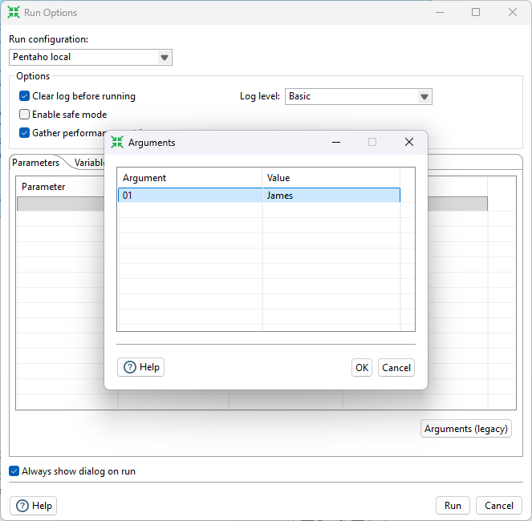
<figcaption>The customer name, as argument 1</figcaption>
</figure>
</div>

4. Select **Run** in the **Run Options** dialog.

> **Under the hood:**
>
> #### Where the argument came from
>
> **Get system info** has no input hop, so it produced exactly one
> row, and the field you configured as *command line argument 1* was
> filled from the run dialog's **Arguments (legacy)** box. The engine
> treats that box as a stand-in for what a scheduler would pass on the
> command line — `pan.bat --% "-file=tr_write_output.ktr" "Acme Ltd"` — so
> the transformation is already runnable unattended, unchanged.
>
> Arguments are positional and, as the label says, legacy; modern
> transformations use named **parameters** (right-click the canvas,
> **Parameters** tab), which you will meet in Module 5. The principle
> is the same either way: values that vary per run come in from
> outside, get materialized as a field, and the steps never know the
> difference.
>
> **Why it matters:** the `.ktr` you just ran by hand is the one the
> scheduler runs tonight. There is no "productionized" version to
> maintain — only the input changes.

5. In **Execution Results**, open the **Step Metrics** tab.

> **Success:** Checkpoint: **TFO - survey** shows `7` in **Written**: 1 customer line, 3 header lines and 3 questions. **Append streams** shows `4` in **Written** and **select questions** `3`.

6. Select **TFO - survey** on the canvas and open the **Preview data** tab.

<div align="center">
<figure>
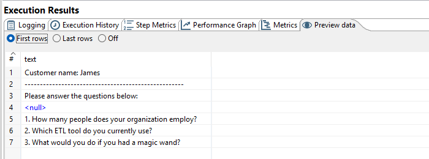
<figcaption>The survey, line by line</figcaption>
</figure>
</div>

> **Success:** Checkpoint: 7 rows of `text`: `Customer name: James`, the hyphens, `Please answer the questions below:`, `<null>` (the empty row), then the three numbered questions.

7. Open `survey.txt` in the lab folder in a text editor. With `James` as the argument it reads:

```text
Customer name: James
----------------------------------------------------
Please answer the questions below:

1. How many people does your organization employ?
2. Which ETL tool do you currently use?
3. What would you do if you had a magic wand?
```

> **Success:** Checkpoint: your `survey.txt` has these 7 lines and matches `survey.txt` under **Lab Files**. The empty Data grid row is written as an empty line.

::::

## Lab Files

Click a file to download. For `.ktr` and `.kjb` files, **Open in Pentaho Data Integration** launches Pentaho Data Integration with the file loaded. If Pentaho Data Integration is already running, the path is copied to your clipboard — switch to Pentaho Data Integration and press `Ctrl+O`, `Ctrl+V`, `Enter`.

[questions.txt](./files/questions.txt)

The expected output, for comparison:

[survey.txt](./files/survey.txt)

### Solution <!-- no-step -->

The finished transformation for this lab. Open it alongside your own to compare, or run to see the expected result.

Also on disk at `C:\Workshop-DI-Practitioner\03-data-sources\01-flat-files\07-mod3-text-file-output\solution`.

[tr_write_output.ktr](./files/tr_write_output.ktr) <button data-launch="spoon" data-path="files/tr_write_output.ktr">Open in Pentaho Data Integration</button> <button data-graph="files/tr_write_output.ktr">View graph</button>
