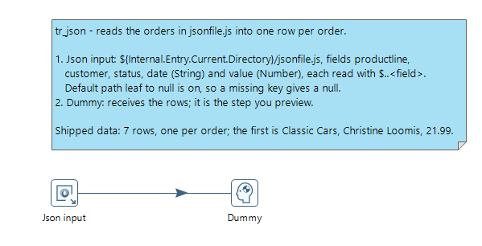
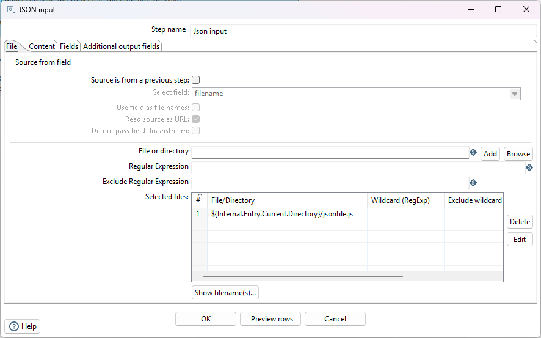
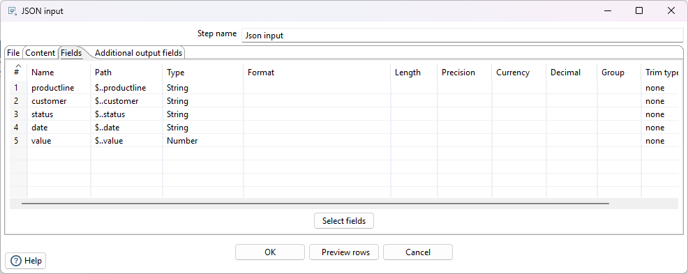
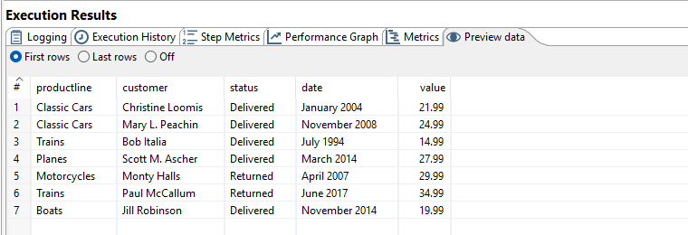

# Read JSON

> **Warning:**
>
> #### Workshop - Read JSON
> 
> Parse a JSON file into rows with **JSON input**.
> 
> **What you’ll do**
> 
> * Read a JSON file from disk
> * Extract fields with JSONPath
> * Use **Select fields** to pick the JSON keys
> * Preview the rows and check their types
> 
> **Prerequisites:** [Text File Input](../06-mod3-text-file-input/guide.md), and basic JSON (objects and arrays).
> 
> **Estimated time:** 25 minutes

<figure>

<figcaption class="pcm-video-caption">Walkthrough: coming soon</figcaption>

</figure>

---

<div align="center">
<figure>

<figcaption>What you build</figcaption>
</figure>
</div>

Look at the input first. `jsonfile.js` is JSON, despite the `.js` extension: one `document` object whose `order` array holds seven orders. These are the first three:

```json
{ "document": {
    "order": [ 
      { "productline": "Classic Cars",
        "customer": "Christine Loomis",
        "status": "Delivered",
        "date": "January 2004",
        "value": 21.99
      },
      { "productline": "Classic Cars",
        "customer": "Mary L. Peachin",
        "status": "Delivered",
        "date": "November 2008",
        "value": 24.99
      },
      { "productline": "Trains",
        "customer": "Bob Italia",
        "status": "Delivered",
        "date": "July 1994",
        "value": 14.99
      }
    ]
  }
}
```

> **Note:** `status` can be `Delivered` or `Returned`.

:::: tabs

### 1. JSON Input

> **Note:**
>
> #### JSON Input
> 
> **JSON input** reads JSON and outputs rows. Each field has its own JSONPath; the step evaluates every path against the document and lines the results up into rows. It has no loop path: each field's own **Path** selects one value per order.

1. Start Spoon with the **Start Pentaho Data Integration** button below, or from PowerShell:

```powershell
Set-Location C:\Pentaho\design-tools\data-integration
.\spoon.bat
```

<button data-launch="spoon" data-path="">Start Pentaho Data Integration</button>

2. Select **File > New > Transformation** (`Ctrl+N`).
3. Select **File > Save as** and save it as `tr_json.ktr` in `C:\Workshop-DI-Practitioner\03-data-sources\01-flat-files\08-mod3-read-json`, next to `jsonfile.js`.
4. On the **Design** tab, open the **Input** folder and drag **JSON input** onto the canvas.
5. Double-click **JSON input**.
6. Set **Step name** to `Json input`.
7. On the **File** tab, enter the path below in **File or directory**, then select **Add**:

   ```text
   ${Internal.Entry.Current.Directory}/jsonfile.js
   ```

<div align="center">
<figure>

<figcaption>The file</figcaption>
</figure>
</div>

8. Open the **Content** tab and set:

   | Setting | Value |
   | --- | --- |
   | **Do not raise an error if no files** | cleared |
   | **Ignore missing path** | cleared |
   | **Default path leaf to null** | selected (the default) |

9. Open the **Fields** tab and select **Select fields**.
10. In the **Select fields** window, expand `document` and then `order` until you see the keys of an order. Select only the five keys, `productline`, `customer`, `status`, `date` and `value`, not `document` or `order` themselves.
11. Select **OK**.
12. Compare the **Fields** grid with this table. If a **Path** or **Type** differs, set it to the value in the table:

    | Name | Path | Type |
    | --- | --- | --- |
    | `productline` | `$..productline` | String |
    | `customer` | `$..customer` | String |
    | `status` | `$..status` | String |
    | `date` | `$..date` | String |
    | `value` | `$..value` | Number |

<div align="center">
<figure>

<figcaption>Five fields, one JSONPath each</figcaption>
</figure>
</div>

> **Tip:** To try a JSONPath expression before you use it, paste the file into a tester such as [jsonpath.com](https://jsonpath.com/).

13. Select **Preview rows**, enter `100` rows, and select **OK**.

> **Success:** Checkpoint: **Examine preview data** shows 7 rows, one per order. The first is `Classic Cars`, `Christine Loomis`, `Delivered`, `January 2004`, `21.99`; the last is `Boats`, `Jill Robinson`, `Delivered`, `November 2014`, `19.99`.

14. Select **Close**.
15. Select **OK**.

> **Under the hood:**
>
> #### Whole document in memory, then one JSONPath per column
>
> **JSON input** doesn't stream. It reads `jsonfile.js` completely,
> parses it into an in-memory tree, and then evaluates each field's
> path against that tree — one query per field. In this file each path
> matches seven values, one per order, and the step zips the seven
> lists together positionally into seven rows.
>
> That positional zip is why the step cares about shape. With
> **Default path leaf to null** off, an order with no `customer` key
> makes the step stop with "The data structure is not the same inside
> the resource" rather than hand you rows whose values have slid out
> of line. In Pentaho Data Integration 11 that option is on by default, and the solution
> keeps it on, so a missing key becomes a null instead.
>
> **Why it matters:** memory is bounded by the *file* size, not the
> row count, so very large JSON is better split, or read one record per
> field. And a structure error is the engine refusing to hand you a row
> whose values have slid one column to the left.

### 2. Dummy

> **Note:**
>
> #### Dummy
> 
> **Dummy (do nothing)** does nothing with the rows. Here it is the step you preview.

1. On the **Design** tab, open the **Flow** folder and drag **Dummy (do nothing)** onto the canvas.
2. Double-click **Dummy (do nothing)**.
3. Set **Step name** to `Dummy`.
4. Select **OK**.
5. Create a hop from **Json input** to **Dummy**: hold `Shift` and drag from one step to the other.

### 3. Run

> **Note:**
>
> #### Run the transformation
> 
> Run it and preview the rows.

1. Save the transformation (`Ctrl+S`).
2. Press `F9` (**Action > Run**), and select **Run** in the **Run Options** dialog.
3. Select **Dummy** on the canvas and open the **Preview data** tab.

<div align="center">
<figure>

<figcaption>One row per order</figcaption>
</figure>
</div>

> **Success:** Checkpoint: 7 rows, one per order. The first is `Classic Cars`, `Christine Loomis`, `Delivered`, `January 2004`, `21.99`, with `value` a Number.

::::

## Troubleshooting <!-- no-step -->

<details>

<summary>No rows returned</summary>

The field paths match nothing in the file. **JSON input** has no loop path: each field's **Path** does the selecting. Check one, such as `$..productline`, against the file in a JSONPath tester.

If the JSON structure changes, update every field's path.

</details>

<details>

<summary>Fields are null</summary>

Check that each path matches its JSON key exactly, including case. A path that matches every order looks like `$..productline` or `$.document.order[*].productline`.

</details>

<details>

<summary>Wrong data types</summary>

Use **Select fields** as a starting point, then set each type yourself. Here `value` is **Number** and the rest are **String**.

</details>

## Lab Files

Click a file to download. For `.ktr` and `.kjb` files, **Open in Pentaho Data Integration** launches Pentaho Data Integration with the file loaded. If Pentaho Data Integration is already running, the path is copied to your clipboard — switch to Pentaho Data Integration and press `Ctrl+O`, `Ctrl+V`, `Enter`.

[jsonfile.js](./files/jsonfile.js)

### Solution <!-- no-step -->

The finished transformation for this lab. Open it alongside your own to compare, or run to see the expected result.

Also on disk at `C:\Workshop-DI-Practitioner\03-data-sources\01-flat-files\08-mod3-read-json\solution`.

[tr_json.ktr](./files/tr_json.ktr) <button data-launch="spoon" data-path="files/tr_json.ktr">Open in Pentaho Data Integration</button> <button data-graph="files/tr_json.ktr">View graph</button>
