# Read XML

> **Warning:**
>
> #### Workshop - Read XML
> 
> Read XML from a file and from a URL with **Get data from XML**.
> 
> **What you’ll do**
> 
> * Read XML from a local file
> * Read XML from a URL passed in a field
> * Use XPath to select the rows and fields
> * Use **Get fields** to infer the XML structure
> * Debug a data type mismatch with the log
> 
> **Prerequisites:** [Read JSON](../08-mod3-read-json/guide.md), basic XML (elements, attributes and hierarchy), and internet access for the URL branch.
> 
> **Estimated time:** 35 minutes

<figure>

<figcaption class="pcm-video-caption">Walkthrough: coming soon</figcaption>

</figure>

---

<div align="center">
<figure>
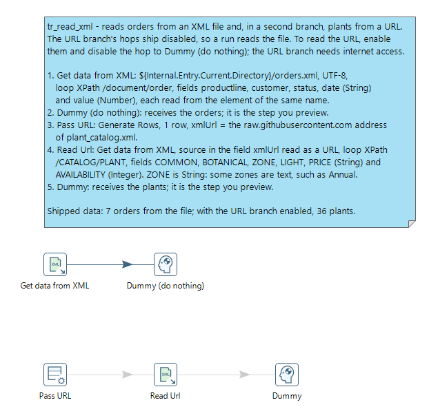
<figcaption>What you build: two ways in</figcaption>
</figure>
</div>

::::: tabs

### 1. XML - File

> **Note:**
>
> #### **XML - File**
> 
> In this branch you read an XML **file** and use XPath to pick out the rows and fields.

<div align="center">
<figure>
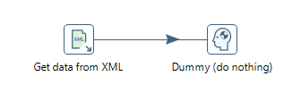
<figcaption>The file branch</figcaption>
</figure>
</div>

<div align="center">
<figure>
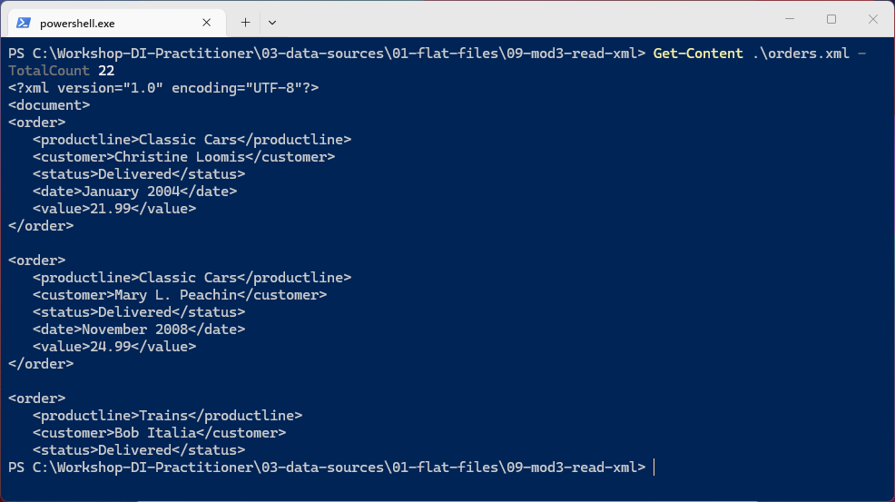
<figcaption>orders.xml</figcaption>
</figure>
</div>

:::: tabs

### 1. Get data from XML

> **Note:**
>
> #### **Get data from XML**
> 
> **Get data from XML** reads any XML document. A **Loop XPath** picks the nodes that become rows, and each field's XPath picks a value from its node.

1. Start Spoon with the **Start Pentaho Data Integration** button below, or from PowerShell:

```powershell
Set-Location C:\Pentaho\design-tools\data-integration
.\spoon.bat
```

<button data-launch="spoon" data-path="">Start Pentaho Data Integration</button>

2. Select **File > New > Transformation** (`Ctrl+N`).
3. Select **File > Save as** and save it as `tr_read_xml.ktr` in `C:\Workshop-DI-Practitioner\03-data-sources\01-flat-files\09-mod3-read-xml`, next to `orders.xml`.
4. On the **Design** tab, open the **Input** folder and drag **Get data from XML** onto the canvas. Keep its default step name, `Get data from XML`: the solution uses it.
5. Double-click **Get data from XML**.
6. On the **File** tab, enter `${Internal.Entry.Current.Directory}/orders.xml` in **File or directory**, then select **Add**.

<div align="center">
<figure>
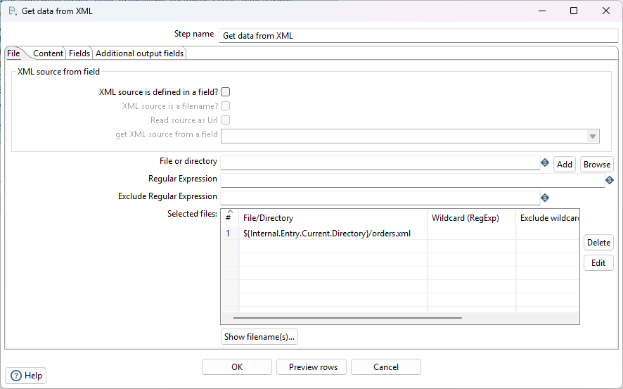
<figcaption>The file</figcaption>
</figure>
</div>

7. Open the **Content** tab and set **Loop XPath** to `/document/order`: one row per `order` element. Set **Encoding** to `UTF-8`.

<div align="center">
<figure>
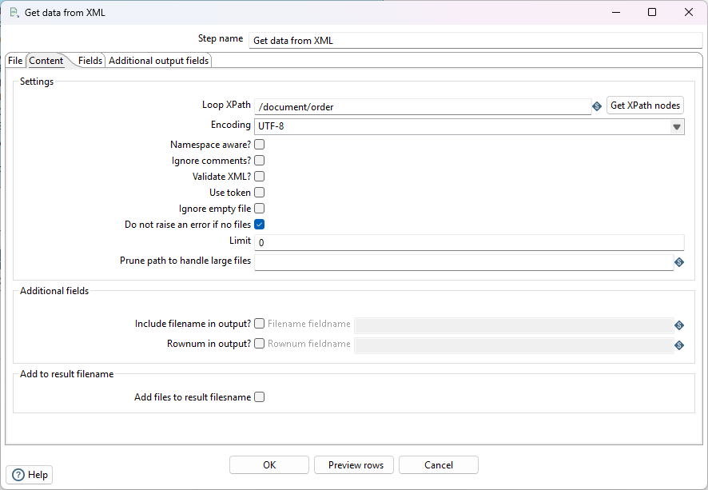
<figcaption>The loop XPath picks the rows</figcaption>
</figure>
</div>

8. Open the **Fields** tab and select **Get fields**.
9. Compare the grid with this table. If a **Type** differs, set it to the value in the table:

   | Name | XPath | Element | Result type | Type |
   | --- | --- | --- | --- | --- |
   | `productline` | `productline` | Node | Value of | String |
   | `customer` | `customer` | Node | Value of | String |
   | `status` | `status` | Node | Value of | String |
   | `date` | `date` | Node | Value of | String |
   | `value` | `value` | Node | Value of | Number |

<div align="center">
<figure>
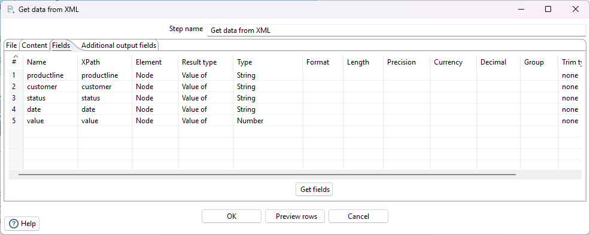
<figcaption>Five fields</figcaption>
</figure>
</div>

10. Select **OK**.

### 2. Dummy

> **Note:**
>
> #### **Dummy**
> 
> **Dummy (do nothing)** does nothing with the rows. Here it is the step you preview.

1. On the **Design** tab, open the **Flow** folder and drag **Dummy (do nothing)** onto the canvas. Keep its default step name, `Dummy (do nothing)`.
2. Create a hop from **Get data from XML** to **Dummy (do nothing)**: hold `Shift` and drag from one step to the other.

<div align="center">
<figure>
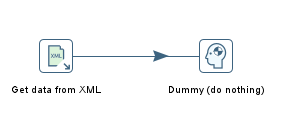
<figcaption>The canvas after Dummy (do nothing)</figcaption>
</figure>
</div>


### 3. Run

> **Note:**
>
> #### **Run the transformation**
> 
> **Get data from XML** can take its XML from a file, from a URL, or from XML already held in a field. This branch reads a file. Later, before you run the URL branch, you disable this branch's hop.

1. Save the transformation (`Ctrl+S`).
2. Press `F9` (**Action > Run**), and select **Run** in the **Run Options** dialog.
3. Select **Dummy (do nothing)** on the canvas and open the **Preview data** tab.

<div align="center">
<figure>

<figcaption>Seven orders from the file</figcaption>
</figure>
</div>

> **Success:** Checkpoint: 7 rows, one per `<order>` element in `orders.xml`. The first is `Classic Cars`, `Christine Loomis`, `Delivered`, `January 2004`, `21.99`.

4. In **Execution Results**, open the **Step Metrics** tab. **Get data from XML** shows `7` in **Written**.

> **Under the hood:**
>
> #### Loop XPath picks the rows; field XPaths are relative to each one
>
> The step parsed `orders.xml` into a DOM tree, then evaluated your
> **Loop XPath** to select a node set — one node per output row. Each
> field's XPath is then evaluated *from that node*, not from the
> document root, which is why the paths on the Fields tab are short
> and why **Get fields** could infer them by looking at one
> element's children.
>
> A DOM means the whole file is in memory before the first row is
> emitted. For files too big for that, the step's **Prune path to
> handle large files** option switches to streaming: the document is
> processed in chunks delimited by the prune path, and only one chunk
> is ever held.
>
> **Why it matters:** the loop path is the one setting to get right —
> zero rows almost always means it selected nothing — and a single
> setting is the difference between a 50 MB feed and a 5 GB one.

::::

### 2. XML - URL

> **Note:**
>
> #### XML - URL
>
> In this branch the XML comes from a **URL**, passed to the step in a field, and XPath picks out the rows and fields as before. You build it in the same transformation, below the file branch.

<div align="center">
<figure>
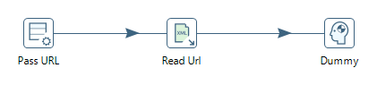
<figcaption>The URL branch</figcaption>
</figure>
</div>

<div align="center">
<figure>
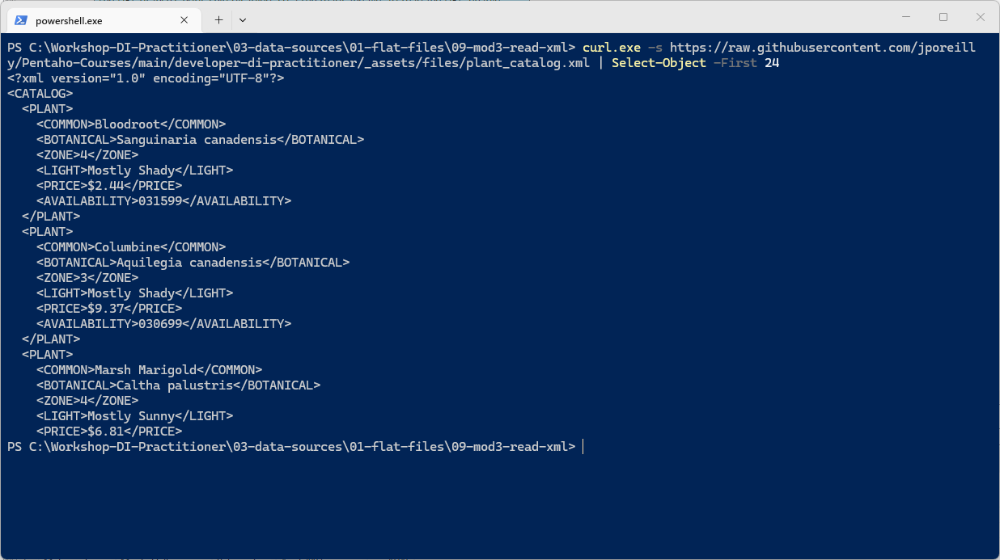
<figcaption><a href="../_assets/files/plant_catalog.xml">plant_catalog.xml</a></figcaption>
</figure>
</div>

::: tabs

### 1. Generate rows - Pass URL

> **Note:**
>
> #### Generate rows
> 
> **Generate rows** outputs a set number of rows, each carrying the fixed values you give it. Here it produces one row holding the URL of `plant_catalog.xml`.

1. On the **Design** tab, open the **Input** folder and drag **Generate rows** onto the canvas.
2. Double-click **Generate rows**.
3. Set **Step name** to `Pass URL`.
4. Set **Limit** to `1`.
5. Fill the **Fields** grid with one row: **Name** `xmlUrl`, **Type** `String`, and in **Value** this URL:

   ```text
   https://raw.githubusercontent.com/jporeilly/Pentaho-Courses/main/developer-di-practitioner/_assets/files/plant_catalog.xml
   ```

6. Select **OK**.

<div align="center">
<figure>
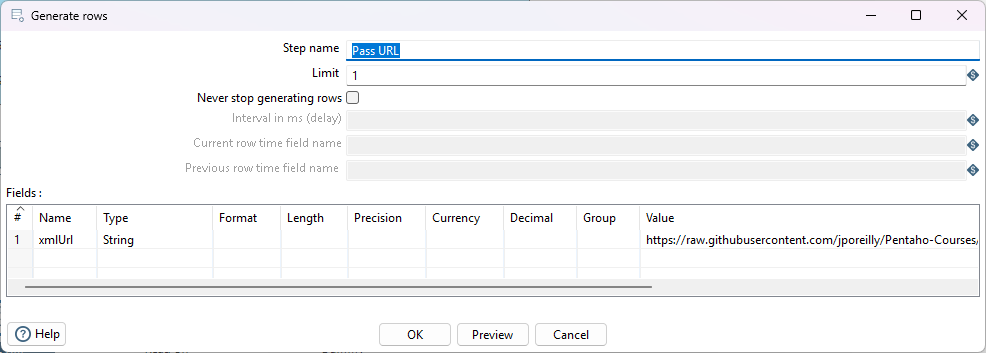
<figcaption>The URL travels in a field</figcaption>
</figure>
</div>

> **Note:** The file's original w3schools address now refuses Pentaho Data Integration's HTTP client (HTTP 403), which is why the course serves a copy of the same file from GitHub.

### 2. Get data from XML - Read URL

> **Note:**
>
> #### Get data from XML
> 
> This step takes the URL from the `xmlUrl` field that **Pass URL** sends it.

1. On the **Design** tab, open the **Input** folder and drag a second **Get data from XML** onto the canvas.
2. Create a hop from **Pass URL** to the new **Get data from XML**.
3. Double-click the new step.
4. Set **Step name** to `Read Url`.
5. On the **File** tab, set:

   | Setting | Value |
   | --- | --- |
   | **XML source is defined in a field?** | selected |
   | **Read source as Url** | selected |
   | **get XML source from a field** | `xmlUrl` |

<div align="center">
<figure>
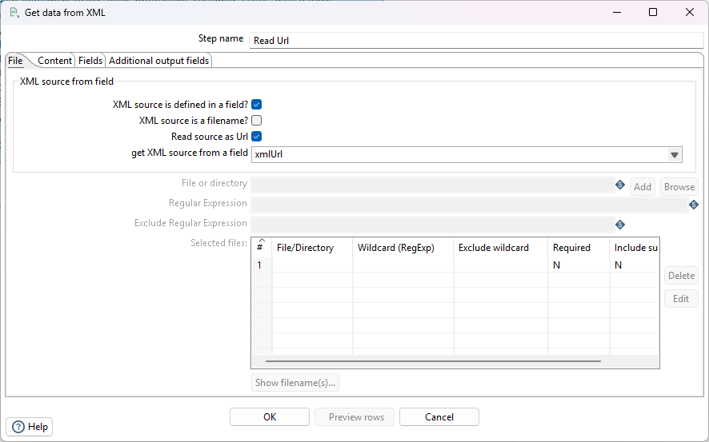
<figcaption>Read the XML from the URL in xmlUrl</figcaption>
</figure>
</div>

6. Open the **Content** tab and set:

   | Setting | Value |
   | --- | --- |
   | **Loop XPath** | `/CATALOG/PLANT` |
   | **Encoding** | `UTF-8` |
   | **Do not raise an error if no files** | cleared |

<div align="center">
<figure>
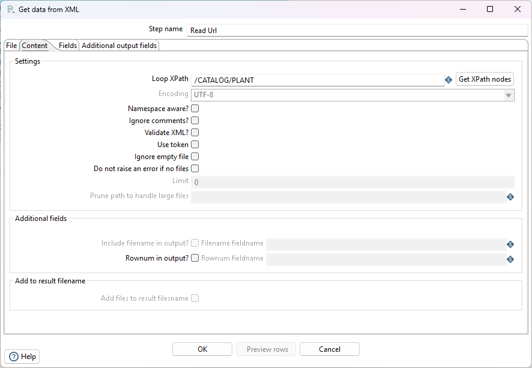
<figcaption>One row per plant</figcaption>
</figure>
</div>

7. Open the **Fields** tab and select **Get fields**. The XML arrives in a field only at run time, so Spoon asks for a sample: a **URL** dialog opens.
8. Paste the same URL into the **URL** dialog and select **OK**. **Get fields** reads the catalog and fills the grid with `COMMON`, `BOTANICAL`, `ZONE`, `LIGHT`, `PRICE` and `AVAILABILITY`.

<div align="center">
<figure>
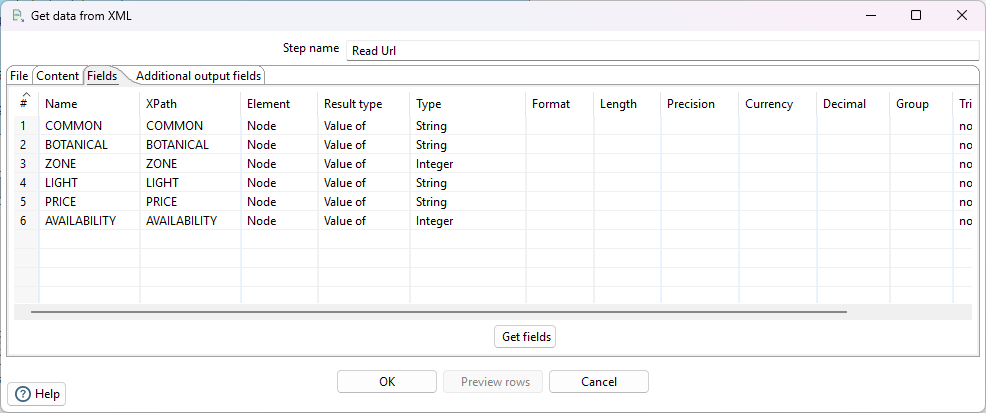
<figcaption>Six fields, types guessed</figcaption>
</figure>
</div>

> **Success:** Checkpoint: **Get fields** guessed `ZONE` and `AVAILABILITY` as **Integer** and the other four as **String**.

9. Leave the types as they are for now, and select **OK**.

> **Under the hood:**
>
> #### A URL is another file path
>
> Nothing in the step changed to fetch from the web. Every file access
> in Pentaho Data Integration goes through Apache Commons VFS, a virtual file system layer
> that turns a string into a stream: `C:/data/x.xml`,
> `http://.../plant_catalog.xml`, `sftp://host/feed.xml`,
> `zip:file:///archive.zip!/x.xml` and, as the MinIO lab shows,
> `s3://` all pass through the same interface. Selecting **Read source
> as Url** tells the step to hand the field's text to VFS as a
> *location* rather than treat it as XML content.
>
> Because the URL arrived in a field, it can vary per row: a
> **Generate rows** with three URLs, or a table of endpoints, drives
> three fetches with no change to the step.
>
> **Why it matters:** anywhere Pentaho Data Integration asks for a filename, a URL will do.
> There is no separate "web input" to learn, and a transformation
> written against local files moves to S3 or SFTP by editing a string.


### 3. Dummy

> **Note:**
>
> #### Dummy
> 
> A second **Dummy (do nothing)** gives this branch its own step to preview.

1. On the **Design** tab, open the **Flow** folder and drag **Dummy (do nothing)** onto the canvas.
2. Double-click the new **Dummy (do nothing)**.
3. Set **Step name** to `Dummy`.

<div align="center">
<figure>
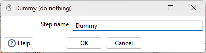
<figcaption>Dummy: the step to preview on the URL branch</figcaption>
</figure>
</div>

4. Select **OK**.
5. Create a hop from **Read Url** to **Dummy**.

<div align="center">
<figure>
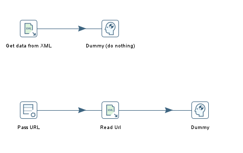
<figcaption>The canvas after Dummy</figcaption>
</figure>
</div>


### 4. Run

> **Note:**
>
> #### **Run the transformation**
> 
> Switch the hops so that only the URL branch runs. The first run fails, on purpose. Before you open the log, guess why.

1. Right-click the hop from **Get data from XML** to **Dummy (do nothing)** and select **Disable**.
2. Right-click the hop from **Pass URL** to **Read Url**. If the menu offers **Enable**, select it; if it offers **Disable**, the hop is already enabled, so close the menu.
3. Do the same for the hop from **Read Url** to **Dummy**.
4. Save the transformation (`Ctrl+S`).
5. Press `F9` (**Action > Run**), and select **Run** in the **Run Options** dialog. The run fails.

<div align="center">
<figure>
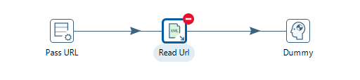
<figcaption>The run fails in Read Url</figcaption>
</figure>
</div>

6. In **Execution Results**, open the **Logging** tab and find the error for **Read Url** that names the value:

```text
ZONE String : couldn't convert String to number : non-numeric character found at position 1 for value [Annual]
```

<div align="center">
<figure>
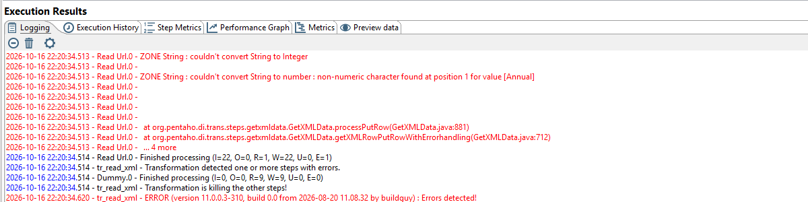
<figcaption>The log names the field and the value</figcaption>
</figure>
</div>

> **Warning:** **Get fields** guessed `ZONE` from the first plants, whose zones are numbers. Further down, plant 23 (`Black-Eyed Susan`) has the zone `Annual`, which no Integer can hold; 8 of the 36 plants do. `ZONE` is really text.

7. Double-click **Read Url** and open the **Fields** tab.
8. Set the **Type** of `ZONE` to `String`. The grid now has these types:

   | Name | Type |
   | --- | --- |
   | `COMMON` | String |
   | `BOTANICAL` | String |
   | `ZONE` | String |
   | `LIGHT` | String |
   | `PRICE` | String |
   | `AVAILABILITY` | Integer |

9. Select **OK**.
10. Save the transformation (`Ctrl+S`).
11. Press `F9` (**Action > Run**), and select **Run** in the **Run Options** dialog.
12. In **Execution Results**, open the **Step Metrics** tab.

> **Success:** Checkpoint: the run finishes without errors, and **Read Url** shows `36` in **Written**: one row per `<PLANT>` in `plant_catalog.xml`.

13. Select **Dummy** on the canvas and open the **Preview data** tab.

<div align="center">
<figure>
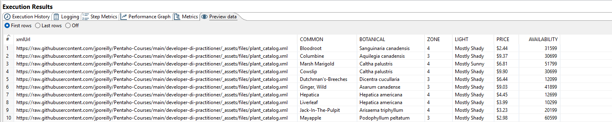
<figcaption>36 plants from the URL</figcaption>
</figure>
</div>

> **Success:** Checkpoint: the first row is `Bloodroot`, `Sanguinaria canadensis`, zone `4`, `Mostly Shady`, `$2.44`. `xmlUrl` comes first: the step passes the incoming field through.

:::

:::::

## Lab Files

Click a file to download. For `.ktr` and `.kjb` files, **Open in Pentaho Data Integration** launches Pentaho Data Integration with the file loaded. If Pentaho Data Integration is already running, the path is copied to your clipboard — switch to Pentaho Data Integration and press `Ctrl+O`, `Ctrl+V`, `Enter`.

[orders.xml](./files/orders.xml)

The URL branch reads its catalog from GitHub. This is the same file, for reference:

[plant_catalog.xml](../_assets/files/plant_catalog.xml)

### Solution <!-- no-step -->

The finished transformation for this lab. Open it alongside your own to compare, or run to see the expected result. The URL branch's hops ship disabled, so a run reads the file; enable them (and disable the file branch's hop) to read the URL. It needs internet access.

Also on disk at `C:\Workshop-DI-Practitioner\03-data-sources\01-flat-files\09-mod3-read-xml\solution`.

[tr_read_xml.ktr](./files/tr_read_xml.ktr) <button data-launch="spoon" data-path="files/tr_read_xml.ktr">Open in Pentaho Data Integration</button> <button data-graph="files/tr_read_xml.ktr">View graph</button>
