# Excel Writer

> **Warning:**
>
> #### Workshop - Excel Writer
> 
> Excel reports often need templates, charts, and fixed layouts.
> 
> Here you fill in a pre-formatted Sales and Expenses report: three sections written into one workbook, in an order you control so the writers never collide.
> 
> **What you'll do**
> 
> * Use a template workbook and write to fixed cell positions
> * Write a report header with **Generate rows**
> * Read sales and expense rows from text files
> * Block parallel flows before writing to the same file
> * Write multiple sections with **Microsoft Excel Writer**
> 
> **Prerequisites:** [Text File Input](../06-mod3-text-file-input/guide.md).
> 
> **Estimated time:** 45 minutes

<div class="pcm-embed-card" data-href="https://www.loom.com/share/770dd4bae75049eeab247bec2bf6fbcc?hideEmbedTopBar=true&amp;hide_owner=true&amp;hide_share=true&amp;hide_title=true" data-title="Advanced Excel File Creation with Microsoft Excel Writer Step 📊" data-description="In this video, I demonstrate the advanced features of the Microsoft Excel Writer Step, focusing on how to create a formatted Excel file using a template, comments, hyperlinks, and formulas. We will be generating a fictional report that includes a logo, a hyperlink to documentation, and arbitrary numbers to illustrate how to insert formulas, specifically a running total. I guide you through the transformation process, including configuring the necessary steps and fields. I encourage you to follow along and replicate this process in your own projects. By the end, you'll see how the final Excel file matches our template design and includes all the required elements." data-thumb="../_assets/embeds/2d94cd73b9b2.png"></div>

<figure>

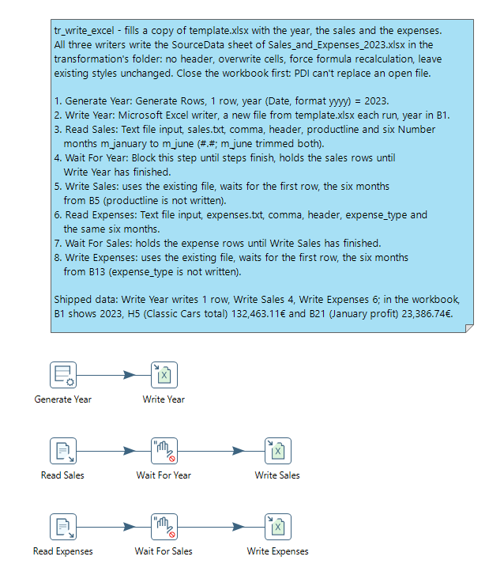

<div align="center">
<figcaption><em>What you build</em></figcaption>
</div>
</figure>

> **Note:** **Create a new transformation**
> 
> Use any of these options to open a new transformation tab:
> 
> * Select **File** > **New** > **Transformation**
> * Use `Ctrl+N` (Windows/Linux) or `Cmd+N` (macOS)

::::: tabs

### 1. Excel Template

> **Note:**
>
> #### Excel template
> 
> Every branch of the transformation writes into a copy of `template.xlsx`. The template has two worksheets:
> 
> * **Sales Chart** - a 3D stacked chart
> * **SourceData** - the cells the chart reads. The transformation writes only these.

1. Open `template.xlsx` in Excel and look at both sheets:

<figure>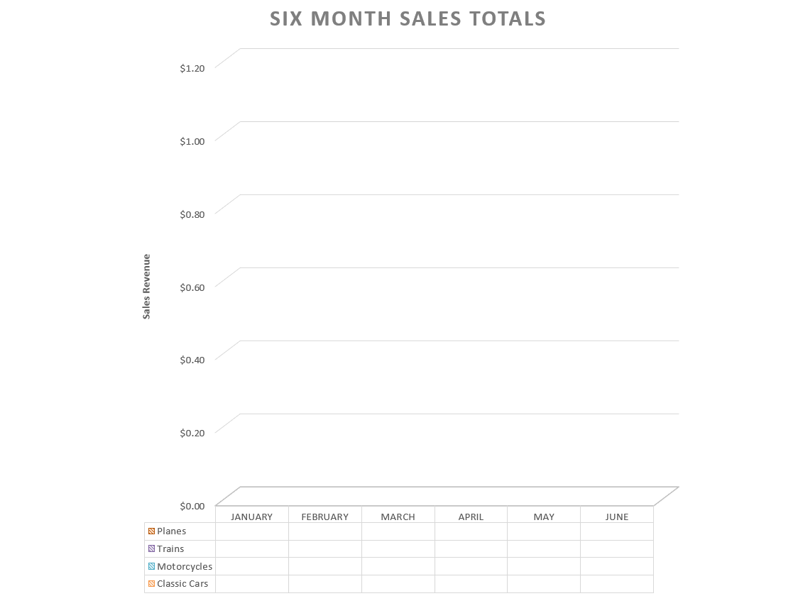<figcaption><p>Sales Chart: the chart, still empty</p></figcaption></figure>

<figure>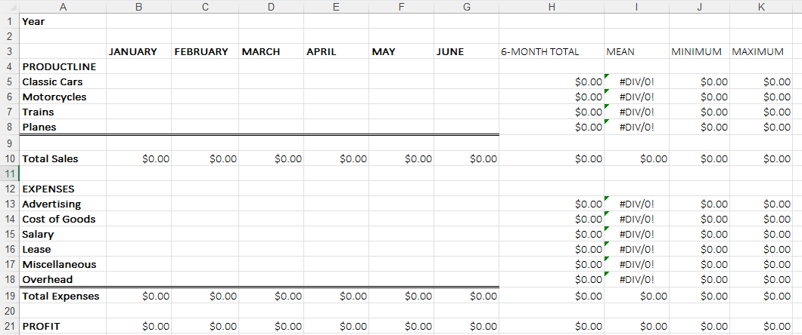<figcaption><p>SourceData: labels and formulas, no numbers yet</p></figcaption></figure>

> **Note:** **SourceData** already has the row and column labels, the totals and the formulas. You write only the numbers: the year into `B1`, sales into `B5:G8`, expenses into `B13:G18`.

### 2. Write Year

> **Note:**
>
> #### Write year
> 
> The first branch writes the report year into `SourceData`, creating the output file from the template.

<figure>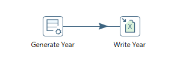<figcaption><p>The year branch</p></figcaption></figure>

:::: tabs

### 1. Generate Rows - Year

> **Note:**
>
> #### Generate rows - year
> 
> **Generate Rows** outputs a fixed number of rows. Here it outputs one row holding the report year.

1. Start Spoon, create a transformation and save it as `tr_write_excel.ktr` in the lab folder, `C:\Workshop-DI-Practitioner\03-data-sources\01-flat-files\10-mod3-excel-writer`, next to `template.xlsx`.


::: tabs

### Windows (PowerShell)

> 
> ```powershell
> Set-Location C:\Pentaho\design-tools\data-integration
> .\spoon.bat
> ```
> 
>

### macOS / Linux

> 
> ```bash
> cd ~/Pentaho/design-tools/data-integration
> ./spoon.sh
> ```
> 
>

:::

<button data-launch="spoon" data-path="">Start PDI</button>

2. Drag **Generate Rows** onto the canvas and name it `Generate Year`.
3. Double-click the step. Set **Limit** to `1` and add one field:

   | Name | Type | Format | Value |
   | --- | --- | --- | --- |
   | `year` | Date | `yyyy` | `2023` |

<figure>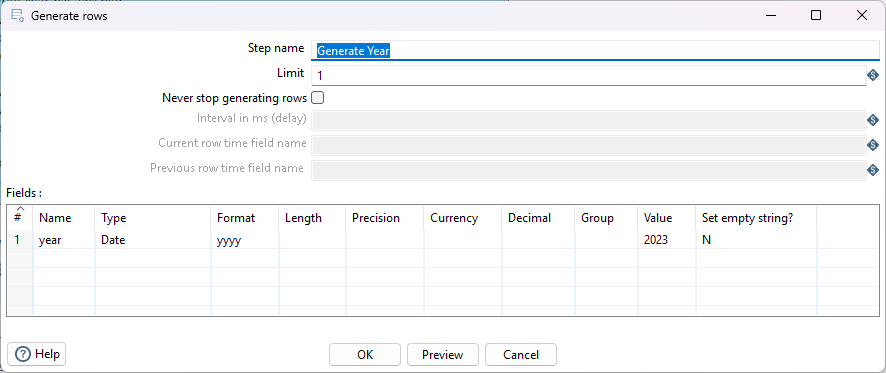<figcaption><p>One row: the year</p></figcaption></figure>

4. Select **OK**.

> **Note:** `year` is a Date, read from `2023` with the format `yyyy`. Cell `B1` in the template is formatted `yyyy` too, so Excel shows the year rather than a full date.

### 2. Excel Writer - Year

> **Note:**
>
> #### Excel Writer - year
> 
> **Microsoft Excel Writer** writes incoming rows into a workbook. Use the `xlsx` format when you work with templates and charts.

1. Drag **Microsoft Excel Writer** onto the canvas and name it `Write Year`.
2. Create a hop to it from `Generate Year`.
3. Double-click the step. On the **File & Sheet** tab, set:

   | Setting | Value |
   | --- | --- |
   | **Filename** | `${Internal.Entry.Current.Directory}/Sales_and_Expenses_2023` |
   | **Extension** | `xlsx` (the step adds it; don't type it in the file name too, or you get `.xlsx.xlsx`) |
   | **If output file exists** | **replace with new output file** - a fresh copy every run |
   | **Sheet name** | `SourceData` |
   | **If sheet exists in output file** | **write to existing sheet** |
   | **Use template when creating new files** | selected |
   | **Template file** | `${Internal.Entry.Current.Directory}/template.xlsx` |

<figure>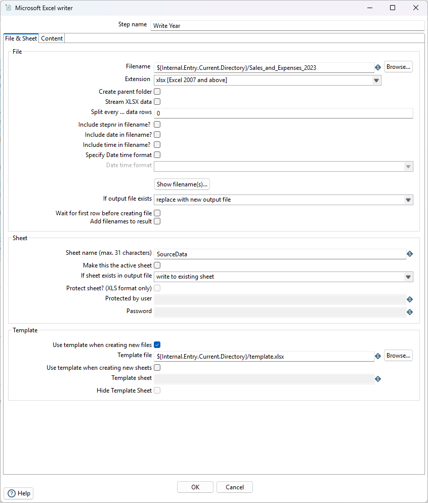<figcaption><p>A new file from the template, every run</p></figcaption></figure>

4. On the **Content** tab, set **Start writing at cell** to `B1`, **When writing rows** to **overwrite existing cells**, and clear **Write Header**.

<figure>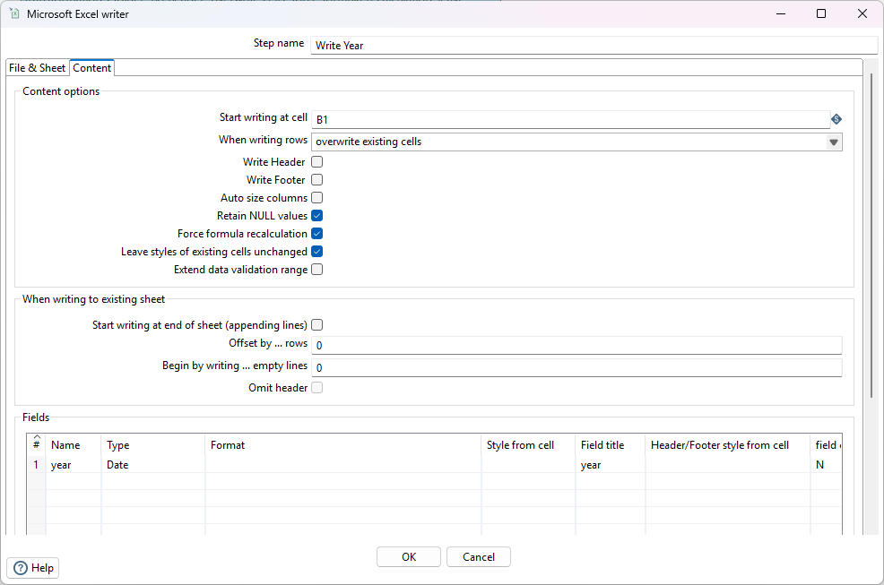<figcaption><p>The year goes in B1</p></figcaption></figure>

5. Select **Get Fields**: one field, `year`.
6. Select **OK**.

> **Under the hood:**
>
> #### The template's chart survives because the writer edits cells, not files
>
> **Microsoft Excel Writer** opened `template.xlsx` with Apache POI,
> the Java library that understands the `.xlsx` object model. It
> copied the workbook — sheets, styles, and the chart on *Sales
> Chart* — into the output file, located the cell you named, and wrote
> the year into it. Everything it didn't touch is preserved.
>
> The chart itself contains no data. It holds *references* to ranges
> on *SourceData*, so when Excel opens the finished file and
> recalculates, the chart draws whatever the transformation put in
> those ranges. That is why the template can be designed entirely in
> Excel by someone who never opens Spoon.
>
> **Why it matters:** the presentation layer — formatting, formulas,
> charts, logos — lives in the template, owned by the report's
> consumer. The transformation only ever supplies numbers, so a
> restyle never touches the pipeline.

::::

### 3. Write Sales

> **Note:**
>
> #### Write sales
> 
> Write the sales rows into the same workbook. A blocking step makes sure the year write has finished first.

<figure>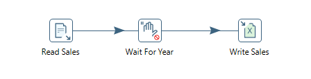<figcaption><p>The sales branch</p></figcaption></figure>

::: tabs

### 1. Text File Input - Read Sales

> **Note:**
>
> #### Text file input - read sales
> 
> Read the sales figures: one row per product line, one column per month.

1. Drag **Text file input** onto the canvas and name it `Read Sales`.
2. Double-click the step. In **File or directory**, add `${Internal.Entry.Current.Directory}/sales.txt`.

<figure>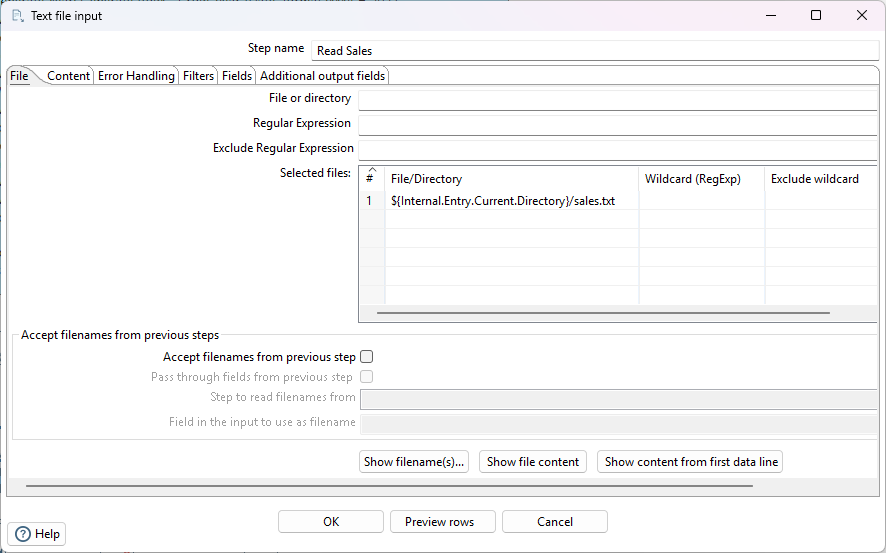<figcaption><p>The sales file</p></figcaption></figure>

3. On the **Content** tab, set **Separator** to `,`, and keep **Header**, **No empty rows** selected and **Format** `mixed`.

<figure><figcaption><p>Comma-separated, with a header</p></figcaption></figure>

4. On the **Fields** tab, select **Get Fields**: `productline` (String) and `m_january` to `m_june` (Number), named from the header line.
5. Select **OK**.

### 2. Block until Step Finish - Wait Year

> **Note:**
>
> #### Block until steps finish - wait year
> 
> This step holds its rows back until the steps you list have finished. Use it to stop two writers working on one file at once.

1. Drag **Block this step until steps finish** onto the canvas and name it `Wait For Year`.
2. Create a hop to it from `Read Sales`.
3. Double-click the step and add one row: step `Write Year`, copy `0`. (If you used **Get steps**, remove every other row.)

<figure>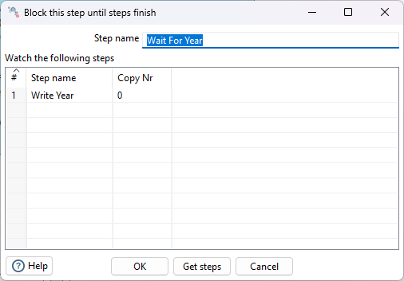<figcaption><p>Wait for Write Year</p></figcaption></figure>

> **Note:** The sales rows now wait here until `Write Year` has finished.

> **Under the hood:**
>
> #### Blocking works through back-pressure, not by pausing threads
>
> **Block this step until steps finish** doesn't suspend anything.
> When the transformation starts, its thread doesn't take any
> rows from its input; instead it polls the status of the step you
> listed — the year writer — until that step reports finished. Only
> then does it start reading, and every row it reads passes straight
> through unchanged.
>
> Meanwhile **Read Sales** keeps running. It fills the row set between
> the two steps (10,000 rows by default), then blocks on the full
> buffer — the same back-pressure that governs every hop. Nothing is
> copied or buffered specially; the pipeline just stalls at that point
> until the gate opens.
>
> **Why it matters:** the year cell is guaranteed to be written before
> the sales writer opens the same workbook, without a job, a second
> transformation or a sleep. Whenever two writers must not overlap —
> same file, same table after a truncate — this one step is the
> ordering primitive.

### 3. Excel Writer - Write Sales

> **Note:**
>
> #### Excel Writer - write sales
> 
> Write the sales rows into the workbook the year writer created.

1. Drag **Microsoft Excel Writer** onto the canvas and name it `Write Sales`.
2. Create a hop to it from `Wait For Year`.
3. Double-click the step. On the **File & Sheet** tab, set:

   | Setting | Value |
   | --- | --- |
   | **Filename** | `${Internal.Entry.Current.Directory}/Sales_and_Expenses_2023` (the same file) |
   | **Extension** | `xlsx` |
   | **If output file exists** | **Use existing file for writing** |
   | **Wait for first row before creating file** | selected |
   | **Sheet name** | `SourceData` |
   | **If sheet exists in output file** | **write to existing sheet** |
   | **Use template when creating new files** | cleared |

<figure>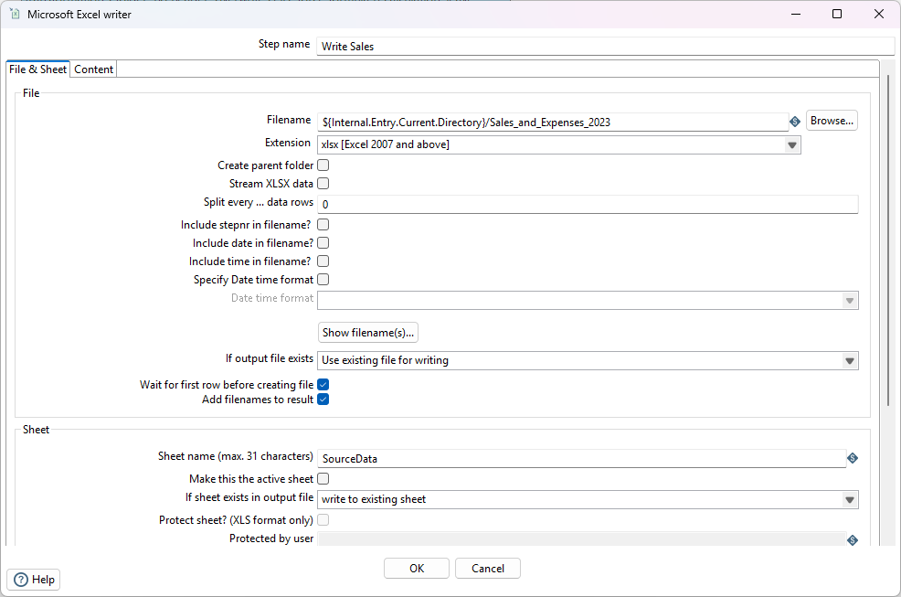<figcaption><p>Reuse the file the year writer made</p></figcaption></figure>

4. On the **Content** tab, set **Start writing at cell** to `B5`, **When writing rows** to **overwrite existing cells**, and clear **Write Header**.

<figure>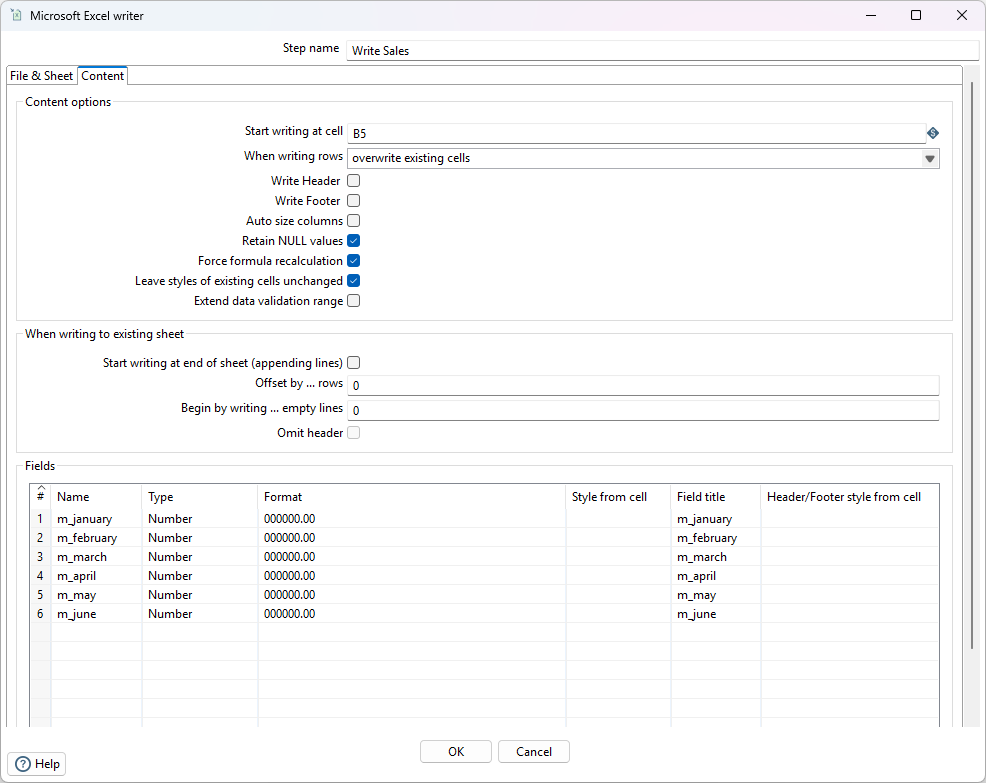<figcaption><p>Sales start at B5</p></figcaption></figure>

5. Select **Get Fields**, then delete `productline`: the template already has the product line names in column A, so you write only the six months into `B5:G8`.
6. Select **OK**.

:::

### 4. Write Expenses

> **Note:**
>
> #### Write expenses
> 
> Write the expense rows into the same workbook, after the sales write has finished. The branch is built exactly like the sales one.

<figure>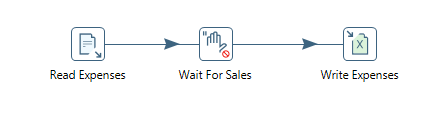<figcaption><p>The expenses branch</p></figcaption></figure>

::: tabs

### 1.  Text File Input - Read Expenses

> **Note:**
>
> #### Text file input - read expenses
> 
> Read the expense figures: one row per expense type, one column per month.

1. Drag **Text file input** onto the canvas and name it `Read Expenses`.
2. In **File or directory**, add `${Internal.Entry.Current.Directory}/expenses.txt`.
3. On **Content**, set **Separator** to `,` with **Header** selected, as for sales.
4. On **Fields**, select **Get Fields**: `expense_type` and `m_january` to `m_june`.

<figure>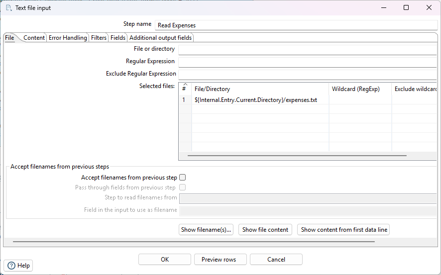<figcaption><p>The expenses file</p></figcaption></figure>

<figure>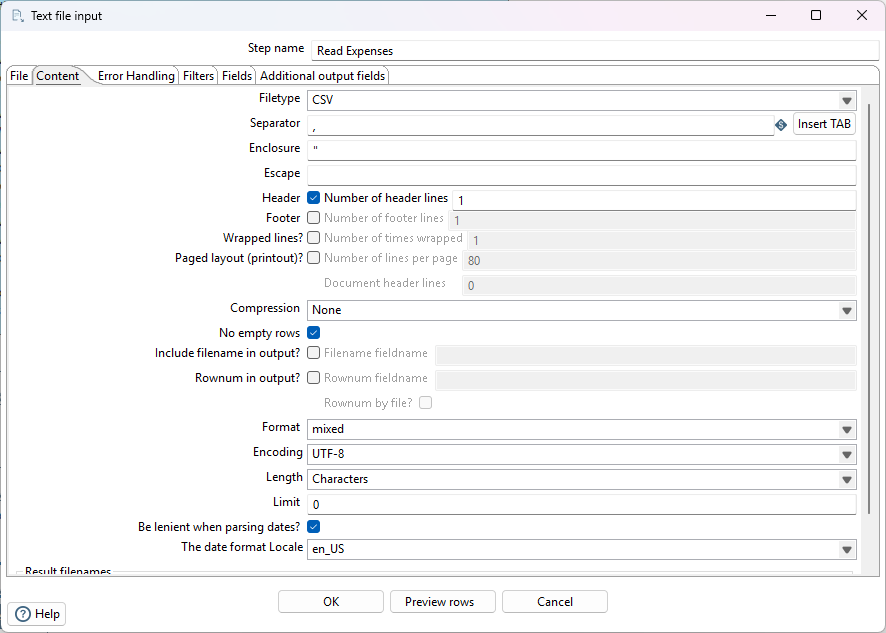<figcaption><p>Same layout as sales</p></figcaption></figure>

<figure>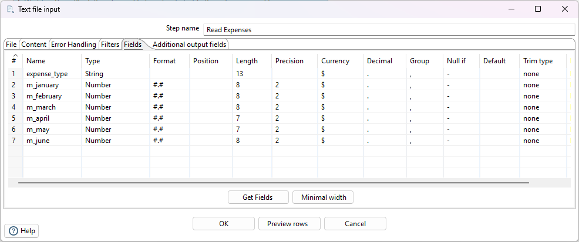<figcaption><p>Seven fields</p></figcaption></figure>

### 2. Block until Step finish - Sales

> **Note:**
>
> #### Block until steps finish - wait sales
> 
> Hold the expense rows until the sales write has finished.

1. Drag **Block this step until steps finish** onto the canvas and name it `Wait For Sales`.
2. Create a hop to it from `Read Expenses`.
3. Add one row: step `Write Sales`, copy `0`.

<figure><figcaption><p>Wait for Write Sales</p></figcaption></figure>

### 3. Excel Writer - Expenses

> **Note:**
>
> #### Excel Writer - Expenses
> 
> Write the expenses to `SourceData`, starting at `B13`.

1. Drag **Microsoft Excel Writer** onto the canvas and name it `Write Expenses`.
2. Create a hop to it from `Wait For Sales`.
3. On **File & Sheet**, use the same settings as `Write Sales`: the same file, **Use existing file for writing**, sheet `SourceData`, **write to existing sheet**.
4. On **Content**, set **Start writing at cell** to `B13`, **overwrite existing cells**, and clear **Write Header**.
5. Select **Get Fields**, then delete `expense_type`. The six months go into `B13:G18`.

<figure>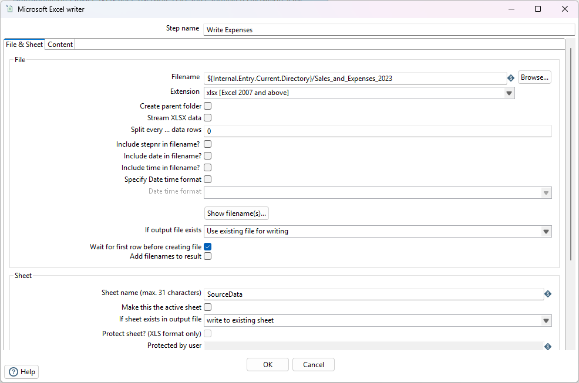<figcaption><p>The same file and sheet</p></figcaption></figure>

<figure>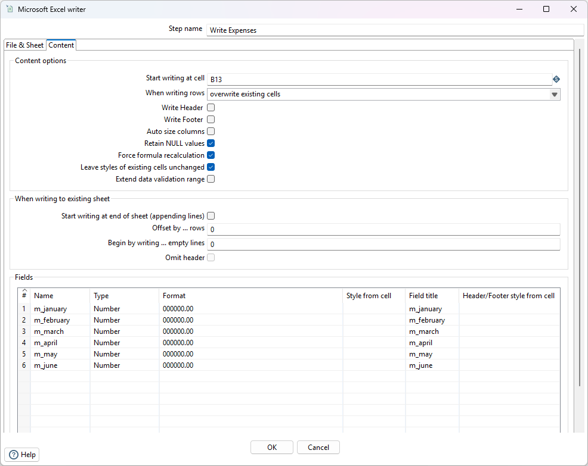<figcaption><p>Expenses start at B13</p></figcaption></figure>

:::

### 5. Run

> **Note:**
>
> #### Run the transformation
> 
> All three branches start together; the two blocking steps put the writes in order: year, then sales, then expenses.

1. Select **Run** in the toolbar, then **Run** in **Run Options**.
2. In **Step Metrics**, check the writers: `Write Year` 1 row, `Write Sales` 4 rows, `Write Expenses` 6 rows.
3. Open `Sales_and_Expenses_2023.xlsx` in the lab folder. On **SourceData**, `B1` shows `2023`, the sales fill `B5:G8` and the expenses `B13:G18`; the template's totals and the **Sales Chart** now show them.

<figure>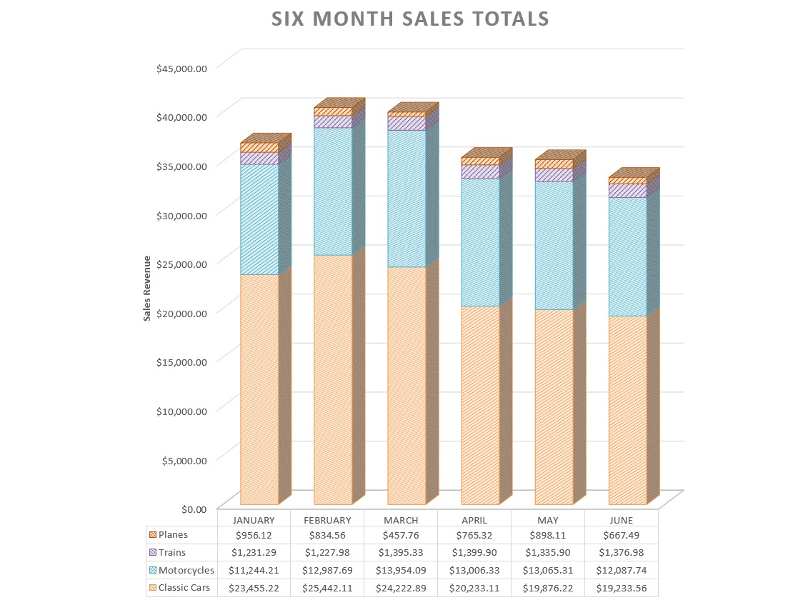<figcaption><p>The finished report</p></figcaption></figure>

:::::

## Lab Files

Click a file to download. For `.ktr` and `.kjb` files, **Open in Pentaho Data Integration** launches PDI with the file loaded. If PDI is already running, the path is copied to your clipboard — switch to PDI and use Ctrl+O, Ctrl+V, Enter.

[expenses.txt](./files/expenses.txt)

[Sales_and_Expenses_2017.xlsx](./files/Sales_and_Expenses_2017.xlsx) (a finished example of the report, for comparison)

[sales.txt](./files/sales.txt)

[template.xlsx](./files/template.xlsx)

### Solution <!-- no-step -->

The finished transformation for this lab. Open it alongside your own to compare, or run to see the expected result.

Also on disk at `C:\Workshop-DI-Practitioner\03-data-sources\01-flat-files\10-mod3-excel-writer\solution`.

[tr_write_excel.ktr](./files/tr_write_excel.ktr) <button data-launch="spoon" data-path="files/tr_write_excel.ktr">Open in Pentaho Data Integration</button> <button data-graph="files/tr_write_excel.ktr">View graph</button>
