# Connecting to Database

> **Warning:**
>
> #### Workshop - Connecting to Database
> 
> Create a reusable MySQL connection to the Steel Wheels `sampledata` database.
> 
> **What you’ll do**
> 
> * Check the database is reachable (optional: Adminer on a lab VM, or DBeaver)
> * Install the MySQL JDBC driver, if PDI doesn't have it yet
> * Create, test, share and explore a PDI database connection
> 
> **Prerequisites**
> 
> * PDI (Spoon) installed and working
> * A running **MySQL** `sampledata` database on port `3306` - on a lab
>   VM the course's lab kit starts it at sign-in. **Not** the
>   HSQLDB/Hypersonic `sampledata` bundled with Pentaho, which is
>   read-only and can't serve the CRUID workshops that follow
> * Basic understanding of schemas, tables and logins
> 
> **Estimated time:** 30 minutes

:::: tabs

### 1. Check the Database

> **Note:**
>
> #### Check the Database First
> 
> This part is optional. Confirming the database answers, outside PDI, means a failed **Test** later is a PDI setting, not the database.
>
> Use the course's MySQL `sampledata`, not Pentaho's bundled sample database, which has no writable user. On a lab VM it is already running: the guide's lab kit started it at sign-in, and the environment panel on [Before You Start](../00-before-you-start/guide.md) shows it. On your own machine, Before You Start's setup tabs bring it up on `3306`, with Steel Wheels loaded and the `pentaho_admin` login used below.

::: tabs

### Adminer (lab VM)

The lab VM comes with **Adminer**, a database browser that runs beside MySQL.

1. Open <http://127.0.0.1:8050> in a browser.
2. Log in with **System** `MySQL`, **Server** `sampledata-mysql`, **Username** `pentaho_admin`, **Password** `password` and **Database** `sampledata`.
3. Select **SQL command**, enter the query below, and select **Execute**:

```sql
select * from CUSTOMERS
where COUNTRY = 'USA' and CITY = 'NYC';
```

> **Success:** Checkpoint: 5 customers, from `Land of Toys Inc.` to `Microscale Inc.`.

### DBeaver

DBeaver Community Edition ships with most drivers, which makes it a quick connectivity check on your own machine.

1. Start DBeaver. On the toolbar, select the arrow beside the **New Database Connection** button (the plug icon), and select **MySQL**.

<figure>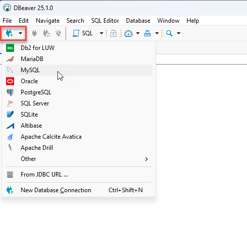<figcaption><p>New Database Connection, MySQL</p></figcaption></figure>

2. On the **Main** tab, set **Server Host** to `localhost`, **Port** to `3306`, **Database** to `sampledata`, **Username** to `pentaho_admin` and **Password** to `password`.

<figure>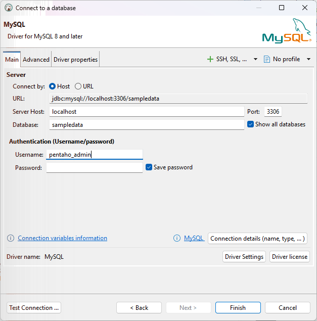<figcaption><p>The Main tab (the screenshot shows a different username)</p></figcaption></figure>

3. Select **Test Connection ...**. If DBeaver offers to download the MySQL driver, accept the download.
4. If the test fails with an error about public key retrieval, open the **Driver properties** tab, set **allowPublicKeyRetrieval** to `TRUE`, and select **Test Connection ...** again.

<figure>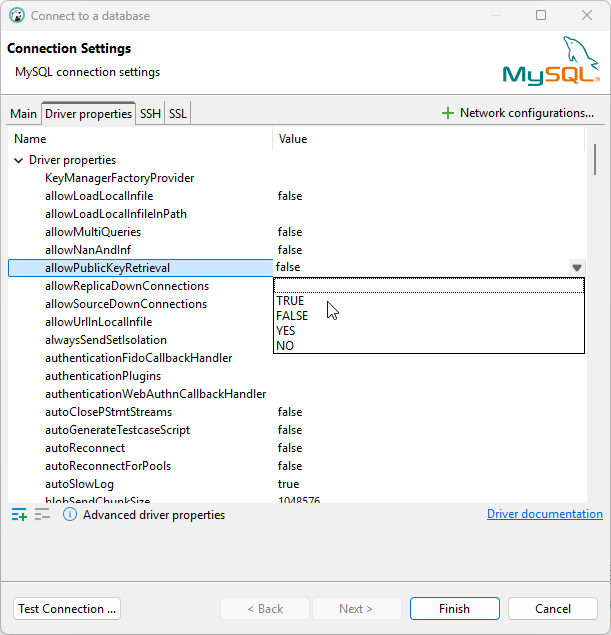<figcaption><p>allowPublicKeyRetrieval on the Driver properties tab</p></figcaption></figure>

<figure>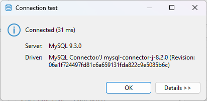<figcaption><p>A successful connection test</p></figcaption></figure>

> **Success:** Checkpoint: the **Connection test** dialog reads **Connected**.

5. Select **OK** to close the test dialog, then select **Finish**.
6. In the **Database Navigator**, expand **sampledata**, **Databases**, **sampledata** and **Tables**, double-click `CUSTOMERS`, and open the **Data** tab.

<figure>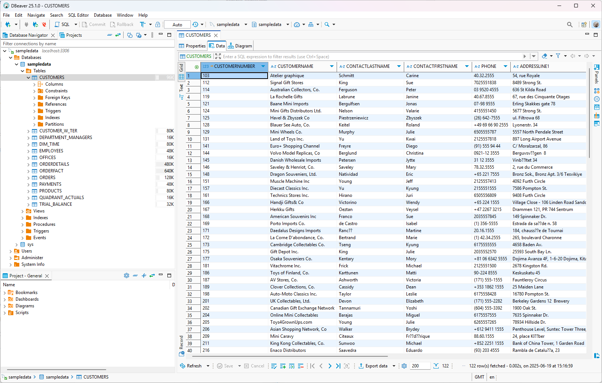<figcaption><p>The CUSTOMERS table on the Data tab</p></figcaption></figure>

> **Success:** Checkpoint: the status bar under the grid reads `122 row(s) fetched`, and the first row is customer `103`, `Atelier graphique`.

7. Select **SQL** on the toolbar. An SQL script editor opens for `sampledata`.
8. Enter the query below, then run it: press `Ctrl+Enter`, or select the orange triangle at the top of the editor's left-hand toolbar.

```sql
select * from CUSTOMERS
where COUNTRY = 'USA' and CITY = 'NYC';
```

<figure>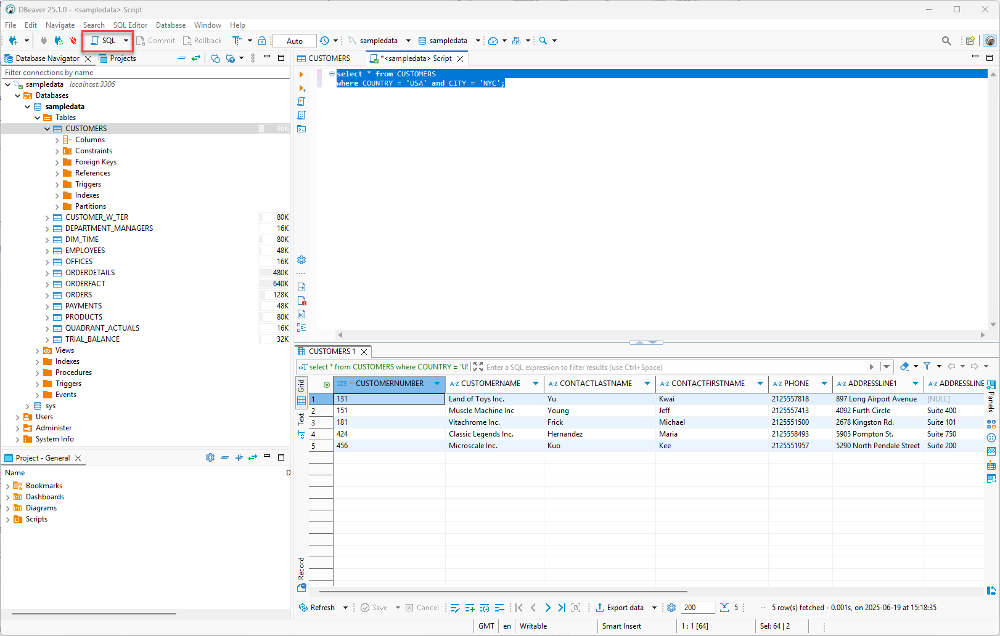<figcaption><p>The NYC customers</p></figcaption></figure>

> **Success:** Checkpoint: 5 customers, from `Land of Toys Inc.` to `Microscale Inc.`, and the status bar reads `5 row(s) fetched`.

:::

### 2. JDBC Driver

> **Note:**
>
> #### Install the JDBC Driver
> 
> PDI does not ship all JDBC drivers, and **PDI 11 does not include the
> MySQL driver this course needs**. Without it, the **Test** in the next
> part fails. On a workshop VM it may already be there: look for
> `mysql-connector-j-*.jar` in the folder below, or look at the **MySQL
> JDBC driver** row in Before You Start's environment panel.

<div class="pcm-embed-card" data-href="https://docs.pentaho.com/install/jdbc-drivers-reference" data-title="JDBC drivers reference | Pentaho" data-thumb="../_assets/embeds/1c4d9f7d98fc.png"></div>

1. Download the MySQL driver, `mysql-connector-j-8.4.0.jar`, from Maven Central straight into PDI's `lib` folder. In PowerShell, run:

```powershell
Invoke-WebRequest https://repo1.maven.org/maven2/com/mysql/mysql-connector-j/8.4.0/mysql-connector-j-8.4.0.jar -OutFile C:\Pentaho\design-tools\data-integration\lib\mysql-connector-j-8.4.0.jar
```

For another database, find its driver here:

<div class="pcm-embed-card" data-href="https://dbschema.com/databases.html" data-title="DbSchema Supported Databases" data-description="Explore all SQL and NoSQL databases supported by DbSchema. Visually design schemas, create ER diagrams, synchronize changes, and document your database — for any database engine." data-thumb="../_assets/embeds/6c6ef7a1bcc8.png"></div>

2. If you downloaded the driver some other way, from <https://repo1.maven.org/maven2/com/mysql/mysql-connector-j/8.4.0/mysql-connector-j-8.4.0.jar> for example, copy the JAR into your PDI install's `lib` folder:

`C:\Pentaho\design-tools\data-integration\lib\`

3. Check that the driver is in place. In PowerShell, run:

```powershell
Get-ChildItem C:\Pentaho\design-tools\data-integration\lib\mysql-connector-j-*.jar
```

> **Success:** Checkpoint: the command lists `mysql-connector-j-8.4.0.jar`.

4. If Spoon is running, close it (**File > Exit**). Spoon loads the drivers in `lib` when it starts, so it sees the new driver the next time you start it, in the next part.

### 3. Data Integration

> **Note:**
>
> #### Define the Connection in PDI
> 
> Create the connection once.\
> Reuse it in steps like **Table input**, **Table output**, and **Database lookup**.
> 
> In this lab, you connect to the Steel Wheels `sampledata` database (MySQL).

1. Start Spoon with the **Start PDI** button below, or from PowerShell:

```powershell
Set-Location C:\Pentaho\design-tools\data-integration
.\spoon.bat
```

<button data-launch="spoon" data-path="">Start PDI</button>

2. Select **File > New > Transformation** (`Ctrl+N`).
3. Select **File > New > Database Connection**. The **Database Connection** dialog opens on **General**.

<figure>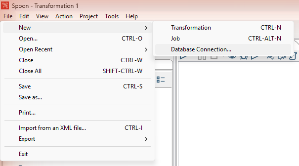<figcaption><p>File &gt; New &gt; Database Connection</p></figcaption></figure>

4. On **General**, enter these settings. Select **MySQL** in the **Connection type** list and **Native (JDBC)** in the **Access** list:

   | Setting | Value |
   | --- | --- |
   | **Connection name** | `MySQL:sampledata` |
   | **Connection type** | **MySQL** |
   | **Access** | **Native (JDBC)** |
   | **Host Name** | `localhost` |
   | **Database Name** | `sampledata` |
   | **Port Number** | `3306` |
   | **Username** | `pentaho_admin` |
   | **Password** | `password` |

<figure>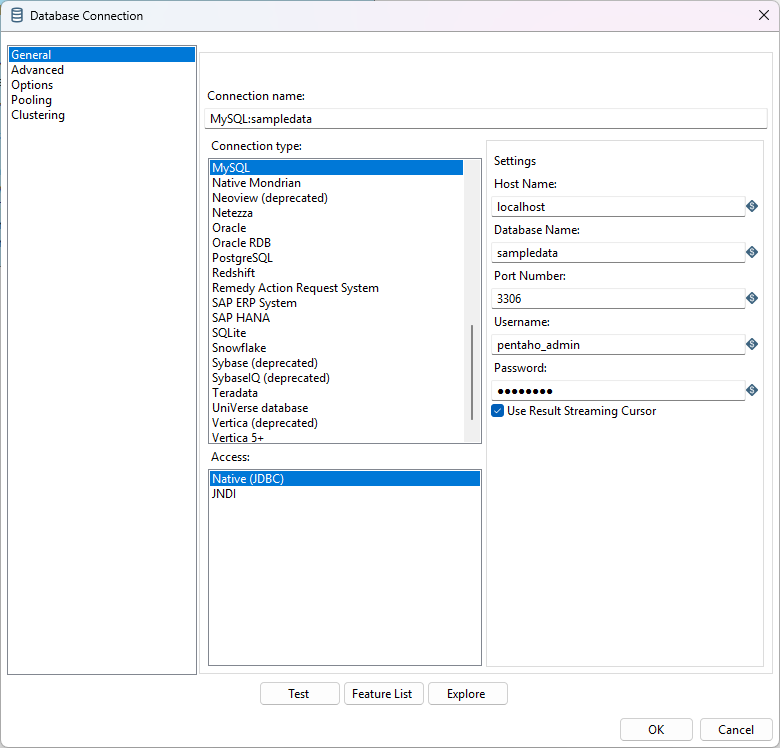<figcaption><p>The MySQL:sampledata connection, General</p></figcaption></figure>

> **Warning:** Use the MySQL driver. A MariaDB driver newer than 2.7.x can fail with a **fetch size** error against this database.

5. In the list on the left, select **Options**. The **Parameters** grid already lists `defaultFetchSize` and `useCursorFetch`, PDI's defaults for MySQL.
6. Fill the **Parameters** grid so it holds these four rows. Add the two that are missing, `useSSL` and `allowPublicKeyRetrieval`, on the empty rows:

   | Parameter | Value |
   | --- | --- |
   | `defaultFetchSize` | `500` |
   | `useCursorFetch` | `true` |
   | `useSSL` | `false` |
   | `allowPublicKeyRetrieval` | `true` |

   `useSSL=false` connects without TLS to the lab's local MySQL server, and `allowPublicKeyRetrieval=true` lets the driver fetch the server's public key to sign in `pentaho_admin`. These are the options the solution's connection carries.

7. Select **Test**.

> **Success:** Checkpoint: Spoon shows **Connection tested successfully**, with the message `Connection to MySQL:sampledata was successful.`

8. Select **OK** to close the message.

> **Under the hood:**
>
> #### Test opened a real JDBC connection, and every step will open its own
>
> Spoon assembled a JDBC URL from the fields you filled in —
> `jdbc:mysql://localhost:3306/sampledata` — loaded the MySQL driver
> from `lib/`, opened a connection, checked it and closed it again.
> The connection you saved is *metadata*: the recipe, not a live
> socket.
>
> At run time each step that uses it — **Table input**, **Table
> output**, **Database lookup** — opens its own physical connection
> from that recipe, with its own transaction. That is what lets a
> reader and a writer on the same database run concurrently on
> separate threads; it is also why a failed **Table output** doesn't
> roll back anything another step did. (**Transformation properties >
> Miscellaneous > Make the transformation database transactional**
> puts them all on one connection when you need all-or-nothing.)
>
> **Why it matters:** connections are cheap to define and reuse, but
> every database step is a client of your database. Ten database steps
> is ten sessions — size connection pools accordingly.

9. Select **OK** to save the connection and close the **Database Connection** dialog.
10. Select **File > Save as** and save it as `tr_connect_database.ktr` in `C:\Workshop-DI-Practitioner\03-data-sources\02-databases\12-mod3-connecting-to-database`.

> **Success:** Checkpoint: in the **View** tab, **Database connections** under your transformation lists `MySQL:sampledata`.

::: tabs

### 1. Share Connection

> **Note:**
>
> #### Share the Database Connection
> 
> Move the connection to the **System** level, so every transformation and job you open in this Spoon can use it.

1. In the **View** tab, expand **Database connections**, right-click `MySQL:sampledata`, and select **Move to System**.

<figure>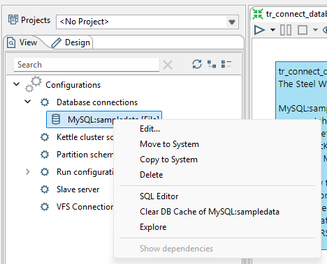<figcaption><p>The connection's right-click menu (earlier PDI version)</p></figcaption></figure>

2. Select **File > New > Transformation** (`Ctrl+N`), and in the **View** tab expand **Database connections** under the new transformation.

> **Success:** Checkpoint: `MySQL:sampledata` is listed under the new transformation too, although you never defined it there.

3. Close the new transformation without saving it.

> **Under the hood:**
>
> #### Move to System put the definition in `shared.xml`
>
> An ordinary connection lives inside the transformation's own XML -
> open the `.ktr` in a text editor and you will find a `<connection>`
> block with the host, port and an encrypted password. **Move to
> System** writes that definition to `shared.xml` in your `.kettle`
> folder, beside `kettle.properties`, and from then on every
> transformation and job you open in this Spoon sees it in the
> **View** tree.
>
> It also changes what Spoon saves: a transformation saved after the
> move is written *without* the `<connection>` block, because
> `shared.xml` holds it. `tr_connect_database.ktr`, saved before the
> move, keeps its own copy, as the solution file does. A file that
> relies on `shared.xml` runs anywhere the same `shared.xml` exists -
> this machine, or a server you copy `shared.xml` to - and fails with
> a missing connection anywhere else. A repository shares connections
> between machines for real.
>
> **Why it matters:** one definition, reused by every workshop that
> follows, and the password never typed again. When a file must run
> on its own somewhere else, keep its connection in the file, or ship
> `shared.xml` with it.

### 2. Explore Database

> **Note:**
>
> #### Explore the Database
> 
> Use the **Database Explorer** to browse tables, preview rows and run SQL.

1. In the **View** tab, expand **Database connections**.
2. Right-click `MySQL:sampledata` and select **Explore**. The **Database Explorer** opens.
3. Expand **Tables**. Right-clicking a table (or selecting it and then **Actions**) offers:

| Menu item | What it does |
| --- | --- |
| **Preview first 100** | Shows the table's first 100 rows |
| **Preview x Rows** | Asks how many rows, then shows them |
| **Row Count** | Counts the rows |
| **Show Layout** | Lists the columns and their types |
| **DDL > Use Current Connection** | Shows the `CREATE TABLE` statement for the table |
| **DDL > Select Connection** | The same, in another connection's SQL dialect |
| **View SQL** | Opens a `SELECT` for the table in the SQL editor |
| **Truncate Table** | Deletes every row in the table |
| **Data Profile** | Profiles the table's columns |

<figure>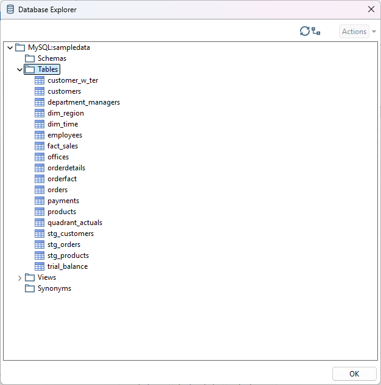<figcaption><p>The sampledata tables</p></figcaption></figure>

4. Right-click `CUSTOMERS` and select **Preview first 100**. The rows show in **Examine preview data**.

> **Success:** Checkpoint: 100 rows, the first 100 of the table's 122 customers. The first is customer `103`, `Atelier graphique`.

5. Select **Close**.
6. Right-click `CUSTOMERS` again and select **View SQL**. The **Simple SQL editor** opens with a `SELECT` for the table.
7. Replace the statement with:

```sql
SELECT * FROM CUSTOMERS
where COUNTRY = 'USA' and CITY = 'NYC';
```

<figure>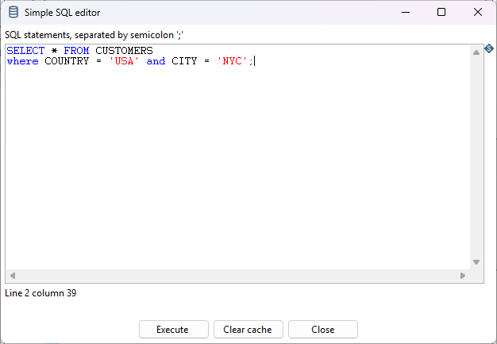<figcaption><p>The SELECT with the NYC filter</p></figcaption></figure>

8. Select **Execute**.

<figure>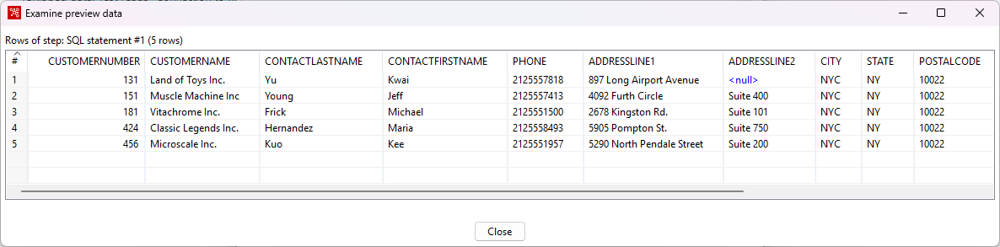<figcaption><p>The query's results</p></figcaption></figure>

> **Success:** Checkpoint: **Examine preview data** shows 5 rows, from `131`, `Land of Toys Inc.` to `456`, `Microscale Inc.`, the same customers as in Adminer or DBeaver.

9. Select **Close**, select **Close** in the **Simple SQL editor**, and select **OK** in the **Database Explorer**.

:::

::::

## Lab Files

Click a file to download. For `.ktr` and `.kjb` files, **Open in Pentaho Data Integration** launches PDI with the file loaded. If PDI is already running, the path is copied to your clipboard — switch to PDI and press `Ctrl+O`, `Ctrl+V`, `Enter`.

### Solution <!-- no-step -->

The finished transformation for this lab: it holds only the `MySQL:sampledata` connection, embedded, so it works without your shared one. Open it to compare your connection settings.

Also on disk at `C:\Workshop-DI-Practitioner\03-data-sources\02-databases\12-mod3-connecting-to-database\solution`.

[tr_connect_database.ktr](./files/tr_connect_database.ktr) <button data-launch="spoon" data-path="files/tr_connect_database.ktr">Open in Pentaho Data Integration</button> <button data-graph="files/tr_connect_database.ktr">View graph</button>
