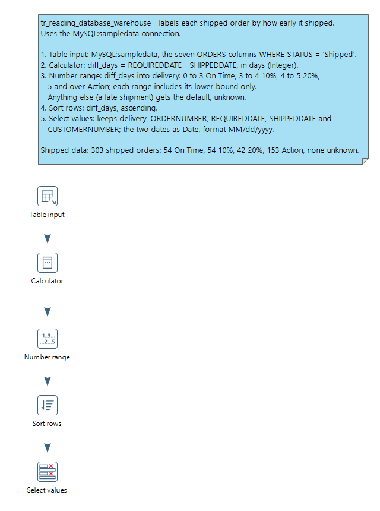
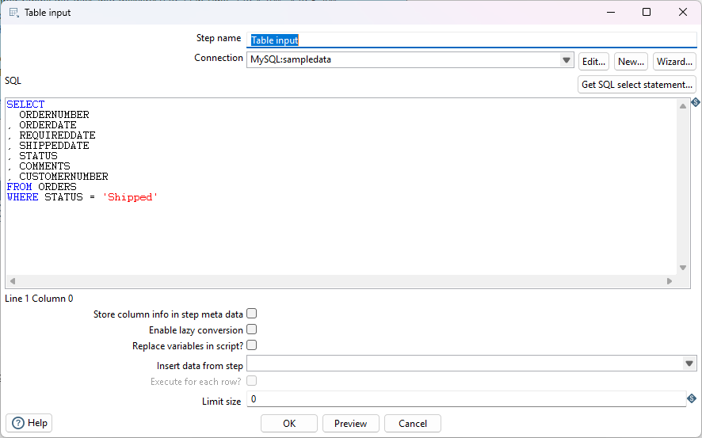
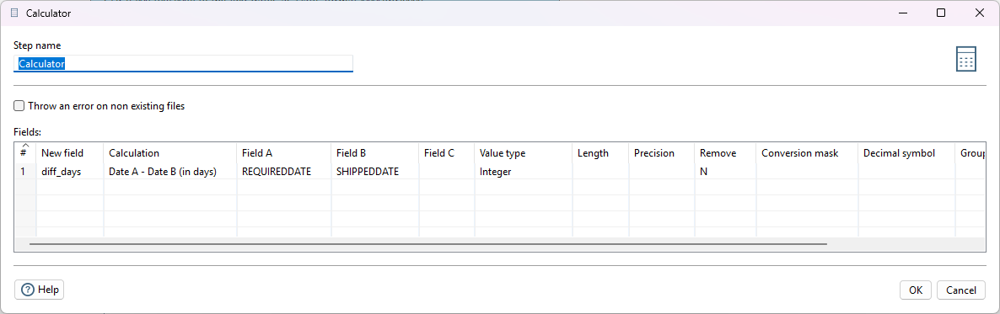
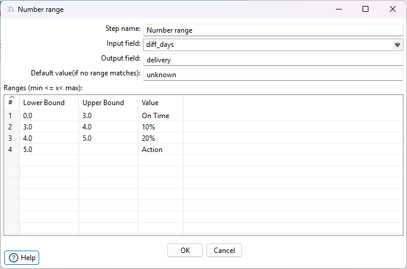
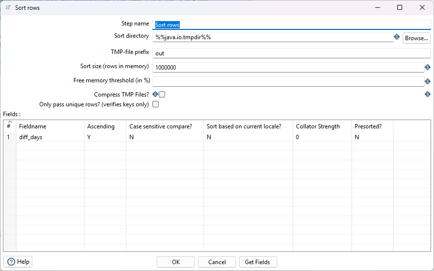
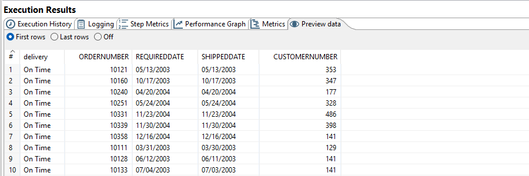

# Reading from a Database

> **Warning:**
>
> #### Workshop - Reading from a Database
> 
> Build a transformation that reads the `ORDERS` table from the Steel Wheels database.\
> Keep the shipped orders, calculate how many days before the required date each one shipped, and label the result.
> 
> **What you’ll do**
> 
> * Read rows with **Table input**
> * Generate the SQL with **Get SQL select statement**
> * Add a calculated field with **Calculator**
> * Label values with **Number range**
> * Sort and format the output with **Sort rows** and **Select values**
> 
> **Prerequisites**
> 
> * The `MySQL:sampledata` connection from [Connecting to Database](../12-mod3-connecting-to-database/guide.md)
> * Basic SQL: `SELECT` and `WHERE`
> 
> **Estimated time:** 30 minutes

<figure>



<div align="center">
<figcaption><em>What you build</em></figcaption>
</div>
</figure>

> **Note:** **Create a new transformation**
> 
> Select **File > New > Transformation**, or press `Ctrl+N` (`Cmd+N` on macOS). Save it as `tr_reading_database.ktr`.

:::: tabs

### 1. Table input

> **Note:**
>
> #### Table input
> 
> **Table input** runs a SQL query over a database connection and outputs one row per result row.\
> Here the query keeps only the orders with `STATUS = 'Shipped'`.

1. Start Spoon.


::: tabs

### Windows (PowerShell)

> 
> ```powershell
> Set-Location C:\Pentaho\design-tools\data-integration
> .\spoon.bat
> ```
> 
>

### macOS / Linux

> 
> ```bash
> cd ~/Pentaho/design-tools/data-integration
> ./spoon.sh
> ```
> 
>

:::

<button data-launch="spoon" data-path="">Start PDI</button>

2. From the **Input** folder in the **Design** tab, drag **Table input** onto the canvas.
3. Double-click the step.
4. In **Connection**, select `MySQL:sampledata`.
5. Select **Get SQL select statement...**. In the **Database Explorer**, expand **Tables**, select `ORDERS` and select **OK**.
6. When asked **Do you want to include the field-names in the SQL?**, select **Yes**.
7. Delete the columns you don't need and add the filter, so the **SQL** reads:

   ```sql
   SELECT
     ORDERNUMBER
   , ORDERDATE
   , REQUIREDDATE
   , SHIPPEDDATE
   , STATUS
   , COMMENTS
   , CUSTOMERNUMBER
   FROM ORDERS
   WHERE STATUS = 'Shipped'
   ```

<figure><figcaption><p>The query</p></figcaption></figure>

8. Select **Preview**, then **OK** to preview the first 1000 rows.
9. Close the preview and select **OK**.

> **Success:** Checkpoint: the preview shows only rows with `STATUS` = `Shipped`. The table holds 303 of them.

> **Under the hood:**
>
> #### The SQL went to MySQL untouched; the rows came back as a stream
>
> **Table input** does not parse or rewrite your query. It sent the
> text exactly as written through the JDBC driver, so anything MySQL
> accepts (functions, joins, window clauses) works here. The result
> set then flows back row by row through a cursor: the step never asks
> the driver for the whole result, so a `SELECT` over a
> hundred-million-row table starts emitting immediately and uses the
> same memory as this one.
>
> The columns in Preview got their types from the driver's result
> metadata — `ORDERNUMBER` arrived as an Integer and `ORDERDATE` as a
> Date because the database said so. That is the row metadata every
> following step builds on.
>
> **Why it matters:** push filters, joins and aggregations into the
> SQL and the database does that work with its indexes, while the
> transformation only sees the rows that matter. It is the biggest
> single performance lever in PDI, and it costs nothing to use.

### 2. Calculator

> **Note:**
>
> #### Calculator
> 
> **Calculator** adds fields computed from a list of built-in functions.\
> It is fast, and needs no expression language.

1. From the **Transform** folder, drag **Calculator** onto the canvas.
2. Hop **Table input** to **Calculator**.
3. Double-click the step and fill in the first row:

| New field   | Calculation                 | Field A        | Field B       | Value type |
| ----------- | --------------------------- | -------------- | ------------- | ---------- |
| `diff_days` | Date A - Date B (in days)   | `REQUIREDDATE` | `SHIPPEDDATE` | Integer    |

<figure><figcaption><p>diff_days</p></figcaption></figure>

4. Select **OK**.

> **Note:** `diff_days` is how many days before its required date each order shipped. `0` means it shipped on the required date; a negative value would mean it shipped late.

### 3. Number range

> **Note:**
>
> #### Number range
> 
> **Number range** maps a number to a label, using a list of ranges.\
> Labels are easier to scan, group and filter on than raw numbers.

1. From the **Transform** folder, drag **Number range** onto the canvas.
2. Hop **Calculator** to **Number range**.
3. Double-click the step and set:
   * **Input field**: `diff_days`
   * **Output field**: `delivery`
   * **Default value(if no range matches)**: `unknown`
4. Fill in **Ranges (min <= x< max)**. Leave the last **Upper Bound** empty, so the range has no upper limit:

| Lower Bound | Upper Bound | Value     |
| ----------- | ----------- | --------- |
| 0           | 3           | `On Time` |
| 3           | 4           | `10%`     |
| 4           | 5           | `20%`     |
| 5           |             | `Action`  |

<figure><figcaption><p>Four ranges, one label each</p></figcaption></figure>

5. Select **OK**.

> **Note:** Each range includes its lower bound and excludes its upper bound, so `diff_days` = 3 is `10%`, not `On Time`. A value outside every range, such as a late shipment, gets the default, `unknown`.

### 4. Sort rows

> **Note:**
>
> #### Sort rows
> 
> Sort the output into the order you want to read it.\
> Merge steps also need sorted input, as later workshops show.

1. From the **Transform** folder, drag **Sort rows** onto the canvas.
2. Hop **Number range** to **Sort rows**.
3. Double-click the step. In **Fields**, add `diff_days` with **Ascending** set to `Y`.

<figure><figcaption><p>Sort on diff_days</p></figcaption></figure>

4. Select **OK**.

> **Note:** If a sort runs out of memory, lower **Sort size (rows in memory)**. PDI then writes sorted chunks to temporary files and merges them.

> **Under the hood:**
>
> #### Sort is the first step that must see every row before it emits one
>
> Everything upstream — read, calculate, bucket — streams: a row in, a
> row out, all steps busy at once. **Sort rows** can't. The smallest
> value might be the last row to arrive, so the step buffers until it
> has read the entire input, sorts, and only then starts writing.
> Watch **Step Metrics** during a large run: the steps after the sort
> sit at zero until the reader finishes.
>
> It stays memory-safe because of **Sort size (rows in memory)**. Once
> that many rows are buffered they are sorted and spilled to a temp
> file in the **Sort directory**; at the end the step merges the sorted
> files back into one ordered stream. Lowering the sort size trades
> disk for RAM; **Compress TMP Files?** trades CPU for disk.
>
> **Why it matters:** a sort marks the point where pipeline
> parallelism stops. Sort as late and on as few rows as you can, or let
> the database do it with `ORDER BY`, which costs the transformation
> nothing.

### 5. Select values

> **Note:**
>
> #### Select values
> 
> **Select values** keeps, drops, renames and reorders fields.\
> It also sets their types, lengths and formats for the steps that follow.

1. From the **Transform** folder, drag **Select values** onto the canvas.
2. Hop **Sort rows** to **Select values**.
3. Double-click the step. On the **Select & Alter** tab, list the fields to keep, in this order: `delivery`, `ORDERNUMBER`, `REQUIREDDATE`, `SHIPPEDDATE`, `CUSTOMERNUMBER`.
4. On the **Meta-data** tab, set the date fields:

| Fieldname      | Type | Format       |
| -------------- | ---- | ------------ |
| `REQUIREDDATE` | Date | `MM/dd/yyyy` |
| `SHIPPEDDATE`  | Date | `MM/dd/yyyy` |

5. Select **OK**.

> **Note:** The format makes `REQUIREDDATE` and `SHIPPEDDATE` display as
> plain dates, with no time. `diff_days` isn't in the list, so it
> leaves the stream here: it has done its job.

### 6. Run

> **Note:**
>
> #### Run and validate
> 
> Run the transformation and check the final stream.

1. Save the transformation, select **Run** in the toolbar, then **Run** in **Run Options**.
2. Select **Select values**, then the **Preview data** tab in **Execution Results**.

<figure><figcaption><p>Shipped orders with their delivery label</p></figcaption></figure>

> **Success:** Checkpoint: 303 rows, sorted by `diff_days`, so the `On Time` rows come first. By label: 54 `On Time`, 54 `10%`, 42 `20%` and 153 `Action`; none is `unknown`.

> **Note:** The screenshot was taken against an older copy of the data, in which order 10165 shipped late and so shows `unknown`. In the lab database it shipped five days early, so your first row is `On Time`.

::::

<details>

<summary>Troubleshooting</summary>

**Preview shows zero rows**\
Check the filter: the value is `'Shipped'`, in single quotes. Run `SELECT DISTINCT STATUS FROM ORDERS` in the database to see the values.

**SQL errors**\
Select **Get SQL select statement...** again, then add your `WHERE` clause back.

**Date or number conversion errors**\
Fix the types on the **Meta-data** tab of **Select values**, then run again.

**Out of memory during the sort**\
Lower **Sort size (rows in memory)** in **Sort rows**, or give PDI more memory.

</details>

## Lab Files

Click a file to download. For `.ktr` and `.kjb` files, **Open in Pentaho Data Integration** launches PDI with the file loaded. If PDI is already running, the path is copied to your clipboard — switch to PDI and use Ctrl+O, Ctrl+V, Enter.

### Solution <!-- no-step -->

The finished transformation for this lab. Open it alongside your own to compare, or run to see the expected result.

Also on disk at `C:\Workshop-DI-Practitioner\03-data-sources\02-databases\13-mod3-reading-from-a-database\solution`.

[tr_reading_database_warehouse.ktr](./files/tr_reading_database_warehouse.ktr) <button data-launch="spoon" data-path="files/tr_reading_database_warehouse.ktr">Open in Pentaho Data Integration</button> <button data-graph="files/tr_reading_database_warehouse.ktr">View graph</button>
