# Writing to a Database

> **Warning:**
>
> #### Workshop - Writing to a Database
> 
> Load a CSV file into a table that doesn't exist yet: **Table output** writes the `CREATE TABLE` for you, from the stream's own fields.\
> Then load a second file the same way. A later workshop uses that table.
> 
> **What you’ll do**
> 
> * Read a delimited file with **CSV file input**
> * Map stream fields to table columns in **Table output**
> * Generate and run the `CREATE TABLE` with the **SQL** button
> * Insert rows, with the commit size, truncate and batch settings
> 
> **Prerequisites**
> 
> * The `MySQL:sampledata` connection from [Connecting to Database](../12-mod3-connecting-to-database/guide.md)
> * Basic understanding of tables and SQL data types
> 
> **Estimated time:** 35 minutes

<figure>

<figcaption class="pcm-video-caption">Walkthrough: coming soon</figcaption>

</figure>

<div align="center">
<figure>
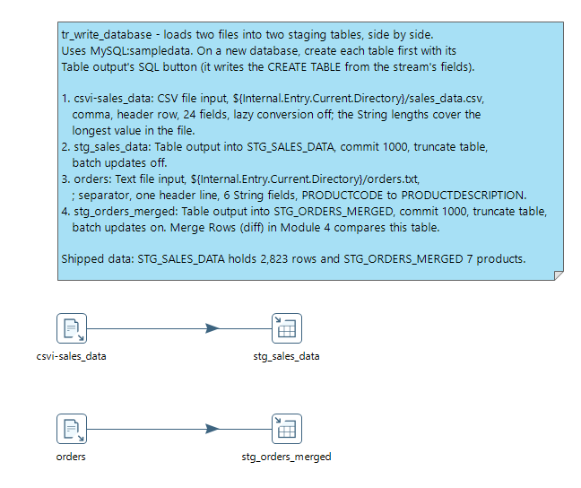
<figcaption>What you build: two independent loads in one transformation</figcaption>
</figure>
</div>

::::: tabs

### Workflow 1 - Sales Data

> **Note:**
>
> #### Load the sales data
> 
> Load `sales_data.csv`, 2,823 order lines, into a new table, `STG_SALES_DATA`.

<div align="center">
<figure>
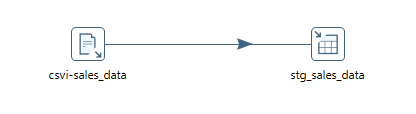
<figcaption>Workflow 1</figcaption>
</figure>
</div>

:::: tabs

### 1. CSV file input

> **Note:**
>
> #### CSV file input
> 
> **CSV file input** reads a delimited file fast, with fewer options than **Text file input**.

1. Start Spoon with the **Start PDI** button below, or from PowerShell:

```powershell
Set-Location C:\Pentaho\design-tools\data-integration
.\spoon.bat
```

<button data-launch="spoon" data-path="">Start PDI</button>

2. Select **File > New > Transformation** (`Ctrl+N`).
3. Select **File > Save as** and save it as `tr_write_database.ktr` in `C:\Workshop-DI-Practitioner\03-data-sources\02-databases\14-mod3-writing-to-a-database`, next to `sales_data.csv` and `orders.txt`.
4. On the **Design** tab, open the **Input** folder and drag **CSV file input** onto the canvas.
5. Double-click **CSV file input**. Set **Step name** to `csvi-sales_data`.
6. Set **Filename** to `${Internal.Entry.Current.Directory}/sales_data.csv`.
7. Leave **Delimiter** as `,` and **Header row present?** selected.
8. Clear **Lazy conversion?**.
9. Select **Get Fields**. In the **Sample data** dialog, keep `100` in **Number of lines to sample** and select **OK**. Close the **Scan results** window if it opens.

> **Warning:** **Get Fields** sets each String field's **Length** from the lines it sampled, and the `CREATE TABLE` you generate in the next tab copies those lengths. In `sales_data.csv`, ten String fields have longer values after the first 100 lines: `CUSTOMERNAME`, `PHONE`, `ADDRESSLINE1`, `ADDRESSLINE2`, `CITY`, `STATE`, `POSTALCODE`, `COUNTRY`, `CONTACTLASTNAME` and `CONTACTFIRSTNAME`. Set their lengths in the next step, or the table is created too narrow and MySQL rejects those rows when the load reaches them.

10. Correct the fields grid so it matches this table. The bold lengths are the ten that the sample sets too short; the longest value in the file is in brackets.

| Name | Type | Format | Length | Precision |
| --- | --- | --- | --- | --- |
| `ORDERNUMBER` | Integer | `#` | `15` | `0` |
| `QUANTITYORDERED` | Integer | `#` | `15` | `0` |
| `PRICEEACH` | Number | `#.#` | `10` | `1` |
| `ORDERLINENUMBER` | Integer | `#` | `15` | `0` |
| `SALES` | Number | `#.#` | `15` | `1` |
| `ORDERDATE` | Date | `MM/dd/yyyy` | | |
| `STATUS` | String | | `10` | |
| `QTR_ID` | Integer | `#` | `15` | `0` |
| `MONTH_ID` | Integer | `#` | `15` | `0` |
| `YEAR_ID` | Integer | `#` | `15` | `0` |
| `PRODUCTLINE` | String | | `20` | |
| `MSRP` | Integer | `#` | `15` | `0` |
| `PRODUCTCODE` | String | | `10` | |
| `CUSTOMERNAME` | String | | **`40`** (34) | |
| `PHONE` | String | | **`20`** (17) | |
| `ADDRESSLINE1` | String | | **`50`** (42) | |
| `ADDRESSLINE2` | String | | **`15`** (11) | |
| `CITY` | String | | **`20`** (14) | |
| `STATE` | String | | **`20`** (13) | |
| `POSTALCODE` | String | | **`15`** (9) | |
| `COUNTRY` | String | | **`20`** (13) | |
| `TERRITORY` | String | | `10` | |
| `CONTACTLASTNAME` | String | | **`15`** (11) | |
| `CONTACTFIRSTNAME` | String | | **`15`** (10) | |

<div align="center">
<figure>
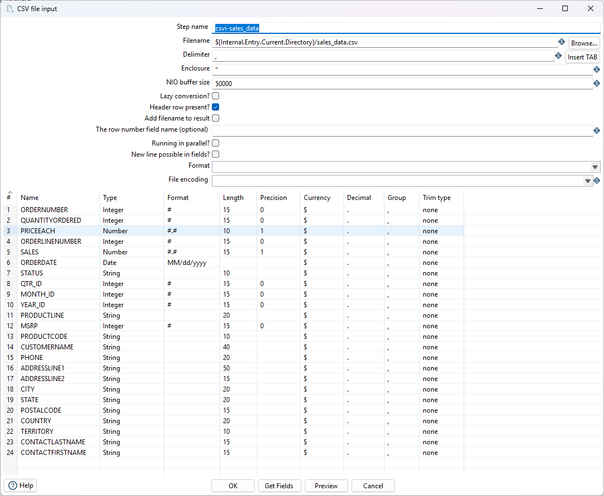
<figcaption>sales_data.csv, 24 fields</figcaption>
</figure>
</div>

> **Note:** The screenshot is from an earlier version of the step: its name is `CSV Input`, **Lazy conversion?** is selected, and most lengths are `20` or more. Use the settings in the steps and the table above. The fields' **Currency** column shows the symbol for your computer's locale.

11. Select **Preview**, enter `100` rows, and select **OK**. The rows show in **Examine preview data**.

> **Success:** Checkpoint: 100 rows; the first is order `10361`, product `S10_1678`, customer `Souveniers And Things Co.`.

12. Select **Close**, then select **OK** to close **CSV file input**.

### 2. Table output

> **Note:**
>
> #### Table output
> 
> **Table output** inserts each row into a database table with an SQL `INSERT`.

1. On the **Design** tab, open the **Output** folder and drag **Table output** onto the canvas.
2. Create a hop from **csvi-sales_data** to **Table output**: hold `Shift` and drag from one step to the other.
3. Double-click **Table output**. Set **Step name** to `stg_sales_data`.
4. In **Connection**, select `MySQL:sampledata`.
5. Set **Target table** to `STG_SALES_DATA`, and leave **Commit size** at `1000`.
6. Select **Truncate table**, so a second run replaces the rows instead of adding them again.
7. Select **Specify database fields**.
8. On the **Main options** tab, clear **Use batch update for inserts**.

<div align="center">
<figure>
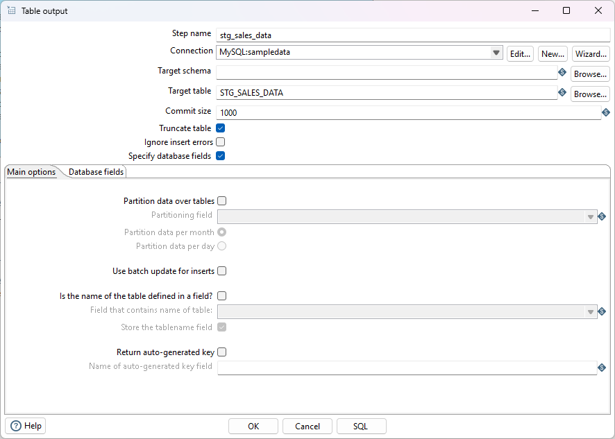
<figcaption>Main options</figcaption>
</figure>
</div>

> **Note:** The screenshot shows an older connection name, `Sampledata`, and **Truncate table** cleared. Use `MySQL:sampledata` and select **Truncate table**.

9. On the **Database fields** tab, select **Get fields**. Each stream field is mapped to a table column of the same name: every **Table field** on the left matches its **Stream field** on the right.

<div align="center">
<figure>
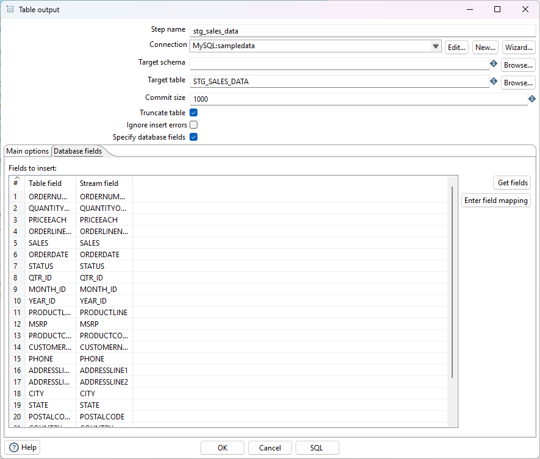
<figcaption>Table field = stream field</figcaption>
</figure>
</div>

10. Select **SQL**. The table doesn't exist yet, so the **Simple SQL editor** opens with a `CREATE TABLE STG_SALES_DATA` statement built from the stream's fields.

<div align="center">
<figure>
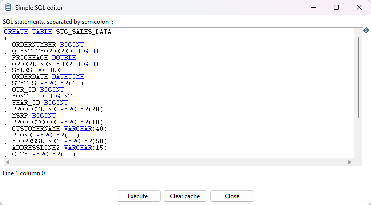
<figcaption>The generated CREATE TABLE</figcaption>
</figure>
</div>

11. Select **Execute**. In **Results of the SQL statements**, select **OK**, then select **Close** in the **Simple SQL editor**.
12. Select **SQL** again.

> **Success:** Checkpoint: Spoon reports `No SQL needs to be executed to make this step function properly.` `STG_SALES_DATA` now exists, with a column for every stream field.

13. Select **OK** to close the message, then select **OK** to close **Table output**.

> **Under the hood:**
>
> #### The `CREATE TABLE` came from the row metadata, translated for MySQL
>
> Selecting **SQL** didn't open a template. **Table output** took the
> stream's row metadata (every field's name, type, length and
> precision as it stands after CSV file input) and asked the
> connection's database dialect to spell each one. A String of length
> 40 became `VARCHAR(40)`, a Date became `DATETIME`, and Integers and
> Numbers became `BIGINT`, `DOUBLE` or `DECIMAL` depending on their
> length and precision: with the lengths in the table, the length-15
> Integers become `BIGINT` and `PRICEEACH` and `SALES` become
> `DOUBLE`, while the screenshot's length-20 fields became
> `DECIMAL(20)`. Point the same step at PostgreSQL and the same click
> writes `TIMESTAMP` and `DOUBLE PRECISION` instead.
>
> That is why the **Warning** above matters. **Get Fields** sampled
> the start of the file to guess lengths, and the DDL inherits the
> guess. A longer value in row 50,000 is rejected by the database, not
> by PDI.
>
> **Why it matters:** the stream's shape and the table's shape came
> from one definition, so they can't disagree today. Set lengths
> generously at the input step and they won't disagree next month
> either.

### 3. Run

> **Note:**
>
> #### Run and validate
> 
> Run the load, then check the table with a database tool such as Adminer or DBeaver.\
> In production, DDL is usually managed with migration scripts rather than from a step.

1. Save the transformation (`Ctrl+S`).
2. Press `F9` (**Action > Run**), and select **Run** in the **Run Options** dialog.
3. In **Execution Results**, open the **Step Metrics** tab.

> **Success:** Checkpoint: **stg_sales_data** shows 2,823 in **Output**, one for each data line of `sales_data.csv`.

4. In DBeaver, run:

   ```sql
   SELECT COUNT(*) FROM STG_SALES_DATA;
   ```

<div align="center">
<figure>
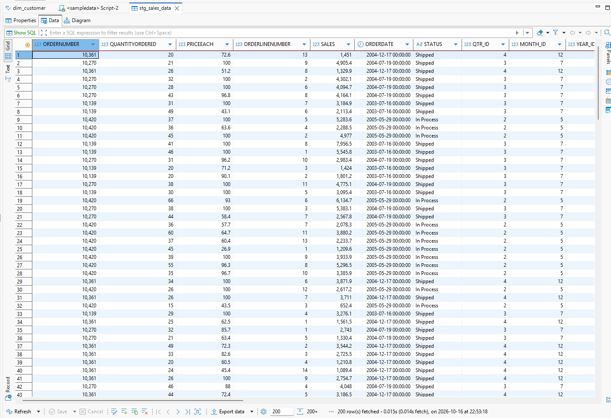
<figcaption>STG_SALES_DATA</figcaption>
</figure>
</div>

> **Success:** Checkpoint: `STG_SALES_DATA` holds 2,823 rows.

5. Press `F9` again, select **Run**, and run the query again. The count is still 2,823, because **Truncate table** empties the table before each load.

> **Under the hood:**
>
> #### Rows are inserted inside transactions, and in batches when you ask
>
> **Table output** prepared a single `INSERT INTO STG_SALES_DATA (...)
> VALUES (?, ?, ...)` at start-up and bound each incoming row to it.
> Every **Commit size** rows (1,000 here) the step commits the
> transaction. With **Use batch update for inserts** selected, as in
> Workflow 2, rows are also queued in the driver and shipped to MySQL
> in groups. Fewer round trips and fewer commits are most of why this
> beats a script that inserts row by row.
>
> The trade-off is granularity. If row 1,472 is rejected, the whole
> batch it sat in fails, and the step can't tell you which row without
> error handling switching batching off. A commit size of 1 gives
> perfect attribution and terrible speed.
>
> **Why it matters:** commit size is the dial between throughput and
> restartability. Large for bulk loads into staging; small, or fully
> transactional, when a half-loaded table would be worse than no load
> at all.

::::

### Workflow 2 - Orders

> **Note:**
>
> #### Load the products for Merge Rows (diff)
> 
> Load `orders.txt` into a new table, `STG_ORDERS_MERGED`. Despite its name, the file holds seven products. [Merge Rows (diff)](../21-mod4-merge-streams-diff/guide.md) in Module 4 compares this table with a changed copy.

<div align="center">
<figure>
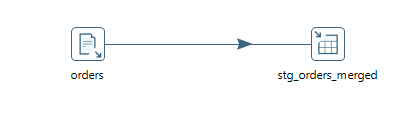
<figcaption>Workflow 2</figcaption>
</figure>
</div>

::: tabs

### 1. Text file input

> **Note:**
>
> #### Text file input
> 
> This time read the file with **Text file input**: `orders.txt` is separated by semicolons.

1. On the **Design** tab, open the **Input** folder and drag **Text file input** onto the same canvas, below Workflow 1.
2. Double-click **Text file input**. Set **Step name** to `orders`.
3. On the **File** tab, enter `${Internal.Entry.Current.Directory}/orders.txt` in **File or directory** and select **Add**.

<div align="center">
<figure>
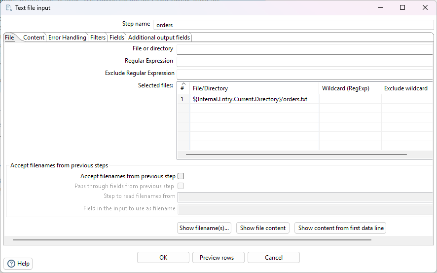
<figcaption>The file</figcaption>
</figure>
</div>

4. On the **Content** tab, set **Separator** to `;`, and keep **Header** selected with **Number of header lines** `1`.
5. Set **Format** to `mixed`.

<div align="center">
<figure>
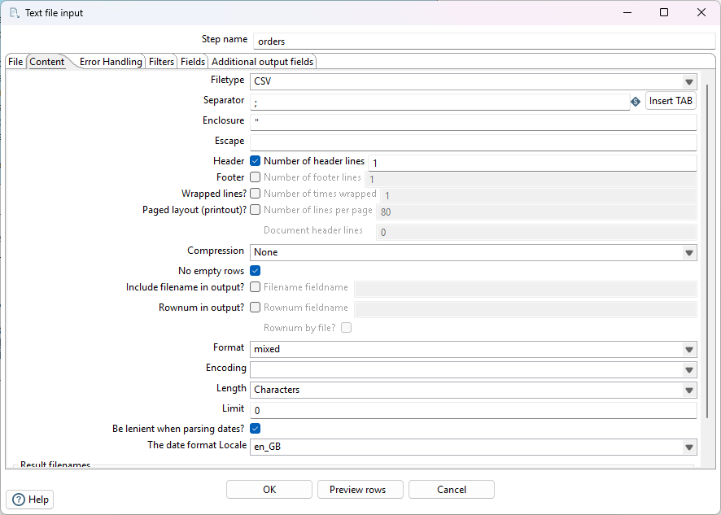
<figcaption>Semicolon separator, one header line</figcaption>
</figure>
</div>

6. On the **Fields** tab, select **Get Fields**. In the **Sample data** dialog, keep `100` in **Number of lines to sample** and select **OK**. Close the **Scan results** window if it opens.
7. Check the grid against this table. The file has only seven products, so the sample reads them all and every length is the longest value in the file:

| Name | Type | Length |
| --- | --- | --- |
| `PRODUCTCODE` | String | `8` |
| `PRODUCTNAME` | String | `36` |
| `PRODUCTLINE` | String | `16` |
| `PRODUCTSCALE` | String | `4` |
| `PRODUCTVENDOR` | String | `25` |
| `PRODUCTDESCRIPTION` | String | `390` |

<div align="center">
<figure>
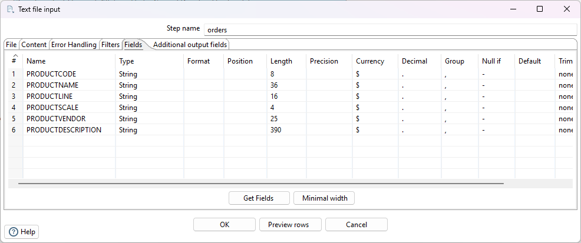
<figcaption>Six String fields</figcaption>
</figure>
</div>

8. Select **Preview rows**, enter `100` rows, and select **OK**. The rows show in **Examine preview data**.

> **Success:** Checkpoint: 7 rows, from `S10_1678`, `1969 Harley Davidson Chopper`, to `S12_1666`, `1958 Setra Bus`.

9. Select **Close**, then select **OK** to close **Text file input**.

### 2. Table output

> **Note:**
>
> #### Table output
> 
> The same step as Workflow 1, with batch updates on.

1. On the **Design** tab, open the **Output** folder and drag **Table output** onto the canvas.
2. Create a hop from **orders** to **Table output**.
3. Double-click **Table output**. Set **Step name** to `stg_orders_merged`.
4. In **Connection**, select `MySQL:sampledata`.
5. Set **Target table** to `STG_ORDERS_MERGED`, and leave **Commit size** at `1000`.
6. Select **Truncate table** and **Specify database fields**.
7. On the **Main options** tab, leave **Use batch update for inserts** selected, as it is by default.

<div align="center">
<figure>
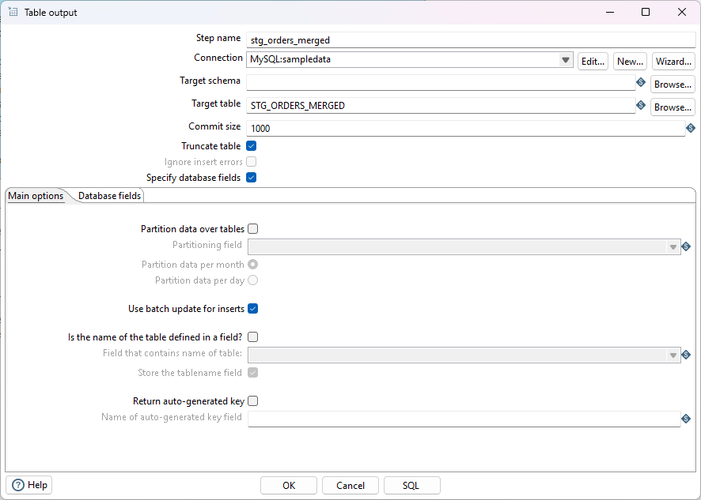
<figcaption>Main options</figcaption>
</figure>
</div>

> **Note:** The screenshot shows an older connection name, `MySQL - sampledata`, and **Truncate table** cleared. Use `MySQL:sampledata` and select **Truncate table**.

8. On the **Database fields** tab, select **Get fields**.

<div align="center">
<figure>
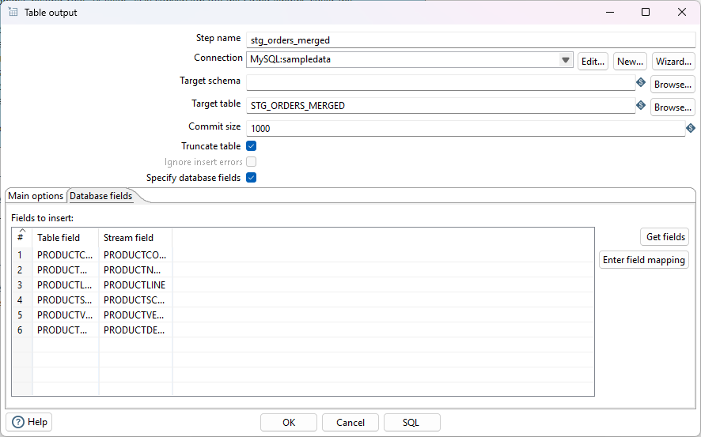
<figcaption>Six fields mapped</figcaption>
</figure>
</div>

9. Select **SQL**. The **Simple SQL editor** opens with a `CREATE TABLE STG_ORDERS_MERGED` statement.

<div align="center">
<figure>
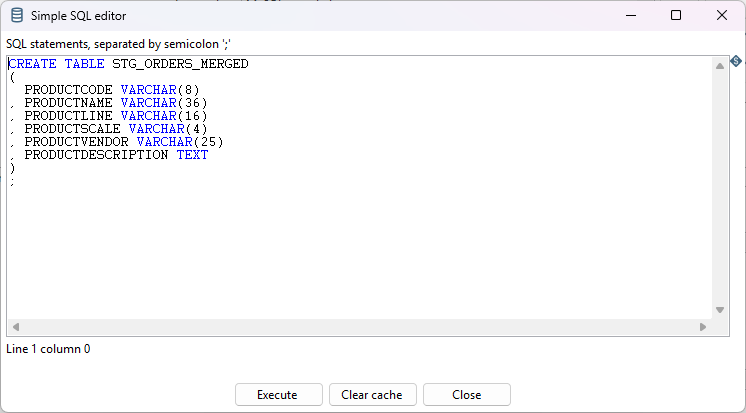
<figcaption>A 390-character string becomes TEXT</figcaption>
</figure>
</div>

> **Success:** Checkpoint: five `VARCHAR` columns, from `PRODUCTCODE VARCHAR(8)` to `PRODUCTVENDOR VARCHAR(25)`, and `PRODUCTDESCRIPTION TEXT`.

10. Select **Execute**. In **Results of the SQL statements**, select **OK**, then select **Close** in the **Simple SQL editor**.
11. Select **OK** to close **Table output**.

### 3. Run

> **Note:**
>
> #### Run and validate
> 
> Run the transformation again: both loads run, side by side.

1. Save the transformation (`Ctrl+S`).
2. Press `F9` (**Action > Run**), and select **Run** in the **Run Options** dialog.
3. In **Execution Results**, open the **Step Metrics** tab.

> **Success:** Checkpoint: **stg_orders_merged** shows 7 in **Output**, and **stg_sales_data** 2,823.

4. In DBeaver, run:

   ```sql
   SELECT * FROM STG_ORDERS_MERGED;
   ```

<div align="center">
<figure>
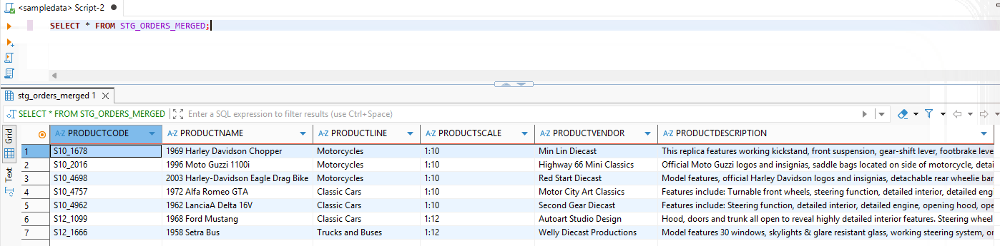
<figcaption>STG_ORDERS_MERGED</figcaption>
</figure>
</div>

> **Success:** Checkpoint: `STG_ORDERS_MERGED` holds 7 rows, `S10_1678` to `S12_1666`, and `STG_SALES_DATA` still holds 2,823.

:::

:::::

## Troubleshooting <!-- no-step -->

<details>

<summary>"No SQL needs to be executed to make this step function properly"</summary>

The table already exists with the same columns. Nothing to do: run the transformation.

</details>

<details>

<summary>The SQL editor shows an ALTER TABLE</summary>

The table exists but its columns differ from the stream. Execute it only if you mean to change the table; otherwise fix the field types or lengths in the input step.

</details>

<details>

<summary>"Data too long for column"</summary>

A string is longer than its column. Increase the field's **Length** in the input step, drop the table and generate the SQL again.

</details>

<details>

<summary>The SQL editor is empty</summary>

Select **Get fields** on the **Database fields** tab first.

</details>

<details>

<summary>The table has twice the rows you expect</summary>

**Truncate table** was clear and the transformation ran twice. Select it, or empty the table with `TRUNCATE TABLE`, and run again.

</details>

## Lab Files

Click a file to download. For `.ktr` and `.kjb` files, **Open in Pentaho Data Integration** launches PDI with the file loaded. If PDI is already running, the path is copied to your clipboard — switch to PDI and press `Ctrl+O`, `Ctrl+V`, `Enter`.

[orders.txt](./files/orders.txt)

[sales_data.csv](./files/sales_data.csv)

### Solution <!-- no-step -->

The finished transformation for this lab. Open it alongside your own to compare, or run to see the expected result.

Also on disk at `C:\Workshop-DI-Practitioner\03-data-sources\02-databases\14-mod3-writing-to-a-database\solution`.

[tr_write_database.ktr](./files/tr_write_database.ktr) <button data-launch="spoon" data-path="files/tr_write_database.ktr">Open in Pentaho Data Integration</button> <button data-graph="files/tr_write_database.ktr">View graph</button>
