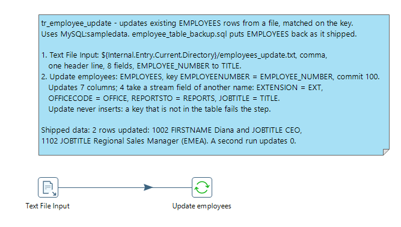
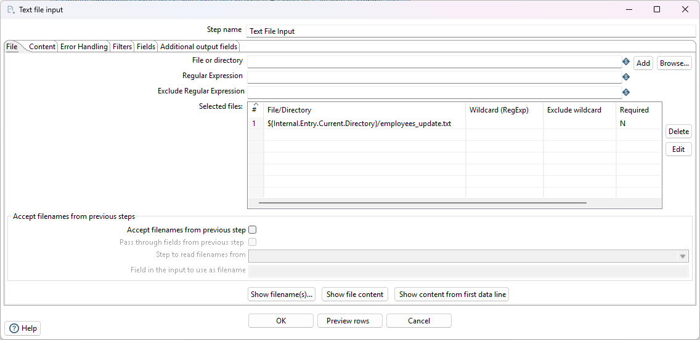
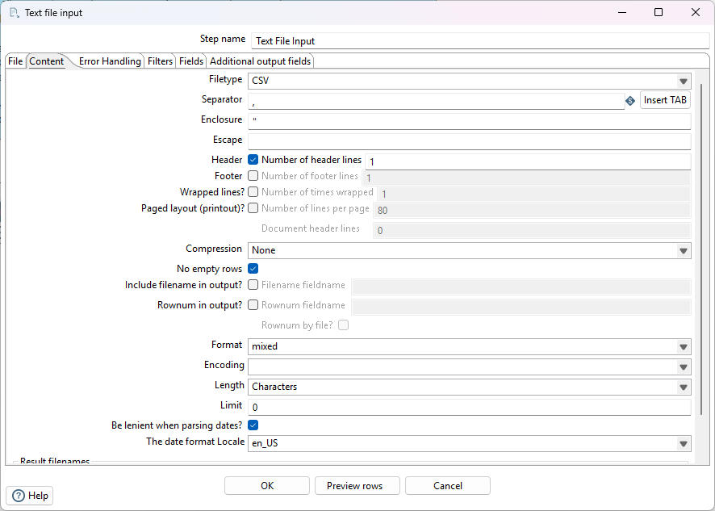
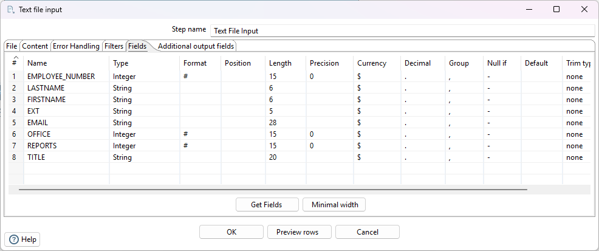
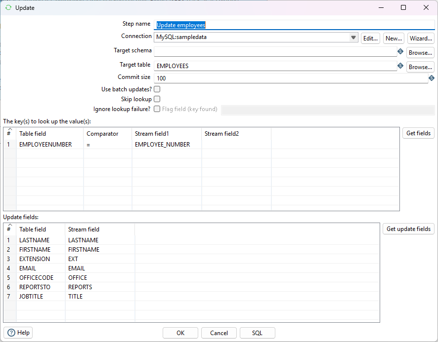
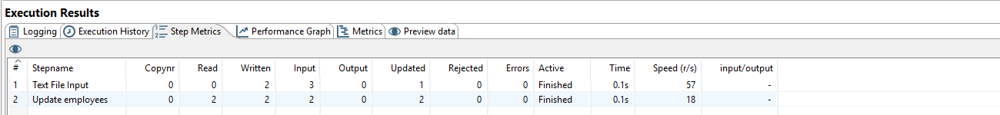
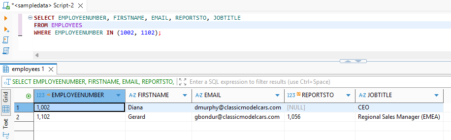

# Table Update

> **Warning:**
>
> #### Workshop - Table Update
> 
> Update existing rows in `EMPLOYEES` from a file, matching on the employee number.\
> Two employees change: a first name and two job titles.
> 
> **What you’ll do**
> 
> * Read the changes with **Text file input**
> * Update the matching rows with **Update**
> * Map stream fields to table columns whose names differ
> * Check the changes with SQL
> 
> **Prerequisites**
> 
> * The `MySQL:sampledata` connection from [Connecting to Database](../12-mod3-connecting-to-database/guide.md)
> * Primary keys: `EMPLOYEENUMBER` identifies an employee
> 
> **Estimated time:** 25 minutes

<figure>



<div align="center">
<figcaption><em>What you build</em></figcaption>
</div>
</figure>

> **Note:** **Create a new transformation**
> 
> Select **File > New > Transformation**, or press `Ctrl+N` (`Cmd+N` on macOS). Save it as `tr_employee_update.ktr` in the lab folder, `C:\Workshop-DI-Practitioner\03-data-sources\02-databases\15-mod3-table-update`, next to `employees_update.txt`.

:::: tabs

### 1. Text file input

> **Note:**
>
> #### Text file input
> 
> Read the changes from `employees_update.txt`: a header line and two employees.

1. Start Spoon.

::: tabs

### Windows (PowerShell)

> 
> ```powershell
> Set-Location C:\Pentaho\design-tools\data-integration
> .\spoon.bat
> ```
> 
>

### macOS / Linux

> 
> ```bash
> cd ~/Pentaho/design-tools/data-integration
> ./spoon.sh
> ```
> 
>

:::

<button data-launch="spoon" data-path="">Start PDI</button>

2. From the **Input** folder, drag **Text file input** onto the canvas.
3. Double-click the step. On the **File** tab, in **File or directory**, enter the path below and select **Add**:

   ```text
   ${Internal.Entry.Current.Directory}/employees_update.txt
   ```

<figure><figcaption><p>The file</p></figcaption></figure>

4. On the **Content** tab, set **Separator** to `,` and keep **Header** selected, with **Number of header lines** `1`.

<figure><figcaption><p>Comma separator, one header line</p></figcaption></figure>

5. On the **Fields** tab, select **Get Fields**, then **OK** at the number of sample lines, and close the **Scan results**.
6. Check the eight fields: `EMPLOYEE_NUMBER`, `LASTNAME`, `FIRSTNAME`, `EXT`, `EMAIL`, `OFFICE`, `REPORTS` and `TITLE`. `EMPLOYEE_NUMBER`, `OFFICE` and `REPORTS` are Integer; the rest are String.

   Four names differ from the table's columns: `EXT` is `EXTENSION`, `OFFICE` is `OFFICECODE`, `REPORTS` is `REPORTSTO` and `TITLE` is `JOBTITLE`. You map them in the next step.

<figure><figcaption><p>Eight fields</p></figcaption></figure>

7. Select **Preview rows**, then **OK**.
8. Close the preview and select **OK**.

> **Success:** Checkpoint: the preview shows 2 rows, employees `1002` and `1102`. `REPORTS` is empty for `1002`: the CEO reports to no one.

### 2. Update

> **Note:**
>
> #### Update
> 
> **Update** changes existing rows only.\
> For each incoming row it looks the key up in the table. A row whose key isn't found fails the step, unless **Ignore lookup failure?** is selected.

> **Note:** To insert the rows that aren't there yet as well, use **Insert / update**, in [Table Insert - Update](../16-mod3-table-insert-update/guide.md).

1. From the **Output** folder, drag **Update** onto the canvas.
2. Hop **Text file input** to **Update**.
3. Double-click the step and set:
   * **Step name**: `Update employees`
   * **Connection**: `MySQL:sampledata`
   * **Target table**: `EMPLOYEES`
   * **Commit size**: `100`
4. In **The key(s) to look up the value(s)**, enter one row:

| Table field      | Comparator | Stream field1     |
| ---------------- | ---------- | ----------------- |
| `EMPLOYEENUMBER` | `=`        | `EMPLOYEE_NUMBER` |

5. Under **Update fields**, select **Get update fields**. PDI adds one row per stream field, with the table field named the same.
6. Make the list match the table. Delete the `EMPLOYEE_NUMBER` row (the key stays as it is) and correct the four names that differ:

| Table field  | Stream field |
| ------------ | ------------ |
| `LASTNAME`   | `LASTNAME`   |
| `FIRSTNAME`  | `FIRSTNAME`  |
| `EXTENSION`  | `EXT`        |
| `EMAIL`      | `EMAIL`      |
| `OFFICECODE` | `OFFICE`     |
| `REPORTSTO`  | `REPORTS`    |
| `JOBTITLE`   | `TITLE`      |

<figure><figcaption><p>Key and update fields</p></figcaption></figure>

> **Note:** The screenshot still lists `EMPLOYEENUMBER` as the first update field. It does no harm, since it sets the key to its own value, but leave it out.

7. Select **OK**.

### 3. Run and validate

> **Note:**
>
> #### Run and validate
> 
> Run the transformation, then check the changes in the database.

1. Save the transformation, select **Run** in the toolbar, then **Run** in **Run Options**.
2. In **Execution Results**, open **Step Metrics**.

<figure><figcaption><p>2 rows updated</p></figcaption></figure>

> **Success:** Checkpoint: **Update employees** shows 2 in **Updated**. (The 1 under **Updated** for **Text File Input** is not a database update.)

3. In your database tool, check the two rows:

   ```sql
   SELECT EMPLOYEENUMBER, FIRSTNAME, EMAIL, REPORTSTO, JOBTITLE
   FROM EMPLOYEES
   WHERE EMPLOYEENUMBER IN (1002, 1102);
   ```

<figure><figcaption><p>The updated employees</p></figcaption></figure>

> **Note:** The screenshot shows `REPORTSTO` `1000` for Diana, from an older copy of the file. Employee `1000` doesn't exist, so the file now leaves it empty and yours shows `NULL`.

> **Success:** Checkpoint: these values changed. Every other column already matched the file, so it stayed as it was.
>
> | `EMPLOYEENUMBER` | Column      | Before                | After                           |
> | ---------------- | ----------- | --------------------- | ------------------------------- |
> | `1002`           | `FIRSTNAME` | `Diane`               | `Diana`                         |
> | `1002`           | `JOBTITLE`  | `President`           | `CEO`                           |
> | `1102`           | `JOBTITLE`  | `Sale Manager (EMEA)` | `Regional Sales Manager (EMEA)` |

4. Run the transformation again. **Updated** is now 0.

> **Under the hood:**
>
> #### Two statements per row: a lookup, then an UPDATE only if something changed
>
> For each of the two incoming rows the **Update** step first ran a
> `SELECT` on `EMPLOYEES` by `EMPLOYEENUMBER`, fetched the current
> values of the update fields, and compared them with the stream. Only
> where a value differed did it issue `UPDATE ... WHERE EMPLOYEENUMBER
> = ?`. That is why the second run updated nothing: every row was read,
> compared and skipped.
>
> **Skip lookup** turns that comparison off: with it selected, the step
> fires the `UPDATE` for every row, halving the round trips at the cost
> of touching rows that didn't need it (and firing any last-modified
> triggers on them).
>
> **Why it matters:** **Updated** in Step Metrics counts rows that
> *changed*, so re-running this transformation is safe. Loads that can
> run twice with the same result (idempotent loads) are the ones you
> can schedule without fear.

> **Tip:** To repeat this workshop or the next one from the start, run `employee_table_backup.sql` from **Lab Files** in your database tool. It puts `EMPLOYEES` back as it shipped.

::::

<details>

<summary>Troubleshooting</summary>

**Updated is 0 on the first run**\
The table already holds the file's values: the workshop ran before. Run `employee_table_backup.sql` and run again.

**The step fails with a lookup error**\
A key in the file isn't in the table. **Update** never inserts; select **Ignore lookup failure?** to skip such rows, or use **Insert / update**.

**Data type errors on update**\
`EMPLOYEE_NUMBER` must be an Integer, like `EMPLOYEENUMBER`. Fix its type on the **Fields** tab of **Text file input**.

**Unknown column errors**\
A **Table field** still has a stream name, such as `EXT` or `TITLE`. Correct it to the table's column name.

</details>

## Lab Files

Click a file to download. For `.ktr` and `.kjb` files, **Open in Pentaho Data Integration** launches PDI with the file loaded. If PDI is already running, the path is copied to your clipboard — switch to PDI and use Ctrl+O, Ctrl+V, Enter.

`employee_table_backup.sql` puts `EMPLOYEES` back as it shipped (23 rows). Run it in your database tool (Adminer or DBeaver) to repeat this workshop or the next one.

[employee_table_backup.sql](./files/employee_table_backup.sql)

[employees_update.txt](./files/employees_update.txt)

### Solution <!-- no-step -->

The finished transformation for this lab. Open it alongside your own to compare, or run to see the expected result.

Also on disk at `C:\Workshop-DI-Practitioner\03-data-sources\02-databases\15-mod3-table-update\solution`.

[tr_employee_update.ktr](./files/tr_employee_update.ktr) <button data-launch="spoon" data-path="files/tr_employee_update.ktr">Open in Pentaho Data Integration</button> <button data-graph="files/tr_employee_update.ktr">View graph</button>
