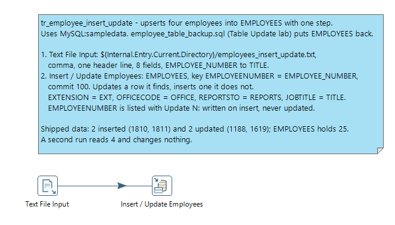
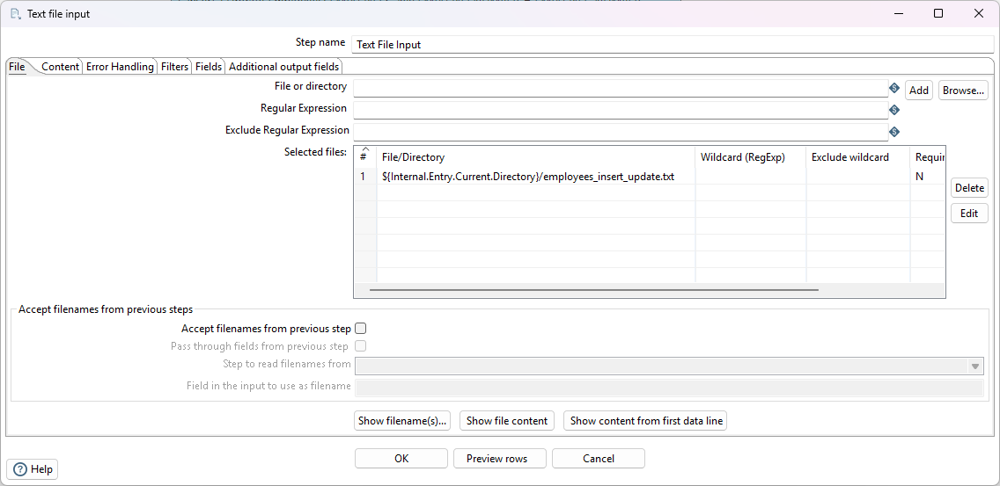
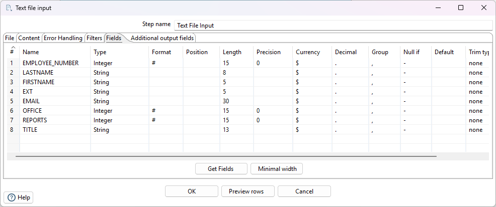
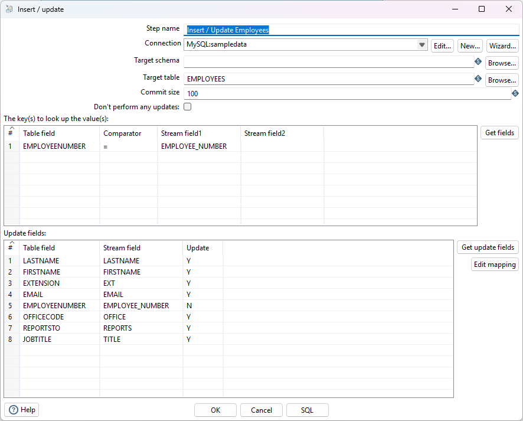
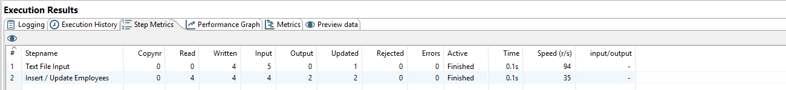
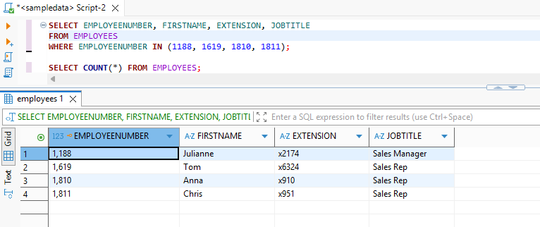

# Table Insert - Update

> **Warning:**
>
> #### Workshop - Table Insert - Update
>
> Apply a file of employees to the `EMPLOYEES` table. Two are already in the table and two are new. One step handles both: it updates the rows it finds and inserts the rest. This is an **upsert**.
>
> **What you'll do**
>
> * Read the employee feed with **Text file input**
> * Upsert into `EMPLOYEES` with **Insert / update**
> * Decide which columns an update may change
> * Check the inserted and updated rows with SQL
>
> **Prerequisites:**
>
> * [Table Update](../15-mod3-table-update/guide.md): the same file layout and field mapping
> * The `MySQL:sampledata` connection from [Connecting to Database](../12-mod3-connecting-to-database/guide.md)
> * DBeaver (or Adminer on a lab VM), connected to `sampledata` as `pentaho_admin`
>
> **Estimated time:** 25 minutes

<div align="center">
<figure>

<figcaption>What you build</figcaption>
</figure>
</div>

:::: tabs

### 1. Text file input

> **Note:**
>
> #### Text file input
>
> Read the feed from `employees_insert_update.txt`: a header line and four employees. It has the same columns as the Table Update file.

1. Start Spoon with the **Start PDI** button below, or from PowerShell:

```powershell
Set-Location C:\Pentaho\design-tools\data-integration
.\spoon.bat
```

<button data-launch="spoon" data-path="">Start PDI</button>

2. Select **File > New > Transformation** (`Ctrl+N`).
3. Select **File > Save as** and save it as `tr_employee_insert_update.ktr` in `C:\Workshop-DI-Practitioner\03-data-sources\02-databases\16-mod3-table-insert-update`, the folder that holds `employees_insert_update.txt`.
4. On the **Design** tab, open the **Input** folder and drag **Text file input** onto the canvas.
5. Double-click **Text file input**.
6. Set **Step name** to `Text File Input`.
7. On the **File** tab, enter `${Internal.Entry.Current.Directory}/employees_insert_update.txt` in **File or directory** and select **Add**. The path moves to **Selected files**.

<div align="center">
<figure>

<figcaption>The file</figcaption>
</figure>
</div>

8. On the **Content** tab, set **Separator** to `,` and **Format** to `mixed`. Leave **Header** selected, with **Number of header lines** `1`.

<div align="center">
<figure>

<figcaption>Comma separator, one header line</figcaption>
</figure>
</div>

9. On the **Fields** tab, select **Get Fields**. Spoon asks for the number of lines to sample: select **OK**, then close **Scan results**.
10. Compare the **Fields** grid with this table. Keep the lengths that **Get Fields** detected.

| Name              | Type    | Format |
| ----------------- | ------- | ------ |
| `EMPLOYEE_NUMBER` | Integer | `#`    |
| `LASTNAME`        | String  |        |
| `FIRSTNAME`       | String  |        |
| `EXT`             | String  |        |
| `EMAIL`           | String  |        |
| `OFFICE`          | Integer | `#`    |
| `REPORTS`         | Integer | `#`    |
| `TITLE`           | String  |        |

<div align="center">
<figure>

<figcaption>Eight fields</figcaption>
</figure>
</div>

11. Select **Preview rows**, enter `100` rows, and select **OK**. The rows show in **Examine preview data**.

> **Success:** Checkpoint: **Examine preview data** shows 4 rows: employees `1188`, `1619`, `1810` and `1811`.

12. Select **Close**, then select **OK** to close **Text File Input**.

### 2. Insert / update

> **Note:**
>
> #### Insert / update
>
> **Insert / update** looks each row up by its key. A row it finds is updated; a row it doesn't find is inserted.

1. On the **Design** tab, open the **Output** folder and drag **Insert / update** onto the canvas.
2. Create a hop from **Text File Input** to **Insert / update**: hold `Shift` and drag from one step to the other.
3. Double-click **Insert / update**.
4. Set **Step name** to `Insert / Update Employees`.
5. Set **Connection** to `MySQL:sampledata`, **Target table** to `EMPLOYEES` and **Commit size** to `100`.
6. Fill **The key(s) to look up the value(s)** grid with one row:

| Table field      | Comparator | Stream field1     |
| ---------------- | ---------- | ----------------- |
| `EMPLOYEENUMBER` | `=`        | `EMPLOYEE_NUMBER` |

7. Under **Update fields**, select **Get update fields**. Spoon adds one row per stream field, with the table field named the same.
8. Correct the four **Table field** names that differ and the key's name, and set **Update** to `N` for `EMPLOYEENUMBER`, so the grid matches this table. The order of the rows doesn't matter.

| Table field          | Stream field      | Update  |
| -------------------- | ----------------- | ------- |
| `LASTNAME`           | `LASTNAME`        | `Y`     |
| `FIRSTNAME`          | `FIRSTNAME`       | `Y`     |
| **`EXTENSION`**      | `EXT`             | `Y`     |
| `EMAIL`              | `EMAIL`           | `Y`     |
| **`EMPLOYEENUMBER`** | `EMPLOYEE_NUMBER` | **`N`** |
| **`OFFICECODE`**     | `OFFICE`          | `Y`     |
| **`REPORTSTO`**      | `REPORTS`         | `Y`     |
| **`JOBTITLE`**       | `TITLE`           | `Y`     |

<div align="center">
<figure>

<figcaption>Key and update fields</figcaption>
</figure>
</div>

> **Warning:** Keep `EMPLOYEENUMBER` in **Update fields**. This step builds its `INSERT` from that list, so without it the new employees have no employee number and MySQL rejects them: "Field 'EMPLOYEENUMBER' doesn't have a default value". **Update** `N` means the column is written on insert and never changed on update.

9. Select **OK**.

### 3. Run and validate

> **Note:**
>
> #### Run and validate
>
> Run the transformation, then check the results in the database. To repeat this workshop from the start, run `employee_table_backup.sql` from the [Table Update](../15-mod3-table-update/guide.md) Lab Files in DBeaver: it puts `EMPLOYEES` back as it shipped, 23 rows.

1. Save the transformation (`Ctrl+S`).
2. Press `F9` (**Action > Run**), and select **Run** in the **Run Options** dialog.
3. In **Execution Results**, open the **Step Metrics** tab.

<div align="center">
<figure>

<figcaption>2 inserted, 2 updated</figcaption>
</figure>
</div>

> **Success:** Checkpoint: **Insert / Update Employees** shows 2 in **Output** (the inserts, `1810` and `1811`) and 2 in **Updated** (`1188` and `1619`).

4. In DBeaver, run:

   ```sql
   SELECT EMPLOYEENUMBER, FIRSTNAME, EXTENSION, JOBTITLE
   FROM EMPLOYEES
   WHERE EMPLOYEENUMBER IN (1188, 1619, 1810, 1811);

   SELECT COUNT(*) FROM EMPLOYEES;
   ```

<div align="center">
<figure>

<figcaption>Two updated, two new</figcaption>
</figure>
</div>

> **Success:** Checkpoint: `EMPLOYEES` holds 25 rows, 2 more than it shipped with.
>
> | `EMPLOYEENUMBER` | What happened                                                                      |
> | ---------------- | ---------------------------------------------------------------------------------- |
> | `1188`           | Updated: `Julie` is now **`Julianne`**, extension **`x2174`**, **`Sales Manager`** |
> | `1619`           | Updated: extension `x103` is now **`x6324`**                                       |
> | `1810`           | **Inserted**: Anna Lundberg, `Sales Rep`                                           |
> | `1811`           | **Inserted**: Chris Schulz, `Sales Rep`                                            |

5. Run the transformation again: press `F9` (**Action > Run**), and select **Run** in the **Run Options** dialog.

> **Under the hood:**
>
> #### Insert / update isn't a MERGE statement
>
> MySQL has `INSERT ... ON DUPLICATE KEY UPDATE`; other databases have
> `MERGE`. This step uses neither, because it has to behave the same on
> all of them. Per row it runs a `SELECT` on the key, then one of three
> things: no match, an `INSERT`; a match with a differing value, an
> `UPDATE`; a match with identical values, nothing. Every decision is
> made in the engine, one row and one pair of round trips at a time.
>
> That is also why the key must be unique in the table. If two rows
> match, the lookup returns two, and the step cannot know which one you
> meant.
>
> **Why it matters:** for a daily feed of thousands of rows this is
> exactly right: simple, portable and safe to re-run. For millions,
> the per-row lookup dominates. Load to a staging table with **Table
> output** and let one SQL `MERGE` do the rest.

6. In **Execution Results**, open the **Step Metrics** tab.

> **Success:** Checkpoint: **Insert / Update Employees** shows 4 in **Read**, and 0 in both **Output** and **Updated**: every row is found, and nothing differs.

::::

## Troubleshooting <!-- no-step -->

<details>
<summary>"Field 'EMPLOYEENUMBER' doesn't have a default value"</summary>

`EMPLOYEENUMBER` is missing from **Update fields**. Add it back with **Update** `N`.

</details>

<details>
<summary>Output is 0 on the first run</summary>

All four employees are already in the table: the workshop ran before. Run `employee_table_backup.sql` in DBeaver, then run the transformation again.

</details>

<details>
<summary>A "Duplicate entry '1188'" error</summary>

The step tried to insert an employee who already exists, so the lookup didn't find them. Check the key row: **Table field** `EMPLOYEENUMBER`, **Comparator** `=`, **Stream field1** `EMPLOYEE_NUMBER`. **Table output** gives the same error, because it only inserts.

</details>

## Lab Files

Click a file to download. For `.ktr` and `.kjb` files, **Open in Pentaho Data Integration** launches PDI with the file loaded. If PDI is already running, the path is copied to your clipboard — switch to PDI and press `Ctrl+O`, `Ctrl+V`, `Enter`.

[employees_insert_update.txt](./files/employees_insert_update.txt)

### Solution <!-- no-step -->

The finished transformation for this lab. Open it alongside your own to compare, or run to see the expected result.

Also on disk at `C:\Workshop-DI-Practitioner\03-data-sources\02-databases\16-mod3-table-insert-update\solution`.

[tr_employee_insert_update.ktr](./files/tr_employee_insert_update.ktr) <button data-launch="spoon" data-path="files/tr_employee_insert_update.ktr">Open in Pentaho Data Integration</button> <button data-graph="files/tr_employee_insert_update.ktr">View graph</button>
